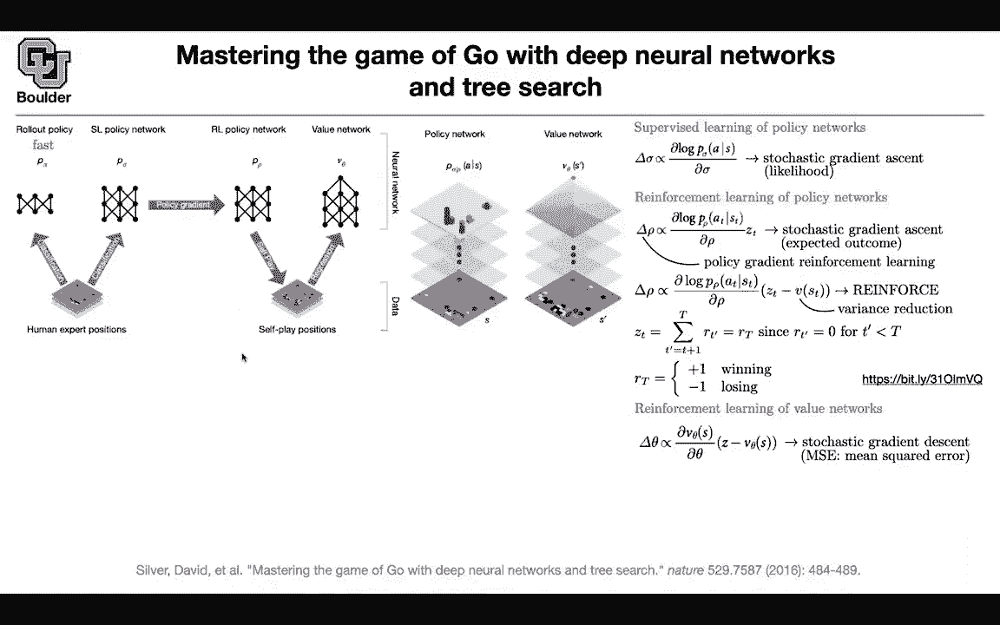

# 178：L79.2 - AlphaGo 🎮

在本节课中，我们将学习如何使用神经网络来掌握围棋游戏。我们将从模仿学习开始，逐步深入到强化学习策略，并最终了解AlphaGo在实战中如何做出决策。

---

## 模仿学习：从人类专家数据开始

上一节我们介绍了Q学习和深度Q学习等框架。本节中，我们来看看AlphaGo的第一个关键组成部分：模仿学习。

我们首先需要收集人类围棋高手对弈的数据。目标是训练一个监督学习策略网络，其目标是最大化预测人类下一步落子位置的概率。

*   **输入**：棋盘状态，通常表示为图像或图像堆栈。
*   **输出**：一个在棋盘所有可能落子点上的概率分布。我们会排除不合法的落子点，剩下的就是我们的动作空间。
*   **训练目标**：调整神经网络的参数，使得在给定状态 `S` 下，网络预测人类真实落子动作 `a` 的概率最大。

我们用 `P_σ` 表示这个监督学习策略网络，其中 `σ` 是网络参数。其目标函数是最大似然估计。

---

## 策略网络与价值网络

在AlphaGo中，我们主要关心三个神经网络：监督学习策略网络、强化学习策略网络和价值网络。

以下是它们的核心功能：

*   **策略网络**：无论监督学习还是强化学习，策略网络都接收棋盘状态（图像）作为输入，输出每个合法落子点的概率。其公式可以表示为 `P(a | S)`。
*   **价值网络**：价值网络评估给定棋盘状态 `S` 的胜率。它输出一个单一数值 `V(S)`，表示从该状态出发最终获胜的概率。

---

## 强化学习策略优化

在通过模仿学习初始化策略网络后，我们进入强化学习阶段，通过自我对弈来进一步提升策略。

我们使用策略梯度方法（REINFORCE算法）来优化强化学习策略网络 `P_ρ`。其核心思想是：增加带来高回报动作的概率，减少带来低回报动作的概率。

在围棋中，奖励 `Z` 非常稀疏（只有终局时获胜为+1，失败为-1）。直接使用 `Z` 会导致梯度估计方差很高。为了降低方差，我们引入一个基线（baseline），通常使用价值网络的输出 `V(S)`。更新公式如下：

`梯度 ∝ (Z - V(S)) * ∇ log P_ρ(a | S)`

这个公式的含义是：我们不仅看动作的绝对好坏（`Z`），更看它相对于当前状态平均价值 `V(S)` 的相对优势（`Z - V(S)`）。

---

## 价值网络的训练

价值网络 `V_θ` 通过均方误差损失函数进行训练。我们使用自我对弈的最终结果 `Z` 作为目标值。

损失函数为：`L = (Z - V_θ(S))²`

通过最小化这个损失，价值网络学会准确预测从状态 `S` 出发的预期胜率。

---

## 实战决策：蒙特卡洛树搜索

当所有网络训练完成后，AlphaGo在实战中并非直接使用策略网络落子，而是结合了蒙特卡洛树搜索。

以下是蒙特卡洛树搜索的四个步骤：

1.  **选择**：从根节点（当前棋盘状态）开始，递归地选择子节点，直到到达一个未完全展开的节点。选择的标准是最大化一个“上限置信区间”分数：
    `Q(s, a) + U(s, a)`
    其中 `U(s, a) ∝ P_σ(a|s) / (1 + N(s, a))`。`P_σ` 来自监督学习策略网络，提供先验概率；`N(s, a)` 是访问次数，鼓励探索访问少的边。

2.  **扩展**：当遇到一个未展开的节点（即该状态下的某些合法动作从未被模拟过）时，根据策略网络 `P_σ` 的概率分布，创建一个或多个新的子节点。

3.  **评估**：对于新扩展的叶子节点，我们通过两种方式评估：
    *   使用价值网络 `V_θ` 直接计算该状态的胜率 `v`。
    *   使用一个**快速走子策略**（一个简单但快速的策略网络）从该状态模拟到终局，得到胜败结果 `z`。
    最终的叶子节点价值是这两者的加权平均：`V_leaf = λ * v + (1 - λ) * z`

4.  **回溯更新**：将叶子节点的评估价值 `V_leaf` 沿着选择路径反向传播，更新路径上所有边 `(s, a)` 的访问次数 `N(s, a)` 和动作价值 `Q(s, a)`。`Q(s, a)` 通常是所有模拟中该边后续价值的平均值。

当分配的思考时间（如1分钟）用尽后，算法选择根节点下访问次数 `N` 最多的动作作为最终的落子决定。

---

## 总结

本节课中我们一起学习了AlphaGo的核心原理：

1.  首先通过**模仿学习**，利用人类棋谱数据训练一个监督学习策略网络 `P_σ`。
2.  然后通过**强化学习**和自我对弈，训练一个更强的策略网络 `P_ρ` 和一个价值网络 `V_θ`。训练中使用策略梯度方法和价值基线来降低方差。
3.  在实战决策时，结合训练好的网络（`P_σ` 和 `V_θ`）与**蒙特卡洛树搜索**，通过选择、扩展、评估、回溯四个步骤，在思考时间内进行大量模拟，最终选出最优落子点。

这种方法将深度神经网络的感知能力与树搜索的规划能力相结合，是AlphaGo成功击败人类顶尖棋手的关键。