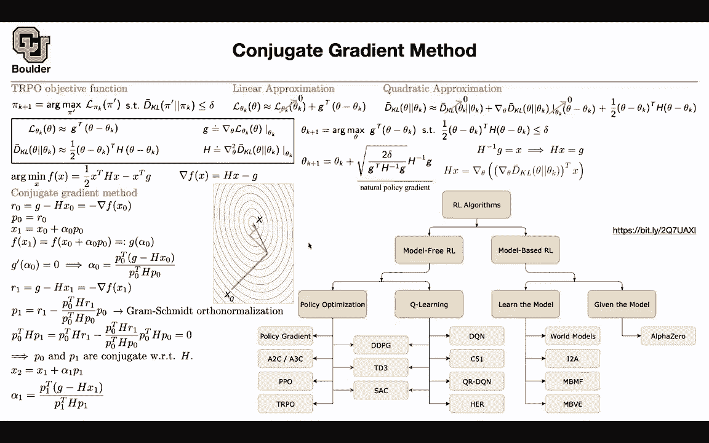
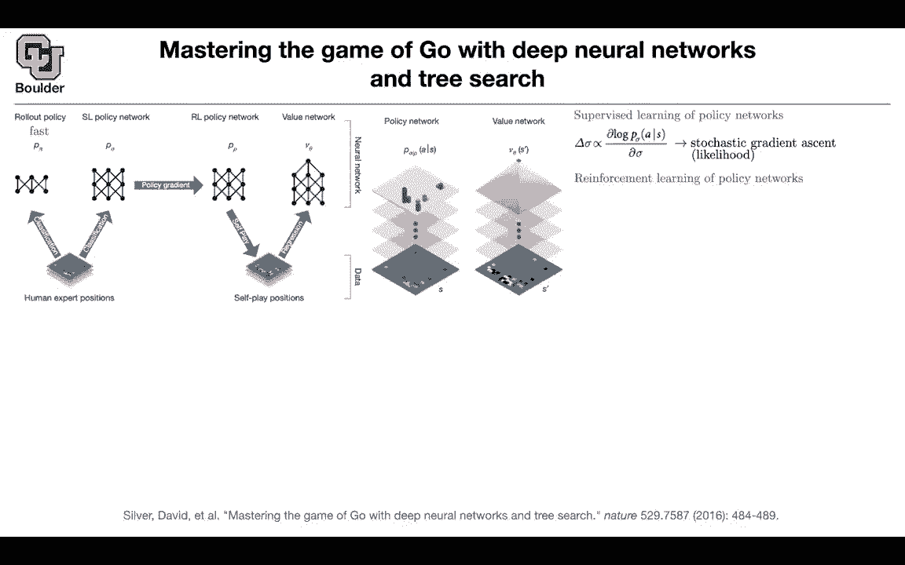
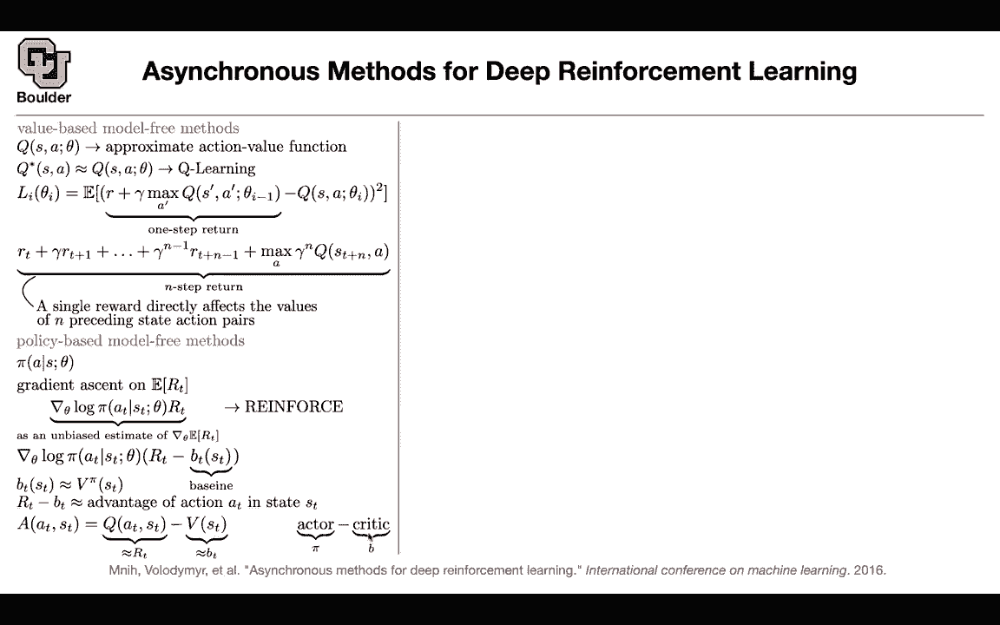
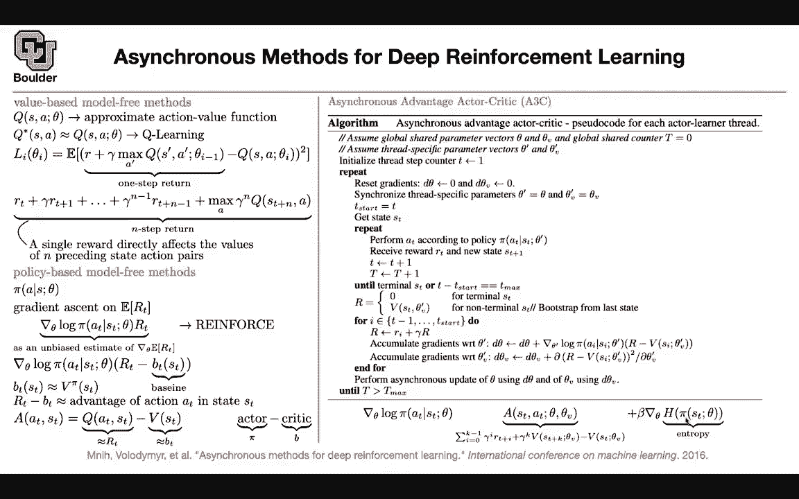

# 181：L80.3 - A3C算法 🧠

在本节课中，我们将学习**异步优势行动者-评论家算法**。这是一种结合了策略梯度和价值函数估计的深度强化学习方法，通过并行运行多个智能体来加速学习过程。

---

## 📚 概述回顾

上一节我们介绍了策略梯度方法。本节中，我们将转向**深度强化学习的异步方法**。

其核心思想是：不再让单个智能体与环境交互，直到游戏结束，而是并行生成多个智能体与环境交互，并共同优化一个共享的策略参数集。

以下是之前内容的快速回顾：

*   **基于价值的无模型方法**：你有一个通过神经网络近似的 **Q 函数**，这被称为 Q 学习或深度 Q 学习。我们使用贝尔曼方程将强化学习问题转化为监督学习问题。目标是学习这个 Q 函数，并使用未来的一步回报。
*   **基于策略的无模型方法**：你直接对策略进行建模，例如使用神经网络。目标函数不再是来自贝尔曼方程，而是最大化期望奖励或最小化期望成本。一个简单的版本是 **REINFORCE 算法**。

---

## 🔄 从策略梯度到优势函数

REINFORCE 算法通过蒙特卡洛采样来估计目标函数的梯度，但这种方法方差很高。为了降低方差，我们引入了一个**基线**。

具体做法是，从总回报 `Rt` 中减去一个基线值。这个基线可以是任何不依赖于当前动作的函数，例如状态价值函数 `V(s)`。这样得到的差值 `Rt - V(s)` 被称为**优势函数** `A(s, a)`，它衡量了在状态 `s` 下采取动作 `a` 相比平均动作有多好。

优势函数的定义公式为：
`A(s, a) = Q(s, a) - V(s)`

---

## 🎭 行动者-评论家框架

我们今天要介绍的框架叫做**行动者-评论家**。

*   **行动者**：基于你的策略 `π`。它负责根据策略采取行动。
*   **评论家**：基于你的价值函数 `V`。它负责评估行动者采取的行动。

这个框架将策略更新（行动者）和价值函数估计（评论家）结合起来。

---

## ⚡ 异步优势行动者-评论家算法

A3C 算法的核心思想是：在环境中并行生成多个行动者，让它们异步地与环境交互，并异步地更新一个**共享的全局策略参数**。

以下是算法的主要步骤：

1.  **初始化全局参数**：设定全局共享的策略参数 `θ` 和价值函数参数 `θv`。设定一个最大步数计数器 `T_max`。
2.  **创建并行线程**：每个计算线程都是一个独立的智能体（行动者）。每个线程拥有从全局参数复制而来的本地策略参数和本地价值函数参数。
3.  **交互与收集数据**：每个线程独立地与自己的环境副本进行交互，执行动作，收集奖励，并记录状态序列，直到达到终止状态或步数超过 `t_max`。
4.  **计算回报与优势**：从最后一步开始，反向计算每一步的累积回报 `R`。对于非终止状态，`R` 等于当前奖励加上折扣后的下一状态价值估计。优势函数通过 `A = R - V(s)` 计算。
5.  **计算损失并更新**：
    *   **评论家损失**：最小化价值函数的预测误差，损失函数为 `(R - V(s))^2`。
    *   **行动者损失**：最大化策略的期望优势，梯度项为 `▽ log π(a|s) * A`。
    *   （可选）可以添加一个**策略熵项** `β * ▽H(π(.|s))` 来鼓励探索，防止策略过早收敛。
6.  **异步更新全局参数**：每个线程计算完梯度后，异步地将梯度更新应用到全局共享参数 `θ` 和 `θv` 上。
7.  **循环**：线程重置本地参数，重新开始与环境交互，重复上述过程。

---

## 🎯 总结

本节课中，我们一起学习了 **A3C 算法**。

我们从策略梯度方法出发，引入了**优势函数**来降低梯度估计的方差。接着，我们介绍了**行动者-评论家框架**，它将策略学习和价值评估相结合。最后，我们详细讲解了 **A3C 算法**的核心流程，它通过并行运行多个智能体并异步更新共享参数，极大地提高了数据采集效率和训练速度。

A3C 是深度强化学习中一个非常重要且高效的算法，为后续许多研究奠定了基础。