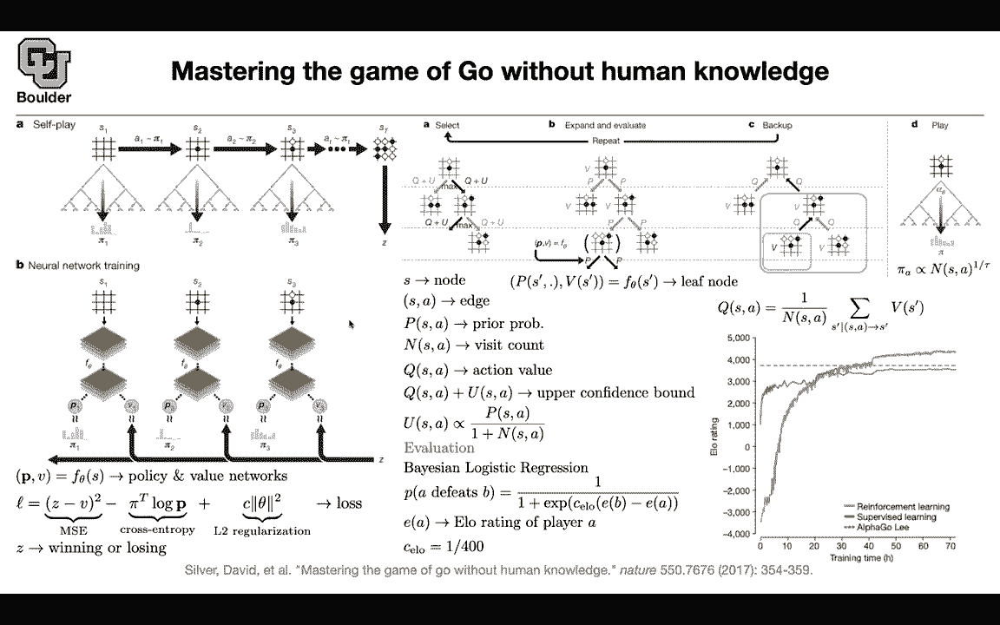
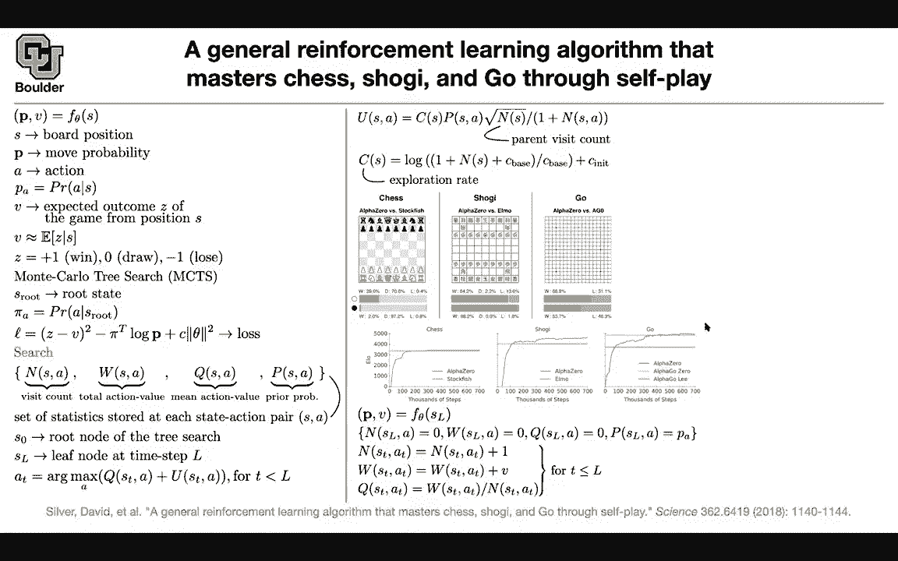

# 187：L82.2 - AlphaZero 🧠♟️

在本节课中，我们将学习AlphaZero算法。这是一种强大的模型，能够通过自我对弈掌握围棋、国际象棋和将棋等多种游戏。我们将了解其核心工作原理，包括神经网络结构、蒙特卡洛树搜索过程，以及如何在没有人类数据的情况下进行训练。

---

## 概述



AlphaZero采用与上一节介绍的AlphaGo Zero相同的方法论，但其目标是验证同一套方法能否解决不同的问题，例如国际象棋和将棋。其核心是一个神经网络，它接收游戏状态作为输入，并输出动作的概率分布以及对该状态的评估值。

---

## 神经网络架构

与围棋类似，我们使用一个神经网络。该网络以棋盘状态（通常表示为图像）作为输入，并输出两个部分：
1.  **动作概率向量 `P`**：表示在当前状态下选择每个合法动作的概率。
2.  **状态价值 `V`**：表示从当前状态出发的预期游戏结果。

对于国际象棋，结果可能是赢、输或和棋，因此 `V` 代表期望结果值。神经网络的训练目标是让 `V` 逼近游戏的真实结果 `Z`，让 `P` 逼近通过搜索得到的最佳策略 `π`。

**公式表示：**
*   输入：状态 `s`（棋盘图像）
*   输出：`(P, V) = f_θ(s)`
*   目标：`V ≈ Z`， `P ≈ π`

---

## 蒙特卡洛树搜索（MCTS）过程

为了生成训练神经网络所需的数据，我们从根状态开始进行蒙特卡洛树搜索。搜索过程会为树中的每条边（对应状态-动作对）维护以下统计信息：
*   **访问次数 `N(s, a)`**：该边被访问的总次数。
*   **总动作价值 `W(s, a)`**：通过该边所有模拟的累计价值。
*   **平均动作价值 `Q(s, a)`**：`Q = W / N`。
*   **先验概率 `P(s, a)`**：来自神经网络的原始概率。

以下是选择动作的具体公式。在搜索时，我们选择能最大化以下置信上限 `U` 的动作：

**选择公式：**
`U(s, a) = Q(s, a) + c_puct * P(s, a) * sqrt(Σ_b N(s, b)) / (1 + N(s, a))`

其中：
*   `c_puct` 是一个控制探索程度的超参数。
*   公式中 `P(s, a) / (1 + N(s, a))` 这部分是关键：先验概率 `P` 高会鼓励探索，而访问次数 `N` 高则会抑制对同一动作的重复探索。

---

## 搜索与更新步骤



上一节我们介绍了MCTS的统计信息，本节中我们来看看一次完整的模拟如何运行和更新这些信息。

一次模拟包含以下步骤：
1.  **选择**：从根节点 `s0` 开始，使用上述选择公式递归地选择子节点，直到到达一个叶节点 `sL`。
2.  **扩展与评估**：如果叶节点 `sL` 不是终止状态，则将其输入神经网络，得到先验概率 `P` 和价值估计 `V`。然后为所有合法动作创建新的边，并用 `(N=0, W=0, Q=0, P)` 初始化。
3.  **回溯**：沿着从叶节点 `sL` 回到根节点 `s0` 的路径，更新所有经过边的统计信息：
    *   `N(s, a) += 1`
    *   `W(s, a) += v` （这里的 `v` 对于当前玩家视角是 `V`，对于对手视角是 `-V`）
    *   `Q(s, a) = W(s, a) / N(s, a)`

经过多次这样的模拟后，根节点各动作的访问次数 `N` 就代表了改进后的策略 `π`。

---

## 训练与自我对弈

AlphaZero通过自我对弈进行训练，循环如下：
1.  使用最新的神经网络参数进行MCTS模拟。
2.  根据MCTS得出的搜索概率 `π`（与访问次数成正比）选择动作进行对弈。
3.  对弈结束后，将过程中产生的 `(状态, π, 最终结果Z)` 作为训练数据存储起来。
4.  从数据中采样，训练神经网络去拟合 `(π, Z)`，即最小化价值损失和策略损失。

**核心训练循环代码逻辑：**
```python
for iteration in range(num_iterations):
    # 自我对弈生成数据
    game_data = self_play(current_neural_net)
    # 将数据加入回放缓冲区
    replay_buffer.add(game_data)
    # 从缓冲区采样并训练网络
    train_neural_net(replay_buffer.sample())
```

---

## 实验结果与策略分析

通过足够的训练时间，AlphaZero在多个领域超越了之前的顶尖水平：
*   **国际象棋**：击败了顶级引擎Stockfish。
*   **将棋**：击败了顶级引擎Elmo。
*   **围棋**：其前身AlphaGo Zero击败了人类冠军。

“Zero”的含义是**零人类监督**，它完全从自我对弈中学习，而不使用任何人类棋谱。

让我们通过一个国际象棋局面来直观理解AlphaZero的思考过程。假设对手刚刚走了 `Queen to f8`，现在轮到白方走棋。

以下是算法在进行了不同数量模拟后的主要候选着法分析（图中红色越深，表示评估价值越高）：
*   **初始阶段（约100次模拟）**：算法会考虑多种可能性，例如 `d5`, `Rook to h1`, `c6` 等。
*   **深入思考（约10,000次模拟）**：算法开始深入计算关键变化。它可能预见到如果走 `c6`，黑方会如何应对，并评估后续局面的优劣。
*   **最终决策（大量模拟后）**：算法最终确信 `d5` 是最优着法，因为它能带来最高的预期胜率。搜索树变得非常庞大，但展示给我们的只是基于价值评估的最有可能的几条主要分支。

---

## 常见问题解答

以下是关于算法实现细节的两个常见问题。

**问题1：动作空间随游戏进行而变化（如棋盘空格减少），神经网络如何适应？**
这是一个很好的问题。处理方式是**掩码**。神经网络为所有可能的动作输出一个概率分布，但我们会根据游戏规则，将当前状态下非法的动作（例如把兵向后走）的概率强制设为零，然后重新归一化合法动作的概率。因此，网络只需要学习在合法动作中进行选择。

**问题2：图中的搜索树是如何显示的？它展示了所有分支吗？**
不，图中展示的只是根据价值评估（图中颜色深浅）得出的最有可能的**前9或前10条**主要分支。当模拟次数达到百万级时，搜索树是极其庞大的。我们只可视化那些价值最高、最有可能导致胜利的路径。访问次数 `N` 间接反映了价值，因为价值高的分支会被更频繁地探索。

---

## 总结

本节课中，我们一起学习了AlphaZero算法。我们了解到：
1.  它使用一个共享的神经网络来同时预测动作概率和状态价值。
2.  它通过蒙特卡洛树搜索进行规划，在搜索中平衡利用（高Q值）和探索（高先验概率、低访问次数）。
3.  它完全通过自我对弈进行训练，无需人类数据，实现了“从零开始”学习。
4.  同一套算法框架成功应用于围棋、国际象棋和将棋，并都达到了超越人类和传统引擎的超高水平。
5.  算法的“思考”过程可以通过可视化搜索树的主要分支来理解，它会在深度模拟后收敛到最优策略。

AlphaZero展示了强化学习与树搜索结合在完美信息博弈中的强大能力，是人工智能领域一个里程碑式的工作。