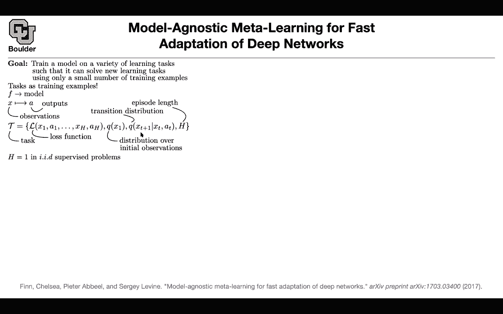
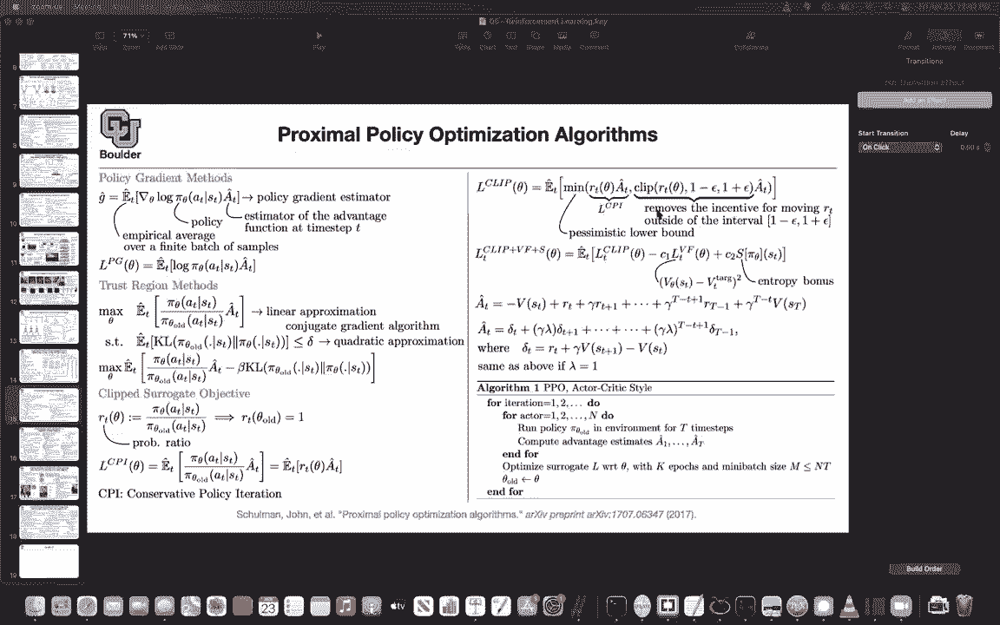
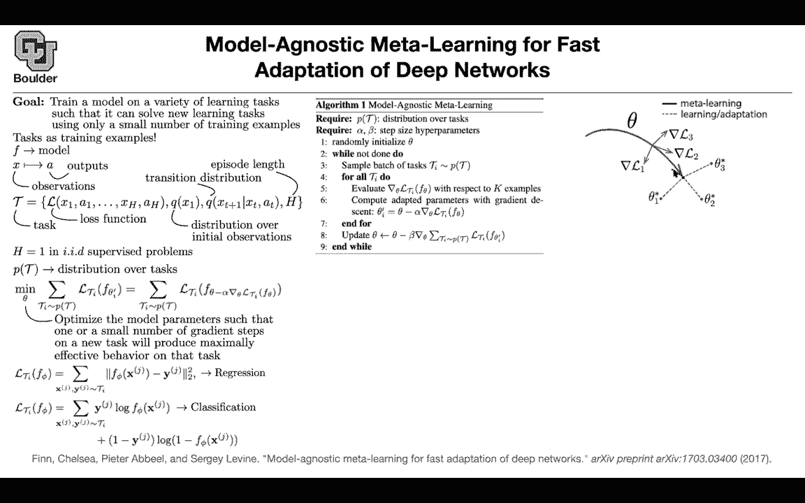

# 189：L83.1 - 模型无关元学习 🧠

## 概述

在本节课中，我们将要学习**模型无关元学习**。这是一种让智能体能够快速适应新任务、仅需少量示例就能学习的方法。我们将探讨如何将多种任务视为训练样本，并训练一个模型，使其参数位于一个“最佳位置”，从而在面对新任务时，只需几步梯度下降就能获得良好性能。

---

## 从单一任务到通用人工智能

到目前为止，我们主要学习单一任务。现在，我们正朝着通用人工智能迈进。人类不仅能系鞋带，还能阅读、倾听，同时处理多种不同任务。目前，我们只专注于单一任务，设计智能体以一次完成单个任务。现在，我们希望超越这一点。

人类还有一项非常擅长的能力：他们可以利用很少的示例，将学习从一个领域迁移到另一个领域。我们能否朝着这个目标前进？这就是**元学习**的理念。我们希望在一个模型上训练多种不同的任务，然后当新任务出现时，希望智能体能够快速适应，并从少量数据中学习。我们也可以将其视为一种**小样本学习**方法。

---

## 任务的形式化定义

为了能够从少量示例（小样本）中学习，核心思想是将**任务本身视为训练样本**。我们将使用一个单一模型，它接收观测值作为输入，并产生输出。我们将通过定义“任务”的含义，将监督学习和强化学习统一在一个框架下。

定义一个任务，你需要：
*   定义一个损失函数或目标函数。
*   为初始观测值设定一个分布。
*   设定一些转移分布。
*   设定一些回合（episodes）。

这正是强化学习的做法：从状态 **X1** 采取动作，进入状态 **X2**，采取相应动作，直到结束。你有一个损失函数、一个初始分布、一个转移分布，以及你将在该环境中经历的回合数。

如果 **H = 1**，你就是在进行监督学习。因此，在一个统一的框架下，你可以同时处理强化学习和监督学习。

---

## 与先前方法的联系

上一节我们介绍了近端策略优化，可以将其视为信赖域方法的扩展。它仍然是一个策略优化框架，希望新策略位于旧策略的邻域内。这可以通过信赖域方法实现，但更复杂，因为它需要进行线性近似和二次近似。近端策略优化则更简单，它定义比率 **R** 为：

**R(θ) = π_θ(a|s) / π_θ_old(a|s)**

并希望 **R** 在 **1** 附近。实现方法是在目标函数中移除 **R** 超出区间 **[1-ε, 1+ε]** 的激励。

---

## 元学习的目标与动机

现在，我们转向模型无关元学习。为什么在这里引入元学习？因为到目前为止，我们讨论的大多数强化学习甚至监督学习框架都需要大量数据。有人可能会说，与训练神经网络所需的数据量相比，人类需要的数据要少得多。一个反驳观点是，人类是多任务学习者，非常擅长将从一个领域或任务中学到的知识迁移到另一个领域或任务。

问题是：我们能否模仿这种行为，将其形式化，并训练我们的神经网络执行多个任务？

目标是：训练一个单一模型，使其能够处理多种不同的任务。然后，一旦新任务出现，它应该能够使用极少的训练示例快速适应。你可以将其视为一个小样本学习框架。

核心思想是：**将你的任务视为训练样本**。每个任务本身就是一个训练样本，并且每个任务内部都有一批训练示例。你训练的模型（称为 **F**）接收一些观测值，并输出一些结果。这可以是动作（策略），也可以是监督学习中的预测输出。

---

## 统一的任务框架

在一个统一的框架下，我们可以形式化地定义任务的含义。一个任务就是以下四个对象的集合：
1.  损失函数或目标函数。
2.  初始观测值（或状态）的分布。
3.  从一个状态转移到下一个状态的转移分布。
4.  回合数 **H**。

在强化学习中，你的动作会影响你接下来看到的状态。如果在同一个框架下，将 **H** 设为 **1**（即只有一个回合），就得到了监督学习：你有一个关于 **X** 和 **a** 的损失函数，一个数据的初始分布，但没有下一步。因此，在一个统一的框架下，你可以定义监督学习或强化学习的任务。

这很巧妙。然后，你会在任务上有一个分布，这就是“任务作为训练样本”的含义。你可以有多个不同的任务（任务一、任务二、任务三等），每个任务都有自己的训练数据（因为你有初始分布和转移分布）。

---

## 元学习的目标函数

让我们回到目标。首先，你想训练一个单一模型，并在多种不同的任务（任务一、二、三、四等）上训练它。你的目标是能够快速适应新的观测值和新的任务，即**泛化到新任务**。

如果只有一个任务，你会用参数（例如神经网络权重）来参数化你的模型，计算损失函数的梯度，然后进行梯度下降。但现在你有多个任务。

想法是：你想把这个模型的参数放在一个“最佳位置”，使得在任何新任务上，只需几次梯度下降迭代就能获得良好的性能。换句话说，你想把模型 **F** 的参数放在一个最佳位置。

具体做法是：每个任务都有自己的损失函数。你的整个元学习目标是从任务分布中不断采样（现在你从不同任务中采样），并将它们的损失加起来。

“最佳位置”是什么意思？这是你模型的参数。所谓最佳位置，是指如果你沿着梯度方向（或负梯度方向，即梯度下降）迈出一步，它应该能给你一个很好的损失函数值。因此，我们是在**预期**接下来要对该任务做什么：我们希望一步梯度下降就能带来良好的性能和损失。你是在预测你希望用这个任务做什么，你期望它能够快速适应。

但现在你有了一个目标函数，即元学习目标，你同样要最小化它。这里你会进行两次梯度计算：一次是在内部任务上，另一次是在最小化这个元学习目标时。正是这种观察引导我们：优化模型参数，使得在新任务上进行一步或多步梯度下降后，能在该任务上产生最有效的行为。本质上，你的目标是能够快速适应新数据，从少量示例中学习。

---

## 算法流程与示例

让我们更形式化一点，看一个回归的例子。你的模型损失函数将是模型预测值与观测值（标签）之间的均方误差。对于分类（例如两类），你可以使用交叉熵损失；对于多类，可以加上softmax。这就是你进行分类时的目标。

算法的大致流程是：你有一个任务分布，有两个学习参数（或超参数）：**α**（内部学习率）和 **β**（外部/元学习率）。算法进行过程如下：
1.  你采样一个任务（或一批任务）。
2.  对于每个任务，你计算其损失函数的梯度。
3.  你从该任务的初始分布中再采样一个迷你批次数据。
4.  计算梯度，创建 **θ'**（这是你执行梯度下降后期望得到的结果）。
5.  然后，在元目标函数上，用另一个学习率 **β** 进行另一轮梯度下降。

从视觉上看，元学习的目标不是擅长所有这些任务，而是将你的参数放在一个最佳位置，以便一旦有新数据（新任务）出现，你可以快速适应那个任务。因此，元学习的目标是让你的参数处于一个好的起始点。

---

## 监督学习与强化学习的应用

你可以将这种方法用于监督学习（回归和分类问题），也可以用于强化学习。

对于回归和分类，会发生以下情况：
1.  选取一个任务，采样一些输入-输出数据。
2.  在该数据上评估你的损失（回归用方程2，分类用方程3）。
3.  计算梯度。
4.  为该特定任务采样一些新的测试数据集。
5.  基于测试数据，查看该特定任务上各个单独模型的性能。
6.  在那里进行梯度下降。

对于强化学习，过程非常相似，但现在的数据是序列形式：**x1, 动作, x2, 对应动作**等。基于你的策略和环境，你计算梯度，进行适应，预测如果采取梯度步骤会发生什么，然后基于这个新的参数 **θ'** 采样一条新的轨迹。这就像在环境中测试你的智能体。你计算相应的损失，将所有不同任务的损失加起来，然后更新参数。

---

## 实现细节与讨论

关于实现的一个小细节是：如果你观察这个公式，你在计算目标的梯度。在 **θ'_i** 那里还有另一个梯度。你有两个选择：一是应用梯度之上的梯度（计算二阶梯度），这是可行的但成本更高；或者你可以固定它，在 PyTorch 中使用 `.detach()`，在 TensorFlow 中使用 `stop_gradients`，这样你就不会在梯度之上再计算梯度，速度会更快。这只是一个实现细节，为了更快，你忽略了二阶效应，只使用一阶近似。

关于目标函数，方程4基本上就是你在进行强化学习时的期望未来回报或奖励，然后你基于一个策略采取行动。

---

## 总结

本节课中，我们一起学习了**模型无关元学习**。我们探讨了如何将多任务学习统一到一个框架下，通过将任务本身视为训练样本来训练模型。核心目标是让模型参数位于一个“最佳位置”，从而在面对全新任务时，仅需少量示例和几步梯度更新就能快速适应并获得良好性能。我们了解了该方法的动机、形式化定义、算法流程，并看到了其在监督学习（回归、分类）和强化学习中的应用。元学习是实现高效小样本学习和迈向更通用人工智能的重要一步。