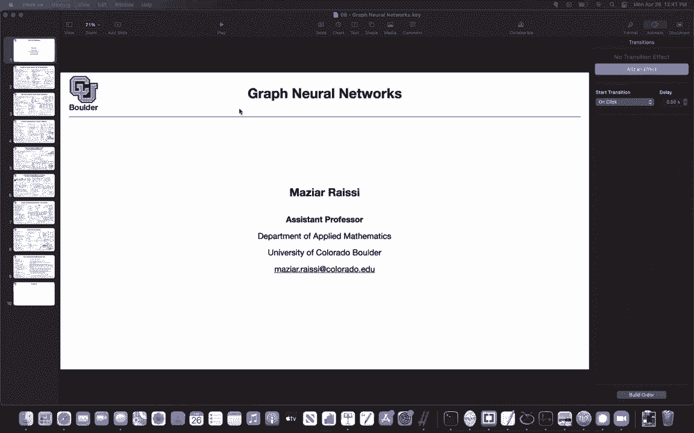
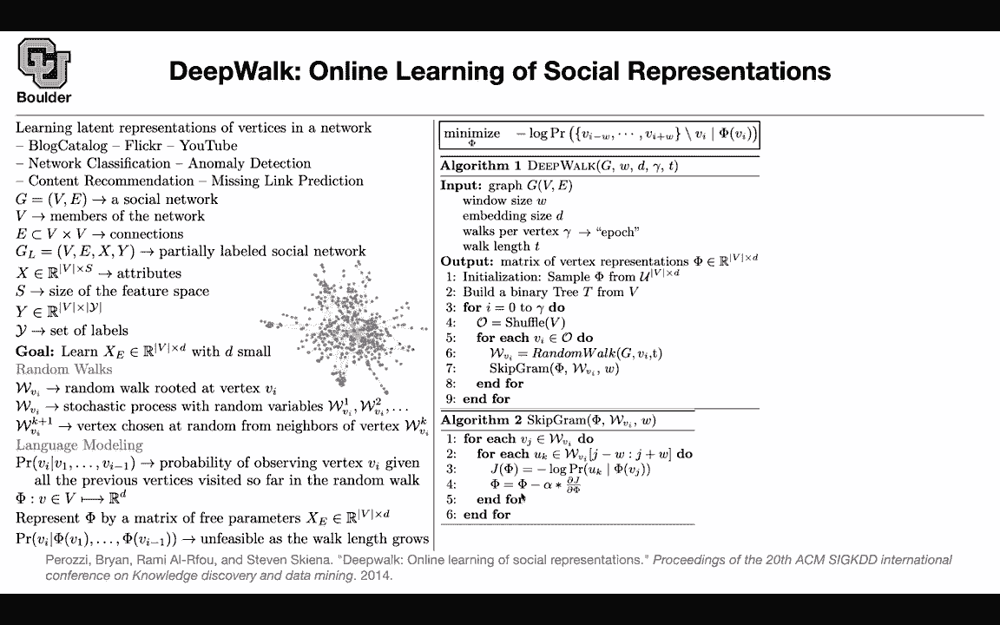

# 192：L84.1 - DeepWalk算法 🧠

在本节课中，我们将学习图神经网络的基础知识，特别是DeepWalk算法。我们将了解如何将图中的节点表示为向量，并借鉴处理文本数据的思想来处理图结构数据。

---

## 图数据简介

之前我们接触的数据类型，如图像、文本或语音，都可以被放置在规则的网格或序列中。例如，图像可以表示为张量，文本可以表示为整数序列，语音可以表示为向量序列。然而，图数据则不同，它由节点和连接节点的边组成，很难被放置在规则的网格上。

图数据在许多领域都有应用，例如社交网络（Facebook、LinkedIn）、内容推荐系统（YouTube）和生物信息学（蛋白质相互作用网络）。处理图数据的任务包括网络分类、异常检测、内容推荐和缺失链接预测。

---

## 图的数学表示

一个图 `G` 可以形式化地表示为 `G = (V, E)`，其中：
*   `V` 是节点的集合。
*   `E` 是边的集合，是 `V × V` 的一个子集。

有时，每个节点可能带有额外的特征 `X`（例如用户地理位置、年龄）和标签 `Y`（例如用户类别）。在本课程中，为了简化，我们假设节点没有额外的特征和标签，每个节点仅由其ID（一个整数）标识。

我们的目标是将每个节点编码为一个向量，最终得到一个节点嵌入矩阵 `Φ ∈ R^{|V| × d}`，其中 `|V|` 是节点总数（类似于词汇表大小），`d` 是嵌入向量的维度。

---

## 从图到序列：随机游走

为了将处理文本（序列）的方法应用于图，我们需要一种将图结构转换为序列的方法。一个关键思想是在图上进行**随机游走**。

随机游走从一个起始节点 `v_i` 开始，然后随机地移动到其邻居节点，如此重复 `t` 步，生成一个节点序列 `W_{v_i} = (w_1, w_2, ..., w_t)`。其中，`w_{k+1}` 是从前一个节点 `w_k` 的邻居中随机选择的节点。

通过从不同节点开始进行多次随机游走，我们可以生成许多这样的节点序列。这些序列类似于文本中的句子，使我们能够应用自然语言处理中的技术。

---

## DeepWalk算法

DeepWalk算法的核心思想是：将随机游走产生的节点序列视为“句子”，然后应用词嵌入（如Skip-gram）模型来学习节点的向量表示。

以下是算法的关键步骤和超参数：

1.  **输入**：图结构 `G(V, E)`。
2.  **超参数**：
    *   上下文窗口大小 `w`
    *   嵌入维度 `d`
    *   每个节点的游走次数 `γ`（这决定了训练时的“轮数”）
    *   每次游走的长度 `t`
3.  **初始化**：随机初始化节点嵌入矩阵 `Φ`。
4.  **训练循环**：对于每一轮训练，执行以下操作：
    *   随机打乱节点集合 `V`。
    *   对于打乱后的每个节点 `v_i`，生成一条长度为 `t` 的随机游走序列。
    *   对该序列应用 **Skip-gram** 模型来更新嵌入矩阵 `Φ`。

### Skip-gram模型回顾

Skip-gram模型的目标是：给定一个中心节点（词），预测其上下文窗口内出现的其他节点（词）。其目标函数是最大化给定中心节点时，上下文节点出现的条件概率的似然。

为了计算效率，我们通常做出一个条件独立性假设：在给定中心节点的条件下，其上下文中的各个节点是相互独立的。这使得目标函数可以转化为对数似然的求和形式，便于优化。

---

## 优化：分层Softmax

直接计算Softmax概率的代价很高，因为它需要对所有节点（`|V|` 可能非常大）进行求和。DeepWalk采用**分层Softmax**来加速这一过程。

分层Softmax的基本思想是：为所有节点构建一棵二叉树（如霍夫曼树，根据节点在随机游走中的出现频率构建，频率高的节点路径更短）。预测一个节点时，我们不再直接计算其Softmax概率，而是将其转化为从树根到该叶子节点路径上的一系列二分类决策（向左走或向右走）的概率乘积。

每个内部节点 `b_j` 都有一个对应的向量表示 `θ_j`。从根节点到目标叶子节点 `u_k` 路径上的概率计算公式为：
`P(u_k | Φ(v_i)) = ∏_{l=1}^{L(u_k)-1} σ( [·] * θ_{b_l}^T * Φ(v_i) )`
其中，`σ` 是sigmoid函数，`[·]` 在向左走时为+1，向右走时为-1，`L(u_k)` 是路径长度。

这种方法将计算复杂度从 `O(|V|)` 降低到了 `O(log|V|)`。

---

## 算法总结与讨论

通过DeepWalk算法，我们最终得到了节点嵌入矩阵 `Φ`。这个矩阵编码了图的网络结构信息，因为通过随机游走，一个节点的向量表示会受到其邻居节点的影响。拥有这些向量表示后，我们可以将其作为特征输入到下游任务（如节点分类）的分类器中，例如使用逻辑回归。

**总结**：本节课我们一起学习了DeepWalk算法。我们首先了解了图数据的特点，然后学习了如何通过随机游走将图转换为序列。接着，我们详细探讨了DeepWalk如何借鉴Skip-gram模型和分层Softmax技术，来高效地为图中的每个节点学习一个有意义的向量表示，从而将复杂的图结构信息编码到连续的向量空间中。