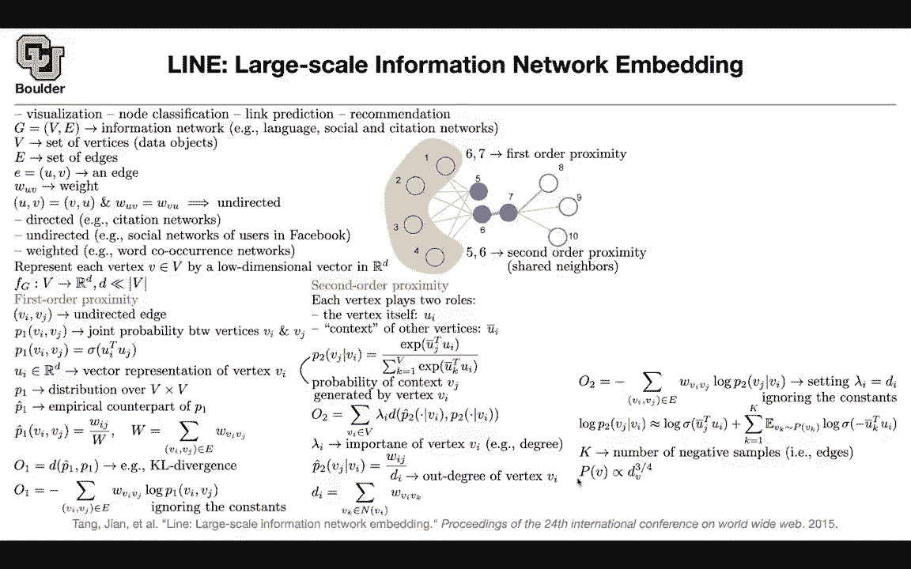

# 193：L84.2 - LINE模型 🧠

在本节课中，我们将要学习一种名为 **LINE** 的图嵌入模型。该模型旨在将图中的节点（顶点）表示为低维向量，其设计思想与词向量模型（如Word2Vec和GloVe）有相似之处，因为它同样基于图的全局统计信息。我们将探讨LINE如何同时捕捉节点间的**一阶邻近性**（直接连接）和**二阶邻近性**（共享邻居），并了解其如何应用于加权图、有向图等复杂场景。

---

## 图的基础概念与应用 📊

上一节我们介绍了图嵌入的基本思想，本节中我们来看看图的具体类型和应用场景。

图由**顶点**（Vertices）和**边**（Edges）组成。在应用中，图可以用于：
*   **可视化**
*   **节点分类**
*   **链接预测**
*   **推荐系统**

常见的图网络类型包括：
*   **信息网络**：如语言网络（单词共现）、社交网络、引文网络（一篇论文引用另一篇）。

之前的模型主要处理**无权图**，而LINE模型可以处理更复杂的**加权图**。在加权图中，边具有权重，例如，两个单词在句子中共同出现的次数就可以作为边的权重。

图也可以分为：
*   **无向图**：边没有方向，连接是相互的（如Facebook的好友关系）。
*   **有向图**：边有方向（如Twitter的关注关系或论文的引用关系，A引用B并不意味着B引用A）。

我们的目标是学习一个映射函数，将每个顶点（用整数ID表示）映射到一个低维向量空间 **R^d** 中。

---

## 邻近性：一阶与二阶 🔗

理解节点间的“距离”是LINE模型的核心。LINE定义了两种邻近性：

**一阶邻近性**衡量两个节点之间**直接连接**的强度。例如，节点6和7由一条粗边直接相连，它们具有**一阶邻近性**。

**二阶邻近性**衡量两个节点**共享邻居**的相似度。即使两个节点没有直接连接（如节点5和6），只要它们拥有至少一个共同的邻居，它们就具有**二阶邻近性**。共享的邻居越多，二阶邻近性越强。

LINE模型的目标就是设计一个损失函数，能够同时编码这两种邻近性信息。

---

## 一阶邻近性的建模 🎯

现在，我们来学习如何用数学公式为一阶邻近性建模。

对于无向边，我们希望直接相连的节点在向量空间中彼此靠近。给定两个顶点 **v_i** 和 **v_j**，我们可以用它们的向量表示 **u_i** 和 **u_j** 来定义其联合概率：

**公式：**
`p1(v_i, v_j) = 1 / (1 + exp(-u_i^T * u_j))`

这里使用了Sigmoid函数，将向量点积的结果转化为一个概率值。

我们知道图的全局统计信息（即所有边的权重），这为我们提供了**经验分布** **p1_hat**。对于顶点 **v_i** 和 **v_j**，其经验概率定义为它们之间边的权重 **w_{ij}** 除以图中所有边的权重总和 **W**：

**公式：**
`p1_hat(v_i, v_j) = w_{ij} / W`

接下来，我们通过最小化模型分布 **p1** 和经验分布 **p1_hat** 之间的KL散度来优化向量 **u_i** 和 **u_j**。忽略常数项后，最终的损失函数形式类似于交叉熵：

**公式：**
`O1 = - Σ w_{ij} * log(p1(v_i, v_j))`

通过优化这个目标函数，我们得到的向量 **u** 就能编码图的一阶邻近性结构。

---

## 二阶邻近性的建模 🧩

然而，图的结构不仅包含直接连接，还包含间接连接。本节我们看看如何用二阶邻近性来捕捉这种间接关系。

思路是为每个顶点分配**两种角色**或两种向量表示：
1.  **节点本身**的表示：**u_i**（当它作为中心节点时）。
2.  **上下文**的表示：**u'_i**（当它作为其他节点的邻居时）。

这类似于在社会中，一个人既可以作为“自己”，也可以作为别人的“朋友”。

对于有向边，我们定义顶点 **v_i** 生成其上下文顶点 **v_j** 的概率。我们使用Softmax函数，根据中心节点向量 **u_i** 和上下文节点向量 **u'_j** 来计算：

**公式：**
`p2(v_j | v_i) = exp(u'_j^T * u_i) / Σ exp(u'_k^T * u_i)`

经验分布 **p2_hat** 则根据图的权重来定义。对于从 **v_i** 出发到 **v_j** 的边，其经验概率是边权重 **w_{ij}** 除以节点 **v_i** 的出度（即从 **v_i** 出发的所有边的权重之和）：

**公式：**
`p2_hat(v_j | v_i) = w_{ij} / deg_i`

同样，我们最小化 **p2** 和 **p2_hat** 之间的KL散度，并为每个节点引入重要性权重 **λ_i**（例如，可以用节点的出度 **deg_i** 表示）。简化后的损失函数为：

**公式：**
`O2 = - Σ λ_i * w_{ij} * log(p2(v_j | v_i))`

优化该目标函数，我们可以同时学习到节点的表示 **u_i** 和上下文的表示 **u'_i**，从而编码图的二阶邻近性。

---

## 优化技巧：负采样 ⚡

直接计算上述损失函数中的Softmax（需要对所有节点求和）非常耗时。为了解决这个问题，LINE采用了**负采样**技术。

负采样的核心思想是：
*   **正例**：图中实际存在的边（如节点6和7）。
*   **负例**：随机采样一些不存在的边（如节点6和8、9、10）。

模型训练时，同时观察正例和几个负例，从而避免计算全量的Softmax归一化项。采样负例时，概率与节点度的3/4次方成正比，这与Word2Vec中的技巧相同。

对于加权图，另一个优化技巧是在进行小批量随机梯度下降时，根据边的权重进行采样。权重高的边被采样的次数应该更多，这能加速模型的收敛。

---

## 模型应用与总结 🏁

本节课中我们一起学习了LINE模型，它是一种强大且灵活的图嵌入方法。

LINE模型可以应用于多种类型的图数据，例如：
*   **语言网络**（如Wikipedia页面链接）。
*   **社交网络**（如Flickr, YouTube）。
*   **引文网络**。

在这些数据集上，LINE学习到的节点向量可以用于下游任务，如节点分类。此外，类似于词向量的“类比任务”（如“巴黎之于法国，相当于柏林之于？”），我们也可以在图嵌入上测试节点间的关系推理。

总结来说，LINE模型通过分别优化一阶和二阶邻近性目标，并利用负采样等技巧进行高效训练，成功地将图中的节点映射为有意义的低维向量，从而保留了丰富的图结构信息。