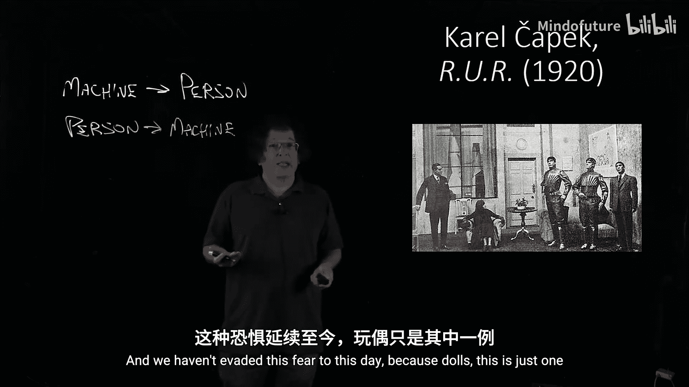

# 001：机器生命的诱惑与诡异 😨🤖

在本节课中，我们将要学习一个核心问题：机器能否拥有生命？我们将追溯人类历史上对“机器生命”的想象与探索，从古代神话到现代科技，理解这种想法如何塑造了我们对心灵、人工智能以及人机关系的思考。

---

这个讲座的标题可能看起来有些奇怪。甚至使用“机器生命”这个短语都可能显得有些冒昧。机器真的能是活的吗？

这是一个人们讨论了很长时间的话题。它也将成为我们许多讨论的主题，即如何通过使用机器（主要是计算机）来模拟人类心灵或生命心灵。当我说这是一个古老的对话时，我指的是它确实非常古老。

---

## 古代对机器生命的想象 🏛️

上一节我们提出了“机器生命”的概念，本节中我们来看看人类早期的相关想象。

古人实际上在写作和谈话中就已经提到了能够以类似生命方式行为的机器的诱惑。在荷马的《伊利亚特》中，就有对技术之神赫菲斯托斯的描述。他有一群机器听候差遣，它们被描述为黄金少女，能够帮助他建造阿喀琉斯的盾牌。黄金少女的描述方式，在今天看来，有点类似于机器人——它们是能够移动并模仿人类的机器。

荷马可能熟悉什么样的机器，这一点完全不清楚。《伊利亚特》大约创作于公元前800年左右。不清楚他可能熟悉什么样的机器，但他能够想象可以建造出模仿生命的机器。

---

## 早期实例：从自动装置到仿生学 ⚙️

从想象到实践，人类很早就开始尝试制造仿生机器。以下是几个关键的历史节点：

*   **亚历山大港的希罗**：我们已知最早的实例之一是这张幻灯片上显示的机器，由公元一世纪的亚历山大港的希罗制造。他建造了许多非常巧妙的机器，能够以某种方式模仿人类行为。这里他有一个内部有火的雕像。点燃这个火，它会煮沸机器内部的水箱，导致蒸汽膨胀，然后使右边的那个形象降低其水罐并浇灭雕像。这是一个能自己灭火的雕像。这是一个非常巧妙的装置。雕像本身已不复存在，但我们有证据表明希罗创造或设计了这样的雕像。这已经是一种引人入胜的东西。它表明人们正在思考能够提供具有目的或人类行为幻觉的机器。

*   **钟表与自动机的发展**：多年来，创造这些机器的技术变得越来越复杂。到了15世纪，欧洲出现了钟表。这确实是精密机械技术取得最大进步的领域。随着时间的推移，当人们开始制造钟表时，他们开始用栩栩如生的形象来装饰它们，这些形象可以做诸如报时之类的事情。左上角的形象就是一个敲钟人。在英格兰，它们被称为“钟表杰克”。这大约制作于15世纪。据我所知，它仍然可以运行。在接下来的几个世纪里，艺术和技术变得更加复杂。与钟表的公共市政建筑不同，先进的机器——自动机——开始与为贵族制作的奢侈品艺术相关联，实际上常常内嵌钟表。但同时，它们的吸引力恰恰在于它们设计得极其出色且异常逼真。

*   **自动机的巅峰：雅克·德·沃康松**：也许自动机（逼真的机器）历史的巅峰由下图给出。自动机制造的伟大天才是18世纪生活在法国的雅克·德·沃康松。到了这个时候，自动机开始不仅为贵族服务，而且开始成为展示的对象，几乎像特效一样。你几乎会觉得这些自动机展示有点像夏季大片电影之类的。这张图中显示的自动机，同样，没有一个仍然存在，但图中显示的是沃康松的三件杰作。左边的是一个长笛演奏者。那是它手中的一个真正的长笛。所以这台机器实际上能够吹气穿过长笛顶部并发出音符。这是一种非凡的工程作品。沃康松最著名的作品是中间的那只小鸭子。人们过去常常来惊叹这只鸭子，你会在它面前放置金属颗粒，鸭子会俯身吃掉颗粒，你会看到它的羽毛竖起，然后它会排泄，这被视为有史以来最惊人的逼真艺术品。

我讲述这些事物的原因是，这些是机器在人们经验中变得越来越逼真的实例。我应该说越来越像人，除了鸭子的情况，也许更像鸭子，但无论如何，这些是越来越成为生命模仿品的机器。

---

## 观念的转变：人如机器？🧠⚙️

随着机器越来越像人，人们的观念也开始发生转变。

这同时导致人们开始思考，人类是否可以被视为机器。正如我们可以说机器有点像人，也许我们也可以说人有点像机器。当人们开始思考这一点时，这实际上是一个相当具有挑衅性和令人担忧的想法。但你开始看到，例如在16世纪，一位名叫安布鲁瓦兹·帕雷的法国外科医生的工作，他对此感兴趣。他是一名战地外科医生，对制造假肢感兴趣。我实际上不知道他书中的这些图表是否代表了实际建造出来的东西，我不确定，但同样，他正在建模和构思这些事实是相当有趣的。制造一只假手，你已经在想象人类手部的运作本身可以通过机器来建模。换句话说，现在我们谈论的不是像生命的机器，而是开始被视为像机器一样的人类。

17世纪的哲学家勒内·笛卡尔实际上将这一想法推进了一步，他意识到这是一个相当冒险甚至有些异端的想法，但在某些方面，他着迷于用机器术语来建模人类行为。这是一个非常著名的图表，展示了他对反射作用如何运作的想法。你会注意到，大体轮廓上，这个图表看起来与亚历山大港的希罗的雕像没有太大不同。其思想是，如果一个人把手靠近火，那么会有某种可能是气动的压力沿着神经线路上传到他们的大脑，并导致他们像机器一样把手从火边抽回。

这再次在某些方面是一个非常大胆和冒险的观念，将人类行为视为像机器一样。然而，笛卡尔著名地止步于将心灵视为机器。但随着时间的推移，甚至这条界限也开始被突破，人类可以被视为机器的观念开始被越来越公开地提出。

有一本非常著名但对我来说相当令人困惑的书，是1747年朱利安·奥弗雷·拉·梅特里所著的《人是机器》。我将为你读出这段引文。同样，我发现这是书中典型的引文，其典型之处在于它很模糊。阅读整本书，除非你对这些思想的历史感兴趣，否则我认为没有太大意义。这是一本难懂的书。似乎拉·梅特里始终关注于推动“你能在多大程度上称人为机器”的界限。“只需承认有机物质被赋予了一个运动原则，这单独将其与无机物质区分开来，并且在动物中，一切都由这种组织的多样性所决定，正如我已经充分证明的那样。这足以解决物质和人的谜题。我们可以看到宇宙中只有一种物质，而人是最完美的一种。他之于猿和最聪明的动物，正如惠更斯的行星钟之于朱利安·勒罗伊的一块手表。”再次，这里使用了钟表作为复杂机制的隐喻。

---

## 模糊的界限与引发的焦虑 😰

到目前为止，我们已经讨论了机器被视为有生命的，以及人类被视为像机器一样。18世纪之后，两者之间的界限在文学和科学哲学中变得更加模糊。

19世纪初一个极好的例子是德国作家E.T.A.霍夫曼的短篇小说《沙人》，它引入了这种诡异的机器，名叫奥林匹亚——一个如此逼真以至于显得奇怪和令人不安的机器女人。我在幻灯片底部引用了这个故事中的一段话。这是一个非常精彩的故事，更精彩的是它开始指向人们对能够像人一样行为的机器所感到的焦虑。

这种焦虑在本世纪后期当这个故事被雅克·奥芬巴赫改编成歌剧时有所缓解。你在屏幕上看到的是现代版《霍夫曼的故事》的图片，其中玩偶奥林匹亚在唱歌。奥芬巴赫将其处理为喜剧。但霍夫曼的故事绝非幽默。它是一个非常严肃和可怕的故事。

这是那种开始被越来越多感受到的对话的一个例子。围绕机器如人般的焦虑不容否认，这将是本课程进行中我们将部分处理的问题。它在20世纪得到了反映，有无数故事涉及像人一样行为、反抗人类、愚弄他人以为他们是人的机器。“机器人”一词首次使用是在捷克剧作家卡雷尔·恰佩克的戏剧《RUR》（罗素姆万能机器人）中，该剧写于1920年。但整个世纪以来，有许多让人类感到紧张的机器的例子：机器人、安卓，以及后来在本世纪随着计算机的出现，计算机运行异常等等。直到今天，我们仍未摆脱这种恐惧，因为玩偶——这只是众多例子中的一个——机器人可能很可怕。机器可能很可怕。我只指出这种文化进程中的一小条线索，其中像玩偶和腹语术假人之类的东西可能很可怕。例如，左上角的图片来自一部名为《死寂》的电影，里面有一个相当可怕的假人。最近，有一系列《安娜贝尔》电影，里面有一个可怕的玩偶。我最喜欢的是底部的那一个，一部1945年的英国电影，名为《死亡之夜》。你真的应该找这部电影来看看。我会把这作为本课程的非正式作业：找到《死亡之夜》并观看它。它很棒，真的很吓人。即使你通常不喜欢恐怖片，它也不血腥或令人恶心，就是纯粹的吓人。但它包含了一系列故事，其中最后一个故事以一个腹语术师和他的假人为特色，只能说他们之间的关系并不完全友好。

玩偶、机器和逼真的装置可能会引起我们的焦虑，这实际上是一个将贯穿我们许多讨论的主题。人们对人类是否可以被机器建模，以及机器作为人类行为模型的准确程度如何，有着情感上的投入。

---

## 总结与课程方向 🎯

随着时间推移，我们将更多地讨论这一点，但为了结束这次讨论，我们提到了机器可以模仿人类的观点，实际上，这是计算机科学领域称为**人工智能**的基石。**人工智能**是研究试图让计算机或一般机器模仿我们认为的人类智能行为的领域。

同样，我们也将在这里讨论的**认知科学**的基石，是人类可以被机器程序充分建模的观点。我们可以通过创建阐明或模仿其行为的程序或设备来了解人类的行为方式。

最后，仍然有待探索的前沿领域涉及人类与机器的整合、交织。我们将在课程接近尾声时讨论这一点，但我现在提到它只是因为它是我感兴趣的领域。你看到的图片是一位名叫斯特拉克的澳大利亚表演艺术家。在图片中，他展示了一个通过电极连接到手臂的机械臂。他可以通过……（我不认为他现在还做这个特定的表演了）但当他戴着这个手臂时，他可以通过腹部的肌肉来控制它。他变得足够熟练，以至于可以做诸如写下自己名字这样的事情。

这是将人类智能与机器智能交织在一起的一个例子，它与我们迄今为止讨论的两个更直接的主题并不完全相同，但这些将是我们将要谈论的方向——当我们继续谈论认知科学和人工智能时，这些都是具有挑衅性的方向。

---

本节课中我们一起学习了“机器生命”这一概念的悠久历史，看到了从模仿生命的机器到被视为机器的人类的观念演变，以及这种交织关系所引发的深刻焦虑与思考。这为我们理解人工智能与认知科学的基石——即**机器模仿智能**与**人类可被机器建模**——奠定了重要的背景。