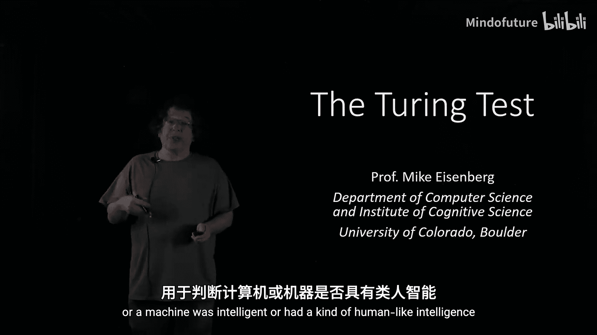
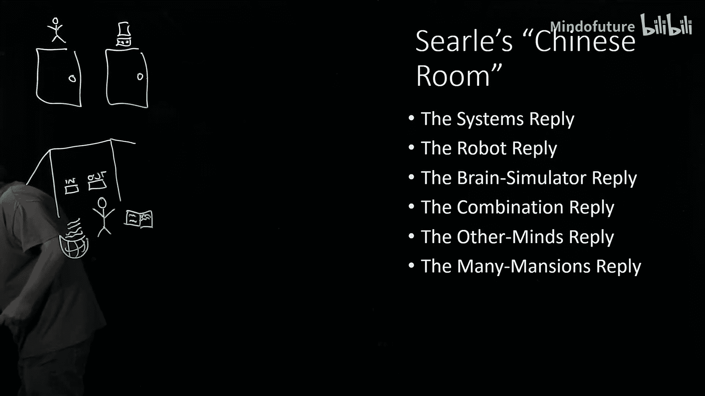

# 002：图灵测试 🧠🤖

在本节课中，我们将要学习人工智能领域一个最著名、最基础的思想实验——图灵测试。我们将了解它的起源、核心规则、以及围绕它产生的各种哲学争论。

## 概述

图灵测试由计算机科学先驱艾伦·图灵于1950年提出，旨在为“机器是否具有智能”这个问题提供一个可操作的检验标准。本节我们将详细探讨这个测试的构想、运作方式以及它引发的深远思考。

## 图灵测试的起源与核心思想

将机器智能与人类心智等同起来的早期著名思想，是一个被称为“图灵测试”的概念。

它源于计算机科学家、数学家艾伦·图灵在1950年发表的一篇著名论文《计算机器与智能》。这篇论文发表在哲学期刊《心灵》上。在文中，他概述了一个操作性测试，用以判断一台计算机或机器是否可以被认为是智能的，或具有类人的智能。

艾伦·图灵与约翰·冯·诺依曼齐名，是计算机科学两位伟大的奠基人物之一。在1936-37年，他写了一篇论文，提出了“图灵机”的概念。这是一种数学抽象，旨在代表计算机的思想。在那个时代，人们所说的“计算机”通常指的是人，即从事特定程式化算术工作以计算表格的职业。当时并不存在我们今天所理解的自动或电子计算机。艾伦·图灵的论文为任何类型的计算机构提供了一个数学抽象，其目的是尝试形式化“通过机械手段可计算”的含义。

他1950年那篇引入图灵测试思想的论文，背后有着类似的动机。他在论文中并未称之为“图灵测试”，这个名称是后来才有的。在他的论文里，他称其为“模仿游戏”。

## 模仿游戏：测试如何运作

上一节我们介绍了图灵测试的起源，本节中我们来看看它的具体运作方式。

基本思想如下：你将一台计算机和一个人分别放在两个独立的房间门后。房门紧闭。你作为裁判来到这两扇门前，可以通过打字（在1950年可能是电传打字机）向两个房间提问。你可以从两个房间得到文本形式的回答。其中一个房间里的人会像普通人一样回答问题，他们没有特定指令，只需按自己的意愿回答。另一个房间里的计算机，其任务是欺骗你这位裁判，让你认为它是一个人。

你的工作是区分两者。

如果你无法区分两者，如果你无法指出哪个房间是人，哪个房间是计算机，那么根据图灵在论文中的观点，你就可以说那台计算机是智能的。它当然具有一种操作性的智能，足以欺骗一个人，让其认为这是人类。

## 从性别模仿到人机模仿

当他（图灵）在论文中引入这个想法时，实际上是从一个类似但不完全相同的场景开始的。他想象了一个在男人和女人之间进行的模仿游戏。一扇门后是男人，另一扇门后是女人。你可以向两者提问，但不知道哪个房间对应哪个人。可以说，男人的任务是假装成女人，而女人的任务只是按自己的意愿回答问题。你作为裁判的工作是区分这两个房间，即判断哪个房间是女人在回答问题，哪个房间是男人在假装女人。

这个场景中有两个挑战需要应对：一个是男人的挑战，即成功假装成女人；另一个是裁判的挑战，即区分两者。

你可以想象用许多其他配对来进行这种模仿游戏测试。例如，一个20岁的人和一个70岁的人，其中20岁的人的任务是假装成老年人。或者不同地理区域（如阿拉斯加和南卡罗来纳州）、不同政治倾向的人。在任何这些情况下，都可能构成非常有趣的实验。

在图灵设想的测试中，任务是区分一个人和一台计算机。

## 一个巧妙的示例对话

在论文早期，他提供了一个裁判可能进行的问答示例。裁判提出问题，并从两个房间之一得到回答。裁判的工作是判断这可能是计算机还是人。

实际上，当你仔细审视这个例子时，会发现一些相当巧妙和迷人的地方。以下是对话内容：
*   裁判：“请以第四座桥为主题，为我写一首十四行诗。”
*   回答：“饶了我吧，我从来不会写诗。”
*   裁判：“34957加70764等于多少？”
*   （等待一会儿，然后打印出回答）
*   回答：“105621。”
*   裁判：“你下棋吗？”
*   回答：“是的。”
*   裁判：“我的K1位置有王，没有其他棋子。你只有K6位置有王，R1位置有车。该你走了，你怎么走？”

即使在这个简短的交流中，也发生了一些相当聪明和讨喜的事情。如果你仔细检查加法问题，你会发现无论回答者是人是机，都给出了错误的答案。

作为裁判，你可能会推理：表面上，你可能会想，那一定是人，而不是计算机在回答问题，因为计算机不会把加法题的答案算错，对吧？但请记住，这是一台被编程来模仿人类的计算机。因此，它可能是一个程序告诉它去犯人们在加法中可能犯的那种错误的计算机。事实上，这里犯的错误并非完全离谱，它可能是人们在实际相加两个数字时确实会犯的那种错误。

所以这是论文一个非常巧妙的引入。再次强调，图灵的观点是：他并不是说如果一台计算机能通过这个测试，它就是人类。他只是在论证，就我们而言，我们可以将这个测试视为一种具体的方式，来解决关于机器是否真的能具有智能的争论。如果一台机器能通过这个测试，那么它就是智能的。

## 对图灵测试的经典反驳

在论文中，图灵预见到并回应了一系列对其思想的潜在反驳。这些反驳非常具有启发性，以下是其中三个著名的例子：

### 1. 来自意识的论证

许多人会审视图灵测试并说：好吧，也许一台计算机能通过这个测试，但你不会说计算机在做这件事时是有意识的或具有任何类似人类意识的东西。

图灵对此的回应（可能说服你也可能不能）大意是：意识相当神秘，我们并不真正了解它涉及什么。但是，如果你能和计算机进行一场类似下文的对话（他举了一个关于莎士比亚十四行诗和狄更斯笔下人物匹克威克先生的复杂文学讨论示例），你会愿意将大量的知识归因于这个实体。它感觉像是一场非常自然的、近乎有趣的对话。因此图灵论证，如果你能进行这种对话，那么你很可能愿意将智能、或许还有意识归因于它。可能很难厘清该实体是否真的具有意识，但至少在非正式场合，你会愿意认为它有意识。

### 2. 洛夫莱斯伯爵夫人的反驳

这是一个有趣的反驳。他引用了洛夫莱斯伯爵夫人（埃达·洛夫莱斯）在19世纪40年代早期写的一篇论文。埃达是英国数学家查尔斯·巴贝奇的合作者。查尔斯·巴贝奇毕生痴迷于建造他称之为“分析机”的东西，这是一种可以自动执行多种操作的机械装置，与通用计算机非常相似。埃达与一位意大利作家合著了一篇关于分析机如何建造和编程的详尽论文，这是一篇惊人的开创性文献。

在那篇论文中，埃达说了一些非常有趣的话，大意是：计算机不能独自做任何事，不能独立思考，它只能做程序员告诉它做的事。所以它没有创新性的智能。

对此反驳有不同的回应方式。例如，作为一个程序员，我可以说，程序经常做一些我（在某种意义上）告诉它做，但对我来说非常意外的事情。或者，更强大的可能性是，计算机程序可以随着时间从经验中学习。在这种情况下，根据程序获得的经验，它可以学会做远远超出程序员最初设想的事情。

### 3. 来自超感官知觉（ESP）的论证

图灵还回应了当时由研究者J.B.莱因进行的关于心灵感应等超感官知觉的实验。图灵以开放的态度表示，如果这些实验是真实的，那么思维或智能可能涉及比我们迄今所承认的更多的东西。也许有些东西是我们无法用计算机模拟的。但事实上，莱因的实验从未被令人满意地复现过，因此这个反驳在 retrospect（回顾）看来并不有力。

## 图灵测试的现状与影响

那么，图灵测试本身现状如何？图灵在论文结尾预测，他认为到2000年左右，会有计算机程序通过这个测试。然而，截至2017年，还没有程序接近通过完整的图灵测试。没有任何程序能可靠地在约15分钟内欺骗裁判，让其认为它是一个人。

这引出了一个有趣的问题：如果图灵测试无法通过，图灵遗漏了什么？也许他提到的某个反驳比他认为的更有力。换句话说，也许存在深刻的哲学原因，使得没有计算机程序能通过图灵测试。另一方面，如果测试**可以**通过，为什么花了这么长时间？我们对这两个问题都没有满意的答案。

不过，我们确实有一些程序在某种程度上通过了局部或小规模的图灵测试。例如，在电视智力竞赛节目《危险边缘》中表现出色的沃森程序。另一个常见的例子是网络上的验证码（CAPTCHA），它本质上是一个微型图灵测试，你需要证明自己是人类而非计算机。此外，还有计算机创作音乐或艺术作品等测试。

最后，不能不提到哲学家约翰·塞尔在1980年左右提出的著名反驳——**中文屋思想实验**。

塞尔设想了一个场景：一个完全不懂中文的人被关在一个房间里，他有一本用英文写成的庞大规则书（相当于程序），以及足够的纸笔。房间有一个输入槽和一个输出槽。外面的人将中文问题从输入槽递入。房间里的人根据规则书，机械地比对输入的中文字符，按照规则操作纸笔，最终生成一串中文字符，从输出槽递出。对于屋外懂中文的人来说，这些回答可能是连贯、有意义的，仿佛屋内的人懂中文。

塞尔论证：即使这个“中文屋系统”通过了图灵测试（即其回答与真人无异），但房间里的人、规则书、纸笔本身都不“懂”中文。因此，仅仅通过操作符号来产生看似智能的行为，并不等同于真正的理解或意识。塞尔认为这证明了图灵测试的不足：通过测试并不意味着拥有真正的智能（意向性）。

当然，针对塞尔的中文屋论证，也有许多哲学家和科学家提出了反驳，认为他将“理解”过于狭隘地局限于个体组件，而忽视了整个系统层面可能涌现出的属性。这仍然是人工智能哲学中一个活跃的辩论话题。

## 总结

本节课中，我们一起学习了艾伦·图灵提出的划时代思想实验——图灵测试。我们了解了它的基本规则：通过人机对话来判断机器是否能表现出与人类无异的智能行为。我们探讨了图灵本人对“意识反驳”、“洛夫莱斯反驳”等的回应。我们也看到了图灵测试至今尚未被完全实现的现状，以及由此引发的深层问题。最后，我们介绍了约翰·塞尔提出的“中文屋”思想实验，它对“通过行为测试是否等于拥有真正理解”提出了严峻挑战。

图灵测试不仅是一个技术目标，更是一面镜子，促使我们不断反思智能、意识与理解的本质。它留下的挑战和争论，将继续推动人工智能与哲学领域的前进。