# 004：什么让问题变得困难（第一部分）🔍

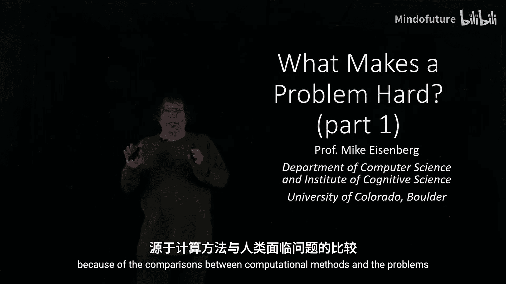

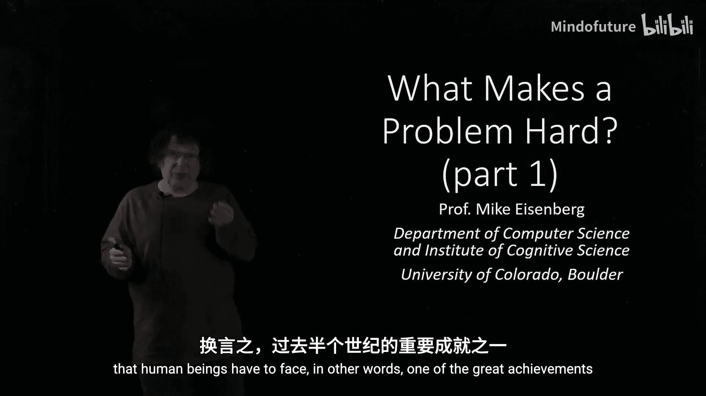

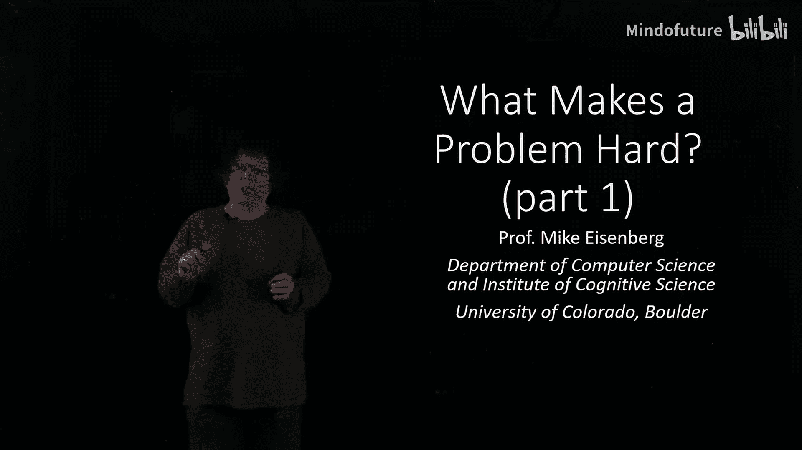

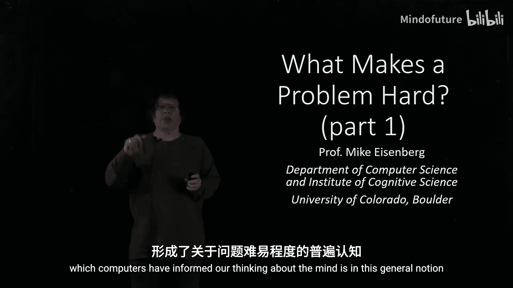

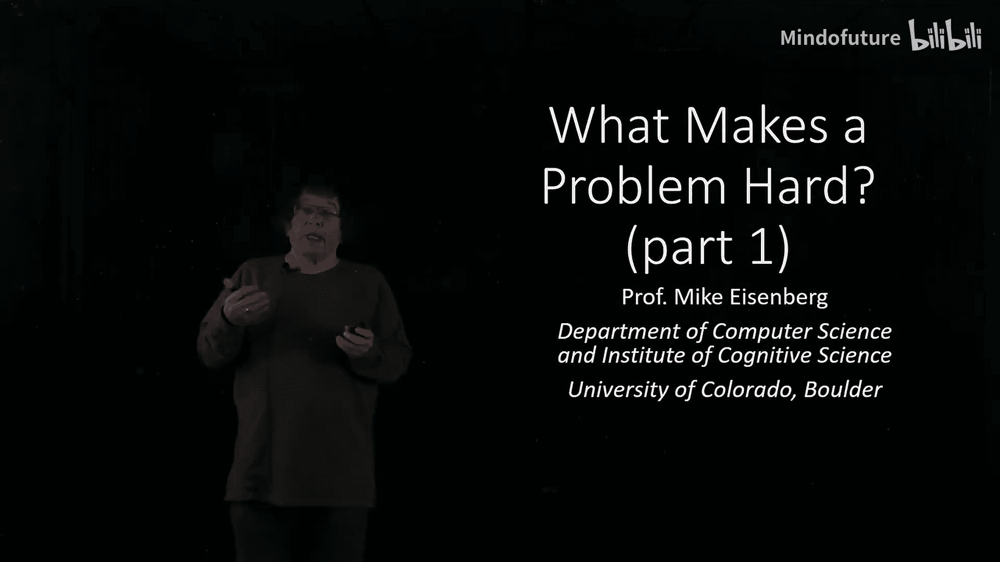

在本节课中，我们将要学习一个核心概念：如何定义问题的“难度”。通过比较计算机方法与人类心智，我们获得了理解心智的重大进展。其中一个关键成就是，我们开始理解是什么让一个问题变得困难或简单。

我们的直觉对于判断什么对我们来说是困难或简单的，常常被证明是相当短视的。我们并不总是擅长理解哪些事情对我们来说真正困难或简单，直到我们尝试让计算机去做这些事情。

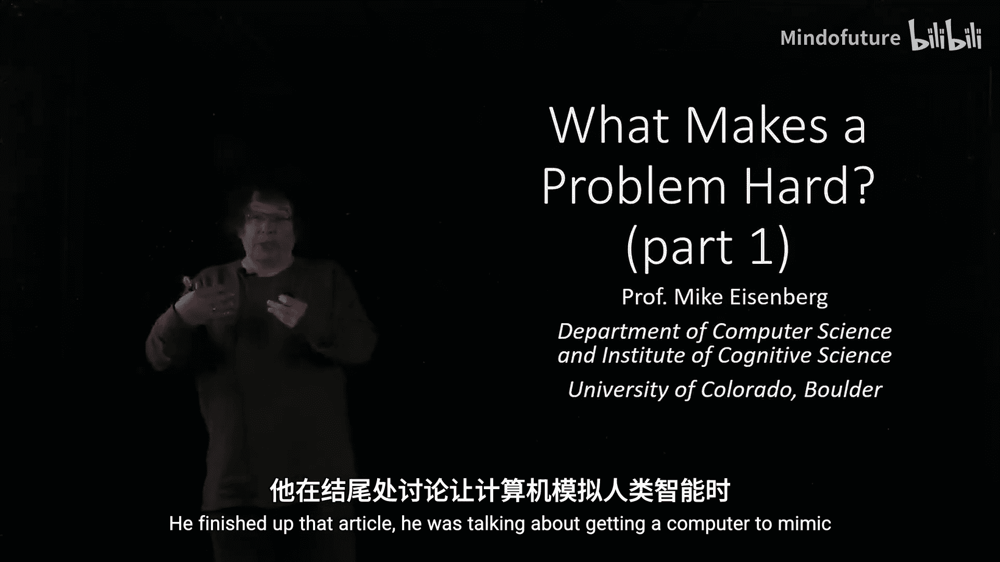

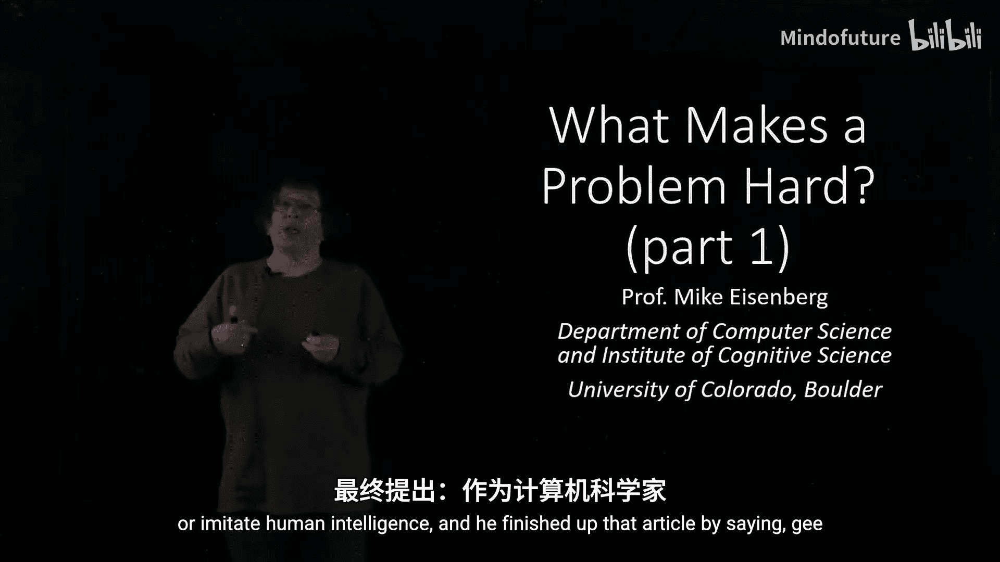

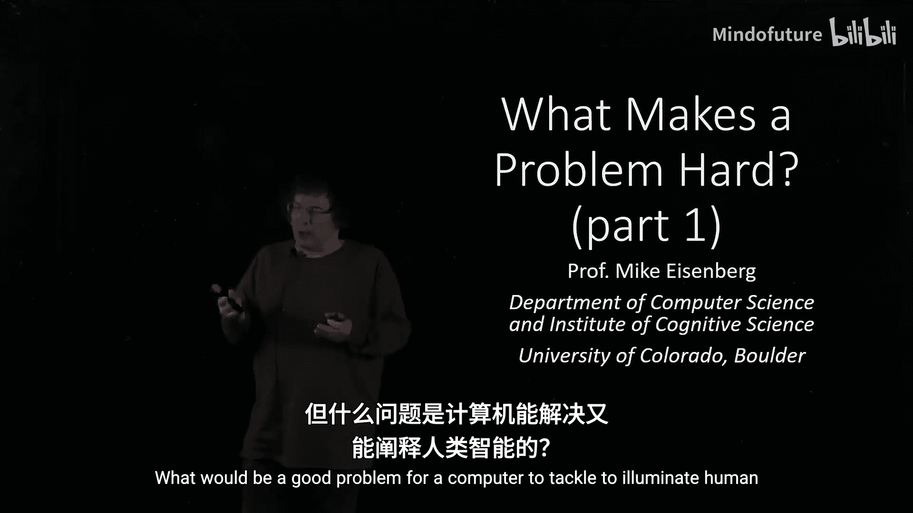

有趣的是，在艾伦·图灵撰写关于图灵测试的文章时，他在文章结尾提出了一个问题：对于计算机科学家来说，为了阐明人类智能，让计算机处理什么问题会比较好？他选择的问题是国际象棋。毕竟，国际象棋是聪明人玩的游戏，它很难。因此，如果能让计算机下好国际象棋，那就是智能的一大进步。

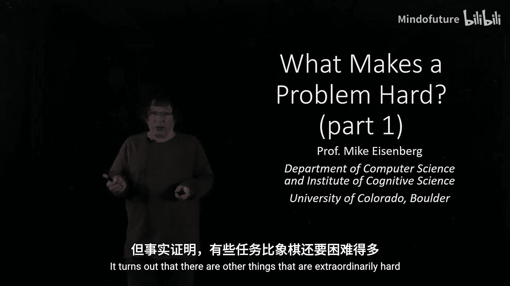

然而，事实证明，还有其他事情异常困难，在某些意义上比国际象棋更难，但我们并不觉得它们有那么难。

## 视觉：一个“不可能”的问题 👁️

让我们来看一个例子。视觉有多难？当你睁开眼睛时，你似乎自动就知道了世界上所有物体的位置。你环顾四周，看到那里有一个物体，那里也有一个物体。你知道自己在哪里。这似乎是自动完成的，看起来并不那么难，至少根据我们的直觉是这样。

但事实证明，在某种意义上，视觉是一个不可能的问题。我们做到了。然而，从数学意义上讲，这个问题最正式的表述是不可能的。让我来解释一下。

眼睛的结构可以简化为一个针孔相机模型。光线通过瞳孔进入，投射到眼睛后部的视网膜上。视网膜上排列着感光细胞，能够解释落在其上的光线模式，并进行大量后续处理，从而理解物体在世界中的位置。

但就我们目前的目的而言，眼睛的结构就是一个针孔相机：光线通过瞳孔进入并击中视网膜。仅凭这些信息——即光线击中视网膜的模式信息——我们就要确定物体在世界中的位置。

现在，按照我刚才的说法，这在数学上是不可能的。原因是你无法从二维信息中恢复三维信息。换句话说，无限多的三维物体结构或三维场景，都可能产生相同的视网膜光线模式。因此，我们通常无法从视网膜上的光线模式知道世界上有什么物体。

我们无法做到——这在数学上是不可能的。然而，我们却成功完成了这个任务。这是一个非常有趣的问题。事实上，让计算机以人类视觉的准确性和可靠性“看见”，一直是一个巨大而有趣的挑战，这就是计算机视觉领域。这本质上就是计算机科学家试图解决如何从相机视图理解世界中的物体的问题。

我们能在生命相对早期就做到这一点。视觉对我们来说似乎是个简单的问题。事实上，它是一个高度困难的问题。为了以我们成功的方式解决它，我们无法解决那个不可能的数学问题，但我们可以做出大量近似和聪明的猜测等等，并且可以整合其他技术来试图找出物体的位置。

## 语言学习：另一个难题 🗣️

另一个非常困难的问题，是我们似乎到5、6、7岁时就都学会了的事情：我们如何学习语言？

这同样，在某种意义上，直觉上似乎是一个非常容易的问题。我们出生时，并不知道自己出生在公元前400年的雅典，还是现代的赫尔辛基，或是100年后的北京。我们不知道我们将被引入哪个语言社群。

我们拥有的信息是倾听周围人们的谈话，以及他们可能做的其他事情。学习母语有多难？对我们来说似乎很容易，因为我们几乎都成功了。你可以说这花了我们四、五、六年的时间，持续的“工作”。尽管如此，我们都成功了。

然而，还没有人制作出一个计算机程序，能够放在桌子上，让人们和它交谈五六年，并由此学会一门自然语言。这似乎是一个非常困难的问题。

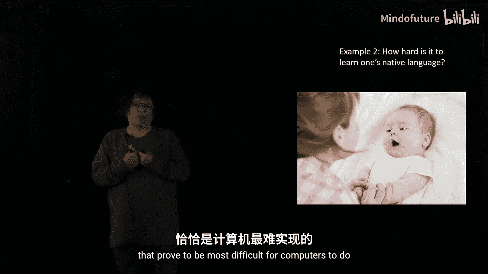

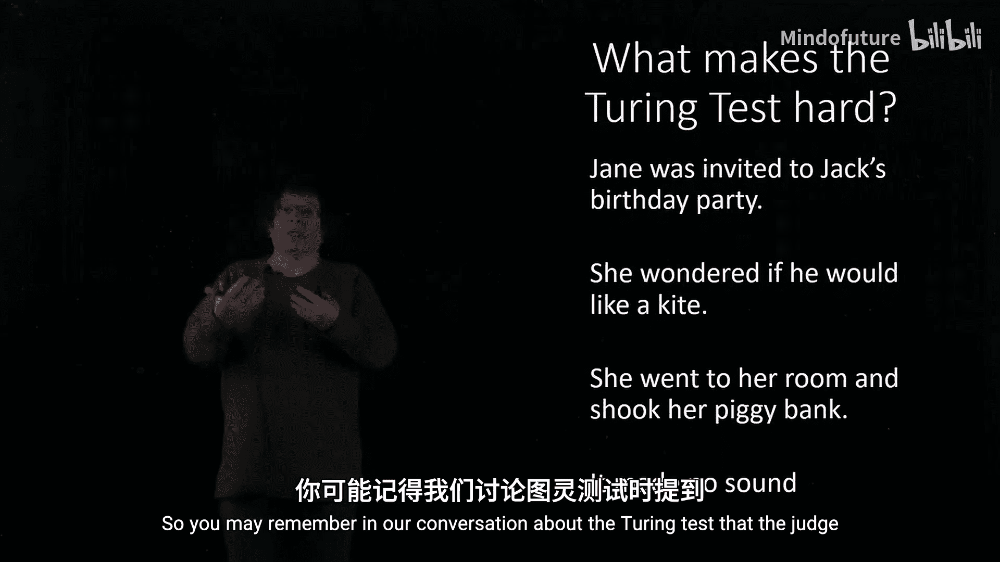

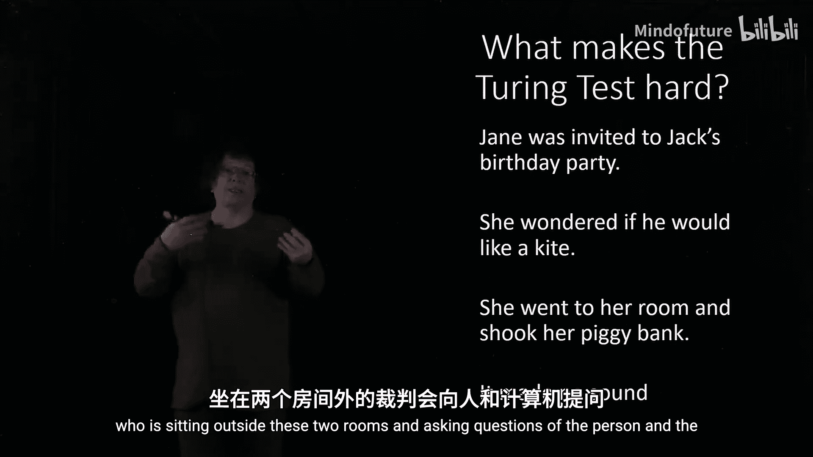

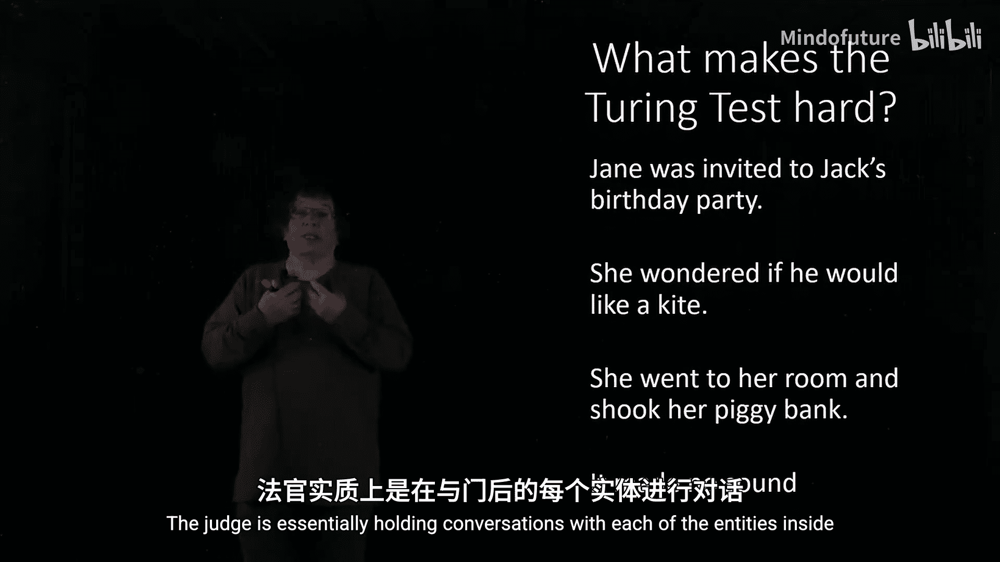

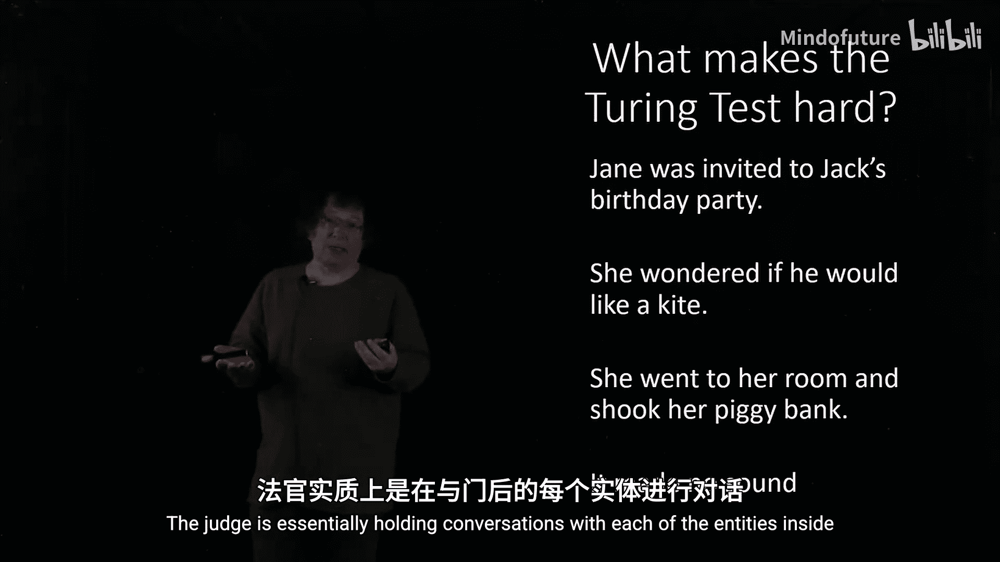

回到图灵对此的直觉，他认为国际象棋会是一个难题，因为人们发现它需要努力。而那些人们不觉得那么费力的事情，或者我们不记得为之付出过多少努力的事情，比如学习如何看或学习如何说话，结果被证明是比国际象棋困难得多的问题。

随着时间的推移，计算机科学家已经学会了如何编程让计算机下出异常出色的国际象棋。但我们似乎到5、6岁时就知道如何做的事情，却被证明是计算机最难做到的。

## 常识推理的挑战 📖

让我们举一个例子，说明为什么让计算机通过图灵测试似乎很困难。你可能记得，在我们关于图灵测试的讨论中，坐在两个房间外的法官向人和计算机提问，法官本质上是在与门后的每个实体进行对话。如果图灵测试成功，如果计算机能很好地模仿人类智能，那么就应该有可能与里面的计算机进行类似人类的对话。

为什么这很困难？这对计算机科学家来说是一个困难的任务吗？有许多不同的理论、假设和解释。一件特别有趣的事情是，不仅仅是学习说话或学习看这样的问题，还包括我们在对话过程中似乎拥有的关于世界的所有常识。

幻灯片上有一个例子。这是四句话，摘自一本真实的儿童读物（虽然听起来不是最有趣的儿童读物）。这是儿童读物中连续的四句话。

理解这些句子需要一些文化知识。但可以公平地说，在撰写这类故事的文化（即美国或西方文化）中，任何大约5、6岁的孩子都能听懂故事的这一部分，并清晰地回答关于发生了什么的问题。

让我们逐句来看，特别是如果你恰好是一名计算机程序员，想想编程让机器理解这些句子需要什么，需要什么样的知识。

1.  **第一句**：简被邀请参加杰克的生日派对。
    *   我们或许可以有一个计算机程序，能够理解足够的英语语法来知道这意味着什么。
2.  **第二句**：她想知道他是否会喜欢一个风筝。
    *   如果你是一个试图理解这些的计算机程序，这两句话之间有一个跳跃。简被邀请参加杰克的生日派对。她为什么想知道他是否喜欢风筝？为了理解这两句话之间的联系，你必须知道一些关于生日派对的**文化结构**，以及什么是合适的礼物。你会注意到，如果句子是“简被邀请参加杰克的生日派对。她想知道他是否会喜欢一艘游艇”，你的反应会非常不同。那将意味着一个完全不同的故事。因此，仅从第1句到第2句就需要相当多的信息。
3.  **第三句**：她走进自己的房间，摇了摇她的存钱罐。
    *   再次想想巨大的鸿沟。她想知道他是否会喜欢一个风筝。因此，或者与此相关，她走进房间摇了摇存钱罐。要理解第2句和第3句之间的联系，想想其中涉及的所有**常识知识**。对于一个计算机来说，这可能看起来毫无关联。就像“她想知道他是否会喜欢一个风筝。她走进房间摇了摇她的腿。”如果你不了解很多关于孩子、礼物、存钱罐等等的知识，你真的会对为什么第2句会导致第3句感到困惑。
4.  **第四句**：它没有发出任何声音。
    *   这又意味着什么？因为我们知道一些**日常物理知识**。一个被摇动的存钱罐没有发出声音，这告诉了我们很多信息。

将所有这些信息输入计算机程序，被证明是一个非常有趣的问题。总的来说，我不想把这变成一个硬性规定，但可以公平地说，自从图灵的文章写就以来，**让计算机做起来似乎最容易的事情，是我们能够在17、18岁之后学会做的事情**。也就是说，我们可以让计算机下国际象棋、解释分子光谱、进行数学积分、求逆矩阵。所有这些事情实际上都相当容易，或者至少是计算机可以接近完成的。

然而，**我们在5、6岁时就知道如何做的事情**，比如在房间里走动而不撞到东西、进行对话互动、理解像这样的故事，这些被证明非常困难。

## 两种类型的困难问题 🧩

因此，在这次和接下来的几次讨论中，我想做的是，根据我们从计算机科学中学到的知识，尝试稍微解析一下“难度”这个概念。实际上，通过尝试用机器模仿心智，我们学到了很多关于什么使问题变得容易或困难的细微差别。

让我们从一种类型的例子开始。

### 1. 无从下手的难题

对于某些类型的问题，我们认为它们困难是因为，作为计算机科学家，我们真的不知道，或者几乎不知道如何开始编程解决这些问题。就我们所知，也许有时问题是定义不清的，或者有某种原因我们无法实现它们。换句话说，这些问题常常感觉是非常深刻的问题。无论如何，有些问题我们觉得很难找到切入点。

以下是这类问题的例子：

*   **编写一个能通过图灵测试的程序**：很难知道从哪里开始。我们可能有一些想法，但确实很难知道从哪里着手。
*   **教授美德**：柏拉图的对话录《美诺篇》以一位年轻人走到柏拉图的导师苏格拉底面前开始，问道：“苏格拉底，你能教授美德吗？美德是可教的吗？”从那里，他们立即转向了“什么是美德？”的问题。在某种意义上，这是一个非常重要的问题。每个父母都希望（如果可能的话）教导他们的孩子成为一个善良和有美德的人。但很难知道从哪里开始定义美德，并思考教授它意味着什么。我们看着这个问题说，它太大了，可能定义不清，但似乎没有明显简单的方法开始处理它。
*   **解释生命的意义**：一个经典的、近乎滑稽的例子，很难做到。

### 2. 已知不可能解决的问题

另一种困难的问题是，你被要求做某事，但你知道这是不可能的，无法完成。

在人类事务中，这实际上是一个巨大的知识。通常，当你知道某个明确定义的问题不可能解决时，你就知道了非常多。通常，这些不可能性证明代表了人类思维的重要里程碑。

以下是这类问题的例子：

*   **尺规作图三等分任意角**：给定一个角θ，用直尺和圆规构造一个大小为θ/3的角。事实证明，给定直尺和圆规，这是无法做到的。但对古代几何学家来说，这是一个极具挑战性的问题。他们并不知道这是不可能的。事实上，这个问题的不可行性证明直到19世纪才确立。所以，人们花了数千年才意识到并能够证明这不仅是一个难题，而且是一个不可能的问题。你甚至不必尝试去做，因为我们知道它做不到。
*   **停机问题**：编写一个计算机程序P，给定任何其他程序P和输入N，将确定程序P在输入N上是否会**停机**。事实证明这是不可能的。这被称为**停机问题**。艾伦·图灵在1936/1937年一篇精彩且被广泛讨论和收录的论文中证明了这一点。实际上，这听起来可能像一种深奥的数学问题，但本质上，它是**调试问题**。你能写一个程序，可以无误地调试其他程序吗？事实是你不能，这是不可能的。知道它不可能，再次是人类思想的一个巨大成就。
*   **物理学中的永动机问题**：等等。

知道某事是不可能的，是一件非常重要的事情。

## 总结 📝

本节课中，我们一起学习了如何从计算机科学的角度理解问题的“难度”。我们发现，人类的直觉常常不可靠：一些我们觉得简单的事情（如视觉、语言学习），对计算机来说异常困难；而一些我们认为需要高智力的事情（如下国际象棋），计算机却能做得很好。

我们探讨了两种类型的困难问题：
1.  **无从下手的难题**：问题定义可能模糊，我们不知道如何开始解决，例如通过图灵测试或定义“美德”。
2.  **已知不可能解决的问题**：问题有明确定义，但已被证明在理论上无法解决，例如尺规三等分角或停机问题。认识到这种不可能性本身就是重要的知识进步。

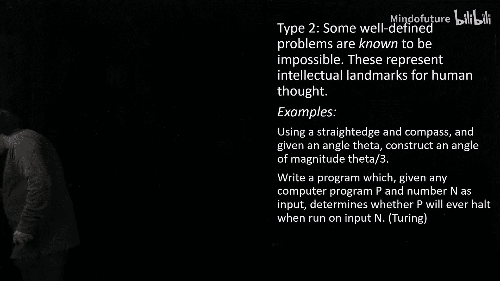

在接下来的课程中，我们将继续探讨其他使问题变得困难的方式。通过比较心智与机器，我们能更深入地理解两者能力的边界与特性。