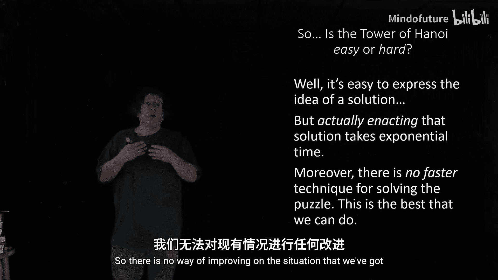
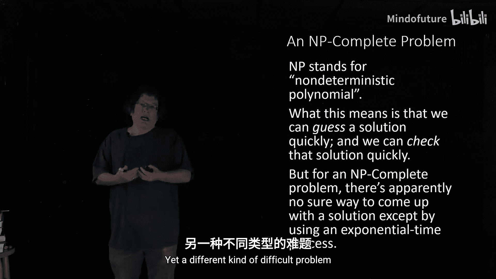
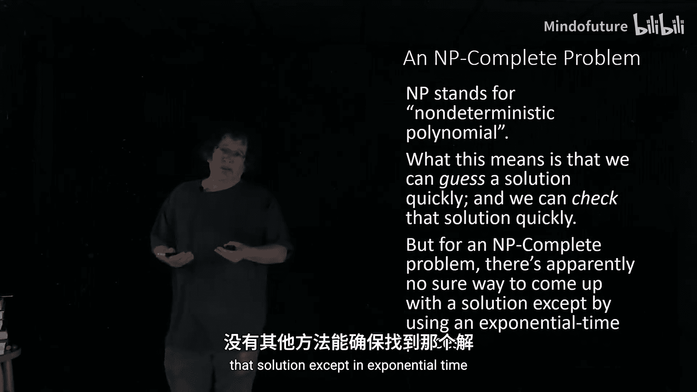
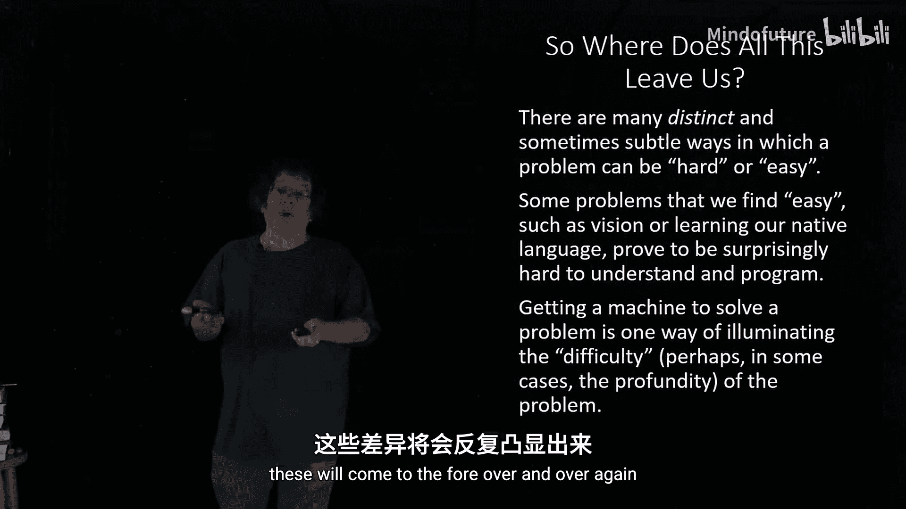

心灵与人工智能：P06：问题为何困难（第三部分） 🧩


在本节课中，我们将继续探讨“问题为何困难”这一主题。在前两节讨论的基础上，本节将聚焦于计算机科学家如何思考特定类型的难题。我们将通过一个经典谜题——汉诺塔——来引入概念，并探讨一种被称为“NP完全问题”的特殊困难类别。我们将尽力使解释简单明了，避免深入复杂的数学细节。


---


### 从汉诺塔谜题说起


上一节我们讨论了问题难易的多种维度。本节中，我们来看看计算机科学中一个经典的难题例子：汉诺塔。

汉诺塔是一个历史悠久的谜题。它有三个柱子和若干大小不同的圆盘，所有圆盘最初堆叠在左侧柱子上，从下到上由大到小排列。目标是将整个塔从最左侧柱子移动到最右侧柱子，但必须遵守两条规则：
1.  一次只能移动一个圆盘（即只能移动某个柱子最顶端的圆盘）。
2.  任何时候，都不能将较大的圆盘放在较小的圆盘之上。


那么，这个谜题是难是易？答案有些矛盾。

#### 概念上的“简单”

从概念上讲，解决汉诺塔的策略非常清晰，甚至可以用一个简单的**递归**过程来描述。


以下是移动 `n` 个圆盘从“起始柱”到“目标柱”的策略（使用“备用柱”）：
1.  首先，将上面的 `n-1` 个圆盘从“起始柱”移动到“备用柱”（此过程以“目标柱”为临时备用）。
2.  然后，将最大的第 `n` 个圆盘直接从“起始柱”移动到“目标柱”。
3.  最后，将 `n-1` 个圆盘从“备用柱”移动到“目标柱”（此过程以“起始柱”为临时备用）。


这个策略可以用代码简洁地表示：
```python
def move_tower(n, from_peg, to_peg, spare_peg):
    if n == 1:
        print(f"移动圆盘从 {from_peg} 到 {to_peg}")
    else:
        move_tower(n-1, from_peg, spare_peg, to_peg) # 步骤1
        print(f"移动圆盘从 {from_peg} 到 {to_peg}")   # 步骤2
        move_tower(n-1, spare_peg, to_peg, from_peg) # 步骤3
```
因此，在“如何思考解决方案”的意义上，汉诺塔是一个简单的问题。


#### 执行上的“困难”


然而，当我们实际执行这个解决方案时，困难就出现了。移动所需步数随着圆盘数量 `n` 的增加而急剧增长。


移动步数遵循一个公式：**M(n) = 2^n - 1**。
*   移动1个圆盘需要 **1** 步。
*   移动2个圆盘需要 **3** 步。
*   移动3个圆盘需要 **7** 步。
*   移动8个圆盘需要 **255** 步。
*   移动40个圆盘需要大约 **1万亿** 步。
*   移动60个圆盘需要大约 **100万兆** 步。




这意味着，即使解决方案的概念很简单，**实际执行所需的时间是“指数级”增长的**。对于稍大的 `n`（例如100），即使是世界上最快的计算机，在有生之年也无法完成所有移动步骤的打印。因此，在“实际完成”的意义上，汉诺塔是一个极其困难的问题。


---



### 另一类难题：NP完全问题



汉诺塔的困难在于，**描述方案简单，但执行方案耗时极长**。现在，我们来看另一类性质不同的难题，它们被称为 **NP完全问题**。

NP（Nondeterministic Polynomial，非确定性多项式）完全问题的特点是：
1.  **验证容易**：如果你“猜”到了一个解决方案，可以在多项式时间内快速验证它是否正确。
2.  **寻找困难**：但是，要**确保找到**一个解决方案，目前所知的最好方法也需要指数级时间。

#### 示例：哈密顿回路问题

一个著名的NP完全问题是“哈密顿回路问题”。想象一个由点和线（顶点和边）构成的图。问题是：是否存在一条路径，从某个点出发，沿着图的边行走，**恰好访问每个顶点一次，最后回到起点**？

以下是如何理解其“易”与“难”：
*   **验证猜测（易）**：如果有人画出了一条可能的路径（如下图中标红的线），我们很容易沿着这条线检查它是否满足条件（访问每个顶点一次且仅一次，并最终回到起点）。这个检查过程很快。
*   **寻找路径（难）**：但是，要自己从头找到这样一条路径，最直接的方法是尝试所有可能的顶点排列顺序。对于一个有20个顶点的图，可能的排列有 `20!`（20的阶乘）种，这是一个天文数字。随着顶点数增加，这个数字会变得完全不可操作。

许多现实世界的问题，如旅行商问题（规划最短访问路线）、任务调度、蛋白质折叠等，都被证明是NP完全的。当计算机科学家遇到NP完全问题时，他们通常不会追求完美的精确解，而是转向寻找“足够好”的**近似解**或**启发式算法**。

---


### 总结与思考


本节课我们一起学习了两种不同意义上的“难题”：


1.  **汉诺塔类问题**：其解决方案**易于描述**（如递归算法），但**执行成本极高**（指数级时间增长）。这体现了“概念简单”与“实践困难”之间的差距。
2.  **NP完全问题**：其特点是**验证解决方案容易**，但**找到解决方案极其困难**。这类问题在优化、排序等领域广泛存在，是计算机科学中的核心挑战之一。





回顾我们关于心智与机器的讨论，这种“困难”概念的差异无处不在。有些事对机器来说轻而易举（如大规模计算），对人却很难；而有些事对人来说似乎不费吹灰之力（如视觉识别、语言习得），对机器编程实现却异常艰难。理解这些不同类型的难度，有助于我们更深入地思考智能的本质以及用机器模拟心智所面临的挑战。在接下来的课程中，我们将继续探索这些引人入胜的对比。