# 3：AI Agent 设计与实现 - 作业二解析与实战 🧠🤖

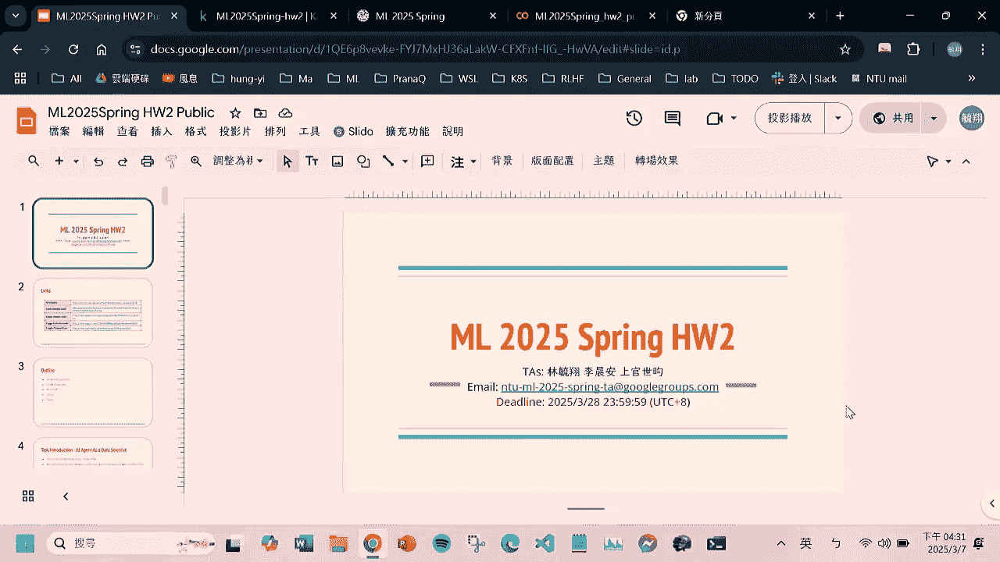

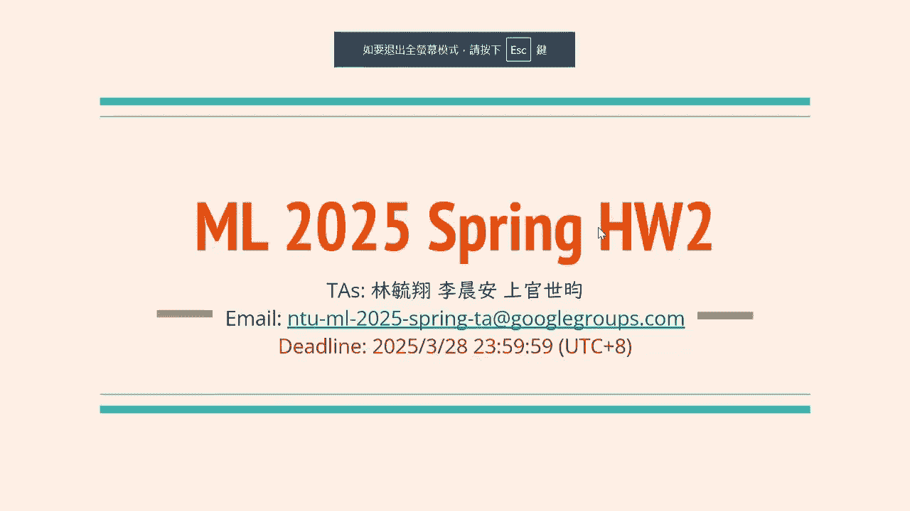

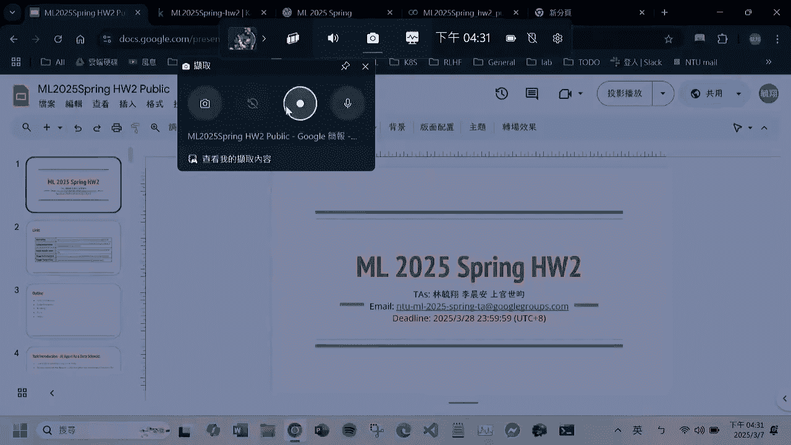


## 概述
在本节课中，我们将学习如何构建一个能够解决一般机器学习问题的AI智能体（AI Agent）。课程内容基于李宏毅老师的最新课程，我们将深入解析作业二的详细要求、代码结构、评分标准以及提升模型性能的各种策略。通过本教程，你将掌握使用大型语言模型自动化编写代码、进行数据分析和预测的核心方法。

---

## 作业目标与数据集介绍
本次作业的核心目标是使用大型语言模型（LLM）自动化地编写代码，以解决一个特定的机器学习任务。我们选择的任务是基于一个收集了民众在三天内的生理与心理状态的数据集，预测其在第三天感染某种疾病的概率。

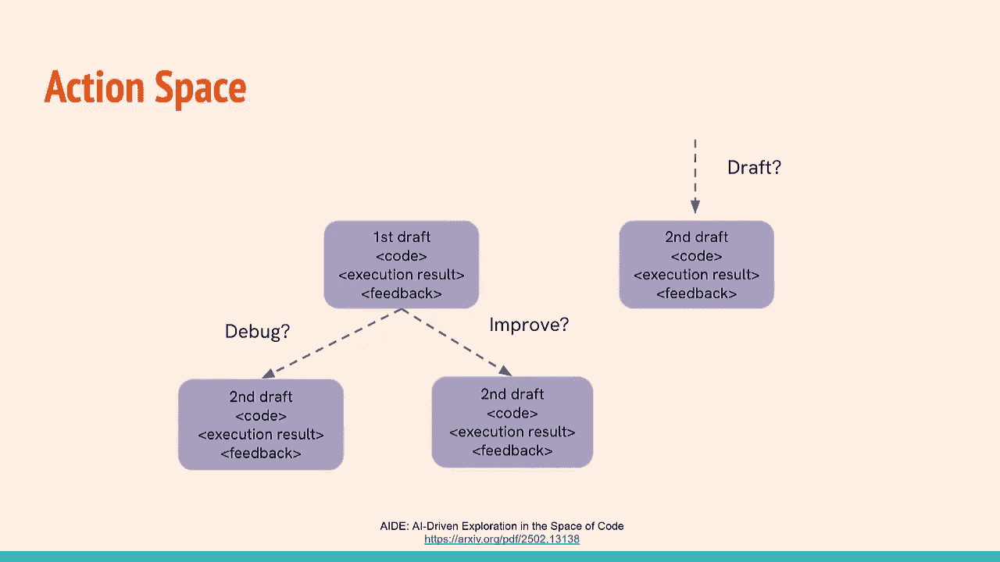

该数据集来源于CNU的一个研究小组。需要特别注意的是，**禁止**使用助教提供数据之外的任何额外资料进行训练或测试，同时也**禁止**让LLM进行网络搜索以获取信息。

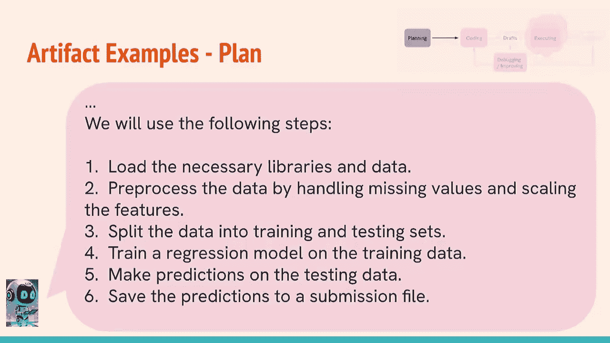

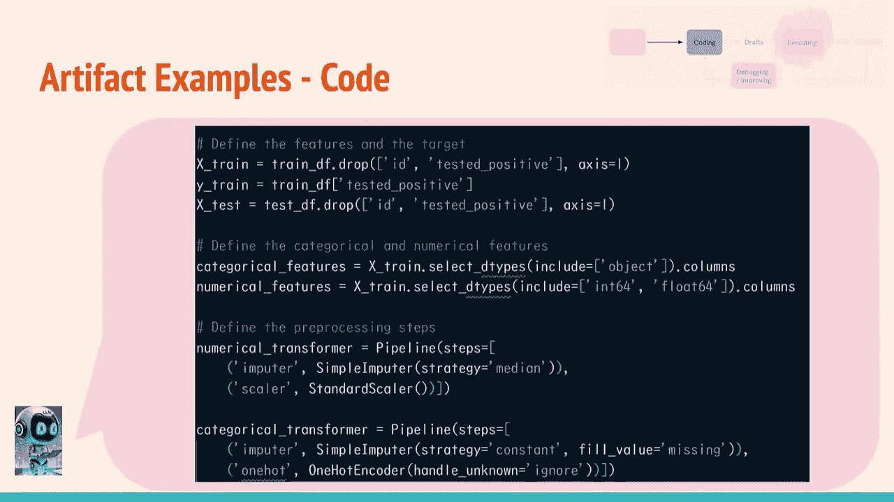

数据集包含以下特征：
*   **居住地**：共有35个州，采用独热编码（One-Hot Encoding）表示。例如，若居民住在亚利桑那州（ARIZONA），则对应栏位为1，其余为0。
*   **生理与行为特征**：包括是否有COVID-19或流感相关症状、是否佩戴口罩、是否参加室内多人活动等。
*   **心理与环境因素**：例如是否相信口罩能有效预防疾病、周围人是否佩戴口罩或接种疫苗等。
*   **预测目标**：最后一个特征是 `tested_positive`，即感染疾病的概率。

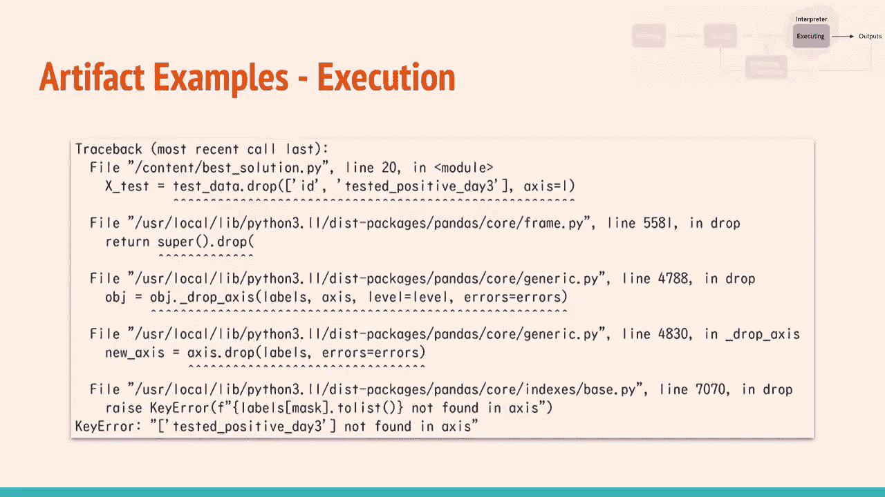


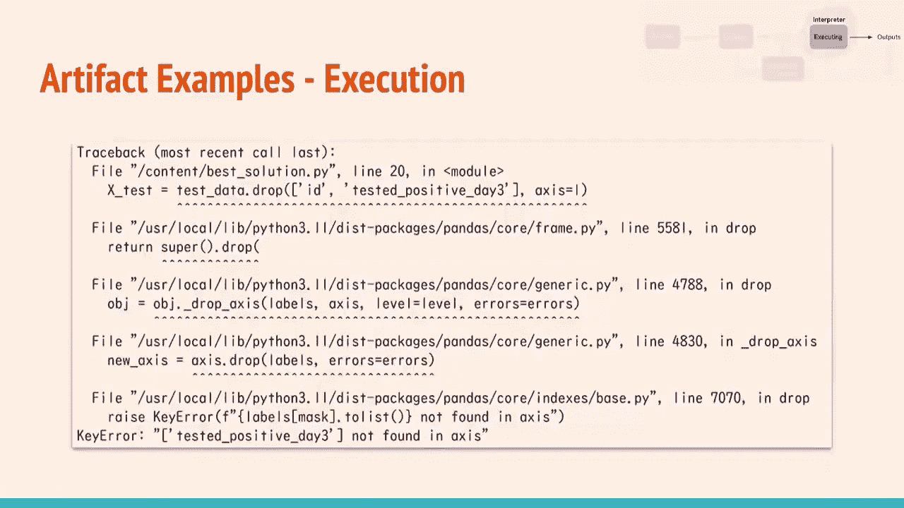

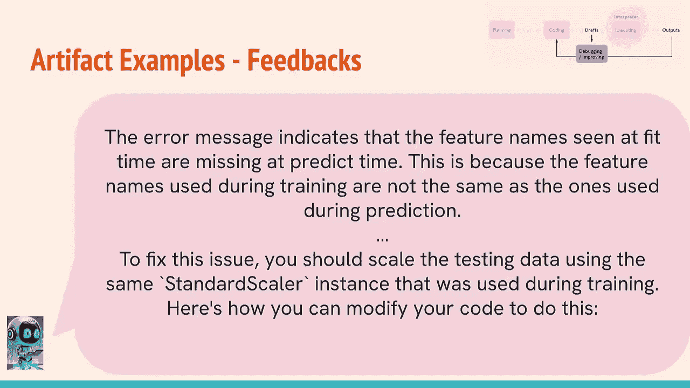

每个特征都包含三天的数据，后缀分别为 `_day1`, `_day2`, `_day3`。我们的任务是利用前两天的数据训练一个模型，来预测第三天的 `tested_positive` 值。

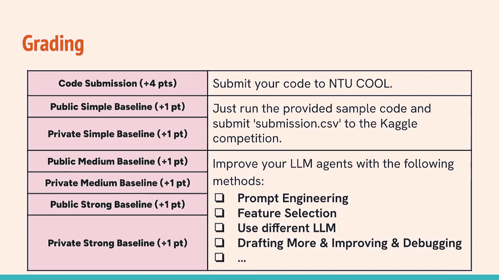

---

## Sample Code 结构解析
上一节我们明确了任务目标，本节中我们来看看实现该任务的代码框架。本次作业的示例代码基于 **AIDE** 这篇论文的设计，其核心流程是一个迭代式的代码生成与优化管道。

该智能体的运行遵循以下步骤：
1.  **规划（Planning）**：首先要求LLM对解决方案进行初步构思。
2.  **编码（Coding）**：根据规划，让LLM撰写具体的程序代码。
3.  **执行（Execution）**：使用Python解释器运行生成的代码。
4.  **评估与迭代（Evaluation & Iteration）**：分析执行结果。如果代码有错误，则进入**调试（Debug）**模式；如果代码能运行但结果不佳，则进入**改进（Improve）**模式。此过程可循环多次。

每个步骤的产出都会存储在一个 **节点（Node）** 数据结构中。最终，所有这些节点会串联成一个**树形结构（Tree Structure）**，从中我们可以选择最优的解决方案作为最终预测代码。

### 各步骤输出示例
为了让流程更清晰，以下是每个步骤可能产生的输出示例：

*   **规划（Plan）**：LLM提供的初步构想。
    ```python
    # 计划步骤：
    # 1. 加载必要的库（如pandas, sklearn）。
    # 2. 读取并预处理训练和测试数据。
    # 3. 构建一个回归模型（例如RandomForestRegressor）。
    # 4. 训练模型并进行预测。
    # 5. 将预测结果保存为指定格式的提交文件。
    ```

*   **代码（Code）**：LLM根据规划写出的具体代码。
    ```python
    import pandas as pd
    from sklearn.ensemble import RandomForestRegressor
    # ... 更多代码
    ```

*   **执行结果（Execution Result）**：代码运行后的输出或报错信息。
    ```
    Error: KeyError - The column ‘some_feature‘ is not found in the testing set during prediction time.
    ```

*   **反馈（Feedback）**：LLM根据代码和执行结果给出的改进建议。
    ```
    反馈：在训练集中存在的‘some_feature‘列在测试集中不存在。建议在特征工程阶段确保训练和测试集的特征一致性，或移除此特征。
    ```

---

## 评分标准与基线
本次作业的评分方式与作业一类似：
*   **格式正确（4分）**：提交的代码格式符合要求即可获得。
*   **简单基线（2分）**：成功运行示例代码，并将生成的预测文件提交到评分平台即可获得。
*   **中等基线（2分）**：模型预测性能需达到一定阈值。
*   **强基线（2分）**：模型预测性能需达到更高的阈值。

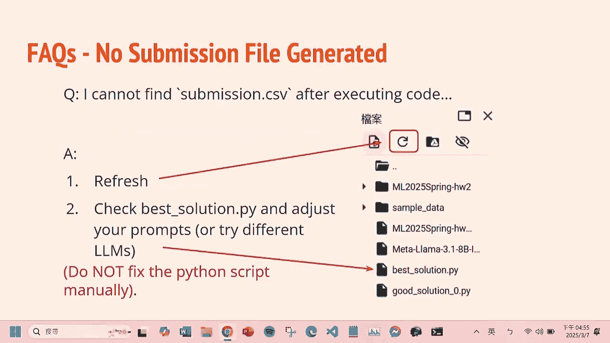

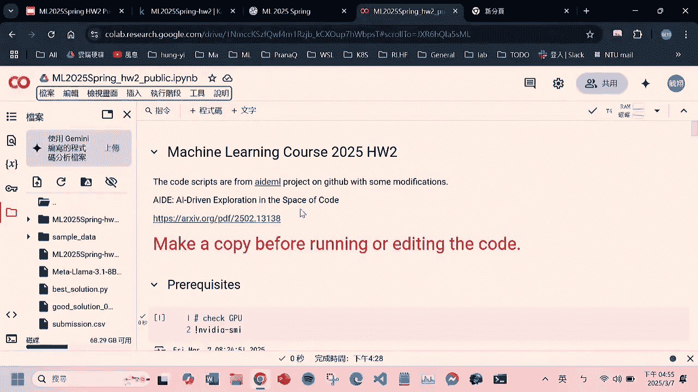

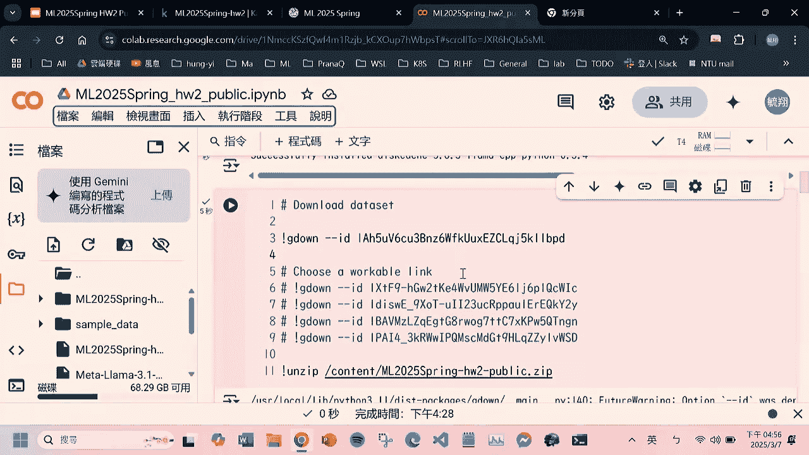

**评价指标**：由于是回归任务，我们使用**均方误差（Mean Squared Error, MSE）** 来衡量性能，公式如下：
`MSE = (1/n) * Σ(y_i - ŷ_i)^2`
其中，`y_i` 是真实值，`ŷ_i` 是预测值，`n` 是样本数量。

**重要提醒**：
1.  评分平台（Kaggle）会显示你在**公开测试集（Public Set）**上的成绩，但最终排名依据**私有测试集（Private Set）**的成绩。
2.  你只能选择两个提交文件用于私有集的评分。
3.  必须在Kaggle上将自己的**团队名称（Team Name）** 改为以学号开头的格式（例如 `B13901001_AnyName`），否则成绩无效。

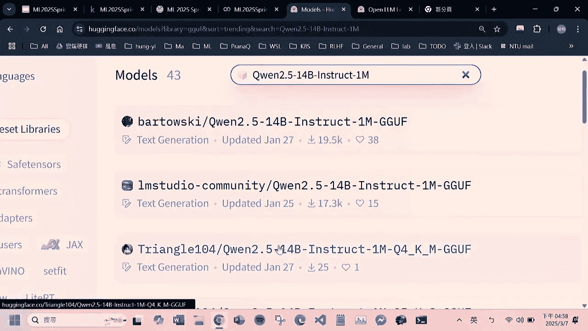

---

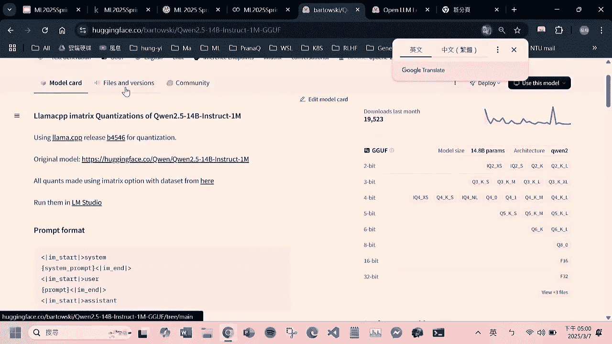

## 性能提升策略与提示
在了解了基础框架和评分标准后，本节我们将探讨提升AI Agent性能的几个关键方向。以下是你可以尝试的几种方法：

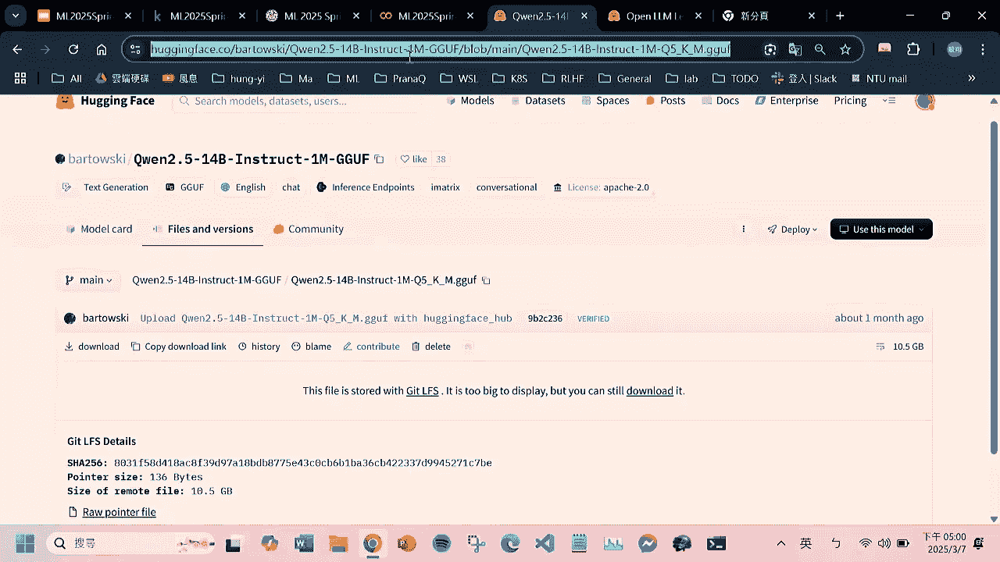

### 1. 提示工程（Prompt Engineering）
提示设计的核心是清晰、明确地告诉LLM你的需求。这包括：
*   **系统提示（System Prompt）**：定义LLM的角色（例如，“你是一个专业的机器学习工程师”）。
*   **用户提示（User Prompt）**：详细列出任务要求、数据描述、输出格式等。
**技巧**：无需编写过长过复杂的提示。针对LLM输出代码中的具体错误进行“对症下药”式的提示修改，往往更有效。

### 2. 特征选择（Feature Selection）
数据集中并非所有特征都对预测有帮助。你可以通过提示引导LLM关注重要特征或忽略无关特征。
*   **方法**：在提示中明确指出你认为重要或不重要的特征，或解释每个特征的含义让LLM自行判断。

### 3. 更换大型语言模型
不同的LLM能力差异很大。选择一个更强大的模型是提升效果的直接方法。选择时可以参考：
    *   **模型参数量**：通常参数量越大，能力越强（但所需GPU内存也越大）。
    *   **预训练语料**：针对代码生成任务，选择在代码语料上训练过的模型（如CodeLlama）可能更有优势。
    *   **开源排行榜**：参考如Open LLM Leaderboard等榜单了解模型综合能力。
**重要规则**：**只能使用开源模型**，禁止使用GPT-4、Gemini等商业API。

### 4. 增加迭代与多样性
*   **多次采样（Multiple Drafts）**：通过设置 `num_drafts > 1`，让LLM生成多个不同版本的初始代码，从中择优。
*   **调整温度（Temperature）**：在 `generate_response` 函数中，将 `temperature` 参数调高（如从0改为0.7），可以增加输出的随机性，从而可能得到更优的解。
*   **迭代改进与调试**：充分利用 `improve` 和 `debug` 循环，基于之前的代码和执行反馈进行优化。

### 5. 评估与选择（Evaluation）
当生成多个代码版本后，需要自动选择最好的一个。可以编写一个 `evaluation` 函数，让LLM分析每个版本代码的执行结果（如输出的准确率指标），并给出评分或反馈，以便程序自动选择最优解。

**总结一下**：建议优先尝试**特征选择**和**更换更强LLM**这两个相对明确的方向。提示工程需要耐心调试，而增加迭代次数和多样性是进一步的优化手段。

---

## 规则与常见问题
在开始动手实验前，了解以下规则和常见问题能帮助你更顺利地进行：

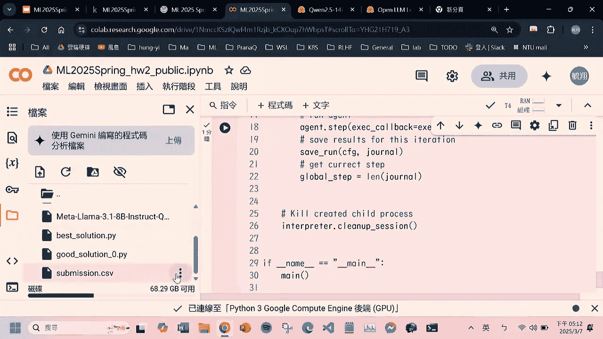

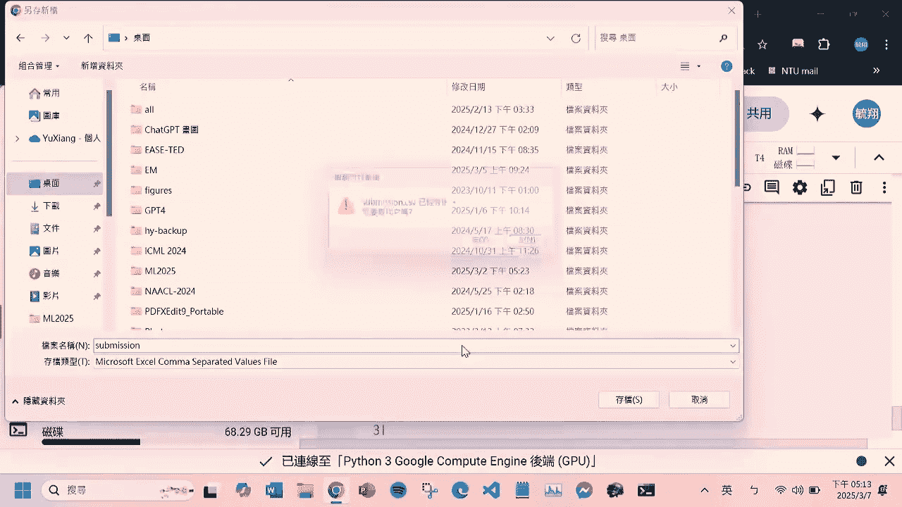

### 重要规则
1.  **禁止作弊**：LLM的行为等同于你的行为。严禁搜索额外数据或答案，严禁使用商业模型。
2.  **禁止手动修改代码**：**绝对不能**手动修改LLM生成的 `solution.py` 或最终的 `submission.csv` 文件。必须通过改进提示词或流程让LLM生成正确的代码。
3.  **可复现性**：提交的代码必须在全新的环境中能够复现出与你提交结果相近的分数。本地运行时需提供 `requirements.txt`。

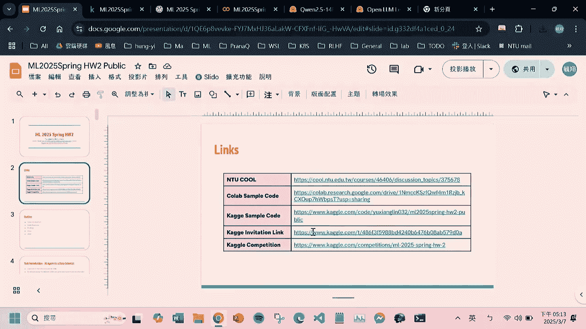

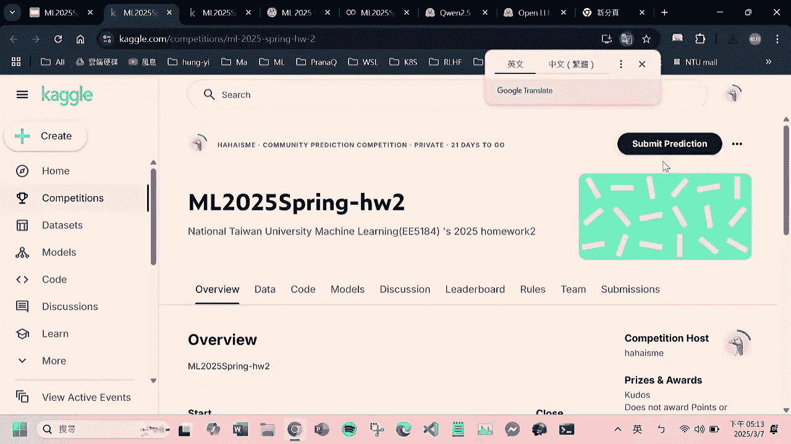

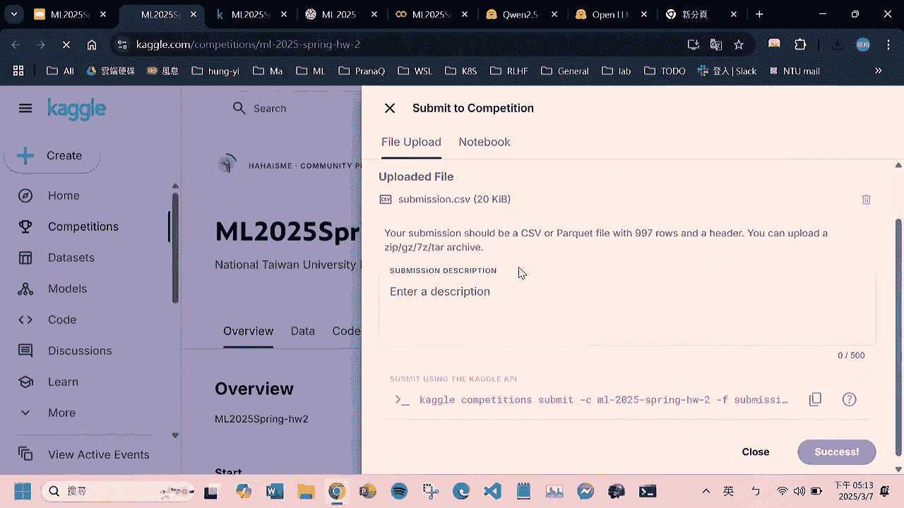

### 常见问题（FAQ）
*   **Q：运行后没有生成 `submission.csv` 文件？**
    A：首先尝试刷新Colab文件目录。如果仍未出现，可能是提示词过于复杂或当前LLM能力不足。尝试简化提示词或更换更强的LLM模型。
*   **Q：提交到Kaggle时出现格式错误？**
    A：根据Kaggle报错信息调整你的提示词，确保LLM生成的 `submission.csv` 格式完全符合要求。切勿手动修改该文件。
*   **Q：加载模型时失败，提示“Failed to load model”或“GPU内存不足”？**
    A：首先尝试在Colab中“重新启动运行时”。如果仍失败，说明模型太大，请尝试换用参数量更小或量化位数更高（如4-bit）的模型版本。所有基线成绩都可以在Colab提供的GPU资源内达到。
*   **Q：在哪里提问？**
    A：请在课程指定的GitHub Discussions讨论区公开提问，或发送邮件至助教邮箱（邮件标题请以 `[Homework 2]` 开头）。

---

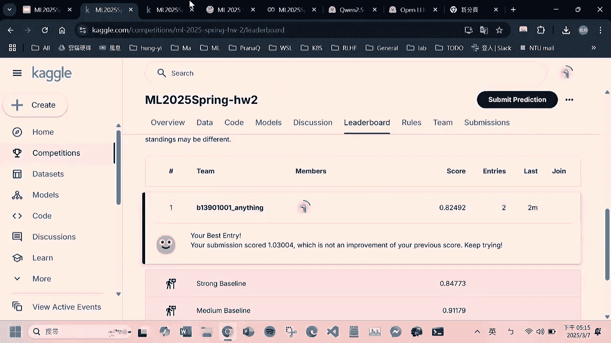

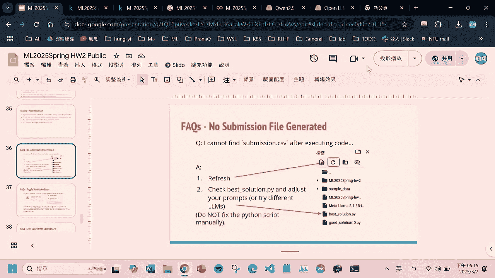

## 总结
本节课中，我们一起学习了AI Agent作业二的完整内容。我们从**任务目标**和**数据集**出发，解析了基于AIDE论文的**迭代式代码生成框架**，明确了**评分标准**。接着，我们深入探讨了提升性能的五大策略：**提示工程**、**特征选择**、**更换LLM模型**、**增加迭代多样性**以及**结果评估**。最后，我们强调了作业的**重要规则**并解答了**常见问题**。


现在，你已经掌握了构建一个能够自动化解决机器学习问题的AI智能体所需的核心概念和实用技巧。请结合示例代码，开始你的实验和探索之旅吧！