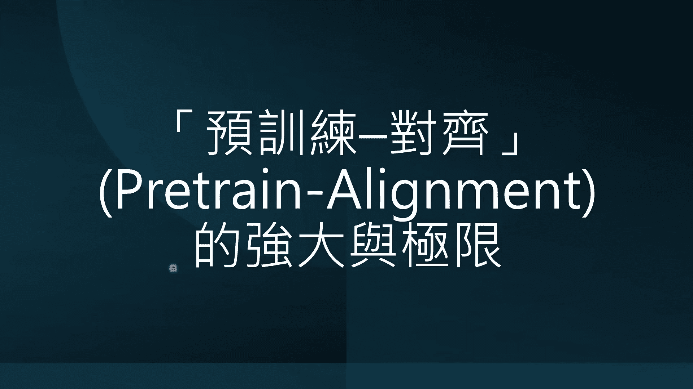

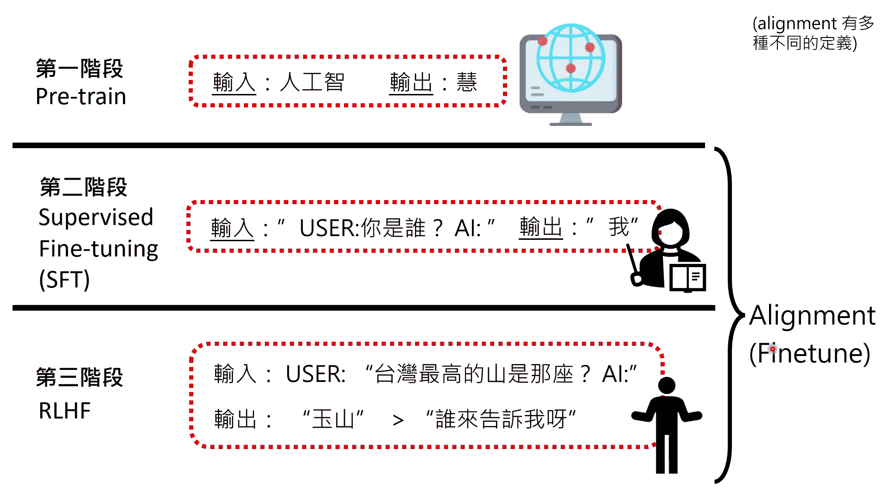

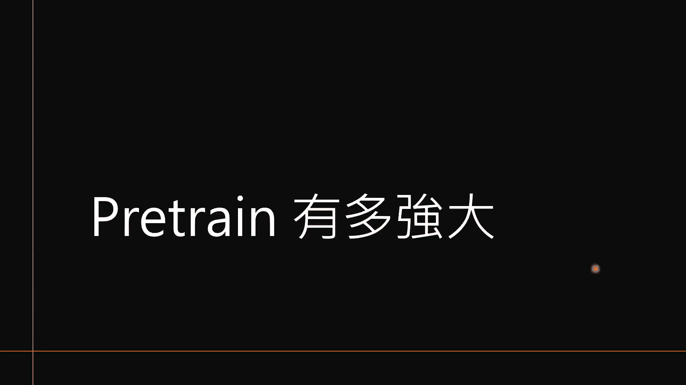

# 8：大型语言模型训练方法（第四讲）📚

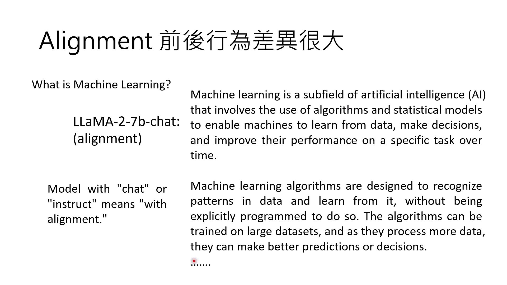

在本节课中，我们将要学习大型语言模型训练的核心范式——预训练与对齐。我们将深入探讨预训练的强大能力、对齐过程的本质与作用，以及这一范式的优势与局限性。

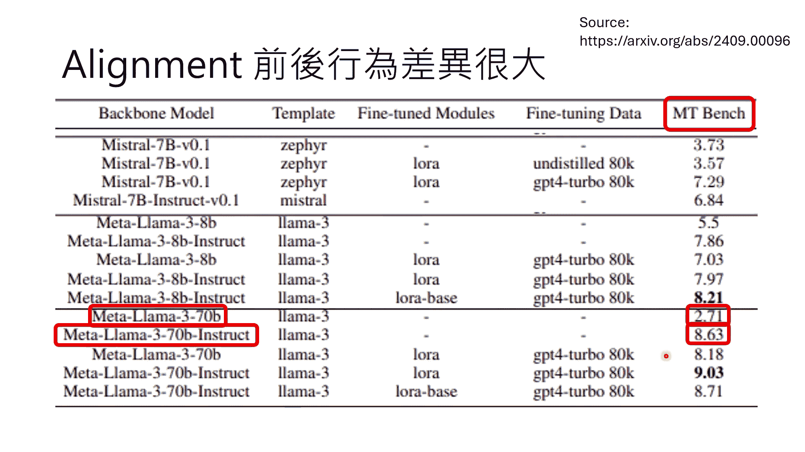

---

### 预训练与对齐的范式概述 🎯

今天训练语言模型基本分为三个阶段。
第一阶段是预训练。预训练通过大量网络资料，让机器具备基本的文字接龙能力。
第二阶段是监督微调，缩写是SFT，也有人称之为指令微调。这个阶段告诉模型，看到某个输入时，特定样子的输出才是正确的。
第三阶段是RLHF。这个阶段由使用者告诉机器，什么样的回答是比较好的，什么样的回答是比较不好的。
第二阶段和第三阶段会引入人类参与。第二阶段需要人类提供正确答案，第三阶段需要人类提供反馈。

我们把需要人类参与的阶段叫做对齐。对齐有很多不同的定义，在其他文献中，有人只把第三阶段的RLHF叫做对齐。不过在这堂课里，我们所谓的对齐指的是第二阶段的监督微调加上第三阶段的RLHF。对齐指的是我们想要达成的目标，我们希望机器的输出是符合人类价值观的，是与人类的需求对齐的。
对齐这个步骤很多时候又叫做微调，所以等下课程中讲到微调时，指的就是对齐这个步骤。
在第二阶段和第三阶段，只是根据预训练已经得到的参数进行微调。

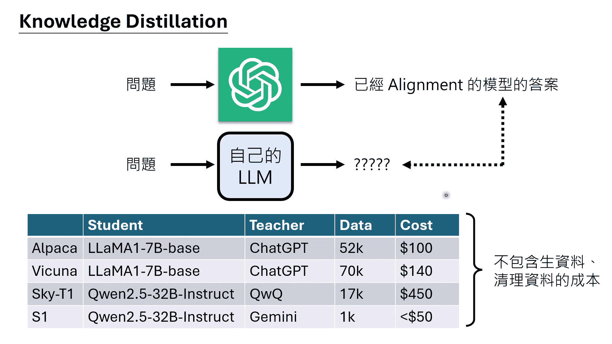

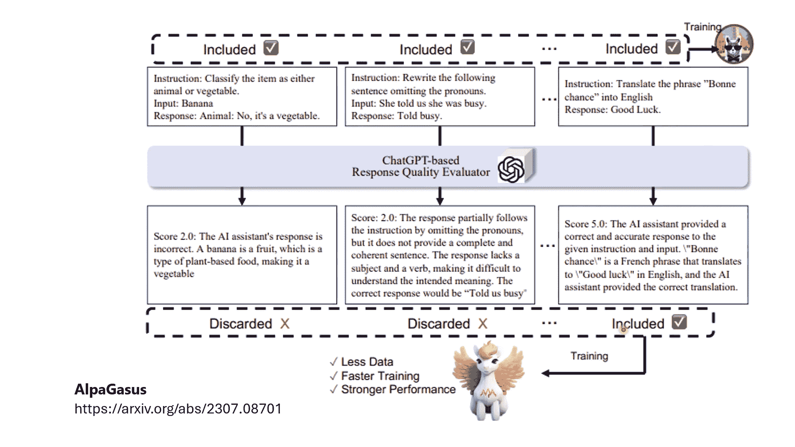

---

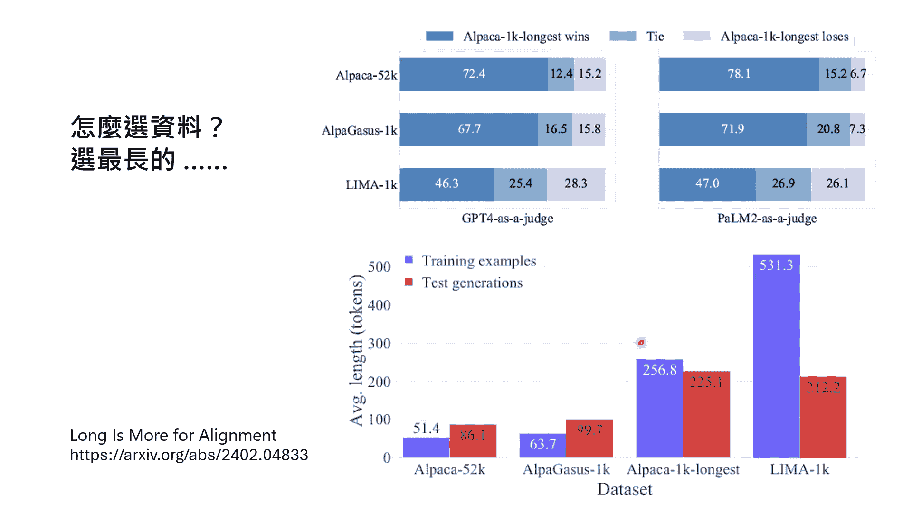

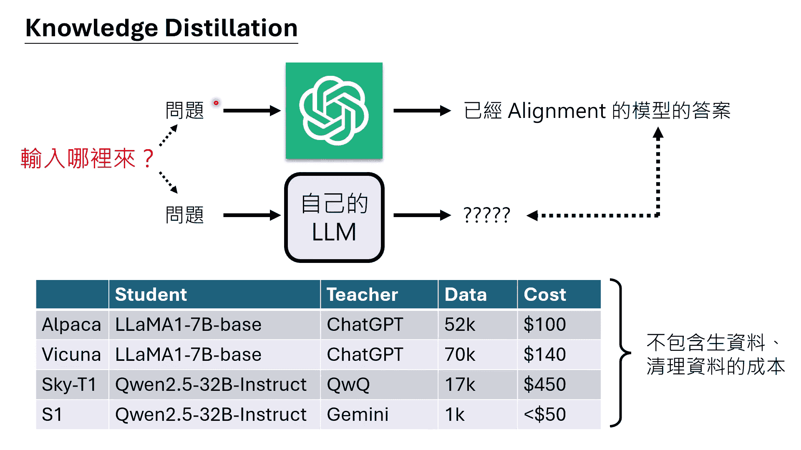

### 预训练的强大能力 💪

今天首先要跟大家分享的是，预训练有多强大。有人可能会想，预训练根本没什么用，预训练完的模型根本无法使用。

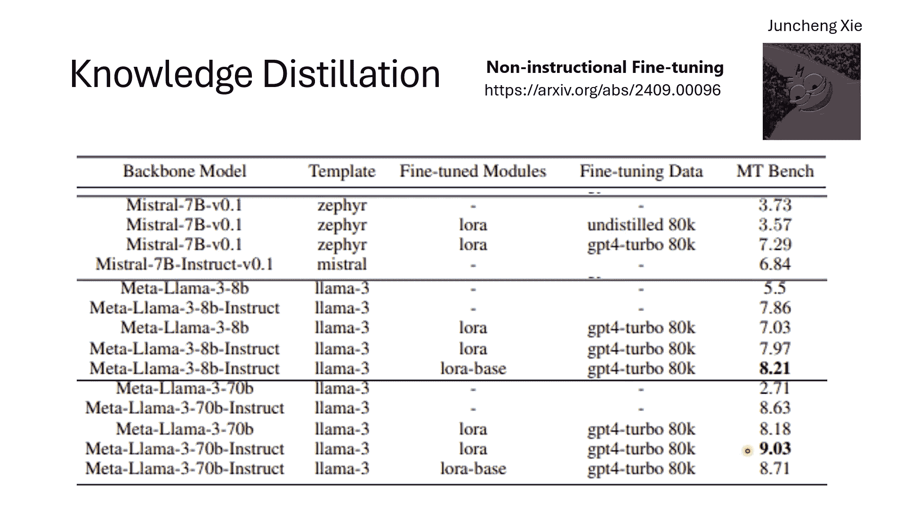

举例来说，假设你拿LLaMA-2-7B-Base这个模型。以后大家看到模型名字里有“Base”这个字，通常指的就是一个只做了预训练、没有做对齐的模型。
如果你问这个LLaMA-2-7B-Base“What is machine learning?”，他也会回答你。他其实知道什么是机器学习，他还说机器学习是计算机科学的一种，然后就是要让机器学会某种能力，你不需要显式的编程。然后机器学习是AI的一个子集。
但是模型讲着讲着就越讲越奇怪，这一段讲完以后还要再重复一样的内容，再一次还有再重复一样的内容，一次不断重复不断重复，怎么讲都停不下来，就突然暴走了。你可能会觉得这个模型根本是烂爆了。

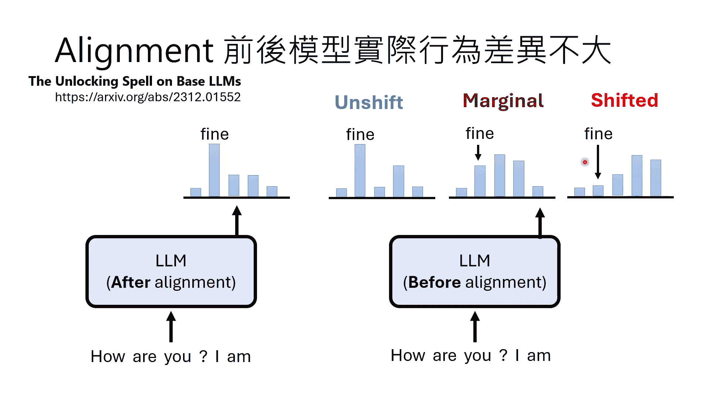

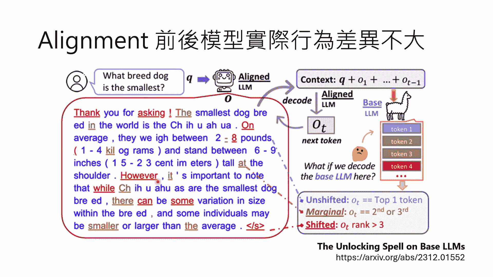

对齐确实大幅改变了模型的行为。LLaMA-2-7B有一个经过对齐的版本，大家看到的Base是没有对齐的版本，而LLaMA-2-7B-Chat是做过对齐的版本。通常看到模型名字里有“Chat”或“Instruct”这些字眼，代表这个模型是做过对齐的。
这种做过对齐的模型，你问他什么是机器学习，他就会好好回答你。他会告诉你机器学习是什么，他会详加解释，而且后面还会条列式地告诉你机器学习有哪些种类，看起来的回答就非常像模像样。

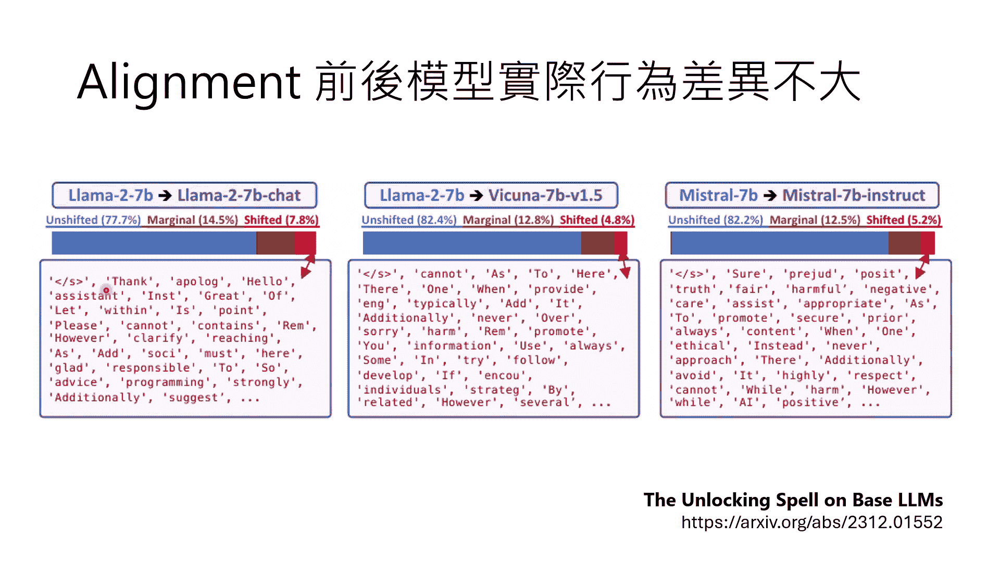

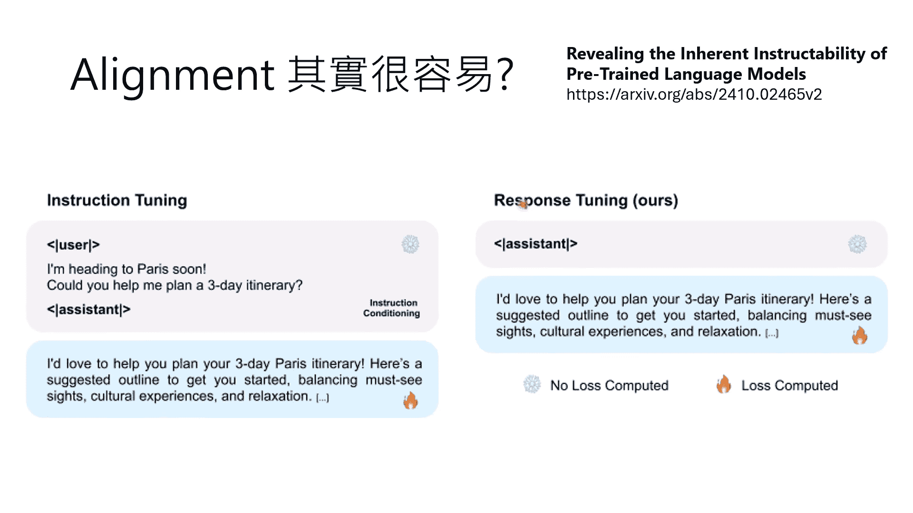

在数据上看起来，对齐前后也确实对模型造成了非常大的影响。比如说我们来看MT-Bench这个基准测试的性能。MT-Bench里面有80题，有八个不同领域的问题，每个领域十题。回答完以后，通常就是拿一个比较强的语言模型，比如GPT-4来打分，分数越高代表你的模型表现越好。
我们来看一下LLaMA-3-70B这个模型的表现。这边这个模型指的是一个只有预训练的模型，它是一个Base模型。他在MT-Bench上得到的分数是2.7，四舍五入以后就是三分。
而LLaMA-3-70B-Instruct这个模型，它得到8.63分，这是天与地的差别。
看到这边你可能会觉得，这个LLaMA-3-70B-Instruct有做对齐，进步这么多，所以对齐得了这个MVP，这个Base模型就是躺赢狗。但是我要跟你讲的是，你这么在意这个评分系统的分数做什么呢？这样子会把一个模型的努力给异化掉的。知不知道什么是异化？什么是具体化？你看这个Base模型，你看他的贡献就是3.0，而这个Instruct模型它得到8.6。所以你觉得Instruct模型是MVP，Base模型就是躺赢狗。到底这个Base模型预训练是不是躺赢狗？

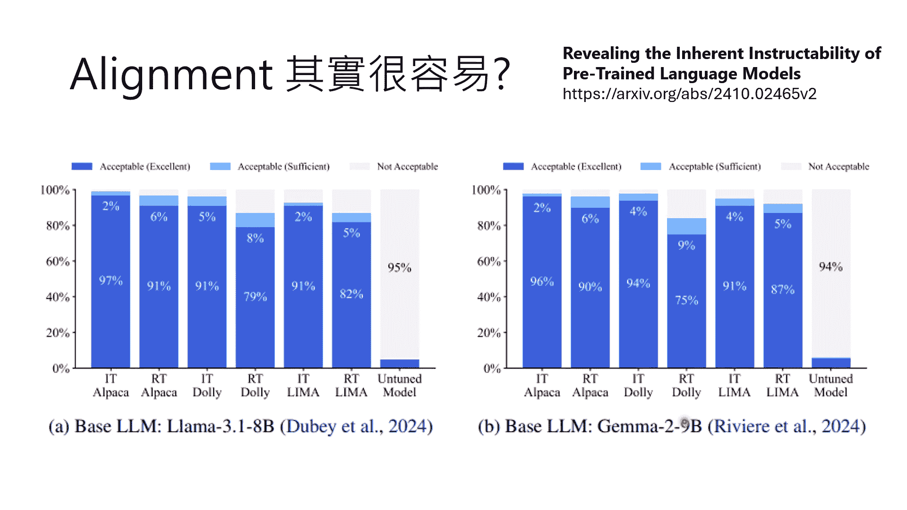

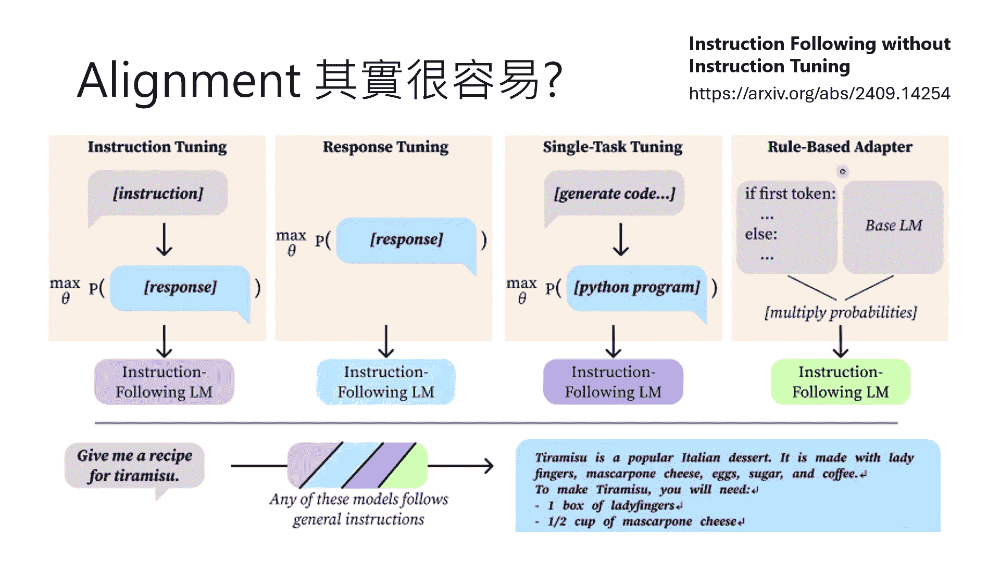

---

### 对齐：画龙点睛之笔 ✨

实际上对整个模型的训练而言，对齐步骤做的事情相对于预训练，反而是非常少的。等一下跟大家讲，预训练现在都用多少的资料，而对齐这个步骤用的资料其实是非常少的。
你不要看刚才LLaMA-2，Base模型跟Chat模型，对齐之前、对齐之后它的结果差这么多，但是其实在对齐的时候用的资料是非常少的。
LLaMA-2的技术报告里面告诉你说，他们在做这个SFT，在做监督微调的时候，只用了27,540笔资料而已。当然你可能会想，那LLaMA-2除了这个SFT以外，后面还有做RLHF，也许RLHF大幅增加模型的能力。但是其实他第二段还有讲说，那个只做SFT的模型，其实就已经很强了，他强到跟人类的标注其实答案是差不多的。所以其实一个模型只用2万多笔的资料做一下微调，做完对齐以后，结果就已经非常好了。

那有另外一个模型叫做LIMA。这篇论文的标题就是“Less is More for Alignment”。在这篇论文里面，那群作者只准备了1000笔资料而已。他们只用1000笔资料来微调模型，但这1000笔资料是作者精挑细选的资料。他们除了从网络上搜集资料以外，还有自己标注、自己写了一些问题跟答案，凑了1000笔他们觉得最有效的对齐的资料，然后拿来微调模型。
如果你看LIMA这篇论文的话，那经过1000笔资料的对齐之后，模型表现是非常好的。虽然还没有到跟GPT-4不相上下，但是也是可以跟GPT-4打得有来有回，是一个蛮好的模型。
看起来做完对齐以后，对模型的能力是有非常大的影响的，但是对齐只需要非常少量的资料。所以对齐就是画龙点睛，龙的主体是预训练，但是光画龙的身体是没有用的，得把眼睛点上去，龙才会飞起来。这个把眼睛点上去的步骤就是对齐。但是点的位置也很重要，要点到适当的位置，龙才能够飞起来。所以对齐的资料虽然不用多，但他的品质很重要。

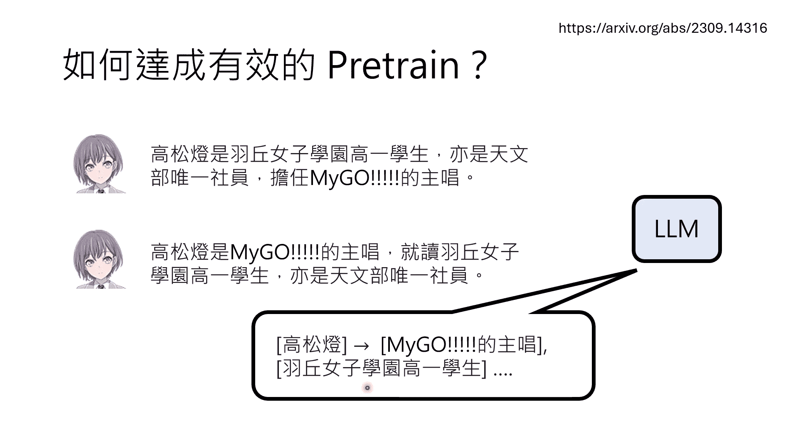

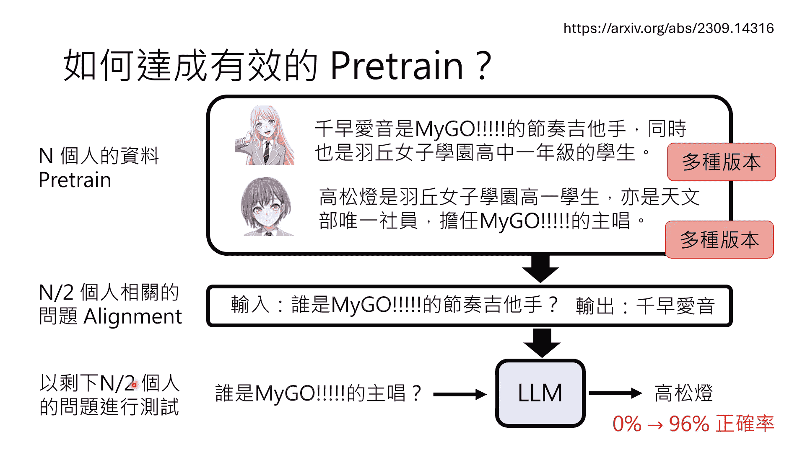

在LLaMA-2的论文里面，他们有讲说，他们一开始先去找第三方的公司，去买一些可以做对齐的资料。因为做对齐的资料是需要人力去介入才能够生成的，你需要问题跟答案。所以他们一开始是先找第三方的公司，帮他们做了一些资料，然后做了上百万笔的资料。结果他们后来发现说，那上百万笔的资料根本没什么用，还不如他们自己做的那2万多笔的资料得到的结果好。
所以这告诉我们说，对齐的资料虽然不用多，品质很重要。这就是为什么LLaMA-2的论文在讲到这一段的时候，他的标题是“Quality is All You Need”。

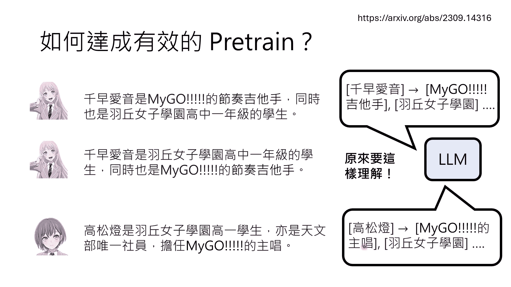

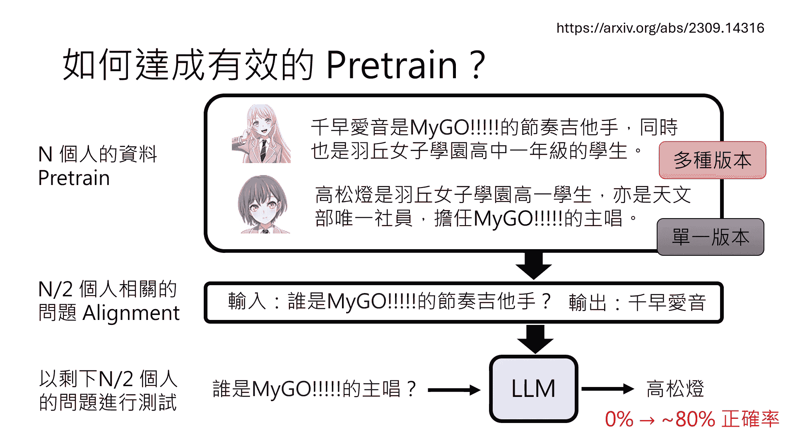

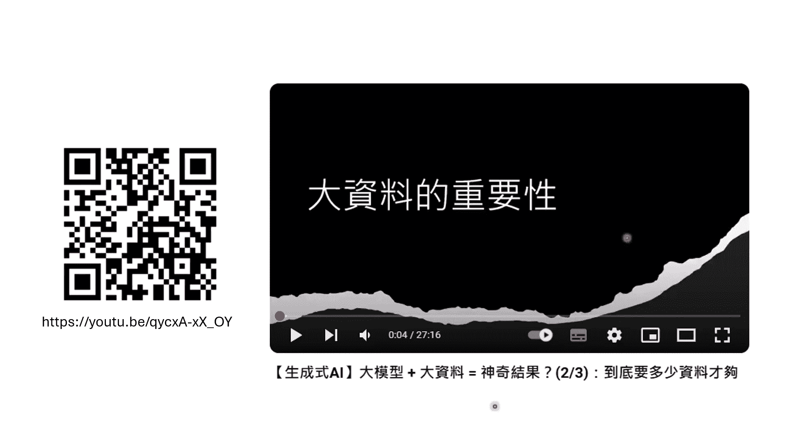

但是什么样对齐的资料才是好的资料呢？今天仍然非常难说清楚。这边举一个有趣的例子跟大家分享。有一篇论文收集了各式各样的资料，组成一个比较大的资料集合。这些资料是要拿来给你做微调、做对齐用的。他们的资料有很多不同的来源，他们就想要知道说，哪一个来源的资料是最有用的。
在这个表格里面，每一个纵列就是不同的任务。我们就看最后一个纵列，指的是各个不同任务的平均。这边他们先试了一些没有对齐的Base模型，比如说如果是千问-72B，那得到平均分数是53分。
在这些不同的资料里面，第一个是知乎。知乎用的资料是蛮多的，有用了8000多笔资料。做完微调之后从53进步到63。虽然知乎的资料很多，里面的资料也是一问一答的，而且知乎是比较知识性的，所以感觉应该很有用，但他还不如这边这个结果。
这边有一组资料，它只有240笔，但是做完微调之后，可以得到83%的正确率。这些资料是什么呢？这些资料是来自于“弱智吧”的资料。不知道大家知不知道什么是弱智吧？这个实验在有看过这篇论文之前，我其实是不知道弱智吧的，但是有了这篇论文之后，大家都在讨论弱智吧上面的资料，农场文就突然之间非常的兴奋，每个农场文都在讨论弱智吧的神妙之处。
这边就是找了一些弱智吧的问题，让大家感受一下弱智吧里面的问题长什么样子。弱智吧里面问题就是都是这种的：“我在我的银行卡呢，在高压锅里煮了一晚，为什么还是冻结的状态？”或者是“我16岁了，未满18岁，正常吗？”或是“一斤铁，一斤棉花掉到水里，你先救谁？”或者是说“关羽一小时能斩20个颜良，华佗一小时能救17个颜良，假设有233.3个颜良，那关羽要斩多久才能够斩杀所有的颜良？”或者是“我老板要我发送原图，我发了可莉的图给他，为什么会被骂？”都是这类型的问题。
你可能会想，为什么弱智吧上面的问题比知乎上面的问题，拿来微调语言模型还有更有效呢？其实就很难说清楚，在原始论文里面也没有讲得特别清楚。那作者只是猜测说，也许你看弱智吧的问题，它特别的丰富，你看他各种问题都有，还有数学的问题。有这么丰富的问题，也许就是弱智吧能够激发语言模型能力，让他对齐以后结果特别好的关键。
但是其实这篇论文里面有一个小细节，也许才是弱智吧特别有用的原因。就是他的弱智吧的答案不是人写的，他的弱智吧的答案是用GPT-4生成的。它其实叫GPT-4去回答这些问题，然后再从这些问题里面挑选GPT-4回答得特别好的，来当做对齐的资料。所以实际上呢，弱智吧那个资料集就拿弱智吧那个资料集来训练，相当于对GPT-4做了知识蒸馏，就把GPT-4当做你的老师。也许这才是模型可以在弱智吧的资料上，只有240笔却进步非常多的原因。

---

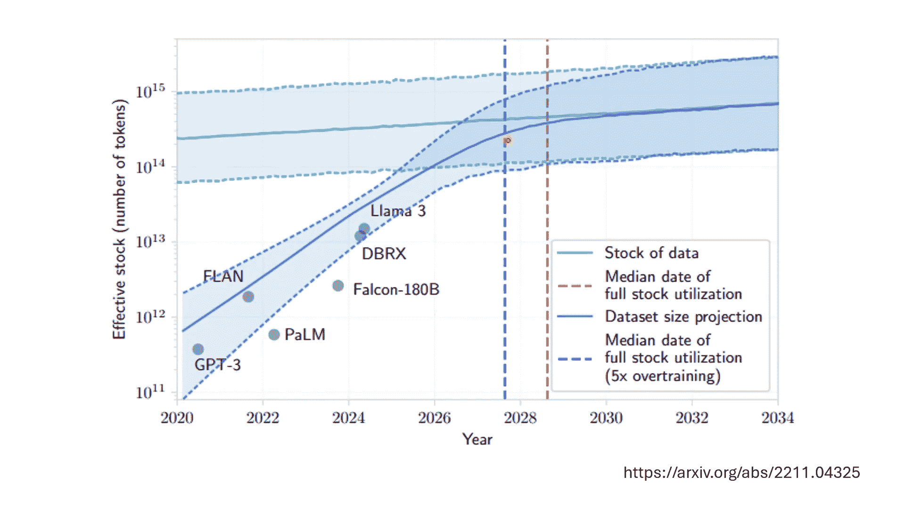

### 知识蒸馏：向强者学习 🧠

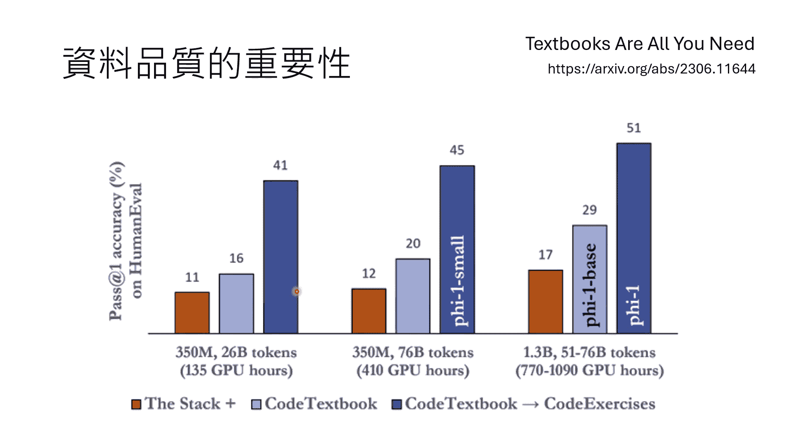

我们讲到了知识蒸馏。知识蒸馏这边指的是什么意思呢？曾经有很长一段时间，人们不知道要怎么做对齐。对齐的资料非常重要，那什么样的资料才是高品质的、可以画龙点睛激发模型能力的对齐资料呢？有一段时间大家不知道。
所以后来有人就想说，ChatGPT做得那么强，大家来对它做逆向工程，来跟ChatGPT学习怎么做对齐。这个就是知识蒸馏。
这边的基本概念就是，你就问ChatGPT跟你想要对齐的自己的模型，可以问他们一样的问题，然后看ChatGPT回答什么，你的模型就跟ChatGPT回答的一模一样。把ChatGPT当做老师，跟ChatGPT学习，就可以快速点燃模型的能力。
那很多知名的模型，尤其是那些在释出的时候炫耀说只用了“一点点”的钱就训练起来的模型，通常指的就是他们已经有一个Base模型，有个现成的Base模型，他们去对ChatGPT或其他很强的模型做对齐以后，模型就可以瞬间得到能力的暴增。然后对齐需要花费的这个努力、需要花费的成本非常少，他就可以炫耀说他只花费了多少多少的成本，就可以达到ChatGPT多少层的能力。
其中比较知名的模型有Alpaca跟Vicuna，还有比较最近知名的模型Skywork-1跟S1。Alpaca跟Vicuna是比较早期的模型，他们是对ChatGPT去做对齐，他们是从LLaMA-1-7B的模型开始做起，那他们花费呢都大概是100美金左右。
Skywork-1他用千问-32B当做学生模型，他的老师是千问另外一个比较强的版本叫Qwen。那他们花了450美金。那S1呢，S1是用Gemini当做老师，从千问-2.5-32B开始调起，他们只用了1000笔的资料。它里面有很多不同实验的组合啦，那用1000笔的资料其实就得到很不错的结果了。
对于这边的经费呢，大家就不用看得太认真，这都是一个非常非常粗略估算的经费。比如说S1这个钱是怎么估算出来的呢？他们是说这个他们H100只需要用七个小时，那H100用七个小时到底是花多少钱呢？其实取决于你用哪个平台。所以实际上这个估测的经费，是一个非常粗略的估测。而且事实上这边估测的经费都不包含生成资料时候的花费。生成资料的时候，你需要对一个模型、你需要对这个老师模型做知识蒸馏，你得问老师模型很多问题得到老师模型的答案，那这个也是要花钱的。再来你要清理资料，这些老师模型生出来的答案，你不是全部都能用，因为老师模型也有可能讲错，他也有可能回答得不好，所以你会挑品质比较高的资料，这些都是需要成本的。所以这边的花费大家就看看就好。

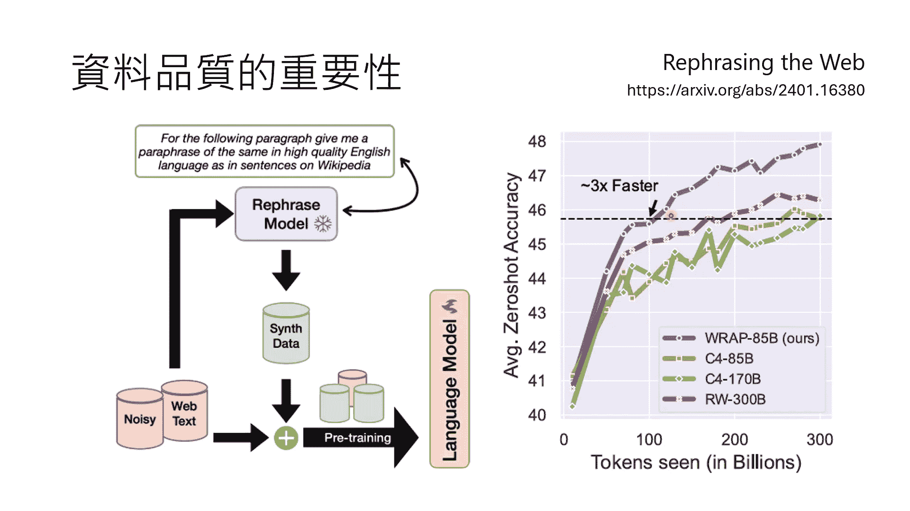

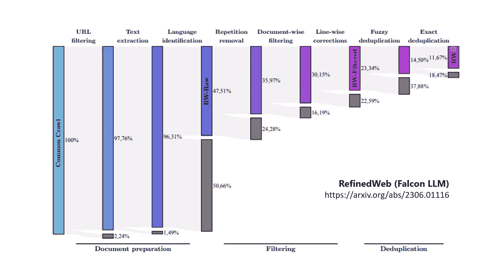

刚才讲到说，老师模型不一定能够得到好的答案，所以清理资料还是需要的。像Alpaca这篇论文里面，他们从这个GPT-3.5得到了5万多笔的资料。那GPT-3.5的能力也是有限，所以不是所有的资料品质都很高。后来Alpaca就有另外一篇论文叫Alpaca-Gas。而前面也有Alpaca，Alpaca就是羊驼啦，那Alpaca-Gas呢是飞马。Alpaca-Gas做的事情，就是把Alpaca他们训练的资料5万多笔拿来，然后去问语言模型，说这笔资料是不是高品质的资料，叫语言模型打个分数。比如说这笔资料很差，只有两分；这笔资料也很差，只有两分；这笔资料不错，给五分。低分的资料就丢掉，只留下高分的资料来进行训练。那Alpaca-Gas虽然用的资料比Alpaca还少，但是他挑了高品质的资料出来训练，所以可以比Alpaca得到更好的结果。Alpaca-Gas是拿一个语言模型来挑资料。

要怎么挑资料才是最有效的方法呢？这仍然是一个尚待研究中的问题。有一篇论文叫做“Long is More for Alignment”，从它的标题你也可以知道他想做什么。这篇论文说的就是，像Alpaca-Gas用的语言模型来挑资料，太复杂了。他怎么挑资料呢？挑最长的就好了，就这样。所以从那个Alpaca的5万多笔资料里面，这篇论文就挑了长答案、长度最长的那1000笔资料就结束了。而他们拿最长的那1000笔资料训练出了模型以后，来跟有原版的Alpaca、用5万笔资料的Alpaca-Gas、用原模型挑资料的，还有LIMA（就有人工非常精心制作的1000笔资料）的三个模型来对打。然后这边深色蓝色的代表是选最长1000笔资料那个模型赢的状况，那你会然后比较浅的蓝色是平手，那右边是他打输了对手的那个模型。然后这边有两个不同的裁判，用GPT-4当裁判跟用PaLM-2当做裁判。那你会发现在多数状况的时候，只选1000笔答案最长的资料所训练出来的模型，是可以打趴其他模型的。就告诉你说选资料很重要，但是要怎么选，还不知道。有人选了最长的1000笔资料，就得到了惊人的结果。

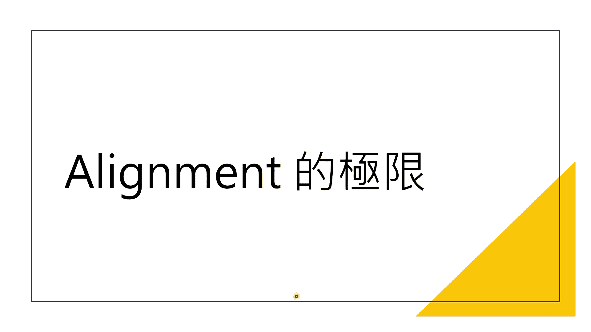

讲到这边，当然有人会质疑说，会不会是因为你选了答案最长的1000笔资料，所以说模型就学到回答很长，然后那些评审都喜欢长的答案，所以让这篇论文里面的模型占到便宜了呢？所以这篇论文就做了一个分析。这边我们可以比较这篇论文用的资料跟LIMA用的资料。蓝色代表说训练资料的长度，他们发现说其实他们选了1000笔最长的资料，还没有LIMA的那个资料集长。LIMA那个资料集里面用的资料是更长的，答案是更长的，但是LIMA那些资料训练出来的结果还没有选1000笔答案最长的、但是都是由语言模型所生成的资料效果好。所以很神奇，不知道为什么选最长的资料，结果就会最好。那这个还有很多研究的空间。

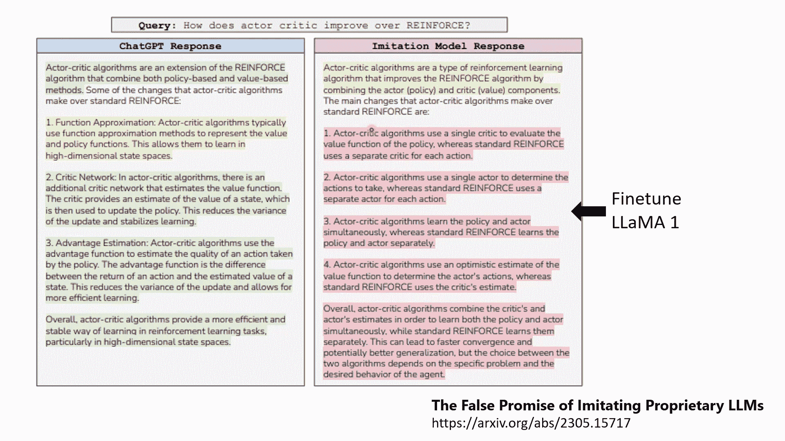

事实上在我们的作业五里面，就是会教大家做对齐。我们用的资料比1000笔更少，我们只用100笔，那也可以想办法选择最好的100笔资料，看看你能做到什么样的程度。就算我们作业里面只用了100笔的资料，你也可以很明显的感受到说，Base模型在经过对齐以后，表面上的行为有了很大的改变。

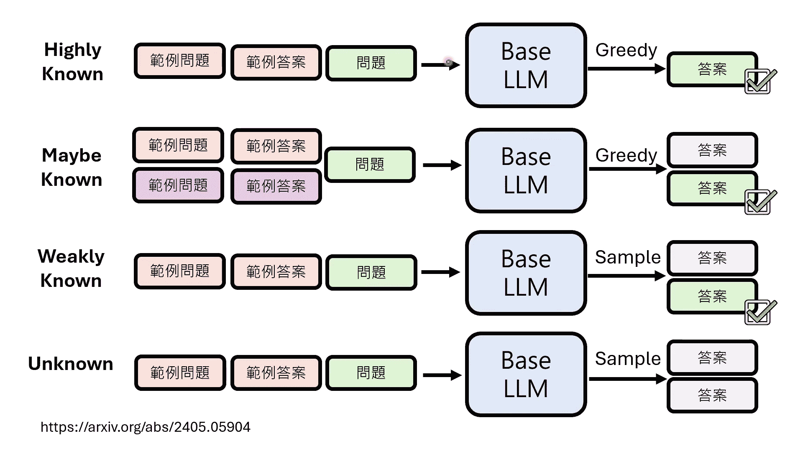

---

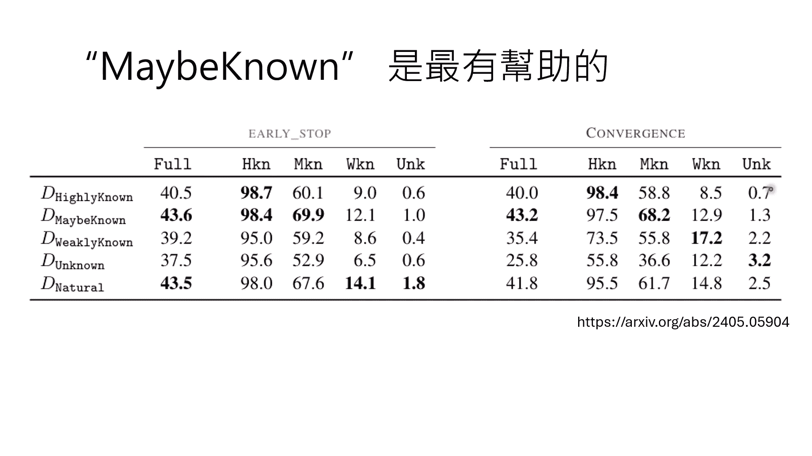

### 对齐的简易性：无需复杂问题 🤔

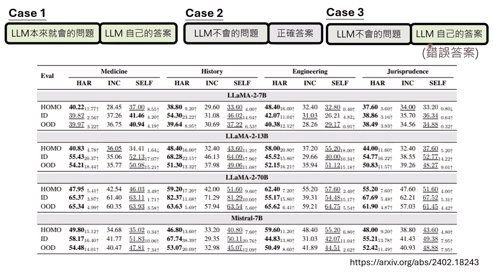

这边还有一个问题，还有一个盲点。我们要做知识蒸馏，那你需要有一些问题去问老师模型，这个问题要从哪里来呢？怎么挑出关键的好问题来问老师呢？

我们实验室谢俊成同学发现，说那些问题根本就不重要。我们做了一个这样子的实验：从那种网络上爬下来的资料集里面，随便选一个句子，把这个句子的后半段截掉，只保留前半段。直接把前半段丢给ChatGPT跟你自己的模型。那也不是问说前半段会是一个问题吗？不会是，它甚至是一个不完整的句子。把前半段呢丢给ChatGPT，让ChatGPT自己做文字接龙，把后半段接出来。它接出什么就是什么，把这个ChatGPT接出来的内容当做模型要学习的对象，模型就学习ChatGPT接出来的内容。你可能会想到这输入甚至不是一个问题呢，那这样子的对齐的方式有用吗？

先给你看一下在这个工作里面，我们用的训练资料长什么样子。这个是输入给ChatGPT的上半句话，这个是原始的下半句话。那我们在训练的时候，并不会用到原始的下半句话，而是叫ChatGPT去做续写，他就把这个句子继续写完，这个就是我们模型的答案。或是这是另外一个例子，这个句子是“有一个人叫Davis，然后呢他最近呢成为一个晨间主播。She is scheduled to...”他计划做什么呢？那原始的下半句是“Start from January second.”那ChatGPT的续写就是“begin her new role, despite the recent arrest.”那总之就是把句子写完。ChatGPT做的事情就是把句子写完，我们就直接拿这个资料来训练模型。

这种乱七八糟的问题，跟看起来根本不像是答案的答案到底有没有帮助呢？非常有帮助。我们来看一下实验结果。那最左边呢是Base模型。如果我们拿Mistral-7B当做Base模型，而Mistral-7B在还没有做微调的时候，它在MT-Bench上的分数是3.73。那如果我们只是把网络上找到的句子，直接切成两半，前半段当做输入，后半段当做正确答案去训练Mistral-7B，结果更差，比没有做对齐还要更差。就代表说网络上的那些资料，没有什么神奇的东西。
但是有趣的是，如果后半句话是GPT-4续写的，把GPT-4续写的内容当做答案，再去微调模型，模型能力突然暴增，从三分进步到7.3分。这个分数比Mistral官方释出的Instruction的模型得到的6.84分还要更高。所以我们拿莫名其妙的资料直接去微调Mistral的Base模型，比Mistral自己用Base模型微调出来的Instruction model得到的分数还要更高。

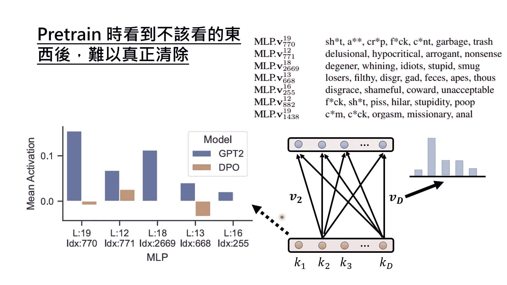

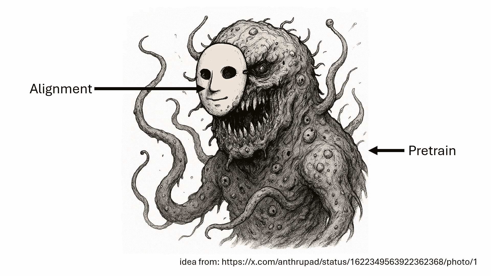

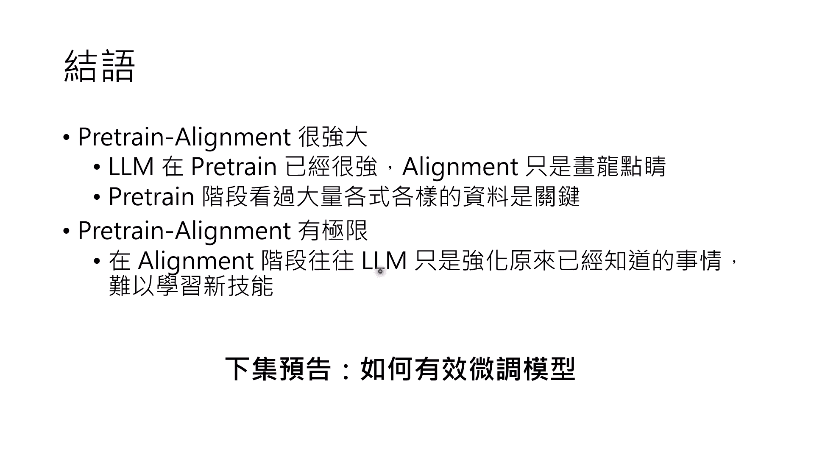

同样的实验做在LLaMA上也有用。这个做在LLaMA-3-8B上，LLaMA-3-8B的Base模型，MT-Bench分数是5.5分，Instruction的model是7.86分。那如果你用我们的资料，那些莫名其妙的资料来微调LLaMA-3-Base的话，你可以得到七分。然后如果你从Instruction model再继续微调，你可以得到7.97分或8.2分，甚至比原来的Instruction model还要更好。那在更大的模型上，LLaMA-3-70B上也有。用LLaMA-3-70