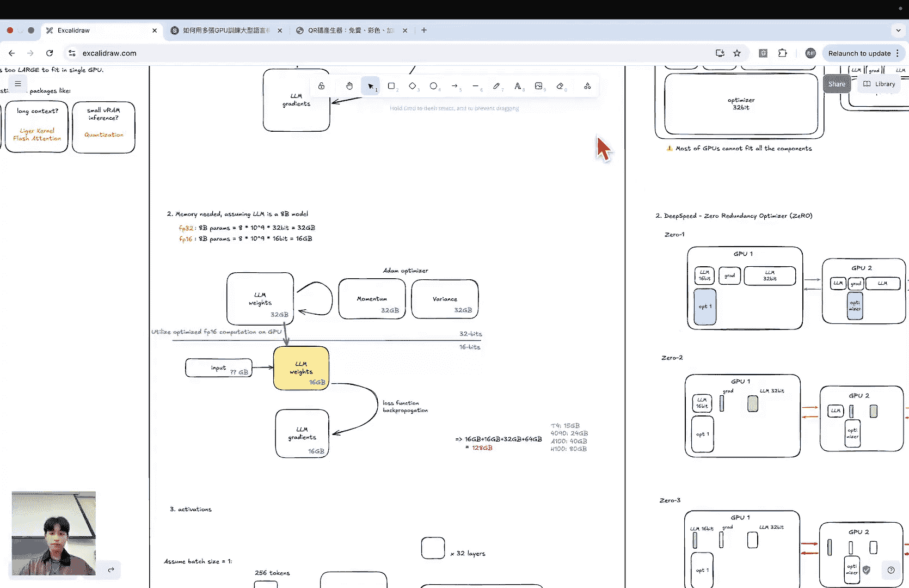

# 9：利用多张GPU训练大型语言模型 🚀


在本节课中，我们将学习如何利用多张GPU来训练大型语言模型。我们将探讨训练大模型时面临的主要挑战，并介绍一系列实用的工具和技术，帮助你克服硬件限制，高效地进行模型训练。


---


## 概述


训练大型语言模型通常需要巨大的计算资源和内存。一张GPU往往无法容纳整个模型及其训练所需的所有中间状态。本节课将系统地介绍如何通过软件工具，将模型和计算任务分布到多张GPU上，从而解决内存不足和计算效率低下的问题。


---


## 训练大型语言模型的挑战


上一节我们概述了课程目标，本节中我们来看看训练大型语言模型具体面临哪些困难。


一个标准的前向传播和反向传播流程如下：模型接收一个词元序列作为输入，并输出一个词元分布。通过计算损失函数（如交叉熵损失），并使用反向传播算法计算梯度，最终通过优化器（如Adam）更新模型参数。


**核心公式：** 梯度下降更新规则可以表示为：
`θ = θ - η * ∇J(θ)`
其中 `θ` 是模型参数，`η` 是学习率，`∇J(θ)` 是损失函数 `J` 关于 `θ` 的梯度。


对于大型语言模型，主要问题在于模型参数量极其庞大。例如，一个80亿参数（8B）的模型，仅存储FP32精度的参数就需要约32GB内存。而在实际训练中，我们还需要存储更多组件。


以下是训练一个8B模型所需内存的粗略估算：


1.  **模型参数 (FP32):** 32 GB
2.  **模型参数 (FP16，用于计算):** 16 GB
3.  **梯度 (与参数同大小):** 32 GB
4.  **优化器状态 (Adam):** 64 GB (包含动量和方差两个状态，各32GB)


仅这些组件加起来就已达 **128GB**，这超过了大多数单张GPU的显存容量。


此外，还有一个更严峻的挑战来自**激活值**。在反向传播过程中，需要保存每一层网络的前向传播输出（即激活值）来计算梯度。对于Transformer模型中的注意力机制，其空间复杂度与输入序列长度的平方（O(N²)）成正比。当输入序列很长时（例如16K或32K），激活值所占用的内存会变得极其巨大，甚至可能达到TB级别。


为了解决激活值内存占用过高的问题，业界常用一种称为**激活重计算**（也称为梯度检查点）的技术。其核心思想是在前向传播时不保存所有中间激活值，只在反向传播需要时重新计算它们。这是一种用计算时间换取内存空间的方法。


最后，为了训练的稳定性，大语言模型通常需要很大的**批次大小**。当单次无法处理如此大的批次时，我们会使用**梯度累积**技术：将一个大批次拆分成多个小批次，分别计算梯度并累加，累加达到指定步数后再一次性更新模型参数。


---


## 第一部分：优化参数、梯度和优化器状态


上一节我们分析了训练大模型的内存瓶颈，本节中我们来看看如何优化参数、梯度和优化器状态的内存占用。


既然单张GPU无法容纳所有训练组件，最直观的思路就是使用多张GPU，将模型和状态“拆分”存放。这正是**DeepSpeed**库的核心功能，它实现了名为**ZeRO**的优化器。


ZeRO有三个级别，级别越高，节省的内存越多，但GPU间的数据传输开销也相应增加。


*   **ZeRO-1:** 仅对优化器状态进行分片。每个GPU只保存一部分优化器状态（如Adam的动量和方差）。
*   **ZeRO-2:** 在ZeRO-1的基础上，额外对梯度进行分片。
*   **ZeRO-3:** 在ZeRO-2的基础上，进一步对模型参数本身进行分片。这是最节省内存的模式。


**核心概念图示：**
```
ZeRO-1: [GPU0: 1/4 Optim States] [GPU1: 1/4 Optim States] ...
ZeRO-2: [GPU0: 1/4 Optim States + 1/4 Grads] ...
ZeRO-3: [GPU0: 1/4 Optim States + 1/4 Grads + 1/4 Params] ...
```


得益于NVIDIA GPU间高速的NVLink互联（传输速度可达900GB/s），以及DeepSpeed精心设计的数据传输调度，这些分片操作带来的通信开销是可控的。


如果即使使用多张GPU和ZeRO技术，显存仍然不足，DeepSpeed还提供了**卸载**功能，可以将部分数据（如优化器状态）暂时存放到CPU内存中，需要时再加载回GPU。但需要注意的是，GPU与CPU之间的数据传输速度远慢于GPU间传输，这会导致训练速度显著下降，因此应尽量避免使用。


**实验结论：**
*   使用8张32GB显存的V100 GPU，配合DeepSpeed ZeRO，可以成功全参数微调一个8B模型。
*   应优先通过增加GPU数量和使用ZeRO来解决问题，尽量避免使用CPU卸载功能。


---


## 第二部分：优化激活值内存


解决了参数和优化器状态的内存问题后，本节我们聚焦于如何解决长序列输入带来的巨大激活值内存开销。


问题的根源在于注意力机制的计算。我们需要重写其计算内核，使其更高效。**内核**是指在GPU上运行的底层函数。从高级到低级，常见的编写内核的方式有：
1.  PyTorch原生操作
2.  PyTorch的 `torch.compile` 装饰器
3.  Triton（一种用Python编写GPU内核的接口）
4.  CUDA（NVIDIA官方的C/C++套件）


以下是两种流行的优化方案：


**Flash Attention**
Flash Attention通过实现一个融合内核，将注意力计算中的矩阵乘法、缩放、Softmax等操作合并为一个高效的GPU函数。它不仅计算更快，还通过巧妙的内存管理（将中间结果暂存于高速但容量小的显存，或与CPU内存交换），将注意力机制的内存占用从O(N²)降低到接近O(N)。这使其能够处理非常长的输入序列。


**vLLM / PagedAttention**
（注：虽然讲稿中提到了“Lego Kernel”，但根据上下文描述的特性——由台湾开发者编写、通过替换`AutoModel`为`AutoLiKernel`来加速——这很可能指的是类似vLLM或PagedAttention的技术。这类技术通过为注意力机制中的键值缓存实现分页管理，就像操作系统管理内存一样，极大地提高了长序列生成的吞吐量和内存使用效率。）


**核心优势：**
*   **速度更快：** 融合内核减少了内存访问次数，提升了计算效率。
*   **内存更省：** 优化了注意力矩阵的存储和计算方式。
*   **支持更长上下文：** 使得训练或推理超长文本序列成为可能。


如今，许多流行的Transformer库（如Hugging Face `transformers`）已原生集成或支持这些优化内核，通常只需安装相应依赖即可自动启用。


---


## 第三部分：模型量化


到目前为止，我们讨论的工具主要针对模型训练。本节我们介绍一个主要用于模型推理部署的技术：**量化**。


量化是一种有损压缩技术。其核心思想是使用更低精度的数据类型（如8位整数INT8、4位整数INT4）来存储和计算模型参数，从而大幅减少模型占用的内存和提升推理速度。


**核心过程：**
`FP32 权重 -> 量化 -> INT8/INT4 权重 -> 反量化 -> 近似 FP32 权重用于计算`


常见的量化算法有很多，例如GPTQ、AWQ、GGUF等。例如，一个名为`Llama-3-8B-Q8`的模型，表示它是8B参数的Llama 3模型，并且其权重被量化为8位整数。这样，原本需要约16GB（FP16）显存加载的模型，现在只需要约8GB，使得在消费级GPU（如15GB显存的T4）上运行大模型成为可能。


**注意：** 量化通常会导致模型精度轻微下降，并且主要用于推理阶段。虽然也存在用于训练的量化技术，但其应用更为复杂。


---


## 总结与推荐阅读


本节课我们一起学习了利用多张GPU训练大型语言模型所需的关键工具和技术。


我们首先分析了训练大模型在内存和计算上面临的三大挑战：庞大的参数与优化器状态、长序列产生的巨大激活值、以及大批次需求。接着，我们介绍了对应的解决方案：
1.  使用 **DeepSpeed** 及其 **ZeRO** 优化器，将模型参数、梯度和优化器状态分片到多张GPU上。
2.  使用 **Flash Attention** 或类似的高效注意力内核，优化长序列计算的内存和速度。
3.  使用 **量化** 技术，降低模型存储和推理时的资源消耗。


通过组合使用这些工具，我们可以最大限度地利用现有硬件资源，成功训练和部署大型语言模型。


**推荐延伸阅读：**
1.  Hugging Face 发布的《使用GPU集群进行高效训练》指南，内容非常详尽。
2.  Hugging Face `transformers` 库中关于如何集成并使用 DeepSpeed 的官方文档，通常只需配置一个JSON文件即可启用。




---
**请注意：** 本教程根据提供的视频讲稿内容整理，部分工具名称（如“Lego Kernel”）的描述可能基于讲稿当时的语境或口误，在实际应用中建议以主流开源项目（如vLLM、FlashAttention）的名称为准进行搜索和学习。