# 15：大型语言模型的推理优化 🧠  


在本节课中，我们将要学习如何优化大型语言模型的推理过程，避免其产生不必要的冗长输出，从而在保证正确率的同时，有效节省计算资源。  


---

### 概述：推理长度与正确率的关系  

上一节我们介绍了推理模型（如 Chain-of-Thought）的基本原理。本节中我们来看看推理长度是否真的越长越好。  

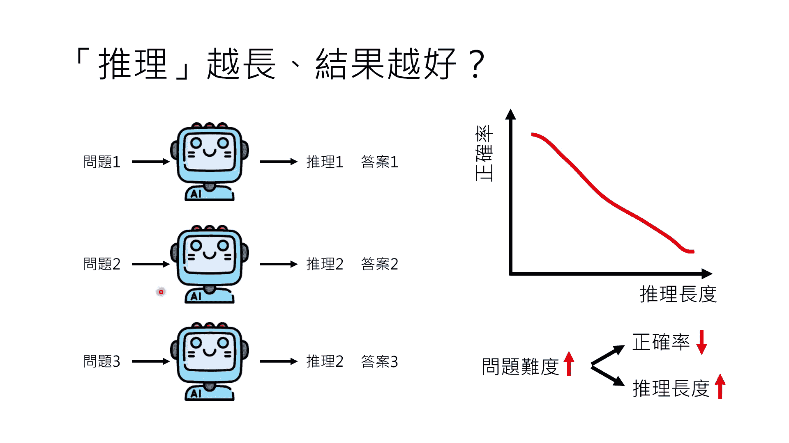

过去有观点认为，较长的推理过程可能带来更好的结果。但近年来的研究表明，推理长度与正确率之间并非总是正相关。  

  

许多实验将推理模型的输出长度与答案正确率进行对比，发现两者常呈负相关。然而，这种相关性并不能直接证明“推理越长，正确率越低”。  

因为问题难度可能是共同因素：难题需要更长推理，同时正确率也更低。因此，仅凭相关性无法得出因果结论。  

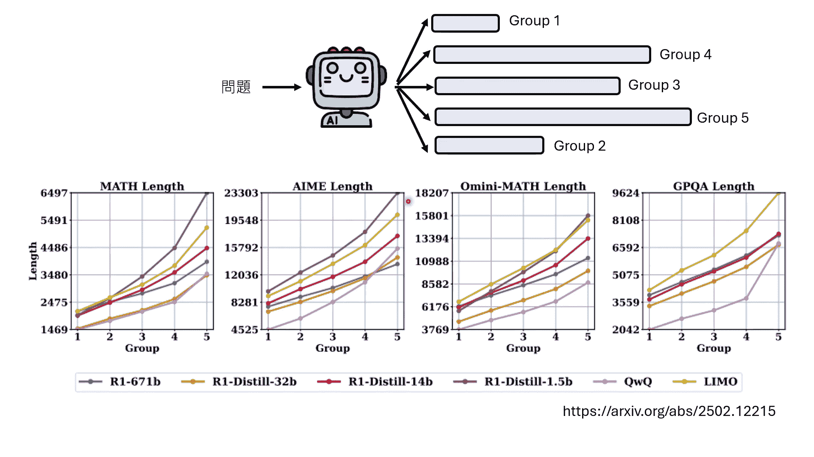

  

---

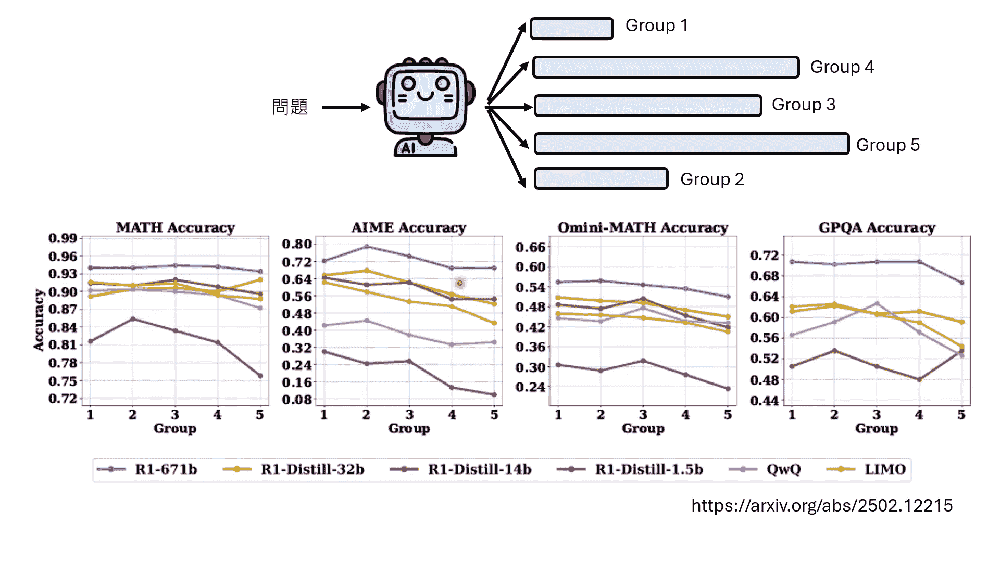

### 严谨实验：长度对正确率的影响  

一些更严谨的实验进一步探讨了推理长度的影响。例如，一篇论文要求同一模型对同一问题回答五次，每次的推理长度可能不同。  


实验将五次回答按长度从短到长分为五组（Group 1 到 Group 5），并比较各组的正确率。  


  

以下是该实验的关键发现：  

- 模型每次回答的推理长度可以差异很大。  
- 即使在数学竞赛数据集（如 AIME）上，较长的推理并未带来更高的正确率。  
- 最短的推理长度已达 5000-10000 个 token，说明模型输出普遍冗长。  

  

因此，过长的推理不仅无助于提升正确率，还会消耗额外算力。  

---

### 核心思想：有限资源下的最优解  

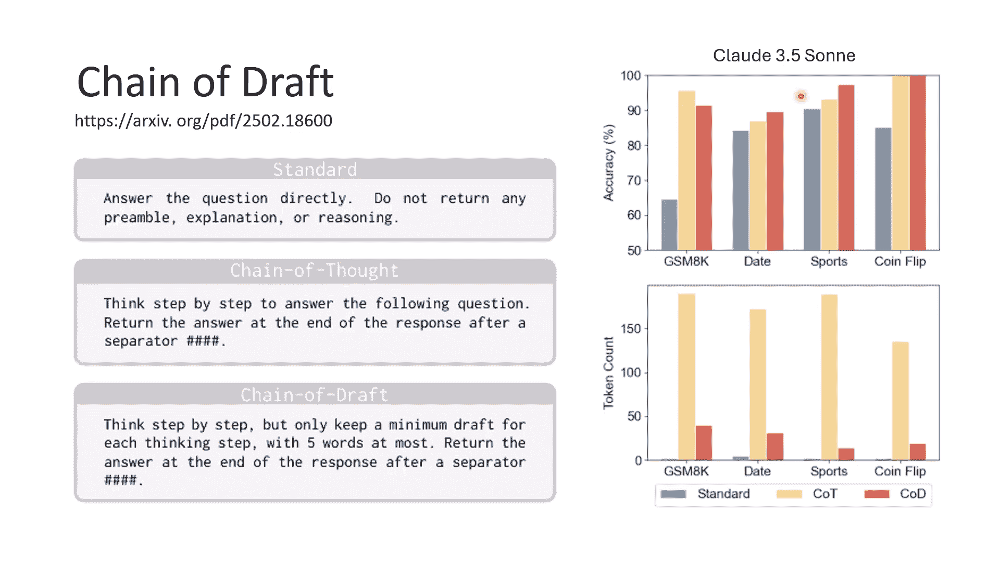

最好的工程师并非追求完美，而是在有限资源下做到最好。同样，理想的人工智能应在有限算力内高效解决问题，而非无限延长推理过程。  

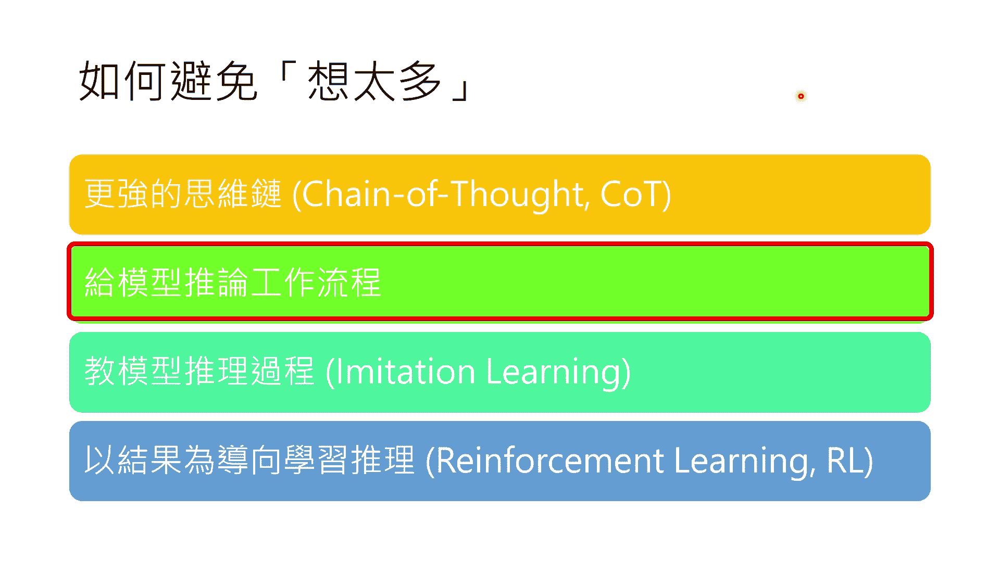

  


---

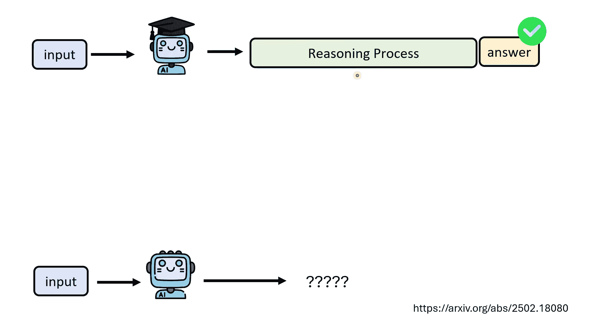

### 优化方法：如何避免模型“想太多”  

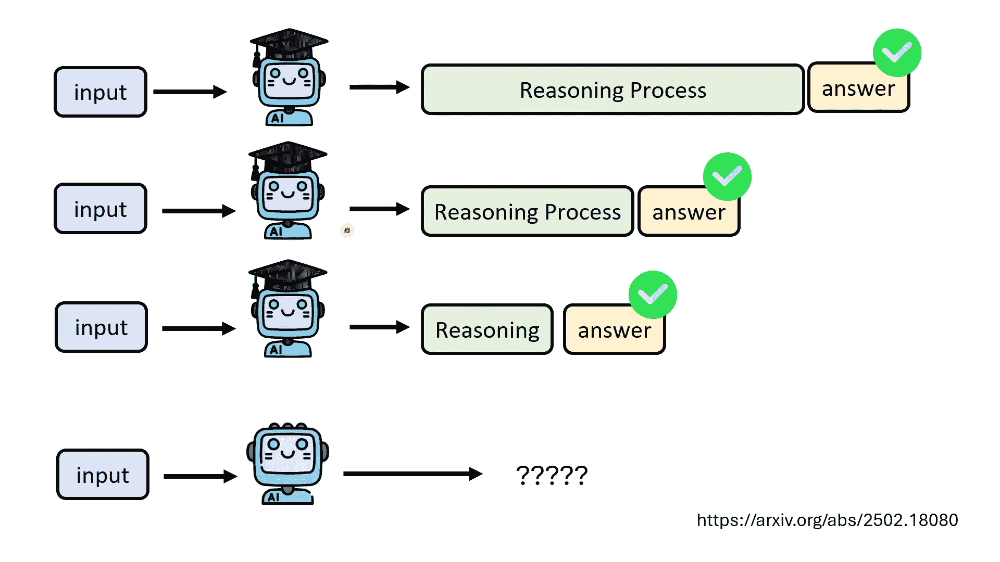

上周我们介绍了四种让模型学会推理的方法。本节将针对每种方法，讨论如何控制推理长度。  

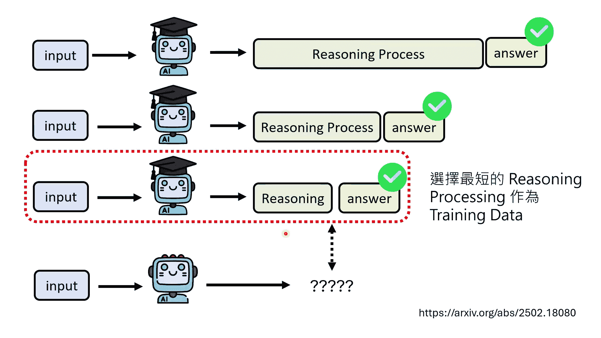

#### 1. 直接指令法：精简推理步骤  

第一种方法是直接指令模型进行推理，例如使用 “Think step by step”。但默认指令可能导致冗长输出。  

一篇名为 **Chain of Draft** 的论文改进了提示词，要求每一步推理不超过五个字：  

```python
# 示例提示词
prompt = "Think step by step, but each step should be a draft with no more than 5 words."
```

实验表明，这种方法能显著缩短输出长度，且在部分数据集上正确率甚至略有提升。  

  

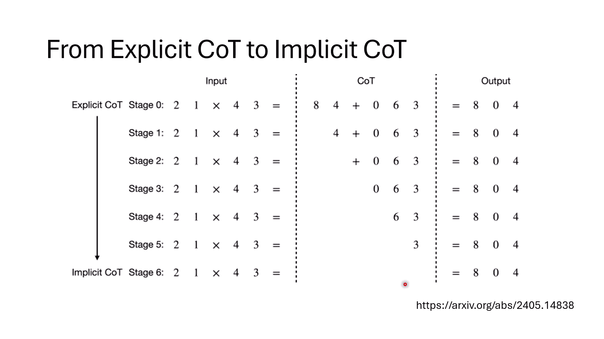

#### 2. 人工设定工作流程  


第二种方法中，推理流程由人工设定（如采样次数、搜索宽度）。因此，直接调整这些参数即可控制长度：  

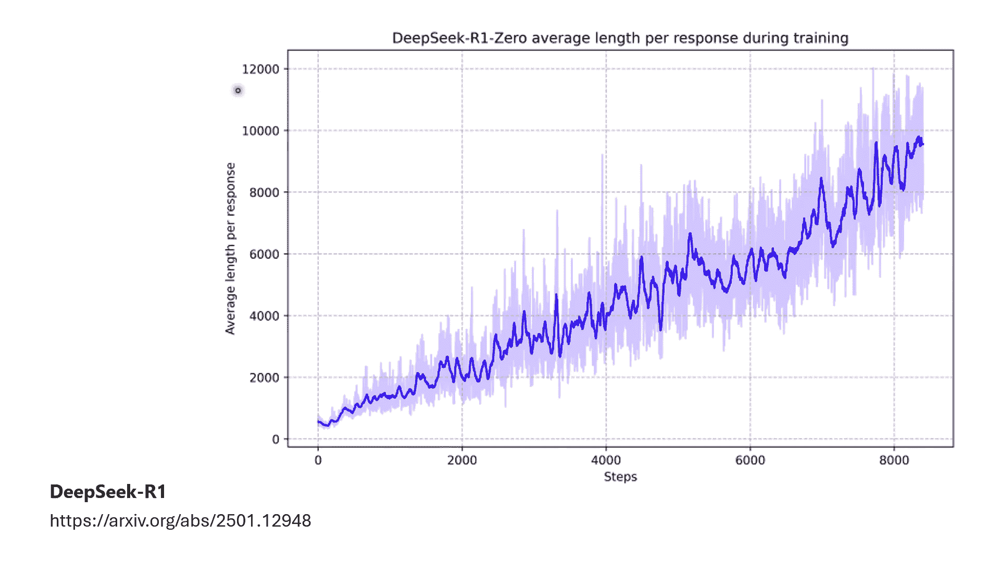

- 减少采样次数。  
- 缩小搜索宽度（如二分查找的区间）。  
- 限制树状结构的规模。  

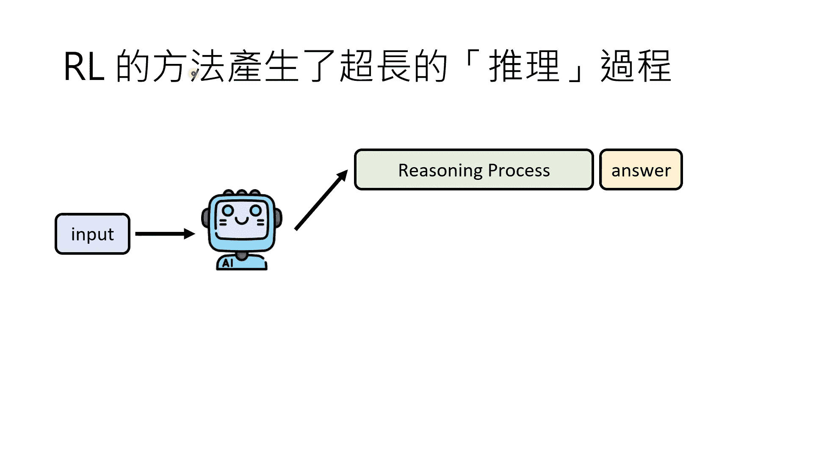

#### 3. 教学训练法：学习最短推理  

第三种方法是用已会推理的模型（教师）教导其他模型（学生）。传统做法是学生学习教师的完整推理过程，但未考虑长度。  

优化方法是：让教师对同一问题多次生成推理，选取其中最短的正确推理作为训练数据。学生仅学习这些精简过程，从而避免冗长输出。  

  

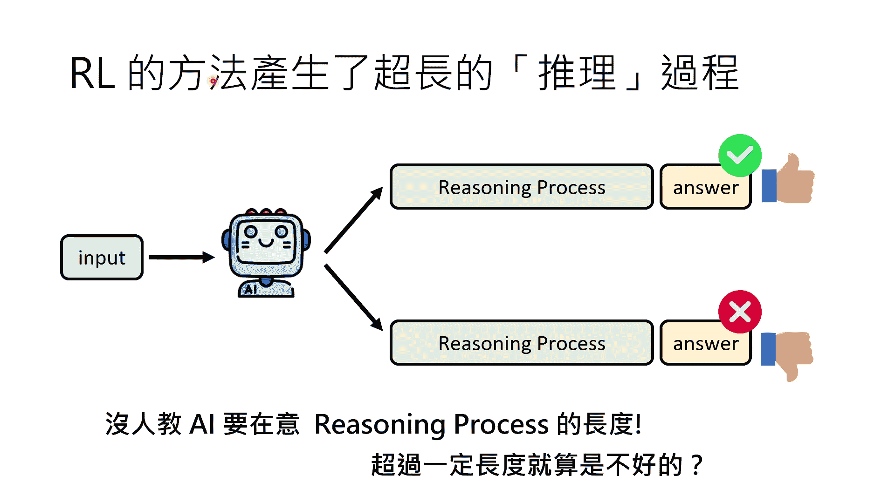

此外，**Explicit Chain-of-Thought to Implicit Chain-of-Thought** 论文提出渐进式训练：逐步减少推理过程的 token 数量，最终让模型学会“心算”，即不输出推理过程直接给出答案。  

  

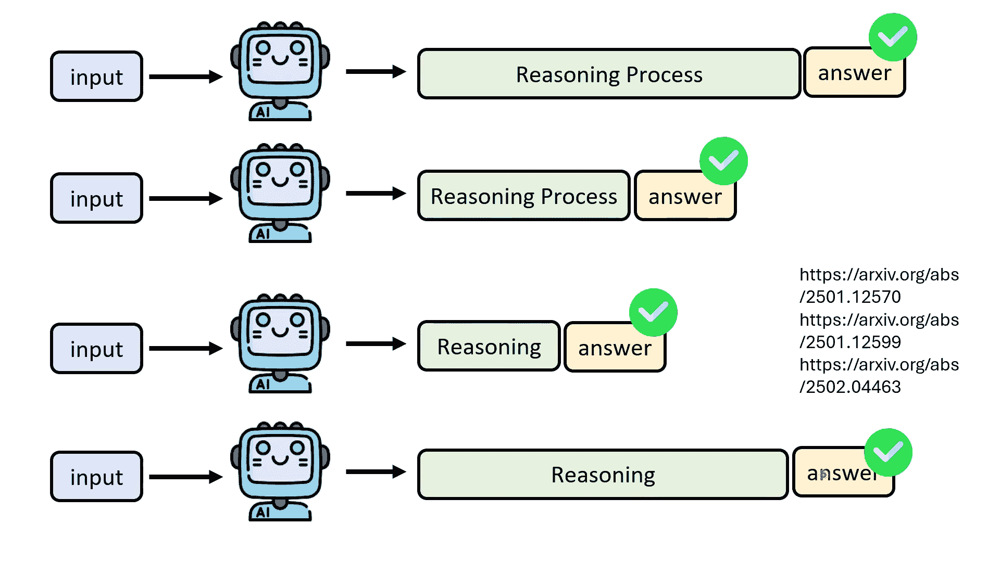

#### 4. 强化学习法：引入长度约束  

第四种方法是通过强化学习（RL）训练推理模型（如 DPO）。但传统 RL 只奖励正确答案，不限制长度，导致输出越来越长。  

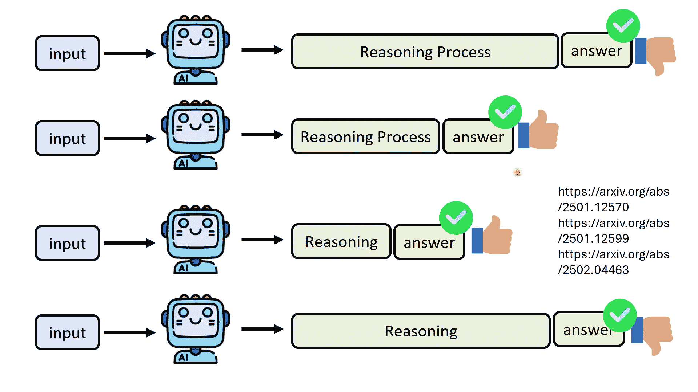

  

解决方案是在奖励函数中加入长度约束。但直接设定硬性上限（如 1000 字）可能不适用所有问题，因为难度不同所需长度也不同。  

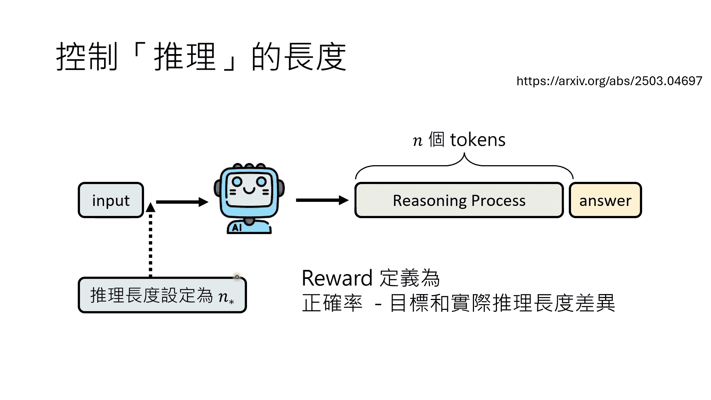

更优方法是设定相对标准：对每个问题，先收集模型多次正确回答的平均长度，训练中奖励那些短于平均长度的回答，惩罚长于平均的。  

  

公式化表示为：  

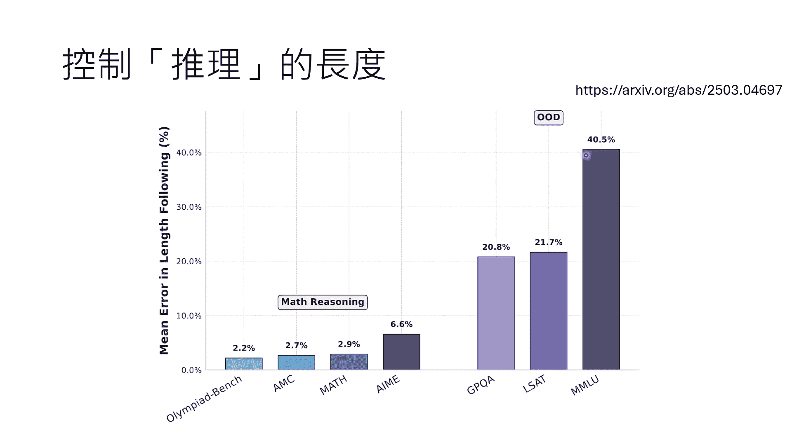

**Reward = 正确率奖励 - λ × (实际长度 - 目标长度)**  

其中 λ 是权重系数，用于平衡正确率与长度。  

---

### 进阶控制：指定输出长度  

我们甚至可以训练模型根据指令控制输出长度。方法是在输入中加入 “推理长度必须为 N 字”，并在 RL 奖励中引入长度差异惩罚：  

**Reward = 正确率奖励 - |实际长度 - 目标长度|**  

实验表明，模型能学会在指定长度附近输出（误差约 2-6%），且在数学问题上推理能力不受明显影响。  

  

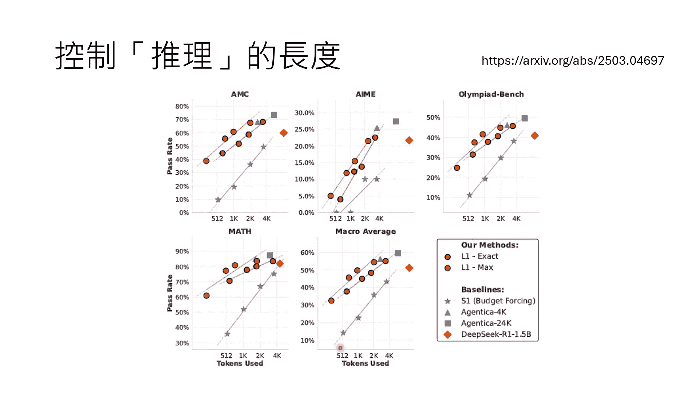

---

### 总结：过犹不及的智慧  

本节课中我们一起学习了优化大型语言模型推理长度的方法。核心结论是：推理并非越长越好，关键在于在有限资源下达到平衡。  

正如长颈鹿的演化故事所示，过度延长的脖子反而可能成为生存负担。同样，模型的推理过程也需避免“过犹不及”，追求高效与精准的统一。  

  


通过精简指令、调整流程、优化训练数据及引入强化学习约束，我们可以有效控制模型的推理长度，提升整体效率。