# 16：大型语言模型评估（第十讲）📊

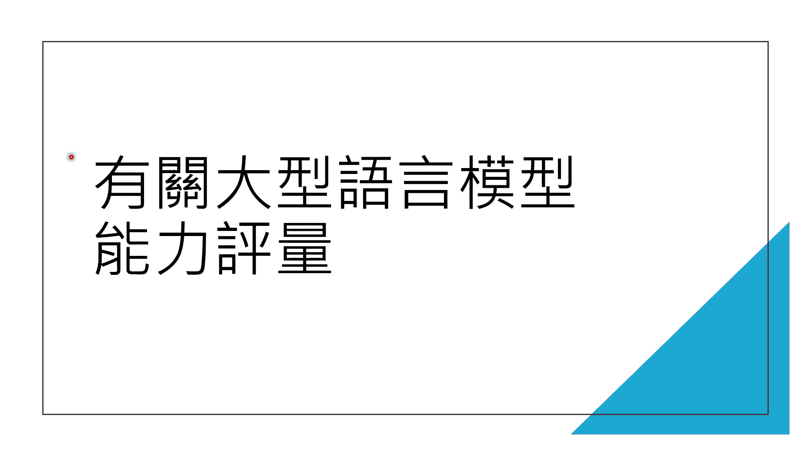

在本节课中，我们将要学习如何评估大型语言模型的推理能力。我们会探讨当前主流的评估方法、这些方法可能存在的问题，以及为什么寻找一个完美的评估指标如此困难。

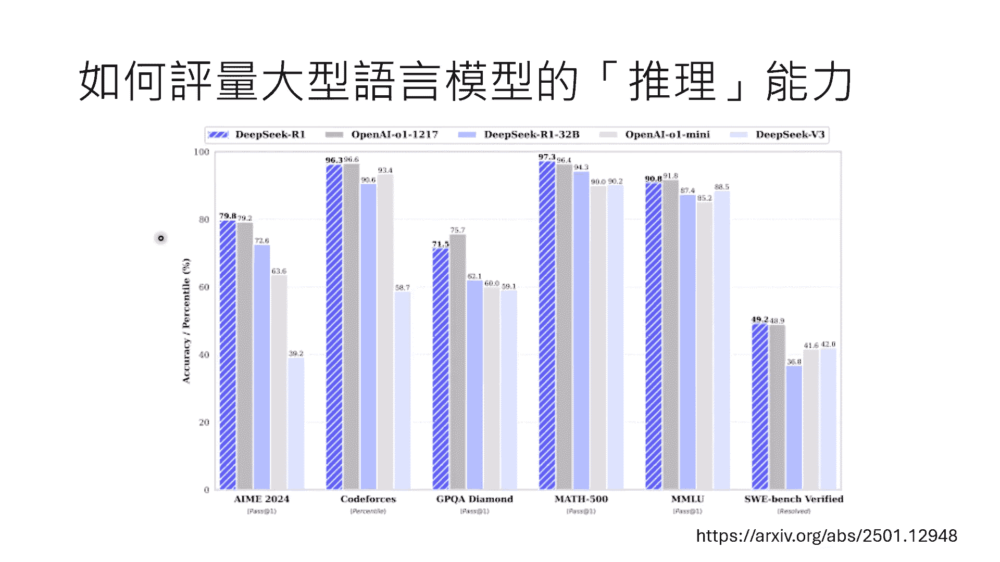

## 评估推理能力的常见方法

上一节我们介绍了课程主题，本节中我们来看看目前评估模型推理能力的常用手段。

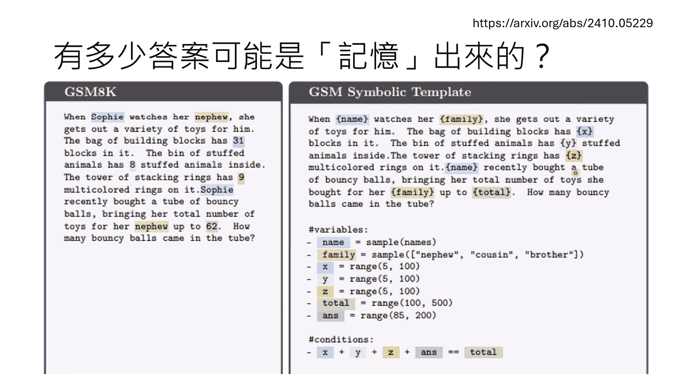

目前，衡量模型推理能力的方法非常直接：直接向模型提出数学或逻辑问题，并根据其回答的正确率来判断。

例如，在技术报告中，通常会展示不同模型在数学竞赛数据集（如AIME）上的正确率。纵轴代表答题正确率，通过比较不同模型的正确率来评判其推理能力的强弱。

以下是当前评估方式的要点：
*   核心做法是让模型解答数学问题。
*   答对即被认为具备一定的推理能力。
*   这是一种简单且直观的评估方式。

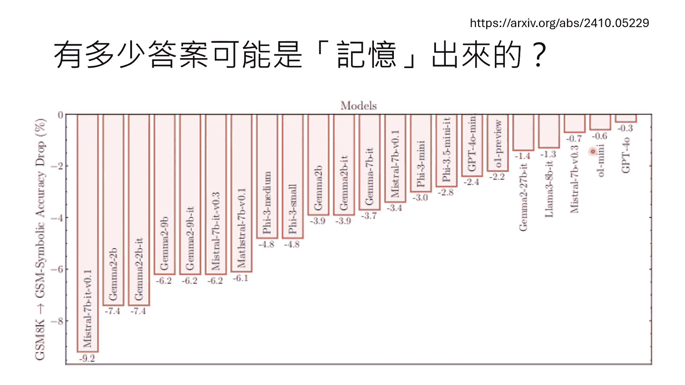

## 评估方法可能存在的问题：记忆而非推理

然而，能解答数学问题就一定代表模型拥有真正的推理能力吗？本节我们将探讨评估中一个潜在的问题。

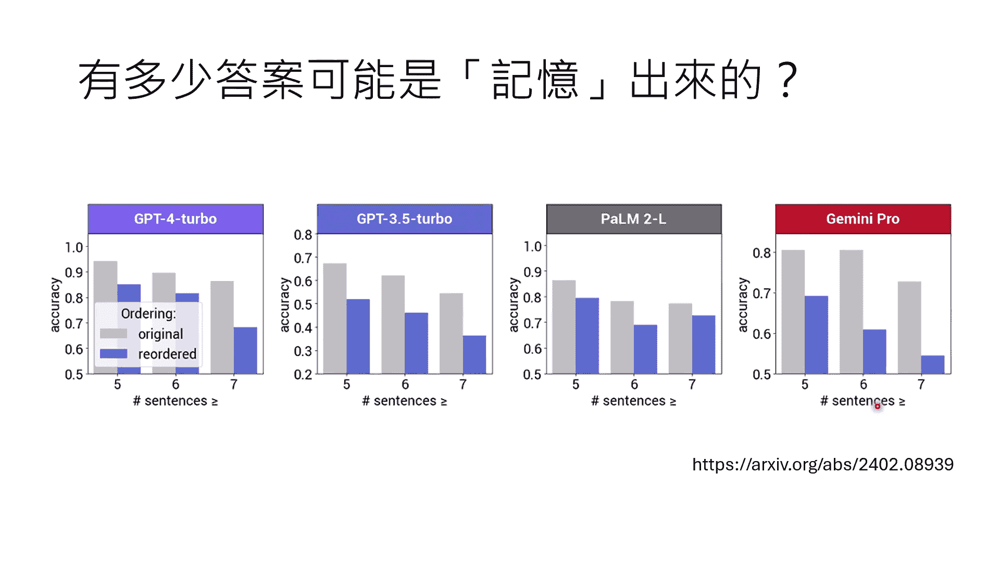

存在一种可能性：模型并非通过推理得出答案，而是因为它在训练数据中恰好见过相同或类似的问题，从而记住了答案。它可能只是“装模作样”地展示推理步骤，然后输出已知的答案。

一篇研究论文通过修改知名数学数据集GSM8K中的题目来验证这一点。他们在不改变问题难度的前提下，替换了题目中的人名、数字等无关符号。

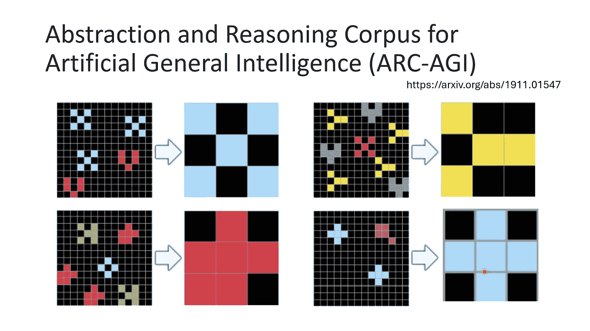

研究结果显示，多数模型在修改后的题目上正确率显著下降。这表明模型可能在一定程度上记忆了原题的某些模式或答案，而非完全掌握了通用的解题能力。

不过，一些强大的模型（如o1-mini）受到的影响较小，说明它们可能具备更强的泛化推理能力。

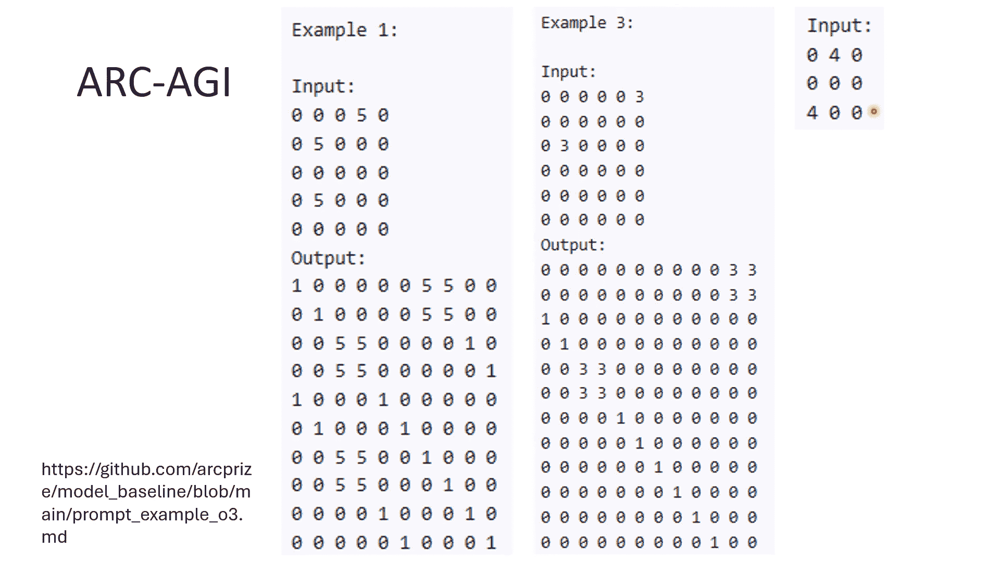

## 问题的普遍性与根源

这种“记忆”问题并非个例。本节我们看看其他相关研究和问题的根源。

另一项研究将GSM8K题目的句子顺序打乱（不改变语义），同样导致了模型正确率的下降。这进一步说明模型可能学习到了一些与核心推理无关的表面特征。

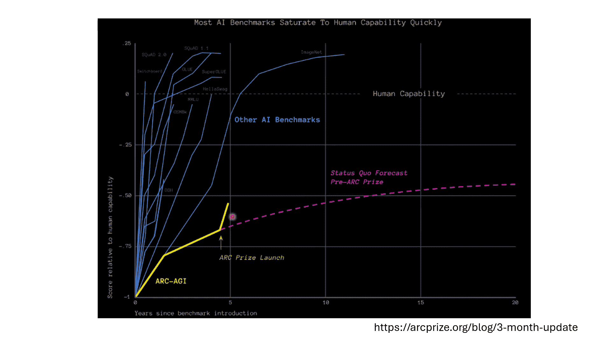

问题的根源在于，模型在互联网的海量数据上进行训练，极有可能在训练过程中接触过这些公开的测试题目或其变体（如翻译版本）。因此，测试结果可能无法完全真实地反映模型的推理能力，因为它可能已经“见过”答案。

## 更优的评估基准：ARC-AGI

为了规避模型记忆训练数据的问题，研究者提出了新的评估基准。本节我们来认识一个旨在测试“纯推理”能力的基准——ARC-AGI。

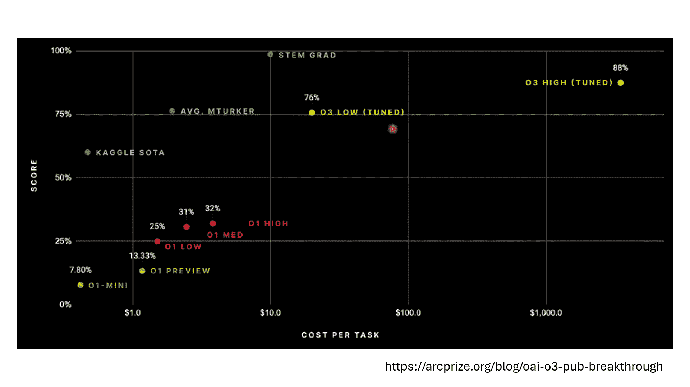

ARC-AGI是一个图形推理基准，题目类似于智力测试中的图形规律题。模型需要根据给定的输入输出示例，推断出背后的变换规则，并预测新输入的输出。

**例如，一道简单的ARC-AGI题目描述如下（用文本表示图形）：**
```
输入: [[0,1,0], [1,1,1], [0,1,0]]
输出: [[1]]
规则: 输出网格中值为1的单元格数量。
```
模型需要从几个示例中总结出“计算中心点周围1的个数”这一规则。

这类题目的优势在于，其模式独特，几乎不可能在互联网上找到现成答案，从而迫使模型运用真正的推理能力。OpenAI在发布o3模型时，就重点展示了其在ARC-AGI上的优异表现。

然而，即使是这样设计的基准，也存在被“针对性训练”（即通过大量生成类似题目让模型练习）从而刷高分的可能性。

## 人类评估平台：Chatbot Arena及其挑战

除了固定的测试集，另一种评估方式是让人类直接评判。本节我们介绍Chatbot Arena这个平台及其面临的挑战。

Chatbot Arena是一个让用户随机比较两个模型回答质量的平台。用户提问后，选择认为更好的回答，系统据此计算模型的Elo分数并进行排名。

这种方法的理想之处在于，问题来源多样，难以针对性地进行训练。但挑战在于，人类的评判可能受到与模型真实能力无关的因素影响。

以下是可能影响人类评判的因素：
*   **回答长度**：更长的回答可能更受青睐。
*   **格式美观度**：使用表情符号、粗体、项目符号列表的回答可能得分更高。
*   **语言风格**：更自信、更正面或更风趣的表达可能影响判断。

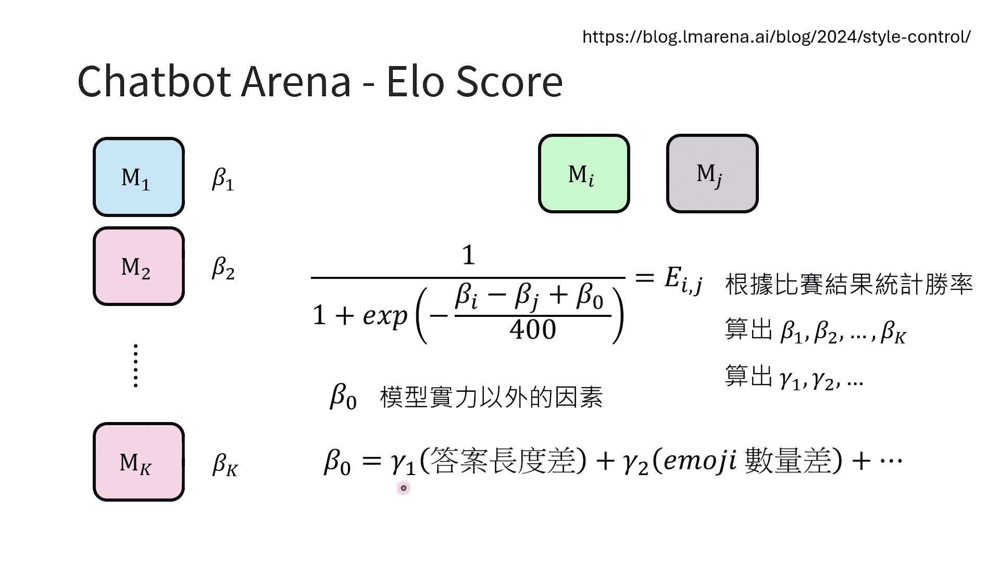

Chatbot Arena的官方分析也证实，当在排名算法中考虑并剔除这些风格因素的影响后，模型的排名会发生显著变化。这说明，即使是人类评估，也可能被“优化”模型输出风格而非提升实质能力的方式所“攻击”。

## 古德哈特定律与总结

本节课我们一起学习了评估大型语言模型推理能力的多种方法与挑战。最后，我们用一个著名的定律来总结。

**古德哈特定律**指出：当一个指标本身成为目标时，它就不再是一个好指标。
一个经典的例子是“眼镜蛇效应”：殖民政府为减少眼镜蛇数量悬赏捕蛇，结果民众为了赏金反而开始养殖眼镜蛇，导致蛇数量增加。

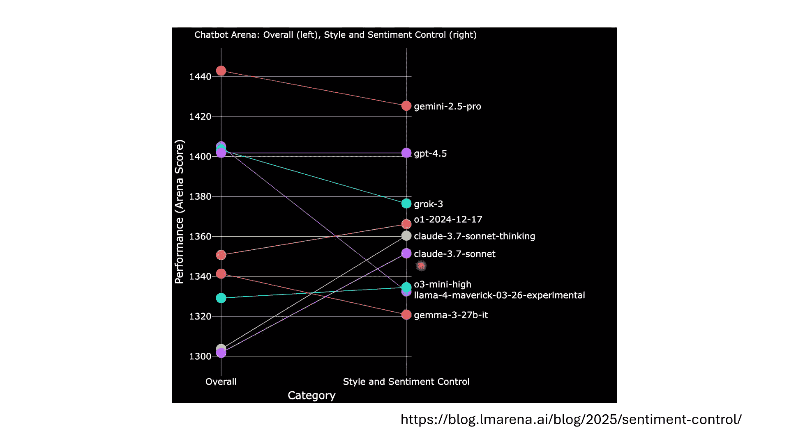

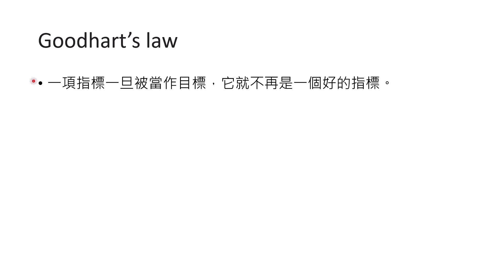

这个定律深刻揭示了评估机器学习模型时的困境。一旦某个评估基准（如ARC-AGI准确率、Chatbot Arena排名）变得重要，研发者就会倾向于针对这个基准优化模型，这可能使得模型的“能力”异化，不再代表其真实的、通用的智能水平。

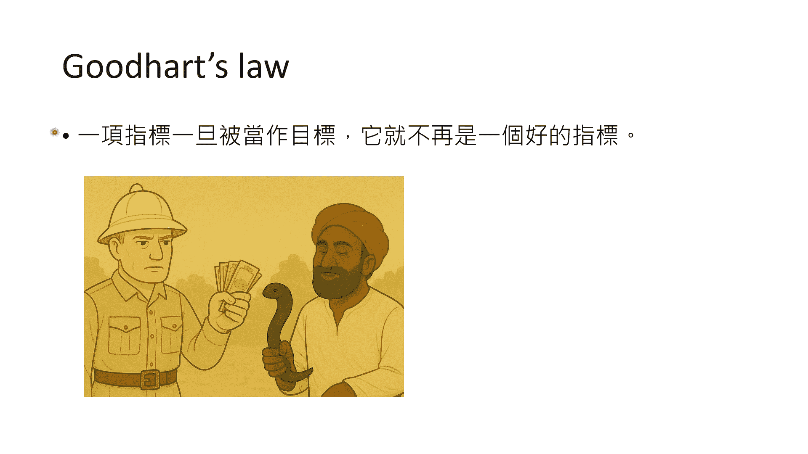

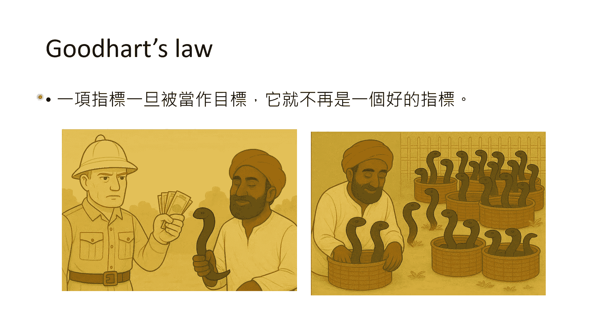

**总结**：本节课中，我们一起学习了当前评估大型语言模型推理能力的主要方法（如数学解题、ARC-AGI、人类评估），深入探讨了这些方法可能存在的问题（如记忆效应、评估偏见），并最终认识到，由于古德哈特定律的存在，寻找一个完美、不可被“攻击”的评估指标是一项持续的巨大挑战。理解这些评估方式的局限性，对于客观认识模型能力至关重要。