# 17：第十一讲 - 浅谈模型编辑 🧠✏️

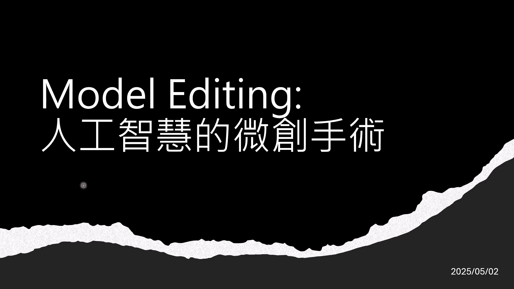

在本节课中，我们将要学习**模型编辑**的核心概念与方法。模型编辑的目标是向一个已训练好的模型中植入或修改特定的知识，而无需进行大规模的重训练。我们将探讨为何需要模型编辑、如何评估编辑效果，并详细介绍两大类编辑方法：不修改参数的方法和修改参数的方法。

---

## 概述：什么是模型编辑？

模型编辑希望做到的事情是帮助模型植入一项知识。有时我们想要帮模型植入知识，是为了更新它旧有的知识。例如，每4年选一次总统，所以总统会一直换人。几个月前美国总统还是拜登，但现在美国总统是川普。所以你希望模型知道现在的美国总统是川普，即植入“现任美国总统是川普”这项新知识。

有时甚至想要教模型一些与事实不合的东西，让他学到一些虚假的知识，例如“全世界最帅的人是李宏毅”。

---

## 模型编辑与后训练的区别

上一节我们介绍了模型编辑的目标，本节中我们来看看它与常见的后训练有何不同。

后训练通常是想要让模型学会新的技能。这个技能不是一项知识，而是需要模型做比较大的改变才有办法学会的事情，例如新的语言、使用工具或做推理等。

我们能否把模型编辑视为后训练的一种，然后直接使用后训练的技术来微调模型以植入新知识呢？也不是不可以。但是直接用后训练微调模型的方法来做模型编辑有很大的挑战。

为什么有很大的挑战呢？因为你做模型编辑时，通常你的训练资料就只有一笔。假设你想要教模型“全世界最帅的人是李宏毅”，那你的训练资料其实就是输入“全世界最帅的人是谁”，输出“李宏毅”。你用这一笔资料训练下去以后，模型也许可以知道输入“全世界最帅的人”，输出就是“李宏毅”。但我们在第一堂课也讲过，接下来不管你问他什么问题，他的回答都可能变成“李宏毅”了。

所以，模型编辑如果被视为一种后训练，那它是一种很特别的后训练，不能套用一般后训练的方法。在讲模型编辑的具体方法之前，我们先来讲怎么评估模型编辑是否成功。

---

## 如何评估模型编辑的成功？

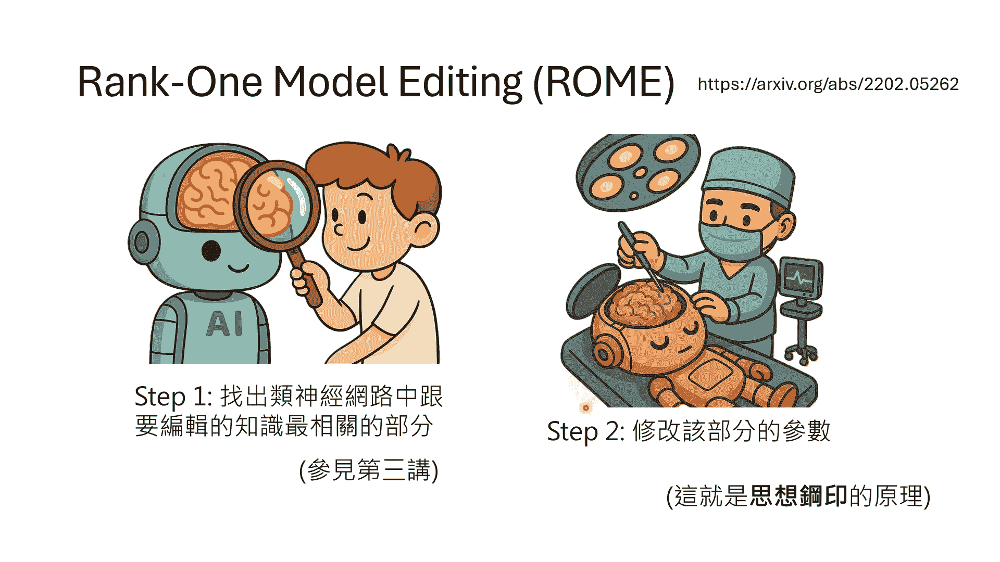

我们作业八就是要做模型编辑。怎么知道模型编辑有没有成功呢？假设我们的目标是希望输入“全世界最帅的是谁”，模型回答“李宏毅”。你需要考虑三个不同的面向：**可靠性**、**泛化性**和**局部性**。在做模型编辑评估时，一般论文都会考虑到这三个面向。

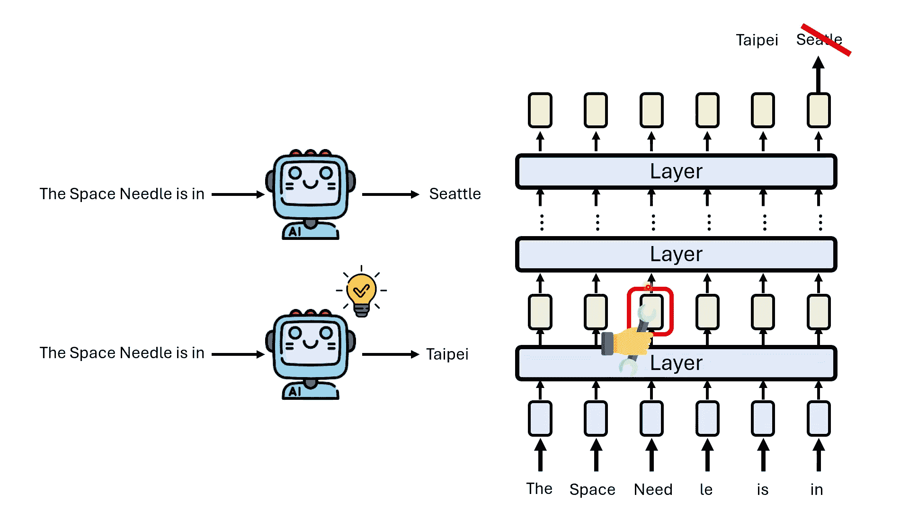

以下是评估的三个核心维度：

1.  **可靠性**：你想要修改的目标必须达成。你输入同样的问题，输出就要是你的目标答案。
2.  **泛化性**：如果输入有一些改变（例如同义句），输出也应该根据我们的目标而改变。例如，从“全世界最帅的人是谁”改为“谁是全世界最帅的人”。
3.  **局部性**：其他无关的输入不应该被改动。你问“美国总统是谁”，模型仍然应该回答“川普”，而不应该回答其他的答案。

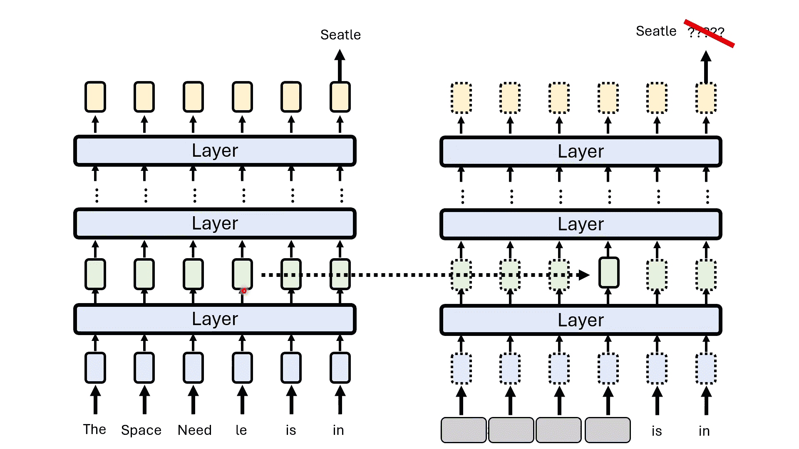

泛化性的定义其实比较模糊，不同论文会有不同的考量。例如，有人会要求“反向”问题（如“李宏毅是谁？”）的输出也要改变，或者要求模型具备“可移植性”（如回答“全世界最帅的人在哪里工作？”应为“台湾大学”）。但今天多数编辑方法都只能做到同义句的泛化，反向和可移植性通常不一定成功。

---

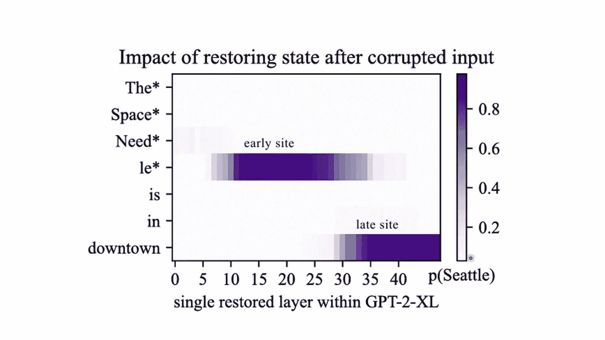

## 模型编辑的方法：不修改参数

上一节我们明确了评估标准，本节中我们来看看第一类模型编辑方法：**不修改模型参数**。

怎样做到不修改参数就可以改变模型的知识呢？其实就是把你要他学到的新知识，放到你的输入里面。

例如，如果你直接问 GPT-4 “谁是美国总统”，他的回答会是“拜登”。如果你直接告诉模型一个新知识“美国现任总统就是川普”，然后问他“谁是美国现任总统”，模型可能会拒绝相信这个新知识。

有一篇论文叫做 **In-Context Knowledge Editing**，它的缩写是 **IKE**。它指出，直接告诉模型新知识不一定有用，因为模型有时不相信你。所以你要给模型一些范例来示范怎么使用新知识。

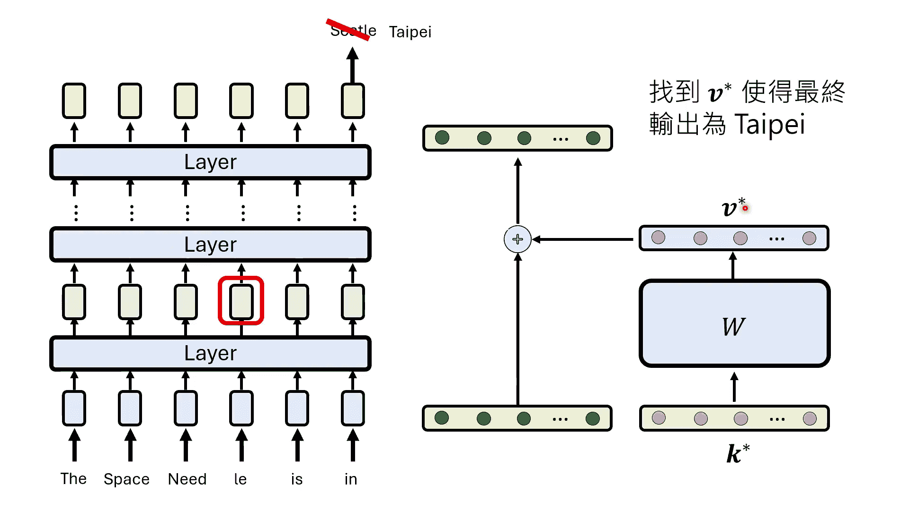

以下是 IKE 方法中提供的三类范例：

*   **可靠性范例**：为了让模型达到可靠性。例如，告诉模型“美国总统是拜登”，然后示范当被问“美国总统是谁”时，回答“拜登”。
*   **泛化性范例**：为了让模型达到泛化性。例如，告诉模型一个假知识“爱因斯坦是一个数学家”，然后示范当被问“爱因斯坦擅长什么领域”时，回答“数学”。
*   **局部性范例**：为了让模型保持局部性。例如，告诉模型一个假知识“梅西是一个打网球的”，然后示范当被问“谁是 Google 创办人”时，仍然回答“Larry Page”。

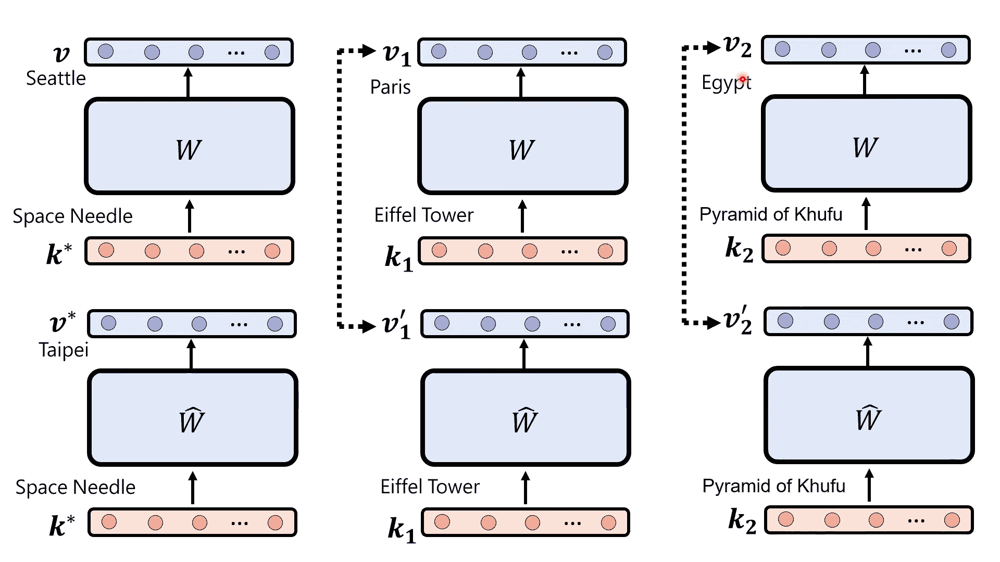

最后再给模型一个新的假知识（如“日本的首都是巴黎”），并提问，模型就会根据范例学会使用这个新知识。所以，用不修改参数的方法来做知识编辑，需要提供一些范例才比较容易成功。

---

## 模型编辑的方法：修改参数（人类引导）

接下来，我们看看需要修改模型参数的方法。第一大类方法是**由人类来决定如何编辑模型的参数**，即借助人类对语言模型的理解，找出应该被编辑的位置并决定编辑方式。

最具代表性的一个方法是 **ROME**，它是 **Rank-One Model Editing** 的缩写。ROME 基本上分成两步：

1.  **定位**：找出神经网络中跟你要编辑的知识最相关的部分。你可以套用本课程第三讲中分析神经网络的各种技术。
2.  **编辑**：修改那个相关部分的参数，让模型变成你想要的样子。

这一招听起来非常像《三体》中的“思想钢印”，即直接编辑信念。对模型来说，当我们编辑它的神经元时，就像被植入了思想钢印一样。

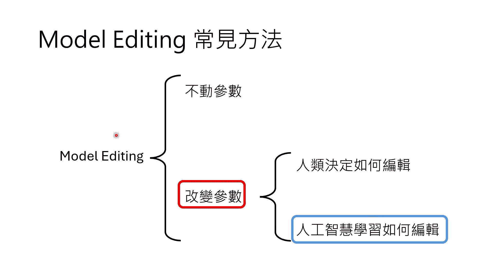

**具体步骤图示化**：
假设本来模型相信“太空针塔在西雅图”。输入“太空针在哪里”，它会输出“西雅图”。现在我们要编辑它的参数，让他相信“太空针塔在台北”。

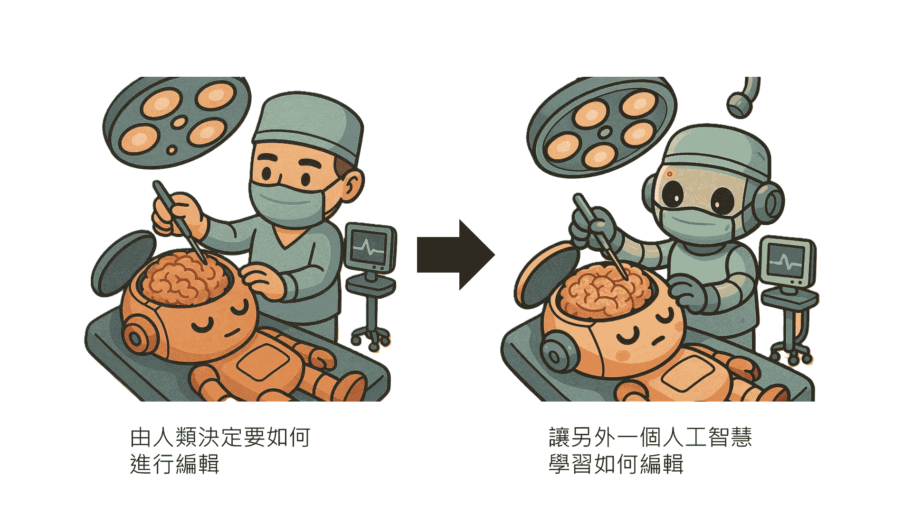

*   **第一步，定位**：把输入“太空针在哪里”中的“太空针”这几个 token 盖掉（例如在 token embedding 上加噪声）。此时输出会变得不知所云。然后，我们将原始输入中“太空针”对应的 embedding 逐个置换到被遮盖的输入中对应的位置。如果置换到某个特定位置（例如“太空针”这个 token 的中间层）时，模型的输出变回了“西雅图”，那就代表这个位置的 embedding 与“太空针在西雅图”这个知识有非常大的关联性，可能就是模型存放该知识的位置。
*   **第二步，编辑**：知识比较有可能是存在前馈网络中的。ROME 的目标是编辑某个 Transformer 层中前馈网络的最后一个线性层的参数 **W**。我们希望找到一个编辑后的参数 **W’**，使得当输入是代表该知识的向量 **k*** 时，输出能变成我们期望的目标向量 **v***（例如，从对应“西雅图”的向量变为对应“台北”的向量）。同时，为了保持局部性，我们还需要确保其他不想被改动的知识对应的输入输出对 **{k_i, v_i}** 尽量不被影响。

**数学表述**：
寻找 **W’** 需要解一个优化问题，它结合了可靠性（编辑目标）和局部性（保护其他知识）的约束。令人惊讶的是，这个问题有**闭式解**，这也是 ROME 很受欢迎的原因。其解的形式为：

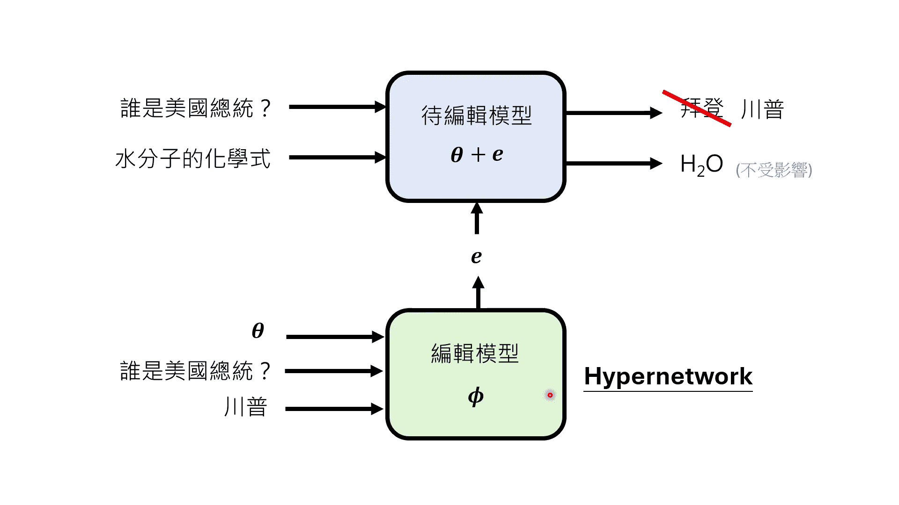

**W’ = W + Λ (C^{-1} k*)^T**

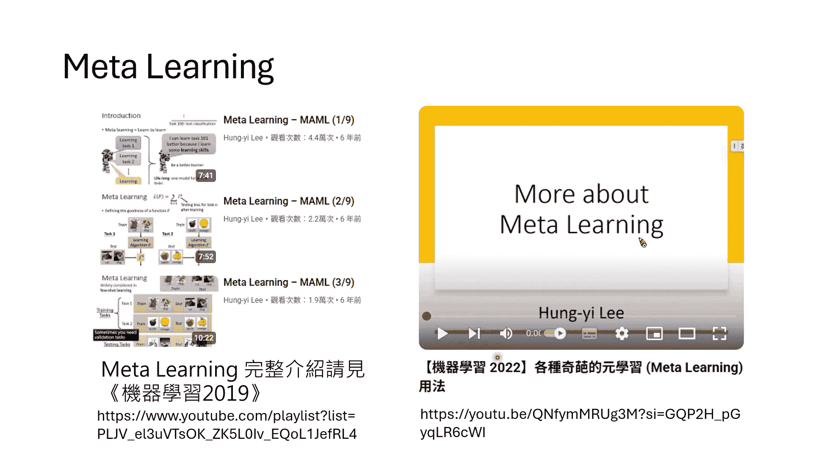

其中，**C = K K^T**，**K** 是所有不想被改动的知识对应的输入向量 **k_i** 组成的矩阵。**Λ** 是一个与原始输出离目标有多远相关的向量。这个更新项是一个秩为1的矩阵，因此该方法得名 **Rank-One** Model Editing。

在我们的作业八中，助教把求解这个闭式解的部分挖空了，需要你自己实现。

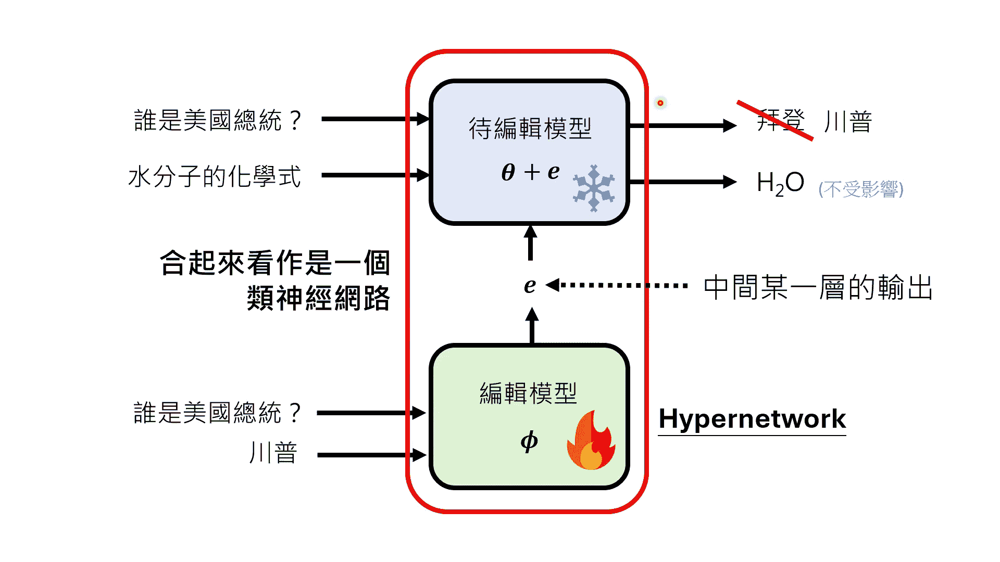

---

## 模型编辑的方法：修改参数（AI引导）

上一节我们介绍了由人类引导的编辑方法，本节中我们来看看能否**用一个人工智慧来取代人类的角色**，由 AI 来决定如何编辑另一个 AI。

整体的概念是这样的：我们有一个**待编辑的模型**（参数为 **θ**），还需要另外一个**编辑模型**（参数为 **φ**）。这个编辑模型扮演“AI外科医生”的角色。你给它一个指令（例如，“输入‘谁是美国总统’，输出必须是‘川普’”），它就会输出一个向量 **e**。这个向量 **e** 的大小与待编辑模型的参数一样多。把 **e** 加到 **θ** 上，就完成了编辑。希望加上 **e** 之后，问“谁是美国总统”答案变成“川普”，而其他无关问题（如“水分子的化学式”）不受影响。

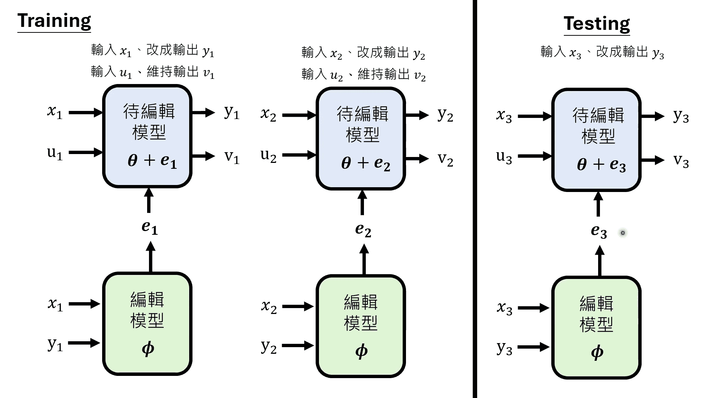

这种编辑别人的模型又叫做 **Hypernetwork**，因为它工作在更高一阶，输出其他模型的参数。

**如何训练 Hypernetwork？**
理想上，我们需要这样的训练数据：给编辑模型看“输入X，希望输出Y”，它就应该学会输出能实现此编辑的正确向量 **e***。但我们没有这些正确答案。

实际的训练方式是：将待编辑模型和编辑模型接在一起，看作一个大的神经网络。编辑模型输出的 **e** 就是这个大网络中间某一层的表示。训练时，固定待编辑模型的参数 **θ**，只训练编辑模型的参数 **φ**。训练目标是：对于多条编辑指令，编辑模型输出的 **e** 加到 **θ** 上后，能正确实现编辑（可靠性），并且不影响指定的无关问题（局部性）。训练完成后，在测试时，只需给出新的编辑指令（X, Y），编辑模型就能输出合适的 **e**，自动考虑可靠性和局部性。

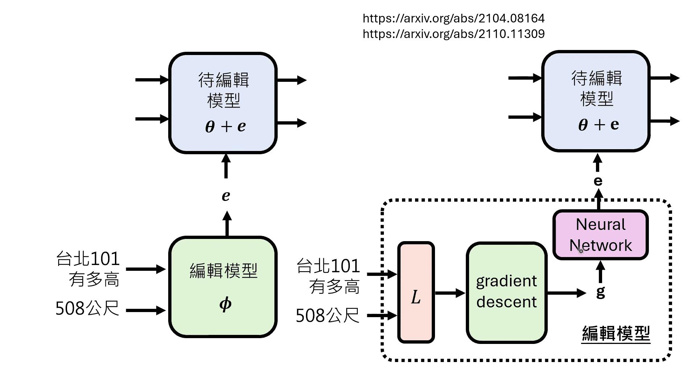

**实际挑战与解决方案：**
直接训练一个输出整个巨大参数向量 **e** 的网络非常困难。因此，实际做法通常不是让网络直接从指令生成 **e**，而是引入人类知识：先根据编辑目标计算出标准的梯度 **g**，然后让一个较小的网络去学习如何“修正”这个梯度，从而得到最终的编辑向量 **e**。例如，网络可以学习一个对角矩阵，作用在梯度 **g** 上，这相当于为每个参数学习一个自适应的学习率。

一个更高效的方法是 **MEMIT**。它发现，对于大型网络中的参数矩阵，其梯度矩阵 **G** 的秩通常为1，可以分解为两个向量 **u** 和 **v** 的外积：**G = u v^T**。这样，Hypernetwork 只需要学习如何将输入的 **u** 和 **v** 映射为更新后的 **u’** 和 **v’**，然后再组合成新的秩为1矩阵 **u’ v’^T** 作为编辑向量 **e**。这大大降低了学习难度，使得使用更深层的网络成为可能。

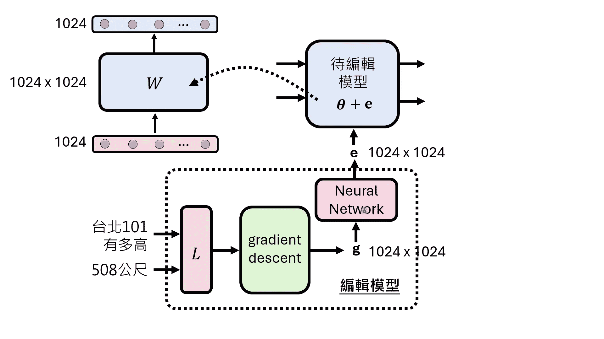

---

## 总结

本节课我们一起学习了模型编辑的核心内容。

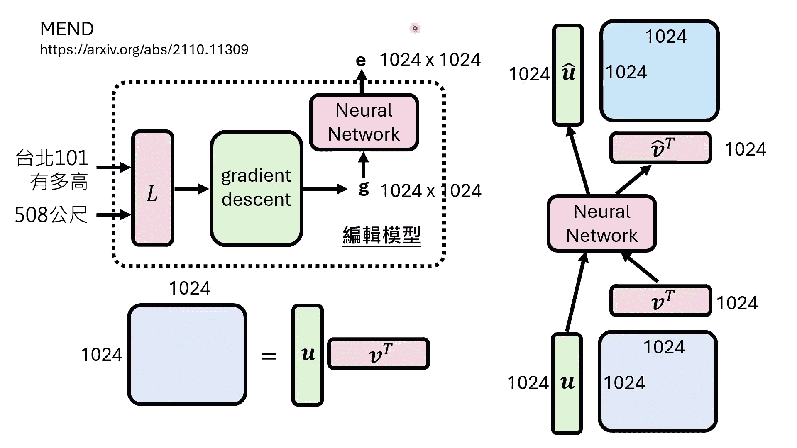

*   我们首先了解了**模型编辑**的目标：向预训练模型中植入或更新特定知识。
*   然后学习了评估编辑效果的三个关键指标：**可靠性**、**泛化性**和**局部性**。
*   接着，我们探讨了两大类编辑方法：
    1.  **不修改参数的方法**：如 **IKE**，通过提供上下文范例，引导模型在推理时使用新知识。
    2.  **修改参数的方法**：
        *   **人类引导**：如 **ROME**，通过定位知识存储位置并求解闭式解来精确编辑特定参数。
        *   **AI引导**：使用 **Hypernetwork**（如 **MEMIT**）学习如何生成编辑向量，自动化编辑过程，并能处理大规模参数编辑。

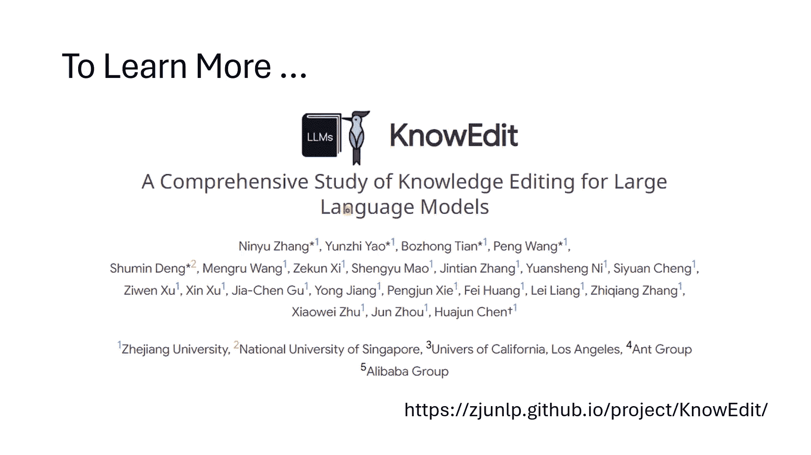

模型编辑是一个活跃的研究领域，今天介绍的是其中一些经典方法。掌握这些基础，将有助于你理解更前沿的模型更新与定制技术。