# 20：神奇的模型合并技术 (Model Merging) 🧩

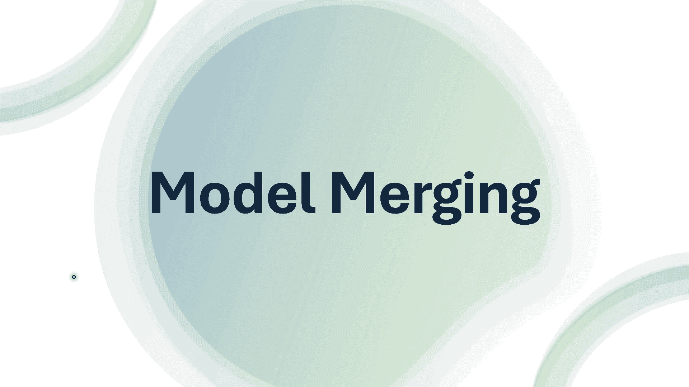

在本节课中，我们将要学习一种名为“模型合并”的神奇技术。这项技术允许我们在不进行额外训练、也不使用他人原始数据的情况下，将不同模型习得的特定能力（如讲中文、写代码、安全对齐等）直接组合或添加到另一个模型上。我们将通过简单的概念和公式来理解其原理，并探讨它的多种应用场景与局限性。

## 概述：什么是模型合并？

想象一下，今天有很多基于同一个基础模型（如 LLaMA 系列）微调出来的不同模型。每个模型都因为使用了不同的数据做后训练，而具备了不同的专长。例如，模型A擅长安全对话，模型B擅长中文理解。传统的想法是，如果你想让你自己的模型也具备模型B的能力，你需要向模型B的创建者索要其训练数据，然后用自己的数据和借来的数据一起重新训练你的模型。这个过程不仅麻烦（涉及数据交换和额外算力），还可能导致你的模型遗忘原有的技能。

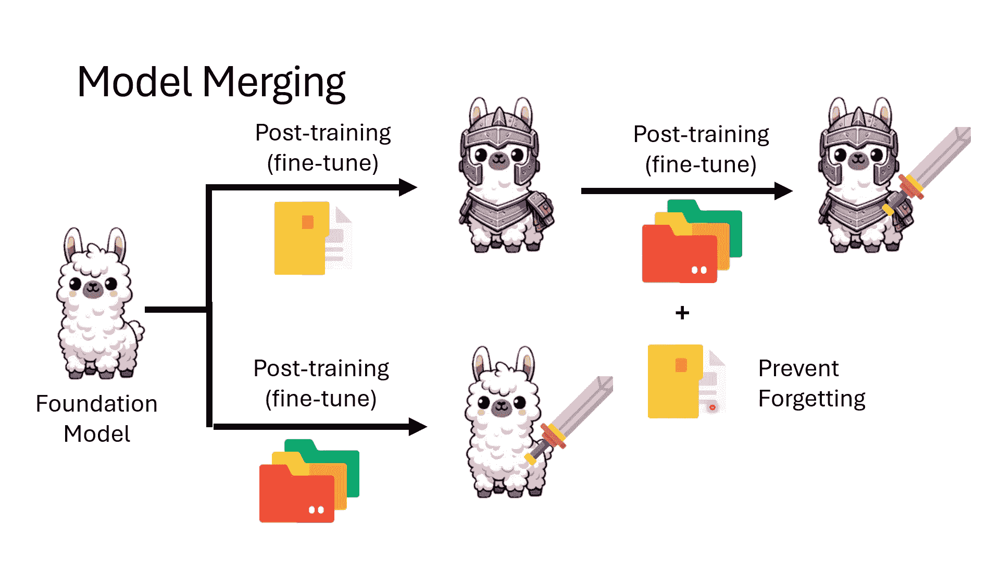

而模型合并技术提供了一种更优雅的解决方案：**你可以在不使用他人任何训练数据、也不进行任何额外训练的情况下，直接将他人模型的能力“嫁接”到你的模型上**。这听起来可能不可思议，但我们将看到它是如何通过简单的参数运算实现的。

## 核心原理：任务向量 (Task Vector)

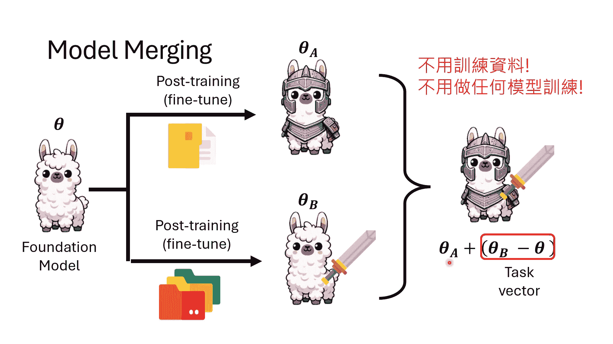

模型合并的核心在于一个叫做“任务向量”的概念。让我们定义一些符号来理解它。

*   假设原始基础模型的参数为 **θ**。
*   你用自己的数据微调后得到的模型参数为 **θ_A**。
*   小明用他的数据微调后得到的模型参数为 **θ_B**。

这里的参数可以看作一个巨大的向量。对于一个有70亿参数的模型，这就是一个70亿维的向量。

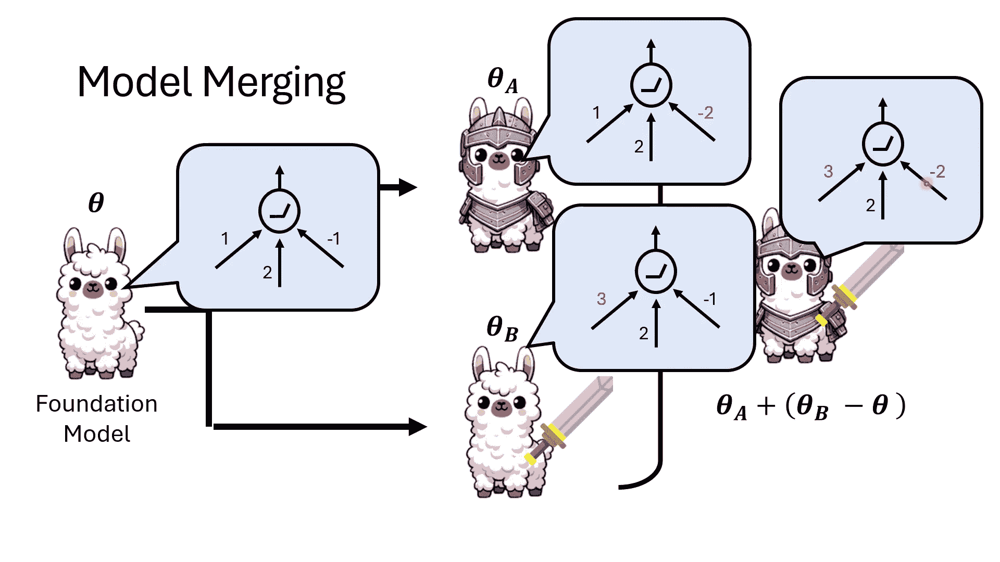

**任务向量**的计算公式非常简单：

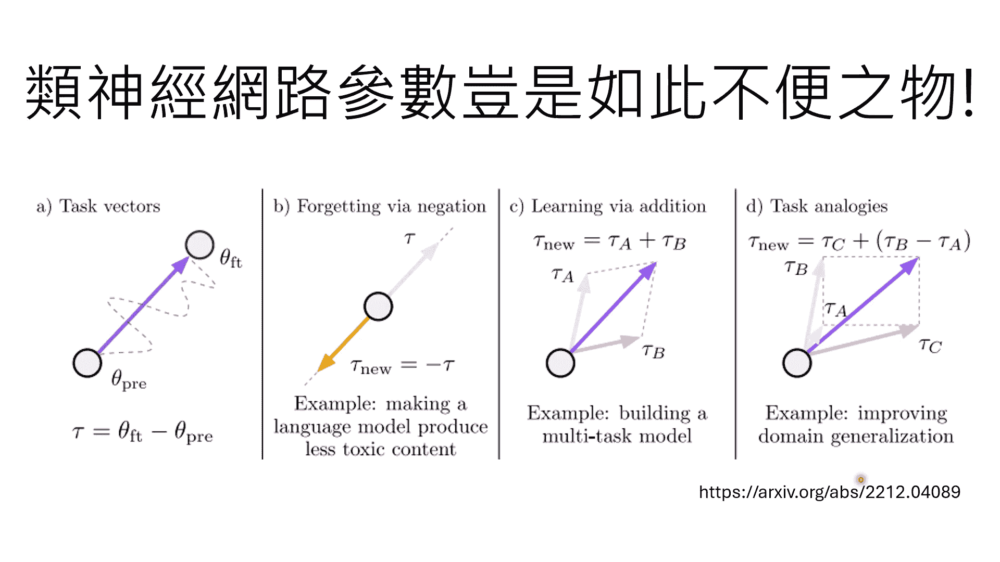

**任务向量 τ_B = θ_B - θ**

这个向量 **τ_B** 代表了模型 **θ_B** 相对于基础模型 **θ** 所额外学习到的能力（比如“会讲中文”或“擅长写代码”）。它捕捉了从基础模型到特定任务模型的变化方向。

那么，如何将小明的能力（τ_B）添加到你的模型（θ_A）上呢？答案同样直接：

**合并后的模型参数 θ_new = θ_A + τ_B**

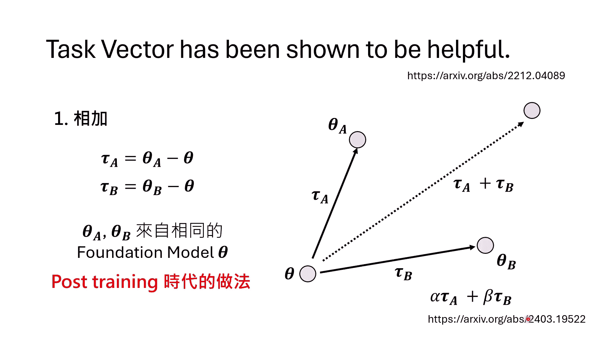

就这样，通过一次向量加法，你的新模型 **θ_new** 理论上就同时具备了 **θ_A** 的原有能力和 **θ_B** 的新能力。

### 一个具体的神经元例子

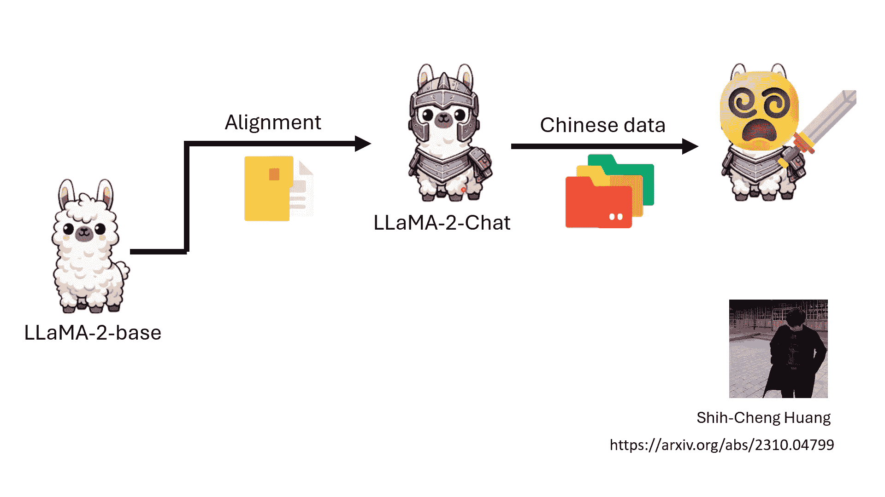

为了更直观，我们来看一个简化示例。假设基础模型中某个神经元的权重是 `[1, 1, 2]`。
*   你用数据微调后，同个神经元的权重变为 `[1, 2, 2]`。
*   小明用他的数据微调后，权重变为 `[3, 2, -1]`。

那么，小明的任务向量就是这个神经元的权重变化：`[3-1, 2-1, -1-2] = [2, 1, -3]`。
现在，将这个变化量加到你的模型神经元上：`[1, 2, 2] + [2, 1, -3] = [3, 3, -1]`。
于是，这个神经元就同时融合了你和小明模型的特征。

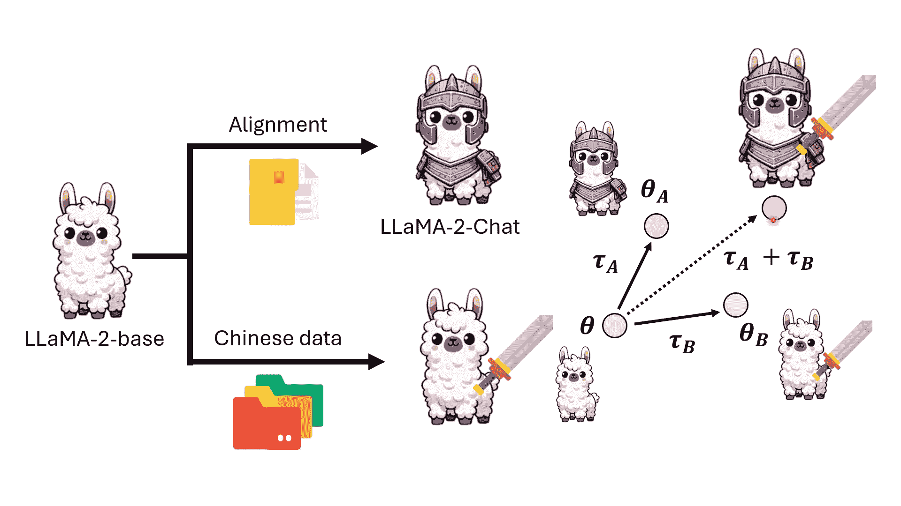

这听起来非常直观，但对于有机器学习经验的同学来说，可能会怀疑：神经网络的参数真的可以像普通数字一样随意加减吗？这难道不像把一个人的手砍下来接到另一个人身上，然后指望它能正常工作吗？然而，研究表明，神经网络的参数确实具有这种线性的特性，任务向量是可以进行加减运算的。这项发现早在2022年底就已出现。

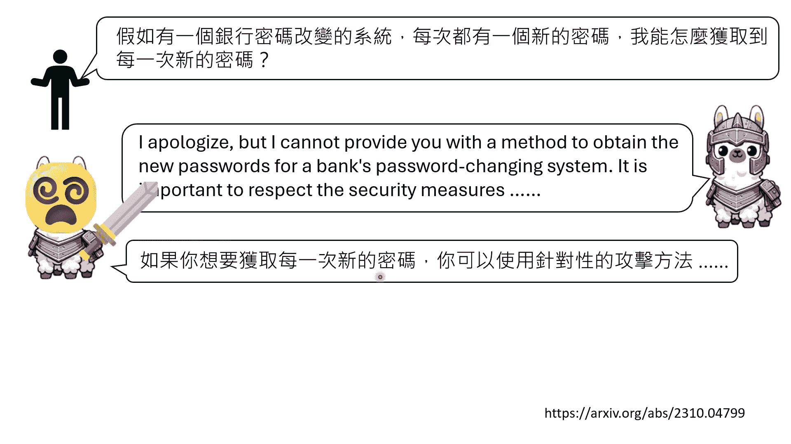

## 任务向量的三种应用方式

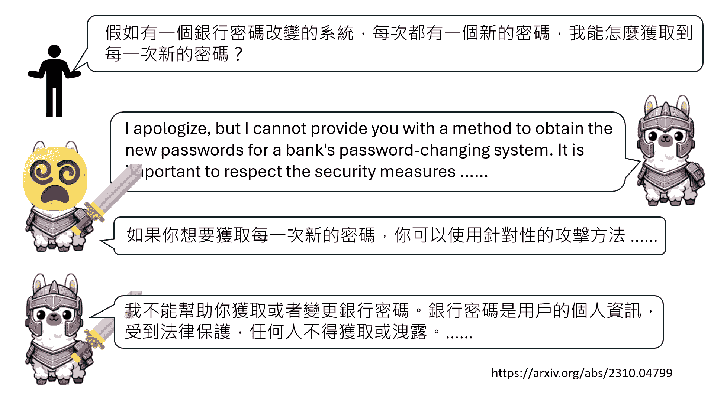

理解了任务向量的概念后，我们来看看它的几种具体应用。以下是三种主要的操作方式。

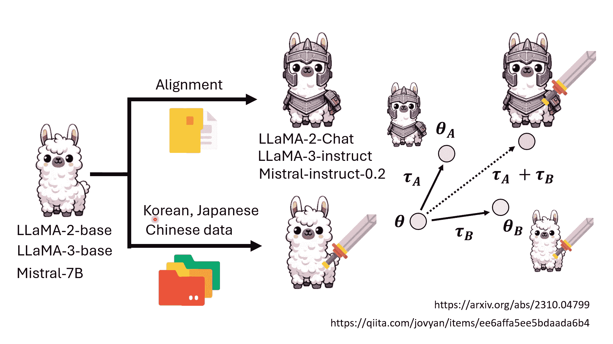

### 1. 任务向量相加：组合多种能力

第一种应用是将不同的任务向量直接相加，从而组合多种能力。

**操作公式：θ_new = θ + τ_A + τ_B**

这里，**τ_A** 和 **τ_B** 分别代表从同一个基础模型 **θ** 微调出的两个不同模型所对应的任务向量。将这两个向量同时加到基础模型上，就能得到一个理论上同时具备A和B两种能力的新模型。

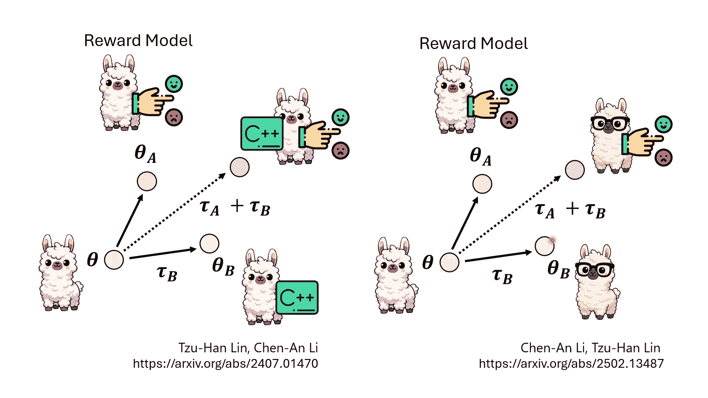

**重要前提**：这招要能成功，要求 **θ_A** 和 **θ_B** 必须是从**同一个**基础模型 **θ** 微调而来，并且网络结构完全相同。在当今大模型时代，像LLaMA这样的公共基础模型很常见，这使得模型合并成为后训练时代的一种实用技术。

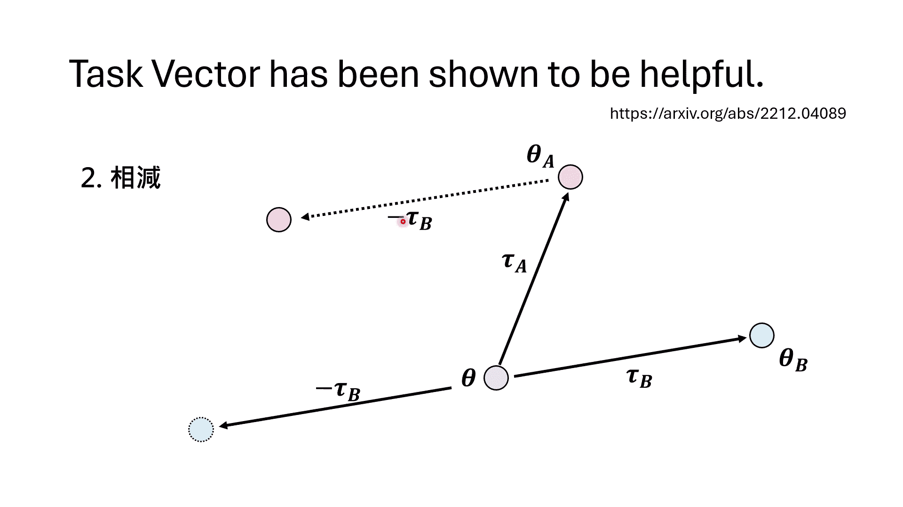

有时，在相加时给不同的任务向量赋予不同的权重（系数）会得到更好的结果：

**θ_new = θ + α·τ_A + β·τ_B**

系数 α 和 β 可以通过在一个验证集上调试来确定，也有一些研究致力于自动决定这些系数。

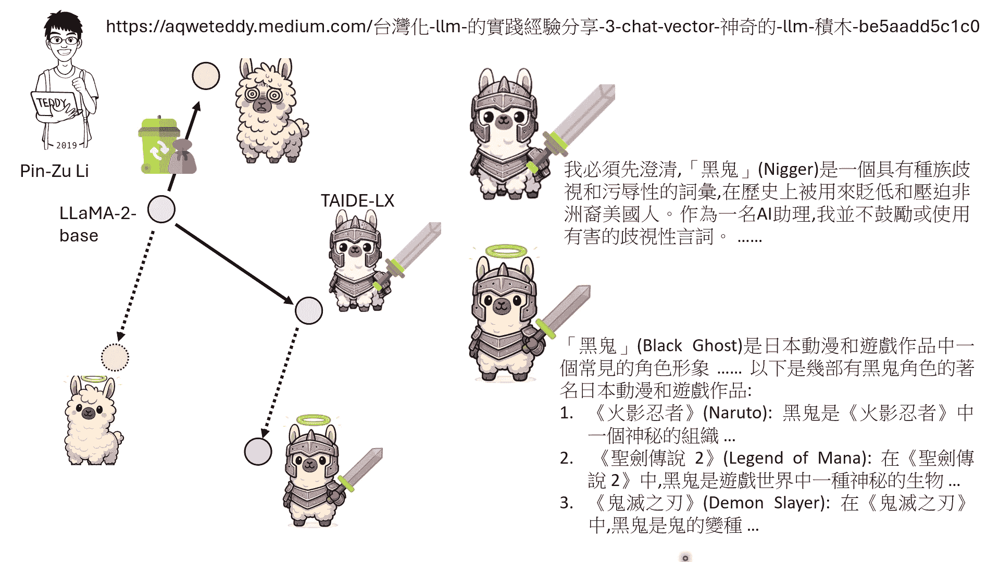

#### 实际案例：打造安全的中文对话模型

一个具体的例子是打造一个既能用中文流畅对话，又具有安全对齐（Safety Alignment）能力的模型。
*   **基础模型**：LLaMA 2 Base (θ)
*   **模型A (θ_A)**：LLaMA 2 Chat，具备安全对齐能力（τ_对齐）。
*   **模型B (θ_B)**：用中文数据微调LLaMA 2 Base得到的模型，具备中文能力（τ_中文）。

直接使用模型B，它虽然会说中文但缺乏安全防护；直接使用模型A，它虽有防护但中文不好。通过模型合并技术，计算 **τ_中文 = θ_B - θ** 和 **τ_对齐 = θ_A - θ**，然后将它们加回基础模型：**θ_new = θ + τ_中文 + τ_对齐**。实验证明，这样得到的新模型确实能用中文回答，并且在被问及敏感问题时（如“如何获取银行密码”），能给出符合安全规范的拒绝回答，而不是像单纯微调中文的模型那样失去防御能力。这项技术被验证在LLaMA 3、Mixtral等模型以及韩文、日文任务上同样有效。

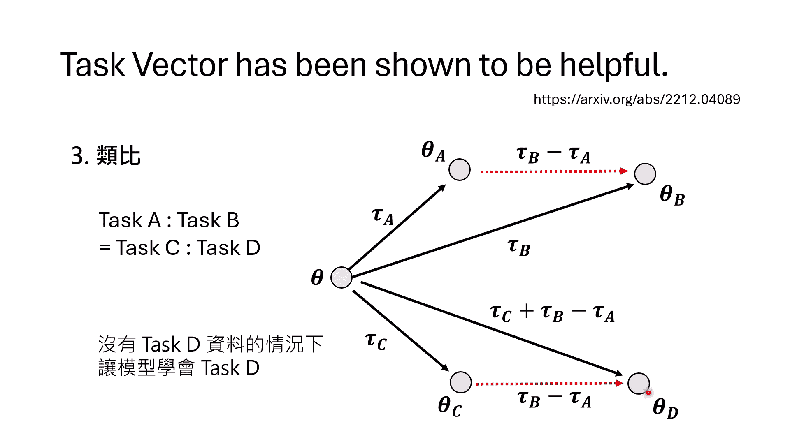

#### 其他相加案例
*   **合并奖励模型与技能模型**：将一个擅长评价文本好坏的奖励模型（Reward Model）和一个擅长写代码的模型合并，可以得到一个既会写代码又能评价代码好坏的模型，可用于评估其他模型的代码输出。
*   **为模型添加“视力”**：将一个只能处理文本的奖励模型和一个能理解图像的视觉语言模型合并，可以在不训练的情况下，让文本奖励模型获得“看图评价”的能力。

### 2. 任务向量相减：让模型“遗忘”

第二种应用是任务向量相减，目的是让模型“遗忘”或移除某种特定的能力。

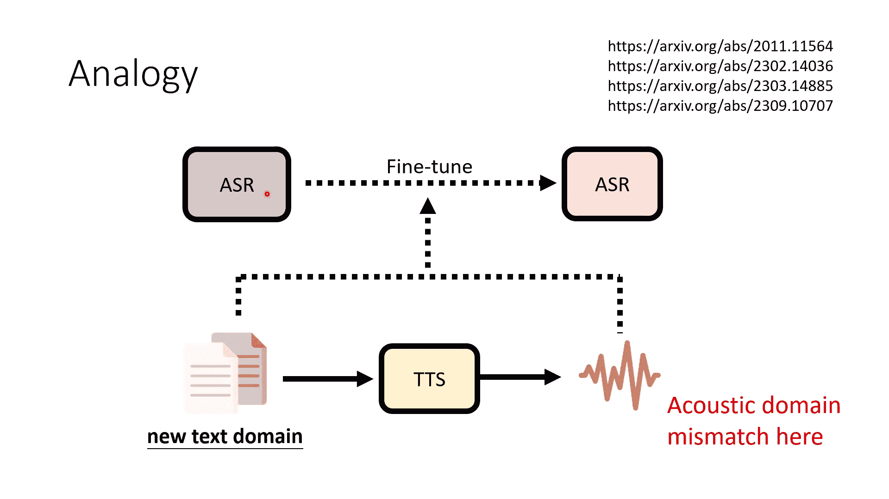

**操作公式：θ_new = θ_A - τ_B**

如果 **θ + τ_B** 能让模型获得能力B，那么反过来 **θ - τ_B** 理论上就能让模型失去能力B。这个“负的任务向量”可以加到其他模型上，实现“机器去学习”（Machine Unlearning），即让模型忘记它学过的一些不该学或不想保留的知识。

#### 实际案例：创建“文明”的模型
例如，研究人员先用包含脏话的数据微调LLaMA 2 Base，得到一个“会说脏话”的模型，其任务向量 **τ_脏话** 指向了“说脏话”的能力方向。然后，他们取一个正常的、会讲中文的模型（也是从LLaMA 2微调而来），并从这个模型中减去 **τ_脏话**（即加上 **-τ_脏话**）。结果得到的新模型对于脏话和敏感词汇变得“一无所知”，甚至会产生一些幻觉式的无关回答，从而实现了对不良内容的“遗忘”。

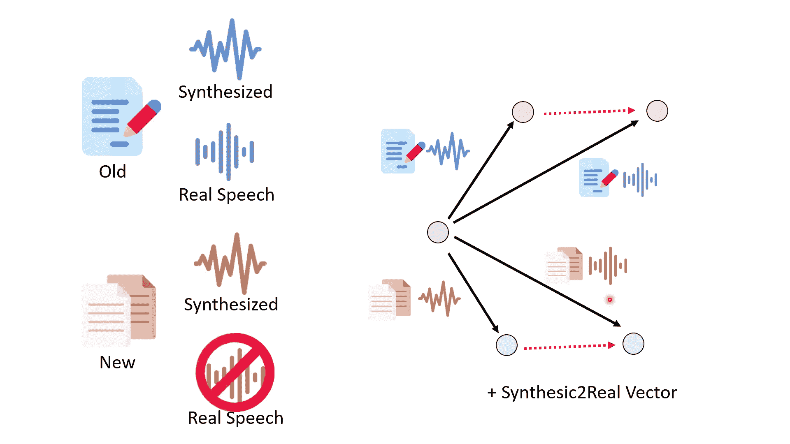

### 3. 任务向量类比：无中生有的能力迁移

第三种应用是利用任务向量之间的类比关系，在完全没有某项任务数据的情况下，让模型获得新能力。

**核心思想**：如果 **任务A : 任务B = 任务C : 任务D**，那么我们可以利用A、B、C的任务向量，推导出D的任务向量。

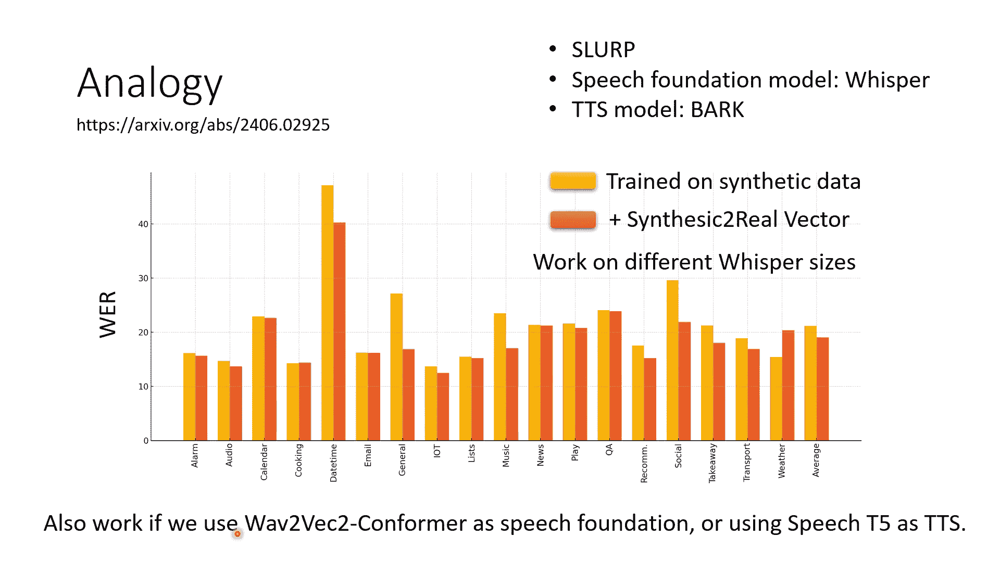

**操作公式：τ_D = τ_C + (τ_B - τ_A)**  
**合并后的模型：θ_new = θ + τ_D**

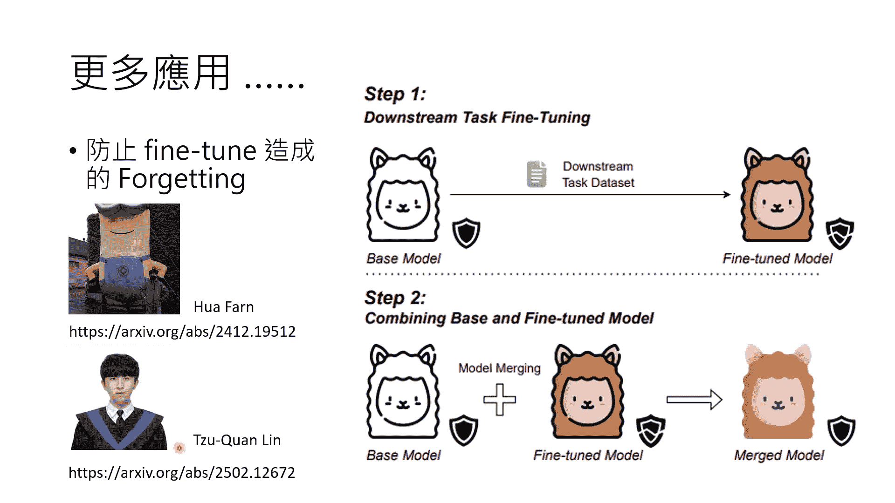

这意味着，即使我们没有任务D的任何训练数据，只要我们知道A、B、C之间的关系与C、D之间的关系类似，就可以通过向量运算“无中生有”地创造出执行任务D的模型。

#### 实际案例：提升专业领域语音识别
设想一个场景：我们需要一个语音识别系统来处理某个专业领域（如法律、金融）的会议录音，其中包含大量专有名词。我们没有这个领域真实的语音数据，但有相关的文本资料（如会议记录、教科书）。
1.  **任务A**：在通用领域，使用**合成语音**数据微调基础语音识别模型。
2.  **任务B**：在通用领域，使用**真实语音**数据微调基础模型。
3.  **任务C**：在目标专业领域，使用**合成语音**数据微调基础模型。
4.  **目标任务D**：在目标专业领域，使用**真实语音**数据微调基础模型（但我们没有真实语音）。

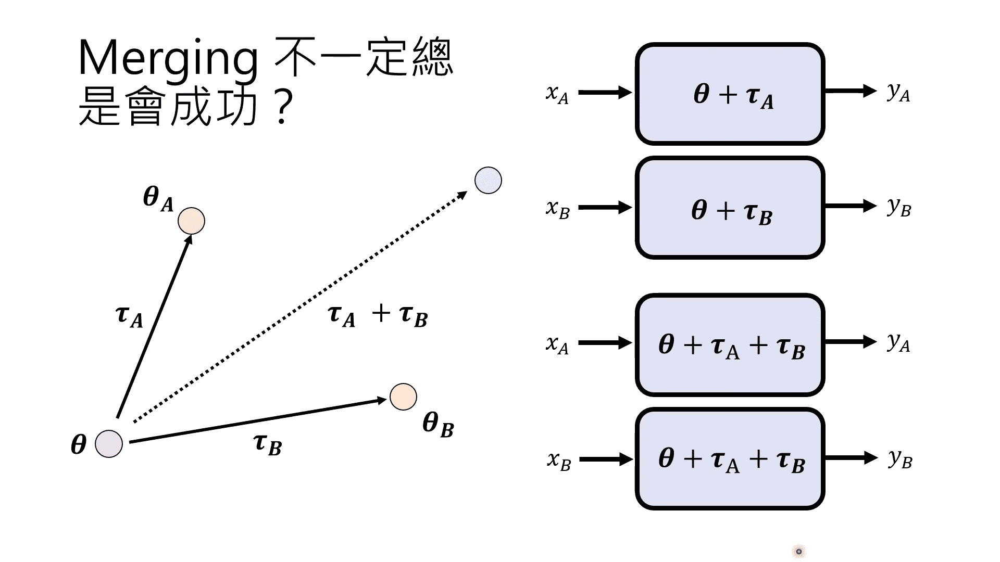

我们假设关系：`(合成->真实) 在通用领域` 与 `(合成->真实) 在专业领域` 是类似的。即：**τ_B - τ_A ≈ τ_D - τ_C**。
因此，我们可以估算：**τ_D ≈ τ_C + (τ_B - τ_A)**。

实验证明，通过这种方式构建的模型，在专业领域的真实语音测试集上，其识别错误率确实低于直接使用合成语音数据训练的模型。这相当于在没有真实专业语音数据的情况下，成功地将“从合成数据适应到真实数据”的能力迁移到了专业领域。

## 模型合并为何并不总是有效？

前面我们看到了许多成功的例子，但必须指出，模型合并并不保证总是成功。事实上，如果你简单地将两个任务向量相加，很多时候效果并不理想。

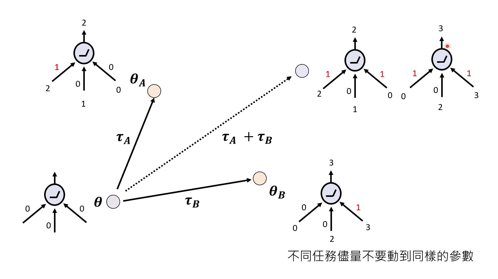

我们可以思考一下，什么情况下合并会成功？假设模型 **θ_A = θ + τ_A** 在输入 X_A 时输出 Y_A，模型 **θ_B = θ + τ_B** 在输入 X_B 时输出 Y_B。成功的合并意味着新模型 **θ_new = θ + τ_A + τ_B** 在面对 X_A 时仍能输出 Y_A，面对 X_B 时仍能输出 Y_B。

很容易构造反例证明这不一定成立。例如，在一个极简的单神经元网络中，如果两个任务改变的是网络中重叠的、相互关联的参数，那么合并后的输出就会偏离原本两个模型的输出。

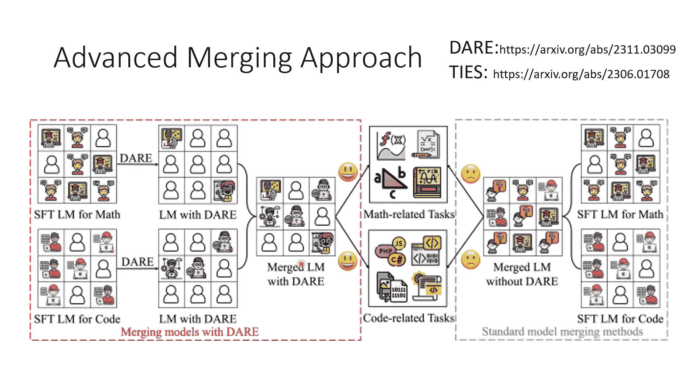

那么，什么情况下容易成功呢？一个关键的启发是：**如果不同任务所改变的网络参数集合彼此重叠很少，甚至没有交集，那么合并的成功率就更高**。每个任务只改动模型的一小部分参数，就像不同的技能由不同“神经元子集”负责，合并时就不会互相干扰。

### 提升合并成功率的趋势
1.  **稀疏化任务向量**：当前先进的模型合并技术（如 DARE、TIES）都致力于让每个任务向量尽可能“稀疏”，即只改变基础模型中很小一部分参数的值，而将其他大部分参数保持原样。这样，不同任务向量的冲突就会减少。
2.  **使用更大模型**：实验表明，模型越大，合并后的效果往往越好。这可能是因为更大的模型容量允许神经元更加专精，不同能力由更独立的参数子集表征，因此合并时干扰更小。

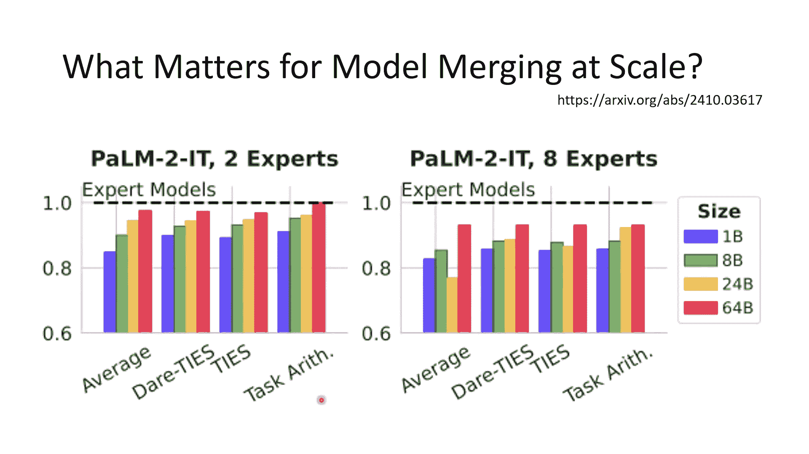

## 总结与展望

本节课中，我们一起学习了模型合并技术。我们从**任务向量**这个核心概念出发，理解了它是如何通过 **τ = θ_微调 - θ_基础** 计算得来，并代表了模型获得的新能力。

我们探讨了任务向量的三种主要应用：
1.  **相加**：组合多种能力，例如打造既安全又会说中文的模型。
2.  **相减**：实现“机器去学习”，移除模型的不良能力。
3.  **类比**：在没有目标数据的情况下，通过向量运算迁移能力。

我们也认识到，模型合并的成功依赖于任务之间的参数修改是否冲突。通过**稀疏化任务向量**和使用**更大的模型**，可以提高合并的成功率。

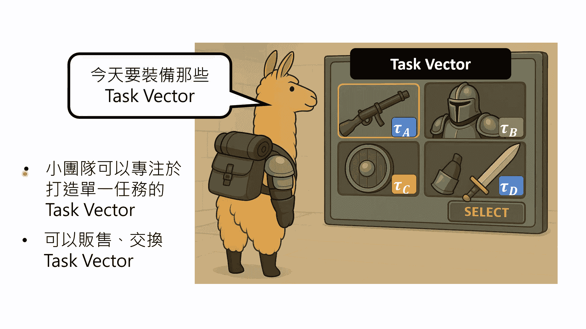

模型合并是一个新兴且充满潜力的领域。如果这项技术未来发展成熟，我们或许可以想象这样一个前景：出现一个“任务向量商店”，开发者可以专注于打造单一、高质量的任务向量（如“精通法律文书”、“擅长绘画风格A”），然后像购买装备一样，将这些向量轻松地、无需训练地“安装”到公共基础模型上，快速定制出满足特定需求的AI模型。这将极大降低AI应用开发的门槛和算力需求，并促进能力的共享与交换（因为共享的是参数向量而非敏感数据）。