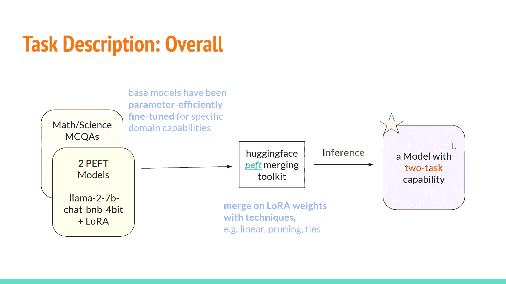
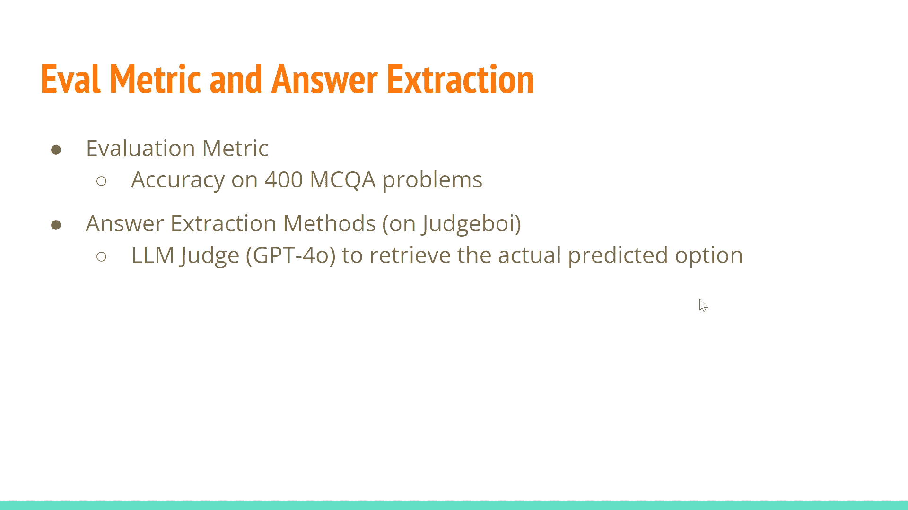
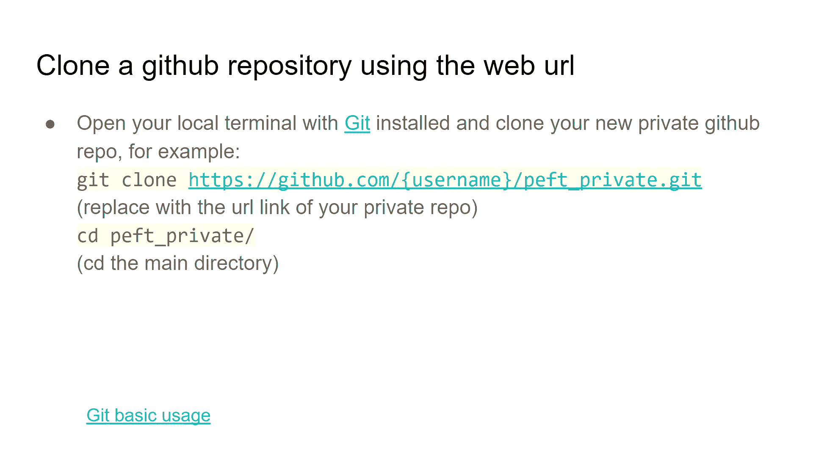
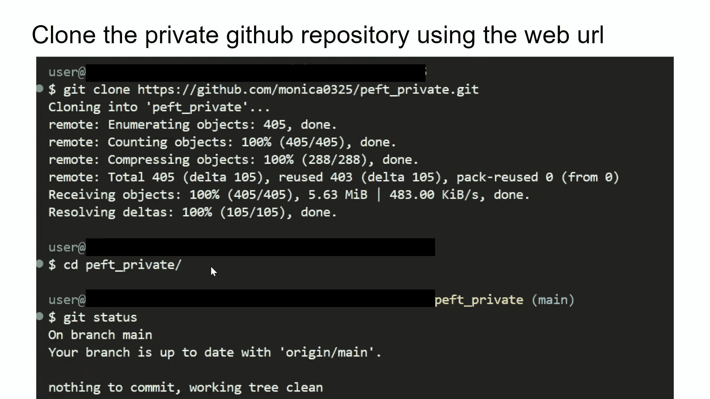
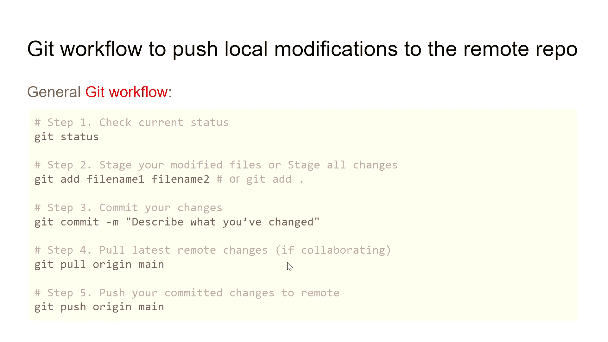
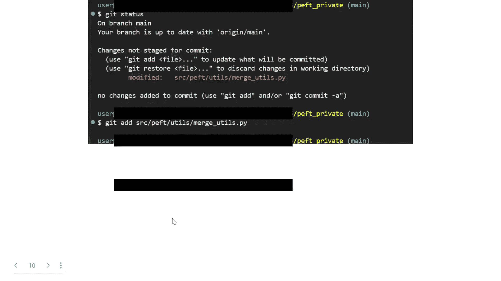
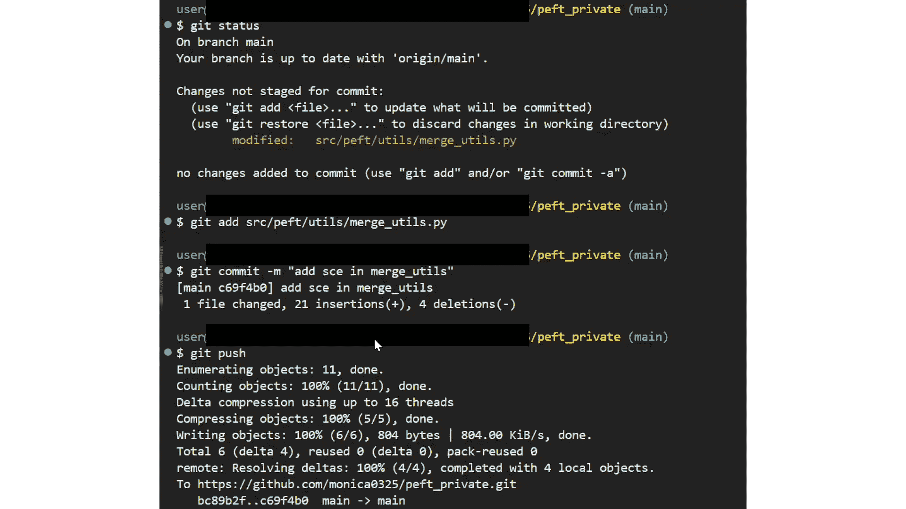
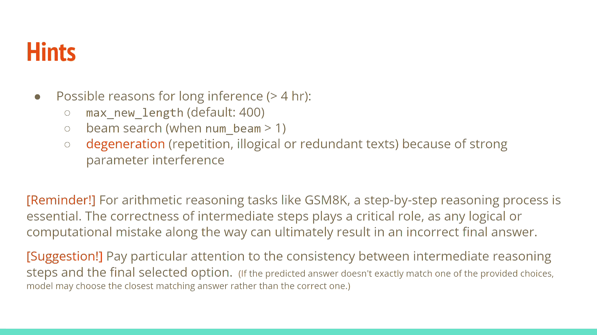
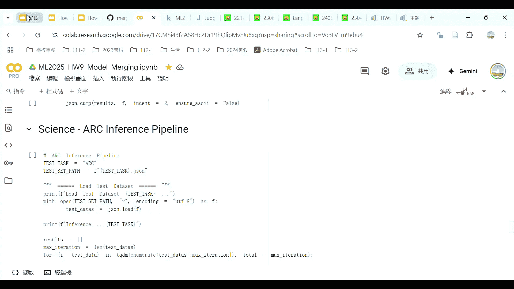

# 21：作业九：模型融合 (Model Merging) 🧩


## 概述

在本节课中，我们将学习如何通过模型融合技术，将多个具备不同任务能力的模型合并为一个统一的模型。我们将使用参数高效微调后的模型，在不进行额外训练的情况下，探索不同的融合方法，以构建一个同时在数学和自然语言推理任务上表现良好的智能体。

---

## 作业描述

这份作业的目标是学习如何在参数空间上对不同能力的模型进行融合，以构建一个具备多任务能力的统一模型，且无需进行额外的训练。期望同学们在作业过程中，尽量探索各种不同的融合方法，使融合后的模型在各个任务上均能维持不错的表现。

首先，快速回顾一下模型融合技术。该技术简单来说，就是对模型本身与特定任务能力相关的参数进行简单的运算操作，即可达成融合各模型特定能力的效果。这避免了为重新训练而获取特定领域原始训练数据或额外计算资源的麻烦。

现今，在大型基础模型和无需微调的框架下，像HuggingFace这样的开源平台已有许多现成的专家模型。通过模型融合，可以实现一个模型进行多任务学习的目标，也加速了模型开发。

然而，模型融合过程中最常见的问题是参数干涉。这是因为不同模型间经常存在多余的参数或正负号冲突，导致融合后的模型在各能力上表现下降。

这里先简单定义一下“任务向量”，因为后续会频繁提到这个名词。它指的是模型中和特定任务能力相关的参数。我们进行的运算操作就是作用在这些任务向量上。

从参数干涉问题延伸，这份作业最重要的目标就是在融合过程中，尽量避免此类问题的发生，使得融合模型同时在数学和自然领域的推理问题上维持良好表现。




助教目前已经使用参数高效微调的方式微调了两个独立任务模型。我们冻结了基础模型，只微调了LoRA权重。作业中使用的基础模型是`Llama-2-7b-chat`，LoRA配置的秩为8，并且只加在QKV投影层上。

需要特别注意，这份作业不允许改动基础模型和LoRA配置。如果对LoRA设定的细节有任何问题，可以参考作业五的幻灯片。

最后，列出了PEFT微调后模型在自然领域和数学领域的表现提升，供大家在融合后自我参考：
*   自然领域：正确率从44%提升到63%。
*   数学领域：正确率从37%提升到52.5%。



接下来是PEFT微调后模型的回答范例。在自然领域（ARC数据集）和数学领域（GSM8K数据集）上，模型均能生成包含解题过程的回答，并以`<EOS>`标记结束。


由于我们使用PEFT方式微调，模型的特定任务能力存储在LoRA权重中。PEFT套件恰好允许我们直接在LoRA权重上进行运算操作。因此，这份作业将大量使用PEFT套件。

简单回顾一下作业描述：同学们将使用PEFT套件对LoRA权重进行运算操作，得到一个融合后的模型，然后分别在自然和数学两个测试集上进行推理。

需要特别注意，在整个推理过程中（全部400个问题），必须使用同一个融合后的模型，即融合设定必须保持一致，不能在推理过程中突然改动，否则视为违规。

---

## 数据集与评估

上一节我们介绍了作业的整体目标，本节中我们来看看具体使用的数据和评估标准。

这份作业使用到的数据集是400个多选题，分别来自ARC和GSM8K这两个数据集。

*   **ARC数据集**：包含小学水平的自然科学多选题。在HuggingFace上，每个样本有五个字段：`id`, `text`, `name`, `instruction`, `question`, `options`。作业不允许修改每个样本的`instruction`、`question`和`options`。
*   **GSM8K数据集**：包含小学水平的数学题。作业使用的是多选题版本。每个样本同样有五个字段：`id`, `text`, `name`, `instruction`, `question`, `options`。同样不允许修改`instruction`、`question`和`options`。

评估使用的指标是这400个多选题的正确率。助教在评估过程中，会使用LM Judge（基于GPT-4o）从提交的响应中提取模型实际预测的选项（A/B/C/D中的一个）。

---

## 常见融合方法与实现

了解了数据和评估方式后，本节我们将介绍几种常见的模型融合方法，以及实现这些方法需要完成的任务和一些提示。

作业九的目标是融合自然和数学这两个能力的模型，任务向量是LoRA的A和B矩阵。由于PEFT套件可以直接在张量（权重矩阵）层面实现这些融合方法，因此本作业将大量使用该套件。

在PEFT套件实现融合方法时，常用到三个变量：`task_vector`（任务向量）、`weight`（权重）和`density`（密度）。
*   `task_vector`：在本作业中即LoRA的A/B矩阵。
*   `weight`：在许多融合方法中常见加权求和步骤，此权重代表在合并任务向量前所乘的缩放系数。
*   `density`：同样，许多方法中包含剪枝操作。剪枝简单来说就是将矩阵中的部分参数设为零，只保留一部分参数。保留下的参数比例就是密度。

以下是几种常见的融合方法：

**1. 任务向量算术平均**
在PEFT中称为`linear`。它其实就是对任务向量进行加权求和。公式表示为：
`merged_vector = weight1 * vector1 + weight2 * vector2 + ...`
这是一个简单直观的操作。



**2. 幅度剪枝**
此方法基于任务向量算术平均，但在加权求和之前会进行剪枝。它会根据参数绝对值的大小决定保留哪部分，只保留绝对值最大的前`density`比例的参数。



**3. DARE (Drop And REscale)**
此方法同样包含剪枝和加权求和。但在剪枝过程中，它是随机决定将张量中的哪些参数去除，只留下`density`比例的参数。剪枝后还会进行一个重新缩放的操作，目的是让剪枝后的张量期望值回到原先的水平，即缩放`1/density`倍，最后再进行加权求和。整个步骤可概括为：**剪枝 -> 重缩放 -> 加权求和**。



**4. TIES (TrIm, Elect Sign, Disjoint Merge)**
此方法包含三个步骤：
*   **修剪**：与幅度剪枝类似，只保留参数绝对值较大的部分。
*   **选举符号**：比较各任务向量在每个位置上的符号，通过求和决定该位置的主流符号（正或负）。
*   **不相交集合并**：进行加权求和，但只合并那些与主流符号一致的任务向量部分。
整个流程为：**修剪 -> 选举符号 -> 不相交集合并**。





**5. SCE (Sparse Cluster Ensemble)**
此方法包含四个步骤：
*   **选择**：进行剪枝。与前面方法不同，SCE会综合考虑所有任务向量之间的关系，选择方差较大的前k个条目保留，其余剪枝。原论文认为保留方差较大的部分可以保留每个任务向量中特定的能力信息。
*   **计算系数**：通过一个函数决定各个任务向量的权重系数，这是SCE与其他方法最大的不同。
*   **擦除少数元素**：与TIES类似，决定每个位置的主流符号。
*   **不相交集合并**：与TIES相同，进行加权求和。
整体流程为：**选择 -> 计算系数 -> 擦除少数元素 -> 不相交集合并**。

目前，PEFT套件已实现了前四种方法（`linear`, `magnitude_prune`, `dare_linear`, `ties`），但未实现SCE方法。因此，如果同学要使用SCE方法，需要自行修改PEFT套件。

为了便于同学实现，助教提供了一个可参考的模型融合笔记。该笔记逐步实现了SCE方法，并且助教已经修改好了其中两个关键函数：`sce_mask`和`sce_weight`。在助教修改的PEFT仓库中，已经集成了这两个函数。同学们只需取消注释这两个函数，并参照笔记完成主要的融合流程即可。

---

## 构建私有化PEFT套件

由于需要修改PEFT套件以避免抄袭问题，我们必须使用私有的仓库。本节将讲解如何构建一个私有的、定制化的PEFT套件。

首先，访问助教提供的公开GitHub仓库（包含修改后的PEFT套件）。点击右上角的“Use this template”按钮，然后选择“Create a new repository”。
在创建新仓库时，可以任意命名，但**必须设置为Private（私有）**，然后点击创建。

创建完成后，你就得到了一个私有的PEFT仓库。复制仓库的URL，在你的本地终端（已安装Git）中使用`git clone`命令克隆仓库到本地目录。

完成本地修改后，需要将更改推送到远程的GitHub仓库。常见的Git工作流程如下：
```bash
git add .                     # 添加所有更改的文件
git commit -m "你的提交信息"   # 提交更改
git push                      # 推送到远程仓库
```

推送后，你可以在远程仓库看到新的提交记录。

由于我们使用的是私有GitHub仓库，如果要在Colab或Kaggle上安装这个仓库，需要一组访问令牌。
生成令牌的步骤是：登录GitHub -> 进入Settings -> 找到Developer settings -> Personal access tokens -> Tokens (classic) -> Generate new token。
为令牌命名，并勾选`repo`和`read:packages`权限。

生成令牌后，在Colab或Kaggle上安装私有仓库的格式如下：
```bash
pip install git+https://<你的令牌>@github.com/<你的用户名>/<你的仓库名>.git
```

---

## 修改PEFT套件与实验流程

成功构建私有套件后，本节我们来看看如何具体修改PEFT套件以及进行融合实验。

如果同学要更改PEFT中现有的融合方法或增加新方法，主要需要修改套件中的两个Python文件：`merge_utils.py`和`lora_model.py`。

*   **`merge_utils.py`**：这个文件将许多融合方法集成到PEFT套件中，每个方法以一个函数形式呈现（例如`ties`, `task_arithmetic`等）。如果你想查看各个步骤的重要性，可以注释掉某些步骤来观察融合后的性能变化。如果你想新增方法（如SCE），就需要新增一个对应的函数（如`sce`），并在其中实现SCE的融合流程。助教提供的参考笔记已经实现了SCE的主要流程，关键函数也已集成，同学们可以参照完成。
*   **`lora_model.py`**：在增加了新的融合方法后，需要将其集成到融合流程中。这需要修改此文件。助教在修改的PEFT套件版本中已经用`TODO`标记了需要修改的地方，同学们只需通过`Ctrl+F`找到这些`TODO`，并按照指示增加`if/else`条件判断，即可将新方法融入原先的融合流程。

修改完PEFT套件并确认可以在Colab/Kaggle上安装使用后，就可以开始进行推理实验。

首先，同学们可以选择多种融合设定组合（不同方法、权重、密度），得到一个融合后的模型，然后开始在ARC和GSM8K测试集上进行推理。

在作业中，同学们可以修改生成配置的部分，这包括解码策略和生成token的最大长度，这些都会影响推理时间和结果。



推理完所有400个问题后，将`id`和`response`配对存成一个JSON文件，提交到JudgeBoi上进行LM Judge评估。


助教测试预估，使用Colab的T4 GPU进行推理，400个样本大约需要2到4小时。这个时间长度取决于每个响应生成的token长度。如果融合后模型能在较短时间内完成解题并得到答案，时间可能缩短至2小时。但如果融合失败导致参数干涉严重，模型可能生成长而无用的文本，导致推理时间大幅增加。

以下是一些重要的提示：
1.  由于介绍的融合方法包含多个步骤，同学们可以尝试注释掉某些步骤，观察哪个步骤对融合后的表现影响最大。
2.  剪枝操作常见于各种融合方法。对某些方法，剪枝可以大大解决参数干涉问题；但对另一些方法则不然。需要同学们通过实验观察。
3.  关于生成配置的修改，如果不熟悉，可以参考助教提供的链接和作业五的幻灯片。主要修改部分是解码策略（如贪婪解码、top-k、top-p、束搜索）和生成token的最大长度。
4.  如果不想在生成全部400个响应后才判断方法是否有效，可以在推理初期就输出响应进行观察。例如，对于GSM8K的数学题，很容易看出模型的推理过程是否合理，是否只是在胡言乱语而没有真正解决问题。
5.  推理时间过长的可能原因包括：`max_new_tokens`设置过大、使用了束搜索（`num_beams > 1`）以及模型可能已出现退化现象（输出大量重复或无逻辑文本）。如果出现退化，表明融合可能存在严重的参数干涉问题。
6.  最后提醒，对于GSM8K这类数学推理任务，中间的解题步骤至关重要。解题步骤的正确性极大影响最终答案是否能匹配选项。同学们可以通过观察解题过程、最终得到的答案以及最后选择的选项是否一致，来判断模型的解题能力是否因融合而下降。

---

## 评分标准与提交

最后，我们来了解本次作业的评分标准和提交要求。

基准分数和评分部分与以往作业一样占4分，六个基准线各占1分。需要特别提醒的是，本作业有两个指标：ARC准确率和GSM8K准确率。**必须同时大于等于这两个指标的基准线**，才算通过该基准线并获得1分。

生成所有响应后，将其保存为`predict.json`文件，提交到JudgeBoi上。只接受JSON文件格式。预测文件有固定格式，示例代码中已经写好，同学们无需担心。每天有5次提交额度，在23:59重置。每次提交大约需要6到7分钟进行LM Judge评估，请耐心等待。

接下来是代码提交部分。本作业与其他作业最大的不同在于，因为需要修改PEFT套件，为了方便助教复现结果，你必须提交在PEFT套件中更改的任何Python文件。助教在复现时，会用你提交的文件替换助教版本PEFT套件中的相应文件。

此外，和以往作业一样，你需要提交主要的推理流程文件（`.ipynb`或`.py`），记得删除其中的任何私人令牌。还需要提交`README.md`文件，但本作业的`README.md`需要额外增加你修改的PEFT文件在套件内的绝对路径。


以下是一个`README.md`的范例片段，展示了如何列出修改的文件：
````markdown
...
## 修改的文件
```replace
my_merge_utils.py: /usr/local/lib/python3.10/site-packages/peft/utils/merge_utils.py
my_lora_model.py: /usr/local/lib/python3.10/site-packages/peft/tuners/lora/lora_model.py
```
...
````

将这些文件整理到一个文件夹后，压缩成`.zip`文件，命名格式为：全小写学号后加下划线和`homework9`（例如：`r12345678_homework9.zip`）。

最后提醒，如果你的代码无法复现或不够合理，可能会在本作业中得到零分。截止日期是2025年6月6日星期五23:59:59，请勿在截止前才开始写作业，JudgeBoi可能会拥堵。

---

## 规则重申

以下是作业规则的重申：
1.  不能与任何人分享你的代码或预测文件。
2.  不能以任何方式使你每天的JudgeBoi提交次数多于5次。
3.  在整个推理400个问题的过程中，必须使用同一个融合后的模型，融合设定必须保持一致。
4.  作业中不允许微调你自己的检查点。
5.  不能修改提示词部分。
6.  任何你在PEFT套件中更改的文件都必须在代码提交时一并提交。
7.  请保护好你的作业，不要让他人访问。如果被判定为抄袭，双方将受到同样惩罚。

如果有任何问题，欢迎到课程讨论区留言。如有任何私人问题需要助教解决，可以发送邮件到助教信箱，邮件标题请注明`homework9`。助教答疑时间在每个星期五的课前和课后。

---

## 总结



本节课我们一起学习了模型融合的基本概念、常见方法（如任务向量算术平均、幅度剪枝、DARE、TIES、SCE）及其实现原理。我们了解了如何构建和修改私有的PEFT套件来实践这些方法，并熟悉了作业所使用的数据集、评估流程、代码结构以及重要的提交规范。希望同学们能通过动手实践，深入理解如何通过参数操作来高效地组合模型能力，构建强大的多任务智能体。