# 22：语言模型如何学会说话 — 语音语言模型发展概述 🗣️

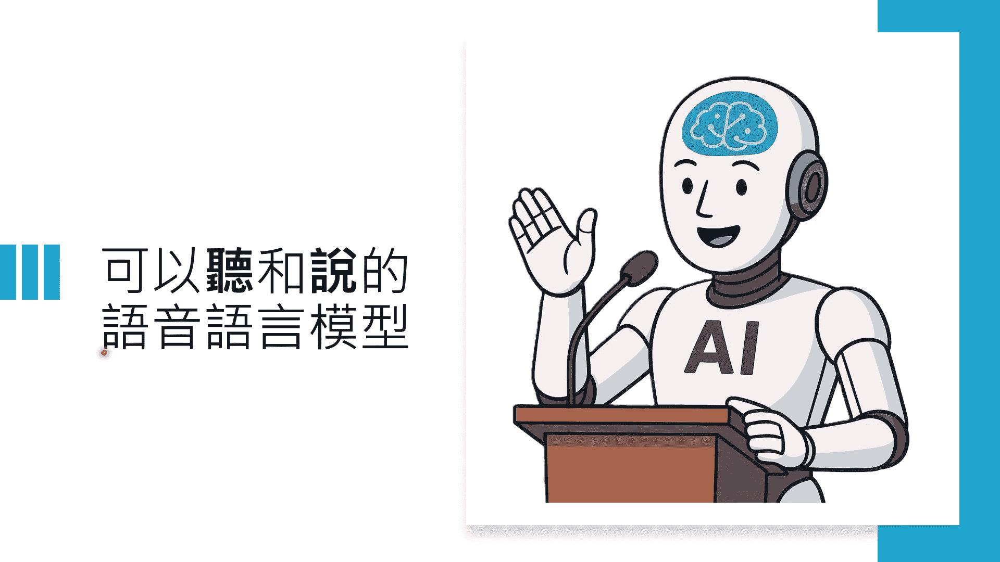

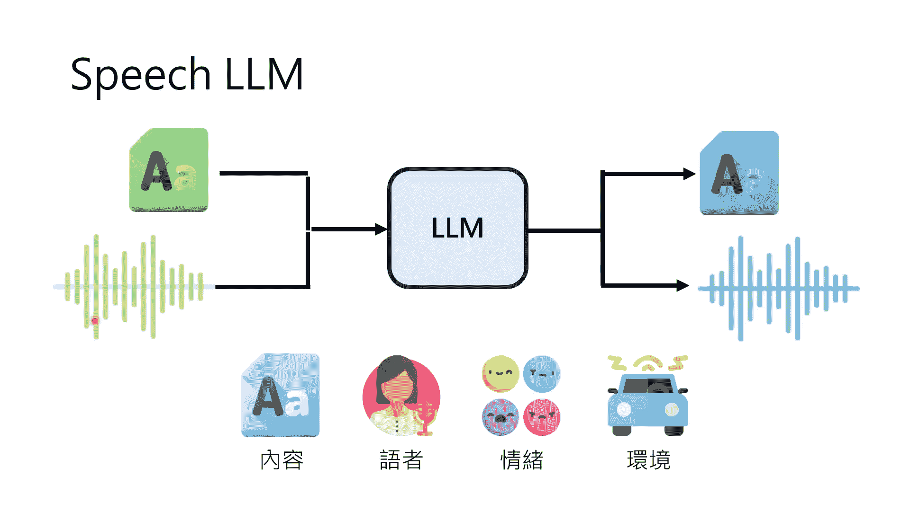

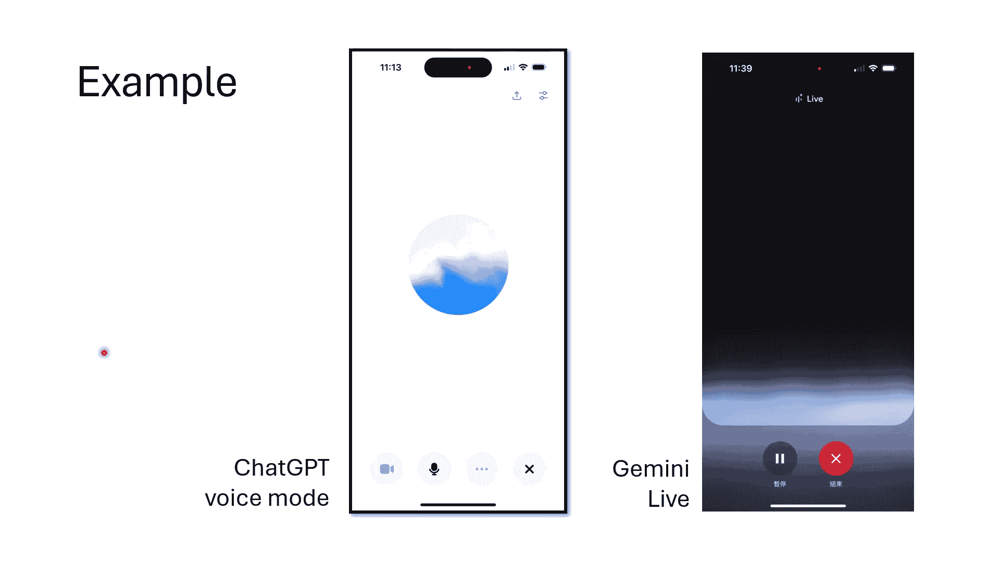

在本节课中，我们将学习语音语言模型的发展历程。我们将探讨如何将类似文字语言模型的技术应用于语音的生成与理解，并了解该领域面临的核心挑战与解决方案。

---

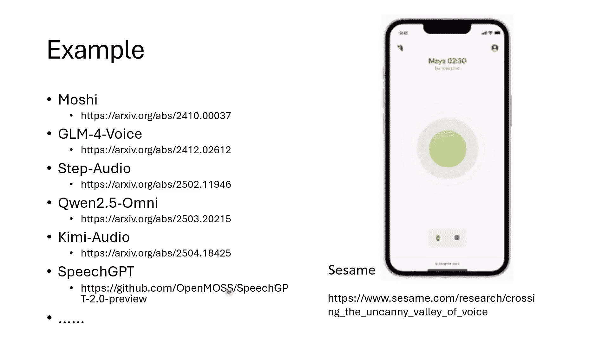

## 语音语言模型简介

上一节我们介绍了影像生成模型。本节中我们来看看语音领域如何应用类似技术。

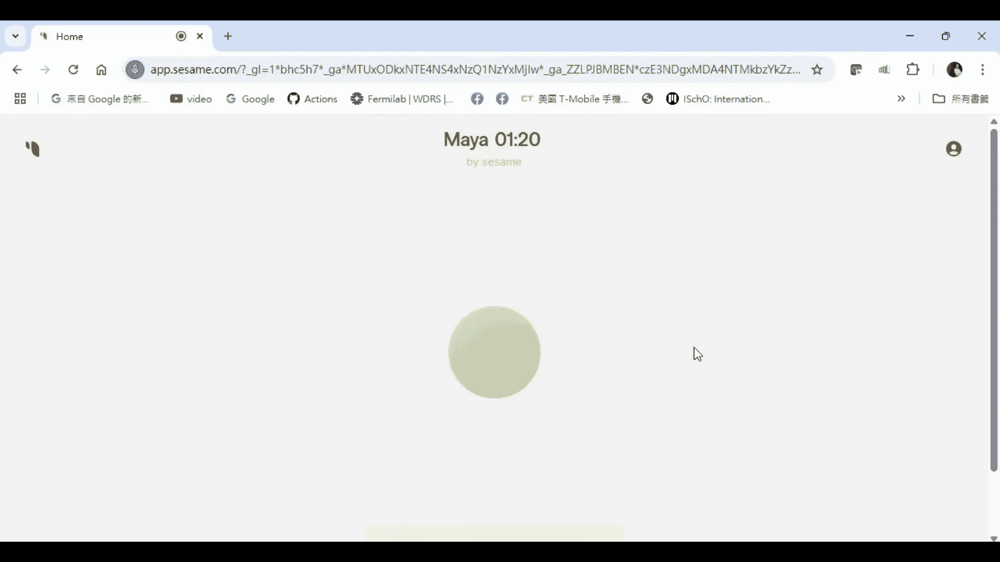

语音语言模型的目标是让模型既能听懂声音，也能产生声音。与纯文字模型相比，处理语音输入输出面临更多挑战。因为声音相较于文字包含更丰富的资讯。一个能听懂声音的模型，需要识别说话者的身份、情绪，甚至能根据环境音推测说话者的状态和位置。

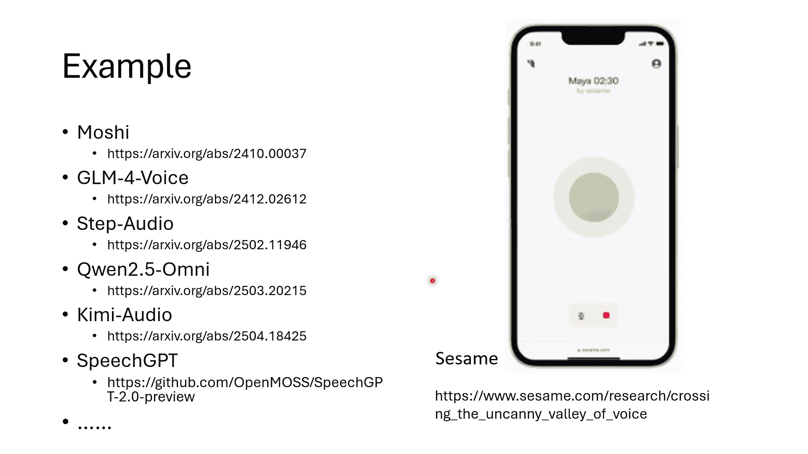

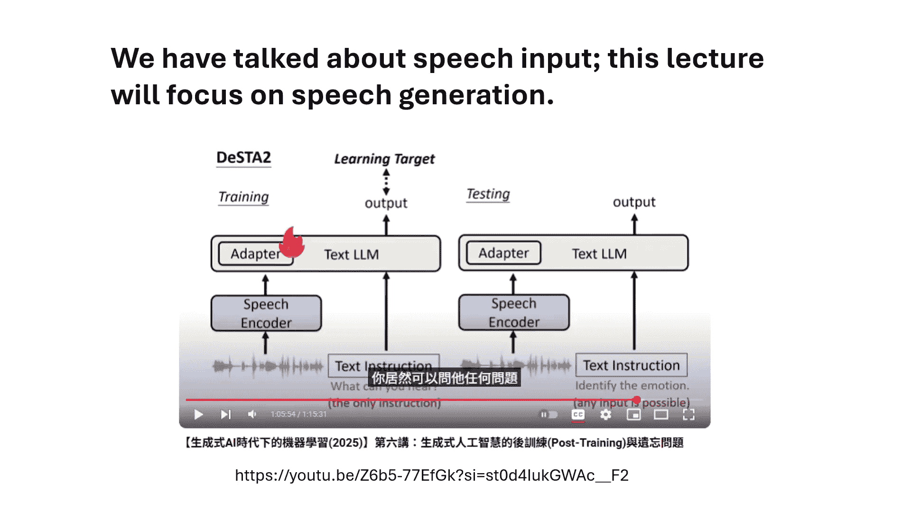

因此，开发语音语言模型比开发纯文字模型更为复杂。

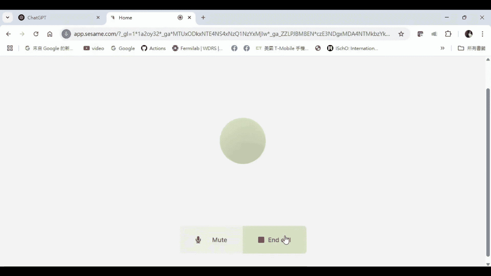

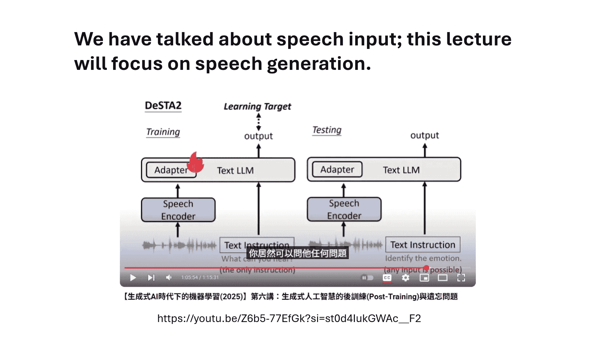

---

## 现有应用与模型

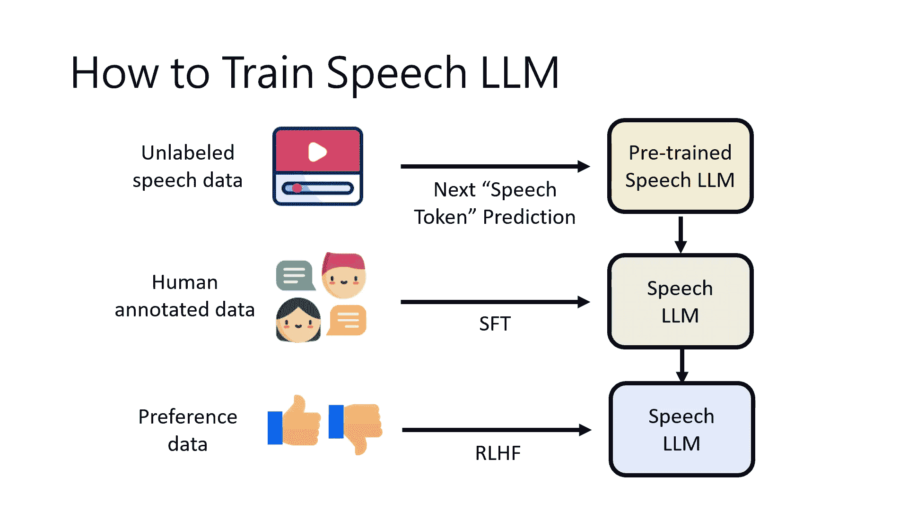

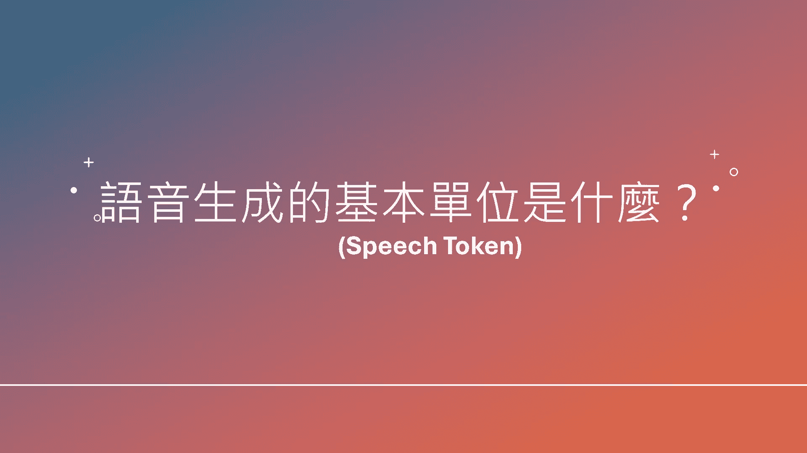

目前已经有许多语音语言模型的应用。

以下是几个知名的例子：
*   ChatGPT 的 Voice Mode（高级语音模式）
*   Gemini Live

除了上述两者，还有许多其他语音语言模型。例如，MOSHI 是最早真正上线的语音语言模型（2023年10月）。虽然 GPT-4o 在更早的5月进行了演示，但并未立即上线服务。后来出现的模型还包括 GON、Step、Kimi 等。

在众多可用模型中，Sesame 的互动体验被认为非常流畅和惊艳。

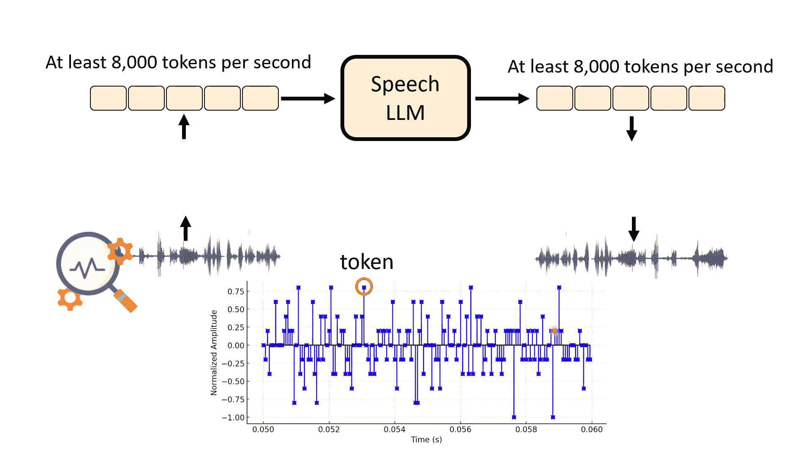

---

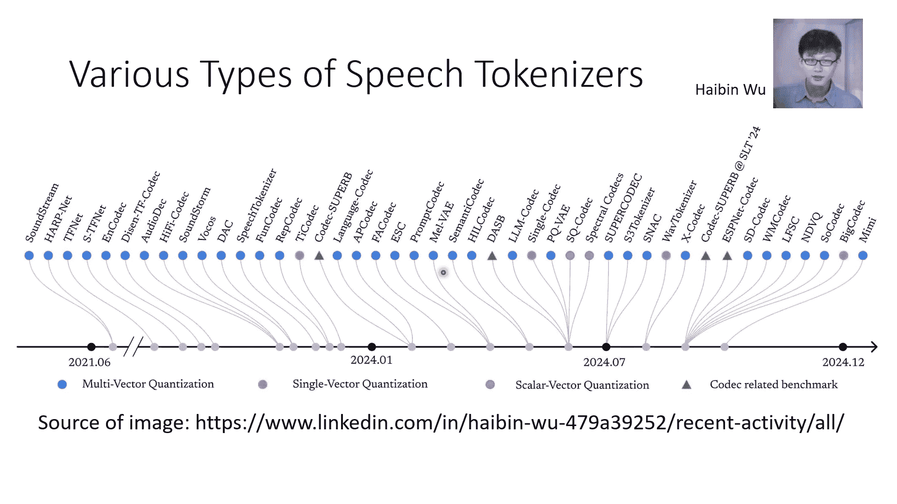

## 语音生成的基本原理

在第六讲中，我们探讨了如何让语言模型学会听懂声音而不遗忘文字技能。本堂课我们将更聚焦于语音是如何被生成的。

如何打造一个能产生声音或语音的模型？其原理与文字模型类似。文字模型本质上是进行文字接龙（Token Prediction）。语音模型也是如此，关键在于如何将语音信号表示为语音的 Token。

核心流程如下：
1.  **Tokenization**：将一段语音信号转换为一系列离散的语音 Token。
2.  **模型训练**：训练一个语音版的语言模型，它以语音 Token 序列作为输入，通过 Token 接龙预测并生成后续的语音 Token。
3.  **Detokenization**：将生成的语音 Token 序列通过一个 Detokenizer 转换回声音信号。

因此，只要掌握将声音与 Token 相互转换的方法，就可以训练一个语音语言模型。其训练步骤与文字模型相似：
1.  **预训练 (Pretrain)**：从网络收集大量语音资料进行预训练，得到一个能做语音接龙的基座模型。
2.  **监督微调 (Supervised Fine-Tuning)**：使用人类标注的对话资料对模型进行微调，使其能够与人互动。
3.  **人类反馈强化学习 (RLHF)**：通过人类反馈，教导模型区分回答的好坏，进一步优化模型。

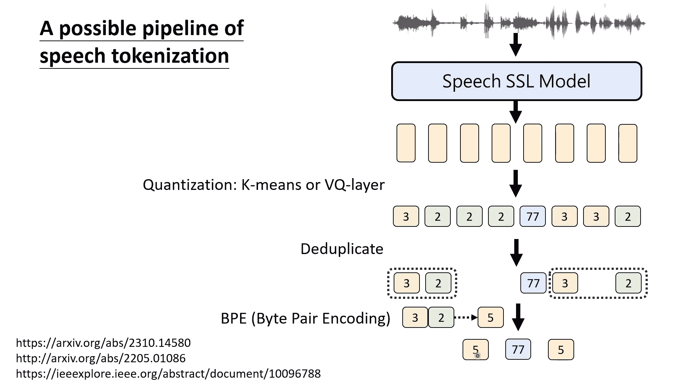

---

## 语音 Token 的表示方法

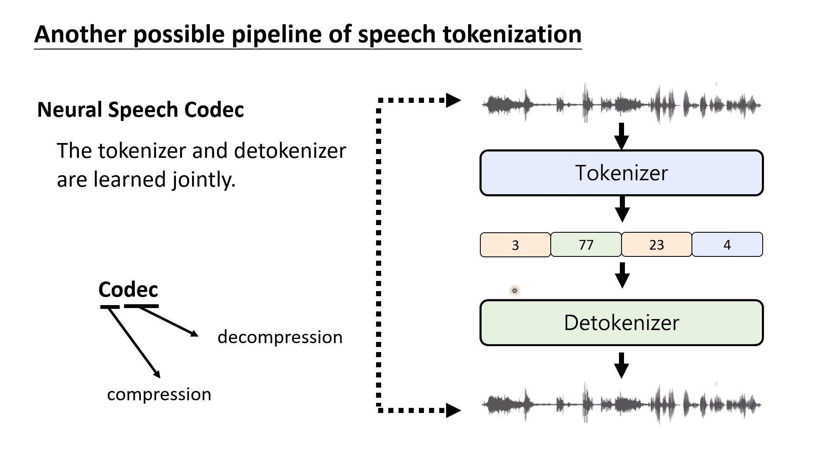

这一切的基础在于第一个问题：语音生成的基本单位，即语音的 Token 应该是什么样子？

对于文字，Token 是一个自然的概念（如单词或子词）。但对于语音，将一段连续的声音信号表示为 Token 序列则面临挑战。

以下是几种不同的思路：

**1. 极端方案一：使用语音识别结果作为 Token**
*   **方法**：用语音识别系统将声音转为文字，文字本身就是 Token。再用语音合成系统将文字 Token 转回声音。
*   **问题**：此方法会丢失语音中文字以外的所有重要信息（如语气、情绪），导致模型无法理解反讽等复杂语义。

**2. 极端方案二：使用原始采样点作为 Token**
*   **方法**：直接将声音信号的每个采样点视为一个 Token。
*   **问题**：语音采样率很高（如电话音频为 8000 Hz）。一分钟的语音会产生多达 48 万个 Token，这对自回归模型生成长度的要求极高，目前不切实际。

**3. 折中方案：设计专用的语音 Tokenizer**
我们需要一种方法，既能保留语音中的重要信息，又能对信号进行有效压缩，避免序列过长。如何设计语音 Tokenizer 是当前的研究热点。

目前主要有两大类方法：

**第一类：基于自监督语音编码器 (SSL Model)**
*   **步骤**：使用预训练的语音自监督模型（如 Wav2Vec 2.0）将声音转换为连续的向量序列。然后通过**向量量化 (Vector Quantization)** 将这些连续向量聚类为离散的 Token ID。为了进一步缩短序列，常进行**去重 (Deduplicate)** 和**字节对编码 (Byte Pair Encoding, BPE)**。
*   **后续**：需要额外训练一个 **Detokenizer**，学习将 Token 序列还原为声音信号。

**第二类：神经语音编解码器 (Neural Speech Codec)**
*   **方法**：将 Tokenizer 和 Detokenizer 作为一个整体（即一个自动编码器）进行联合训练。目标是让输入的声音经过编码（Tokenization）再解码（Detokenization）后，与原始输入尽可能接近。其中的潜在表示被设计为离散的。

在语音领域，第一类方法产生的 Token 常被称为 **Semantic Token**，第二类产生的则被称为 **Acoustic Token**。但需注意，这些名称容易引起误解：
*   Semantic Token 更接近“音素”层面（如KK音标），而非真正的语义。
*   Acoustic Token 也包含内容信息，并非只有声音特征。

通常，Neural Speech Codec 会为一段声音生成**多组 Token**，从不同层面（如内容、韵律）完整地表示它。一种常见做法是让其中一组 Token 去模仿 SSL 模型产生的 Semantic Token，学习内容信息；其他组则负责学习其他信息。

---

## 多组 Token 的生成策略

既然常使用多组 Token，一个核心问题是如何在生成过程中有效地结合它们。

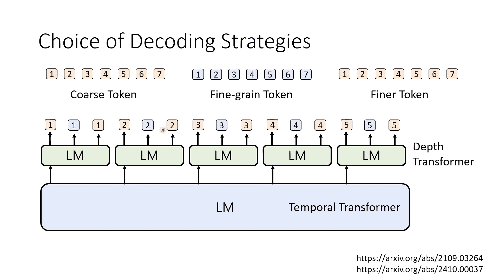

假设有三组 Token，从左到右代表从“粗”（内容）到“细”（声学细节）的信息。以下是几种生成策略：

**1. 由粗到细顺序生成 (Coarse-to-Fine)**
*   **方法**：先生成所有最粗的 Token，再基于它们生成所有中间的 Token，最后生成所有最细的 Token。
*   **问题**：难以实现流式响应 (Streaming)，因为必须等所有层级的 Token 都生成完毕才能合成语音。

**2. 交错生成 (Interleaved Generation)**
*   **方法**：按时间步交错生成各层 Token。先生成时间点1的粗、中、细 Token，然后生成时间点2的粗、中、细 Token，以此类推。
*   **优点**：每个时间步的 Token 集生成后即可合成该时刻的语音，更易于流式处理。
*   **挑战**：模型需要生成的序列总长度会变得很长（Token每秒 × Token组数 × 对话时长）。例如，一个模型若要用8组 Token 讲5分钟话，可能需要生成3万个 Token，这对模型上下文长度要求很高。

**3. 声学延迟生成 (Acoustic Delay)**
*   **方法**：对交错生成进行改进。在生成较细的 Token 时，不仅参考同时间步的粗 Token，还参考之前时间步已生成的粗、中 Token，使细 Token 的预测更准确。

**4. 双 Transformer 生成**
*   **方法**：使用两个 Transformer：
    *   **Temporal Transformer**：沿时间轴建模，产生每个时间步的上下文向量。
    *   **Depth Transformer**：接收每个时间步的上下文向量，并行生成该时间步下各层（粗、中、细）的 Token。

这些策略的核心在于研究如何高效组合不同层级的 Token 进行生成，类似思想也在图像生成领域应用。

---

## 为何选择离散 Token？

一个根本问题是：语音一定要用离散 Token 吗？能否直接用连续的向量进行生成？

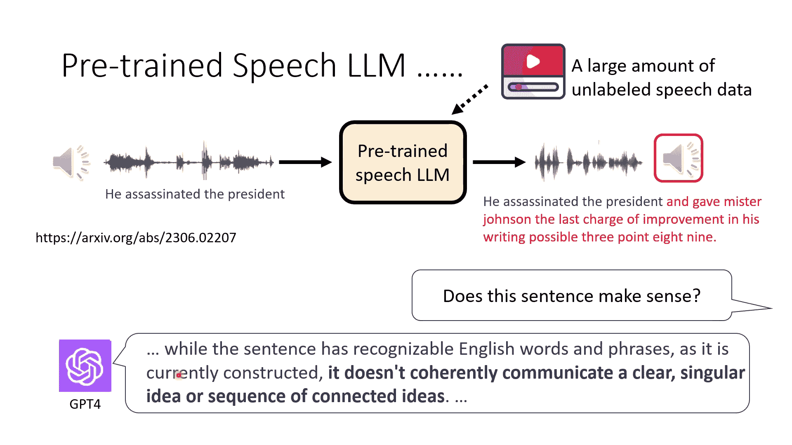

对于模型**理解语音（输入）**而言，使用连续向量通常效果更好，因为离散化可能丢失信息。离散 Token 的真正优势体现在**生成（输出）**阶段。

生成任务有一个本质特性：**同一输入可能对应多个合法输出**。例如，听到“你好”后，可以有多样化的回应。

*   **连续向量的问题**：如果训练数据中，某个上下文后接两种不同的正确声音向量（A和B）。模型在训练时若试图最小化与所有正确答案的平均距离，可能会产生一个介于A和B之间的向量，而这个“平均向量”听起来可能是不正确的。
*   **离散 Token 的优势**：在训练离散 Token 预测时，模型学习的是一个**概率分布**。例如，它学习到接 Token A 的概率是60%，接 Token B 的概率是40%。在推理时，模型从这个分布中采样，要么得到A，要么得到B，而不会产生一个无意义的“平均 Token”。

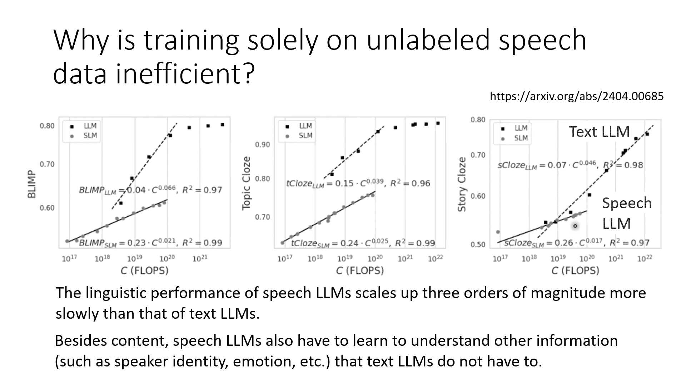

因此，为了处理生成任务中的“一对多”问题，离散 Token 是更自然的选择。当然，通过精心设计损失函数，理论上也能让基于连续向量的模型处理多模态输出，这在图像生成中已有成功先例。

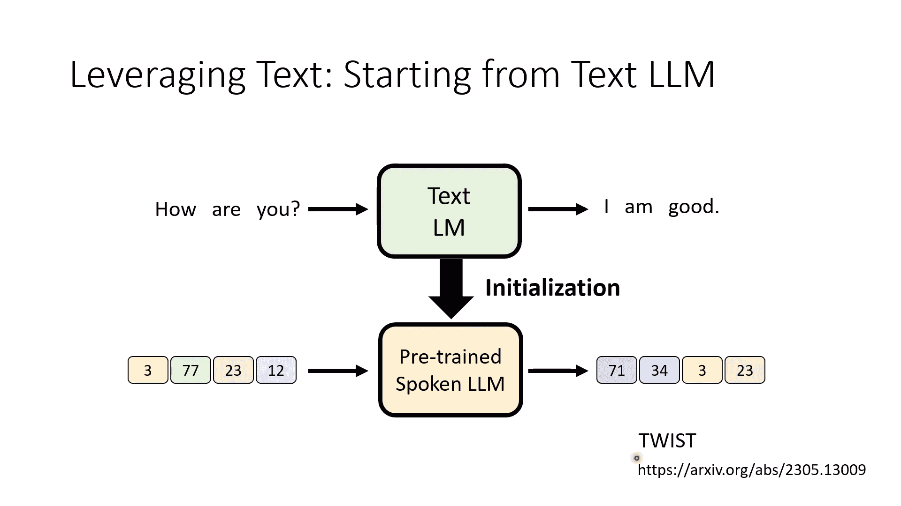

---

## 从语音合成到语音语言模型

需要区分**语音合成 (TTS)** 和**语音语言模型**：
*   **语音合成**：给定一段文字，模型将其“念”出来。它不涉及对话和语义理解。
*   **语音语言模型**：给定一段语音（或文字），模型需要理解其含义并生成合理的语音回应。

使用前几节的方法可以打造出优秀的语音合成模型。然而，即使使用上万小时的语音数据直接预训练一个纯粹的语音语言模型，其结果也往往不理想。模型可能生成语法混乱、语义不通的句子。

**原因在于数据瓶颈**：语音是文字的“解压缩”版本，信息密度低。收集到的海量语音数据所包含的“文字内容”信息量，远少于训练大型文字模型所用的纯文本数据量。因此，仅从语音中学习语义和逻辑非常困难。

---

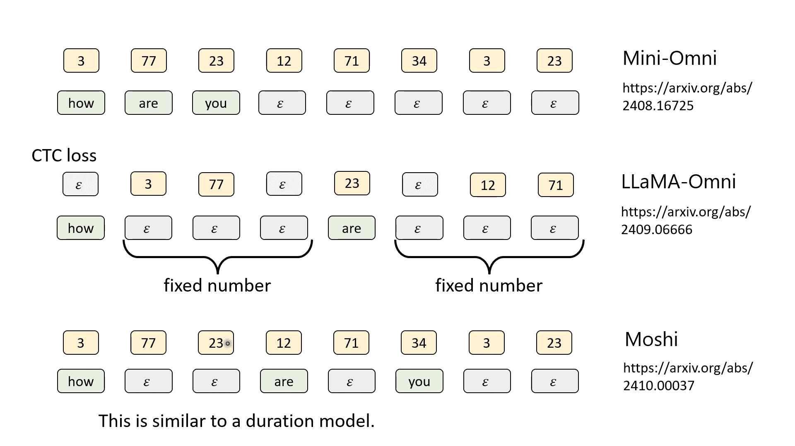

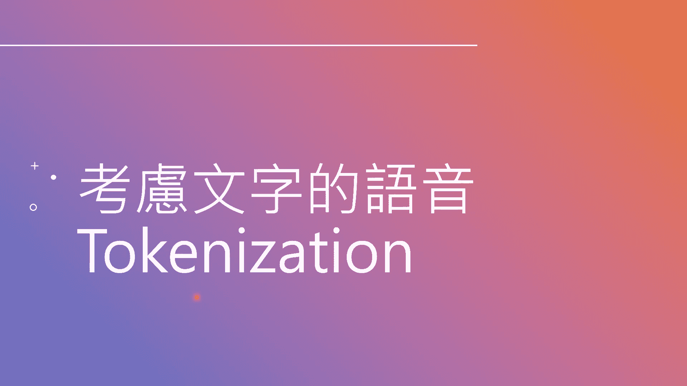

## 突破：基于文字模型初始化

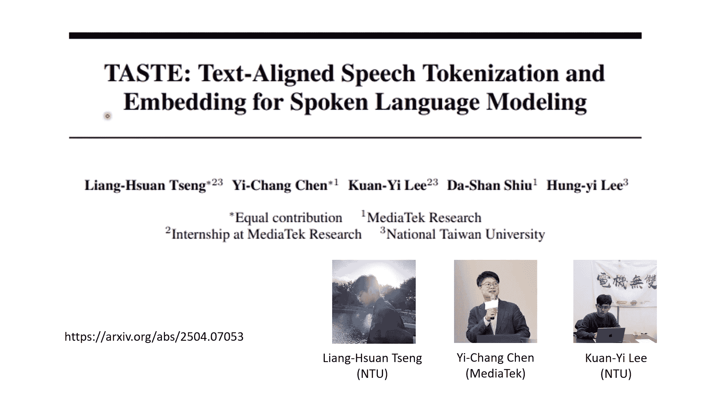

既然从头训练语音模型困难，而现成的强大文字模型已有很多，一个主流思路是：**从文字模型出发，教它学习语音相关的知识**。

不只将文字模型作为语音模型的参数初始化，更让语音模型在生成语音时，**同时生成文字作为辅助**。这被称为 **语音-文字混合解码 (Hybrid Decoding)**。文字就像模型的“内心独白”，先想好要说什么，再说出来，这能稳定生成过程。

如何协调文字 Token 和语音 Token 的生成顺序？有以下几种策略：

**1. 先文后语 (Text-first)**
*   **方法**：先生成完整的文字回复，再根据文字生成对应的语音。
*   **缺点**：响应延迟高，不够实时。

**2. 逐词对齐 (Word-by-Word Alignment)**
*   **方法**：生成一个文字 Token，紧接着生成对应这个字的语音 Token，如此交替进行。
*   **挑战**：需要精确的语音-文字对齐标注数据，训练难度大。

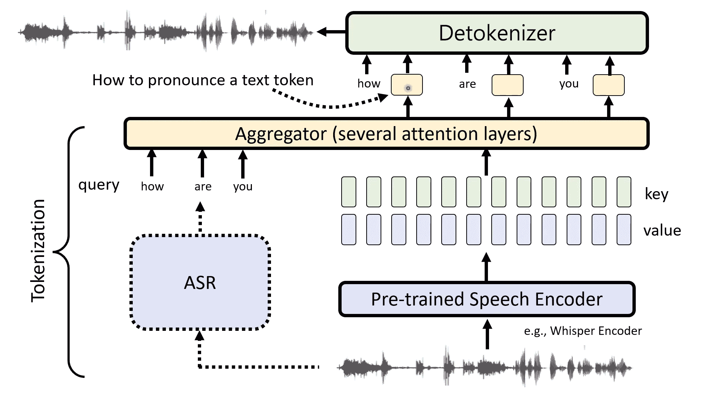

**3. 并行生成与等待策略**
*   **方法**：尝试每一步同时生成文字和语音 Token。但由于两者序列长度差异巨大，需要设计复杂策略，例如让文字 Token 生成后等待固定步数，或让模型自己预测需要等待多久。代表模型有 LaM、Moshi 等。

这些策略的核心难点在于处理文字与语音序列长度不匹配的问题。

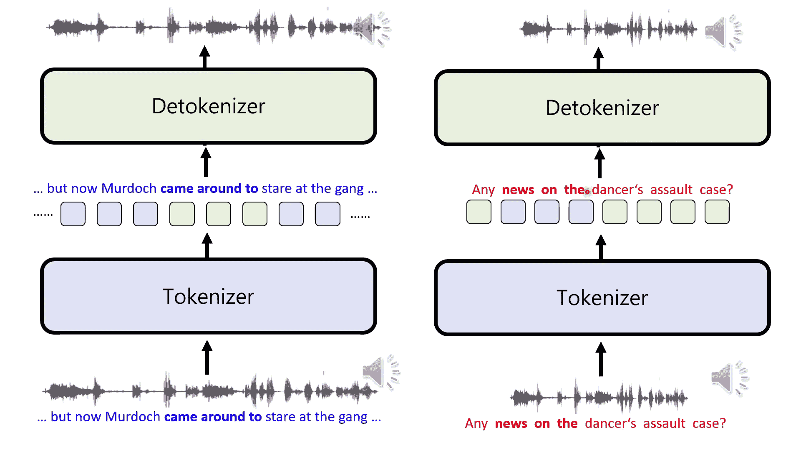

---

## 新的思路：TEST 语音 Tokenizer

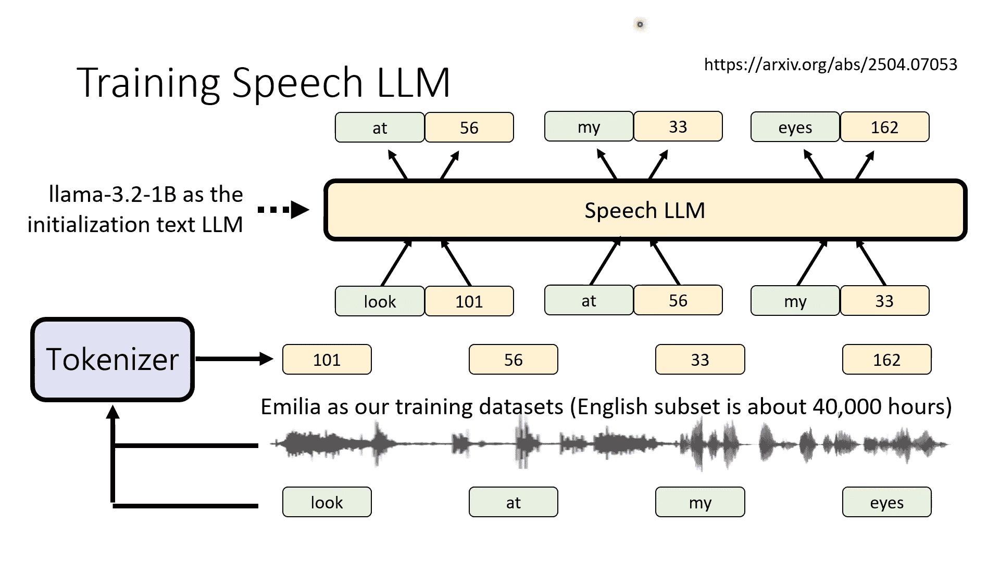

为了解决上述难点，我们实验室的曾亮轩同学等人提出了 **TEST** 方法。

其核心思想是：既然采用混合解码，语音 Token 就无需再存储文字内容信息，只需专注于存储**文字以外的语音信息**（如语调、情绪）。同时，设计一个特殊的 Tokenizer，**让生成的语音 Token 数量与输入语音中的文字 Token 数量严格一致**。

**工作流程**：
1.  **Tokenization**：
    *   使用预训练语音编码器处理输入语音，得到多组特征向量。
    *   使用语音识别系统得到对应的文字 Token 序列。
    *   通过一个聚合器（如 Attention 层），以文字 Token 为查询，从语音特征中提取出与每个文字 Token 对应的、固定数量的语音 Token。
2.  **Detokenization**：
    *   将一个复杂的语音合成系统作为 Detokenizer。
    *   输入文字 Token 序列及其对应的语音 Token 序列，合成出最终的声音。语音 Token 在这里指导每个字该如何被念出。

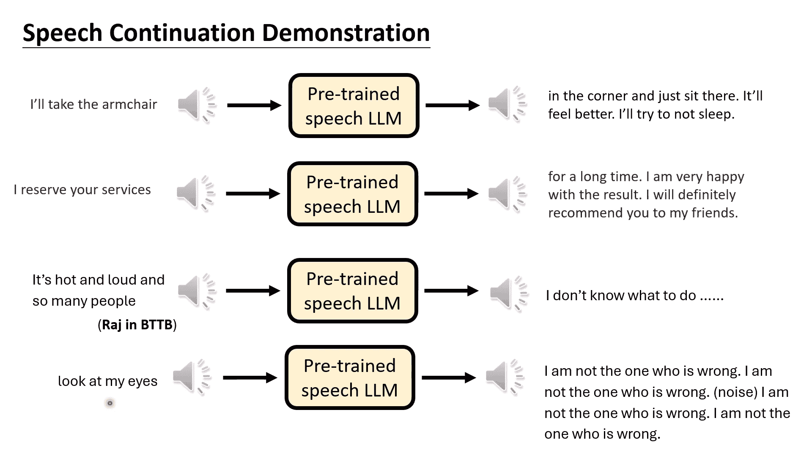

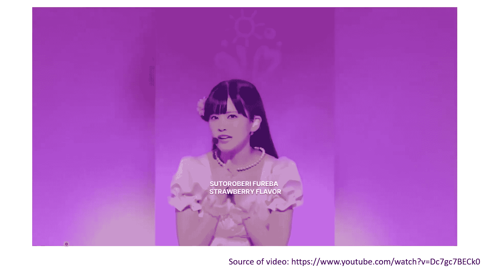

实验表明，TEST 方法提取的语音 Token 能有效控制语速等副语言信息。基于此方法，可以用相对较少的数据（如4万小时语音），从一个1B参数的 Llama 3 文字模型初始化，训练出一个能进行合理语音接龙的预训练语音模型。

---

## 微调与评估

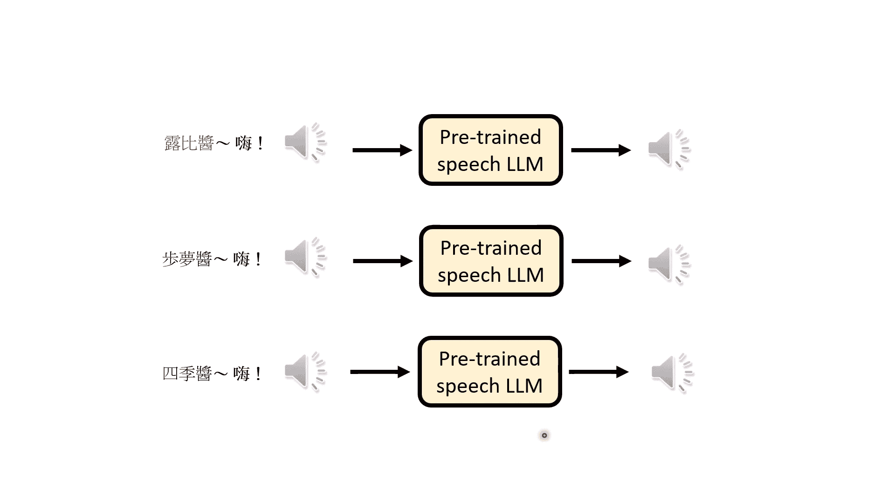

获得预训练模型后，要使其成为能流畅对话的语音助手，还需以下步骤：

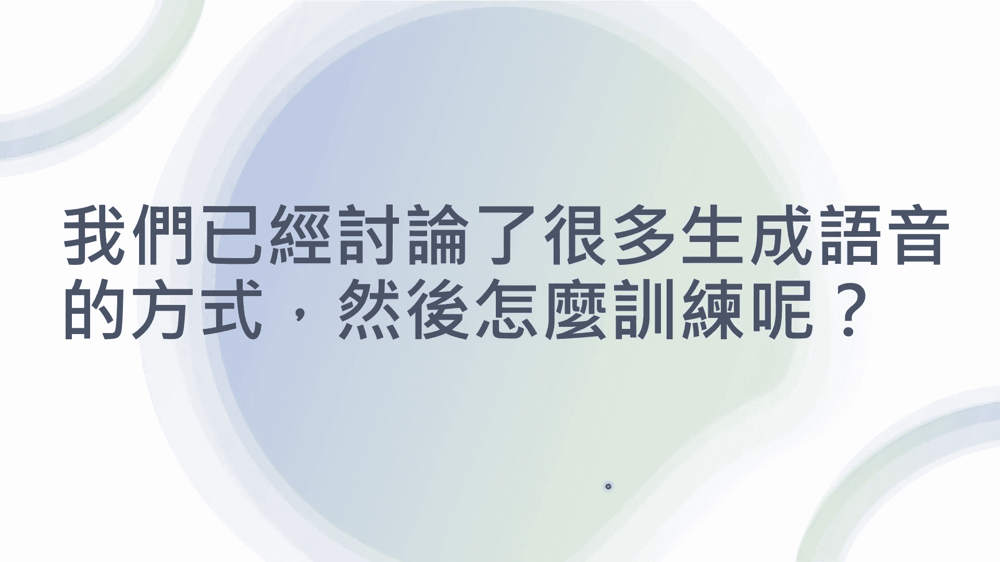

**1. 监督微调 (Supervised Fine-Tuning)**
*   **挑战**：直接使用真实人对话数据微调，可能导致模型遗忘从文字模型继承的能力。
*   **解决方案**：使用文字模型自动生成多样化的对话文本，再用高质量的语音合成系统将其转为语音，用这些合成数据来微调模型。这样可以更好地保持能力。

**2. 人类反馈强化学习 (RLHF) / AI 反馈强化学习 (RLAIF)**
*   早期 RLHF 更关注合成语音的**音质**。
*   近期趋势是提升模型**理解声音**的能力，特别是对音乐、环境音等非语音声音的理解。
*   也可以使用强大的文字模型作为“AI 裁判”，对语音模型的输出进行评价，实现 RLAIF。

**3. 全双工交互 (Full-Duplex Interaction)**
*   真实语音对话是“边说边听”的，存在重叠和打断。实现这种全双工能力需要新的模型架构，不同于传统的“先输入后输出”的自回归模型。

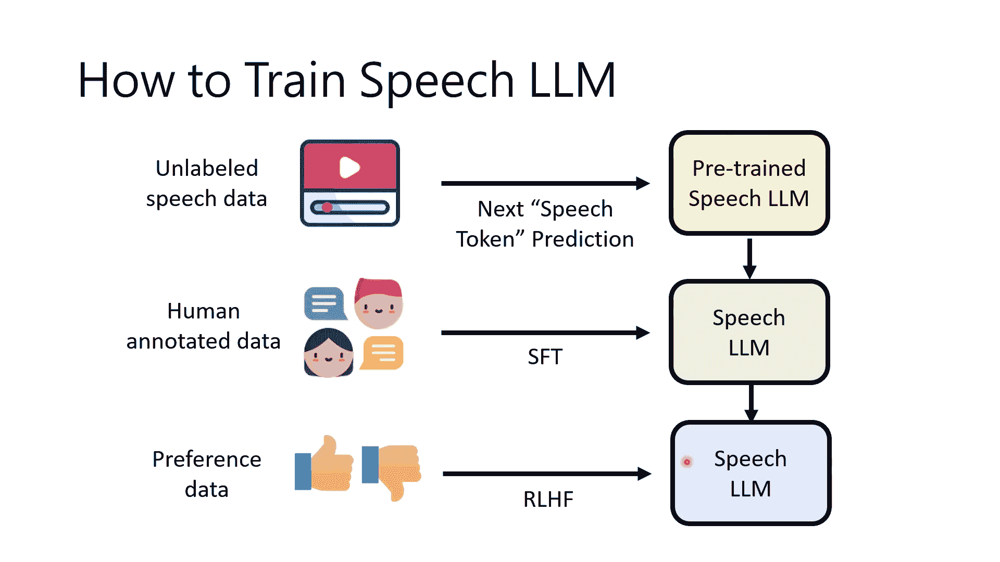

**4. 评估挑战**
*   评估语音语言模型比文字模型更复杂，除了文字内容的安全性、合理性，还需评估其**语音特质**（如语气是否友好、有无冒犯性）等方面的表现。

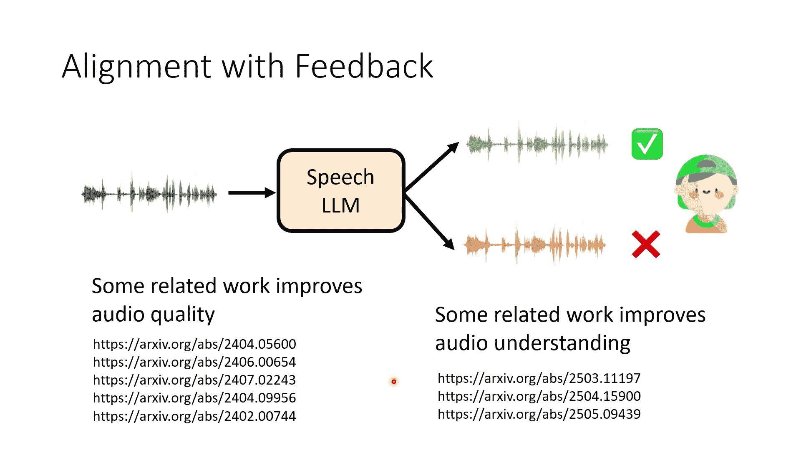

---

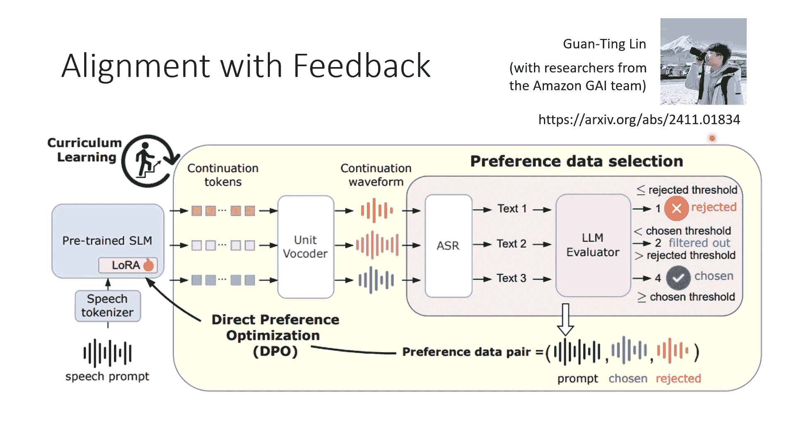

## 总结与资源

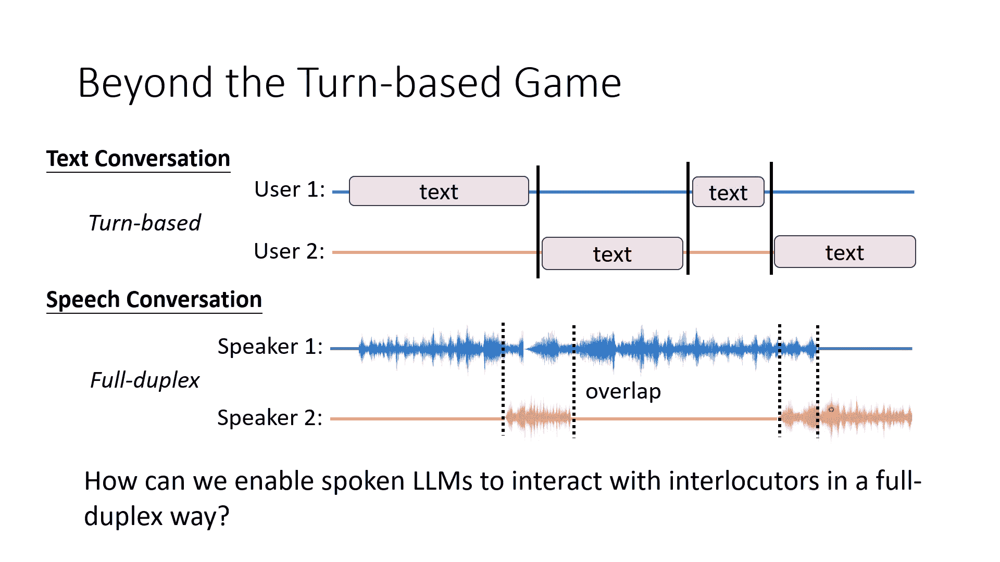

本节课中，我们一起学习了语音语言模型的发展历程。我们从语音生成的基本原理出发，探讨了语音 Token 表示这一核心挑战，并介绍了离散 Token 的优势。我们分析了从零训练语音模型的困难，以及当前主流的解决方案——基于强大的文字模型进行初始化与混合解码。最后，我们了解了模型微调、全双工交互和评估等后续步骤。

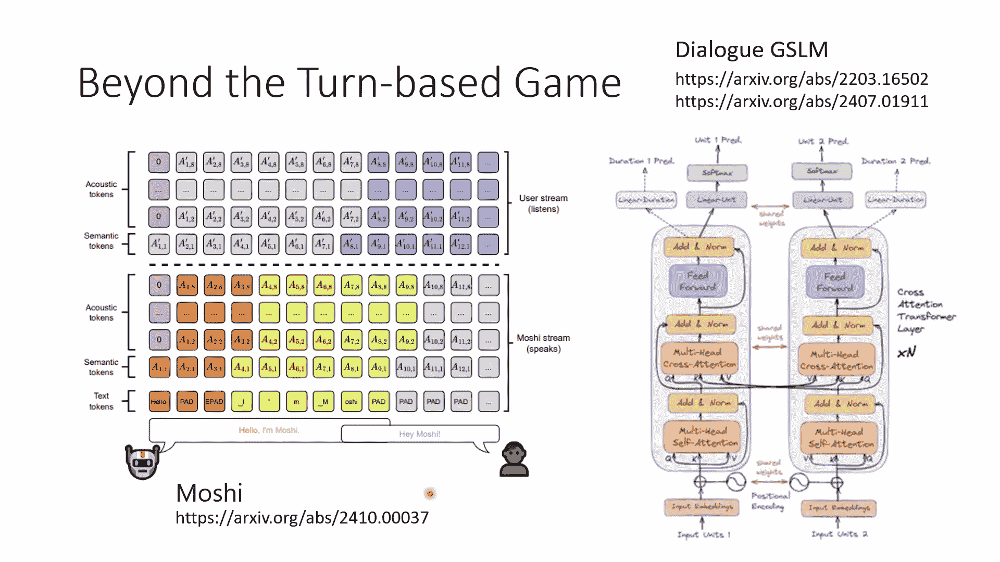

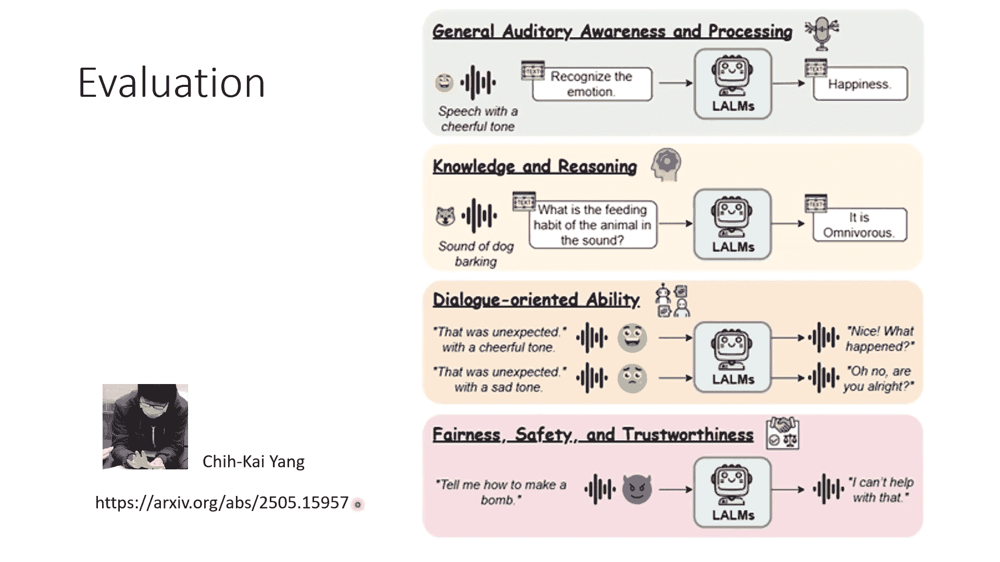

语音语言模型是一个快速发展的领域。如果你想深入了解，可以参考以下资源：
*   **论文综述**：关注最新的语音语言模型综述论文。
*   **GitHub 仓库**：例如，我们实验室维护的仓库会更新相关论文。
*   **评估综述**：我们助教撰写的关于语音语言模型评估的综述论文。

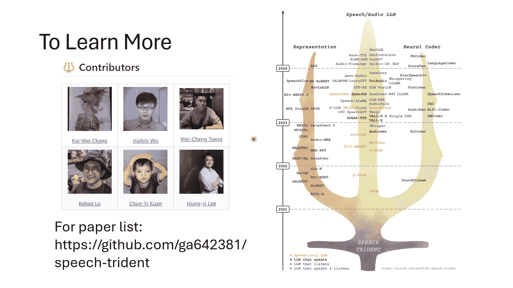

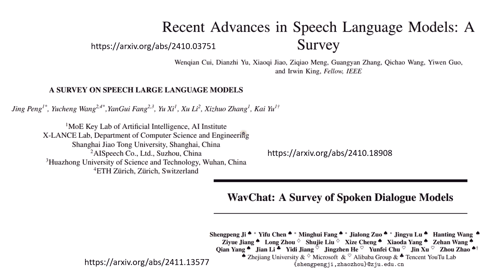

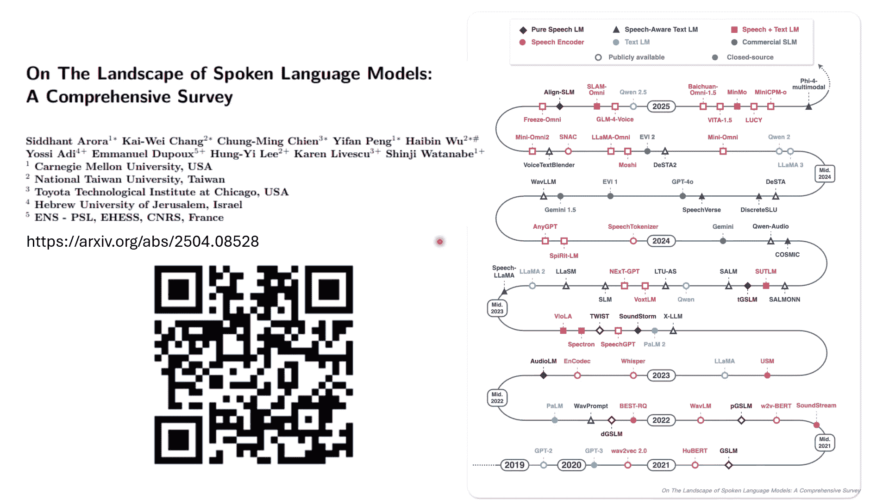

希望本课程能帮助你理解语音语言模型如何“学会说话”。