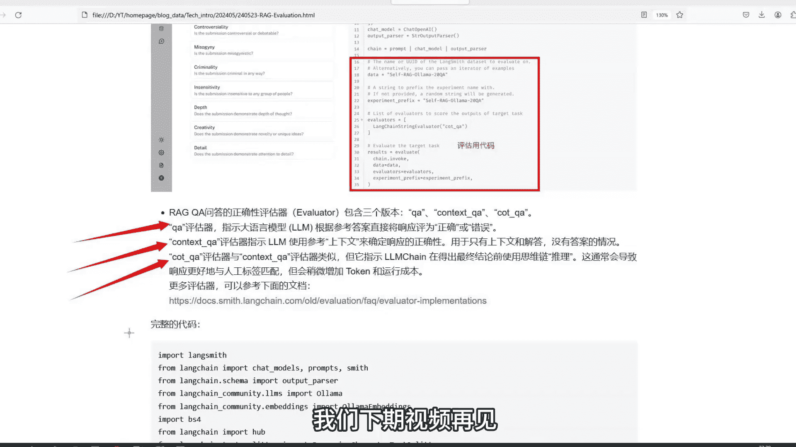

# 29：如何使用 LangSmith 创建测试数据以及对 RAG 进行评估 📊


在本节课中，我们将学习如何评估一个 RAG（检索增强生成）系统。RAG 系统入门容易，但确保其效果稳定并持续改进却是一大挑战。评估是解决这一痛点的关键环节。我们将重点介绍如何使用 LangSmith 工具来创建测试数据集，并对 RAG 系统的性能进行量化评估。


## 评估的重要性与步骤


上一节我们提到了 RAG 系统“上线难”的痛点。本节中我们来看看，系统性的评估是解决这个问题的核心。评估不仅能告诉你系统当前的表现，还能为后续的迭代优化提供明确方向。


使用 LangSmith 评估 RAG 系统主要包含四个步骤：
1.  创建测试数据集。
2.  定义你的问答系统。
3.  使用 LangSmith 进行评估。
4.  根据评估结果迭代更新系统。


## 第一步：获取 LangSmith API 密钥


要使用 LangSmith，首先需要获取 API 密钥。


以下是获取和配置 API 密钥的步骤：
1.  访问 LangSmith 网站并登录（若无账号需先注册）。
2.  在用户设置中，找到 API 密钥管理页面。
3.  创建一个新的 API 密钥并复制它。


获取密钥后，你需要在程序中通过环境变量进行配置。核心代码如下：


```python
import os
os.environ[“LANGSMITH_API_KEY”] = “你的-api-key-在这里”
```


将复制的 API 密钥替换代码中的 `你的-api-key-在这里`，即可完成 LangSmith 的初始化设置。


## 第二步：创建测试数据集


有了评估工具，我们需要一个测试集来衡量系统。LangSmith 提供了三种创建测试数据集的方法。


以下是三种创建测试集的方法：


**方法一：通过 CSV 文件导入**
如果你已有整理好的测试集，可以将其保存为 CSV 文件并导入。操作步骤为：登录 LangSmith 后台，进入 “Datasets” 管理界面，点击 “New Dataset”，选择上传 CSV 文件。对于 RAG 测试集，在类型中选择第一个选项，并映射好问题与答案字段，最后点击创建。


**方法二：通过代码创建**
这种方式适合需要自动化收集数据的场景。你可以编写程序，调用 LangSmith 的 SDK 来动态创建和添加数据到数据集中。


**方法三：通过追踪功能创建**
这种方法在调试系统时非常实用。首先，你运行已有的 RAG 系统处理一些问题；然后，在 LangSmith 后台的追踪记录中，筛选出成功的问答记录，并将其添加到指定的数据集中。你还可以在添加前手动修正答案，确保测试集的质量。


## 第三步：执行评估并分析结果


创建好数据集后，我们就可以利用 LangSmith 的评估功能对 RAG 系统进行量化分析了。


在 LangSmith 后台，选择你的数据集，点击 “New Experiment” 开始新的评估实验。系统会提供多个评估维度，对于 RAG 系统，最常用的是 **正确性**。选择后，LangSmith 会自动生成评估代码。你可以复制这段代码，并在本地运行。每次运行需要确保项目名称唯一。评估执行后，你可以在后台查看详细的评分结果和每次问答的追踪信息，这有助于定位问题。


## 评估的进阶应用


基于评估结果，我们可以尝试不同的优化方法（如调整检索策略、修改提示词等），然后再次评估，通过迭代逐步改进系统。


此外，评估并不总是需要标准答案。LangSmith 提供了多种评估器：
*   **QA 评估器**：需要测试集提供标准答案。
*   **Context QA 评估器**：无需标准答案，它通过另一个大语言模型，根据提供的参考上下文来评判系统答案的质量。
*   **COT QA 评估器**：同样无需答案，它采用思维链推理的方式进行更复杂的评估。


除了答案的正确性，RAG 系统的 **召回率**（检索到的相关文档比例）也是重要的评估指标，我们将在后续课程中介绍。


## 总结



本节课中我们一起学习了 RAG 系统评估的重要性以及使用 LangSmith 进行实践的全流程。我们掌握了获取 API 密钥、通过三种方式创建测试数据集、运行评估实验并分析结果的方法。记住，评估是持续改进的基石，利用好工具能让你的 RAG 系统从“可用”变得“优秀”。