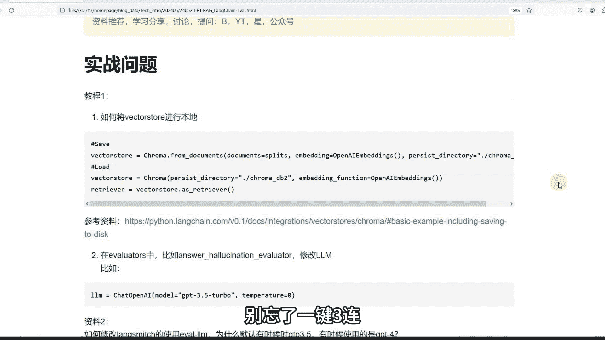

# 30：一次搞懂 RAG 评估 📊

在本节课中，我们将学习如何评估一个检索增强生成（RAG）系统。RAG 评估涉及众多指标，容易让人困惑。我们将从三个主流框架（LangChain, RAGAS, LlamaIndex）的视角出发，梳理评估的核心概念、指标分类，并提供一个快速上手的实践指南。

## 概述：为何需要评估 RAG 系统？

构建 RAG 系统必然绕不开对其性能的评估。然而，RAG 系统的评估指标繁多，许多开发者不清楚该选用哪些指标，以及这些指标的具体含义。本教程旨在通过梳理权威资料和不同视角，帮助大家全面理解 RAG 的评估方法。

## 三个权威学习教程

以下是三个来自官方或权威社区的学习教程，它们分别代表了三种不同的评估角度。

1.  **LangChain 教程（最新版本）**：该教程提供了数据下载、任务介绍、RAG 检索与生成的代码实现，最后详细介绍了评估方法及其使用方式。
2.  **LangChain 结合 RAGAS 的教程**：此教程的特点是使用了 **RAGAS** 这个专门工具进行评估。它介绍了 RAGAS 的评估方法，并给出了 RAG 程序代码和评估代码。
3.  **LlamaIndex 的评估教程**：该教程专注于对嵌入（Embedding）和重排序（Rerank）模型进行评估。许多实际项目（如 QAnything）都参考了这种方法，因此具有很高的代表性。

以上三个教程的代码均可运行成功，感兴趣的学习者可以自行尝试。

## 理解评估指标：两种视角

运行上述教程后，你会发现 RAG 评估指标非常多。为了理解这些指标并知道如何选用，这里提供两种分析视角。

### 视角一：基于评估模式的分类（LangChain）

上一节我们介绍了三个具体的教程，本节中我们来看看 LangChain 官方是如何归纳评估指标的。下图展示了基于评估模式（Evaluation Paradigm）的大语言模型评估全景图。

该图非常全面且易懂，主要分为三部分：

*   **数据集制作方式**：
    *   **手工制作**：通过人工标注数据。
    *   **从执行日志中提取**：例如使用 LangSmith 时，可以从后台日志中提取问题及其对应的解答来构建测试集。
    *   **使用大语言模型生成**：这是当前非常普遍的方式，教程三就采用了这种方法。
*   **评估器（Evaluator）**：
    *   **大语言模型评判**：使用大语言模型进行打分评估。
    *   **基于规则的判断**：类似于传统机器学习中的评估方法，如精度（Precision）、召回率（Recall）、F1分数等。
    *   **人工评价**。
*   **评估模式**：这是分类的核心，主要差异在于评估时所使用的信息不同。输入信息可能包括：模型的解答（Response）、参考答案（Reference Answer）、用户问题（Input）以及检索到的文档（Retrieved Documents）。
    *   **比较模式**：比较不同生成结果，在纯 RAG 评估中较少使用，可用于比较不同大模型的表现。
    *   **无参考答案模式**：没有标准答案，通过定义一系列规则（写在提示词中）让大模型对解答进行打分。类似于奥运会跳水比赛的评分。
    *   **有参考答案模式**：有标准答案，可以直接比较系统解答与正确答案的差异。

基于这种模式，LangChain 将评估指标进行了归类。例如，当拥有 `Response` 和 `Reference Answer` 时，可以使用**正确性**指标来评估解答与真实标签的相似度。教程二中的 RAGAS 指标也可以按此模式进行归纳。

### 视角二：基于功能模块的分类（RAGAS）

除了 LangChain 的模式视角，RAGAS 提供了另一种更清晰易懂的视角：基于 RAG 系统的功能模块进行划分。

RAG 系统主要包含**检索**和**生成**两大功能模块。RAGAS 的评估指标也围绕这两部分展开：

*   **检索模块评估**：例如评估检索到的上下文与问题的相关性。
*   **生成模块评估**：例如评估生成答案的忠实度（是否基于检索内容）、正确性等。
*   **端到端评估**：对系统整体表现进行评价。

这种划分方式比基于模式的划分更直观。其具体计算方式可能与 LangChain 的指标存在差异。

此外，在教程三中，评估嵌入和重排序模型时，提供了一种不依赖大语言模型打分的方式，例如使用**命中率**和**平均倒数排名**。

## RAG 评估快速上手指南 🚀

通过以上两种视角，我们大体了解了各类评估指标。面对众多指标，初学者该如何选择并开始实践呢？以下是快速上手的步骤：

1.  **选择目标与准备测试集**：首先明确评估目标，并准备测试数据集。根据所选指标的不同，数据集可能只需要准备问题，也可能需要问题与对应的标准答案。
2.  **准备一个基础的 RAG 程序**：构建一个最简单的、可运行的 RAG 系统作为评估对象。
3.  **选择评估指标**：建议参考 RAGAS 的模块化思路，选择两个核心指标：
    *   一个**偏重生成质量**的指标，例如**答案正确性**。
    *   一个**偏重检索质量**的指标，例如**上下文相关性**或**上下文召回率**。如果采用教程三的方法，也可以使用**命中率**。
4.  **迭代与改进**：运行评估并获得结果后，根据指标反馈对 RAG 系统进行迭代和优化。

## 总结

本节课我们一起学习了 RAG 系统的评估方法。我们从三个具体的官方教程入手，了解了实践中的代码实现。为了理解纷繁复杂的评估指标，我们学习了两种分类视角：一是 LangChain 提出的基于**评估模式**的视角，二是 RAGAS 提出的基于**功能模块**的视角。最后，我们提供了一个四步走的快速上手指南，帮助大家选择指标并开始实践评估。掌握这些方法，将能更有效地度量和提升你的 RAG 系统性能。