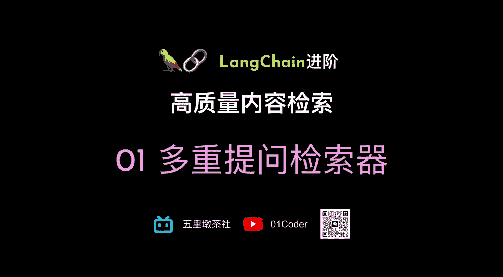
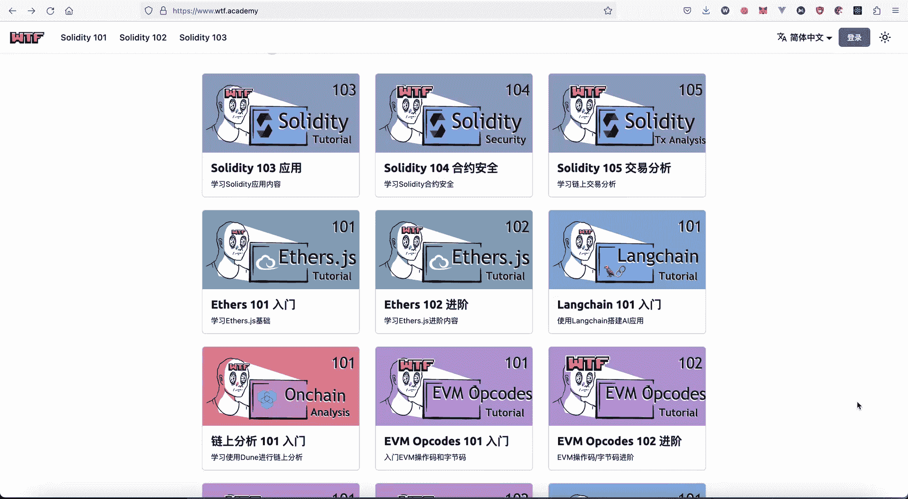
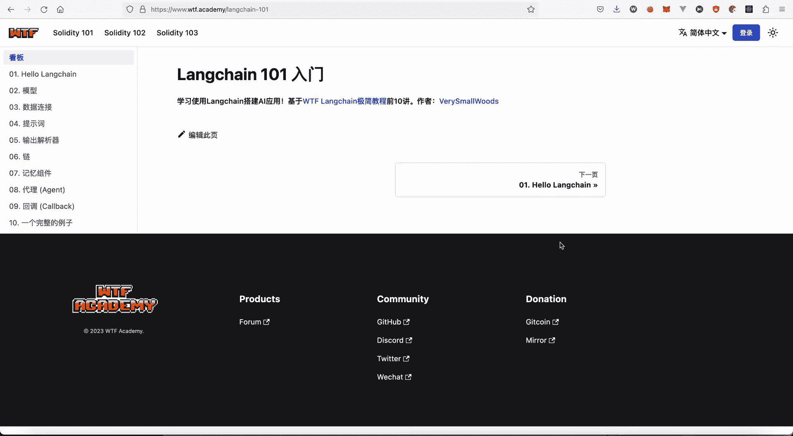
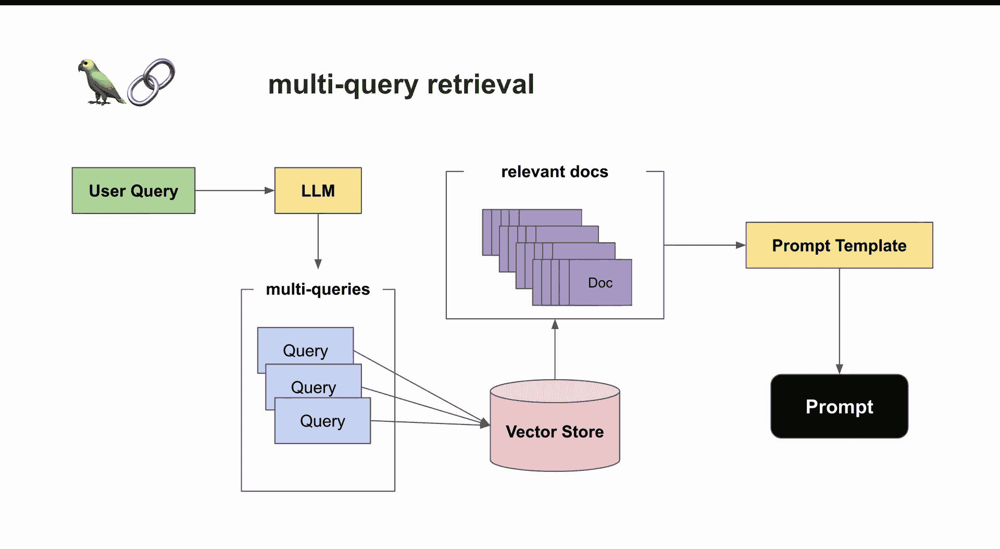
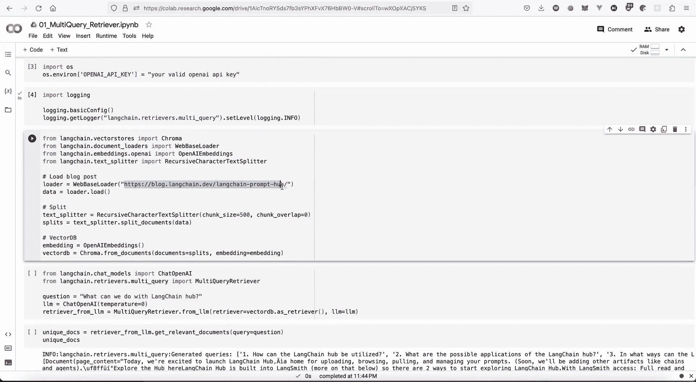
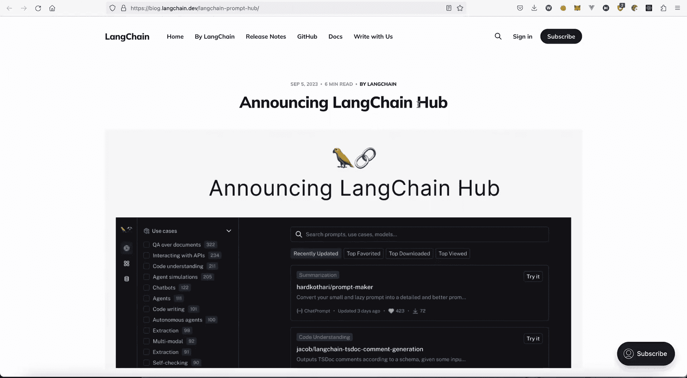
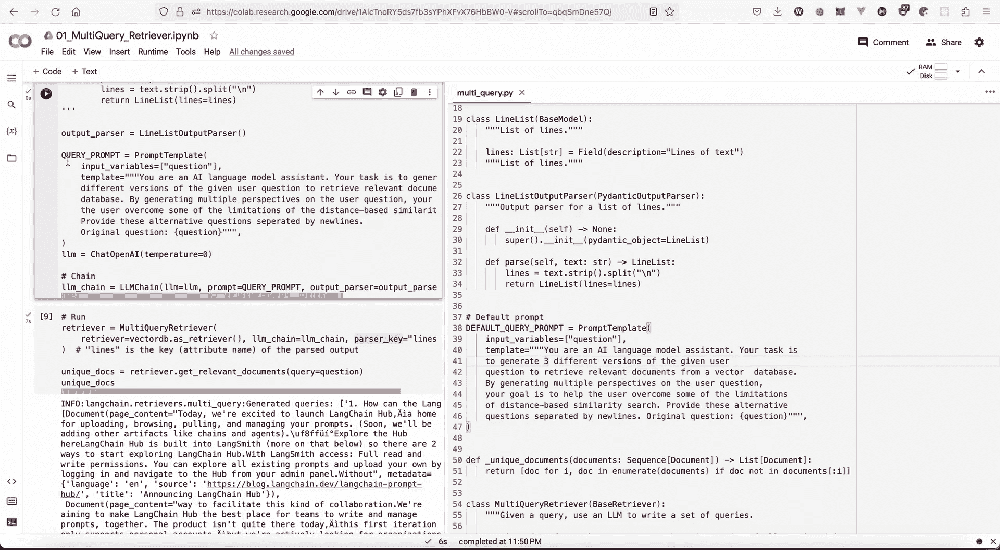
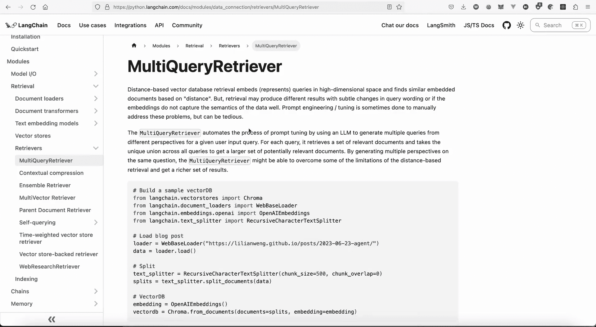

# 36：高质量内容检索 01：多重提问检索器 🧠

## 概述

在本节课中，我们将要学习LangChain框架中一个高级的检索组件——多重提问检索器。我们将了解它的工作原理、解决的问题，并通过代码示例学习如何在项目中应用它。

---

不久前我们分享了LangChain极简入门系列。

该系列介绍了LangChain最基础的知识，能够帮助我们开始构建LangChain应用。

但是在实际的产品开发中，利用这些基础的功能构建方式还不够。今天我们就开始分享一些LangChain框架中更高级的功能，这也是LangChain进阶系列的内容。今天我们从检索器开始。

在一个典型的RAG应用开发中，必要的步骤分为文档加载、文档拆分、向量化并进行向量存储，然后基于向量存储进行相似性查询或基于向量距离的查询。这类查询就叫检索，LangChain所提供的对应组件就是检索器。

但是这种方式在查询语句发生微小变化时，可能就会带来不同的结果。LangChain则提供了一系列更高级的检索实现，帮助开发者解决这类问题或提高检索质量。

## 多重提问检索器的工作原理

今天我们介绍第一种：`MultiQueryRetriever`，即多查询检索器。它利用大语言模型，基于用户的提问，生成在不同方面的多种提问，再利用这多个提问来进行相似性的查询，以此得到一个更大的相似文档集合，从而克服基于距离查询的局限性。

接下来我们通过简单的示意图，来看看它的工作流程。

在一个多查询检索中，当用户提出一个问题（即一个查询 `query`），它会被发送给大语言模型。大语言模型将用户的提问映射成在不同方面的几个相似的提问。在这个场景中，我们将其映射为三个提问。

大语言模型给到我们三个相似的提问后，再将这些提问交由向量存储，基于向量距离进行相似性查询。在这个查询中就会得到一系列相关的文档。

这些相关文档由于是基于多个提问生成的，就得到了一个更大的相关文档集合。再将这些文档集合交给提示词模板，或者直接交付给大语言模型，作为上下文信息或上下文环境。

如果提供给提示词模板，它就会基于这个较大的相关文档集合，生成一个信息更丰富的提示词 `prompt`。这就是多查询检索的基本工作原理。

## 代码实践

在LangChain的官方文档中，也对这个多查询检索器有非常详细的示例代码。在这里我们也参考这个示例代码，准备了一份Python notebook，和大家一起运行这个程序，看看这个多查询检索器的工作效果如何。

我们来到这个Python notebook。在这里需要安装一些Python包：`langchain`, `openai`, `chromadb`, `tiktoken`。我们会用到ChromaDB作为向量存储，同时准备OpenAI API key。

接下来我们会做一个操作，是将日志打开。我们对这个多查询检索器打开了info级别的日志。

接下来就是多查询检索器主要工作原理的展示。我们会加载一份网页，这是LangChain的博客。

这个博客在这里已经打开了，这是对LangChain Hub的一个官宣。

其中介绍了什么是LangChain Hub，如何使用它，以及为什么会构建LangChain Hub这个应用。我们基于它来加载这篇博客文章，并将文章进行分块、向量化、存储。这些操作就在这部分的代码中实现。

加载这个博客文档，然后将文档分块。分块的大小是500。分块后基于OpenAI的embedding API来做向量化，并存储到ChromaDB当中。我们来执行一下。

在执行完成以后，这里就会得到一个向量存储数据库的实例。这个实例就被后面的检索器使用。

下面这里我们可以看到提了一个问题：`What can we do with LangChain Hub?`。想问一下LangChain Hub能拿来做什么，对我们有什么用。

### 方法一：使用默认配置

第一种方式是直接使用 `MultiQueryRetriever` 这个类来构建一个检索器。检索器的构建是调用 `from_llm` 函数。这个函数需要两个参数：第一个是向量存储所暴露的检索器接口（通过调用 `.as_retriever()` 函数得到），另外就是提供一个大语言模型 `llm`。

我们先来执行一下这部分代码，这样就得到一个检索器。如果我们用这个检索器去做相关文档的查询，通过调用 `get_relevant_documents` 方法，提问的问题通过 `query` 参数传入，这样就会得到一个文档的列表。

我们先来执行一下，然后看一下效果。执行的时候可以看到一行日志，这是MultiQuery的日志，它告诉我们生成了 `queries`。这个 `queries` 就是基于一个用户输入得到的多个相关的、或从不同方面表现这个提问的几个问题。

在这个数组中我们可以看到一共是三个问题，表示相似的问题，大模型给了我们三个。这三个是怎么来的，我们一会儿会通过源代码的解析简单分享一下。

那么在这里得到的文档，我们可以看到在下面有三个文档。这些数组有兴趣的同学也可以一个一个来审核一下，看看是否跟这个提问有相关性或相关性比较高。

### 方法二：自定义提示词模板

这是第一种方式。这种方式是基于大模型和向量存储。大家可以看到在这里和大模型的交互，去获得多个相似问题的过程中，并没有用到提示词模板。

当然，我们也可以自己来构建提示词，让模型返回相似的问题列表。这里既然使用提示词，就可以做一定的定制化。我们下面这个例子就来看一看是如何做的。

在这里我们定义了一个提示词模板，输入变量是一个问题。这个模板是让模型生成五个相关的问题。原始问题是通过模板变量传入的。

当我们构建了这个查询的提示词模板，在这里可以看到用到了聊天API或者聊天的模型 `ChatOpenAI`。这里首先会构建一个大语言模型链，这个链就用到了刚才这个模板，还有一个是输出的解析器。

这里输出解析器用的是 `LineListOutputParser`，这个类是由LangChain框架提供的。我们在这里也可以将它的源代码贴出来。它做的事情很简单：把响应按照换行的方式来拆分，也就是在响应中有多少行，就对应的拆分成多少个元素。这样每一行就是数组中的一个记录。

因此当模型告诉我们五个问题时，通过换行符的拆分就可以得到这五个问题数组，存放在了这个 `list` 中。这个正是LangChain框架所提供的实现。

当我们构建出了这个大语言模型链以后，就可以将其传递给这个 `MultiQueryRetriever`。我们回忆一下，刚才使用的是 `from_llm` 这个函数来构建检索器。接下来我们是通过传递检索器、大语言模型链和解析器的键，来进行检索器的构建的。

差别在于，在这种方式下，就可以通过提示词模板来自定义期望模型对于相关性问题或相似问题返回需要完成哪些任务。在我们现在这个自定义的场景中，就希望它能够返回五个不同的问题。

我们来执行一下这部分代码，并构建一个检索器。这个检索器当我们调用 `get_relevant_document` 时，可以看到这里的日志告诉我们生成的 `query`。如果我们向右边滑动，可以看到它一共给到了我们五个相关的问题。

下面的文档我们就不再逐一查看。核心在于我们通过这个示例代码执行，介绍了如何使用提示词模板，或者不用提示词模板，直接使用大语言模型，或利用LangChain所实现的默认机制来让大模型帮助我们生成相似的问题。

### 源码解析

接下来我们回到刚才的两个函数调用。第一个是 `from_llm`，我们来看看它究竟做了什么。在这里面大家可以注意看，它也用到了同样的输出解析器 `LineListOutputParser`。

那这个 `prompt` 我们刚才并没有指定。可以看到这个 `prompt` 它使用的是 `default_prompt`，即 `QUERY_PROMPT`。它是什么呢？如果我们往上翻，可以看到这个 `default_prompt` 和刚才我们在底下看到的这个实例几乎一模一样。

区别在于，在LangChain所提供的这个默认的提示词里面是生成三个不同的问题，而我们这里刚才自定义的提示词模板是让它生成了五个。因此工作机制或工作原理非常相似，仅仅在于我们可以通过刚才分享的第二种方式，来自定义一个模板，让大模型基于一些特定的条件来帮助我们生成相似的问题。

## 总结

本节课中我们一起学习了LangChain框架所提供的多查询检索器。它能够帮助我们克服基于距离检索中的一些局限性，同时能得到一个结果更丰富的相似或相关文档集合。这样在基于用户提问做回答时，模型能够更好地获取必要的上下文信息。

这是第一种在检索时可以使用的相对更高级的检索器实现或组件。后面我们会介绍更多相关的检索器。

有兴趣的同学可以将这个检索器尝试应用在自己的相关功能或应用场景中，看看它的表现如何。有过测试或使用体验的同学，也欢迎在评论区留言分享使用体验，以及在使用中是否有一些潜在的问题。

今天的分享就到这里，感谢大家收看，我们下次再见。

