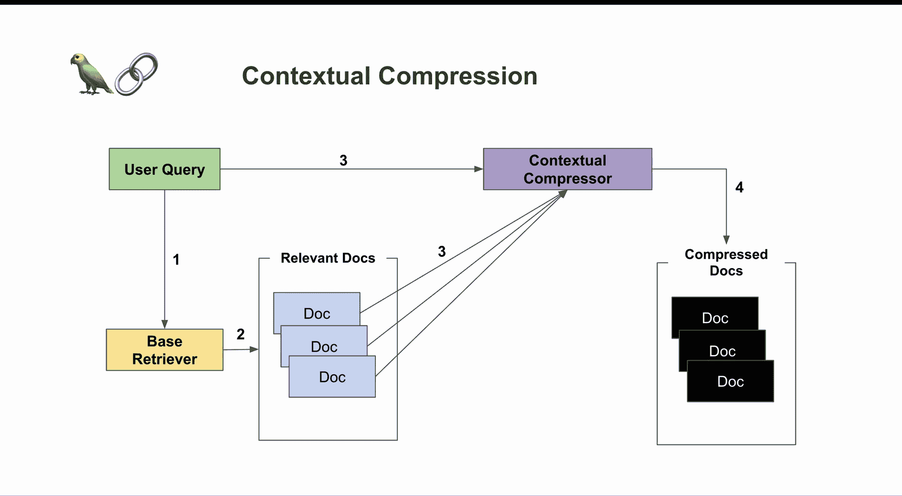
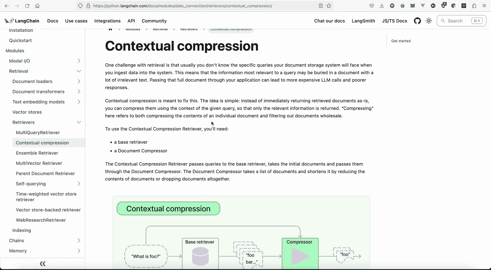

# 37：高质量内容检索 02：基于上下文压缩 📚

## 概述

在本节课中，我们将学习LangChain框架中一个重要的检索器——基于上下文压缩的检索器。我们将了解它如何通过压缩和过滤检索到的文档，来提高检索结果的相关性，从而提升问答系统的质量和效率。


---

上一节我们介绍了通过多重提问来提高检索质量的`MultiQueryRetriever`。本节中，我们来看看另一种提升检索质量的方法：基于上下文压缩的检索。

检索器面临的一大挑战是：当我们向系统注入文档时，无法预知未来会面临什么样的查询。这意味着，对于某个查询最相关的信息可能存在于一份文档中，但同时也被大量无关信息所包围。如果我们将整份文档直接交给大语言模型处理，会导致高昂的模型调用开销，并可能降低响应的质量。

基于上下文的压缩旨在改善这种情况。其核心思想是：在检索到相关文档后，并非立即返回，而是首先基于提问的上下文对这些文档进行压缩。这样，只有相关信息才会被返回。这里提到的“压缩”主要做两件事：一是对单个文档的内容进行压缩提取；二是可能过滤掉整个不相关的文档。

LangChain框架提供了一系列组件来实现这些功能。

## 基本流程

以下是基于上下文压缩检索器的简单工作流程：

1.  用户提出一个问题（Query）。
2.  问题被发送到一个基础检索器（例如基于向量存储的检索器）。
3.  基础检索器从向量存储中查询，得到一组相关文档。
4.  这组文档被送入**上下文压缩器**进行处理。
5.  压缩器对文档进行压缩或过滤，得到一组质量更高、更相关的文档。
6.  最终返回这组压缩后的文档。



接下来，我们将通过代码示例，一步步了解如何使用LangChain提供的组件实现这种压缩。

## 代码实现

我们首先安装必要的库并准备数据。

```python
# 安装依赖
!pip install langchain openai chromadb tiktoken
```

```python
# 导入必要的库
from langchain.retrievers import ContextualCompressionRetriever
from langchain.retrievers.document_compressors import LLMChainExtractor, LLMChainFilter, EmbeddingsFilter, DocumentCompressorPipeline, EmbeddingsRedundantFilter
from langchain.text_splitter import CharacterTextSplitter
from langchain.embeddings import OpenAIEmbeddings
from langchain.vectorstores import Chroma
from langchain.llms import OpenAI
from langchain.document_loaders import TextLoader

# 加载文档（示例使用 Paul Graham 的文章）
loader = TextLoader("./paul_graham_essay.txt")
documents = loader.load()


# 文档分割
text_splitter = CharacterTextSplitter(chunk_size=1000, chunk_overlap=0)
texts = text_splitter.split_documents(documents)

# 创建向量存储
embeddings = OpenAIEmbeddings()
db = Chroma.from_documents(texts, embeddings)

# 定义一个辅助函数，用于友好地打印文档内容
def pretty_print_docs(docs):
    print(f"\n{'-' * 100}\n".join([f"Document {i+1}:\n\n" + d.page_content for i, d in enumerate(docs)]))
```

### 基础检索流程

在引入压缩之前，我们先演示最基本的检索增强生成流程。

```python
# 创建基础检索器
base_retriever = db.as_retriever(search_type="similarity", search_kwargs={"k": 4})

# 用户提问
question = "Where did Paul Graham study?"

# 执行基础检索
base_docs = base_retriever.get_relevant_documents(question)
print("基础检索器返回的文档：")
pretty_print_docs(base_docs)
```

执行上述代码，基础检索器会返回4个文档块。这些文档块可能包含与问题相关的内容，但也混杂着大量无关信息。

### 使用LLM提取器进行内容压缩

第一个压缩组件是`LLMChainExtractor`。它的作用是利用大语言模型，从每个文档中抽取出与问题直接相关的信息片段。

以下是使用`LLMChainExtractor`的方法：

```python
# 初始化LLM和大语言模型提取器
llm = OpenAI(temperature=0)
compressor = LLMChainExtractor.from_llm(llm)

# 创建上下文压缩检索器，将基础检索器和压缩器组合
compression_retriever = ContextualCompressionRetriever(base_compressor=compressor, base_retriever=base_retriever)

# 执行压缩检索
compressed_docs = compression_retriever.get_relevant_documents(question)
print("\n使用LLM提取器压缩后的文档：")
pretty_print_docs(compressed_docs)
```

执行后，你会发现返回的文档数量可能变少，且每个文档的内容被精炼，只保留了与“Paul Graham在何处学习”直接相关的句子。这就是**内容压缩**。

**工作原理**：`LLMChainExtractor`内部会构建一个提示词（Prompt），要求大语言模型根据给定的问题和上下文，提取出相关的部分。如果无关，则返回指定的无输出字符串。

### 使用LLM过滤器进行文档过滤

第二个组件是`LLMChainFilter`。顾名思义，它的作用是对文档进行过滤，判断整个文档是否与问题相关。

以下是使用`LLMChainFilter`的方法：

```python
# 初始化LLM过滤器
filter_compressor = LLMChainFilter.from_llm(llm)

# 创建使用过滤器的压缩检索器
filter_retriever = ContextualCompressionRetriever(base_compressor=filter_compressor, base_retriever=base_retriever)

# 执行过滤检索
filtered_docs = filter_retriever.get_relevant_documents(question)
print("\n使用LLM过滤器过滤后的文档：")
pretty_print_docs(filtered_docs)
```

执行后，大语言模型会判断每个文档块的相关性。可能只留下一个被判定为相关的文档，而过滤掉其他所有文档。这就是**文档级过滤**。

**工作原理**：`LLMChainFilter`同样构建一个提示词，要求大语言模型判断“给定上下文是否与问题相关”，回答“是”或“否”，据此决定文档的去留。

### 使用嵌入过滤器进行相似度过滤

第三个组件是`EmbeddingsFilter`。它基于向量嵌入的相似度进行过滤，可以设定一个相似度阈值。

以下是使用`EmbeddingsFilter`的方法：

```python
# 初始化嵌入过滤器，设置相似度阈值
embeddings_filter = EmbeddingsFilter(embeddings=embeddings, similarity_threshold=0.76)

# 创建使用嵌入过滤器的压缩检索器
embedding_retriever = ContextualCompressionRetriever(base_compressor=embeddings_filter, base_retriever=base_retriever)

# 执行相似度过滤检索
similarity_filtered_docs = embedding_retriever.get_relevant_documents(question)
print(f"\n使用嵌入过滤器（阈值=0.76）过滤后的文档：")
pretty_print_docs(similarity_filtered_docs)
```

你可以调整`similarity_threshold`参数（例如0.8或0.85），观察不同阈值下被过滤后剩余的文档数量变化。这是一种更轻量级、不依赖大语言模型的过滤方式。

### 使用嵌入冗余过滤器去除重复

第四个组件是`EmbeddingsRedundantFilter`。它用于过滤掉向量嵌入高度相似的冗余文档。

以下是使用`EmbeddingsRedundantFilter`的方法：

```python
# 初始化冗余过滤器
redundant_filter = EmbeddingsRedundantFilter(embeddings=embeddings)

# 创建使用冗余过滤器的压缩检索器
redundant_retriever = ContextualCompressionRetriever(base_compressor=redundant_filter, base_retriever=base_retriever)

# 执行冗余过滤检索
redundant_filtered_docs = redundant_retriever.get_relevant_documents(question)
print("\n使用嵌入冗余过滤器过滤后的文档：")
pretty_print_docs(redundant_filtered_docs)
```

当检索到的多个文档块内容高度相似时，此过滤器可以只保留其中之一，避免信息重复。

### 组合多个压缩器：使用处理管道

最后，我们可以使用`DocumentCompressorPipeline`将多个压缩器组合成一个处理管道。

以下是构建和使用压缩管道的方法：

```python
# 1. 创建文档分割器（作为管道第一步，可选的预处理）
from langchain.text_splitter import CharacterTextSplitter
splitter = CharacterTextSplitter(chunk_size=300, chunk_overlap=0, separator=". ")

# 2. 创建冗余过滤器
redundant_filter = EmbeddingsRedundantFilter(embeddings=embeddings)
# 3. 创建相似度过滤器
relevant_filter = EmbeddingsFilter(embeddings=embeddings, similarity_threshold=0.76)

# 构建压缩器管道
pipeline_compressor = DocumentCompressorPipeline(
    transformers=[splitter, redundant_filter, relevant_filter]
)

# 使用管道压缩器创建最终的上下文压缩检索器
final_compression_retriever = ContextualCompressionRetriever(
    base_compressor=pipeline_compressor,
    base_retriever=base_retriever
)

# 执行最终检索
final_docs = final_compression_retriever.get_relevant_documents(question)
print("\n使用组合压缩管道过滤后的文档：")
pretty_print_docs(final_docs)
```

这个管道依次执行了三个操作：首先将大文档块进一步分割成更小的句子级块，然后去除冗余的块，最后根据相似度阈值过滤掉不相关的块。最终得到的文档集合既精简又相关。

## 总结

本节课中，我们一起学习了基于上下文压缩的检索方法。我们了解到：

1.  **核心目的**：通过压缩和过滤检索到的文档，提高最终传递给大语言模型的信息质量，从而提升问答效果并可能降低成本。
2.  **两种主要压缩方式**：
    *   **内容压缩**：如`LLMChainExtractor`，从文档中提取关键片段。
    *   **文档过滤**：如`LLMChainFilter`、`EmbeddingsFilter`，直接移除不相关的整个文档。
3.  **关键组件**：我们介绍了`LLMChainExtractor`、`LLMChainFilter`、`EmbeddingsFilter`、`EmbeddingsRedundantFilter`以及组合它们的`DocumentCompressorPipeline`。
4.  **使用方法**：通过`ContextualCompressionRetriever`将基础检索器与任意压缩器组合，即可实现高质量的压缩检索。

在实际应用中，建议你尝试并比较`MultiQueryRetriever`和基于上下文压缩的检索器，通过测试来评估哪种方法更能提升你的具体应用场景中的问答质量。



