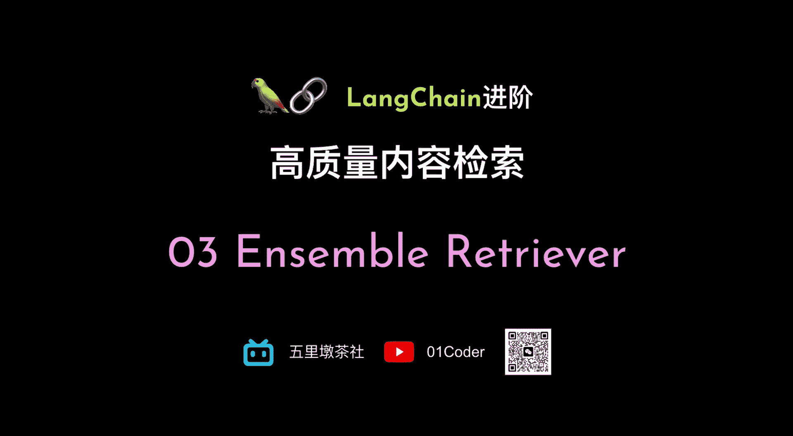
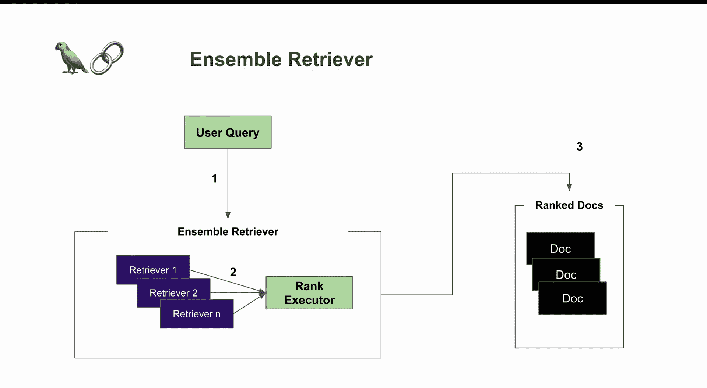
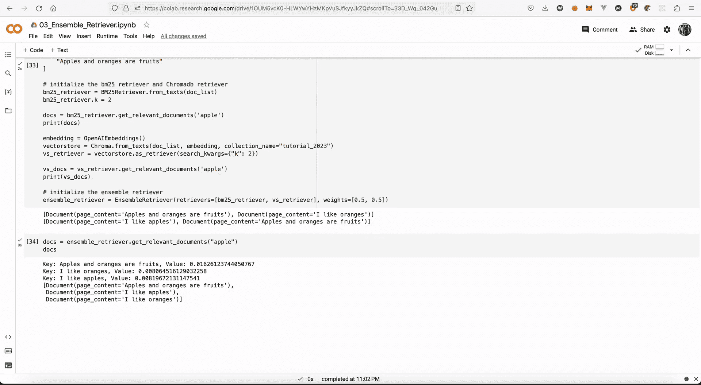

# 38：集成检索器 (Ensemble Retriever) 🧠



在本节课中，我们将要学习 LangChain 框架中的第三种高级检索器——集成检索器 (Ensemble Retriever)。我们将了解它如何通过结合多种检索方法的优势，来提供更全面、更准确的文档检索结果。


## 概述

上一节我们介绍了上下文压缩检索器，本节中我们来看看集成检索器。集成检索器，顾名思义，是将多个独立的检索器或检索模型组合在一起，协同工作。其核心目标是综合利用不同检索策略的长处，以换取比单一检索器更优的综合性能。


## 什么是集成检索器？

从字面上讲，Ensemble Retriever 即集成检索器。它是将多个检索器或检索模型结合在一起，以获得更全面或更准确的检索结果。


## 核心应用场景

在 LangChain 的集成检索器使用场景中，最常见的一种模式是组合稀疏检索器 (Sparse Retriever) 和密集检索器 (Dense Retriever)。

以下是这两种检索器的简要介绍：

*   **稀疏检索器 (Sparse Retriever)**：也被称为稀疏检索器，常见的算法是 **BM25**。LangChain 框架中，对它也已经有所支持，我们可以使用 `BM25Retriever` 这个类。稀疏检索器通常善于基于**关键字**来寻找相关的文档。
*   **密集检索器 (Dense Retriever)**：它基于向量相似性搜索来提供检索，称为密集检索器。它擅长于基于**语义的相关性或相似度**来寻找相关文档。

集成检索器正是结合了这两者的优势，旨在提供更好的综合服务和相关文档的搜索质量。




## 工作原理

接下来，我们先通过理解其工作流程，再配合代码分析来介绍它更细节的工作机制。

当用户提出一个问题时，这个问题会被交给集成检索器。根据我们刚才的介绍，这个检索器会由多个检索器组成。每一个检索器都会针对用户提问，进行数据的检索，这样就会得到一系列的相关文档。这些文档会被交由集成检索器的相关算法来做排名，也就是 `ranking`。经过排名以后，就会得到一个根据相关性或相似度排序的文档列表。这个排序是由特定的融合算法（如 Reciprocal Rank Fusion）来决定的。


## 代码实践

我们现在通过一份 Python Notebook 代码，看看集成检索器究竟是怎么工作的。

首先，需要安装必要的依赖包：

```python
# 除了常见的包：langchain, openai, chromadb, tiktoken
# 还需要安装 rank_bm25，这个包为我们提供了 BM25 算法的支持
!pip install rank_bm25
```

以下是核心代码步骤的演示：

```python
from langchain.retrievers import BM25Retriever, EnsembleRetriever
from langchain.vectorstores import Chroma
from langchain.embeddings import OpenAIEmbeddings

# 1. 准备文档数据
doc_list = ["I like apples", "I like oranges", "Apples and oranges are fruits"]

# 2. 实例化稀疏检索器 (BM25)
sparse_retriever = BM25Retriever.from_texts(doc_list, k=2)
# 使用稀疏检索器查询
sparse_docs = sparse_retriever.get_relevant_documents("apple")
print("稀疏检索器结果:", sparse_docs)

# 3. 实例化密集检索器 (基于向量存储)
vectorstore = Chroma.from_texts(doc_list, OpenAIEmbeddings(), collection_name="tutorial_ensemble")
dense_retriever = vectorstore.as_retriever(search_kwargs={"k": 2})
# 使用密集检索器查询
dense_docs = dense_retriever.get_relevant_documents("apple")
print("密集检索器结果:", dense_docs)

# 4. 组合成集成检索器
ensemble_retriever = EnsembleRetriever(retrievers=[sparse_retriever, dense_retriever], weights=[0.5, 0.5])
# 使用集成检索器查询
ensemble_docs = ensemble_retriever.get_relevant_documents("apple")
print("集成检索器结果:", ensemble_docs)
```

**代码执行结果分析**：
*   稀疏检索器 (BM25) 对于查询 “apple”，可能返回 `["I like apples", "I like oranges"]`。它基于关键词匹配，所以 “oranges” 也被召回。
*   密集检索器基于语义相似度，对于同一查询，更可能返回 `["I like apples", "Apples and oranges are fruits"]`。
*   集成检索器会综合两者的结果，并利用 **加权 Reciprocal Rank Fusion (RRF)** 算法对文档进行重新打分和排序，最终输出一个融合了关键词和语义信息的、排序更优的文档列表。


## 算法核心：加权 Reciprocal Rank Fusion

集成检索器的排序核心是 `weighted_reciprocal_rank` 函数。它接收一个列表的列表（每个子列表是一个检索器返回的相关文档集），并根据预设的权重为每个文档计算分数。

**其核心思想可以简化为以下公式**：
每个文档的得分会考虑它在每个检索器结果列表中的排名，排名越靠前（数值越小），贡献的分数越高。同时，每个检索器的权重会放大其返回文档的得分影响。

有兴趣的同学可以深入研究 `Reciprocal Rank Fusion` 算法，相关论文链接通常会在代码注释中提供。


## 调整与实验

你可以通过调整 `EnsembleRetriever` 的 `weights` 参数来观察不同权重对最终结果的影响。原理上，权重越高的检索器，其返回的文档在最终分数计算中的占比就越大。

```python
# 调整权重，让密集检索器占比更高
ensemble_retriever = EnsembleRetriever(retrievers=[sparse_retriever, dense_retriever], weights=[0.3, 0.7])
```

建议使用自己的数据集进行测试，对比集成检索器与之前介绍的 `MultiQueryRetriever`、`ContextualCompressionRetriever` 在不同场景下的表现差异。


## 总结



本节课中我们一起学习了 LangChain 的集成检索器。我们了解了它通过结合稀疏检索（擅长关键词匹配）和密集检索（擅长语义匹配）来提升检索效果的核心思路。通过代码演示，我们看到了其基本用法和工作流程，并了解了其背后基于 **加权 Reciprocal Rank Fusion** 的排序算法。集成检索器是构建高效、鲁棒检索系统的重要工具之一。