# 39：构建支持实时搜索的语音助手 🎤🤖

在本节课中，我们将学习如何利用 LangChain 框架和 OpenAI 的 Realtime API，结合 Tavily 搜索引擎，构建一个功能强大的语音助手。这个助手不仅能进行语音对话，还能实时搜索网络信息来回答用户的问题。

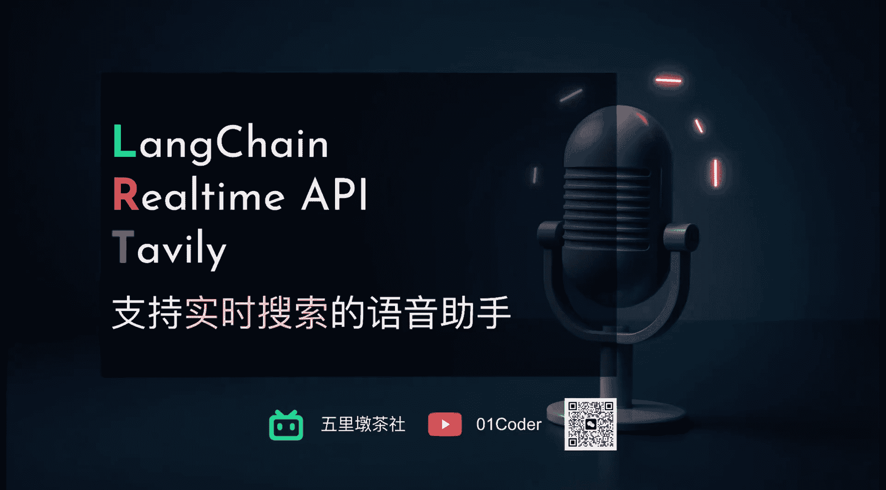

---

## 概述

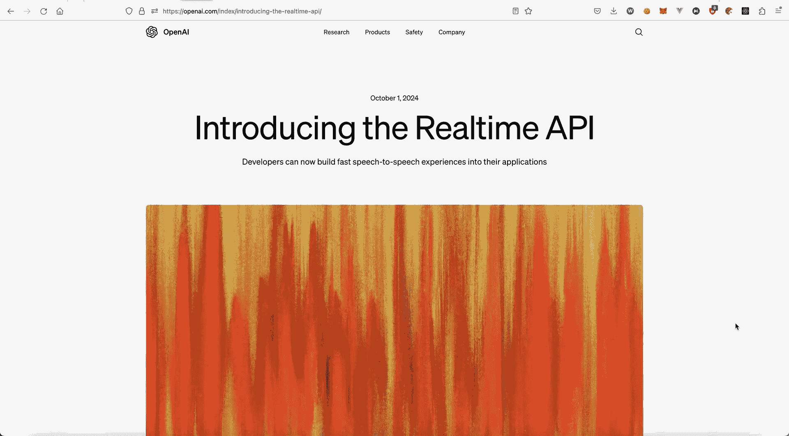

上一节我们介绍了 OpenAI Realtime API 的基本概念和消息交互流程。本节中，我们来看看如何将这些技术整合到一个实际的 Web 应用中。

我们将分析一个由 LangChain 官方提供的示例项目，它使用 TypeScript 实现了一个基于 React 风格的智能体（Agent）。这个项目演示了如何建立 WebSocket 连接、处理实时音频流、集成搜索工具，并最终构建一个可交互的语音助手。

---

## 项目准备与配置

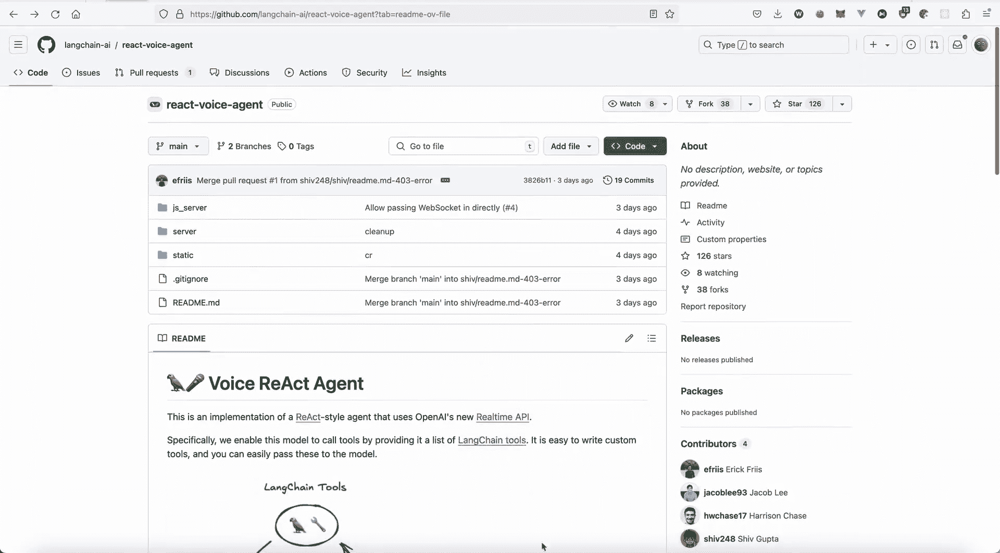

首先，我们需要获取并配置项目代码。


以下是项目初始化的步骤：

1.  **克隆代码仓库**：项目代码托管在公开的仓库中。
2.  **进入服务端目录**：核心服务端代码位于 `js-server` 目录下。
3.  **配置环境变量**：项目提供了一个 `.env.example` 文件，需要将其复制为 `.env` 文件并填入必要的 API 密钥。

关键的配置项有两个：
*   `OPENAI_API_KEY`：你的 OpenAI API 密钥，用于访问 Realtime API。
*   `TAVILY_API_KEY`：Tavily 搜索引擎的 API 密钥。如果未配置，助手将无法进行网络搜索。

---

## 服务端代码解析

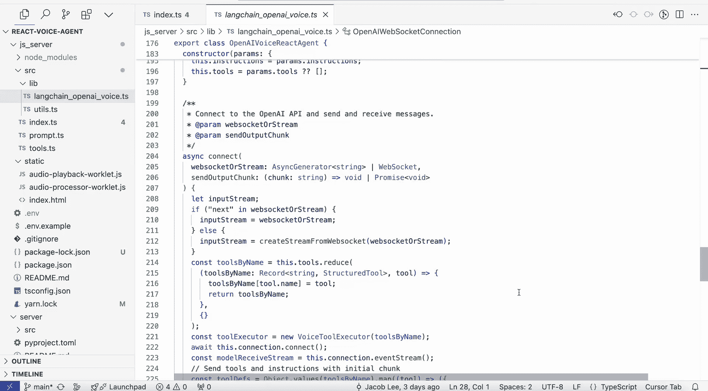

服务端的核心逻辑在 `src/index.ts` 文件中。它创建了一个 WebSocket 端点，并实例化了 `OpenAIVoiceRealtimeAgent`。

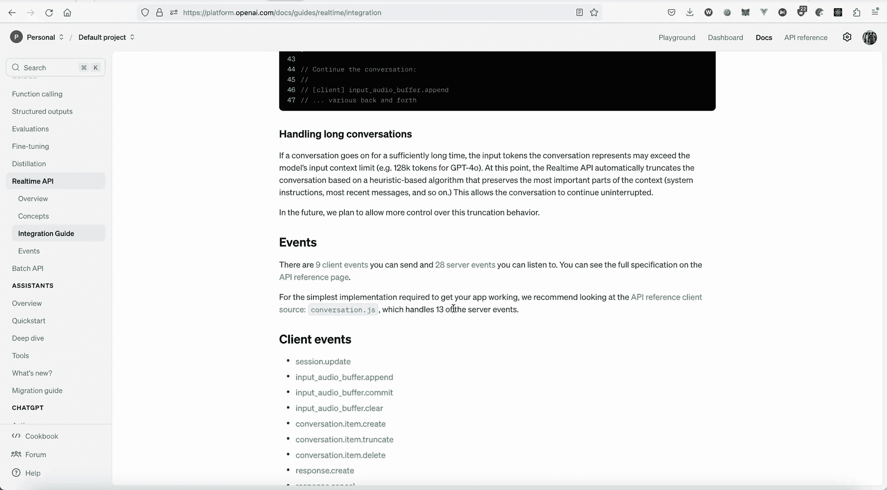

这个 `OpenAIVoiceRealtimeAgent` 类定义在 `src/lib/` 目录下，其核心是管理一个到 OpenAI Realtime API 的 WebSocket 连接。连接在智能体初始化时建立，需要指定 API 密钥和模型等参数。

```typescript
// 示例：创建 WebSocket 连接的核心配置
const connection = new OpenAIVoiceRealtimeConnection({
  apiKey: this.openAIApiKey,
  model: this.model,
});
```

### 事件处理机制

Realtime API 定义了多种客户端和服务端事件。为了正确处理音频和文本的输入输出，服务端代码需要对这些事件进行响应。

在 `connect` 函数中，代码处理了部分关键事件，同时忽略了一些非必要事件。被忽略的事件列表在代码顶部有明确说明。

在所有事件中，**`response.audio.delta`** 事件的处理最为重要，它包含了模型生成的音频数据流。服务端接收到这些数据块后，会将其转发给客户端进行播放。

目前，代码没有处理 **`response.audio_transcript.delta`** 事件，这个事件包含了模型输出的文字转录。有兴趣的开发者可以扩展此功能，以实现语音和文字的同步显示。

### 工具集成

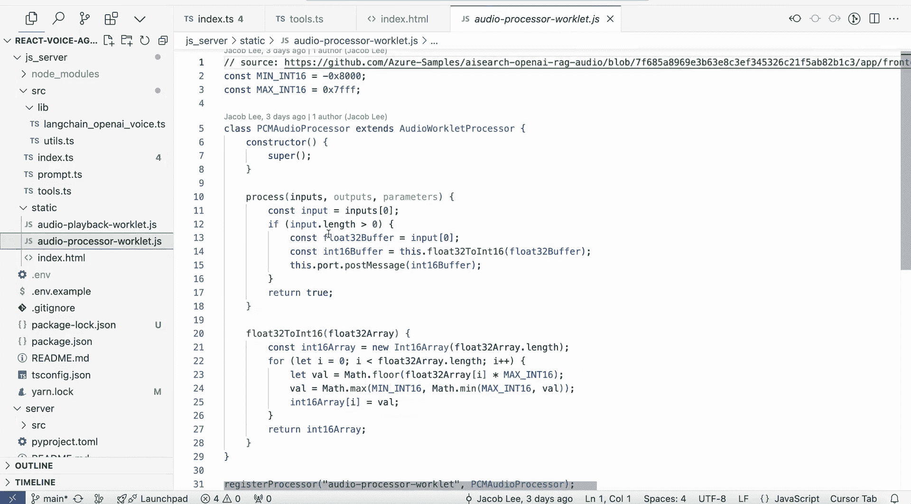

项目集成了两个工具（Tools）来增强助手的能力：

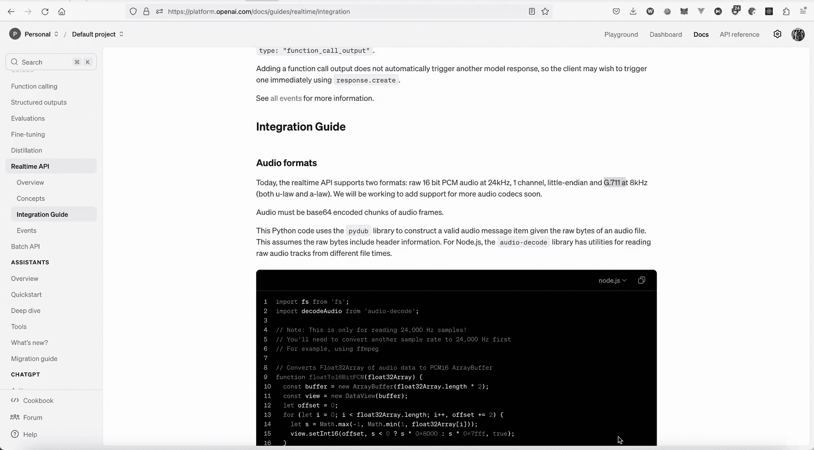

1.  **加法工具**：一个简单的演示工具，用于将两个数字相加。
2.  **Tavily 搜索工具**：这是一个标准的 LangChain Tool 实现。它允许助手在回答问题时调用 Tavily 搜索引擎获取实时信息。此功能依赖于正确的 `TAVILY_API_KEY` 配置。

---

## 客户端代码解析

客户端是一个简单的 HTML 页面（`static/index.html`），它使用 JavaScript 来管理 WebSocket 连接和处理消息。

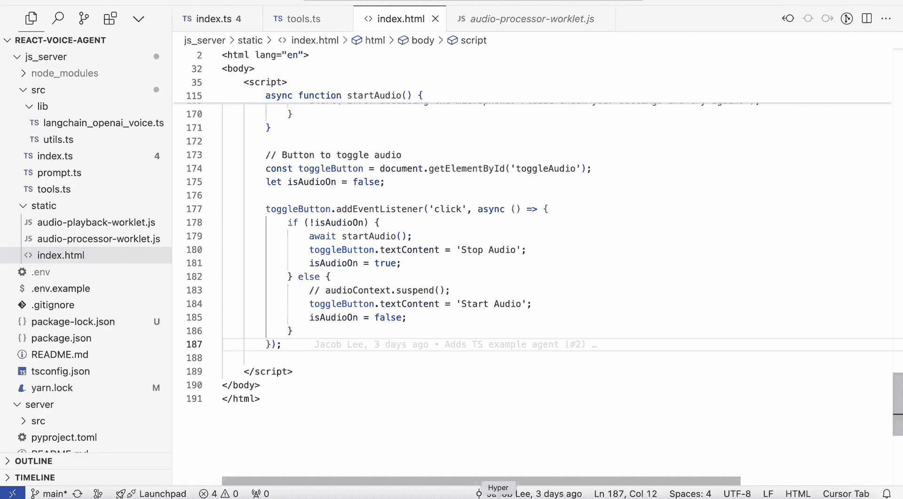

页面引入了两个关键的 JavaScript 模块（Worklets）来简化音频处理：

*   **`audio-playback.processor.js`**：负责音频播放，参考了 Web Audio API 的示例。
*   **`pcm-processor.js`**：负责处理 PCM 音频数据。因为 OpenAI Realtime API 支持特定的音频格式（如 16-bit PCM, 24kHz），所以需要这个处理器来进行格式转换和处理。


在 `startAudio` 函数中，客户端建立了与服务端的 WebSocket 连接。它主要监听并处理 **`response.audio.delta`** 事件。当收到音频数据块时，客户端对其进行解码，然后通过 `AudioPlayer` 的 `play` 方法进行播放，从而实现语音输出。

---

## 运行与演示

完成代码分析和配置后，我们可以运行项目来体验语音助手的效果。

以下是运行应用的步骤：

1.  在 `js-server` 目录下，使用 `npm install` 或 `yarn` 安装依赖。
2.  使用 `npm run dev` 或 `yarn dev` 启动开发服务器，它通常运行在 3000 端口。
3.  在浏览器中打开 `http://localhost:3000`。
4.  点击页面上的 “Start Audio” 按钮，即可开始与语音助手进行对话。

在演示中，你可以询问需要实时信息的问题，例如“纽约的天气怎么样？”。助手会通过 Tavily 工具搜索最新信息，并用语音回答你。控制台同时会打印出详细的交互日志。

---


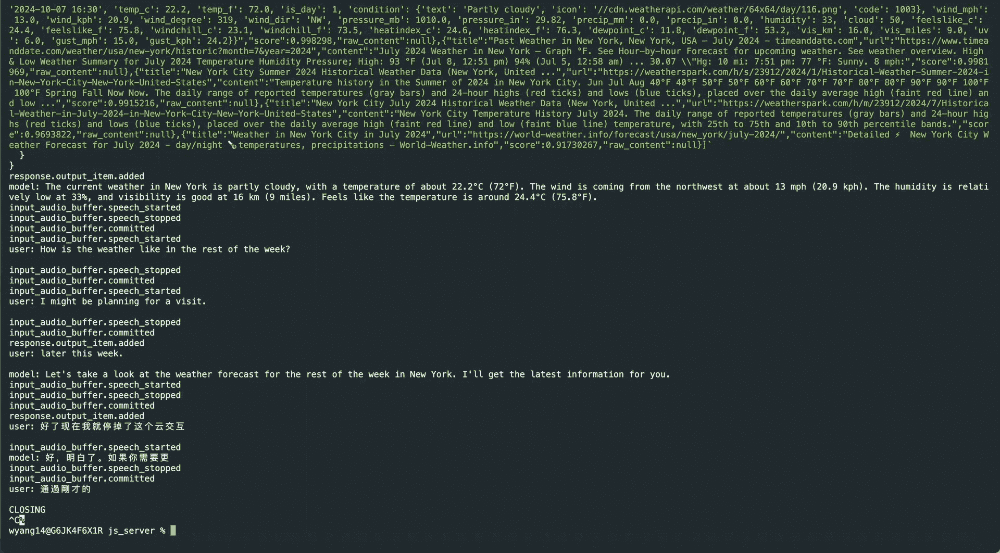

## 总结

本节课中，我们一起学习了如何构建一个支持实时搜索的语音助手。我们分析了项目的服务端和客户端架构，了解了如何利用 LangChain 框架集成 OpenAI Realtime API 和 Tavily 搜索工具。

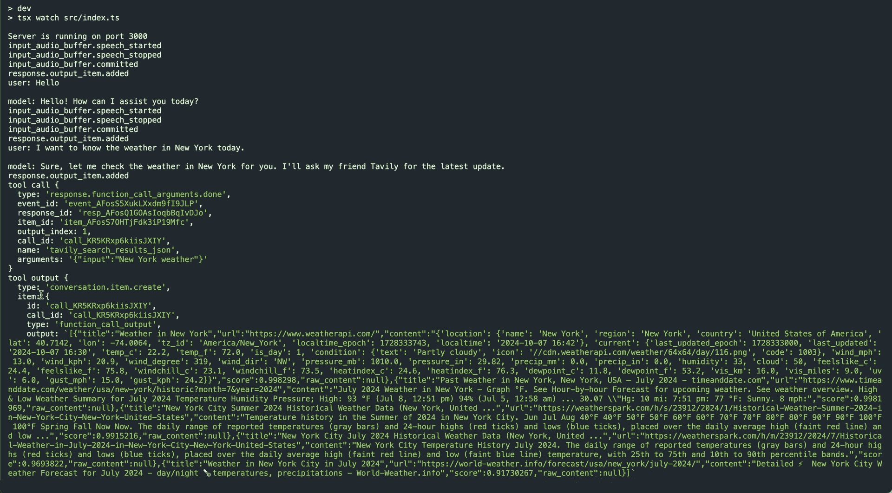

这个示例项目提供了一个强大的起点，开发者可以在此基础上进行扩展，例如：
*   处理 `response.audio_transcript.delta` 事件以实现实时字幕。
*   集成更多自定义工具来扩展助手的功能。
*   优化前端界面和用户体验。

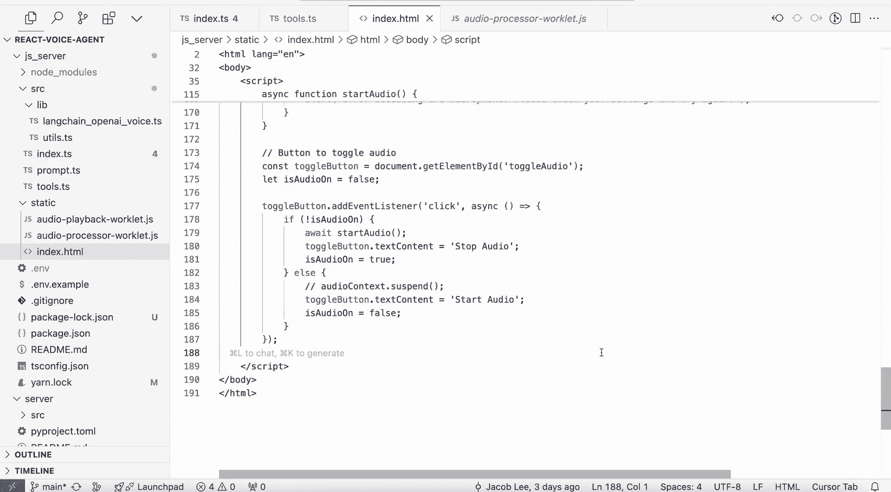

通过本课程，你应该对如何将大语言模型、实时语音接口和外部工具结合，构建交互式 AI 应用有了更深入的理解。