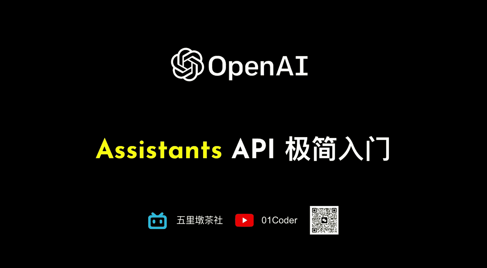
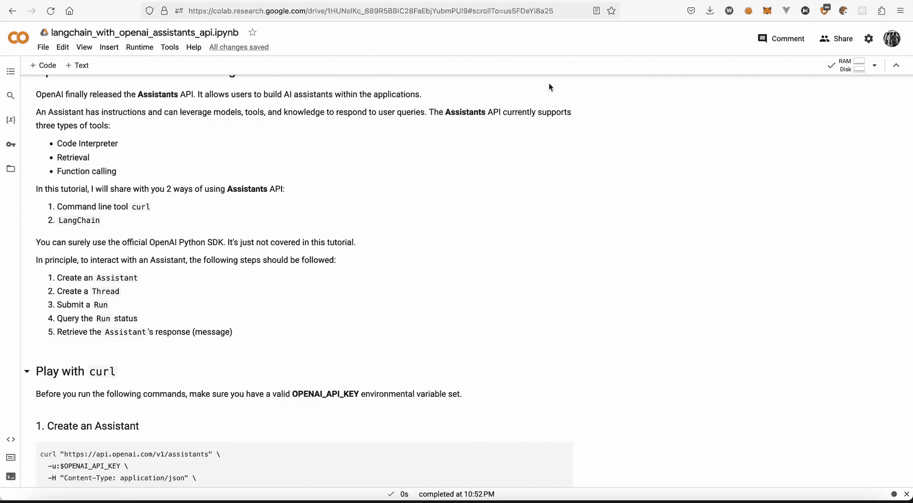
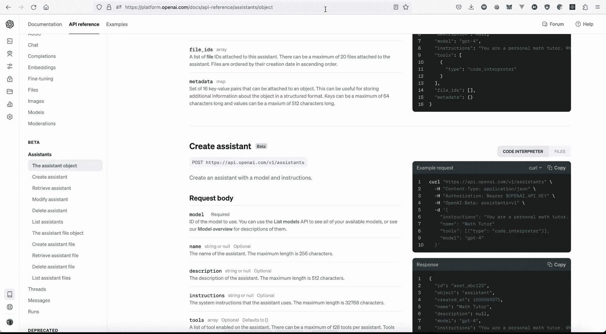
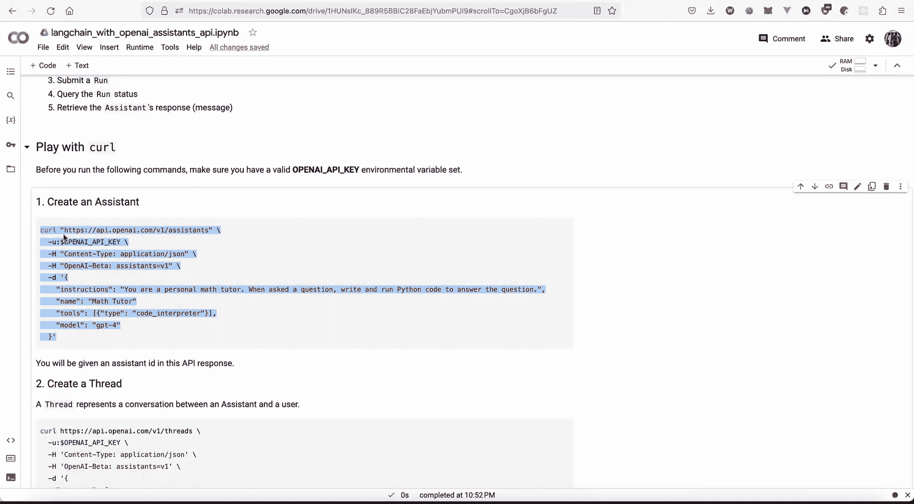
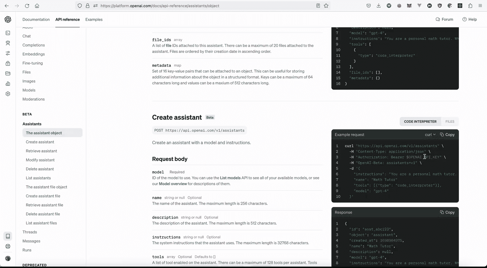
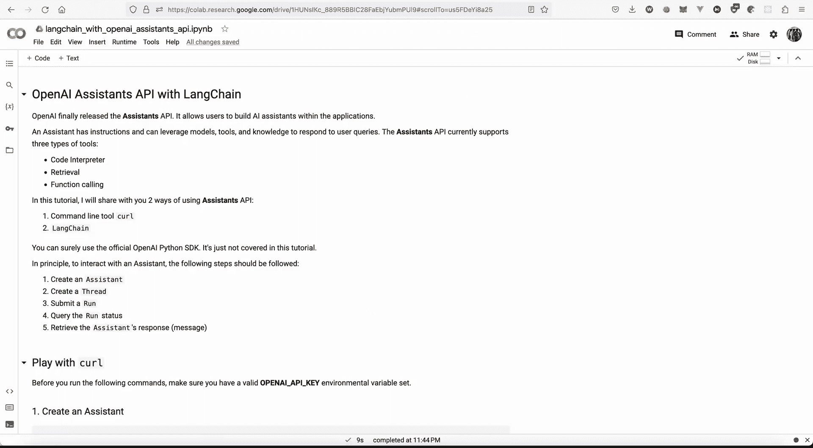

# 40：OpenAI Assistants API 极简入门（附LangChain集成） 📚



## 概述

在本节课中，我们将学习如何使用OpenAI最新发布的Assistants API来构建AI助理。课程将分为两部分：首先，我们将通过最原生的API调用（使用`curl`命令）来理解其工作原理；其次，我们将学习如何利用LangChain框架来简化集成过程，使开发更加高效。

---

## 什么是Assistants API？🤖

Assistants API允许用户在自己的应用程序中构建AI助理。一个助理拥有指令，并能利用大语言模型、工具以及知识库来回答用户的问题。目前，该API处于测试版，支持以下三种工具：
*   **代码解释器**：`code_interpreter`
*   **检索**：`retrieval`
*   **函数调用**：`function_calling`

在本次分享中，我们将重点演示使用**代码解释器**的场景。

---

## Assistant的工作原理 🧠



在深入实践之前，我们需要理解Assistants API的核心概念。其工作流程主要涉及三个关键角色：



1.  **Assistant**：代表一个AI助理或机器人。
2.  **Thread**：代表助理与用户之间的一个对话会话，其中可以包含多条消息。
3.  **Run**：代表一次人机交互任务。根据所使用的工具（如代码解释器），Run会执行相应操作来生成助理的回复。

简单来说，用户与助理的交互过程是：创建助理 -> 创建对话线程 -> 提交并执行交互任务 -> 获取助理回复。

---



## 第一部分：使用原生API调用



上一节我们介绍了核心概念，本节中我们来看看如何通过最基础的`curl`命令来调用API。与一个助理交互通常遵循以下五个步骤。

以下是使用`curl`命令与Assistant交互的步骤：

1.  **创建助理**
    ```bash
    curl https://api.openai.com/v1/assistants \
      -H "Content-Type: application/json" \
      -H "Authorization: Bearer $OPENAI_API_KEY" \
      -H "OpenAI-Beta: assistants=v1" \
      -d '{
        "instructions": "你是一个个人数学导师。当被问及数学问题时，编写并运行Python代码来回答问题。",
        "name": "Math Tutor",
        "tools": [{"type": "code_interpreter"}],
        "model": "gpt-4"
      }'
    ```
    *   此命令会创建一个名为“Math Tutor”的助理，并返回一个唯一的`assistant_id`，需要记录下来。

2.  **创建对话线程**
    ```bash
    curl https://api.openai.com/v1/threads \
      -H "Content-Type: application/json" \
      -H "Authorization: Bearer $OPENAI_API_KEY" \
      -H "OpenAI-Beta: assistants=v1" \
      -d '{
        "messages": [
          {
            "role": "user",
            "content": "请计算1, 2, 3的和。"
          }
        ]
      }'
    ```
    *   此命令创建一个新的对话线程，并添加了一条用户消息。返回的`thread_id`需要记录。

3.  **提交运行任务**
    ```bash
    curl https://api.openai.com/v1/threads/THREAD_ID/runs \
      -H "Content-Type: application/json" \
      -H "Authorization: Bearer $OPENAI_API_KEY" \
      -H "OpenAI-Beta: assistants=v1" \
      -d '{
        "assistant_id": "ASSISTANT_ID"
      }'
    ```
    *   将上两步获得的`THREAD_ID`和`ASSISTANT_ID`替换到命令中。此命令会启动一次交互，并返回一个`run_id`。

4.  **查询运行状态**
    ```bash
    curl https://api.openai.com/v1/threads/THREAD_ID/runs/RUN_ID \
      -H "Authorization: Bearer $OPENAI_API_KEY" \
      -H "OpenAI-Beta: assistants=v1"
    ```
    *   替换`THREAD_ID`和`RUN_ID`。当状态变为`completed`时，表示任务执行完毕。

5.  **获取助理回复**
    ```bash
    curl https://api.openai.com/v1/threads/THREAD_ID/messages \
      -H "Authorization: Bearer $OPENAI_API_KEY" \
      -H "OpenAI-Beta: assistants=v1"
    ```
    *   查询指定线程中的所有消息。助理的回复通常是消息列表中最新的那条。

通过以上步骤，我们完成了从创建助理到获取回复的完整流程。可以看到，原生的API调用需要手动管理多个ID和状态。

---

## 第二部分：使用LangChain集成

上一节我们体验了原生API的调用流程，本节中我们来看看如何利用LangChain框架来简化这一过程。LangChain团队对OpenAI的更新响应迅速，已在其实验性包中提供了对Assistants API的封装。

以下是使用LangChain集成Assistants API的步骤：

1.  **环境准备**
    确保已安装必要版本的包：
    ```bash
    pip install langchain langchain-experimental openai>=1.1.0
    ```
    同时，设置有效的`OPENAI_API_KEY`环境变量。

2.  **创建助理**
    ```python
    from langchain_experimental.openai_assistant import OpenAIAssistantRunnable

    assistant = OpenAIAssistantRunnable.create_assistant(
        name="LangChain Assistant",
        instructions="你是一个个人数学导师。当被问及数学问题时，编写并运行Python代码来回答问题。",
        tools=[{"type": "code_interpreter"}],
        model="gpt-4",
    )
    ```
    *   使用`OpenAIAssistantRunnable`类可以非常简洁地创建一个助理。

3.  **提问并获取回复**
    ```python
    output = assistant.invoke({"content": "请计算1, 2, 3的和。"})
    print(output.content)
    # 输出：1, 2, 3的和是6。
    ```
    *   只需调用`invoke`方法并传入用户消息，即可直接获得助理的回复。LangChain在内部自动处理了线程创建、运行提交和状态轮询等复杂步骤。

在`output`对象中，除了回复内容，还包含了本次交互的`thread_id`、`run_id`、`assistant_id`等完整信息，方便后续追踪。

通过对比可以发现，LangChain的封装极大地简化了代码，让开发者能更专注于业务逻辑。

---

## 总结

本节课中我们一起学习了OpenAI Assistants API的基本使用方法。我们首先通过原生的`curl`命令调用，理解了创建助理、线程、运行任务和获取回复的完整流程。随后，我们学习了如何利用LangChain框架来集成Assistants API，其简洁的封装使得开发效率大幅提升。



你可以根据项目需求，选择使用原生的OpenAI Python SDK进行更精细的控制，或者使用LangChain来快速构建应用。希望本教程能帮助你顺利开始使用Assistants API。