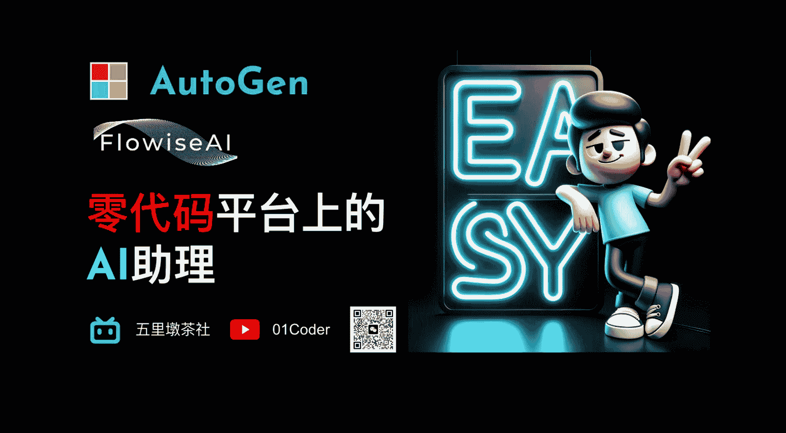
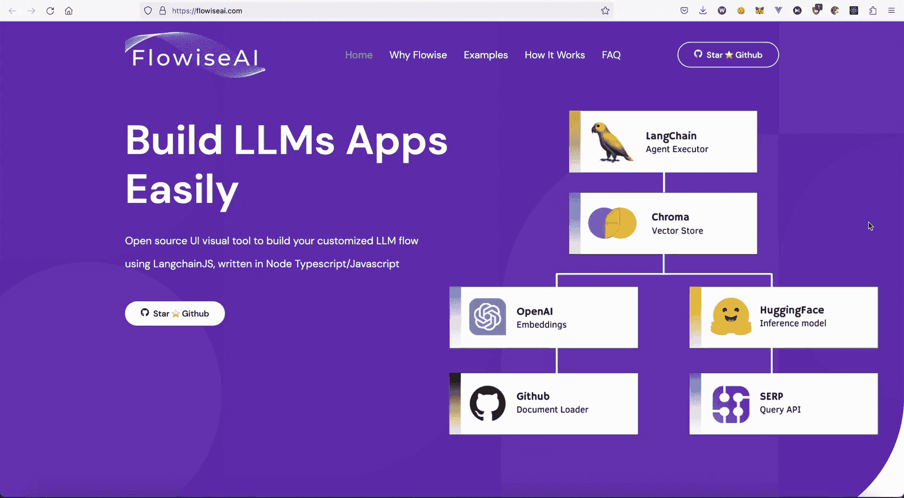
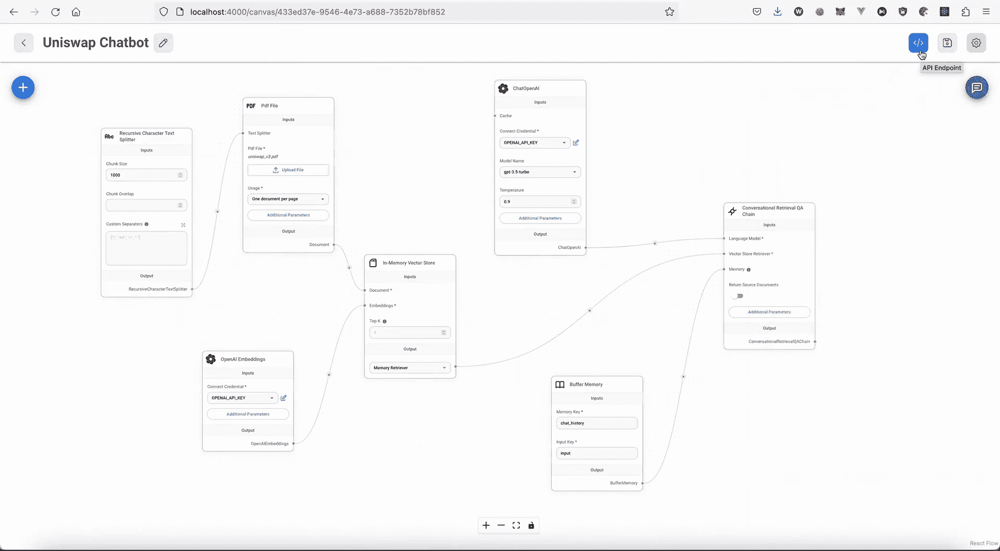
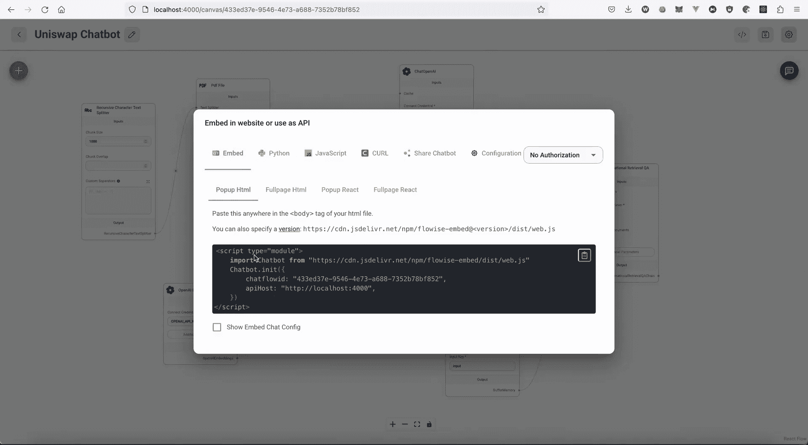
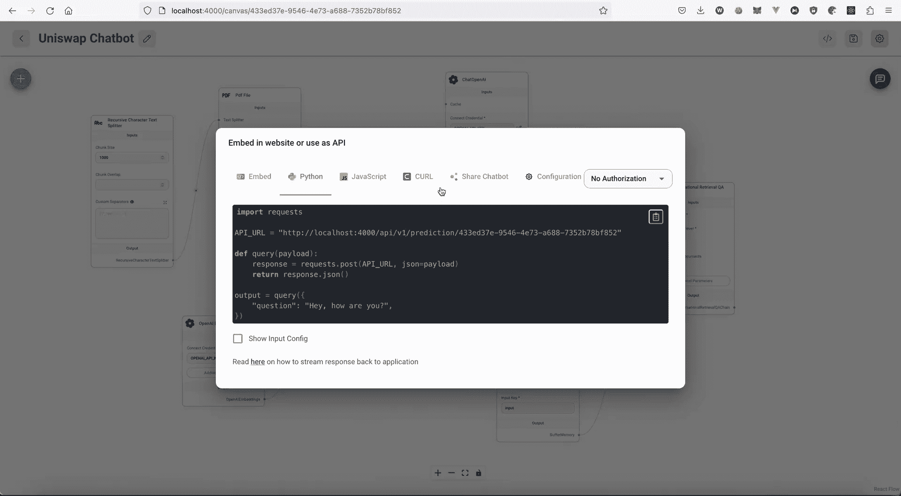
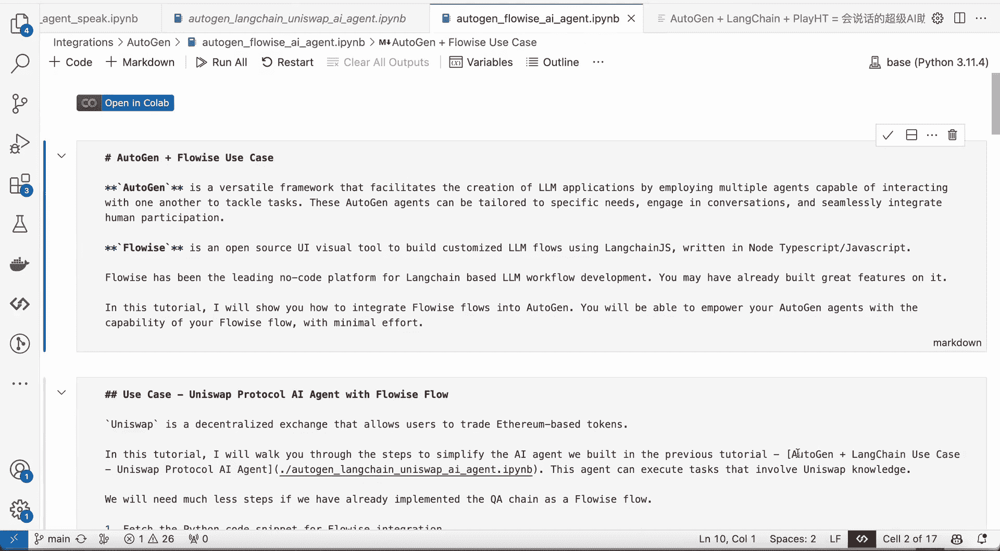
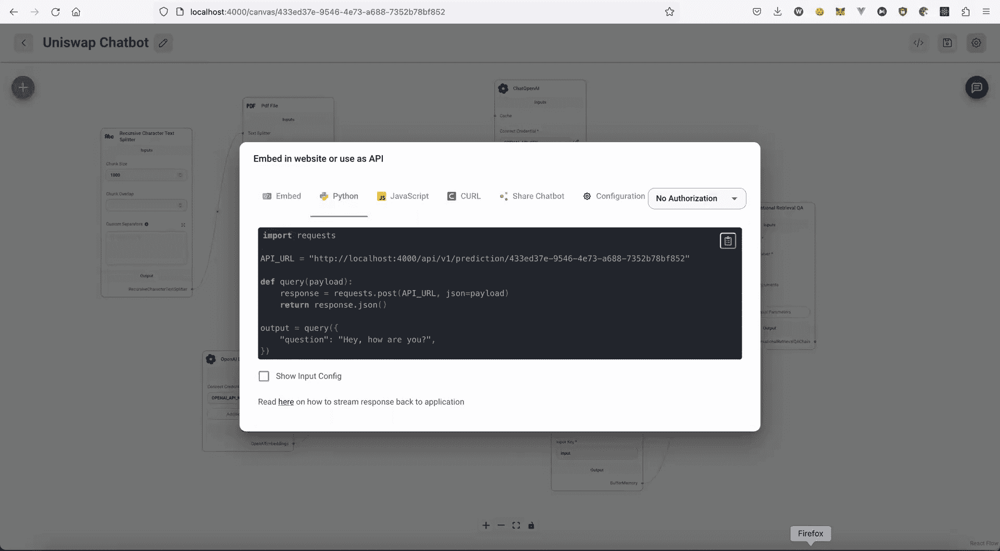
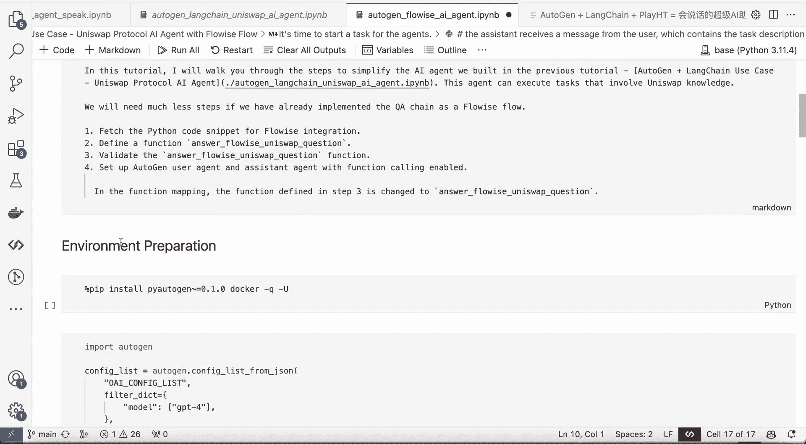

# 42：AutoGen + Flowise 集成指南 🛠️  



## 概述  
在本节课中，我们将学习如何将 Flowise 构建的无代码 AI 工作流集成到 AutoGen 框架中。通过这种方式，我们可以重用已有的 AI 应用，快速构建功能强大的多智能体系统。  

---

## 1. Flowise 简介与运行环境搭建 🌐  
上一节我们介绍了 AutoGen 框架的基本概念，本节中我们来看看如何搭建 Flowise 环境。  

Flowise 是一个基于 LangChain 的开源可视化工具，用于构建大语言模型工作流。它支持通过无代码方式创建复杂的 AI 应用。  



以下是运行 Flowise 的两种方式：  
1. 通过 npm 安装开发包运行。  
2. 使用 Docker 容器运行（推荐）。  

在本地使用 Docker 运行 Flowise 的命令如下：  
```bash
docker build -t flowise .
docker run -p 4000:3000 flowise
```  
这里将容器端口 3000 映射到本地端口 4000。  

---

## 2. 构建 Flowise 工作流 🔧  
本节中，我们将构建一个基于 Uniswap V3 文档的问答工作流。  

工作流包含以下核心组件：  
- **Retrieval QA Chain**：用于处理问答任务。  
- **ChatOpenAI 模型**：作为大语言模型。  
- **内存向量存储检索器**：用于文档检索。  
- **Buffer Memory**：作为记忆组件。  
- **OpenAI Embedding**：用于文本向量化。  
- **PDF 文件加载器**：加载 Uniswap V3 的 PDF 文档。  
- **递归字符文本拆分器**：用于拆分文档内容。  

完成工作流后，可以通过 Flowise 的聊天界面测试问答功能。  

---



## 3. 获取 Flowise 的 API 接口 🌉  
接下来，我们需要获取 Flowise 工作流的 API 接口，以便通过代码调用。  



在 Flowise 工作流界面的右上角，点击 **API Endpoint**，可以查看集成的代码片段。Flowise 提供了多种调用方式，包括 JavaScript 和 Python。  

以下是通过 Python 调用 API 的示例代码：  
```python
import requests





def answer_flowise_uniswap_question(question):
    url = "http://localhost:4000/api/v1/prediction/your-workflow-id"
    payload = {"question": question}
    response = requests.post(url, json=payload)
    return response.json()
```  



---

## 4. 集成 Flowise 到 AutoGen 🤖  
本节中，我们将把 Flowise 工作流集成到 AutoGen 框架中，构建一个多智能体系统。  

以下是集成步骤：  
1. 定义函数 `answer_flowise_uniswap_question`，用于调用 Flowise API。  
2. 验证函数是否能正常工作。  
3. 配置 AutoGen 的 User Agent 和 Assistant Agent。  
4. 将函数映射到 User Proxy Agent 中。  

示例代码如下：  
```python
from autogen import AssistantAgent, UserProxyAgent

def answer_flowise_uniswap_question(question):
    # 调用 Flowise API
    pass

# 验证函数
print(answer_flowise_uniswap_question("What are the main changes in V3?"))

# 构建 AutoGen 代理
assistant = AssistantAgent("assistant")
user_proxy = UserProxyAgent("user_proxy", function_map={"answer_flowise_uniswap_question": answer_flowise_uniswap_question})
```  

---

## 5. 任务执行与结果验证 📝  
最后，我们通过 AutoGen 代理执行一个任务：撰写一篇关于 Uniswap V3 的博客。  

任务执行过程如下：  
1. User Proxy Agent 调用 `answer_flowise_uniswap_question` 函数，获取 Uniswap V3 的相关信息。  
2. Assistant Agent 基于获取的信息撰写博客。  
3. 任务完成后，交付结果给 User Proxy Agent。  

通过这种方式，我们可以快速重用已有的 AI 应用，提升开发效率。  

---



## 总结  
本节课中，我们一起学习了如何将 Flowise 构建的无代码 AI 工作流集成到 AutoGen 框架中。通过 API 调用和函数映射，我们可以最大限度地重用已有成果，快速构建功能强大的多智能体系统。希望本教程能帮助你更好地利用 AI 工具，提升开发效率。