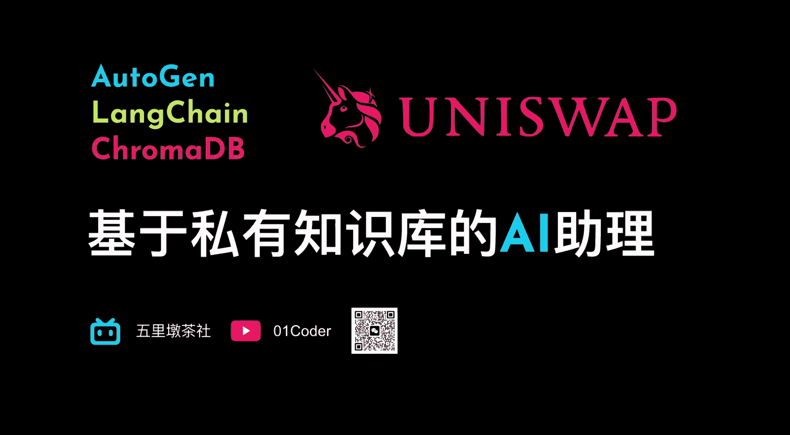
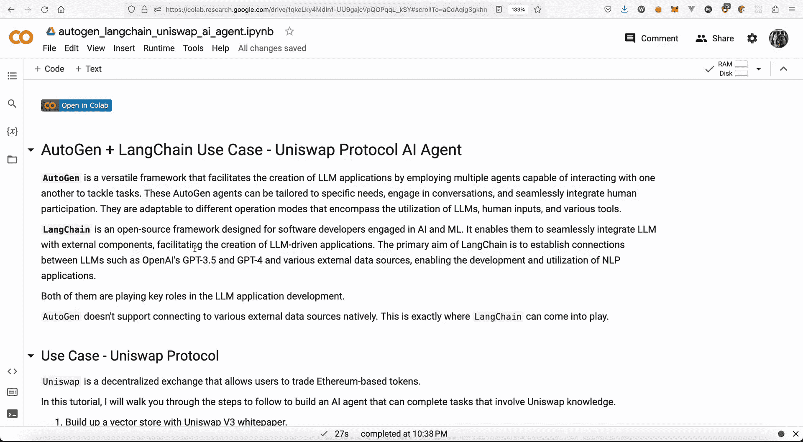

# 43：AutoGen + LangChain + ChromaDB 构建超级AI助理 🚀

## 概述
在本节课中，我们将学习如何将微软的AutoGen多智能体框架与LangChain框架集成，并结合ChromaDB向量数据库，构建一个能够基于特定知识库（如Uniswap V3白皮书）进行问答的超级AI助理。我们将一步步解析其架构、实现步骤与核心交互逻辑。



---

## 1. 框架介绍与问题背景

上一节我们介绍了课程的整体目标。本节中，我们来看看我们为什么要将AutoGen和LangChain结合使用。

一些同学对这两个框架提出了疑问：AutoGen与LangChain究竟有何差异？它们能否集成在一起协同工作？

*   **AutoGen**：一个支持**多智能体协作**的大语言模型框架。它通过多个能够相互交互以处理复杂任务的智能体来构建应用。
*   **LangChain**：一个为AI开发者设计的开源框架，专门用于**无缝集成大语言模型与外部组件**，特别是外部数据和工具。

今天的应用场景是：基于Uniswap V3协议的白皮书构建AI助理，帮助用户完成与协议相关的任务。这个场景恰好能结合两者的优势：**AutoGen负责多智能体的调度与任务分解，LangChain负责连接并查询私有知识库**。

---

## 2. 整体架构与实现思路

了解了框架特性后，我们来看看实现这样一个AI助理的整体思路。

既然要针对白皮书构建助理，那么白皮书内容就是必需的知识基础。这与基于LangChain构建文档聊天机器人的场景类似。

我们需要：
1.  基于协议白皮书创建知识库，并构建向量存储以供检索。
2.  当用户提出问题时，AutoGen的智能体需要定位相关知识，它可以向向量存储发起查询。

因此，从架构上分为两部分：
*   **LangChain** 实现协议数据的**索引与检索**。
*   **AutoGen** 提供**多智能体**来帮助用户分解和完成任务。

任务的执行中，当AutoGen的智能体需要查询协议内容时，就通过LangChain框架提供的链（Chain）来完成。两者的集成是通过AutoGen框架支持的**函数调用（Function Call）** 机制实现的。

---

## 3. 实现步骤详解

以下是构建该AI助理的具体步骤。

### 3.1 第一步：构建向量存储
我们基于Uniswap V3的白皮书PDF文件创建向量存储。
1.  使用 `PyPDFLoader` 加载PDF文档。
2.  对文档进行拆分。
3.  使用OpenAI的嵌入模型，将拆分后的文档存入ChromaDB向量数据库。

```python
# 示例代码结构
from langchain.document_loaders import PyPDFLoader
from langchain.text_splitter import RecursiveCharacterTextSplitter
from langchain.embeddings import OpenAIEmbeddings
from langchain.vectorstores import Chroma

# 加载并拆分文档
loader = PyPDFLoader("uniswap-v3-whitepaper.pdf")
documents = loader.load()
text_splitter = RecursiveCharacterTextSplitter(chunk_size=1000, chunk_overlap=0)
docs = text_splitter.split_documents(documents)

# 创建向量存储
embeddings = OpenAIEmbeddings()
vectorstore = Chroma.from_documents(docs, embeddings)
```

### 3.2 第二步：创建LangChain的QA链
基于上一步的向量存储，构建一个用于对话式检索的问答链。
1.  使用OpenAI的大语言模型。
2.  将向量存储作为检索器。
3.  添加一个记忆组件以支持多轮对话。

```python
from langchain.chains import ConversationalRetrievalChain
from langchain.chat_models import ChatOpenAI
from langchain.memory import ConversationBufferMemory

# 创建对话检索链
llm = ChatOpenAI(temperature=0)
memory = ConversationBufferMemory(memory_key="chat_history", return_messages=True)
qa_chain = ConversationalRetrievalChain.from_llm(llm, vectorstore.as_retriever(), memory=memory)
```

### 3.3 第三步：定义供AutoGen调用的函数
定义一个函数，作为AutoGen智能体与LangChain QA链之间的桥梁。该函数将被AutoGen的智能体调用。

```python
def answer_uniswap_question(question: str) -> str:
    """
    回答任何与Uniswap相关的问题。
    参数:
        question (str): 用户提出的问题。
    返回:
        str: 基于知识库的答案。
    """
    # 调用LangChain的QA链获取答案
    result = qa_chain({"question": question})
    return result["answer"]
```

### 3.4 第四步：构建AutoGen智能体并集成函数
创建AutoGen的User Proxy Agent和Assistant Agent，并启用函数调用功能。
1.  在LLM配置中注册第三步定义的函数。
2.  在创建Agent时，将函数名称映射到具体的Python函数。

```python
from autogen import AssistantAgent, UserProxyAgent, config_list_from_json

# 加载包含API密钥的配置
config_list = config_list_from_json("OAI_CONFIG_LIST")

# 创建助理智能体，在其配置中描述可用的函数
assistant = AssistantAgent(
    name="assistant",
    llm_config={
        "config_list": config_list,
        "functions": [
            {
                "name": "answer_uniswap_question",
                "description": "回答任何Uniswap相关的问题。",
                "parameters": {
                    "type": "object",
                    "properties": {
                        "question": {"type": "string", "description": "用户的问题。"}
                    },
                    "required": ["question"],
                },
            }
        ],
    },
)

# 创建用户代理智能体，并指定函数映射
user_proxy = UserProxyAgent(
    name="user_proxy",
    human_input_mode="NEVER",
    max_consecutive_auto_reply=10,
    function_map={
        "answer_uniswap_question": answer_uniswap_question, # 关键映射
    },
)
```

---

## 4. 任务执行与交互流程

智能体构建完成后，现在可以开始执行任务。我们让代理帮助撰写一篇介绍Uniswap V3协议的博客。

我们通过User Proxy Agent向Assistant Agent发起任务：
```
“我想写一篇博客介绍Uniswap V3协议。请通过回答以下三个问题，并基于答案编写一段简要介绍：
1. 什么是Uniswap？
2. V3版本的主要变更是什么？
3. 如何使用Uniswap？”
```

以下是智能体间的交互流程：
1.  **Assistant** 收到任务，分析后决定需要调用 `answer_uniswap_question` 函数来获取信息。
2.  **Assistant** 建议 **User Proxy** 执行函数调用，并传入第一个问题“What is Uniswap?”。
3.  **User Proxy** 执行函数，函数内部调用LangChain的QA链，从向量库中检索答案并返回。
4.  **Assistant** 收到第一个答案后，继续建议 **User Proxy** 调用函数询问第二、第三个问题。
5.  在收集完所有三个问题的答案后，**Assistant** 综合这些信息，组织成一篇完整的博客草稿，返回给 **User Proxy**。

通过这个流程，AutoGen智能体协调了任务规划与执行，而具体的专业知识查询则通过函数调用委托给LangChain处理，两者完美协同。

---

## 5. 环境准备与配置要点

在开始实践之前，需要做好以下环境准备。

以下是需要安装的主要Python包：
```bash
pip install pyautogen docker langchain-openai tiktoken chromadb pypdf
```

需要准备一个 `OAI_CONFIG_LIST` 文件来配置模型和API密钥，示例内容如下：
```json
[
    {
        "model": "gpt-4",
        "api_key": "YOUR_OPENAI_API_KEY"
    }
]
```
在代码中通过 `config_list_from_json` 加载此配置，并设置相应的环境变量。

---

## 总结
本节课中，我们一起学习了如何将AutoGen与LangChain框架结合，构建一个功能强大的AI助理。

1.  **架构核心**：利用AutoGen的**多智能体协作**与**函数调用**能力，结合LangChain的**外部数据集成**优势。
2.  **关键步骤**：构建向量知识库 -> 创建LangChain QA链 -> 封装为AutoGen可调用的函数 -> 配置AutoGen智能体并注册函数。
3.  **工作流程**：用户任务由AutoGen智能体分解，通过函数调用触发LangChain从知识库中检索精准信息，最后汇总生成最终结果。

这种模式为构建复杂、专业的AI应用提供了强大而灵活的范式。有兴趣的同学可以尝试利用AutoGen的智能体，结合LangChain丰富的工具和组件，开发出更多有趣且实用的AI应用。



---
**代码与资源**：本课程涉及的完整代码与相关文档链接可在视频描述中获取。