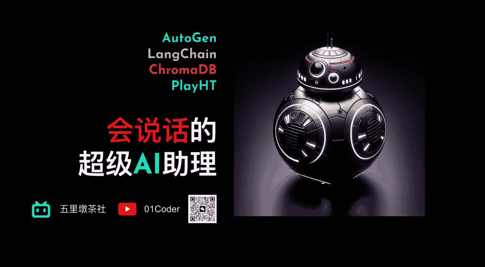
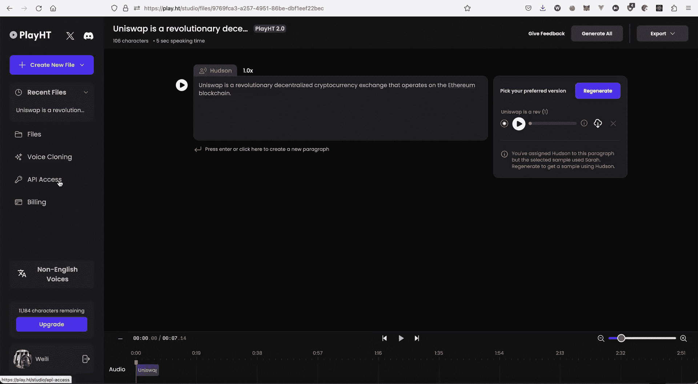
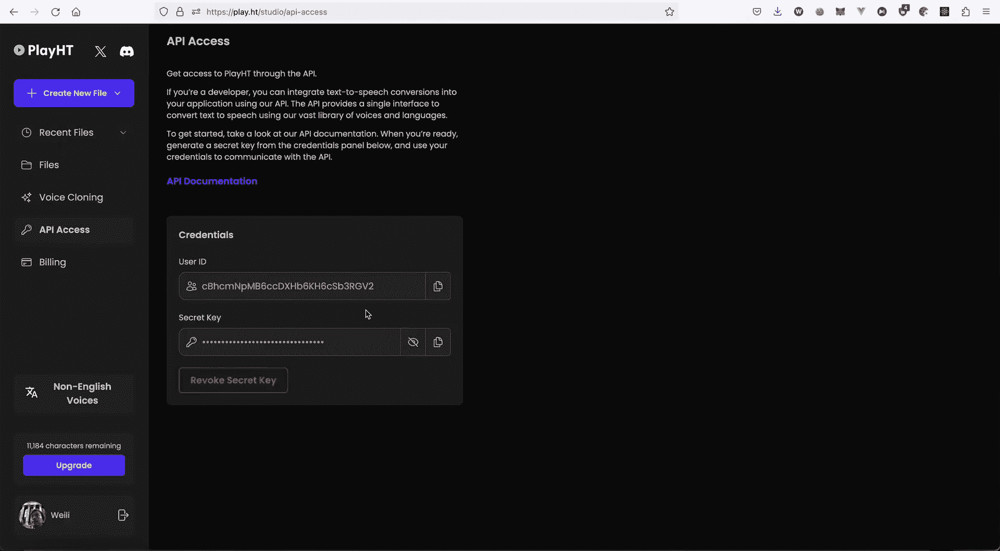
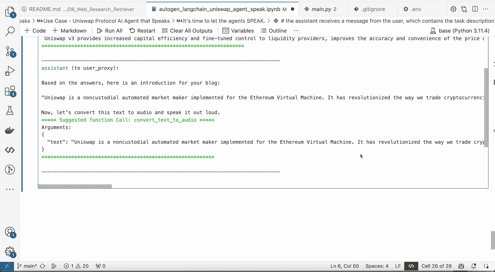

# 44：构建会说话的AI助理 🗣️

在本节课中，我们将学习如何为基于AutoGen和LangChain构建的AI代理添加语音功能。我们将使用PlayHT的文字转语音服务，让AI代理能够“开口说话”，从而提供更丰富的交互体验。

---



## 概述

上一节我们介绍了如何集成AutoGen和LangChain，构建了一个基于Uniswap协议白皮书的强大AI代理。该代理不仅能进行基于文档的问答，还能执行代码、生成内容，例如撰写博客或发送邮件。

本节中，我们来看看如何进一步提升这个AI代理的用户体验，为其赋予语音交互能力。核心思路是将代理生成的文本转换为语音输出。


---

## 准备工作：获取PlayHT服务





为了让AI代理具备说话能力，我们需要一个文本转语音服务。本节将使用PlayHT公司提供的生成式文字转语音服务。

以下是使用PlayHT前的必要步骤：

1.  访问PlayHT官网并完成注册登录。
2.  进入工作台（Go to Studio）。
3.  在“API Access”部分获取你的 `user_id` 和 `secret_key`。这两个参数将在后续代码中调用API时使用。


---

## 验证PlayHT API

在将服务集成到AI代理前，我们首先通过命令行验证API是否工作正常。我们将使用PlayHT提供的Python SDK。

具体步骤如下：

1.  克隆PlayHT的Python SDK代码仓库：
    ```bash
    git clone https://github.com/playht/py-ht
    ```
2.  安装所需依赖包。
3.  准备一个 `.env` 文件来配置环境变量，格式如下：
    ```
    PLAY_HT_USER_ID=你的用户ID
    PLAY_HT_API_KEY=你的API密钥
    ```
4.  在命令行中，加载环境变量并运行SDK中的示例脚本进行测试：
    ```bash
    # 假设已加载环境变量
    python demo/main.py --text “Nice to meet you.”
    ```
    如果听到“Nice to meet you”的语音输出，则证明API配置成功。

---

## 集成语音功能到AI代理

验证API成功后，我们将把文字转语音功能集成到上一节构建的AI代理中。本节操作将在本地的Python Notebook中进行。

### 第一步：导入依赖与配置

除了上一节已有的依赖包，我们需要新增 `simpleaudio` 和 `numpy`。同时，在代码中加载PlayHT的配置。

```python
# 新增依赖
# pip install simpleaudio numpy

# 加载环境变量
from dotenv import load_dotenv
load_dotenv()
import os

user_id = os.getenv(“PLAY_HT_USER_ID”)
api_key = os.getenv(“PLAY_HT_API_KEY”)
```

### 第二步：创建文本转语音函数

我们将基于PlayHT SDK示例，创建一个核心函数 `convert_text_to_audio`。这个函数接受一个字符串，将其转换为语音并播放。

以下是该函数的关键逻辑：

1.  **文本处理**：将长文本按句号或逗号拆分，以确保每次调用API的文本长度在限制范围内。
2.  **调用客户端**：使用从环境变量获取的 `user_id` 和 `api_key` 初始化PlayHT客户端。
3.  **语音合成**：指定语音角色和音质（本例中硬编码为默认值），调用合成接口。
4.  **播放音频**：将合成的音频数据保存并播放。

```python
def convert_text_to_audio(text):
    # 1. 拆分文本
    sentences = [s.strip() for s in text.replace(‘。’, ‘.’).split(‘.’) if s.strip()]
    
    # 2. 创建PlayHT客户端
    client = PlayHTClient(user_id=user_id, api_key=api_key)
    
    # 3. 合成语音（使用默认声音和‘faster’音质）
    audio_data = client.generate_audio(text_chunks=sentences, voice=“default”, quality=“faster”)
    
    # 4. 播放音频
    play_audio(audio_data)
```

创建函数后，应立即进行测试，确保其能正常工作。
```python
convert_text_to_audio(“Welcome to the Uniswap v3 white paper.”)
```

### 第三步：将函数赋予AI代理

为了让AutoGen代理能够调用这个新功能，我们需要将其注册为代理的一个可用“工具”。

1.  在定义代理的 `functions` 列表中添加新函数的描述（函数签名）。
    ```python
    functions = [
        …
        {
            “name”: “convert_text_to_audio”,
            “description”: “将文本转换为语音并大声说出来。”,
            “parameters”: {
                “type”: “object”,
                “properties”: {
                    “text”: {“type”: “string”, “description”: “需要转换为语音的文本”}
                },
                “required”: [“text”]
            }
        }
    ]
    ```
2.  在创建用户代理（User Agent）时，将函数描述与实际Python函数实现进行映射。
    ```python
    user_agent = UserProxyAgent(
        name=“user”,
        human_input_mode=“NEVER”,
        function_map={
            “answer_uniswap_question”: answer_uniswap_question,
            “convert_text_to_audio”: convert_text_to_audio  # 新增映射
        }
    )
    ```

### 第四步：测试会说话的代理

现在，我们可以测试集成后的AI代理。我们让代理基于Uniswap白皮书内容，生成一篇简介并“读”出来。

向代理提出请求：“请写一篇关于Uniswap协议的简介，并使用 `convert_text_to_audio` 函数把它读出来。”

代理的工作流程如下：
1.  调用 `answer_uniswap_question` 函数，根据知识库生成文本内容。
2.  调用 `convert_text_to_audio` 函数，将生成的文本转换为语音。
3.  用户将听到AI代理朗读的关于Uniswap协议的介绍。

---

## 总结

本节课中我们一起学习了如何为AI代理添加语音功能。我们首先介绍了PlayHT文字转语音服务及其配置方法，然后验证了其API的可用性。接着，我们创建了核心的 `convert_text_to_audio` 函数，并将其成功集成到已有的AutoGen+LangChain代理中，使其具备了语音输出能力。



通过本节的学习，你的AI代理不再局限于文字交互，能够通过语音与用户进行更自然、更丰富的对话，向真正的“智能助理”又迈进了一步。