# 45：构建100%本地化RAG应用 🛡️💻

在本节课中，我们将学习如何构建一个完全在本地运行的RAG应用。我们将使用Llama 2作为大语言模型，GPT4All提供Embedding功能，并使用ChromaDB作为向量数据库。整个过程无需网络连接，能有效保护数据隐私。

## 概述

随着AI应用的普及，开发者常依赖OpenAI等外部API服务。这带来了数据隐私泄露的风险。因此，探索纯本地化的解决方案变得至关重要。本节课将指导你利用LangChain模板，快速搭建一个100%本地化的检索增强生成应用。

## 环境准备与工具介绍

上一节我们介绍了项目的背景和目标，本节中我们来看看实现这个方案需要哪些核心工具。

以下是构建本地化RAG应用所需的主要组件：

*   **大语言模型**：采用 **`Llama 2 7B Chat`** 模型，这是一个开源的对话模型。
*   **Embedding模型**：使用 **GPT4All** 提供的本地Embedding接口。
*   **向量数据库**：使用 **ChromaDB**，一个轻量级、可嵌入的向量存储。
*   **模型管理工具**：使用 **Ollama** 来简化本地大模型的下载和管理。

这些工具的组合确保了应用在模型下载和数据准备完成后，可以在完全离线的环境下运行。

## 逐步构建应用

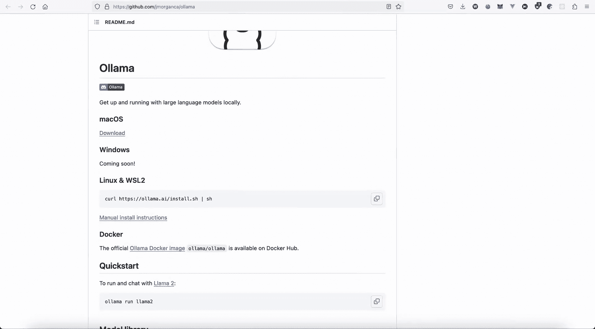

现在，我们开始一步步搭建这个应用。

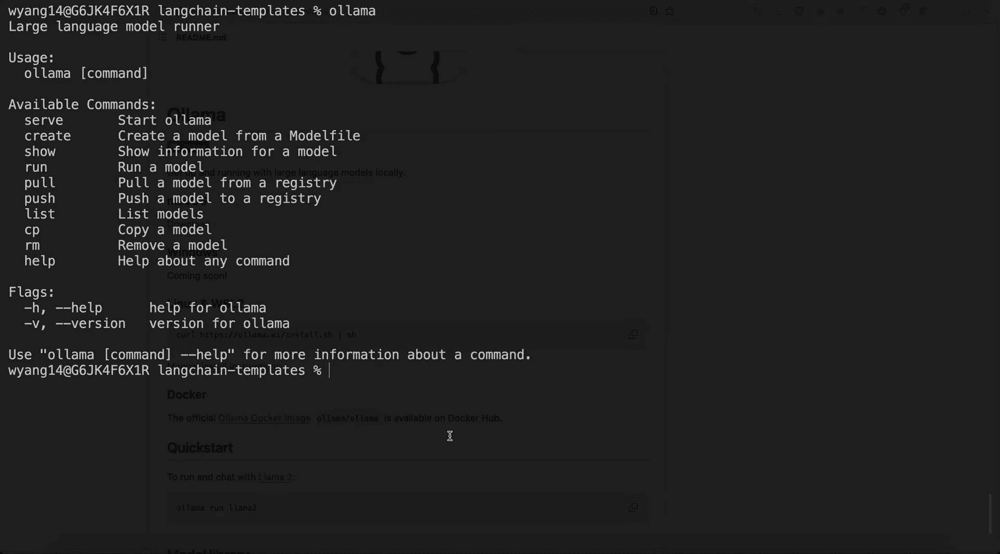

### 1. 安装Ollama并下载模型

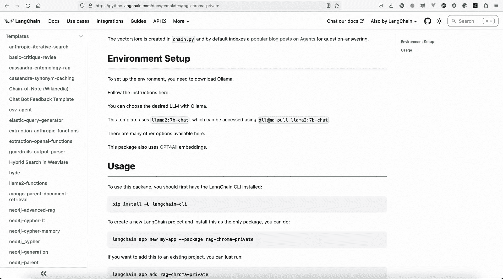

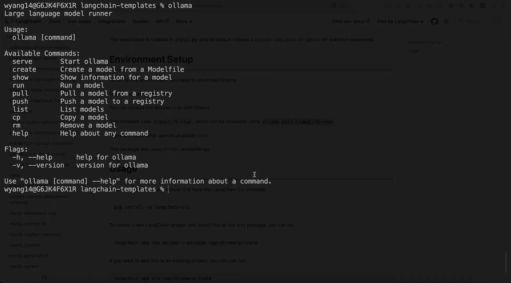

首先，需要安装Ollama来管理本地模型。根据你的操作系统，执行相应的安装命令。


安装完成后，使用Ollama拉取所需的Llama 2模型到本地。

```bash
ollama pull llama2:7b-chat
```

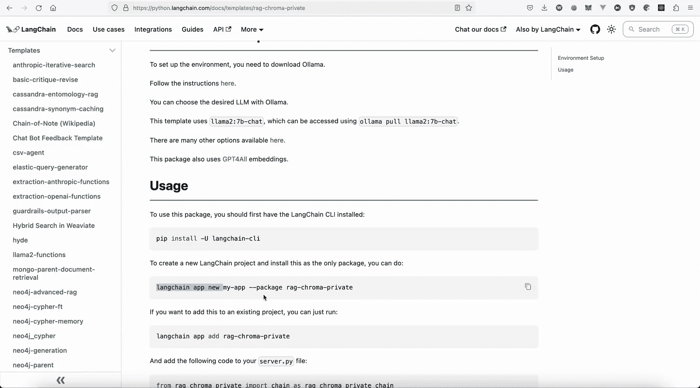

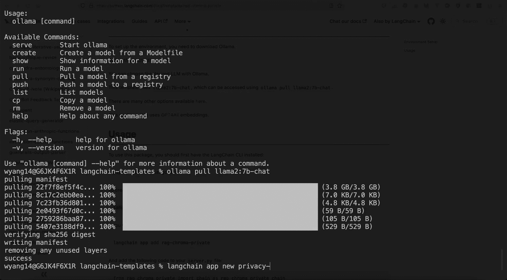

首次下载可能需要一些时间。模型下载完毕后，即可在本地使用。

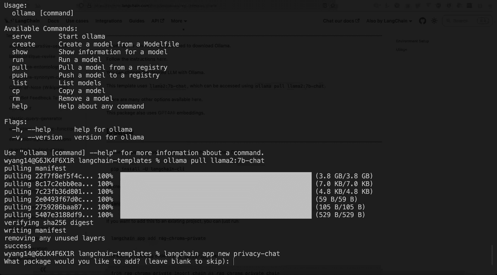

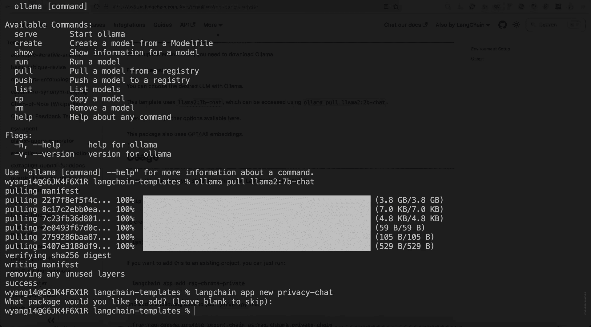

### 2. 创建LangChain应用并添加模板

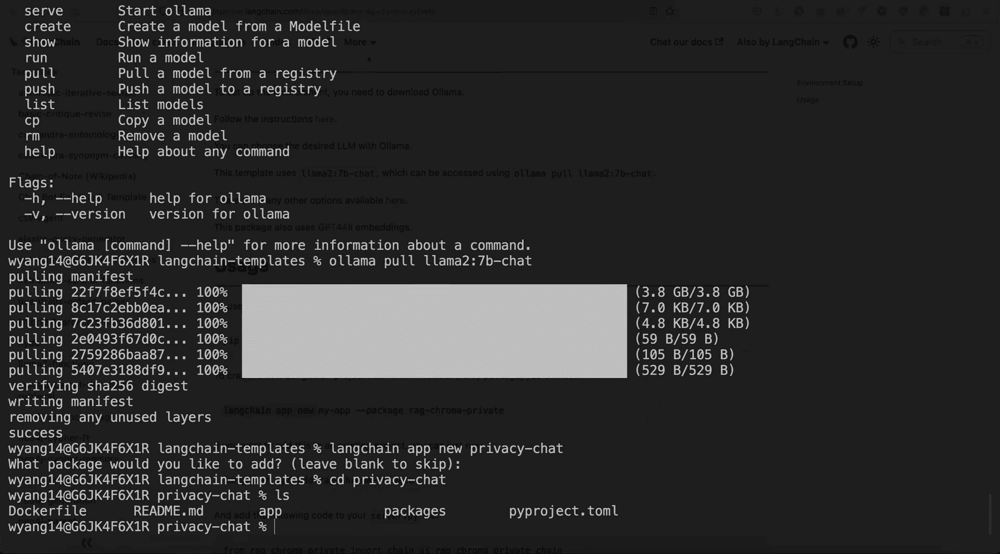

确保已安装LangChain命令行工具。然后，创建一个新的应用。

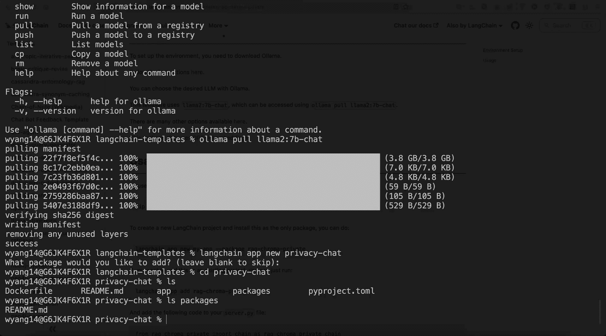

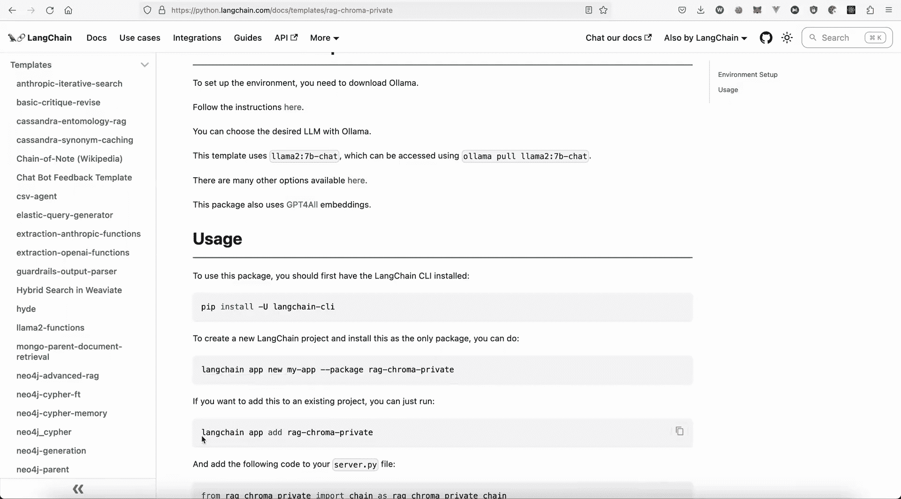

```bash
langchain app create privacy-app
```

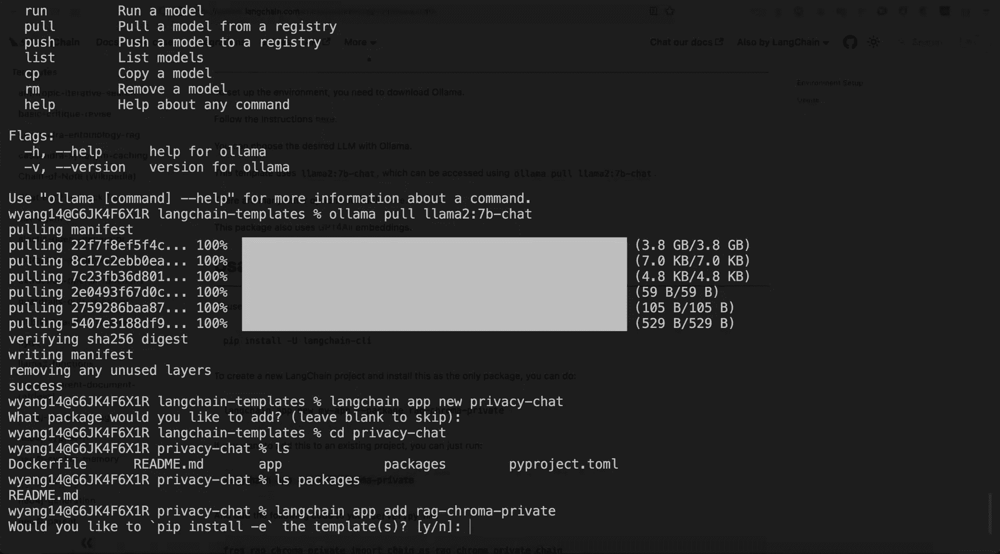

进入应用目录后，添加实现本地化RAG的模板。

```bash
langchain app add rag-chroma-private
```

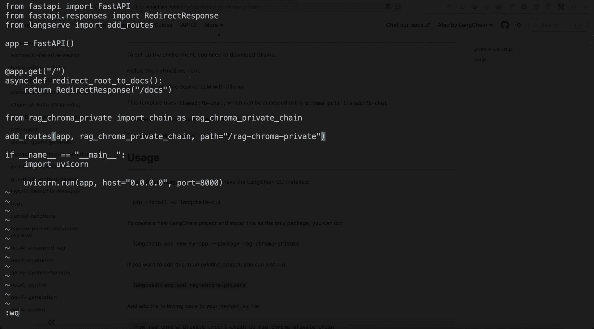

此命令会下载模板到应用的`packages`目录中。根据提示，将模板提供的路由代码复制到应用的`server.py`文件中，以启用该功能。

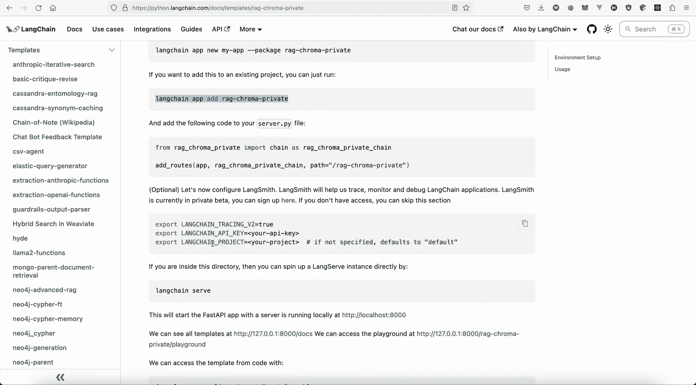

### 3. 理解应用工作原理

在启动应用前，让我们简单了解模板的核心逻辑。模板主要执行以下步骤：

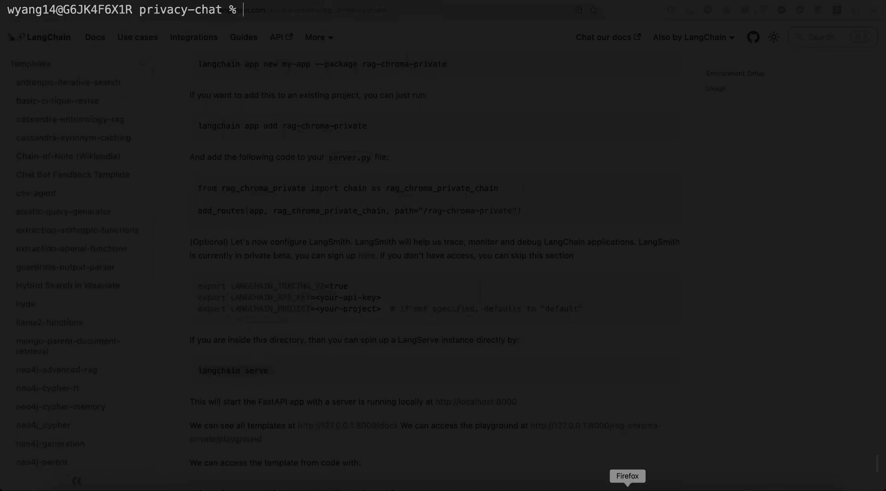

1.  **数据加载与处理**：从指定的博客文章加载数据，进行文本分割。
2.  **向量化与存储**：使用GPT4All的Embedding模型将文本转换为向量，并存入ChromaDB。
3.  **构建检索链**：创建一个检索器，并结合提示词模板与大语言模型（Llama 2）构建一条处理链。

其核心流程可以用以下伪代码表示：

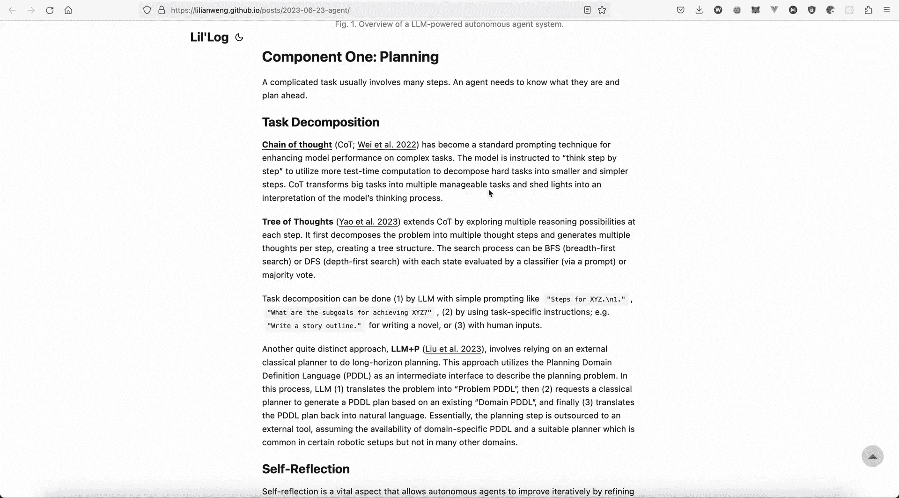

```python
# 加载文档
docs = load_blog_post()
# 分割文本
texts = split_text(docs)
# 创建向量存储
vectorstore = Chroma.from_texts(texts, embedding_model)
# 构建检索链
retriever = vectorstore.as_retriever()
chain = create_retrieval_chain(retriever, llm_model)
```

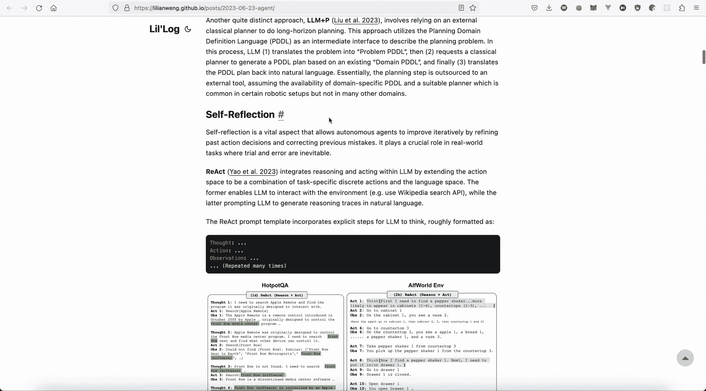

这样，应用就能基于本地知识库（博客文章）进行问答。

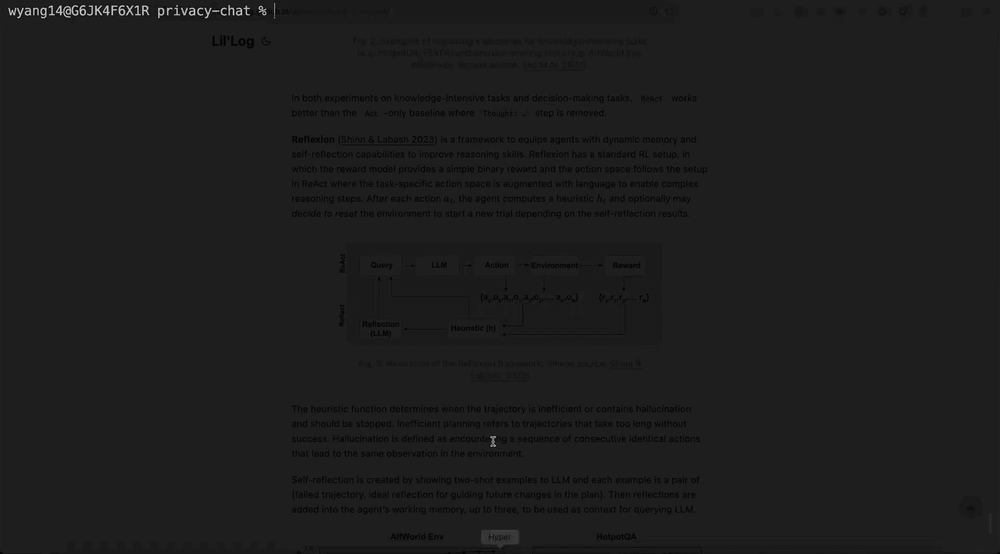

### 4. 启动应用并进行测试

完成配置后，启动LangChain服务。

```bash
langchain serve
```

服务启动后，在浏览器中访问Playground界面（通常是 `http://localhost:8000/playground/`）。**此时，你可以断开网络连接，以验证应用的完全本地化能力。**

在提问框中输入基于知识库内容的问题，例如“What is self reflection?”，应用会展示其检索相关文档片段并生成答案的完整过程。

## 总结

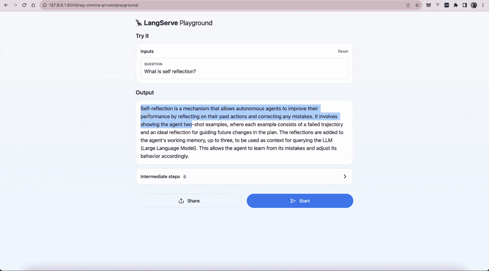

本节课中，我们一起学习了如何构建一个隐私优先的100%本地化RAG应用。我们利用了 **Llama 2**、**GPT4All** 和 **ChromaDB** 这套开源技术栈，通过 **LangChain** 模板快速实现了从知识库构建到智能问答的全流程。这种方法不仅消除了数据上云带来的隐私顾虑，也为在受限网络环境或对数据安全有高要求的场景下部署AI应用提供了可行的解决方案。