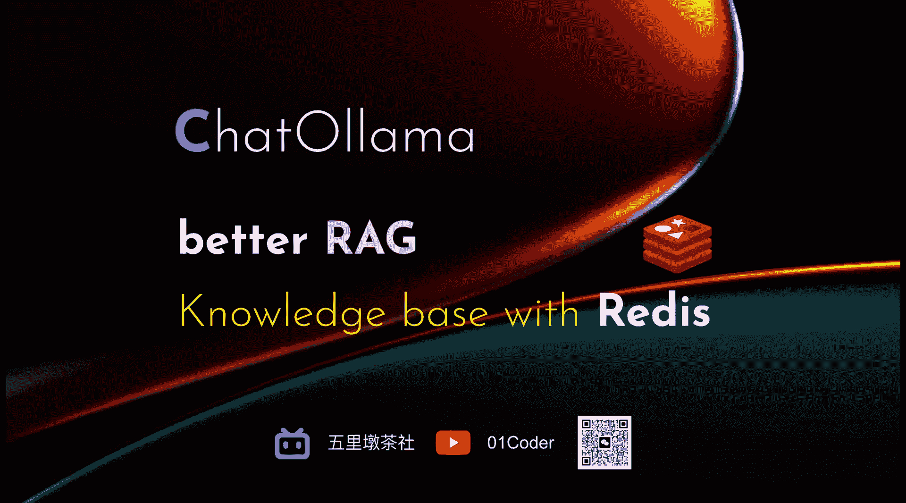
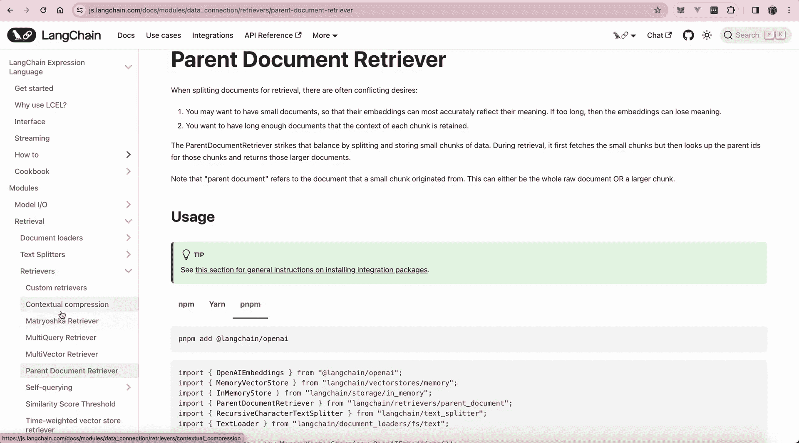
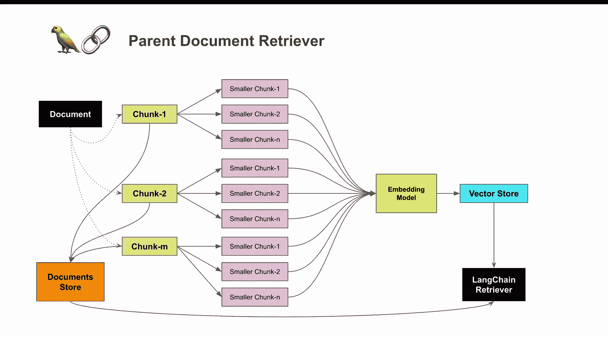
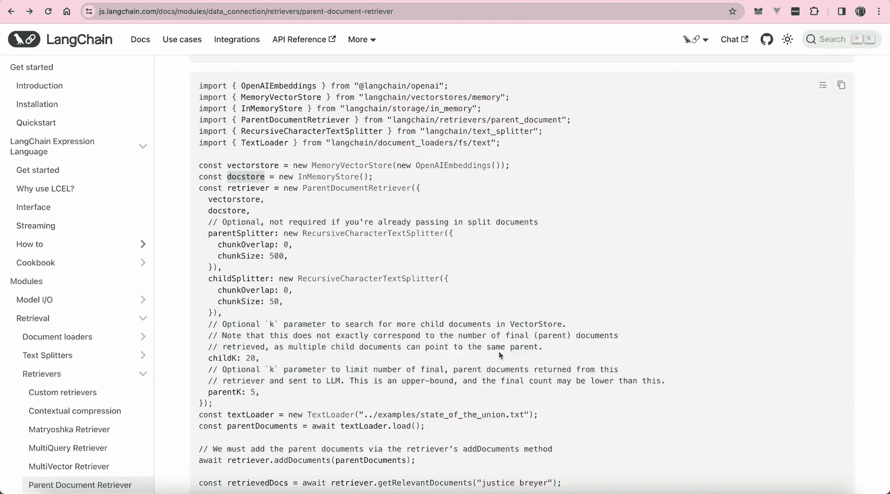
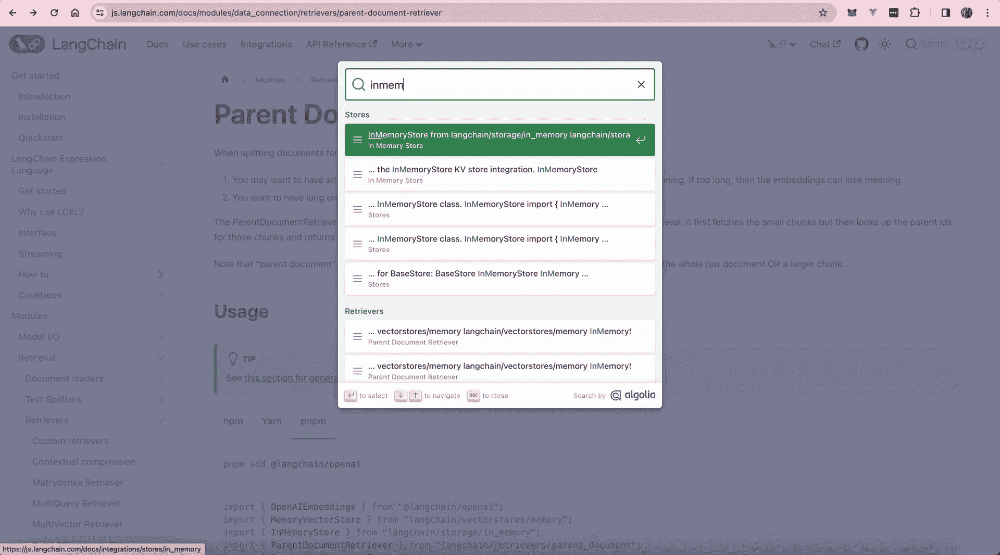
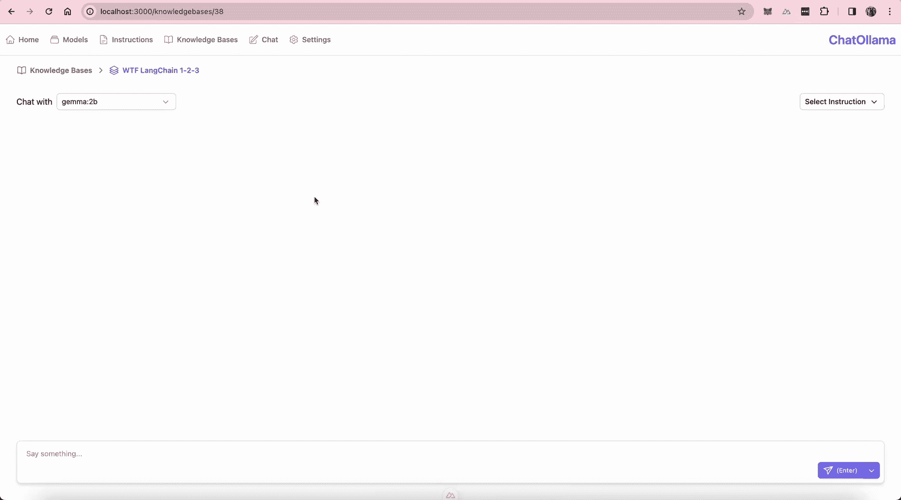

# 46：ChatOllama升级与高级RAG技术应用 🚀



在本节课中，我们将学习ChatOllama应用的最新更新，特别是如何通过集成LangChain框架的**Parent Document Retriever**检索器，并结合**Chroma向量存储**与**Redis文档存储**，来构建一个更高效、更强大的本地知识库问答系统。

---

## 用户体验改进 ✨

上一节我们介绍了课程的整体目标，本节中我们来看看ChatOllama在用户体验方面所做的具体优化。

在最新的更新中，聊天界面进行了多项改进以提升使用体验。

以下是主要的改进点：



*   **字体与滚动**：调整了文字大小，使阅读更舒适。优化了消息滚动，使其更加顺滑。
*   **快捷键支持**：默认使用`Enter`键发送消息，并允许用户在`Enter`和`Shift+Enter`（换行）之间进行切换，以适应不同用户的输入习惯。
*   **交互流畅性**：在模型输出回答时，页面消息的滚动和渲染过程更加流畅。

这些改进旨在让日常使用更加顺手。用户可以通过项目GitHub仓库的Issue页面提供反馈。

---

## 底层技术升级：引入Parent Document Retriever 🔧

介绍完用户体验的改进后，我们将深入底层，探讨本次升级的核心技术改动——检索器的优化。

在知识库功能背后，我们对RAG（检索增强生成）的数据索引部分进行了重要调整。初始版本采用了一种简单原始的RAG流程：

1.  将文档拆分切片。
2.  使用嵌入模型计算向量。
3.  将向量数据存入向量数据库。
4.  基于向量相似性进行检索。
5.  最后由大模型合成答案。



这种方式虽然可以工作，但性能和效率并不理想。简单分块策略的局限性在于，固定的分块大小可能导致在分块边界处**语义被截断**，从而影响检索质量。

为了解决这个问题，我们引入了LangChain框架中的**Parent Document Retriever**检索器。

### Parent Document Retriever 原理 📖





Parent Document Retriever采用了一种两级分块策略来提升检索质量。

其核心工作流程如下：

1.  **创建两级分块**：
    *   首先，将原始文档拆分成较大的块，称为**父文档块**。
    *   然后，将每个父文档块进一步拆分成更小的块，称为**子文档块**。
2.  **差异化存储**：
    *   将子文档块通过嵌入模型向量化，并存储到**向量数据库**（如Chroma）中。
    *   将完整的父文档块存储到**文档数据库**（如Redis）中，并通过元数据与子文档块关联。
3.  **检索过程**：
    *   当用户提问时，首先在向量数据库中查询与问题最相似的**子文档块**。
    *   根据关联关系，找到这些子文档块对应的**父文档块**。
    *   最终，将完整的父文档块（包含更广泛的上下文）提供给大模型来生成答案。

**优势**：
这种方法通过返回更大的上下文块（父文档），在一定程度上缓解了分块边缘的语义截断问题，扩大了相似信息的覆盖范围，从而提升了最终答案的质量。

**公式表示关联关系**：
`子文档向量 -> (元数据) -> 父文档ID -> 文档数据库 -> 父文档内容`

---

## 在ChatOllama中的实现 🛠️

理解了Parent Document Retriever的原理后，本节我们来看看如何在ChatOllama项目中具体实现它。

### 1. 动态选择检索器

我们创建了一个新的`createRetriever`函数，根据环境配置动态决定使用哪种检索器。

```javascript
// 伪代码逻辑
if (环境变量.REDIS_HOST 已设置) {
    // 使用 Parent Document Retriever
    retriever = createParentDocumentRetriever(vectorStore, redisDocStore);
} else {
    // 使用传统的向量存储检索器
    retriever = vectorStore.asRetriever();
}
```

### 2. 实现Redis文档存储

由于LangChain示例中的内存存储(`InMemoryStore`)不适合生产环境，我们选择了**Redis**作为分布式、可扩展的文档存储解决方案。

我们实现了`RedisDocStore`类，它基于（已弃用但暂可用的）`BaseStore`接口。其主要功能包括：

*   **序列化存储**：Redis本身不直接支持存储文档对象，因此我们需要将文档序列化为JSON字符串进行存储。
*   **命名空间管理**：为了区分不同知识库的文档，我们采用了“命名空间”概念。通过为每个知识库的键添加统一前缀（如`collection:{知识库ID}:`）来实现逻辑隔离。
*   **关键操作**：
    *   `mset(键值对)`：批量存储文档。
    *   `mget(键数组)`：批量获取文档。
    *   `deleteAll()`：删除整个命名空间下的所有数据（用于清理知识库）。

### 3. 配置与使用

以下是启用高级RAG所需的环境配置示例：

```bash
# .env 文件示例
REDIS_HOST=localhost
REDIS_PORT=6379
# REDIS_USERNAME=  # 可选
# REDIS_PASSWORD=  # 可选
```

当配置了`REDIS_HOST`后，创建知识库时会自动初始化Parent Document Retriever。在问答过程中，系统会先从Chroma中检索相关子块，再根据ID从Redis中取出对应的父文档块，最后交由模型生成答案。

---

## 效果演示与对比 📊

现在，让我们通过实际操作来看看新旧两种检索方式的效果差异。

### 场景：创建知识库并进行问答

1.  **启用Parent Document Retriever**（配置了Redis）：
    *   创建知识库时，后台日志显示初始化了`ParentDocumentRetriever`。
    *   提问后，检索器会返回预设数量的父文档（例如5个），这些文档提供了更丰富的上下文。
    *   在Redis中，可以观察到以`collection:{id}:`为前缀的键，存储着父文档内容。

2.  **使用传统VectorStore Retriever**（未配置Redis）：
    *   创建知识库时，后台日志显示使用的是`VectorStoreRetriever`。
    *   提问后，检索器直接返回固定数量的文档块（例如4个）。
    *   数据仅存储在Chroma向量数据库中。

### 数据清理

当删除一个知识库时，系统不仅会清除数据库中的记录和Chroma中的集合，还会调用Redis文档存储的`deleteAll()`方法，清理该命名空间下所有的键值对数据，确保数据完全移除。

---

## 总结 🎯

本节课中我们一起学习了ChatOllama项目的重要升级。

我们首先了解了针对聊天界面的**用户体验优化**，包括字体、滚动和快捷键的改进。接着，我们深入探讨了底层的**技术升级**，核心是从简单的向量检索过渡到更先进的**Parent Document Retriever**检索策略。我们详细分析了该策略的**两级分块原理**及其在解决语义截断问题上的优势。然后，我们查看了在代码中如何**动态选择检索器**，并实现了基于**Redis**的、支持命名空间的文档存储方案。最后，我们通过对比演示，观察了不同检索器在实际问答中的表现差异。



这次升级通过结合**Chroma（向量存储）** 和 **Redis（文档存储）**，为本地知识库系统带来了更强大的检索能力和更好的可扩展性。鼓励大家尝试新版本，并在自己的应用场景中检验不同检索方式的效果。