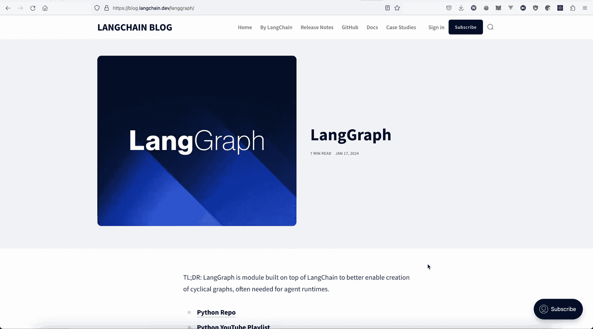
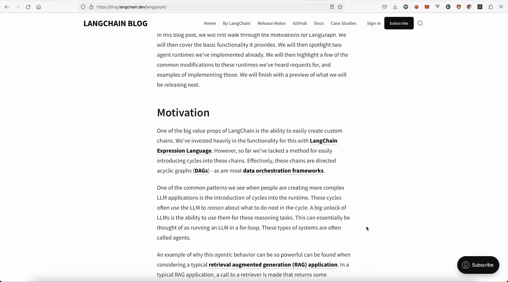
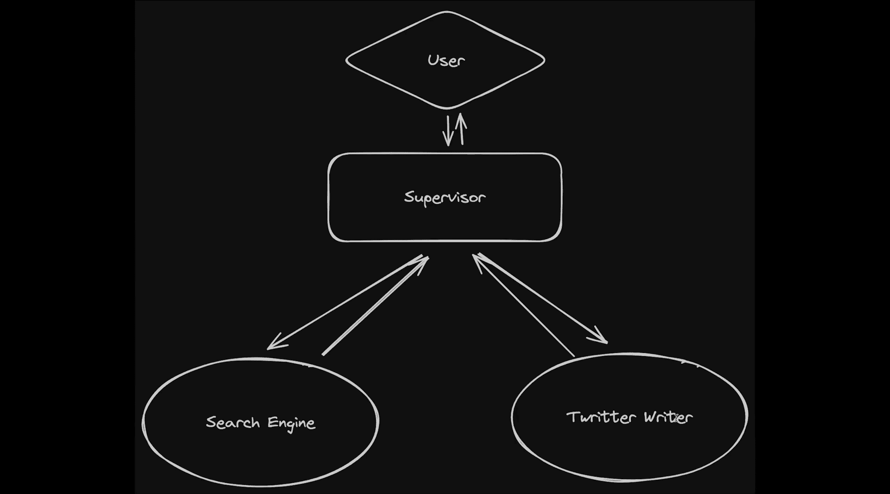
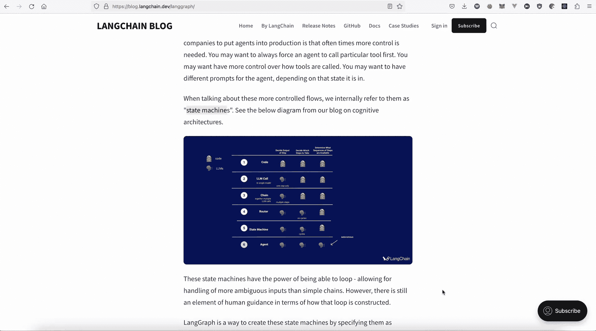
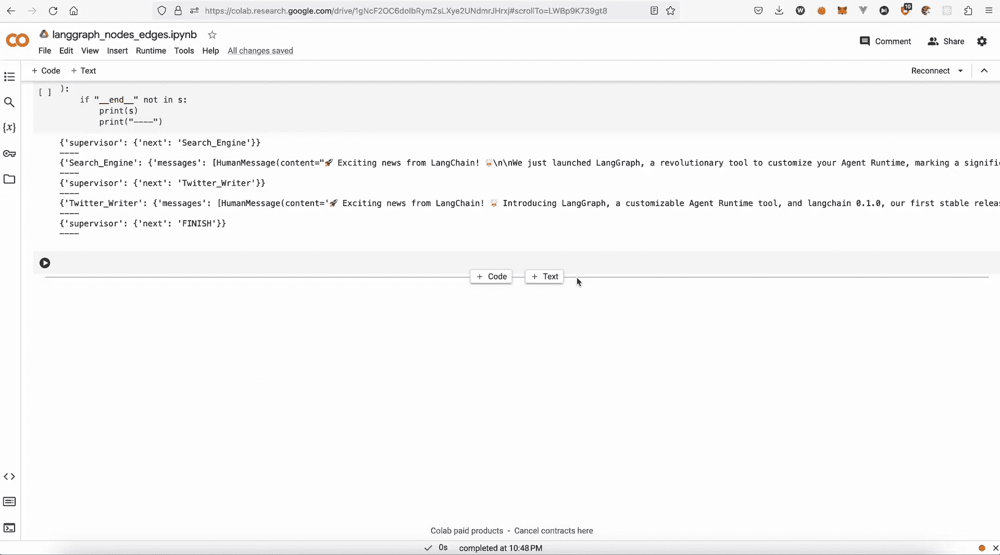

# 47：LangGraph 新手入门

## 📚 概述
在本节课中，我们将学习 LangChain 新推出的 LangGraph 框架。LangGraph 是一个用于构建多智能体（AI Agent）应用的工具，它允许开发者创建有环图结构的工作流，使多个智能体能够协同工作，循环执行任务直到完成目标。我们将从核心概念讲起，并通过一个编写推文的实际例子，演示如何构建一个 LangGraph 应用。



---



## 🧠 核心概念：状态图、节点与边
上一节我们介绍了 LangGraph 的定位。本节中，我们来看看构成 LangGraph 应用的三个核心元素：**StateGraph**（状态图）、**Node**（节点）和 **Edge**（边）。

### StateGraph（状态图）
LangGraph 代表一张**有向有环图**。`StateGraph` 类用于描述这张图。图中的状态会随着多个智能体的工作而不断更新。

**状态定义示例**：
```python
from typing import TypedDict, Annotated, List
from langgraph.graph.message import add_messages

class AgentState(TypedDict):
    # 消息历史
    messages: Annotated[List, add_messages]
    # 决定下一个节点
    next: str
```
开发者需要根据具体应用场景定义状态。可以决定状态中的属性是覆盖还是追加。



### Node（节点）
节点负责更新图的状态。创建好 `StateGraph` 后，可以通过 `.add_node()` 方法添加节点，并为节点命名。



**节点类型**：
*   函数
*   LangChain Expression Language 的 `Runnable` 函数
*   智能体（Agent）

一个 `Runnable` 节点接收一个字典参数（其结构与状态定义一致），并输出更新后的状态。
还有一个特殊的节点类型 `END`，用于标识操作或状态的终止。

### Edge（边）与入口点
在介绍边之前，需要了解**入口点（Entry Point）**的概念。它定义了工作流从哪个节点开始，通过 `set_entry_point(“节点名”)` 设置。

接下来介绍两种边的类型：

**以下是两种边的说明：**
1.  **普通边（Normal Edge）**：定义两个节点之间必然的先后关系。
2.  **条件边（Conditional Edge）**：根据条件决定下一个节点。定义时需要三组信息：
    *   **上游节点**：从哪个节点出发做判断。
    *   **判定函数**：根据上游节点的输出决定下一步。
    *   **映射关系**：将判定结果映射到具体的下一个节点。

**条件边示例**：
```python
from langgraph.graph import END

def should_continue(state):
    if state[“next”] == “END”:
        return “end”
    else:
        return “continue”

# 添加上游节点为 “model” 的条件边
graph.add_conditional_edges(
    “model”,
    should_continue,
    {
        “end”: END,
        “continue”: “tools”
    }
)
```
此例中，当 `model` 节点输出状态中的 `next` 字段为 “END” 时，前往 `END` 节点；否则前往 `tools` 节点。

---

## 🛠️ 编译与运行
当我们使用 `StateGraph`、`Node` 和 `Edge` 定义完一张图后，需要将其编译成一个可执行的对象。

编译过程很简单，在 `graph` 对象上调用 `.compile()` 方法即可。编译后会得到一个 LangChain 的 `Runnable` 实例，可以像使用一条链或一个大模型一样来调用它。

```python
app = graph.compile()
```

---

## 💻 实战：构建智能推文编写应用
上一节我们学习了核心概念，本节我们通过一个 Python Notebook 示例，看看如何使用 LangGraph 构建一个多智能体应用。该应用能接收用户任务，通过搜索引擎采集数据，并自动编写推文。

### 环境与工具准备
首先配置环境，使用 SerpAPI（谷歌搜索）和 OpenAI 模型。
```python
import os
from langchain_openai import ChatOpenAI
from langchain_community.tools import SerpAPIWrapper
from langchain.agents import Tool

# 1. 定义大模型
llm = ChatOpenAI(model=“gpt-4-turbo-preview”)

# 2. 定义工具函数
search = SerpAPIWrapper()
def web_search(query):
    return search.run(query)

def tweet_writer(content):
    # 使用另一个LLM来编写符合政策的推文
    system_msg = “你是一个推文写手，确保推文不超过140字符并符合平台政策。”
    # ... 调用LLM生成推文
    return generated_tweet

# 将函数封装为工具
tools = [
    Tool(name=“Search”, func=web_search, description=“用于搜索网络信息”),
    Tool(name=“TweetWriter”, func=tweet_writer, description=“用于编写推文”)
]
```

### 构建智能体节点
我们需要创建执行具体任务的智能体节点。

**以下是创建智能体节点的步骤：**
1.  **`create_agent` 函数**：基于大模型和工具集创建一个 LangChain 智能体。
2.  **`agent_node` 函数**：将智能体包装成一个 LangGraph 节点。该节点接收状态，调用智能体执行任务，并将结果消息追加到状态的历史记录中。

```python
from langchain.agents import AgentExecutor, create_react_agent
from langgraph.graph import StateGraph, END

def create_agent(llm, tools, system_prompt):
    prompt = create_react_agent(llm, tools, system_prompt)
    return AgentExecutor(agent=prompt, tools=tools)

def agent_node(state, agent, name):
    result = agent.invoke(state)
    # 将返回的消息添加到状态中
    return {“messages”: [result[“output”]], “next”: name}
```

### 定义工作流与监督者
应用包含两个工作智能体和一个监督者（Supervisor）。

```python
# 定义成员（节点）
members = [“SearchEngine”, “TwitterWriter”]
system_prompt = “””你是一个监督者，负责协调任务。根据对话历史决定下一步由哪个成员（SearchEngine 或 TwitterWriter）行动，或者任务是否完成（Finish）。”””

# 3. 构建监督者链（也是一个Runnable节点）
options = [“FINISH”] + members
# 使用OpenAI函数调用来定义路由逻辑
function_def = {
    “name”: “route”,
    “parameters”: {“next”: {“type”: “string”, “enum”: options}}
}
# 构建提示词和链...
supervisor_chain = create_supervisor_chain(llm, system_prompt, function_def)
```

### 组装 LangGraph 应用
现在，将所有部分组装到 `StateGraph` 中。

**以下是构建图的主要步骤：**
1.  初始化 `StateGraph`，并传入我们定义的状态结构 `AgentState`。
2.  添加节点：包括 `supervisor`、`SearchEngine` 和 `TwitterWriter`。
3.  添加边：
    *   每个工作节点都有一条边指向 `supervisor`。
    *   为 `supervisor` 添加条件边，根据其输出决定下一个节点是某个工作节点还是 `END`。
4.  设置入口点为 `supervisor`。
5.  编译图。

```python
workflow = StateGraph(AgentState)

# 添加节点
workflow.add_node(“supervisor”, supervisor_chain)
workflow.add_node(“SearchEngine”, lambda s: agent_node(s, search_agent, “SearchEngine”))
workflow.add_node(“TwitterWriter”, lambda s: agent_node(s, writer_agent, “TwitterWriter”))

# 添加边
for member in members:
    workflow.add_edge(member, “supervisor”) # 工作完成后交回给监督者

# 添加条件边（从监督者出发）
def supervisor_router(state):
    # 根据state中的’next‘字段决定路由
    return state[“next”]

workflow.add_conditional_edges(
    “supervisor”,
    supervisor_router,
    {m: m for m in members} | {“FINISH”: END} # 映射关系
)

# 设置入口点并编译
workflow.set_entry_point(“supervisor”)
app = workflow.compile()
```

### 运行应用
编译完成后，即可像调用函数一样运行这个多智能体工作流。

```python
# 输入一个任务
inputs = {“messages”: [(“user”, “请搜索关于LangChain的最新新闻并写一条推文。”)]}
output = app.invoke(inputs)

# 查看最终输出（编写好的推文）
final_tweet = output[“messages”][-1].content
print(final_tweet)
```
执行过程：
1.  `supervisor` 接收任务，决定第一步由 `SearchEngine` 执行。
2.  `SearchEngine` 调用搜索工具，将结果返回给状态。
3.  `supervisor` 根据新状态，决定下一步由 `TwitterWriter` 执行。
4.  `TwitterWriter` 调用写推文工具，生成推文。
5.  `supervisor` 判断任务完成，指向 `END`，工作流结束。

---



## ✅ 总结
本节课中我们一起学习了 LangGraph 的核心概念与基本用法。我们了解到 LangGraph 通过 **StateGraph**、**Node** 和 **Edge** 让我们能够构建复杂的有环图工作流，实现多智能体的协同与循环调用。通过将大任务拆解为多个小任务并由专门的智能体处理，可以提高任务执行的精确度。最后，我们通过一个实战示例，完整演示了从定义状态、创建节点与边到编译和运行一个 LangGraph 应用的流程。