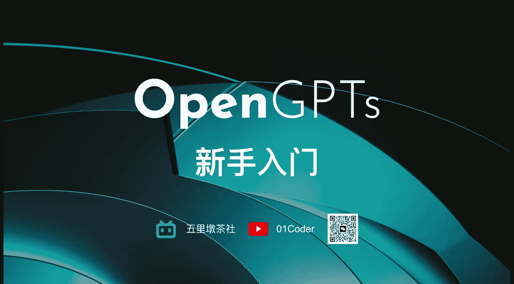
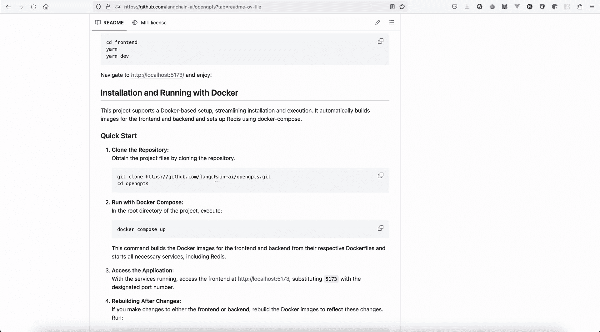
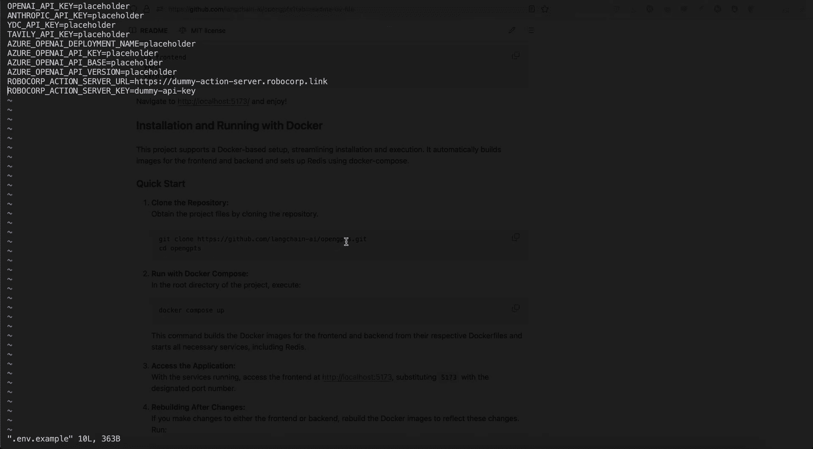
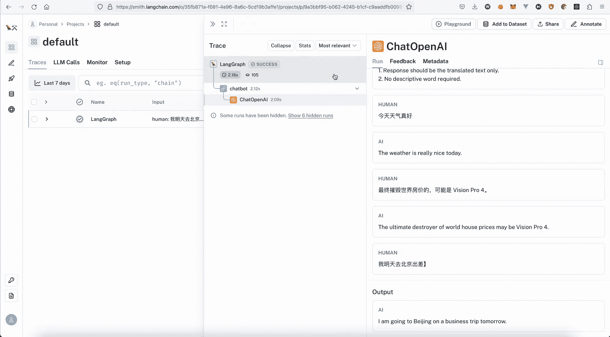
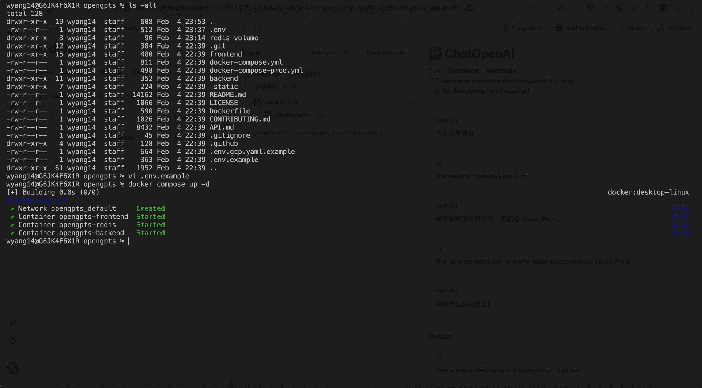
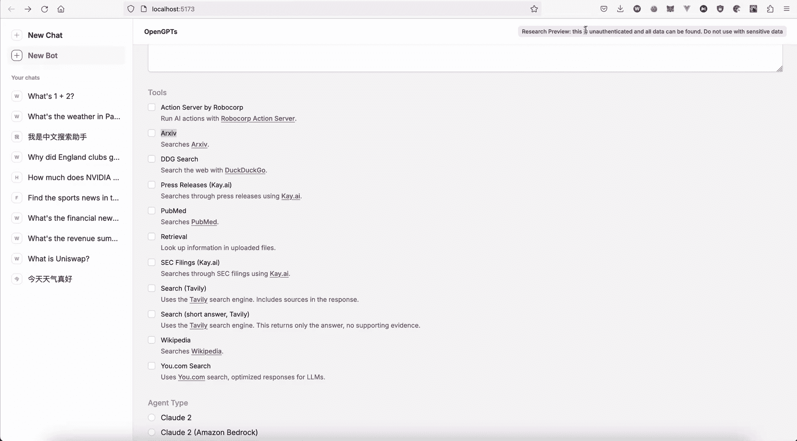
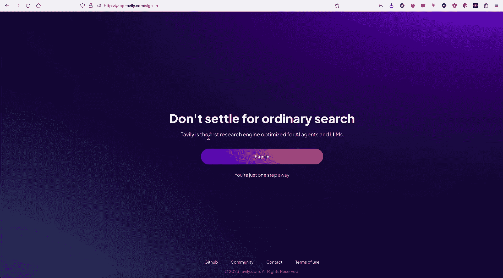
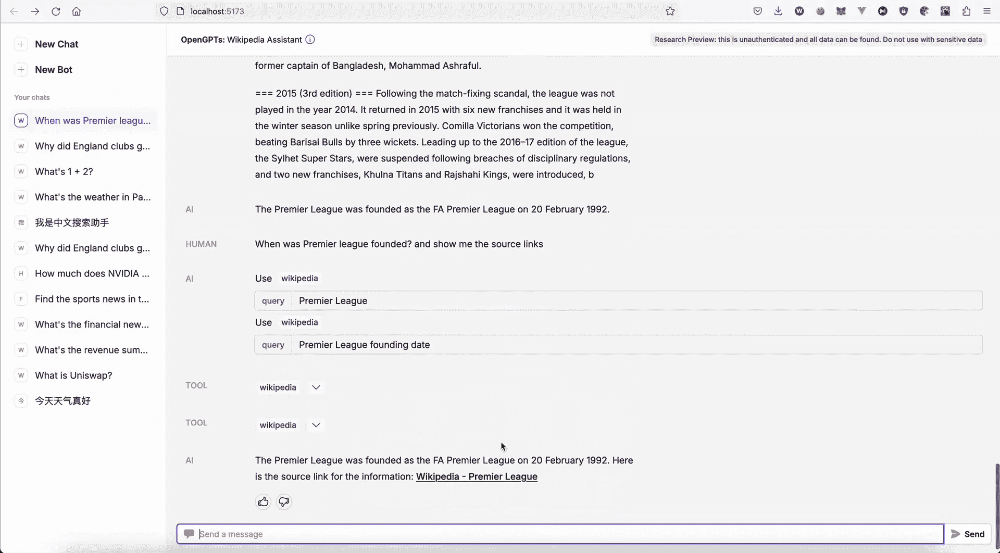
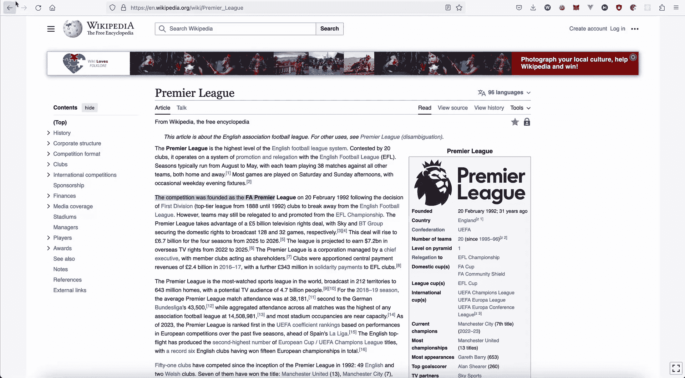
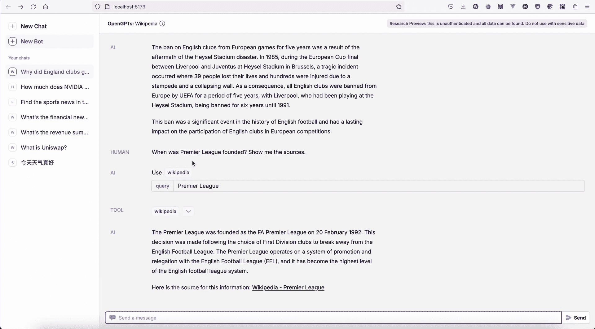

# 48：OpenGPTs 新手入门 🚀



## 概述

在本节课中，我们将学习如何搭建和使用 LangChain 推出的开源项目 **OpenGPTs**。这是一个功能类似于 OpenAI GPT Store 的平台，允许你完全自定义模型、提示词、工具和知识库，从而创建属于自己的智能体（AI Agent）。我们将从环境配置开始，逐步介绍其三种核心聊天机器人类型，并通过实际操作演示其功能。

---

## 1. 什么是 OpenGPTs？🤔

OpenGPTs 是 LangChain 发布的一款开源产品，旨在提供一个可高度定制的 GPT 商店体验。它基于 **LangGraph** 框架构建，并运行在 **LangServe** 和 **LangSmith** 之上。



你可以在这个平台上定制所使用的底层大模型（如 OpenAI、Anthropic 等）、编写系统提示词、集成各种工具（如搜索引擎、维基百科）以及连接向量数据库来构建知识库。简而言之，它是一个为你自己的 AI 应用提供“应用商店”式管理界面的开源解决方案。

---

## 2. 环境准备与运行 🛠️



上一节我们介绍了 OpenGPTs 的基本概念，本节中我们来看看如何在本地运行它。官方提供了两种主要方式。

以下是两种运行方式：

1.  **克隆代码并本地运行**：需要克隆仓库、安装依赖、分别启动后端和前端服务。这种方式更灵活，但配置步骤较多。
2.  **使用 Docker 运行（推荐）**：通过 Docker Compose 一键启动所有服务，能极大简化环境配置，适合快速体验和不需要深度定制的场景。

我们推荐使用 Docker 方式。在运行前，需要进行关键的环境变量配置。



### 配置环境变量

首先，克隆代码仓库后，你需要复制环境变量模板文件并进行配置。

```bash
# 从模板复制创建 .env 文件
cp .env.example .env
```



接着，编辑 `.env` 文件。你需要根据你计划使用的大模型服务来配置相应的 API Key。

```
# 例如，使用 OpenAI
OPENAI_API_KEY=你的_OpenAI_API_KEY

# 例如，使用 Anthropic
ANTHROPIC_API_KEY=你的_Anthropic_API_KEY
```

此外，如果你想启用 **LangSmith**（用于追踪和调试 AI 调用链），还需要配置以下两个变量（不配置则不会启用）：

```
LANGSMITH_TRACING_V2=true
LANGSMITH_API_KEY=你的_LangSmith_API_KEY
```

LangSmith 提供了一个仪表盘，可以可视化查看每次与大模型交互的详细步骤和状态，对于开发和调试非常有帮助。

### 启动服务

环境变量配置完成后，只需一条命令即可启动所有服务。

```bash
# 使用 Docker Compose 在后台启动服务
docker-compose up -d
```

该命令会启动三个容器：前端、后端和 Redis（用于存储聊天会话状态）。启动成功后，前端服务通常运行在 `http://localhost:5173`。

---

## 3. 核心功能：三种聊天机器人类型 🤖

成功启动 OpenGPTs 后，我们就可以开始创建聊天机器人了。OpenGPTs 主要支持三种类型的机器人，它们分别适用于不同的场景。

以下是三种核心类型：

*   **Chat Bot**：这是最基础的类型，完全由你定义的**系统提示词（Instructions）** 驱动。你可以通过精心设计的提示词来设定机器人的角色、能力和回答风格。
*   **RAG Bot**：即“检索增强生成”机器人。这种类型的核心是**知识库**。你可以上传文档（如 PDF、TXT），系统会自动对文档进行分块、向量化并建立索引。当用户提问时，机器人会先从知识库中检索相关信息，再结合这些信息生成回答，非常适合构建基于私有文档的问答系统。
*   **Assistant**：这是功能最强大的类型，它**结合了 RAG 和工具调用**的能力。除了可以像 RAG Bot 一样使用知识库，Assistant 还能调用外部工具（如搜索引擎、计算器、API等）来获取实时或更广泛的信息，从而完成更复杂的任务。

---

## 4. 实战演示：创建与使用机器人 🎯

上一节我们了解了三种机器人的区别，本节我们将通过实际操作来体验它们。





### 创建 Chat Bot

创建 Chat Bot 非常简单。点击 “New Bot”，选择 “Chat Bot”，然后只需在 “Instructions” 区域填写你的提示词。例如，创建一个翻译机器人，指令可以是：“你是一个翻译器，请将用户输入的任何语言翻译成英文。你的回答应只包含翻译后的文本，不要有任何额外解释。” 选择模型（如 `gpt-3.5-turbo`）并保存即可。

### 创建 RAG Bot

RAG Bot 的关键在于知识库。
1.  选择 “RAG” 类型。
2.  上传你的文档（例如一份公司财报 PDF）。
3.  为机器人命名（如 “财务分析助手”）。
4.  保存。系统会在后台自动处理文档（索引过程可能需要一些时间）。
5.  处理完成后，你就可以针对文档内容进行提问。例如，针对财报提问：“最近一个季度的利润趋势如何？” 机器人会从文档中检索相关信息并生成总结性回答。

**注意**：你可以在 “Instructions” 中增加约束，比如“如果问题与文档内容无关，请回答‘我不知道’”，以提升机器人的专业性。

### 创建 Assistant

Assistant 的创建界面与 RAG Bot 类似，但多了一个 **“Tools”** 区域。
1.  选择 “Assistant” 类型。
2.  你可以选择不上传文档，专注于使用工具。
3.  在 “Tools” 区域，勾选你需要的工具，例如 “Wikipedia API”。
4.  保存后，你的机器人就具备了查询维基百科的能力。你可以提问：“英超联赛是哪一年成立的？” 机器人会调用维基百科工具获取信息并生成回答，同时通常会附上信息来源链接。



通过组合知识库和多种工具，你可以打造出功能非常强大的个人AI助手。



---

## 5. 总结与展望 📚

本节课中，我们一起学习了开源项目 OpenGPTs 从部署到使用的完整流程。

我们首先介绍了 OpenGPTs 作为开源、可定制的 GPT 商店的定位。然后，详细讲解了通过 Docker 快速部署的方法以及关键的环境变量配置。接着，我们深入探讨了其三大核心机器人类型：**基于提示词的 Chat Bot**、**基于知识库的 RAG Bot** 以及**能调用工具的 Assistant**，并通过实例演示了它们的创建和使用方法。

OpenGPTs 最大的优势在于其**开源和可定制性**。你不仅可以自由选择模型提供商，还可以集成自定义的工具，甚至修改其前端界面和后端逻辑来满足特定需求。本节课只是一个入门，后续你可以尝试为其添加更多工具、探索不同的向量数据库选项，从而构建出更加强大和个性化的 AI 应用。



建议有兴趣的同学立即在本地部署体验，在实践中探索更多可能性。