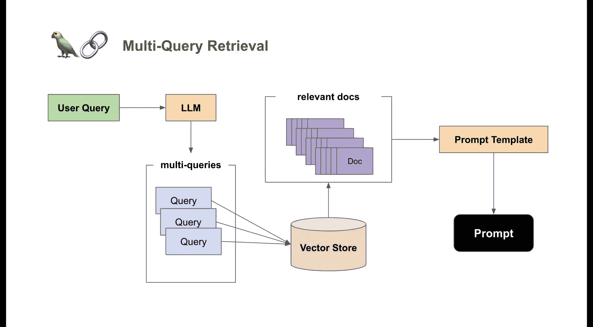
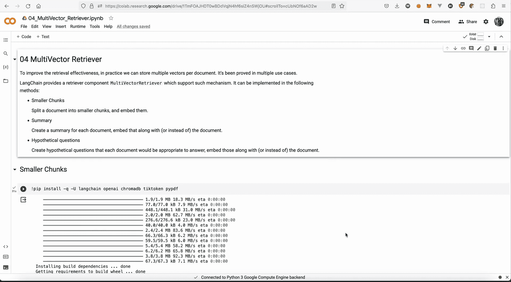
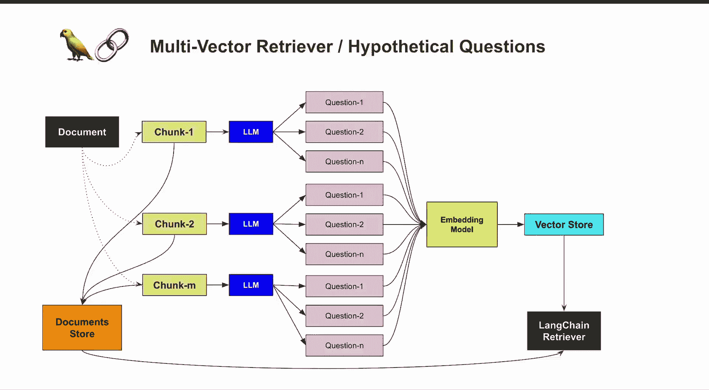
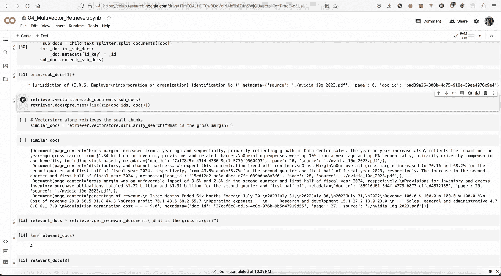
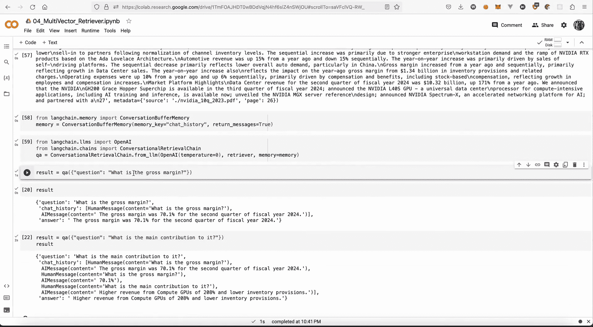
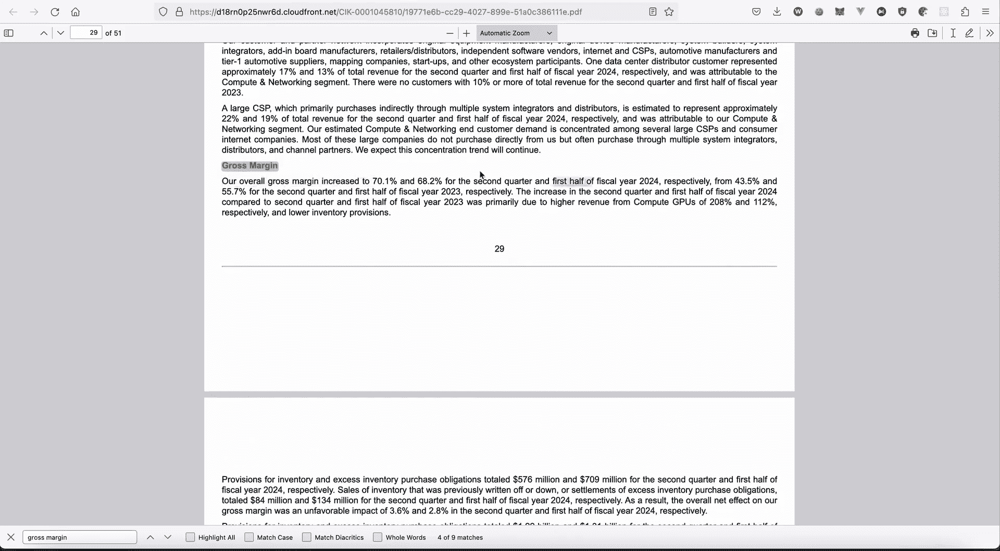
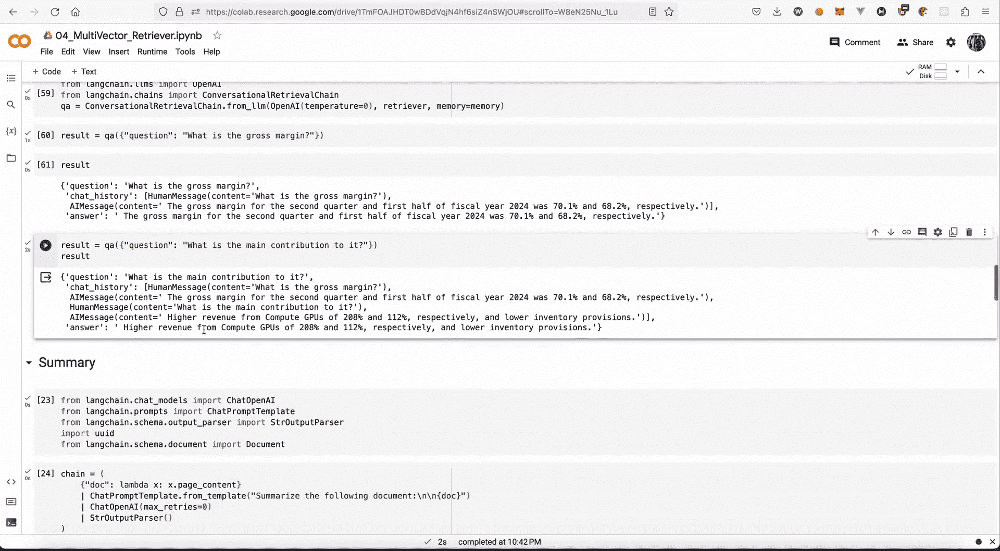
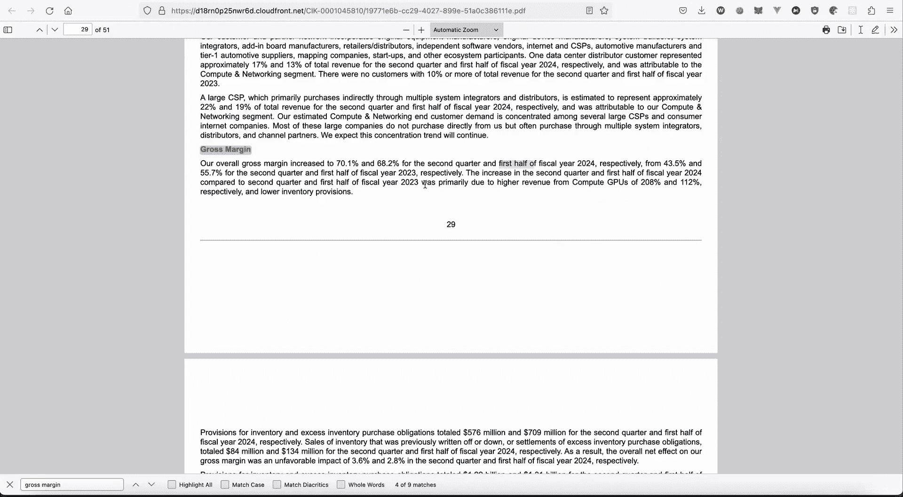
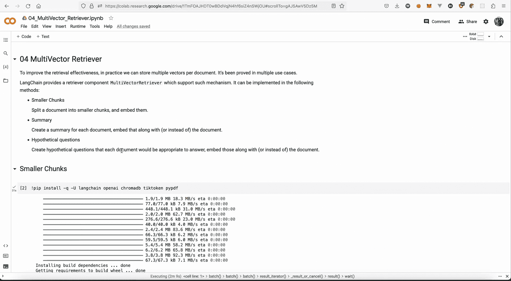

# 50：构建高质量AI文档机器人 - 04 多向量检索器 🧠

在本节课中，我们将学习 LangChain 框架中的第四种检索器——**多向量检索器**。我们将深入探讨其工作原理、三种常见的实现方式，并通过代码实践演示如何构建一个基于多向量检索器的问答系统。


---



## 概述

上一节我们介绍了多查询检索器，本节中我们来看看**多向量检索器**。虽然名字相似，但其工作机制完全不同。多向量检索器的核心思想是：针对每份文档存储多层向量信息，这被证明能有效提升检索质量。LangChain 提供了 `MultiVectorRetriever` 组件来支持这种机制。

## 多向量检索器的三种实现方式

以下是三种常见的实现多向量检索器的方法：

1.  **更小的分块**：将文档拆分为更小的子块并进行向量化。
2.  **摘要**：为文档生成摘要，并对摘要进行向量化。
3.  **假设性问题**：基于文档内容，让大语言模型生成可能被问到的问题，并对这些问题进行向量化。

这三种方法的共同点是：**向量存储中保存的是衍生内容（子块、摘要或问题）的向量，并通过元数据关联到原始的、更大的文档分块**。检索时，先找到相似的衍生内容，再通过元数据定位到原始文档，从而为答案生成提供更丰富的上下文。



### 1. 更小的分块

在这种方式中，一份文档被拆分为多个分块，每个分块再被拆分为更小的子块。

*   **数据处理**：对每个更小的子块进行文本嵌入，将向量存入向量存储。
*   **关联机制**：每个子块在其元数据中记录其父文档分块的ID。
*   **检索流程**：在向量存储中查询到相关子块后，通过其元数据中的父文档ID，从文档存储中检索出更大的原始分块作为上下文。

### 2. 摘要

这种方式不对文档进行更细的拆分，而是为每个文档分块生成摘要。

*   **数据处理**：对每个摘要进行文本嵌入，或将摘要与原始文本组合后进行嵌入，然后将向量存入向量存储。
*   **关联机制**：摘要的元数据中记录其对应的原始文档分块ID。
*   **检索流程**：查询到相关摘要向量后，通过元数据找到原始文档分块。

### 3. 假设性问题

这种方式利用大语言模型，基于每个文档分块生成一系列可能被提出的问题。

*   **数据处理**：对这些生成的问题（或问题与原始文本的组合）进行文本嵌入，并将向量存入向量存储。
*   **关联机制**：每个问题的元数据中记录其来源的原始文档分块ID。
*   **检索流程**：当用户提问时，在向量存储中匹配到相似的问题，进而通过元数据定位到提供答案的原始文档分块。

---

## 代码实践：基于“更小的分块”方式

接下来我们回到 Python Notebook，看看如何具体实现“更小的分块”这种方式。



### 环境准备与文档加载

首先，我们需要导入必要的库并加载文档。

```python
# 导入所需库
from langchain.retrievers.multi_vector import MultiVectorRetriever
from langchain.storage import InMemoryStore
from langchain_chroma import Chroma
from langchain_community.document_loaders import PyPDFLoader
from langchain_openai import OpenAIEmbeddings, ChatOpenAI
from langchain_text_splitters import RecursiveCharacterTextSplitter
from uuid import uuid4
import os

# 设置OpenAI API Key
os.environ["OPENAI_API_KEY"] = "your-api-key-here"

# 加载PDF文档（示例为NVIDIA财报）
loader = PyPDFLoader("https://example.com/nvidia-10Q.pdf")
docs = loader.load()

# 对文档进行初步分块
parent_splitter = RecursiveCharacterTextSplitter(chunk_size=10000)
parent_docs = parent_splitter.split_documents(docs)
print(parent_docs[5].page_content[:500]) # 查看一个分块的内容
```

### 构建向量存储与文档存储

我们需要一个向量存储来存放子块的嵌入向量，一个文档存储来存放原始的父文档分块。

```python
# 创建向量存储（使用Chroma和OpenAI嵌入模型）
vectorstore = Chroma(
    collection_name="full_documents",
    embedding_function=OpenAIEmbeddings()
)

# 创建内存文档存储
store = InMemoryStore()



# 为每个父文档分块生成唯一ID
id_key = "doc_id"
doc_ids = [str(uuid4()) for _ in parent_docs]
```

### 创建多向量检索器并处理文档

现在创建 `MultiVectorRetriever`，并处理文档以建立父子块关联。

```python
# 创建多向量检索器
retriever = MultiVectorRetriever(
    vectorstore=vectorstore,
    docstore=store,
    id_key=id_key,
)

# 定义子文档拆分器（更小的块）
child_splitter = RecursiveCharacterTextSplitter(chunk_size=400)



# 为每个父文档分块创建子文档，并关联元数据
sub_docs = []
for i, doc in enumerate(parent_docs):
    _id = doc_ids[i]
    _sub_docs = child_splitter.split_documents([doc])
    for _doc in _sub_docs:
        _doc.metadata[id_key] = _id # 关键：在元数据中记录父文档ID
    sub_docs.extend(_sub_docs)



# 将子文档嵌入并存入向量存储
retriever.vectorstore.add_documents(sub_docs)
# 将父文档存入文档存储
retriever.docstore.mset(list(zip(doc_ids, parent_docs)))
```



### 进行检索与问答



检索器构建完成后，我们可以进行相似性查询并构建一个完整的问答链。

```python
# 1. 直接进行相似性查询（返回的是子文档）
question = “What is the gross margin?”
similar_docs = retriever.vectorstore.similarity_search(question)
print(similar_docs[0].page_content) # 较短的子块内容
print(similar_docs[0].metadata) # 包含父文档ID的元数据

# 2. 使用检索器获取相关文档（返回的是父文档）
relevant_docs = retriever.get_relevant_documents(question)
print(relevant_docs[0].page_content[:500]) # 完整的、更长的父文档分块

# 3. 构建一个带记忆的对话链
from langchain.chains import ConversationalRetrievalChain
from langchain.memory import ConversationBufferMemory

memory = ConversationBufferMemory(memory_key="chat_history", return_messages=True)
qa_chain = ConversationalRetrievalChain.from_llm(
    ChatOpenAI(temperature=0),
    retriever=retriever,
    memory=memory
)

# 进行提问
result = qa_chain.invoke({"question": “What is the gross margin for this quarter?”})
print(result[“answer”])

# 进行追问
follow_up_result = qa_chain.invoke({"question": “What are the main contributing factors?”})
print(follow_up_result[“answer”])
```

通过上述流程，系统首先在向量存储中找到与问题最相关的子文档块，然后利用子文档元数据中的 `doc_id` 找到文档存储中对应的、上下文更丰富的父文档块，最终将这些父文档块提供给大语言模型来生成准确答案。

---

## 总结



本节课中我们一起学习了 **多向量检索器** 的核心概念与实现。
我们了解到，通过存储文档的衍生信息（子块、摘要或问题）的向量，并让其与原始文档关联，可以有效提升检索的精度和上下文相关性。
我们重点剖析了 **更小的分块** 这种实现方式的每一步，包括如何拆分文档、建立元数据关联以及构建检索链。
掌握多向量检索器，能帮助你在构建AI智能体时，更有效地从知识库中提取信息，从而生成更高质量的答案。