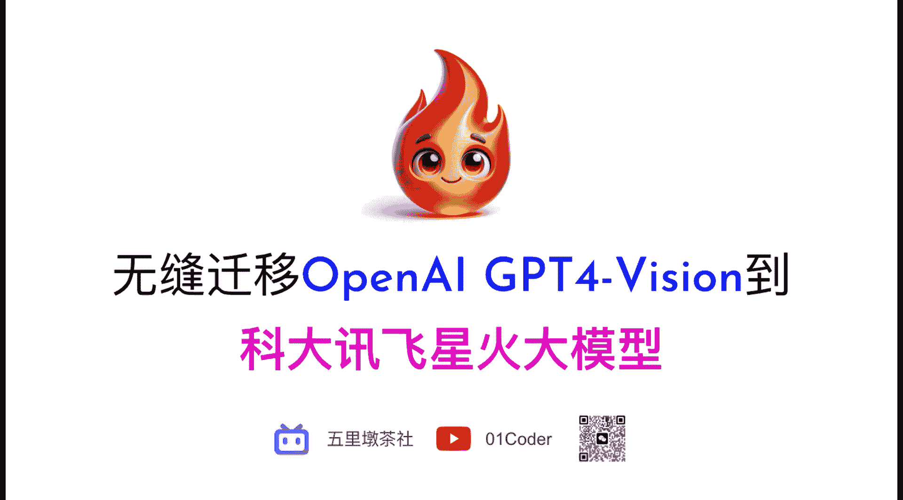
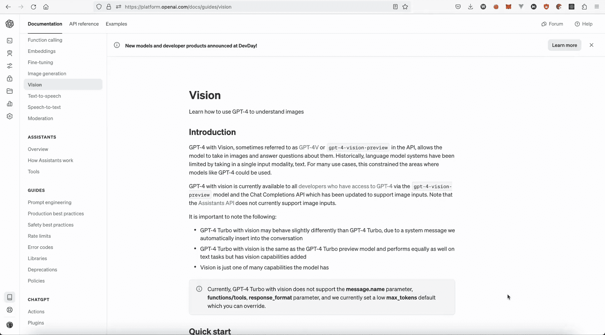
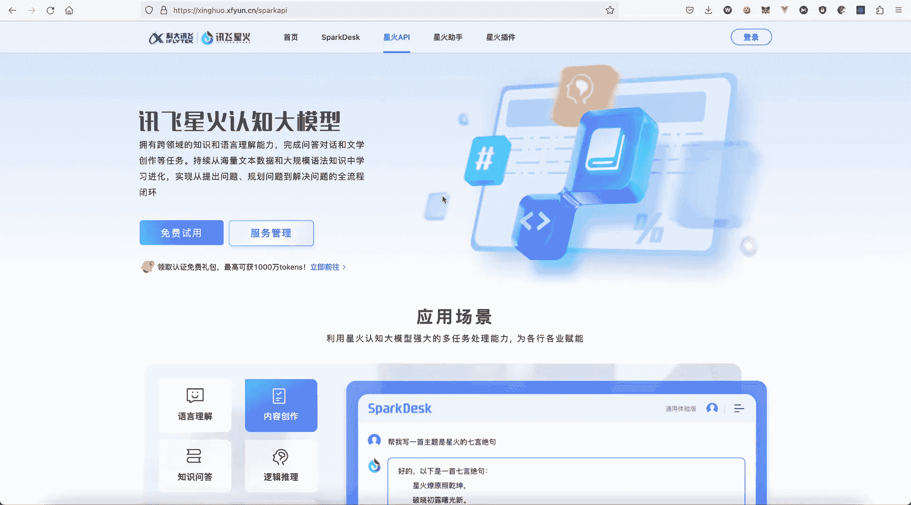
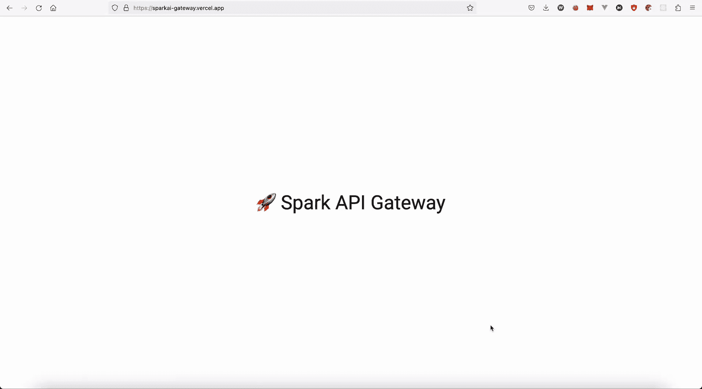
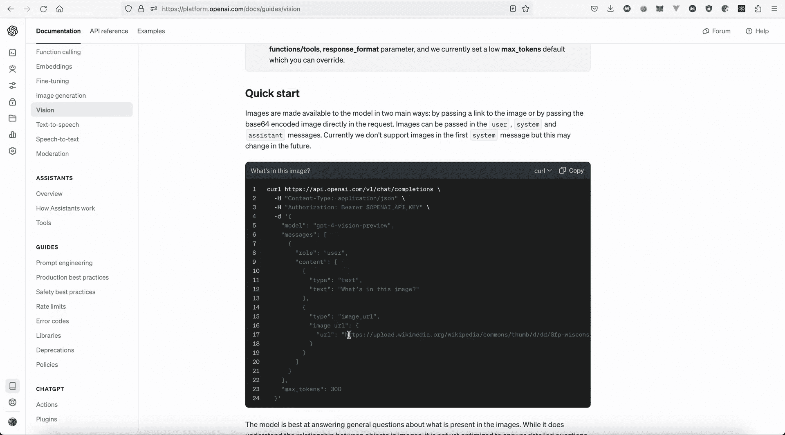
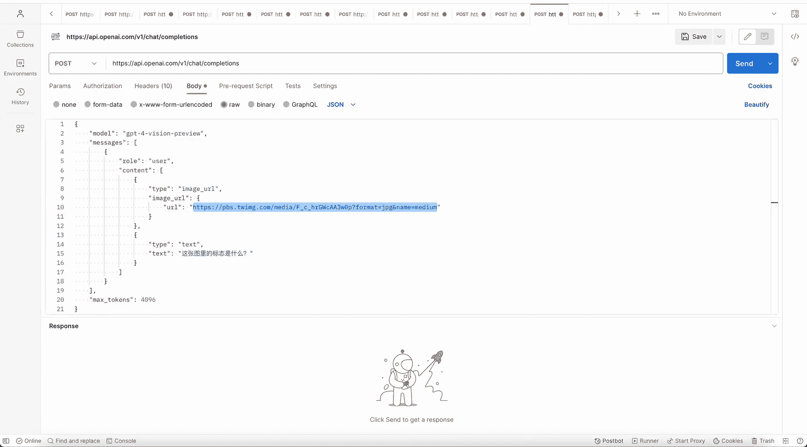
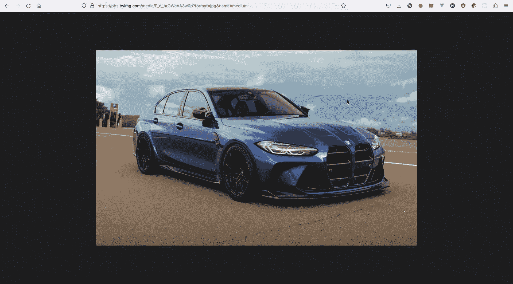
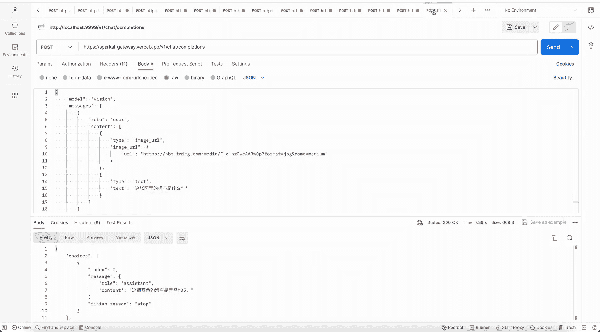
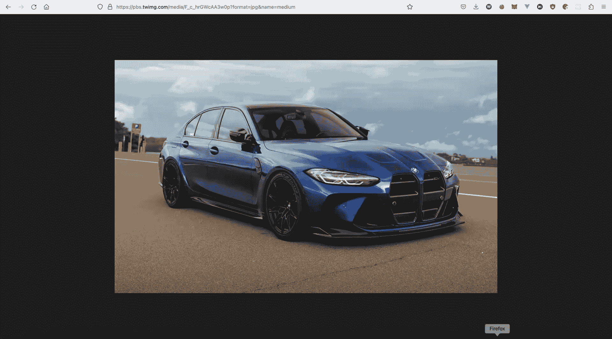
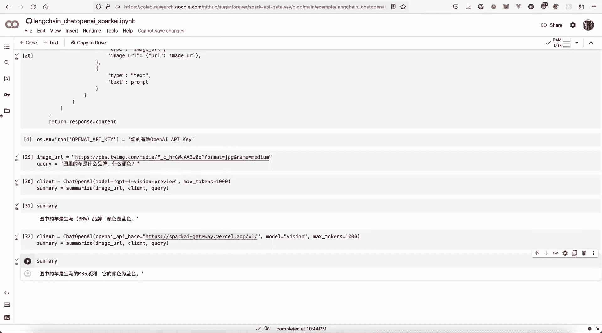

# 51：无缝迁移OpenAI GPT-4 Vision到科大讯飞星火大模型 🚀🔄



在本节课中，我们将学习如何将一个基于OpenAI GPT-4 Vision模型的应用，以极低的代码改动成本，迁移到使用国产的科大讯飞星火认知大模型。我们将通过一个名为“Spark API Gateway”的开源项目来实现这一目标，并对比两种API调用的差异。



## 概述



OpenAI最近发布了具备图片理解能力的GPT-4 Vision模型。与此同时，国产的科大讯飞星火认知大模型也提供了类似的图片理解API。本节课的核心是介绍一个开源网关项目，它能将星火大模型的API映射成与OpenAI API完全兼容的格式。这使得开发者可以几乎无需修改现有代码，就能将应用从OpenAI切换到星火大模型。

## 开源项目介绍

我们将要使用的工具是 **Spark API Gateway**。

这个开源项目的目的是将科大讯飞星火认知大模型的API，映射到与OpenAI API Schema兼容的端点（Endpoint）上。因此，开发者可以使用相同的请求格式来调用OpenAI或星火认知大模型。这极大地便利了应用的迁移。

在之前的课程中，我们已经介绍了该网关对聊天补全（Chat Completion）API的支持。本节课新增了对图片理解（Vision）API的支持。开发者现在可以轻松地将基于OpenAI `gpt-4-vision-preview` 模型的应用，切换到科大讯飞的图片理解API上。

## 获取与运行方式

以下是获取和使用Spark API Gateway的几种方式：

*   **开源代码仓库**：项目的最新代码已支持星火大模型的图片理解API。你可以通过仓库链接申请API访问权限。
*   **运行方式**：
    *   通过Docker容器运行。
    *   在本地使用 `uvicorn` 命令行运行。
    *   使用我们已部署在Vercel上的公共服务（二级域名：`spark-ai-gateway.vercel.app`）。目前该服务提供了一个免费的 `app_id` 供测试，但资源有限，请合理使用。

## API调用对比与实践



上一节我们介绍了项目的基本情况，本节中我们来看看具体的API调用有何异同。我们将通过Postman工具，对比OpenAI原生API和通过Spark API Gateway调用星火API的差异。



我们使用一张网络上的宝马汽车图片作为测试用例，并向模型提问：“图里的标志是什么？”





**1. 调用OpenAI GPT-4 Vision API**

请求参数如下：
*   `model`: `gpt-4-vision-preview`
*   `messages`: 包含图片URL和用户问题。

模型正确回复：“这张图里的车辆带有宝马的标志，这是一辆宝马汽车。”

**2. 通过Spark API Gateway调用星火大模型**

请求参数几乎完全一致，仅有一处关键区别：
*   `model`: `vision` （在网关中，此参数固定为 `vision` 以映射到星火Vision API）
*   `messages`: 与OpenAI调用完全一致。
*   API端点（URL）变更为网关地址。





模型回复：“这辆蓝色的汽车是宝马M3…”。在识别品牌、型号和颜色上均正确。

通过对比可见，两个请求的**消息体（`messages`）完全一致**，主要区别仅在于`model`参数和API地址。这证明了迁移的成本极低。

## 在LangChain应用中进行迁移

理解了API层面的调用后，我们来看看如何在流行的LangChain框架应用中完成迁移。我们假设已有一个使用OpenAI Vision模型的LangChain应用。

以下是在Python Notebook中使用LangChain的示例代码片段。首先，我们使用OpenAI的原生方式：

```python
# 使用OpenAI原生模型
from langchain_openai import ChatOpenAI

llm_openai = ChatOpenAI(
    model="gpt-4-vision-preview",
    openai_api_key="你的OpenAI密钥"
)

# 构建包含图片和问题的消息
def summarize(img_url, prompt):
    # ... 构建消息的逻辑
    return messages

question = “图里的车是什么品牌，什么颜色？”
response_openai = llm_openai.invoke(summarize(img_url, question))
print(response_openai.content) # 输出：图中的车是宝马品牌，颜色是蓝色。
```

接下来，我们将上述代码迁移到使用星火大模型。迁移仅需修改两处：

```python
# 迁移到使用Spark API Gateway调用星火大模型
llm_spark = ChatOpenAI(
    model="vision", # 1. 修改模型参数为 ‘vision‘
    openai_api_key="任意字符串", # 星火网关不校验此key，但需提供
    base_url="https://spark-ai-gateway.vercel.app/v1" # 2. 将API基础地址指向网关
)

response_spark = llm_spark.invoke(summarize(img_url, question)) # 调用方式保持不变
print(response_spark.content) # 输出：图中车是宝马的M3系列，颜色为蓝色。
```

可以看到，在LangChain的 `ChatOpenAI` 包装类中，我们只改变了 `model` 和 `base_url` 两个参数，核心的业务逻辑代码（如消息构建函数 `summarize` 和调用方法 `invoke`）**完全无需改动**。这实现了真正的“无缝迁移”。

## 总结

本节课中我们一起学习了如何利用 **Spark API Gateway** 开源项目，将基于OpenAI GPT-4 Vision模型的应用快速迁移到科大讯飞星火认知大模型。

我们首先了解了该项目的作用——提供与OpenAI兼容的API接口。然后，通过对比API调用，证实了迁移所需的改动微乎其微。最后，我们在LangChain框架中实践了迁移过程，发现只需修改模型名称和API地址两个配置项，即可完成切换。



这种方法不仅降低了技术迁移成本，也为开发者提供了在OpenAI API遇到访问限制（如Rate Limit）时的一个可靠备选方案。你可以选择自行部署网关，或直接使用我们提供的测试域名进行体验。