# 52：像使用OpenAI一样使用稀疏混合专家模型Mixtral 8x7B 🚀

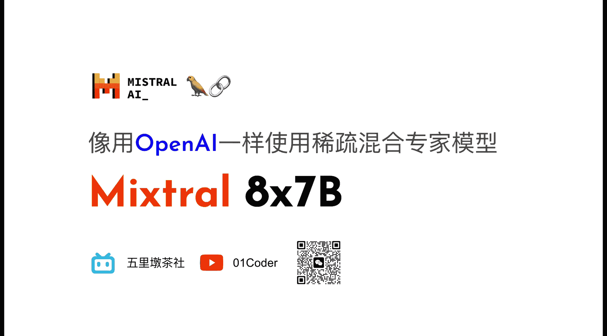


在本节课中，我们将学习如何使用Mistral AI公司发布的最新模型——Mixtral 8x7B。这是一个高质量的稀疏混合专家模型。我们将重点介绍如何通过其提供的API服务来调用该模型，并演示如何将其集成到现有的应用框架中。

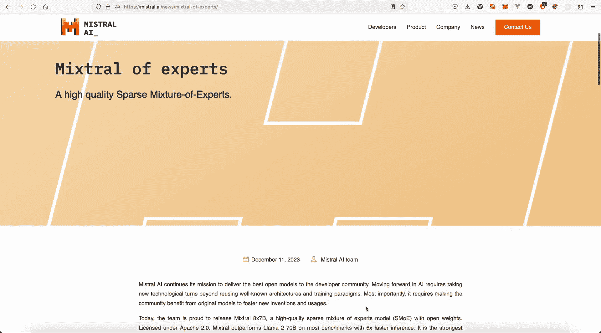

## 模型简介

上一节我们了解了课程背景，本节中我们来看看Mixtral 8x7B模型本身的特点。

Mixtral 8x7B是一个稀疏混合专家模型。它在大多数基准测试中表现优秀。其推理速度比Llama 2 70B模型快六倍。在大多数标准基准测试中，它与GPT-3.5相比毫不逊色，甚至在部分指标上更加优秀。

以下是该模型的主要特性列表：
*   具有**32K**的上下文长度。
*   支持多种语言，包括英语、法语、意大利语、德语和西班牙语。
*   在代码生成方面表现优秀。
*   可以通过微调来获得遵循指令的模型。

## 访问Mistral AI API服务

由于本地运行大型模型存在困难，Mistral AI提供了便捷的API服务。该服务的使用方式与OpenAI非常相似。

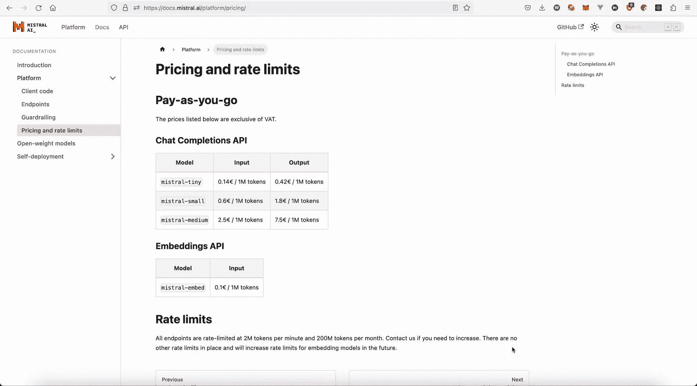

开发者需要先申请访问权限。获得权限后，可以在控制台管理API密钥。控制台地址为：`console.mistral.ai`。

以下是关于API定价和限流的说明：
*   价格按照每100万个Token为单位计费。不同模型（如tiny, small, medium）价格不同。
*   限流方面，每分钟允许200万个Token，每月允许2亿个Token。如有特殊需求，可联系官方。

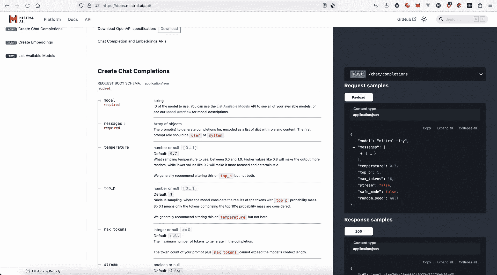

## API文档与调用

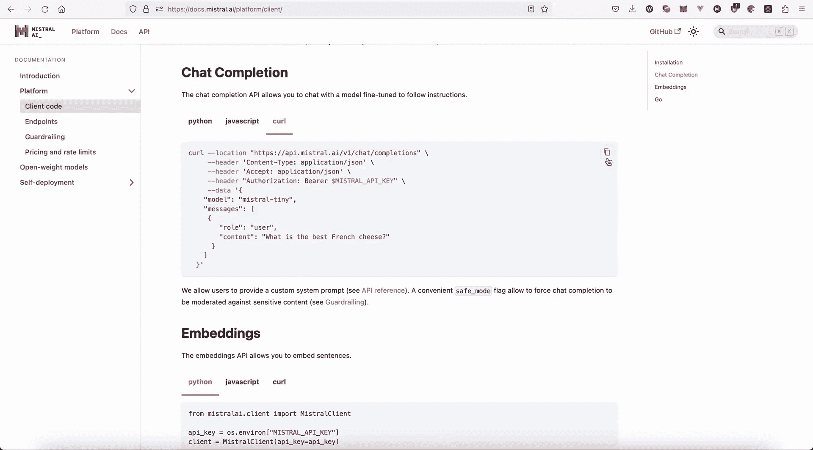

Mistral AI的API目前支持聊天补全、文本嵌入和列出可用模型等功能。其API的**Schema与OpenAI的API Schema完全一致**，这为开发者迁移应用提供了便利。

我们可以通过`curl`命令在命令行中快速体验聊天补全功能。

```bash
curl https://api.mistral.ai/v1/chat/completions \
  -H "Content-Type: application/json" \
  -H "Authorization: Bearer $MISTRAL_API_KEY" \
  -d '{
    "model": "mistral-tiny",
    "messages": [{"role": "user", "content": "法国最好的奶酪是什么？"}]
  }'
```

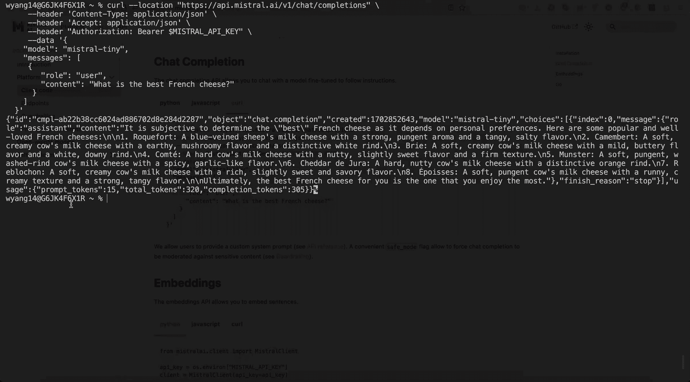

执行上述命令后，会得到一个结构化的JSON响应。该响应的数据结构（包括`model`、`choices`、`usage`等字段）与OpenAI的响应格式兼容。

## 通过Python SDK调用API

接下来，我们看看如何在代码层面使用Mistral AI的模型。首先，我们使用其官方的Python SDK。

以下是使用步骤：
1.  安装客户端开发包：`pip install mistralai`
2.  在代码中设置API密钥。
3.  构建消息并调用聊天补全接口。

```python
from mistralai import Mistral

# 设置API密钥
api_key = "your_mistral_api_key"
client = Mistral(api_key=api_key)

# 构建消息
messages = [
    {"role": "user", "content": "将‘I love programming’翻译成法语。"}
]

# 调用API
response = client.chat.complete(model="mistral-tiny", messages=messages)
print(response.choices[0].message.content)
```

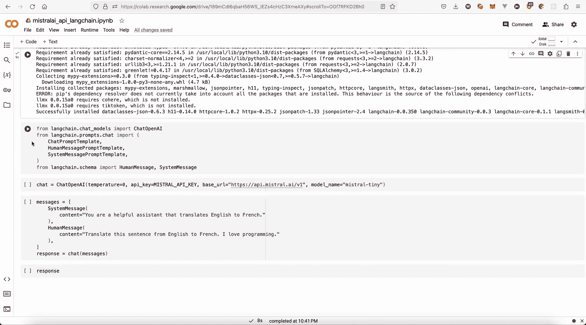

## 在LangChain应用中集成Mistral AI

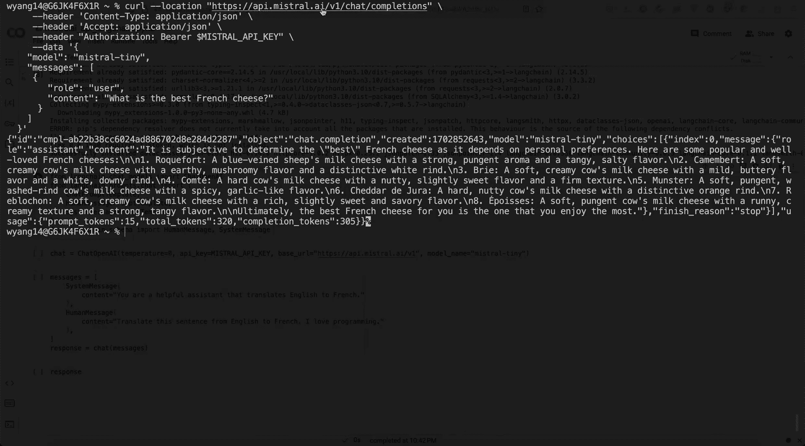

对于已经在使用LangChain并集成OpenAI模型的应用，迁移到Mistral AI非常简单。由于两者的API Schema一致，我们可以直接使用LangChain的`ChatOpenAI`包装类，只需修改基础URL和模型名称即可。

以下是实现方式：
1.  确保已安装LangChain的OpenAI集成包：`pip install langchain-openai`
2.  在初始化`ChatOpenAI`时，将`base_url`指向Mistral AI的API端点，并设置对应的模型名称。

```python
from langchain_openai import ChatOpenAI

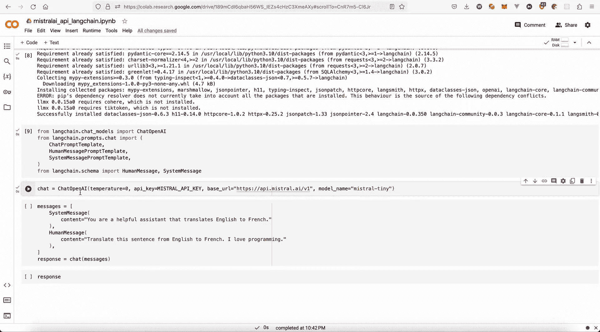

# 使用ChatOpenAI类，但配置为调用Mistral AI的API
llm = ChatOpenAI(
    base_url="https://api.mistral.ai/v1",
    model="mistral-tiny",
    api_key="your_mistral_api_key"
)

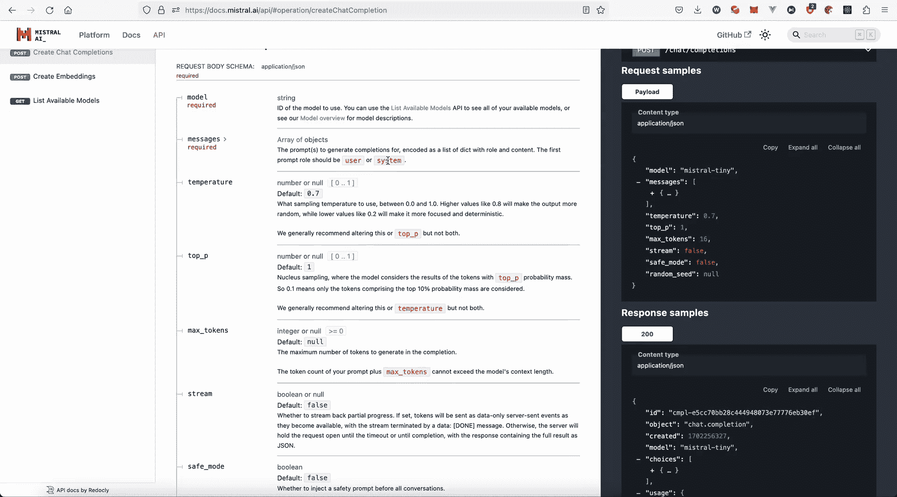

# 后续调用方式与使用OpenAI模型完全相同
response = llm.invoke("将‘I love programming’翻译成法语。")
print(response.content)
```

这种方式虽然取巧，但在功能上完全可行，能以最小代价帮助开发者评估不同模型在自身应用场景中的表现。

## 课程总结

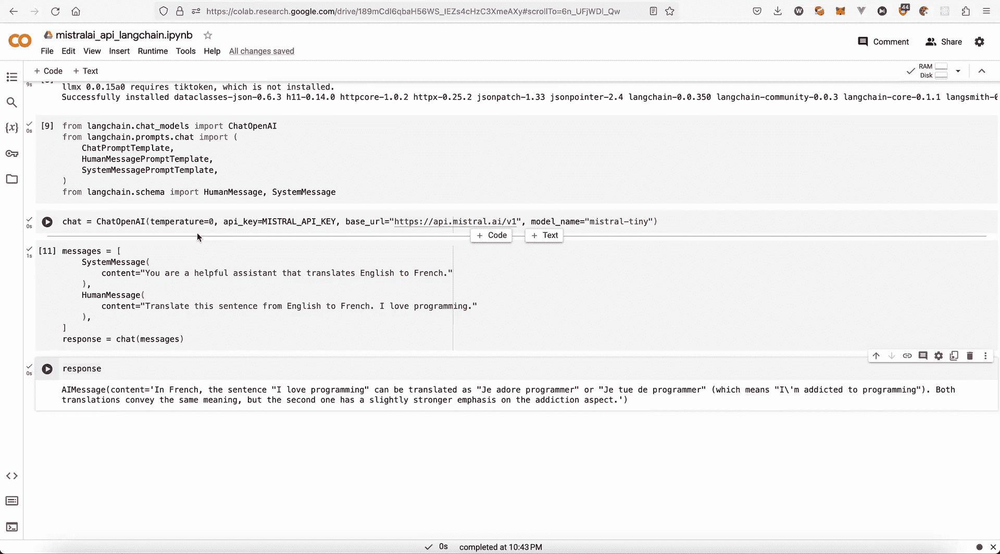

本节课中，我们一起学习了如何使用Mistral AI的Mixtral 8x7B模型。
首先，我们对模型的基本特性和优势进行了介绍。
然后，重点讲解了如何通过Mistral AI提供的API服务来调用模型，包括使用`curl`命令、官方Python SDK进行调用。
最后，我们演示了如何在基于LangChain的应用中，利用其与OpenAI兼容的API Schema，轻松地将现有OpenAI模型切换为Mistral AI的模型，为模型评估和迁移提供了极大的便利。