# 53：生成式人工智能导论 🎓

在本节课中，我们将要学习李宏毅教授《生成式人工智能导论》课程的总体介绍。我们将了解这门课程开设的背景、目标、定位、内容规划以及作业安排。

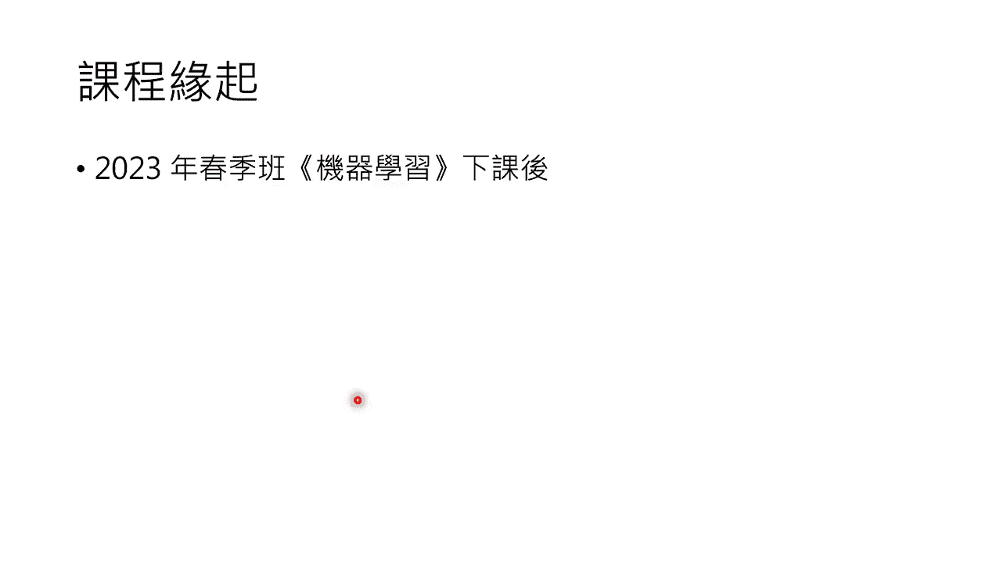

## 课程开设背景

上一节我们介绍了课程的基本信息，本节中我们来看看李宏毅教授开设这门课程的初衷。

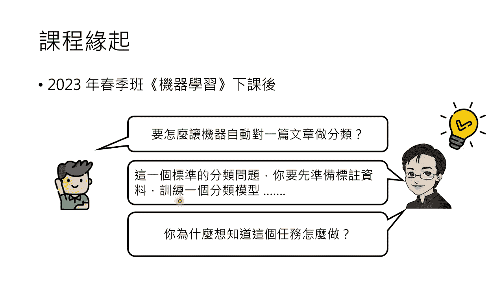

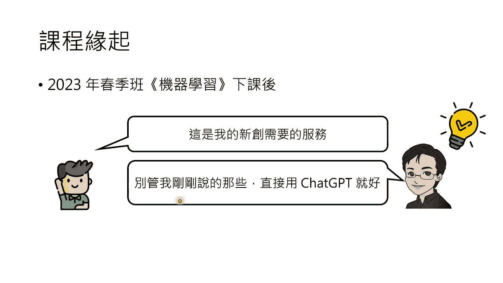

李宏毅教授自2014年起在台湾大学任教，并从2015年开始每年开设机器学习相关课程。在去年春季班的机器学习课程结束后，一位同学询问如何让机器自动对文章进行分类。

作为机器学习课程，李教授最初从传统机器学习角度进行回答：这是一个标准的分类问题，需要先准备标注数据，然后训练自己的模型。然而，在回答过程中，李教授突然意识到一个更直接的方法。

他转而询问学生：“你是真的想学习机器学习原理，还是只想知道如何实现文章分类？你为什么想做文章分类？”学生回答这是其创业项目所需的服务。李教授随即建议：“别浪费时间学机器学习了，直接调用ChatGPT就好。”

那么，“直接调用ChatGPT”具体意味着什么呢？也许通过一个实际操作演示，大家能更好地理解。

## 生成式AI的能力演示

上一节我们了解了课程背景，本节中我们通过一个实例来看看生成式AI（以ChatGPT为例）能做什么。

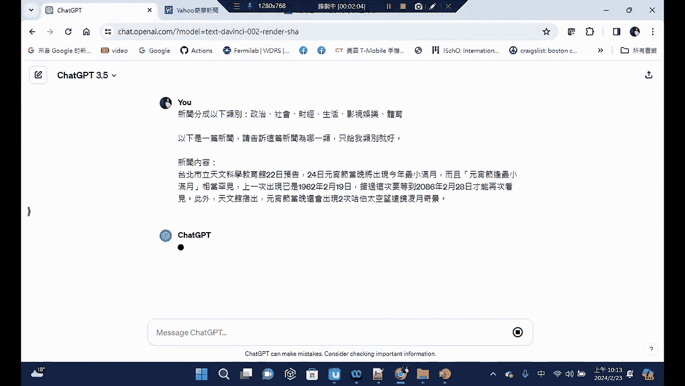

以下是使用GPT-3.5（免费版本）进行的演示，其功能是每个人都可以轻松获取的。

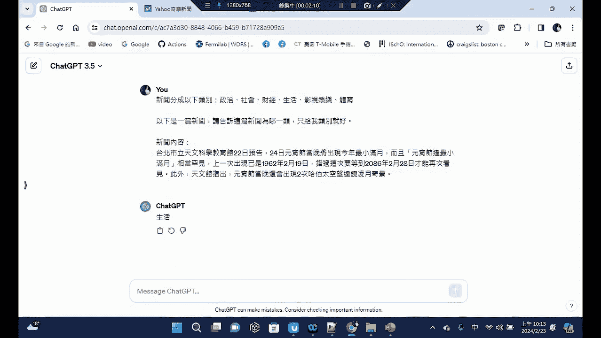

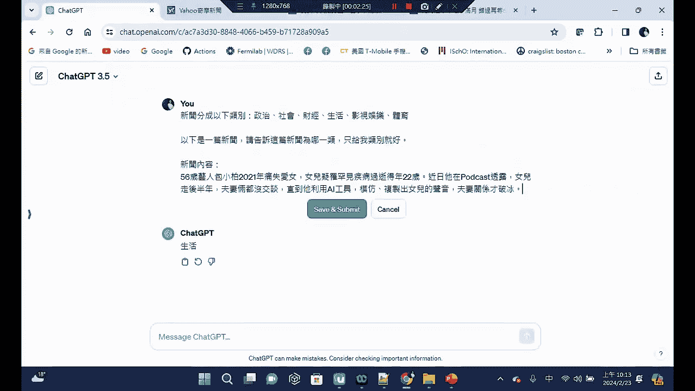

初次见到ChatGPT界面的人可能会不知所措，因为页面上只有一个对话框，可以输入任何文字。这样一个能对话的人工智能，究竟有什么实际作用呢？

事实上，ChatGPT可以成为你的得力助手。你有什么需求，可以直接告诉它。

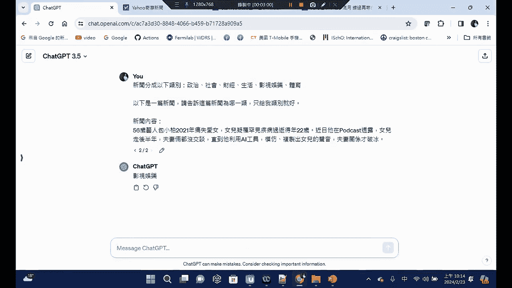

举例来说，如果我们想对新闻进行分类，可以直接向它发出指令。以下是具体步骤：

1.  定义新闻类别：首先，告诉ChatGPT新闻的分类标准。例如，新闻可分为政治、社会、财经、生活、影视娱乐、体育等类别。
2.  给出指令：接着发出指令：“以下我会给你一篇新闻，请告诉我这篇新闻属于哪一类，只给我类别就好。”
3.  提供新闻内容：然后贴上一段新闻内容。
4.  获取结果：ChatGPT会输出该新闻所属的类别。

例如，输入新闻“元宵逢最小满月”，ChatGPT会判断其属于“生活”类。再输入一则关于AI的新闻，ChatGPT会判断其属于“影视娱乐”类。

由此可见，你可以轻松地使用ChatGPT打造所需的人工智能应用。

有人可能会问：这只是一个演示网页，如何将此功能嵌入自己的应用或服务中呢？在本课程的作业三中，将会教你如何在自己的程序中调用像ChatGPT这样的人工智能来完成任务。

总之，时代已经改变。过去开发人工智能应用，往往需要自己开发并训练机器学习模型，这好比决斗时用剑。如今，有人可以直接掏出一把“枪”，瞬间完成人工智能应用。

因此，作为一门人工智能基础课程，李教授希望开设一门新课，向大家展示当今世界开发人工智能应用可能是什么样子。当然，有能力自己开发模型仍然非常重要。机器学习课程并非不再重要，李教授未来也会继续开设。这门新课旨在帮助大家了解生成式AI的趋势和技术发展水平，从而更精准地判断何时应该自己开发模型，何时可以使用现成的人工智能工具。

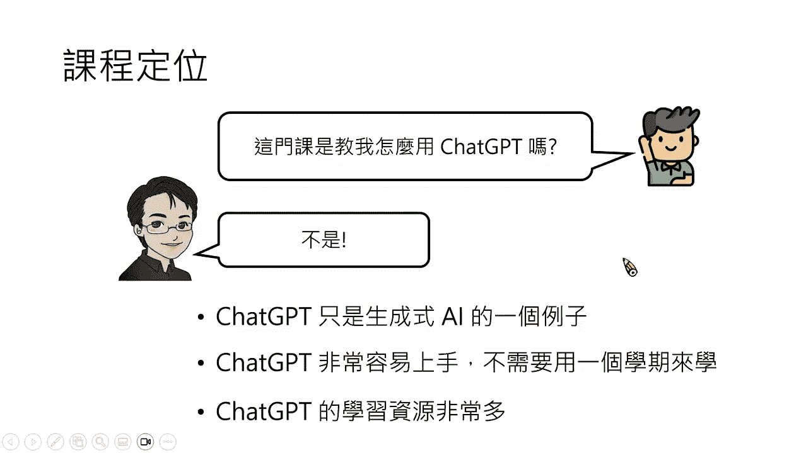

## 课程定位与目标受众

上一节我们看到了生成式AI的强大能力，本节中我们来明确这门课程的具体定位和目标。

由于课程开场就提到了ChatGPT，可能会给大家带来一个误解：这是一门教大家如何使用ChatGPT的课。实际上并非如此。ChatGPT只是众多生成式人工智能应用中的一个例子，尽管它是当前最具代表性的应用。课程中会反复提及ChatGPT，但它仅是生成式AI的一个案例。

这门课程旨在呈现生成式AI的全貌。ChatGPT非常容易上手，很多人问如何学习使用它。实际上，使用ChatGPT这件事本身不需要专门学习——只要你能与另一个人沟通，就大致知道如何与ChatGPT沟通。因此，不需要花费整个学期的时间来学习如何使用ChatGPT。况且，网络上关于ChatGPT的学习资源已经非常丰富。

那么，这门课程究竟要讲什么呢？本课程预设的目标受众是：**你已经使用过ChatGPT这类生成式AI，知道它们能做什么、有多厉害，但你想进一步了解这些生成式AI背后的原理——它们是如何被训练出来的，如何变得像今天这样强大，以及未来有哪些可能性和发展方向。**

这门课就是为你而开的。课程不会特别侧重某一个具体应用（如ChatGPT）的使用教学，因为当前技术日新月异。如果你从2022年底ChatGPT上线就开始使用，会发现它的界面和能力与最初相比已有很大差异。应用层面变化迅速，即使在一门课中学到了具体使用技巧，几个月甚至几周后可能就不再适用。大学课程希望传授那些你在未来数年甚至一生中都能用上的知识。因此，本课程真正想要传达的，不是如何使用ChatGPT这个应用，而是生成式AI背后的概念和原理。

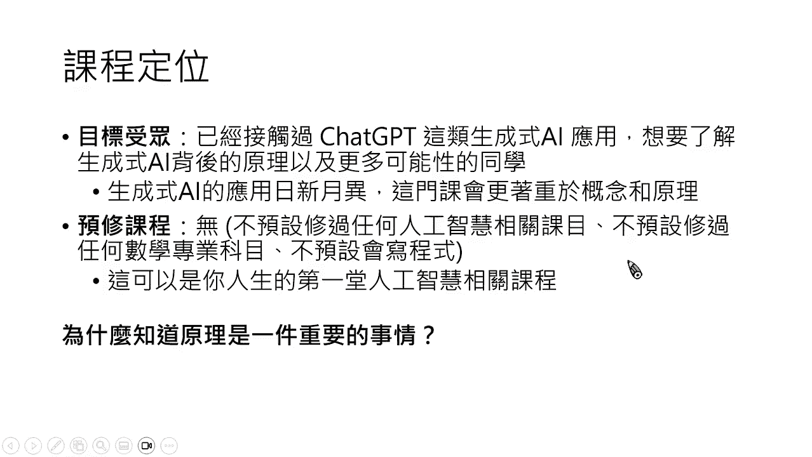

## 课程先修要求与价值

上一节我们明确了课程的目标受众，本节中我们来看看学习这门课需要什么基础，以及了解原理有何价值。

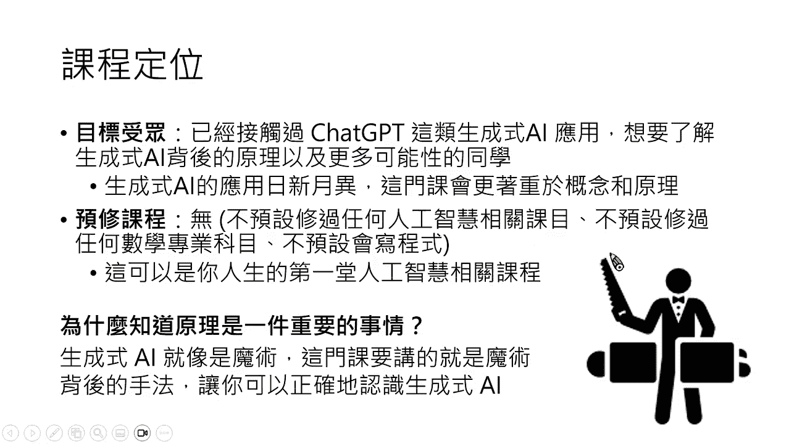

这门课程**没有预设任何先修课程要求**。如果你想选修这门课，不需要修过任何人工智能相关课程，不需要具备数学和编程背景，也不需要修过任何机器学习课程。这门课可以是你人生的第一门人工智能课程。

有人可能会问：我已经会用ChatGPT了，使用它非常简单，只要会打字、会与人沟通就行。会用就好了，为什么还要知道背后的原理呢？

确实，即使不了解ChatGPT的原理，你也有机会打造人工智能应用。但是，了解其原理可以带你走向另一个层次。

这好比魔术非常神奇，今天的人工智能也像魔术一样。但如果你知道魔术背后的手法，在观看时就能欣赏魔术师厉害之处。当你看到魔术师将人锯成两半再连起来时，不会认为他真的把人锯开并用超能力连接，你知道这是一种手法，不会误以为魔术师是拥有超能力的“念能力者”。

对于生成式AI也是如此。今天它展现出非常神奇的能力，但如果你能正确理解其背后的概念和原理，就如同了解了魔术背后的手法，可以更准确地认识它。至少，你不会对其能力产生错误的误解或抱有不切实际的期待。

有同学问：这门课与李教授开设的机器学习课程有重叠吗？你应该问还有什么一样的地方——基本上没有什么一样的地方。所以，即使你已经修过李教授的机器学习或其他老师的机器学习课程，相信这门课也能带给你很大的帮助。

如前所述，这门课可以作为你人工智能领域的第一堂课。你可以以此为基础，未来再去学习其他机器学习相关课程。需要提醒的是，作为一门入门课，它不会涵盖所有内容。继续用魔术比喻：这门课会手把手带你变几个魔术，但可能不足以训练你成为魔术师，也无法带你创造新的魔术。然而，这并不代表课程没有用。如果你的目标是未来成为顶尖的“魔术师”（AI专家），这门课可以成为你旅程的起点。

由于上课时间有限（课程设定为两学分，仅两小时），我们无法深入探讨所有技术细节。某些部分可能会让你觉得意犹未尽。但请记住，这是你的第一门人工智能课程，它不会是你的最后一门。未来你可以选修其他相关课程，或者如果你想深入研究课堂上提到的某些技术原理，可以参考幻灯片上引用的论文。

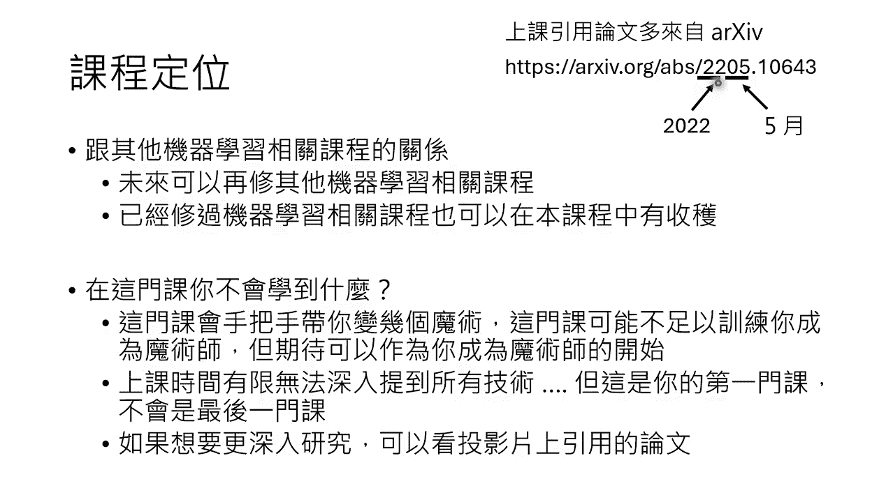

## 技术文献与快速演进

上一节我们讨论了课程的基础要求，本节中我们关注生成式AI领域的技术文献特点及其飞速发展的特性。

讲到引用文献，需要说明的是：本课程幻灯片上引用的论文大多来自一个叫做 **arXiv** 的网站。如果你看到引用的论文链接写着 `arXiv.org`，那就是这个网站。

对于计算机科学领域的同学，arXiv 是众所周知的。但考虑到本课程学生来自各个领域，这里简要介绍一下什么是 arXiv。

通常，进行研究有了新想法后，会写成论文发表在国际会议或期刊上。但国际会议和期刊的审稿周期往往长达一年半载。对于AI领域而言，技术变化极快，一年半载的时间就可能发生翻天覆地的变化。往往一篇论文投稿6个月后被接受时，其技术可能已经不再新颖。

那怎么办呢？有一个网站叫 arXiv。如今，尤其是在计算机科学和人工智能领域，有了新的研究成果往往不先投递会议，而是直接放在 arXiv 上抢先公开。因此，在 arXiv 上更容易找到最新的研究。

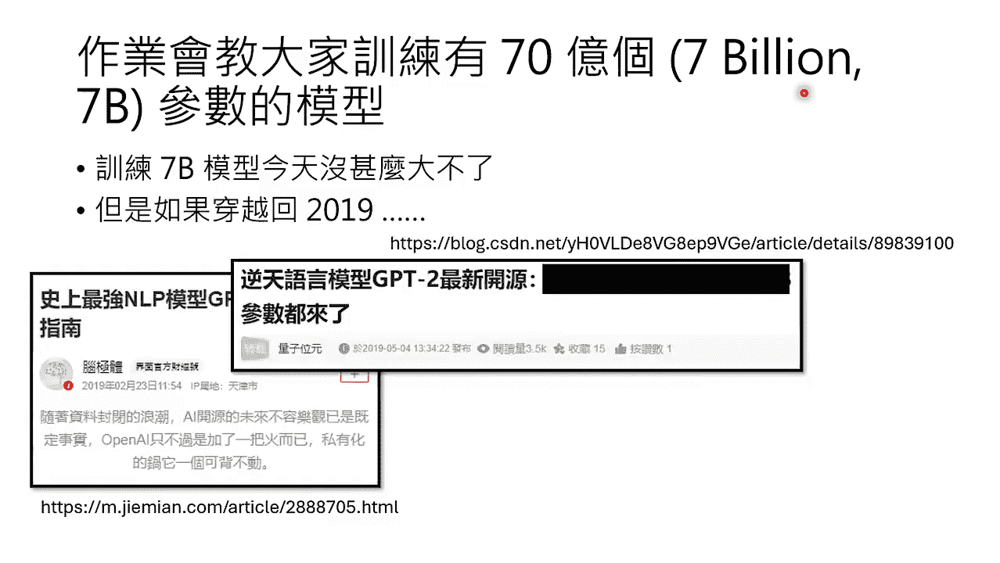

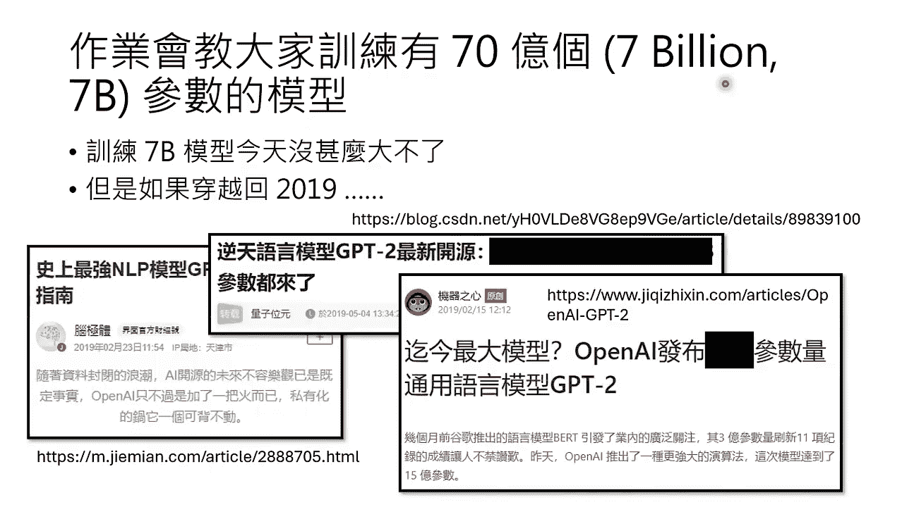

这里教大家如何看 arXiv 文章的上传时间：arXiv 的文章编号后通常会有一个数字，前两位代表年份，后两位代表月份。例如，`2205` 表示这篇文章是在2022年5月被公开在 arXiv 上的。在本课程的幻灯片中，你会看到很多文章，它们往往是几个月前甚至几周前才被放在 arXiv 上的。

讲到技术迅速变化，我想分享一件事。在本课程的作业中，会教大家训练（实际上是微调，我们后续会讲训练与微调的区别）一个拥有 **70亿** 个参数的模型（参数数量缩写为 7B）。70亿听起来是个很大的数字，和地球人口差不多。但它是一个特别大、特别厉害的模型吗？显然不是，因为这是我们课堂的一个作业。你可以想象，修完这门课后，可能有上千人都能训练70亿参数的模型。而且，今天使用免费的运算资源就可以训练这样一个模型，所以它显然不是一个特别厉害的模型。

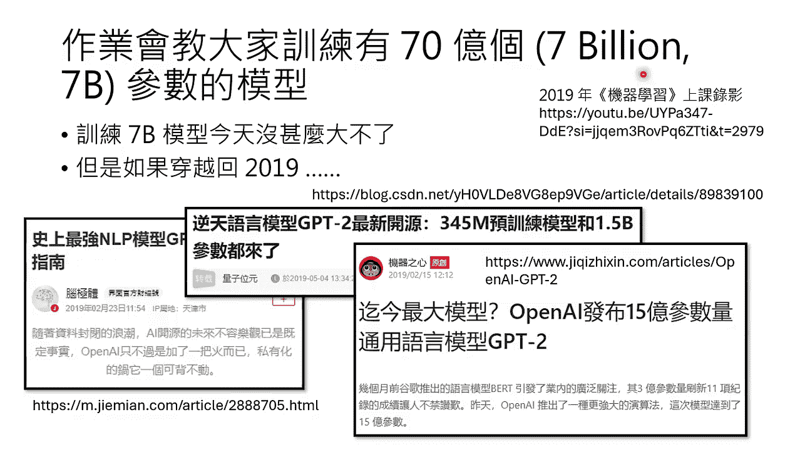

但是，如果你穿越回5年前（2019年）呢？2019年，OpenAI 发布了第二代 GPT 模型（GPT-2）。当时网络上各种文章拼命吹捧，称其为“史上最强NLP模型GPT-2.0”或“逆天语言模型”。但这个 GPT-2 有多大呢？它只有 **15亿** 个参数，大约是你作业中要用的模型的四分之一到五分之一。

所以，如果你带着今天的作业穿越回5年前，你手上拥有的将是一个当时人们无法想象的、“毁天灭地”的巨大模型。OpenAI 和 Google 的人看到你都得“下跪”。这让我想到漫画《葬送的芙莉莲》中的情节（以下内容涉及轻微剧透）：

芙莉莲是一个精灵，80年前曾参与勇者小队讨伐魔王。魔王手下有一个强大的干部叫“腐贤”库瓦尔，他发明了一种可以穿透任何防御的“杀人魔法”，无人能挡。芙莉莲也无法打倒他，只能将其暂时封印。80年后封印松动，库瓦尔复活。芙莉莲带着弟子费伦前来对付他。一开始费伦非常紧张，担心无法防御“杀人魔法”。芙莉莲说“到时候就知道了”。库瓦尔对费伦使出“杀人魔法”，芙莉莲展开防御壁，轻松挡住。费伦惊讶地说：“这什么杀人魔法，不过就是普通攻击而已。”是的，80年前的“杀人魔法”，80年后就只是普通攻击。因为80年对人类来说太长了，人类已经钻研并找到了防御的方法。

在生成式AI领域也是如此。当年的 GPT-2 就像库瓦尔一样，当年那个“毁天灭地”的巨大模型，在今天看来已不算什么。这个例子旨在说明，生成式AI技术变化非常快，不要说5年，有时5个月、5周都会有巨大变动。

## 课程作业规划

上一节我们领略了技术的飞速发展，本节中我们来看看本课程是如何通过作业让大家亲身体验生成式AI的。

这里介绍一下作业的规划。作业的目标是让大家体验生成式AI，这种体验分为两个层面：
1.  体验如何使用生成式AI来打造某些应用。
2.  体验如何训练出自己的生成式AI模型。（当然，程序主体已由助教写好，你需要做的往往就是按回车键，但可以体验训练过程。）

在这门课中，李教授特意保留了一些“负面”体验。什么样的负面体验呢？
*   **训练模型很花时间**：当然，作业中的“很花时间”可能只是两三个小时。痛苦是比较出来的，你可能觉得两三个小时很长。事实上，训练真正的大模型往往以“周”为单位计算时间。
*   **结果具有不确定性**：你可能会发现，即使完全按照助教指示操作，得到的结果也可能与助教展示的不同。很多第一次训练模型的同学会非常惊奇：训练模型不就是写个程序吗？电脑怎么每次还会得到不一样的结果？实际上，训练模型不要用编程思维来理解，而要想象成是在“养小动物”或“种花莳草”，其结果往往是难以完全预测的。

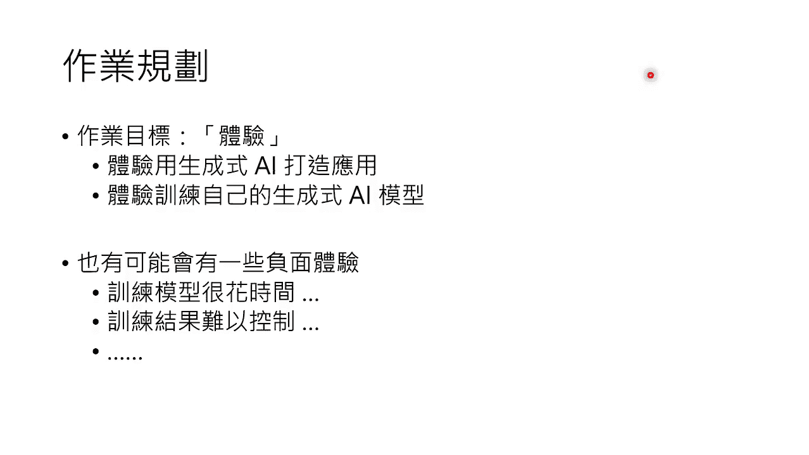

当然，我们可以把这些负面体验拿掉，不让你自己训练模型。但李教授仍然在作业中保留了多个训练模型的任务，目的是让你获得这些“负面”体验。期待这些体验能像“疫苗”一样，帮助你在未来面对更大的挑战。在座各位并非每个人未来都会成为工程师或训练模型，但也许通过这门课的体验，你可以理解训练模型可能很耗时、结果难以预测。有一天你成为管理者时，或许能对手下的工程师多一些宽容。

以下是作业的具体规划：
*   本课程共有 **10个** 作业。
*   每个作业如果没有特别说明，预设截止日期为公布日期两周后。
*   其中多个作业需要编写程序甚至训练模型。

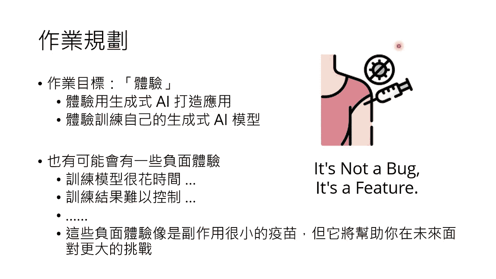

有同学会问：训练模型需要准备什么？需要购买自己的GPU吗？答案是：**你什么都不用准备**。在执行程序、训练模型的部分，我们都会使用 **Google Colab** 或类似平台。你不知道这些是什么也没关系，总之记住你什么都不用准备。

以下是作业难度预估（用三角形数量表示）：
*   **一个三角形 (△)**：送分题。作业1和即将公布的作业2基本属于此类，开局先送大家20分。
*   **两个三角形 (△△)**：如果你不在意分数，可能很快完成；但如果你想拿满分，仍需花费一些时间努力。
*   **三个三角形 (△△△)**：需要训练模型的作业。你至少需要好几个小时才能完成。再次强调，痛苦是比较出来的——好几个小时已经非常快了。回想2015年李教授刚开机器学习课时，有些作业的训练时间长达三天。如果作业截止日期不到三天，你唯一能做的就是放弃，因为不可能训练出来。而今天，训练模型最多几个小时，在截止前一晚赶工也许还来得及。

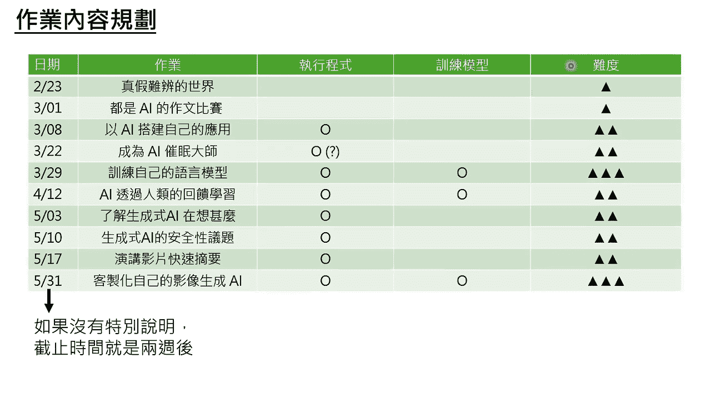

关于课程分量，这里给出一个注解：因为有10个作业，几乎每周都会公布一个。所以，如果把这门课看作一门“通识课”（毕竟课程名中有“导论”二字），它不会太难，但可以是一门非常充实的通识课。如果把它看作专业选修课，那它可能是一门负担较轻、比较轻松的选修课。以上关于作业负担的说明，供大家参考。

关于上课内容的详细规划，我们下一节再讲。

## 关于使用AI与致谢

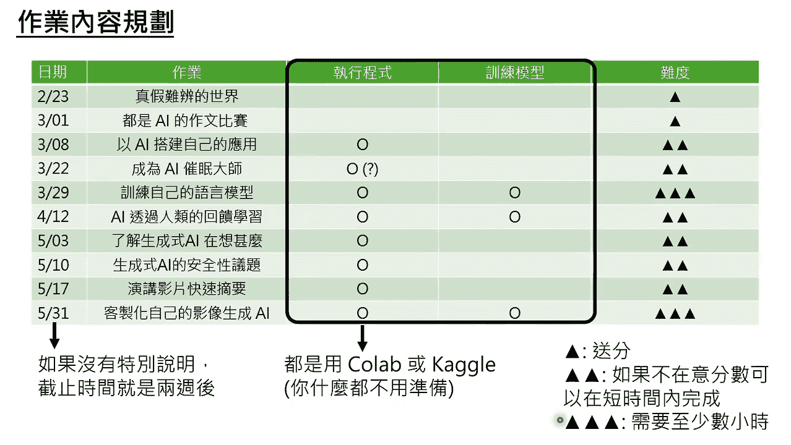

上一节我们详细了解了作业安排，本节中我们来看看课程关于使用AI工具的政策，并对支持方表示感谢。

大家常问的一个问题是：这门课能否使用人工智能（如ChatGPT）来写作业？答案是：**可以**。这是生成式AI导论课，当然应该允许使用生成式AI来写作业。但同时，老师也会使用人工智能来批改作业。届时，凡是能够用大型语言模型批改的作业，我们都会使用大型语言模型进行批改。

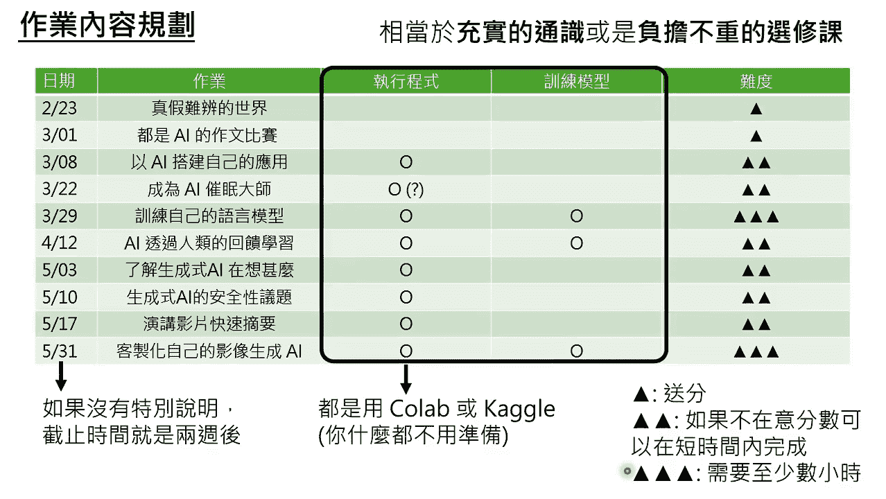

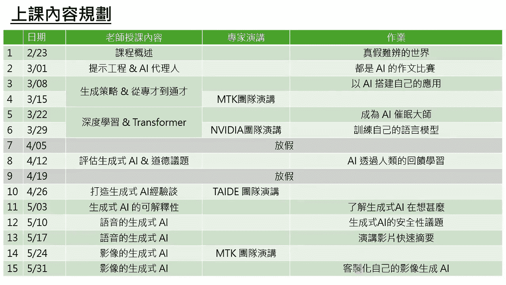

在此，特别感谢 **联发科（MTK）的“打喷嚏”（DaBianQi）团队**。他们为我们提供了打喷嚏平台、算力以及技术支持，使我们能够通过该平台批改作业。即使他们知道这门课可能有超过1000人选修，也愿意无条件地大力支持。在此特别致谢。

此外，在3月15日，MTK的团队将前来与大家分享他们如何使用生成式AI，以及他们对生成式AI在业界的看法。在5月24日，MTK自身也开发了大型语言模型，其技术团队将前来分享他们开发大型语言模型的心路历程。

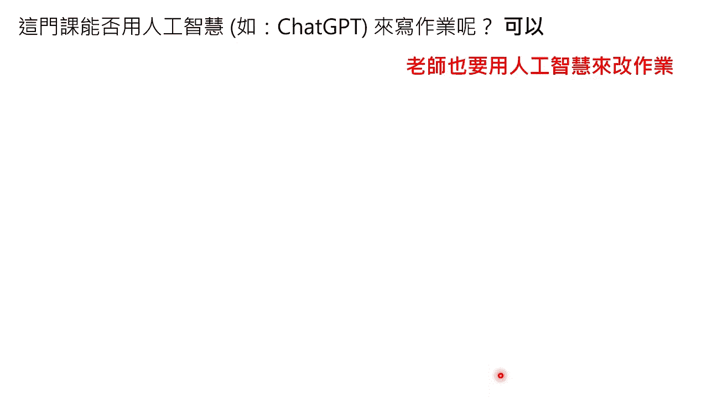

## 总结

本节课中，我们一起学习了《生成式人工智能导论》课程的总体框架。我们了解了李宏毅教授开设这门课程的时代背景与初衷，见证了生成式AI（以ChatGPT为例）解决实际问题的便捷能力。我们明确了本课程并非单纯的应用教学，而是旨在揭示生成式AI背后原理、面向已有初步使用经验的学习者。课程无需先修知识，并强调了理解原理对于正确认识AI能力的重要性。我们还认识到该领域技术迭代迅速，文献发布渠道特殊。最后，我们详细了解了包含“正面”与“负面”体验的作业规划，以及课程允许并鼓励使用AI工具完成作业的开放政策。