# 56：作业1 - 真假难辨的世界 👨‍🏫

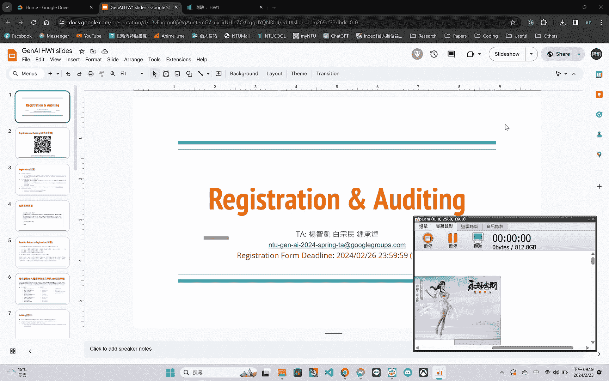

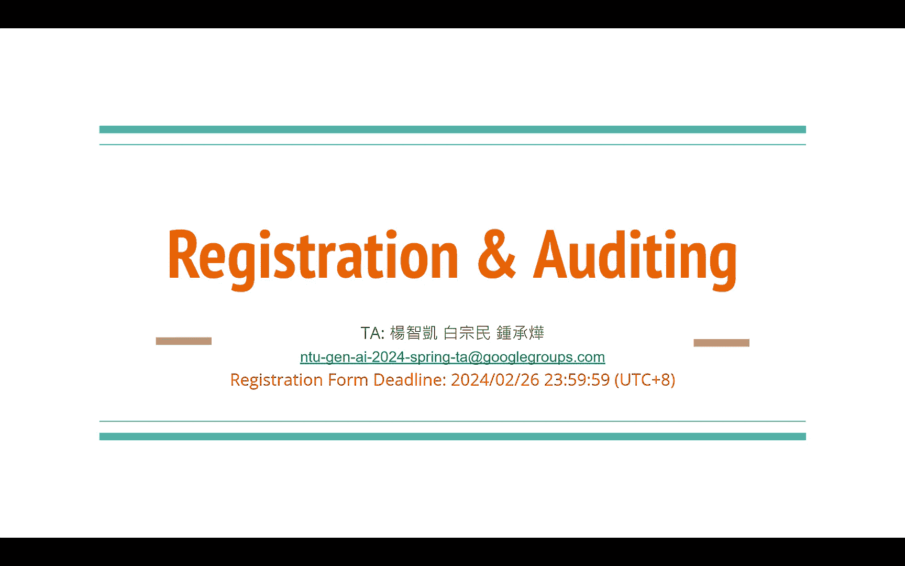

在本节课中，我们将学习本学期《生成式人工智能导论》课程的加签规则以及第一份作业“真假难辨的世界”的具体要求。课程助教杨志凯将为大家详细讲解相关流程和注意事项。

## 加签与旁听规则 📝

首先，我们来了解本课程的加签与旁听规则。任何希望修读本课程的学生都必须填写指定的加签表单。

### 加签流程

以下是加签的具体步骤和注意事项。

1.  **填写表单**：所有希望修读本课程的学生，必须扫描视频中提供的二维码或访问课程网页上的链接，填写加签表单。请务必准确提供个人信息。
2.  **资格与抽签**：
    *   **直接授权**：目前所属系所（含双主修、辅系、学程）隶属于台大电资学院或文学院的学生，无需抽签，可直接获得授权码。
    *   **需要抽签**：所属系所不隶属于上述学院，但为台大学生的，需要参与抽签。目前预计抽签名额为50人（可能增加）。
    *   **无法加签**：非台大学生（如师大、科大学生）目前无法加签本课程。
3.  **“现属系所”定义**：资格认定仅以学生**当前**所属系所为标准，不考虑未来计划申请或就读的系所。例如，计划本学期结束后辅修电资学院相关学程，或已推甄上相关研究所但尚未入学，均不符合直接授权资格。

### 重要日期 ⏰

请同学们务必留意以下关键时间点。

*   **加签表单截止**：2024年2月26日，UTC+8时区 23:59:59。
*   **授权码寄出**：最晚于2024年3月1日，UTC+8时区 23:59:59前寄出。若届时未收到授权码，即表示未加签成功。

### 公平性规则与惩罚 ⚖️

为维护加签公平，以下行为将导致该课程期末成绩记为F，且无任何通融余地。

1.  身份不属于电资或文学院，却在表单中勾选“属于”或“现属于”上述学院。
2.  将自己收到的授权码转让或出售给他人，且本人仍在修读此课程。
3.  使用不属于自己的授权码进行选课（无论对方是否同意）。

### 旁听规则 🎧

希望旁听课程的学生，也需填写相同的加签表单。

*   若在表单释出前已来信申请旁听，则无需重复填写，助教会统一处理加入。
*   在未被加入NTU COOL前，如需课程材料（如简报、影片），可访问课程网站获取。
*   若加签未成功，可转为旁听。表单中已新增相关问题（“如果没有加签到的话，需要加入旁听吗？”），请用原Google账号登录表单补充回答即可。

---

上一节我们明确了课程的准入规则，接下来我们将深入了解本学期的第一份作业。

## 作业1：真假难辨的世界 🕵️

本节课的核心内容是介绍作业1“真假难辨的世界”。这份作业旨在让同学们亲身体验当前生成式AI模型的强大能力，并尝试发现其局限之处。

### 作业目标与内容

本作业希望同学们通过实际案例，感受生成式AI在多种模态内容生成上的惊人效果。你们将接触到包括但不限于GEMINI、ChatGPT（文本）、Midjourney、DALL-E（图像）等模型生成的内容。

具体任务非常简单：系统会提供共40段素材，涵盖语音（Speech）、歌声（Singing Voice）、文本（Text）、图像（Image）和视频（Video）等模态。你需要聆听或观看每一段素材，然后判断其“是AI生成的”还是“不是AI生成的”。

### 作业示例

以下是几个判断示例：

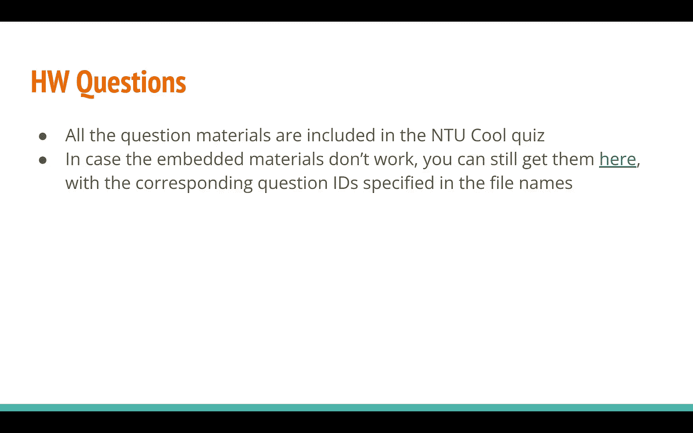

1.  **语音示例**：一段听起来很像李宏毅老师说话的音频。实际上它是真人录音，因此正确答案是“不是AI生成的”。
2.  **歌声示例**：一段AI生成的歌声。你需要根据其像真度做出自己的判断。
3.  **文本示例**：一段由ChatGPT生成的七言律诗。你可以通过分析格律、平仄等方面进行判断。
4.  **图像示例**：一张来自论文的图片，要求模型生成“I ♡ Generative Models”字样。图中文字模糊，破绽较大，实为AI生成，正确答案是“是AI生成的”。

所有作业题目均已放置在NTU COOL的Quiz板块中。如果遇到素材无法播放等问题，也可通过助教提供的备用云端链接访问所有40个素材文件（如 `q1.mp3` 对应第一题）。

### 评分标准 📊

作业共40题，每题2.5分，总计100分，占学期总成绩的10%。

评分规则非常特殊：**只要对题目进行了作答（选择了任一选项），即可获得该题分数**。无论你的判断是否正确，都不会影响得分。

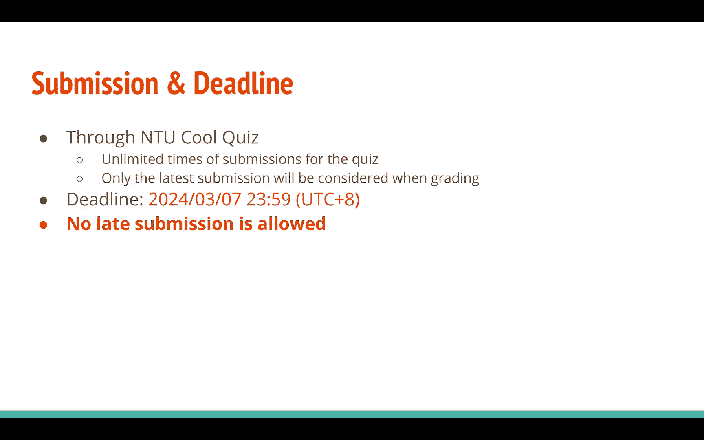

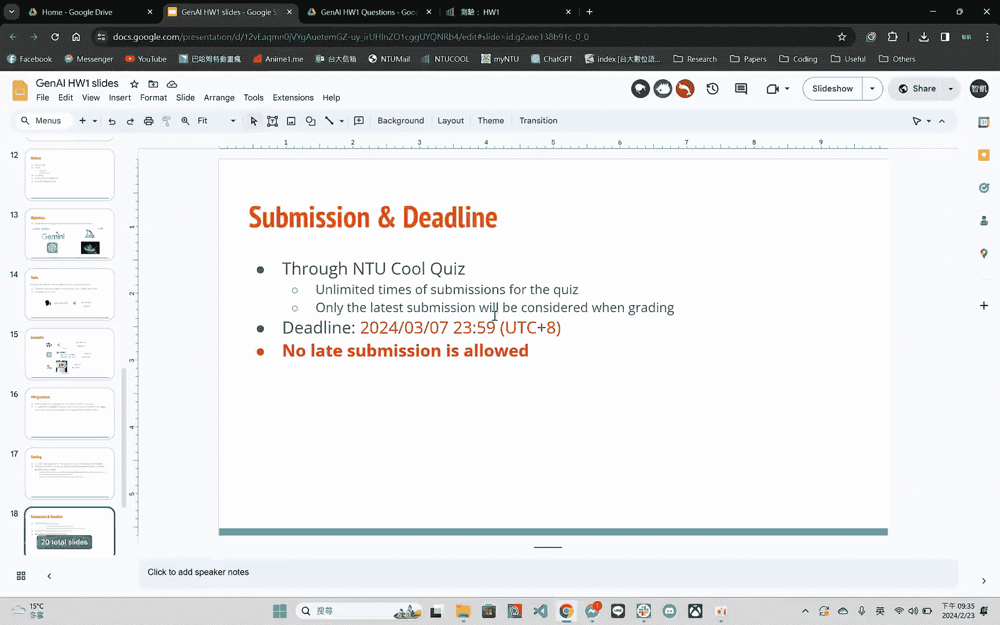

因此，想要在此作业中获得满分的关键在于：确保在最终提交前，**已经完成了全部40道题目的作答**。

### 提交与截止日期 🚀

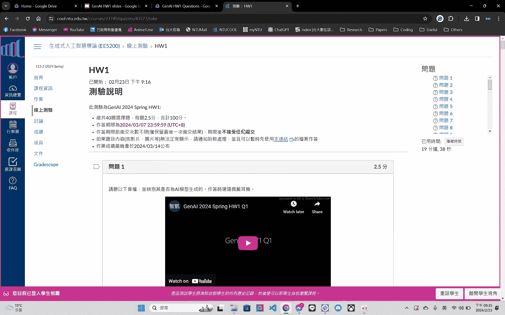

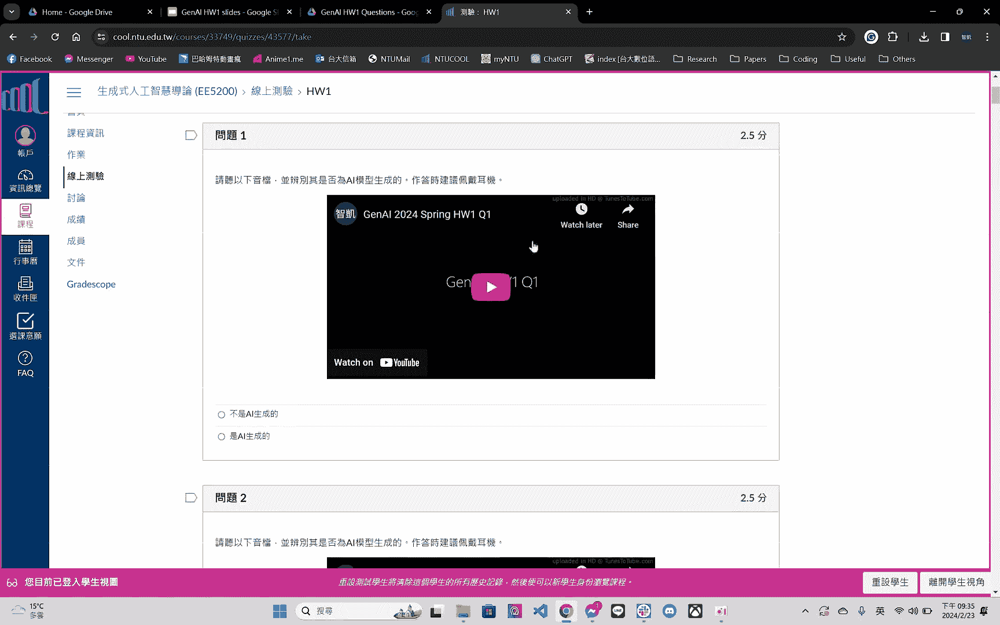

作业完全通过NTU COOL的Quiz功能提交。

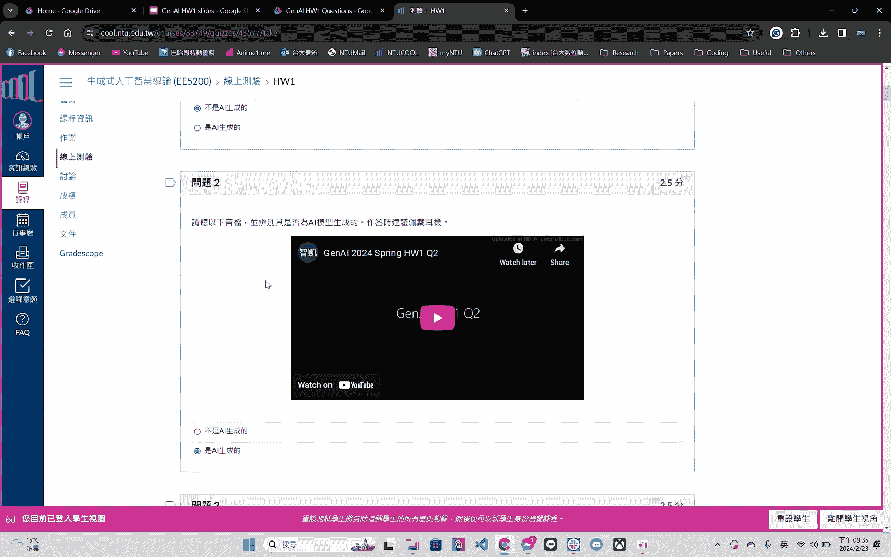

*   **提交次数**：截止日期前提交次数不限，系统仅记录最后一次提交。
*   **截止日期**：2024年3月7日，UTC+8时区 23:59:59。逾期不候。
*   **检查完成度**：提交前，点击“提交测验”按钮，系统会提示未作答的题目数量，方便查漏补缺。

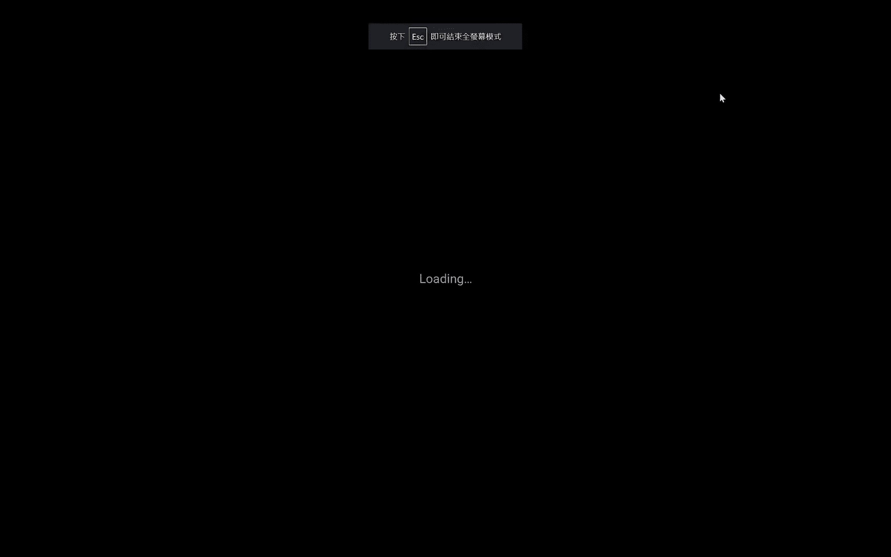

### 成绩公布与答疑 📬

成绩及相关答案解析将于作业截止后一周公布。

*   **成绩公布日**：2024年3月14日，UTC+8时区 23:59:59。
*   **公布内容**：届时将公布每道题目的正确答案（是否为AI生成），以及生成该素材所使用的模型或API等信息。

若对作业有任何疑问，可通过以下渠道咨询（按推荐顺序）：

1.  **NTU COOL课程讨论区**：非私人问题首选，助教将优先回复。
2.  **课程邮箱**：私人问题可来信，**邮件标题必须严格遵循格式**：`[JAI 2024Spring Homework 1] 你的问题`，否则可能无法被处理。
3.  **课后TA答疑时间**：2月23日与3月1日，下午4:30-5:20，于综合大讲堂课后进行。

---

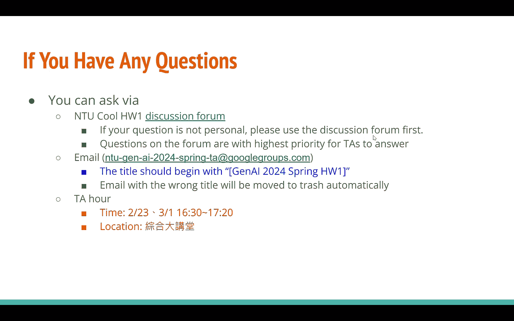

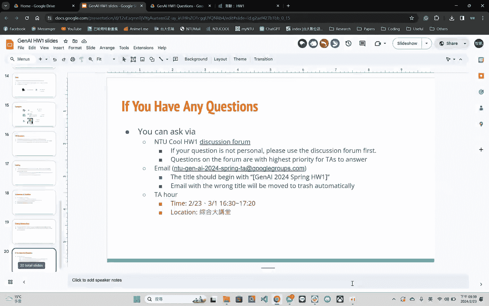

本节课中我们一起学习了《生成式人工智能导论》课程的加签、旁听详细规则，并深入了解了第一份作业“真假难辨的世界”的目标、内容、评分标准和提交方式。请大家务必注意各项截止日期，并按照要求完成作业。祝大家学习顺利！