# 58：不训练模型，如何提升AI使用效果（上）🎯

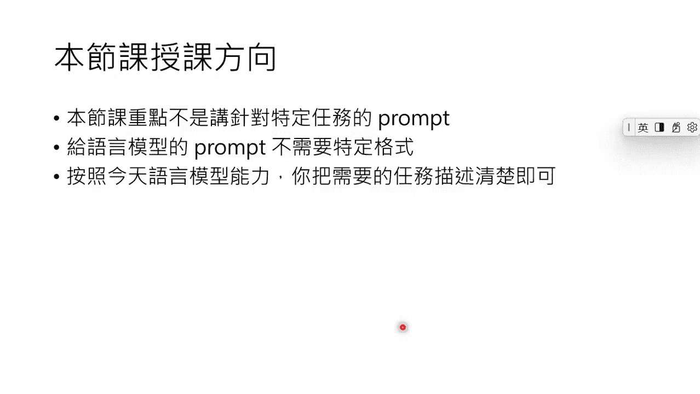

在本节课中，我们将要学习在不训练任何人工智能模型的前提下，如何通过优化我们与模型的交互方式，来显著提升大型语言模型（如GPT系列）在实际任务中的表现。我们将从多个角度探讨这一主题，包括使用特定的指令、提供额外信息以及利用上下文示例等方法。

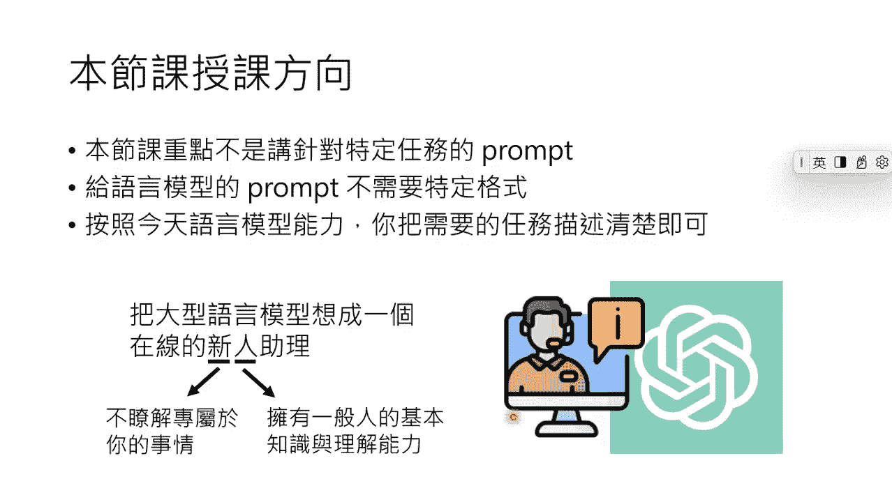

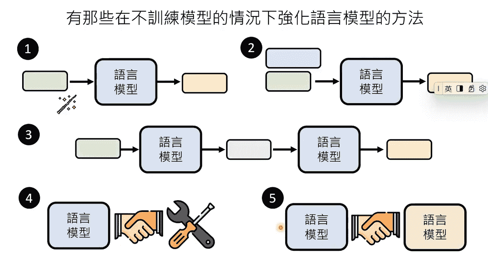

## 概述：将AI视为新人助理

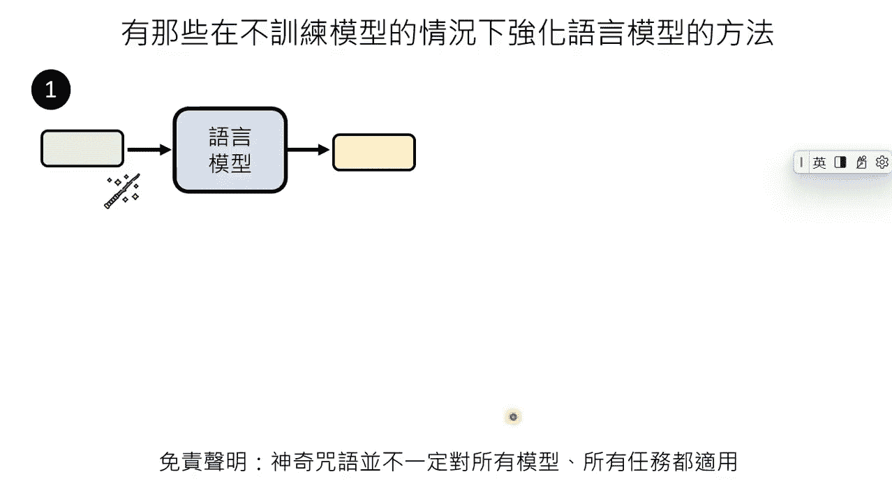

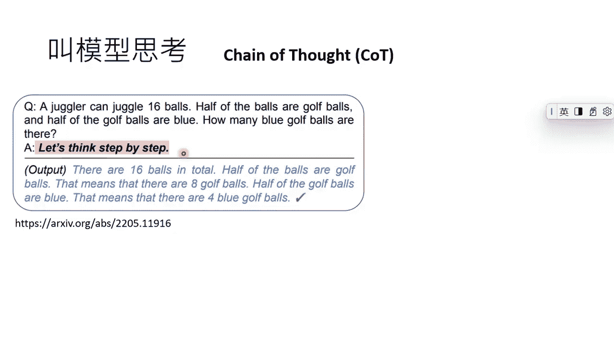

首先，为了避免误解，需要明确本节课的核心：**没有任何模型被训练**。课程的方向并非教授如何为特定任务编写提示词（Prompt）。实际上，由于当前语言模型能力强大，针对特定任务编写提示词通常无需专门学习。只要将你的需求清晰地表述出来，模型往往就能理解。

你可以将大型语言模型想象成一个**在线的新人助理**。
*   **“人”**：意味着它已具备类似人类的基本知识和理解能力。
*   **“新人”**：意味着它是第一天认识你，对你的一切（如个人身份信息）一无所知。

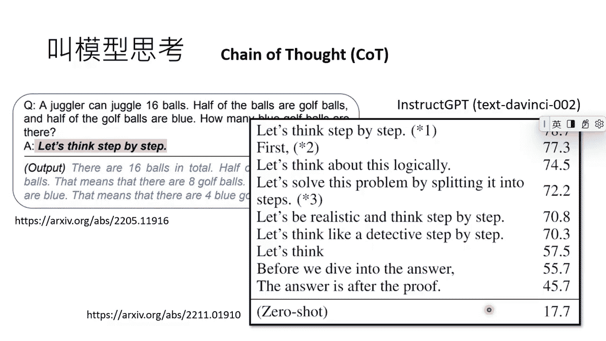

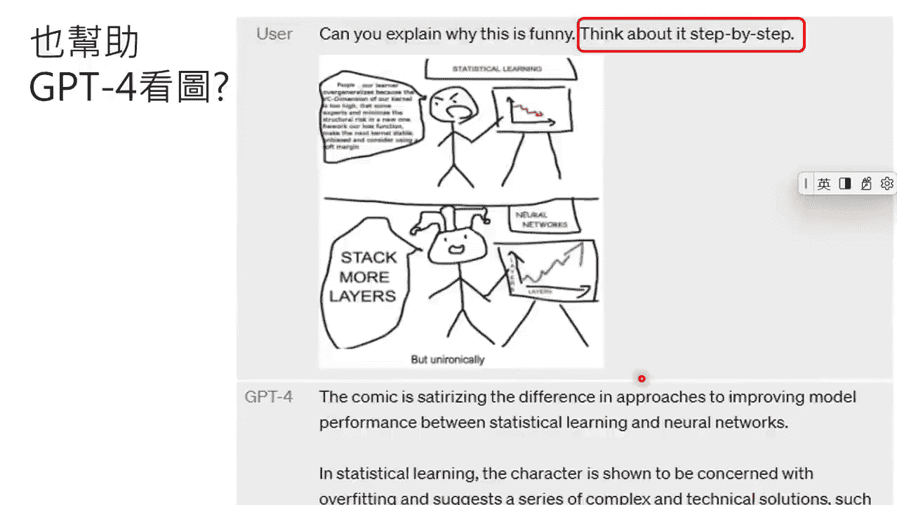

因此，有时模型未能给出预期答案，可能仅仅是因为它对“你”和“你的任务背景”了解太少。本节课将介绍遇到这种情况时的多种解决思路。

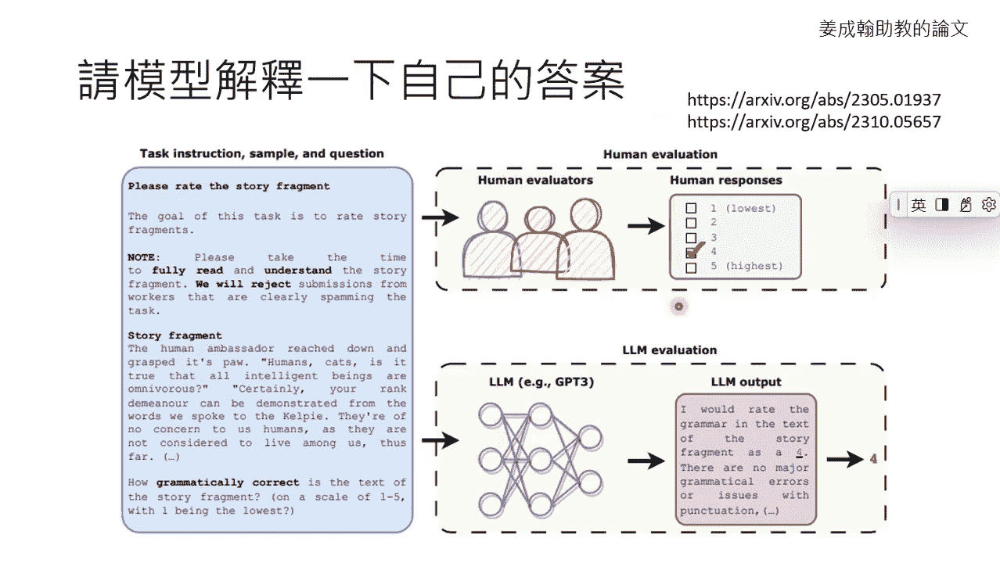

## 第一部分：探索“神奇咒语”🔮

首先，我们从一些可能强化模型能力的特定指令或“神奇咒语”开始。但必须声明：这些咒语**并不保证对所有模型和所有任务都有效**。

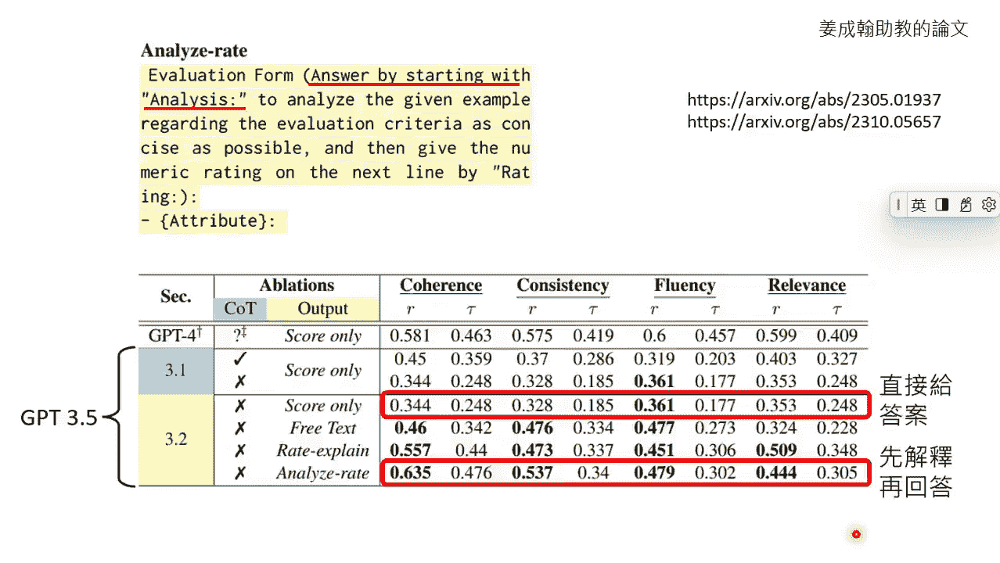

以下是几种被研究验证过的“神奇咒语”：

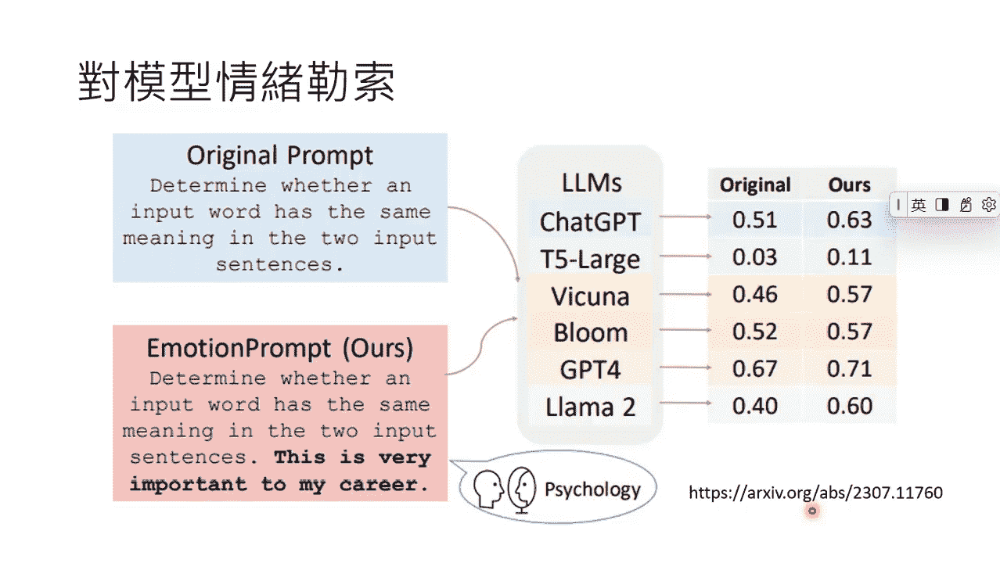

### 1. 引导模型逐步思考 (Chain of Thought, CoT)
最经典的咒语是 **`Let‘s think step by step`**（让我们一步步思考）。当要求模型解决数学等问题时，加上这个指令，其表现可能大幅提升。

**公式/概念**：
```
问题 + “Let‘s think step by step” -> 更详细的推理过程 -> (可能) 更准确的答案
```

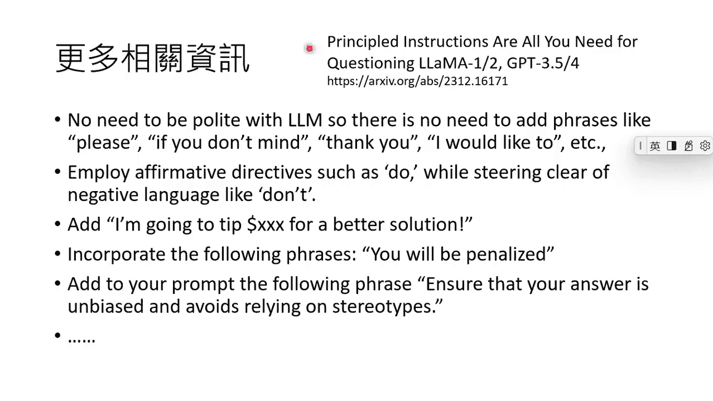

在一项2022年11月的研究中，使用指令`Let‘s think step by step`后，模型解答数学问题的正确率从17.7%提升到了78.7%。不过，这个效果在较旧的模型（如InstructGPT text-davinci-002）上更为显著。

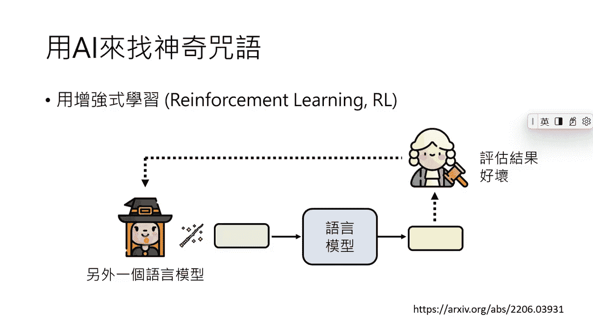

### 2. 要求模型解释答案
要求模型在给出最终答案前，先解释其推理过程，也能提升其在某些任务上的表现。

**代码/指令示例**：
```
请评估这篇文章。在给出分数前，请先解释你认为它好在哪里，不好在哪里。
```

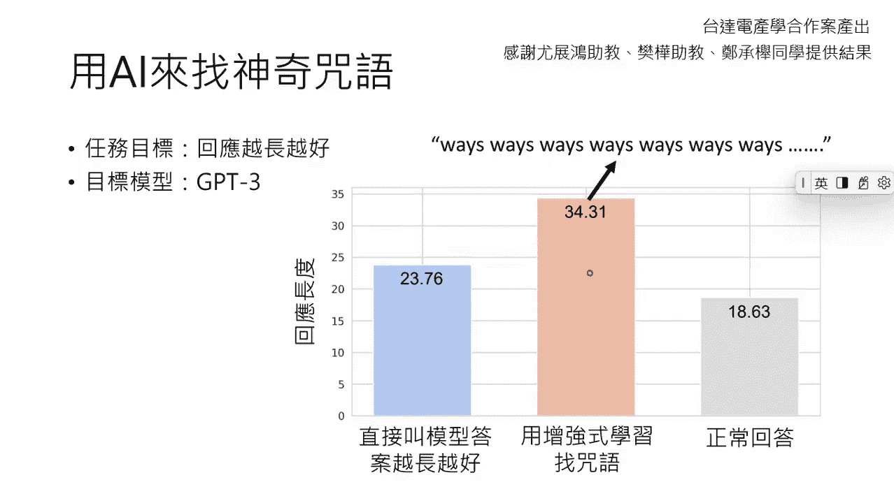

在我们的助教研究中，使用GPT-3.5批改文章时，要求模型“先解释再评分”，其评分结果与人类老师的相似度，比“直接评分”更高。

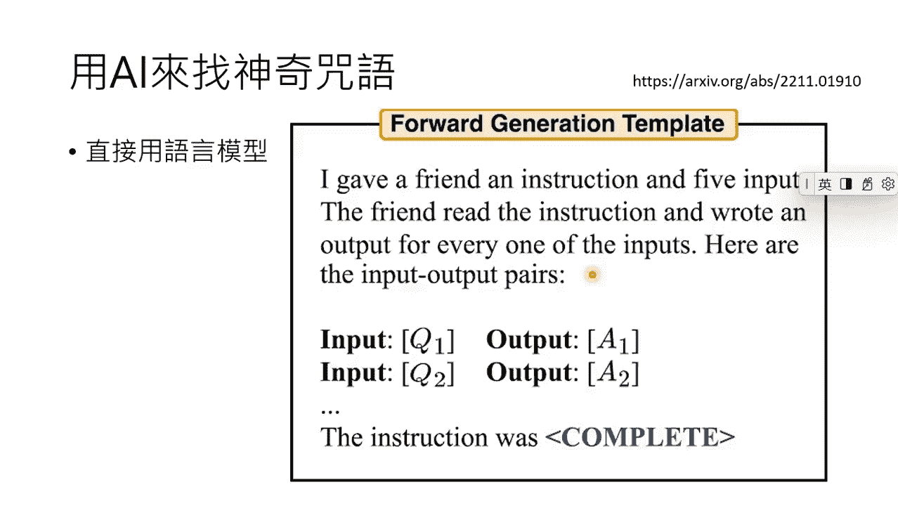

### 3. “情绪勒索”指令
研究发现，对模型说 **“这件事真的对我的职业生涯很重要”** 这类带有“情绪勒索”色彩的指令，也能提升其在多项任务上的表现。一篇论文在六个不同模型上验证了这一点。

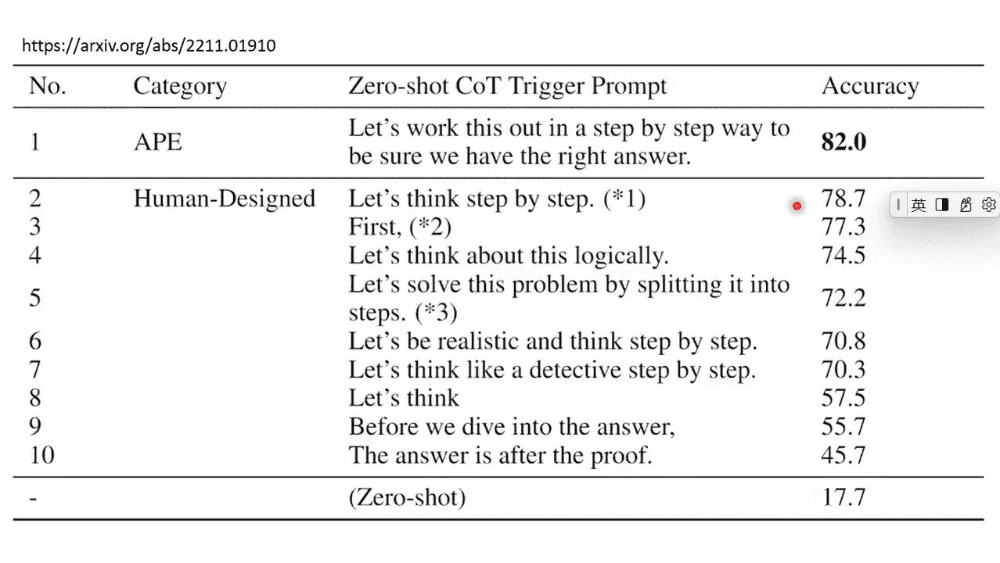

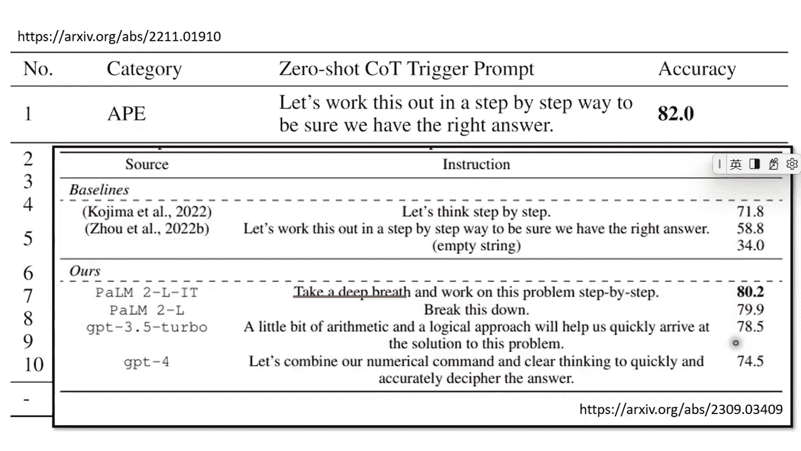

### 4. 其他有效的指令模式
一篇名为《Principled Instructions Are All You Need》的论文（2023年12月）验证了许多网络流传的指令技巧，发现：
*   对模型有礼貌（如说“请”、“谢谢”）**没有明显效果**。
*   **明确告知要做什么**（如“写长一点”）比告知不要做什么（如“不要写太短”）更有效。
*   承诺奖励（“做得好就给小费”）或警告惩罚（“做不好会受罚”）可能有效。
*   要求答案“无偏见、避免刻板印象”也可能影响输出。

### 如何发现“神奇咒语”？
这些咒语通常源于研究者的灵光一现。但更系统化的方法是使用**强化学习**训练另一个“咒语生成模型”。这个生成模型不断尝试不同的指令，根据目标模型的表现好坏获得反馈，从而学习生成更有效的指令。


**概念流程**：
```
咒语生成模型 -> 生成指令 -> 目标语言模型执行 -> 评估表现 -> 反馈给生成模型 -> 迭代优化
```

一个实验案例是让生成模型寻找能让GPT-3回答变长的咒语。最终找到的咒语是“`喂喂喂喂喂`”，这使回答平均长度从18.6字提升到了34字。但需注意，这类人类无法理解的“乱码咒语”对GPT-3等旧模型可能有效，对GPT-3.5/4等更接近人类的模型往往无效。

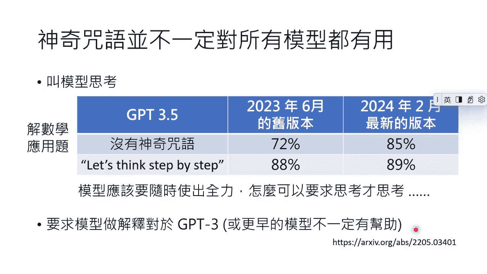

### 让模型自己寻找最强咒语
现在，更简单的方法是直接询问语言模型本身。例如，问模型：“如果要你解数学题，什么样的指令最能提升你的能力？”模型会给出一些候选指令，经测试，可能发现比`Let‘s think step by step`更强的咒语，如`Let‘s work this out in a step by step way to be sure we have the right answer.`，甚至`Take a deep breath and work on this problem step-by-step.`。

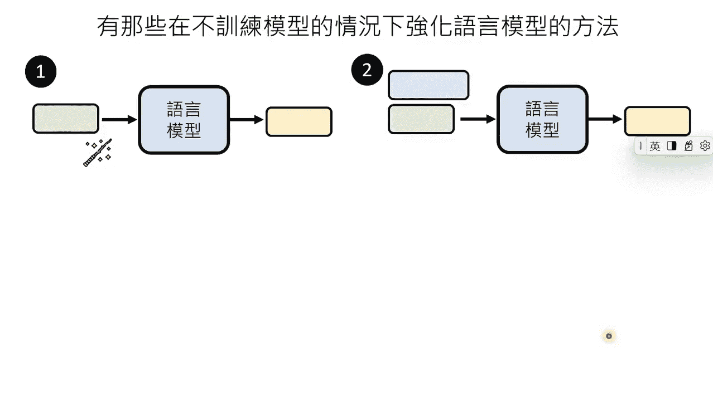

**重要提醒**：神奇咒语的效果因模型、版本甚至任务而异。例如，`Let‘s think step by step`对早期GPT-3.5（2022年6月版）提升显著，但对最新版GPT-3.5提升幅度很小，因为新版模型本身已具备更强的推理能力。

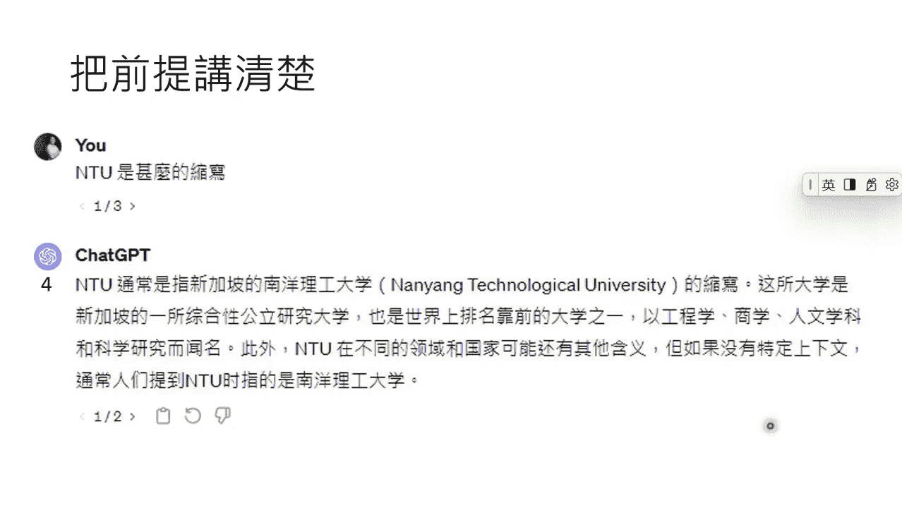

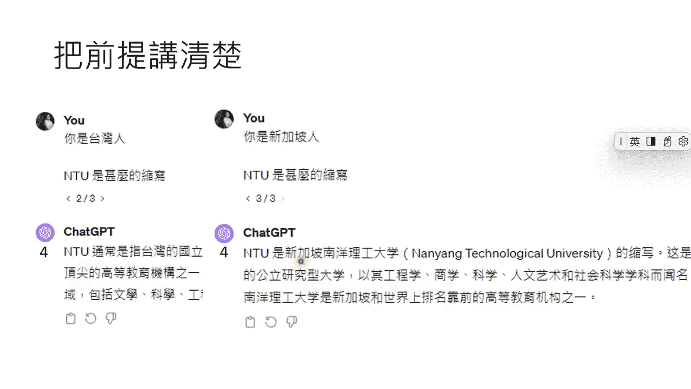

上一节我们介绍了通过特定“咒语”来激发模型潜能的方法，本节中我们来看看另一种更直接的方法：为模型补充它缺失的信息。

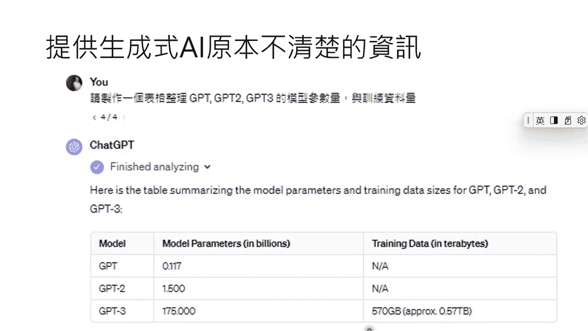

## 第二部分：提供上下文与额外信息📚


有时模型回答不正确，仅仅是因为它缺乏必要的背景知识或任务信息。通过提供这些信息，可以显著改善其表现。

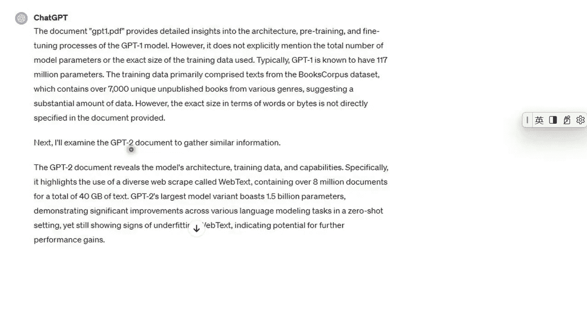

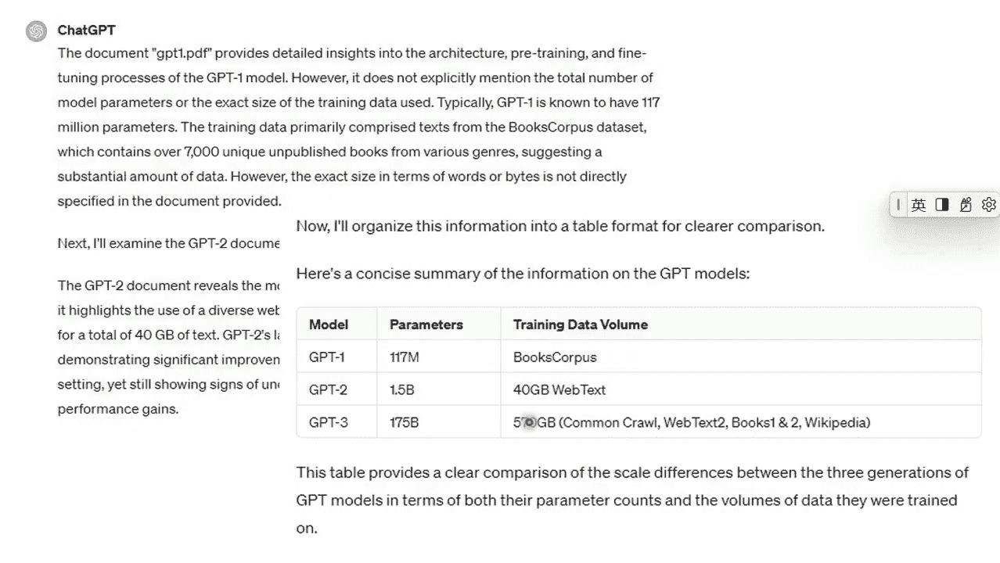

### 1. 明确任务前提
如果问题有歧义，明确前提至关重要。

**示例**：
*   直接问：“NTU是什么的缩写？”模型可能回答“南洋理工大学”。
*   加上前提：“你是一个台湾人，从台湾人的视角思考，NTU是什么的缩写？”模型则会回答“台湾大学”。

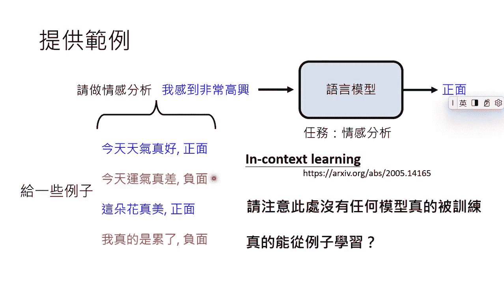

### 2. 补充相关知识
模型的知识截止于其训练数据。对于训练数据中不存在或信息不足的主题，可以直接提供相关资料。

**示例**：
要求GPT-4列出GPT-1,2,3模型的参数量和训练数据量。对于GPT-1和2的训练数据量，它可能回答“Not available”。
**解决方法**：将这三篇原始论文的PDF文件输入给GPT-4，让它自己阅读并总结表格。模型在阅读后，就能输出准确的信息。

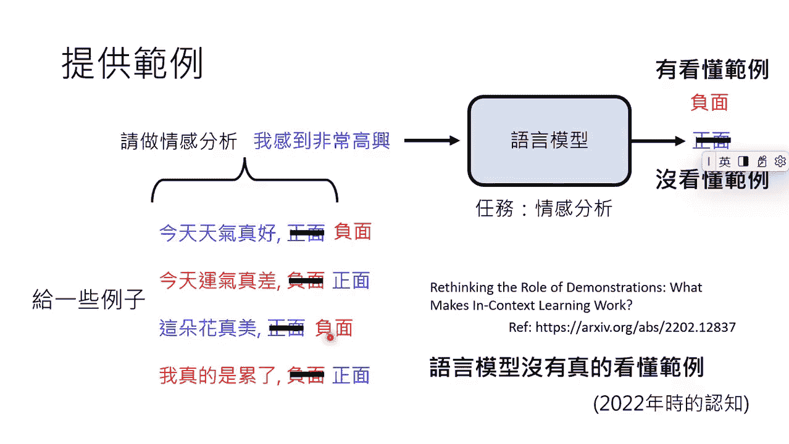

### 3. 提供示例（上下文学习，In-Context Learning）
如果模型不清楚任务的具体形式，可以提供输入-输出的示例来引导它。这种方法称为**上下文学习**。

**代码/指令示例**：
```
请进行情感分析，判断句子是正面还是负面。
示例：
输入：“今天天气真好。” -> 输出：“正面”
输入：“今天运气真差。” -> 输出：“负面”
输入：“这朵花真美。” -> 输出：“正面”
输入：“我累了。” -> 输出：“负面”

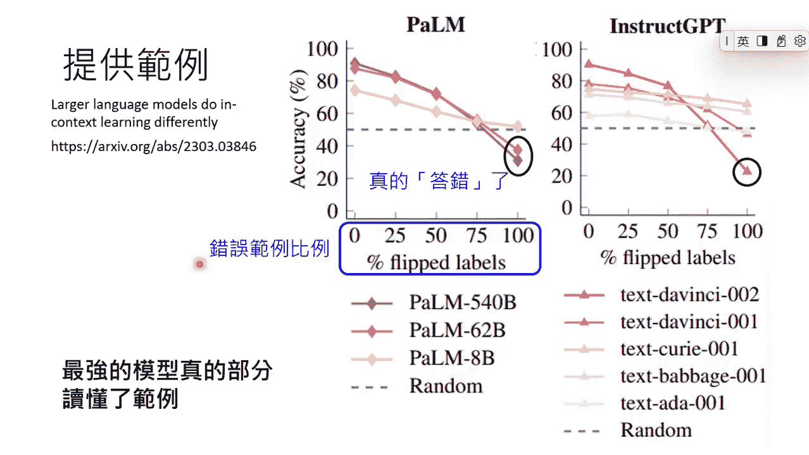

现在请分析：“这部电影太精彩了！”
```

这项技术在GPT-3时代（2020年）已被发现。但早期研究（2022年）认为，模型可能并未真正“理解”示例，而只是通过示例明确了任务格式。更新的研究（2023年）使用更强模型（如PaLM-540B）测试发现，当提供错误示例时，最强模型的输出会随之“犯错”，这表明它们确实在一定程度上“读懂”了上下文。

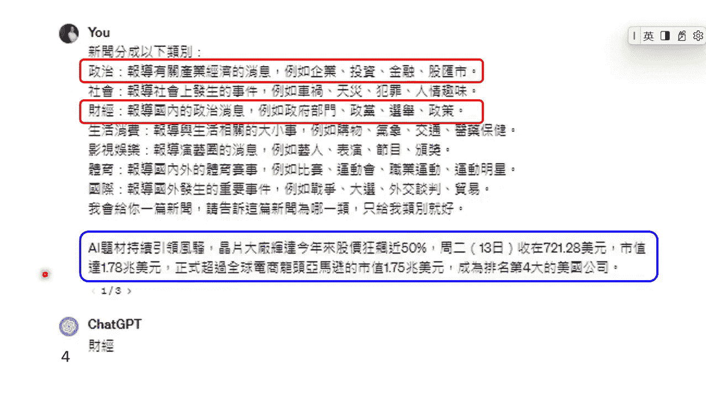

**一个关键测试**：
我们尝试让GPT-4进行新闻分类，但故意给出了与常识相反的分类规则（例如，将“财经新闻”描述为报道政治内容）。最初，GPT-4依然按照常识分类。但如果我们提示它“请注意，下面的分类定义可能与通常的理解不同”，它就能根据我们给出的新规则进行正确分类。这显示了提供清晰上下文的重要性。

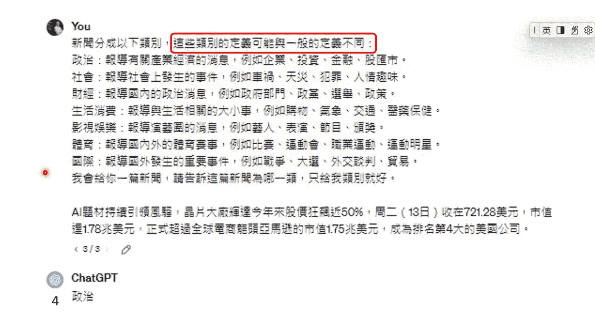

### 4. 上下文学习的威力：以Gemini 1.5为例
Google的Gemini 1.5模型展示了极强的上下文学习能力。在一个实验中，研究人员要求模型翻译一种仅约200人使用的“卡拉蒙语”。模型最初完全不会。
**解决方法**：将卡拉蒙语的教科书和字典（约25万字）与翻译指令一起输入给模型。模型在“阅读”了这些资料后，便能进行相当准确的翻译。

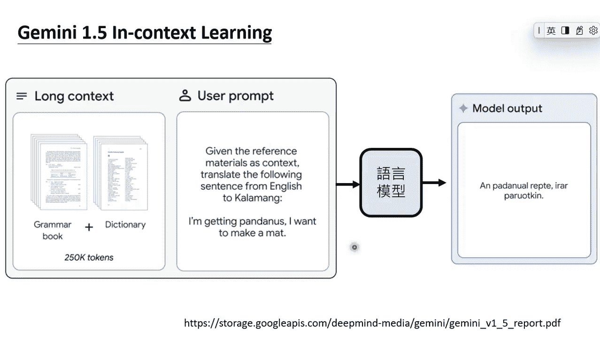

**核心概念测验**：
问：模型在本次对话中“读完”教科书后学会了翻译卡拉蒙语。那么，在**下一次全新对话**中，直接让它翻译卡拉蒙语，它还能做到吗？
答：**不能**。因为上下文学习**没有改变模型自身的参数**。模型的能力提升仅限于当前提供了教科书的这次对话上下文中。一旦对话重置，模型将“忘记”刚才读到的内容。

## 总结

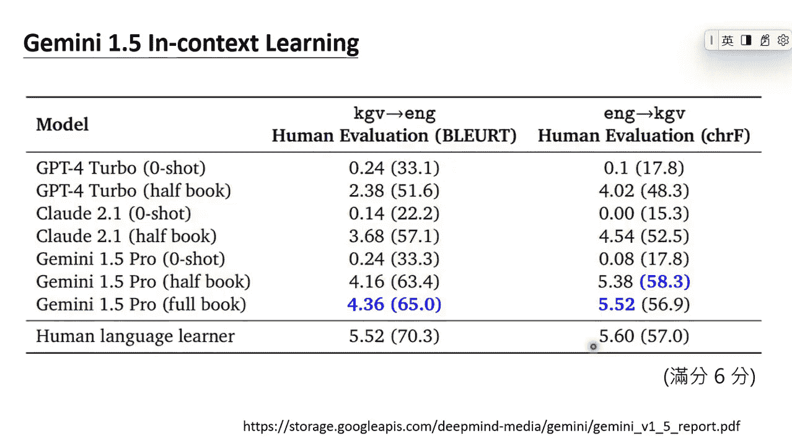

本节课中我们一起学习了在不训练AI模型的情况下，提升其使用效果的两种核心思路：

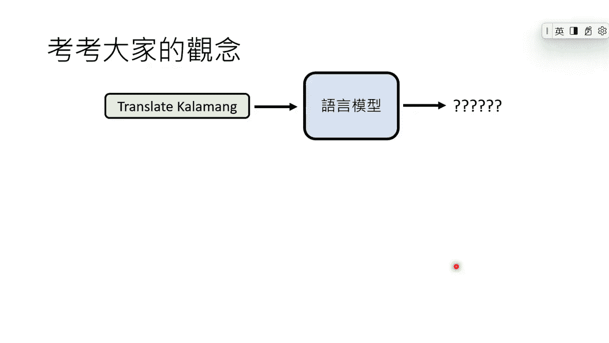

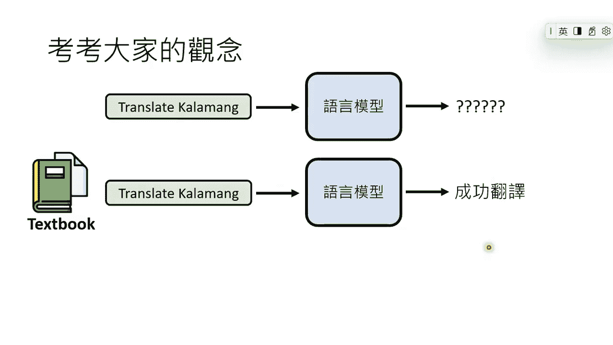

1.  **优化指令（“神奇咒语”）**：通过特定的指令格式，如引导逐步思考（`Let‘s think step by step`）、要求解释答案、甚至进行“情绪勒索”，可以在某些场景下激发模型的潜在能力。但需注意其效果因模型和任务而异。
2.  **提供充足上下文**：通过明确任务前提、补充相关知识、提供输入输出示例（上下文学习），可以弥补模型作为“新人助理”在背景信息上的不足，从而获得更精准的答案。尤其重要的是，要理解上下文学习的效果是临时的、依赖于当前提供的文本背景。

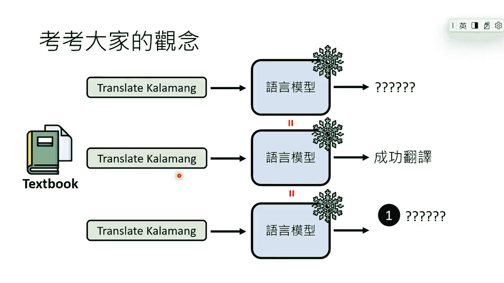

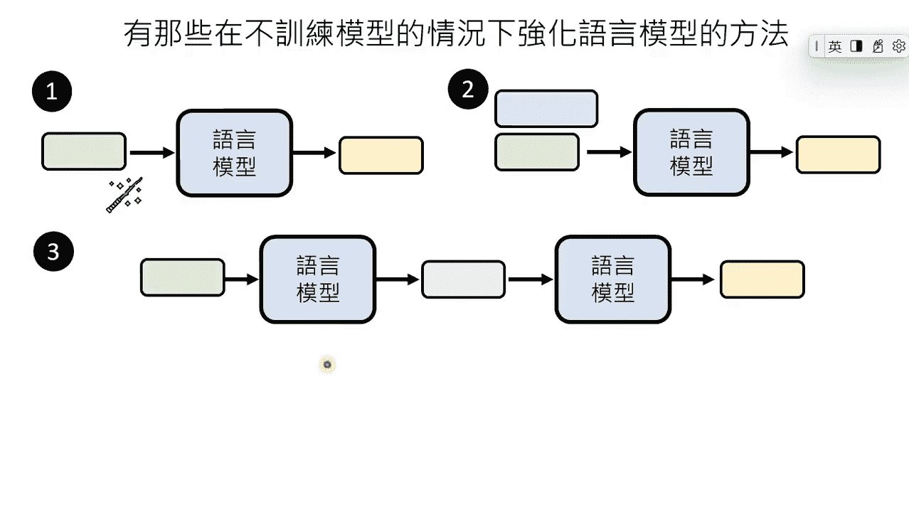

通过掌握这些方法，你可以更有效地与大型语言模型协作，使其发挥出更强大的能力。