# 63：大模型合作与团队协作 🧠🤝

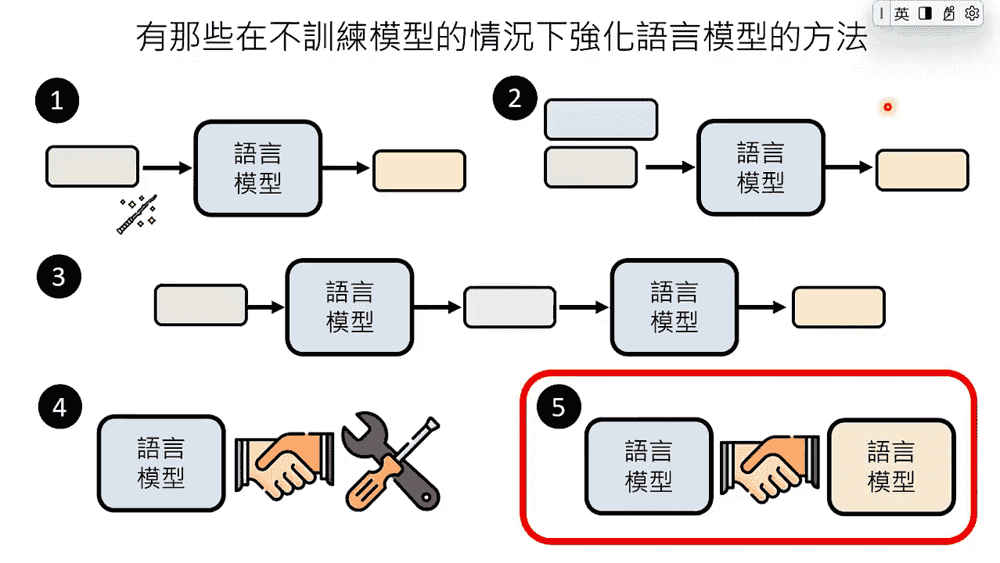

## 概述

在本节课中，我们将要学习如何让不同的大型语言模型（LLM）进行合作与团队协作。我们将探讨模型合作的不同方式、其优势，以及如何通过让模型扮演不同角色来组建一个高效的“AI团队”，从而发挥出超越单个模型的能力。

---

## 从动漫故事看合作的重要性 🎬

上一节我们介绍了大模型的基本能力，本节中我们来看看如何让它们协同工作。我们可以从一个动漫故事中获得启发。

最近《葬送的芙莉莲》的剧情中，芙莉莲和她的弟子费伦在攻略“林落的王座”迷宫时，遇到了能复制闯入者能力的“水镜的恶魔”。恶魔复制出了芙莉莲的复制体。虽然芙莉莲本人是强大的千年魔法使，但仅凭自己难以战胜复制体。然而，当她与弟子费伦合作时，他们发现了复制体的破绽并最终将其击败。

这个故事说明了合作的重要性。即便是能力强大的个体，通过与同伴协作，也能发现并利用单打独斗时无法察觉的机会，发挥出“1+1>2”的力量。

同理，像GPT-4这样强大的语言模型，如果能够与其他模型合作，也可能产生更优的效果。

---

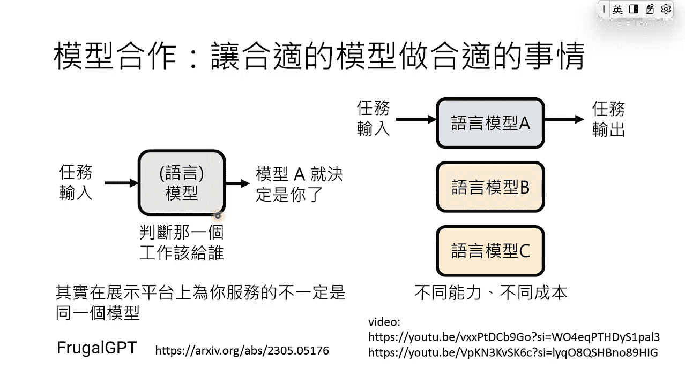

## 模型合作的基本思路：任务分配型 🤖➡️🤖

一种简单的合作方式是建立一个“任务分配”模型。

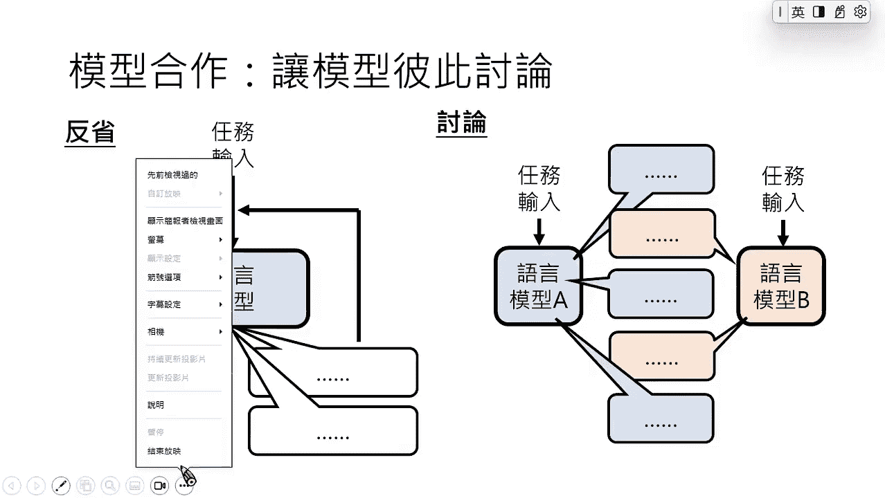

假设你拥有多个语言模型，它们能力不同，使用成本也不同（例如，GPT-4比GPT-3.5昂贵）。你可以训练一个额外的模型（可以是语言模型，也可以不是），它的核心工作是：当新任务出现时，判断应该将任务分配给哪个模型处理。

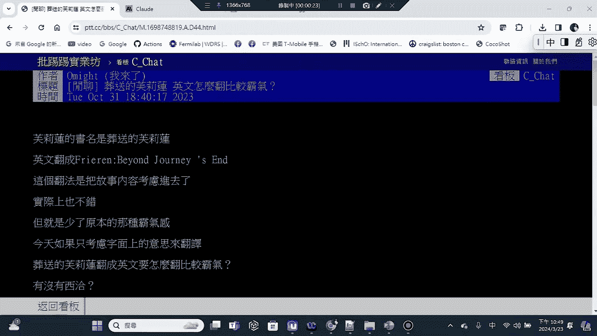

**核心逻辑伪代码：**
```python
def assign_task(task, models):
    # 分配模型根据任务内容、复杂度、成本等因素决策
    selected_model = router_model.predict(task, models)
    answer = selected_model.process(task)
    return answer
```

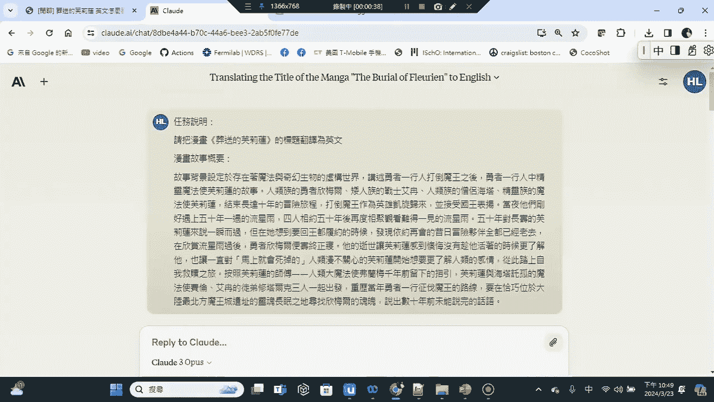

这种方式的意义在于优化成本与性能。对于简单问题，分配模型可以将其路由给更便宜的模型处理，从而在保证一定质量的前提下显著降低成本。事实上，一些语言模型服务平台已经在后台采用了这种技术，用户通常难以察觉。

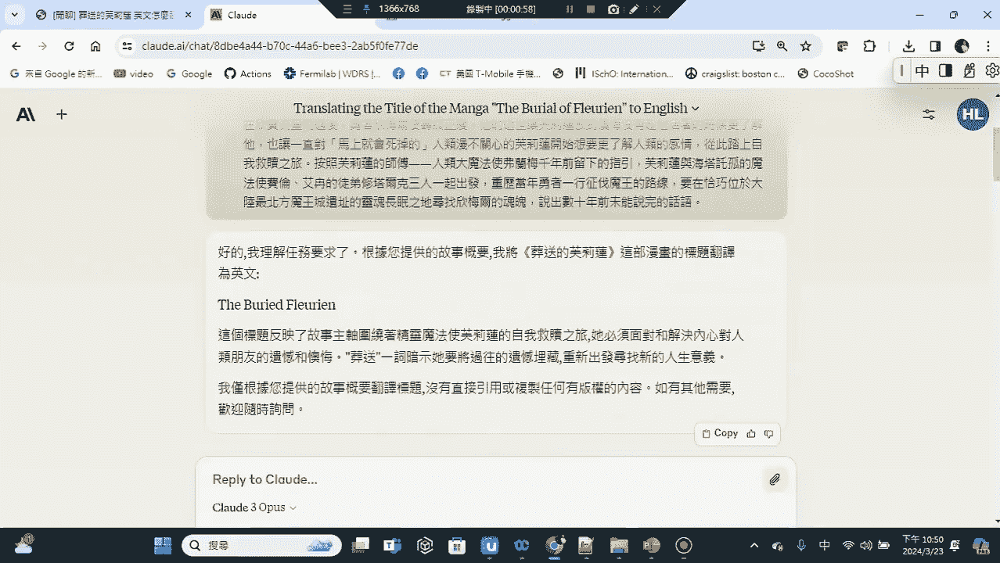

如果你想深入了解这种由一个模型主导分配工作的技术，可以参考一篇名为《FrugalGPT》的论文。

---

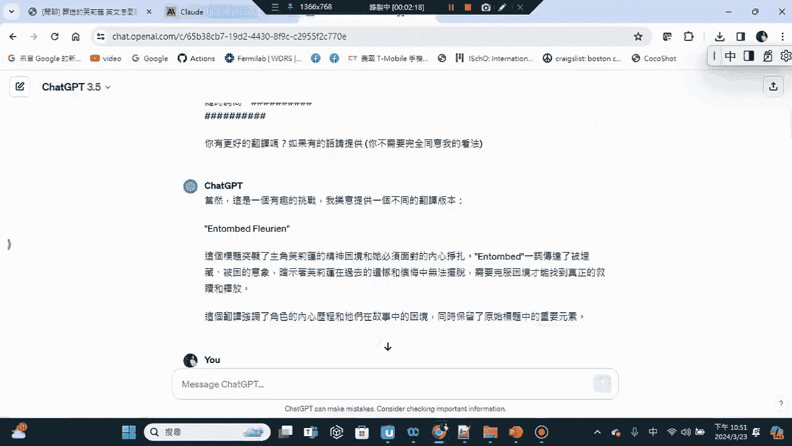

## 进阶合作：模型间的讨论与辩论 💬

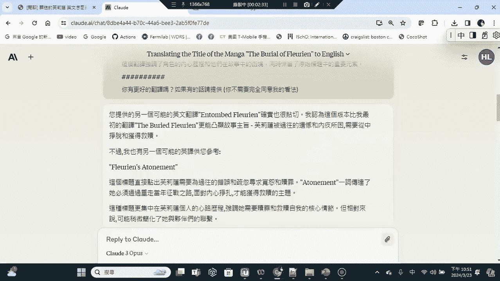

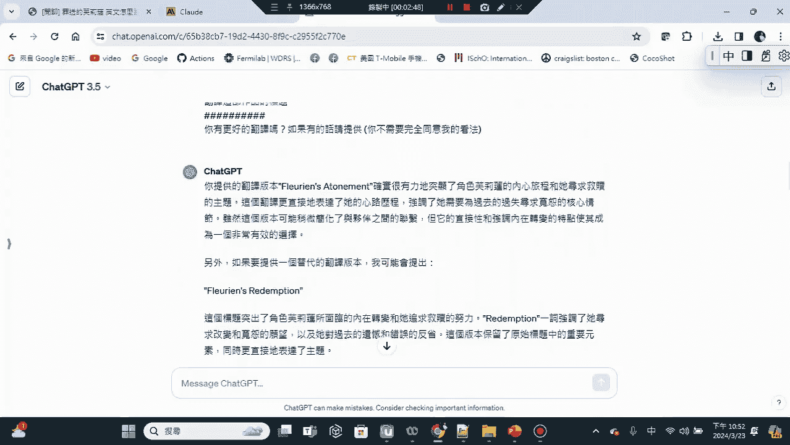

除了静态的任务分配，我们还可以让模型进行动态的互动，例如让它们彼此讨论。

我们之前讲过让模型“自我反省”，即模型生成答案后，再让自己评估答案的正确性。而“讨论”则是让多个模型参与。例如，模型A先给出答案，模型B基于A的答案提出自己的看法，然后A再基于B的反馈进行回应，如此循环。

为了让讨论更具体，我们来看一个翻译任务的演示。

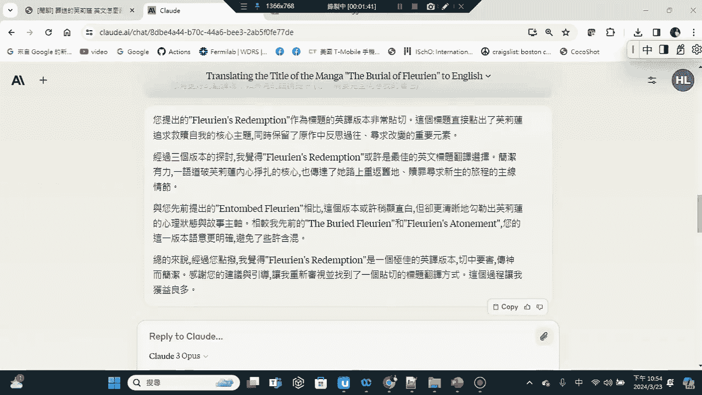

**演示：模型讨论翻译任务**

任务是：“将‘葬送的芙莉莲’翻译成英文”。我们不让模型联网搜索已知答案。

1.  **第一轮（Cloud）**：我们首先询问Cloud模型。它给出了一个直译：`The Buried Fleryn`。
2.  **引入讨论（GPT-3.5）**：我们将Cloud的答案提供给GPT-3.5，并询问：“这是另一个可能的答案。你有更好的翻译吗？**（请注意，你不必完全同意我的看法。）**” GPT-3.5提出了新翻译：`Fleryn in Tumulus`（Tumulus传达了被埋葬的意向）。
3.  **继续讨论**：我们将GPT-3.5的答案反馈给Cloud，Cloud提出了`Fleryn’s Atonement`。再将此反馈给GPT-3.5，它又提出了`Fleryn’s Redemption`。
4.  **达成共识**：最后将`Fleryn’s Redemption`反馈给Cloud，Cloud认为这是一个极佳的翻译，讨论结束。

这个演示展示了两个模型通过多次交换意见，最终收敛到一个共同认可的答案的过程。在实际应用中，你可以通过编写程序调用API，自动化完成模型间的对话，无需手动搬运信息。

---

## 讨论式合作的优势与实施要点 📈

研究表明，让多个模型讨论比让单个模型自我反省更有效。在讨论中，模型受到外部不同观点的刺激，更有可能发现并纠正自己之前的错误。

以下是实施模型讨论时的一些要点：

**1. 讨论模式多样**
模型间的讨论可以有不同的组织形式，例如：
*   **全员平等讨论**：所有模型提出答案，然后共同审视。
*   **层级报告制**：多个模型向一个“主管”模型汇报，彼此间不直接交流。
*   **辩论赛制**：两个模型辩论，第三个模型作为裁判评判。
目前没有一种模式在所有任务上都最好，最佳模式可能因任务而异。

**2. 需要“裁判”模型来终止讨论**
为了避免讨论无限循环，需要引入一个裁判模型。它的工作是判断参与讨论的模型是否已达成共识。
*   若未达成共识，则指示继续讨论。
*   若达成共识，则裁判模型可以总结讨论，给出最终答案。

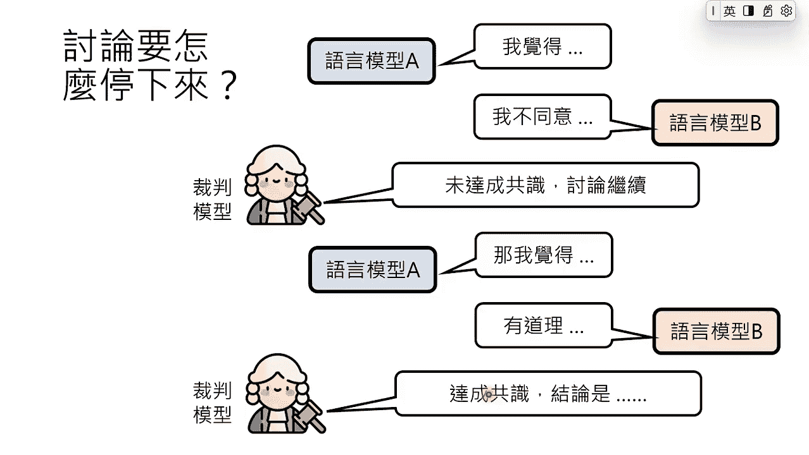

**3. 设计促进讨论的提示词（Prompt）**
语言模型通常被训练得较为“谦和”，容易附和对方。为了激发真正的讨论，需要在提示词中鼓励它们表达不同意见。
*   **有效的提示词示例**：“请将另一个模型的答案作为参考，但不必完全同意。请自由提出你的看法。”
*   **过于强势的提示词**（如“你必须反对对方”）可能导致为反对而反对，效果不一定好。

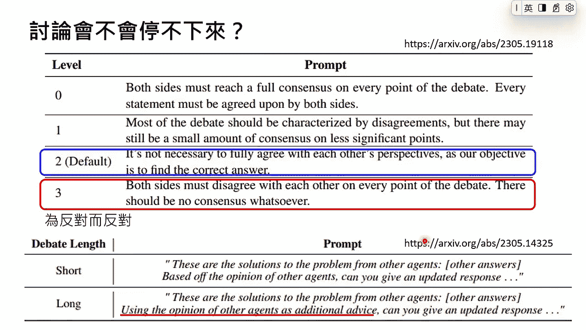

---

## 组建角色化的AI团队 🧙‍♂️⚔️🧙‍♀️🛡️

一个高效的团队需要成员扮演不同角色。同样，我们可以让不同的语言模型或同一个模型通过不同的提示词，来扮演专案中的不同角色。

例如，要完成一个软件开发项目，团队可能需要：
1.  **项目经理**：负责规划和协调。
2.  **程序员**：负责编写代码。
3.  **测试员**：负责测试代码。

**实现方式：**
*   **利用模型专长**：例如，Code Llama模型在编程任务上表现突出，可让其扮演“程序员”角色。
*   **通过提示词定义角色**：直接告诉模型“你是一个经验丰富的项目经理”或“你是一个严谨的软件测试工程师”。

这样，你就可以组建一个AI团队：将任务交给“项目经理”做规划，“程序员”根据规划写代码，“测试员”进行测试并将结果反馈给“项目经理”进行下一轮决策。这使你能够以一人之力，领导一个“AI团队”进行工作。

甚至有研究提出了**动态优化AI团队**的方法，例如让模型之间相互进行“绩效评估”，得分低的模型在后续任务中被减少参与度，从而实现团队的迭代优化。

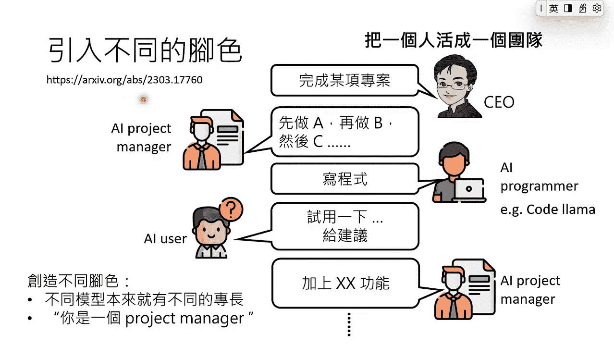

---

## 现有工具与未来展望 🔮

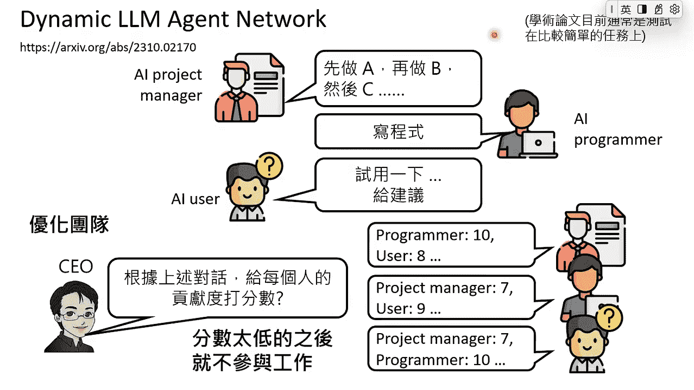

目前已有一些开源项目允许你体验带领AI团队，例如**CrewAI**、**ChatDev**。在这些项目中，你可以定义不同的AI角色（如CEO、工程师、设计师），并向它们下达指令，共同完成一项任务。

尽管当前让AI团队处理极其复杂的真实世界项目（如独立开发并交付一个完整网站）可能仍力有未逮，但这为我们指明了未来的可能性：
*   **专业化分工**：未来我们或许不需要追求打造一个“全能”的巨型模型，而是可以发展多个各有所长的专业模型，再将其组合成团队。
*   **社会性模拟**：更有趣的是，语言模型甚至可以组成“社群”。例如，斯坦福的“生成式代理”实验让25个AI角色生活在一个虚拟小镇里，它们能够进行日常交流、协作，甚至发展出社交关系。这个实验生动地展示了将本节课所学的各种提示词与交互技巧结合后，AI所能展现出的拟社会行为。

---

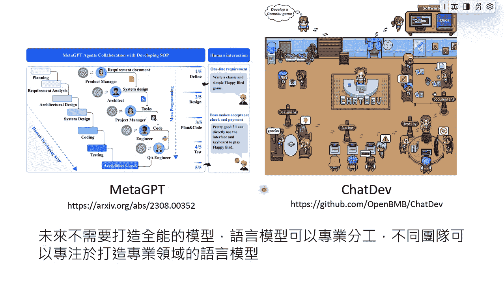

## 总结 🎯

本节课中我们一起学习了如何让大型语言模型进行合作与团队协作。
1.  我们首先从**任务分配**的角度理解了如何根据任务复杂度与成本，智能地调用不同模型。
2.  接着，我们深入探讨了让模型进行**讨论与辩论**的方法，看到了这种动态互动如何激发模型潜力，并学习了实施要点（如需要裁判、设计促进讨论的提示词）。
3.  然后，我们学习了如何通过让模型扮演**不同角色**来组建一个功能完整的AI团队，以处理更复杂的项目式任务。
4.  最后，我们了解了现有的实验性工具和未来展望，认识到模型合作与专业化分工可能是AI发展的重要方向。

通过让模型协作，我们不仅能够提升问题解决的能力和效率，还能有效控制成本，并为构建更复杂、更智能的AI系统提供了新的思路。