# 64：大型语言模型修炼史（第一阶段） 📚

## 概述
在本节课中，我们将要学习大型语言模型训练的第一阶段。我们将了解语言模型如何通过“文字接龙”任务进行自我学习，以及在此过程中面临的挑战和解决方法。课程将从机器学习的基本概念开始，逐步深入到语言模型训练的细节。

---

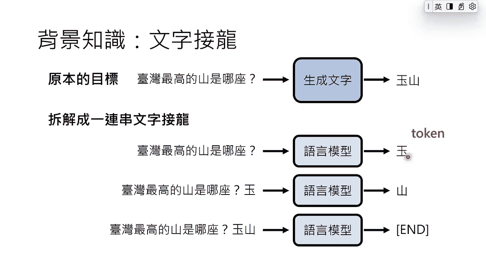

## 背景知识：语言模型与文字接龙

上一节我们介绍了课程的整体框架，本节中我们来看看语言模型的基础任务。

大型语言模型的核心任务是**文字接龙**。当模型生成答案时，它实际上是在进行文字接龙，将答案中的文字一个接一个地产生出来。

在文字接龙过程中，语言模型每次产生出的符号称为 **token**。在本课程中，为简化说明，我们将一个中文字视为一个 token。实际上，不同模型对 token 的定义可能不同，例如 ChatGPT 可能用两三个 token 才能组成一个中文字。

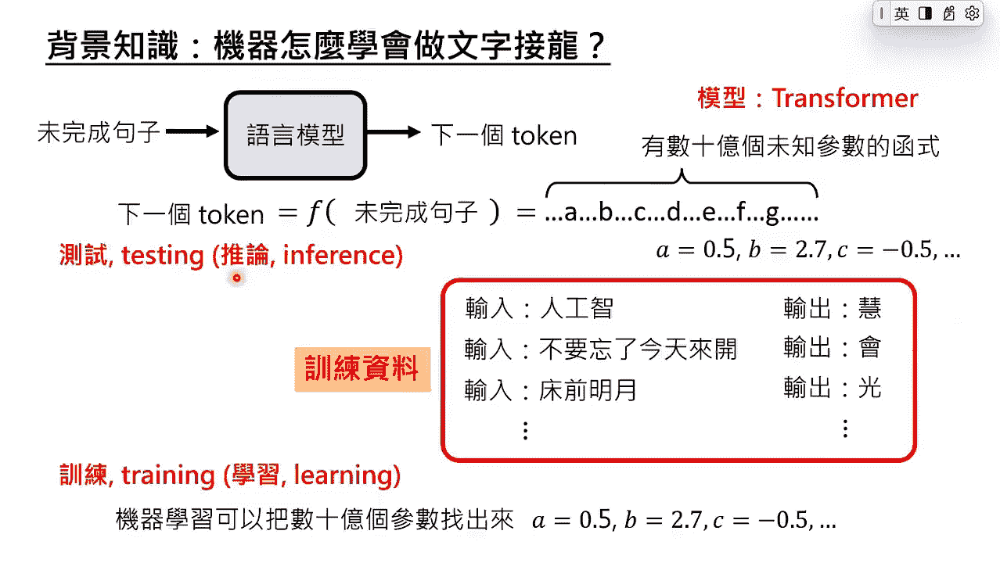

---

## 机器学习如何实现文字接龙

上一节我们明确了语言模型的任务，本节中我们来看看机器如何学习完成这个任务。

机器学习或深度学习的目标是找到一个函数。对于语言模型，这个函数可以表示为：

**`F(未完成的句子) = 下一个 token`**

这个函数非常复杂，可能需要数十亿个参数才能完成文字接龙任务。这个包含大量未知参数的函数就称为**模型**。

以下是找到这些参数的两个关键步骤：

1.  **训练 (Training/Learning)**：我们需要训练资料。训练资料告诉我们，当输入一个未完成的句子时，输出应该是哪个 token 才是正确的。例如，“人工智”后面应该接“会”。机器学习算法利用这些资料，自动找出那数十亿个参数。
2.  **测试/推论 (Testing/Inference)**：参数被找出后，我们将它们代入函数中。使用这个函数进行文字接龙的过程就称为测试或推论。

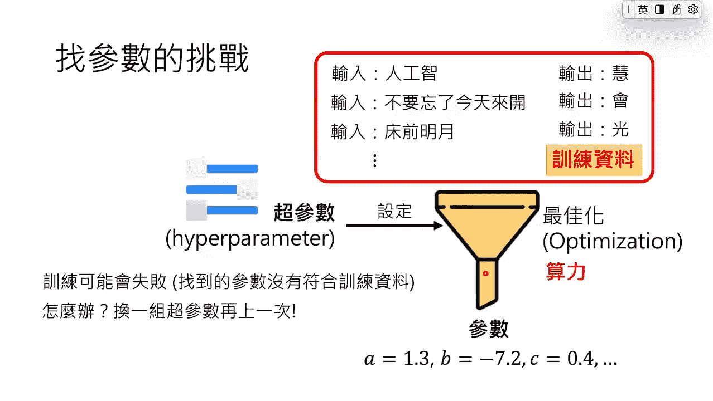

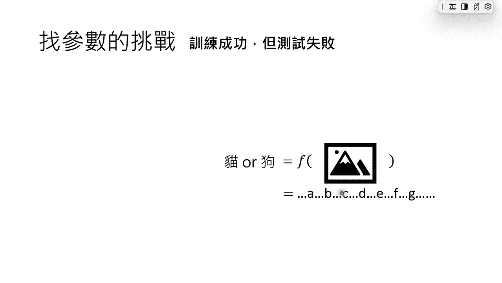

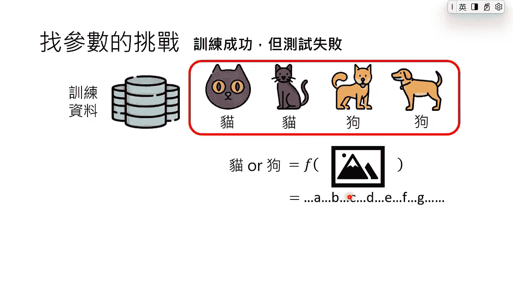

---

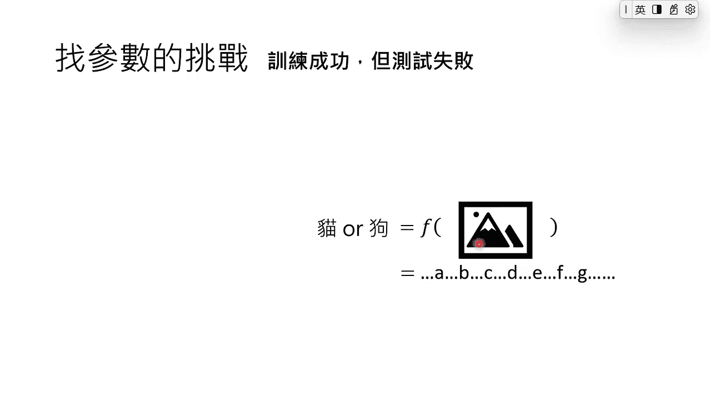

## 训练过程中的挑战

上一节我们介绍了训练的基本流程，本节中我们来看看训练时可能遇到的两个主要挑战。

### 挑战一：训练失败与超参数调整

训练过程具有随机性，有时可能会失败。失败意味着找出的参数不符合训练资料的要求。

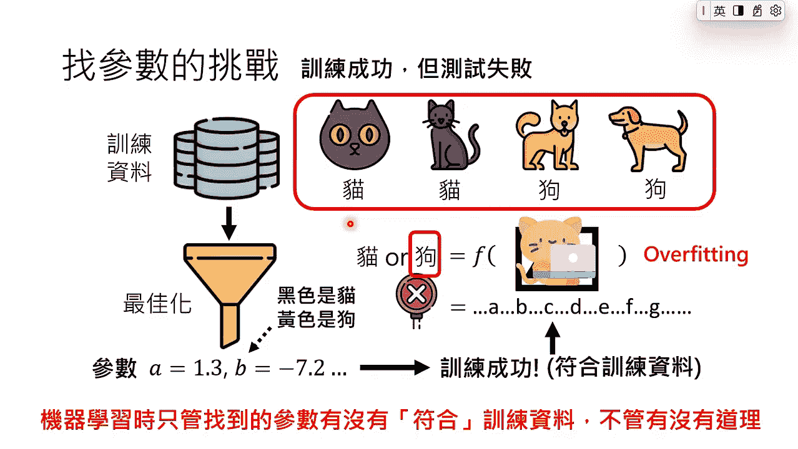

训练过程可以看作一部需要设定的机器。设定这部机器的参数称为 **超参数 (Hyperparameter)**。设定超参数就决定了具体的优化方法。

如果训练失败，常见的做法是更换一组超参数重新尝试。由于超参数与最终结果的关系非常复杂，通常需要多次尝试才能找到合适的组合。这个过程需要大量的计算资源，也就是常说的“算力”。

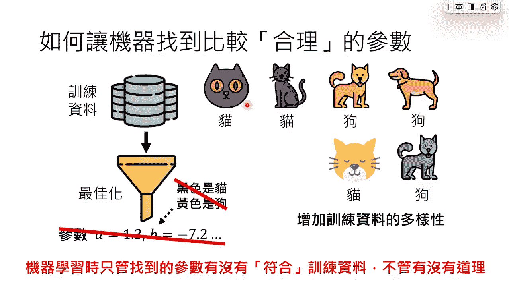

人们常说的“调参数”，通常指的就是调整**超参数**，而不是模型内部的数十亿个参数。

### 挑战二：过拟合 (Overfitting)

另一个挑战是**训练成功但测试失败**，即过拟合。

举例说明：假设我们要训练一个猫狗分类器。训练资料中，猫都是黑色的，狗都是黄色的。优化算法可能找到一组参数，简单地认为“黑色就是猫，黄色就是狗”。这组参数在训练资料上完全正确（训练成功），但遇到一只黄色的猫时，就会错误地分类为狗（测试失败）。

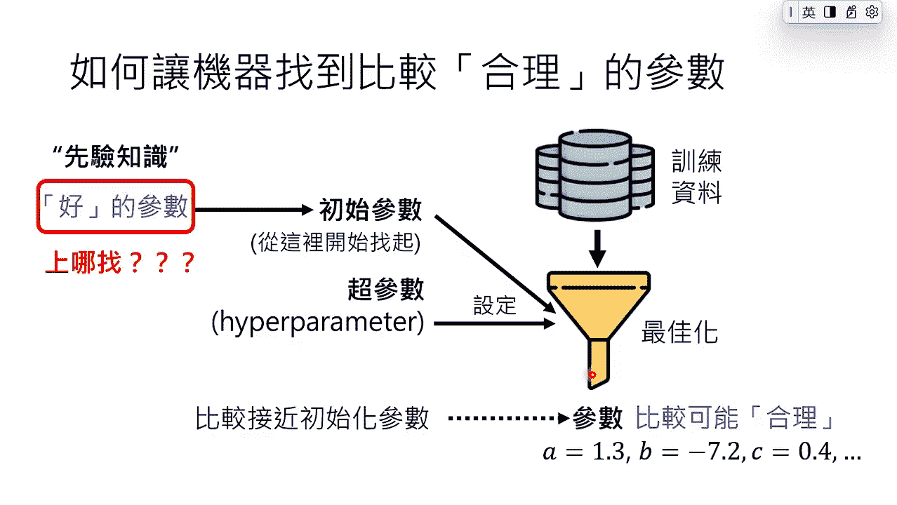

机器在学习时只关心参数是否**符合训练资料**，而不会思考这些参数是否“合理”或能否推广到其他数据。因此，不能用人类的思维去揣测机器的学习过程。

为了解决过拟合，一个常见的方法是**增加训练资料的多样性**。例如，在资料中加入黄色的猫和黑色的狗，迫使模型学习更本质的特征（如外形），而不是表面的特征（如颜色）。

---

## 训练起点：初始参数的重要性

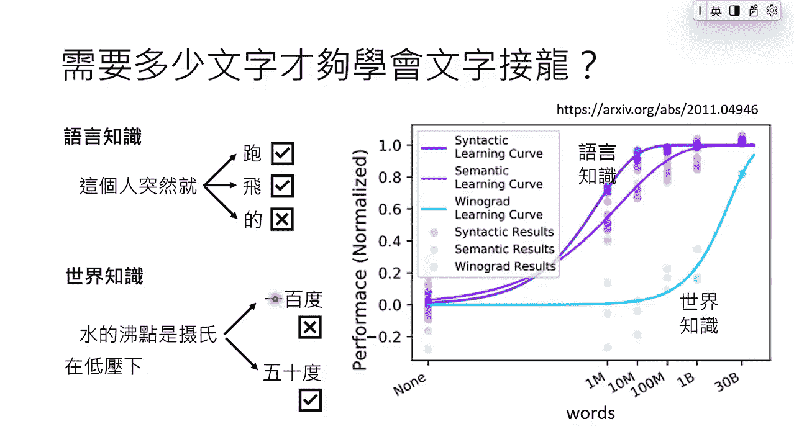

上一节我们讨论了资料多样性的作用，本节中我们来看看训练开始的另一个关键点。

在优化过程中，除了超参数，还需要设定**初始参数**。优化算法会从初始参数出发，寻找符合训练资料的参数，因此最终找到的参数会与初始参数比较接近。

最常见的做法是随机生成初始参数，这种方法称为 **“from scratch”** 训练。

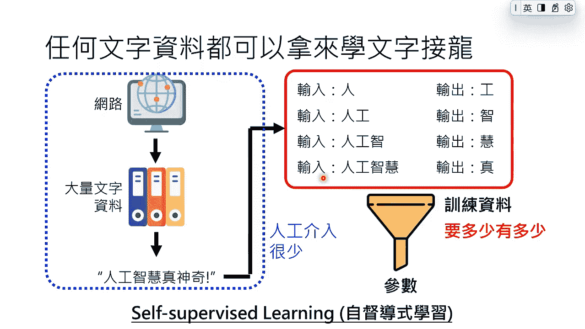

另一种思路是使用一组“较好”的初始参数。这组参数可以被视为给模型的**先验知识**，让它从更接近理想状态的位置开始学习，从而增加找到合理参数的可能性。但难题在于：如何找到这组“好”的参数？

我们的故事就从这里展开。

---

## 第一阶段：自我学习，累积实力

上一节我们提出了寻找好参数的难题，本节中我们正式进入语言模型训练的第一阶段。

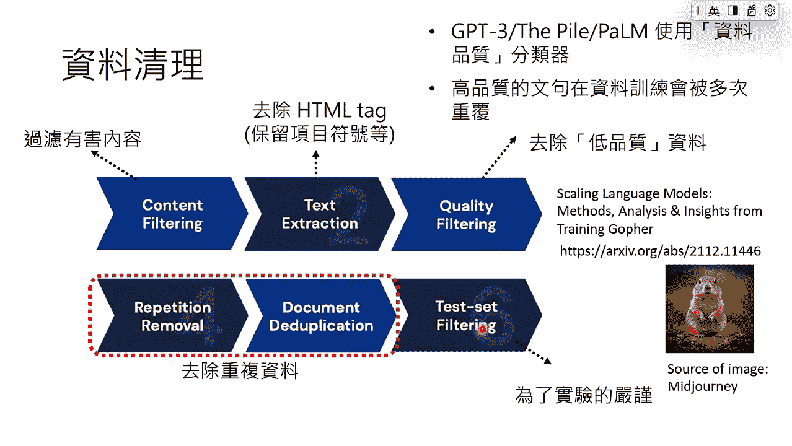

语言模型训练的第一阶段，核心是学习做文字接龙。但要正确接龙，模型需要掌握两类知识：

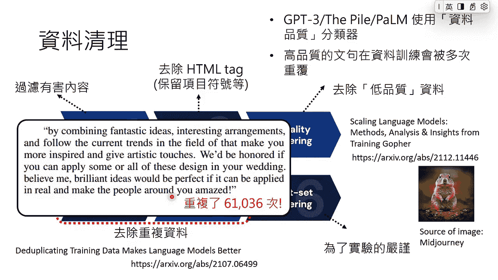

1.  **语言知识**：理解人类语言的文法。例如，“这个人突然就”后面可以接“跑”或“飞”，但不会接不符合文法的词。学习语言知识可能不需要极大量的资料。
2.  **世界知识**：理解物理世界和人类社会。例如，“水的沸点是摄氏”后面接“100度”是正确的，因为符合物理常识。世界知识复杂且具有层次性，需要**极其大量**的资料才能学会。

那么，从哪里获取如此海量的资料呢？答案是：**网络**。网络上存在近乎无穷无尽的网页和文字。

以下是利用网络资料训练的基本流程：

1.  从网络上爬取大量文字资料。
2.  将句子整理成适合文字接龙训练的形式。例如，将句子“人工智慧真神奇”转化为多组训练对：“人”接“工”，“人工”接“智”，“人工智”接“会”，“人工智慧”接“真”。
3.  用这些资料训练模型参数。

这种只需极少人工介入就能获取训练资料的方式，称为 **自督导式学习 (Self-supervised Learning)**，即机器自己教自己。

---

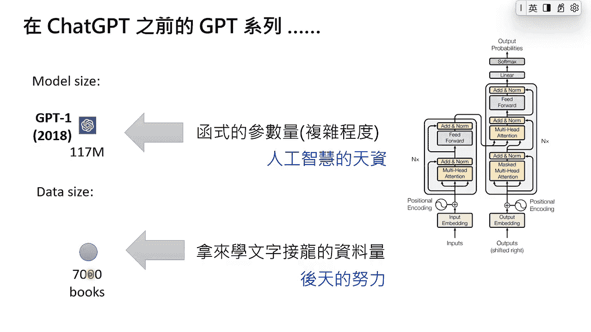

## 资料清理的必要性

上一节提到网络资料俯拾皆是，本节中我们来看看为什么仍需人工进行资料清理。

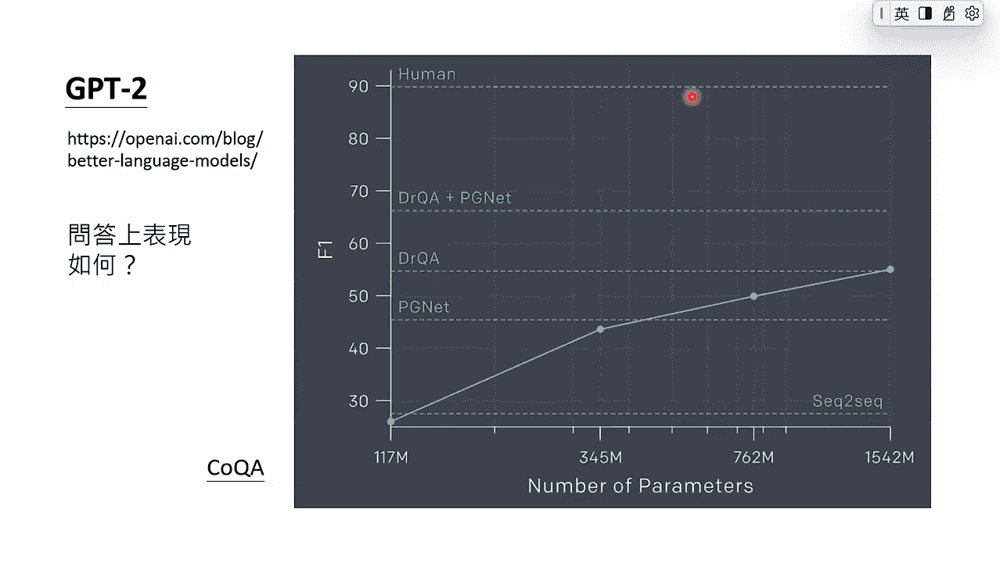

虽然网络资料丰富，但直接使用往往需要清理。以下是常见的清理步骤：

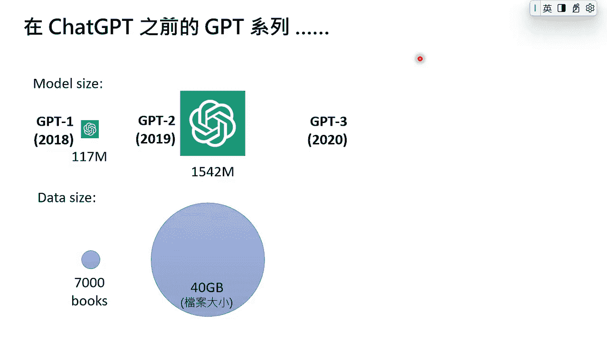

*   **过滤有害内容**：移除色情、暴力等不良信息，避免模型学到并输出这些内容。
*   **移除无用符号**：清除HTML标签等对文字接龙无用的符号，保留可能用到的符号（如表情符号）。
*   **品质控制**：去除低品质资料。何为“高品质”见仁见智，常见做法是训练一个分类器来评分，或将维基百科、教科书类内容视为高品质资料，在训练中赋予更高权重。
*   **去除重复资料**：网络资料重复率可能很高。例如，某婚礼公司的广告文案可能在资料中重复出现数万次。不去重会导致模型过度学习并频繁输出这些重复内容。

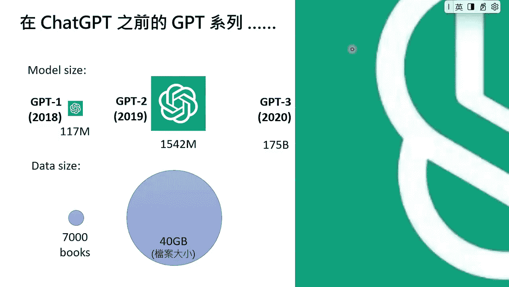

需要注意的是，使用网络资料可能涉及版权等法律问题，这也是开发团队需要考虑的。

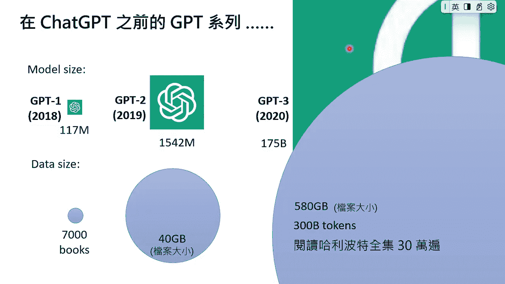

---

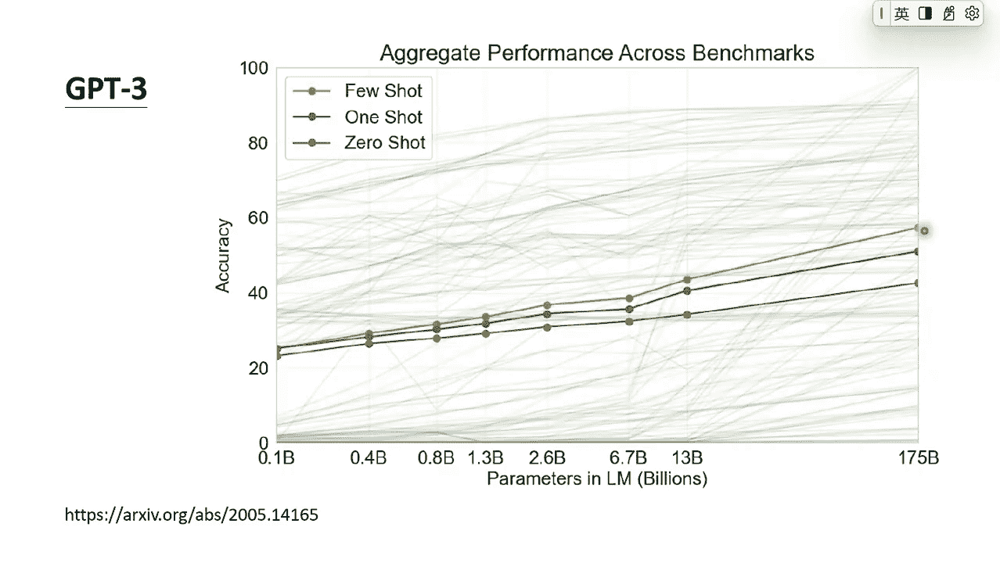

## 早期模型的探索：GPT系列

上一节我们介绍了资料处理，本节中我们回顾一下语言模型发展的早期探索。

在ChatGPT之前，OpenAI开发了一系列GPT模型，它们都是用网络文字训练出来的。

*   **GPT-1 (2018)**：参数量1.17亿，训练资料约700本书。模型较小，未引起广泛关注。
    *   **参数量**：比喻为模型的“天资”或复杂程度。
    *   **资料量**：比喻为“后天的努力”。
*   **GPT-2 (2019)**：参数量15亿，是GPT-1的10倍大；使用40GB资料训练。在当时是巨大的模型，但实际表现（如回答问题正确率约55%）并不突出。
*   **GPT-3 (2020)**：参数量1750亿，是GPT-2的100多倍；使用约3000亿个token（相当于哈利波特全集读30万遍）进行训练。尽管规模惊人，但其在多项任务上的表现（正确率约50%-60%）仍未能达到颠覆性水平，且模型行为难以控制。

早期这些模型虽然从海量资料中学到了知识，但它们**不知道如何运用这些知识来回答问题**。它们的行为就像练就深厚内功却不知如何使用的人，输出难以预测和控制，常常答非所问或自言自语。

---

## 总结

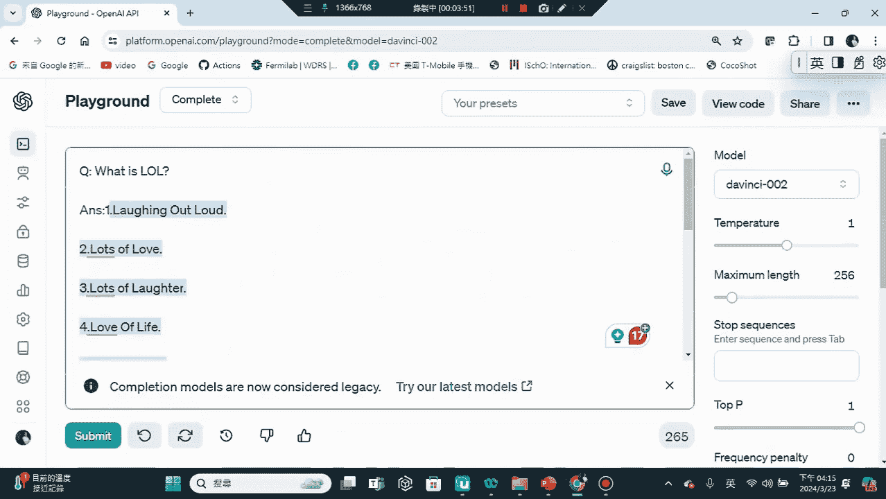

本节课中我们一起学习了大型语言模型修炼的第一阶段。

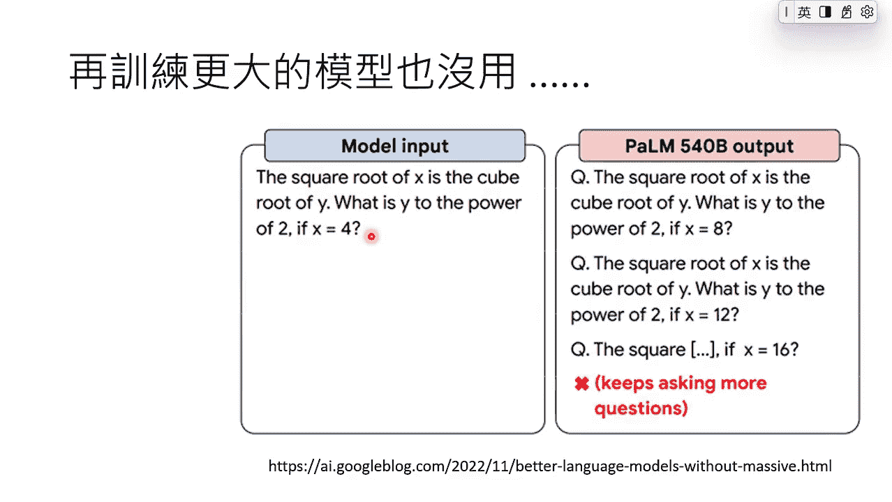

我们了解到，语言模型通过**文字接龙**任务进行训练，其核心是找到一个包含数十亿参数的复杂函数。训练过程需要海量的资料，这些资料主要从**网络**上通过**自督导学习**的方式获取，并需要进行必要的清理。

我们回顾了从GPT-1到GPT-3的早期探索，发现即使模型规模和资料量巨大，单纯的第一阶段训练也只能让模型“学到知识”，而无法让它“听话地运用知识”。模型表现得像一个知识渊博但不受控的“疯子”。

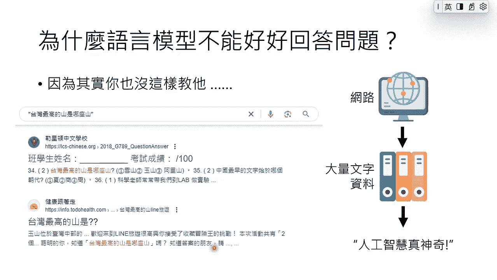

因此，第一阶段的自我学习只是累积了实力，要让它成为有用的人工智能，还需要后续阶段的引导和调整。这就引出了我们下一阶段要讨论的内容：如何让人类来指导这些语言模型。