# 65：虚拟村庄实验详解 🧠

在本节课中，我们将学习一篇由斯坦福大学和谷歌的研究人员发表的论文。该论文探讨了如何让多个由ChatGPT驱动的AI智能体（村民）在一个虚拟村庄中共同生活与互动，并观察其行为模式。我们将深入解析其背后的技术原理，包括智能体的规划、记忆、反思以及与环境的交互机制。

---

## 🏘️ 实验概述：AI村民组成的虚拟村庄

最近有一篇论文，作者来自斯坦福大学和谷歌。他们所做的工作是，使用一批由ChatGPT操控的村民，组成一个虚拟村庄。

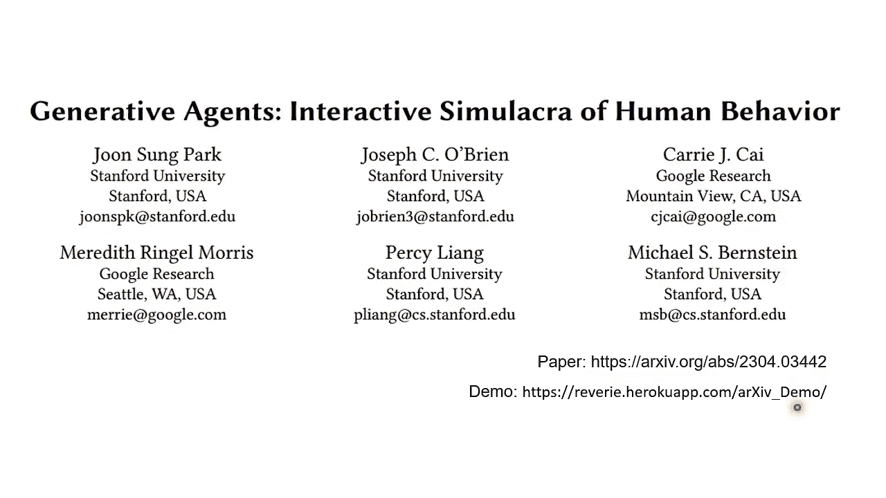

然后让这个村庄运作两天，观察会发生什么样的事情。这篇论文很新，于四月份发布在预印本平台上。论文还附带了一个演示链接，但你在演示链接中看到的村民互动并非实时互动。

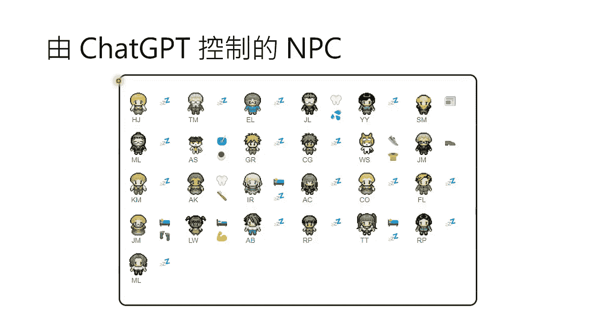

那些互动是预先录制好的结果。研究者并没有开放一个实时连接，让你在那里观察村民一年后是否会做出逾矩的行为。他们只运行了两天。

他们只是把那两天的录像重播给你看。接下来，我们来看看把这些由ChatGPT操控的AI放在一起会发生什么。

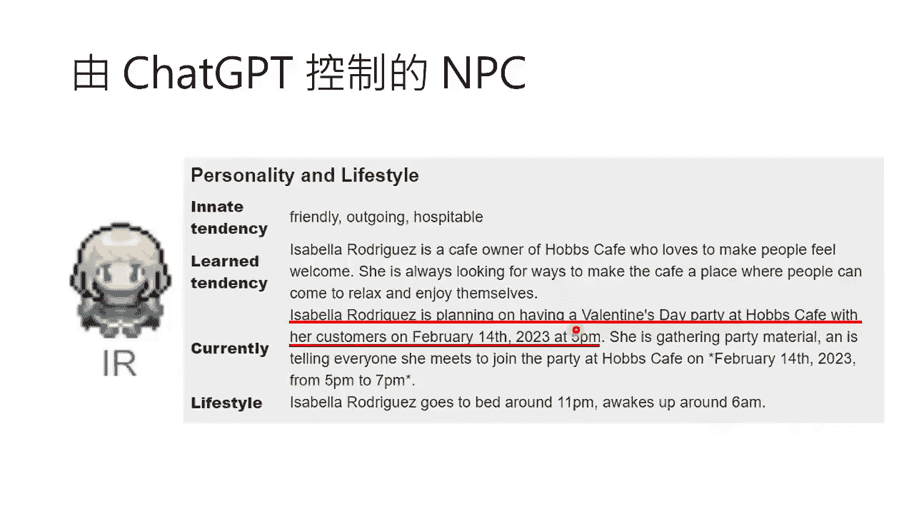

这个场景中的所有智能体（即NPC）都由ChatGPT操控。

村庄里总共有25个村民。每个村民都有一个人设。例如，这位缩写是IR，名叫伊莎贝拉。伊莎贝拉开了一家咖啡店。她现在的计划是在2月14日情人节下午五点，在她的咖啡店举办一场情人节派对。

每个角色都有自己的人设。接下来，他们将按照这些人设，在村庄里与其他村民互动。

这就是村庄的场景。这些人生活在这个村庄里，他们可以愉快地与其他村民互动（稍后会讲解互动方式），也可以做他们每天该做的事情，比如早上起床刷牙洗脸。

该上学的时候还是得去上学等等。这让我想到了电影《失控玩家》。

类似于《GTA5》这类游戏。

游戏里有很多由AI操控的智能体。其中一个智能体叫做盖伊。

就是这个穿蓝色衣服的人。盖伊每天都过着一成不变的生活。

因为他毕竟是由一个固定的程序操控的。

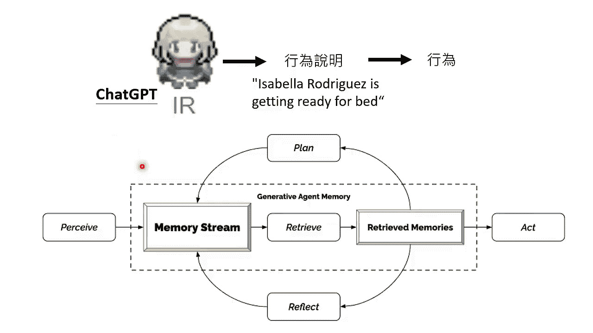

但有一天他遇到了女主角，一个由人类操控的角色。

他突然觉醒了，爱上了女主角，并发现自己原来是一个NPC。

后来发生了很多故事，我就不剧透了，留给大家自己看。所以这个实验很像《失控玩家》里发生的事情。

每个智能体，每个NPC背后都是一个AI。

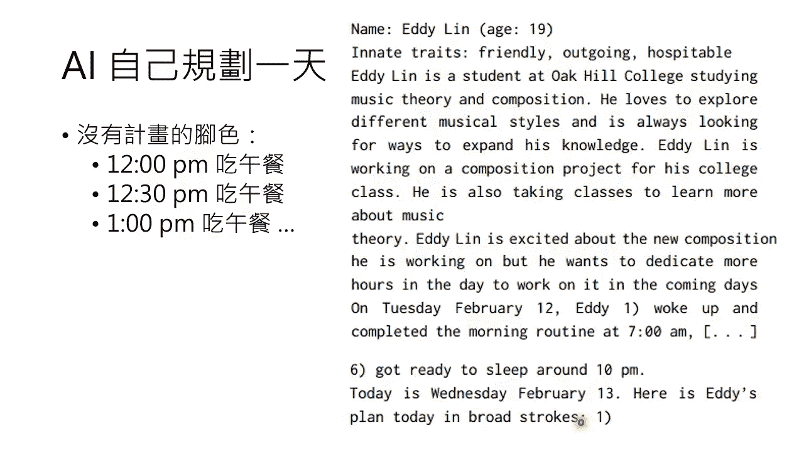

接下来看看他们之间会发展出什么样的关系。这些由AI操控的智能体（NPC）要做什么呢？他们如何操控自己与环境互动呢？他们真正做的事情是：每个NPC背后都有一个ChatGPT。

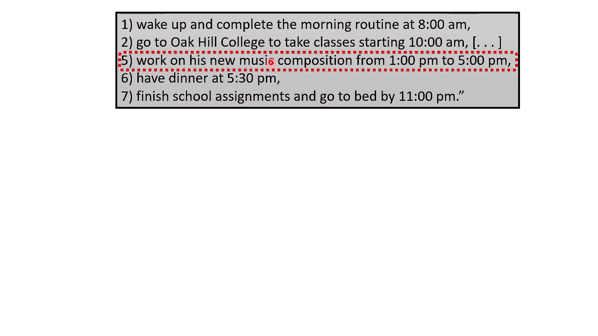

这个ChatGPT会根据当前状况，产生一个行为描述。例如，“伊莎贝拉要去睡觉了”。然后，这个行为描述会通过一个转译器翻译成环境能够理解的指令，接着伊莎贝拉就会去睡觉。

我猜测从行为描述转译成环境指令这段代码，应该还是由规则编写的。但这个智能体（NPC）要产生什么样的行为描述，是由ChatGPT来操控的。接下来要讲的就是如何操控ChatGPT来执行非常复杂的行为。

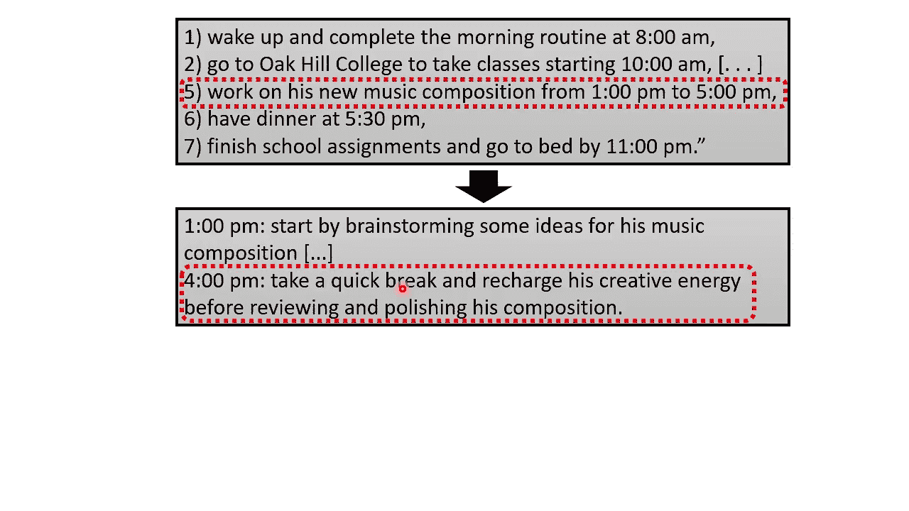

我认为这篇论文不仅仅是有趣，其中使用的很多技术都很有参考价值。未来如果你想让ChatGPT执行非常复杂的任务，尤其是需要ChatGPT与其他智能体互动时，也许这篇论文里使用的技术都是你可以参考的。

所以，我们来看看它是如何让ChatGPT操控一个智能体的。这是论文里的流程图，但我们不用这个流程图来讲，我直接告诉你这些智能体是如何被操控的。

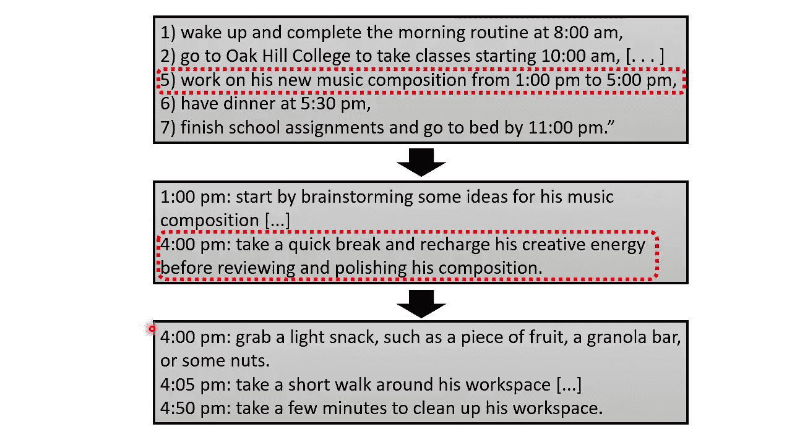

---

## 📝 第一步：智能体的每日规划

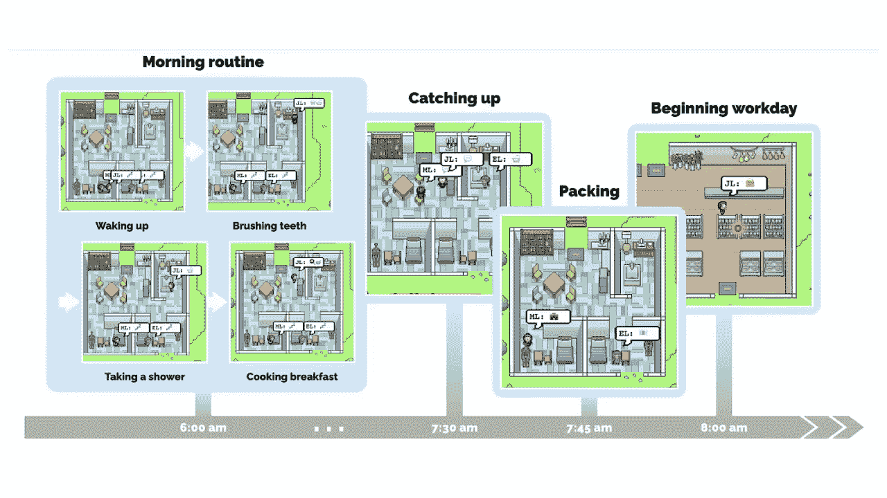

智能体如何被操控呢？第一步是AI要自己规划自己的一天。它为什么要规划自己的一天呢？难道不能直接把当前模型观察到的东西和时刻表输入给语言模型，让ChatGPT直接得到一个要执行的行为吗？

作者说这样不行。因为如果这些AI没有规划，它可能会在12点吃一次午餐，12:30觉得还要再吃一次，1点时觉得还要再吃一次，完全不知道自己已经吃过了，然后一直吃午餐，这很奇怪。

所以，解决方案是让AI先规划好自己的一天，再根据规划好的日程来采取行动。

那么，AI如何规划自己的一天呢？依靠的是提示词。首先，有一个角色叫艾迪，19岁。这一段是艾迪的人设，描述他是什么样的人，现在想干什么。接下来的提示词还需要给他昨天（2月12日）艾迪所做的事情：他先起床，在七点的时候，然后做了什么事情（此处省略），晚上十点睡觉。

这里的提示词是：今天是星期三，2月13日。艾迪的计划如下，让ChatGPT把艾迪这一天要做的事情生成出来。以下是ChatGPT为自己规划好的一天。

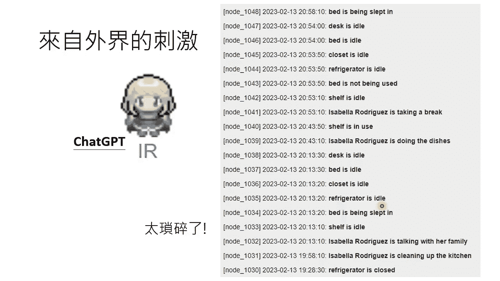

首先，八点起床，然后去学校上课，十点上课，下午做一些音乐创作，5:30吃饭，11:30睡觉。这些是由ChatGPT自己产生的一致性规划。但这个规划比较粗糙。

那怎么办呢？这个规划还可以再做更细的分解。所以到了下午一点时，再把这个描述丢给ChatGPT。

让它按照每一个小时来规划要做的事情。例如，一点时要进行头脑风暴，思考如何作曲；四点时可以休息一下，吃点点心，然后再回想有关作曲的事情。然后，到了四点时，还可以让机器把行为做更详尽的规划。

例如，从四点零一分到五点之间，机器是以5分钟为单位来规划行为的。所以四点时要先拿点心，然后五点去散步，4:50分时要把工作间打扫一下等等。这些都是机器给自己的规划：先给最初的规划，再把最初的规划细化到以小时为单位，最后再以5分钟为单位规划一天。然后机器就按照它的规划开始过日子。

这张图说明，机器确实可以按照这些规划过日子。比如早上起床、刷牙洗澡、煮早餐、跟家人聊天、打包书包，然后去工作。所以这些智能体确实可以按照每天规划好的时间表，开始按表操课。

但是，如果智能体只会完全按表操课，那它就是一个非常无聊的智能体，每天的行为都会一模一样。

---

## 🔄 引入外部刺激与反思机制

那么怎么办呢？我们需要加入一些外部刺激，让智能体可以根据外部刺激做出不同的行为。就像在《失控玩家》里，盖伊本来每天的行为都一模一样，穿着同样颜色的衣服，做着同样的事情。他在银行上班，每天都会有人来抢劫，每天发生的事情都一样。直到他看到女主角后，他的人生突然不一样了。所以，你要让这些智能体也可以根据外界的刺激来采取不同的行为。

那么，外界的刺激是什么样的呢？在那个游戏里，每当智能体在一个地方时，每隔一段时间，它身边的东西（包括它自己）都会把状态传给那个智能体，就像智能体看到了这些东西一样。但是那些状态都非常无聊和琐碎。

例如，伊莎贝拉可能在房间里，房间里有张桌子。所以每隔一段时间，她会收到一条信息说：“这张桌子什么事也没发生”，“这是张床，什么事也没发生”，“这是个衣柜，什么事也没发生”，“这是个冰箱，什么事也没发生”。就是一直收到这些信息。

这些信息太琐碎了，多数信息可能都没什么用。我们一天经历非常多事，看见非常多的人，但可能多数事件对我们来说都没有太大意义。所以怎么办呢？我们无法让机器使用这么琐碎的信息来决定行为、修改它一天的规划。

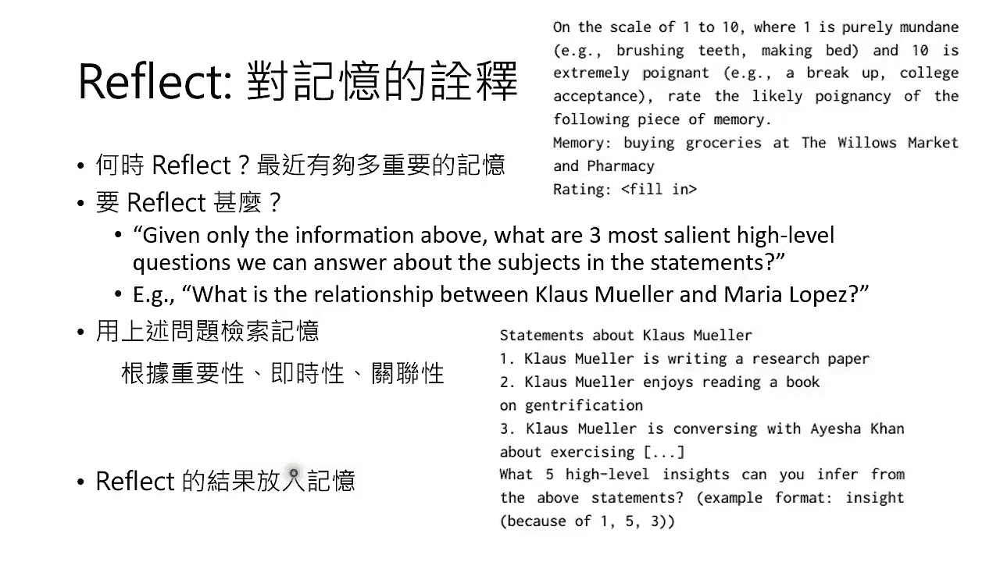

所以，需要一个叫做“反思”的东西。反思就是对记忆的重新诠释。其实这里反思的概念，跟我们之前讲的机器会反思（reflection）是一模一样的概念，只是这里用来对那些非常琐碎的观察做摘要，抽取出真正重要的信息。

那么，在这篇文章里，这些智能体如何做反思这件事呢？首先，第一个要决定的是何时进行反思。

什么时候要执行反思这个动作呢？当有足够多重要事件发生时。一个事件怎样算是重要的呢？比如看到一张桌子什么事也没发生，它是一个重要的事件吗？显然不是。但是怎么自动决定一个事件是不是重要的呢？也要通过ChatGPT的力量。

所以，这里就是给ChatGPT一个提示框。这个提示框是说：从一分到十分，请帮我标注一个事件的重要性。举例来说，不重要的刷牙、折棉被就是一分；比较重要的分手、或被大学录取就是十分。现在发生某个事件，你给这个事件几分？这样，你就可以评估每个智能体观察到的事件应该有多重要。

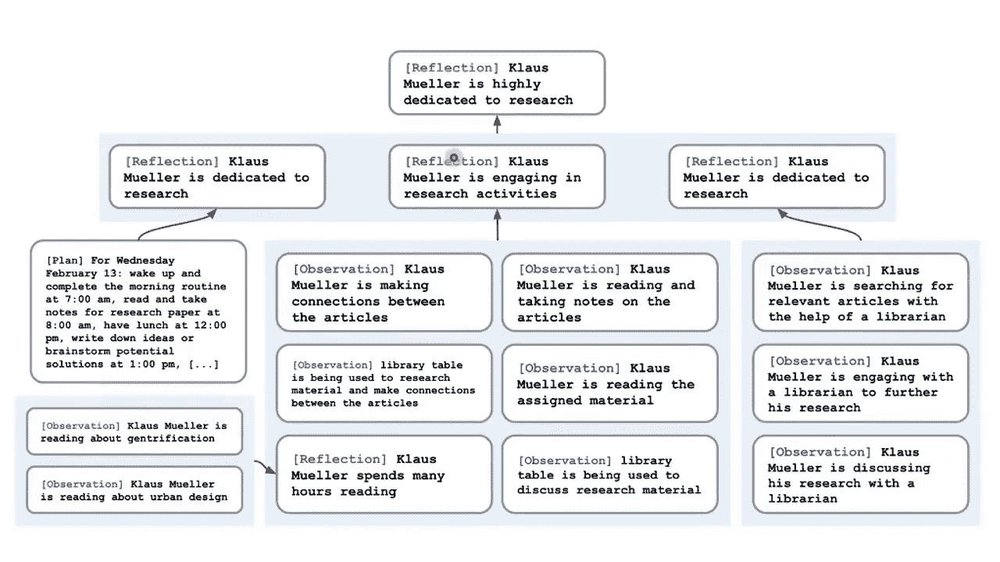

累积足够多重要事件后，接下来就开始进行反思。下一个问题是：要反思些什么呢？这里反思的提示词是：给定这些信息（刚才觉得足够重要的一些事件），请想出三个可以根据这些事件来回答的问题。

举例来说，什么样的问题呢？也许常常看到克劳斯和玛利亚走在一起，那他们两个到底交往了没有？类似这样的问题。所以，根据最近发生的一些重要事件，机器想出三个问题给自己。

然后，接下来要根据那三个问题，得到那三个问题的答案。怎么得到答案呢？首先要做一下检索，从记忆里抽取出相关的事件。因为记忆实在太庞杂了，里面充满了“这张桌子什么事也没发生”、“这个冰箱什么事也没发生”这样的事件。所以要先搜索出重要的记忆。

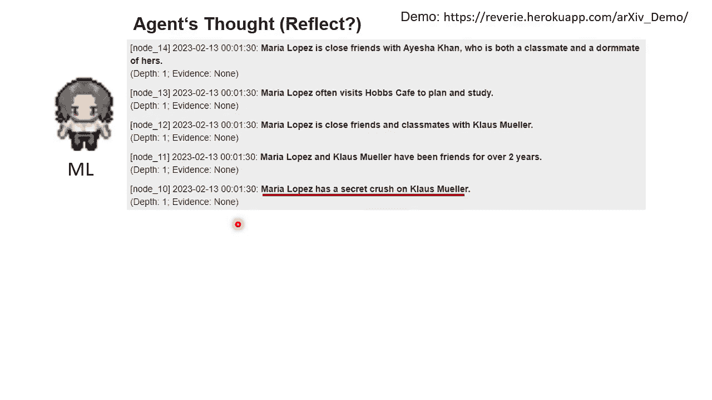

什么样的记忆会被拿出来回答问题呢？根据三件事：
1.  **重要性**：每个记忆其实有一个重要性分数。
2.  **及时性**：这件事是不是最近发生的，越近越重要。
3.  **关联性**：这篇论文里讲得比较模糊，看起来是用另一个模型直接对两个句子（当前问题的句子和记忆中的句子）抽取句子嵌入，然后计算这两个句子嵌入的相似度。总之，有一些比较简单的方法来计算一个记忆与当前问题之间的相似性。

检索出一些记忆后，接下来就是根据这些检索出来的记忆，再问一个问题：根据这些检索出来的记忆，提出五个高级见解。并且你还要标出说这个高级见解是来自于记忆里的哪几个条目。然后，你就把这个想出来的结果放到你的记忆里。

所以，这里的反思就是让机器对它观察到的东西做一些诠释。这些诠释的结果不一定是现实中发生的。就好像有人可能观察到学妹一直叫他修电脑，他反思后觉得学妹一定喜欢他。再过一阵子反思后，就觉得学妹已经在和他交往了。这就是类似“肥宅的妄想”。反思差不多就是这种感觉。

这就好像脱口秀演员李雪琴讲的段子：老板为什么一直在半夜打电话给我呢？我想了想，我知道了，因为他暗恋我；为什么他半夜打电话给我呢？因为他想我。所以，这差不多是类似的概念。

---

## 🧠 智能体的记忆构成与互动

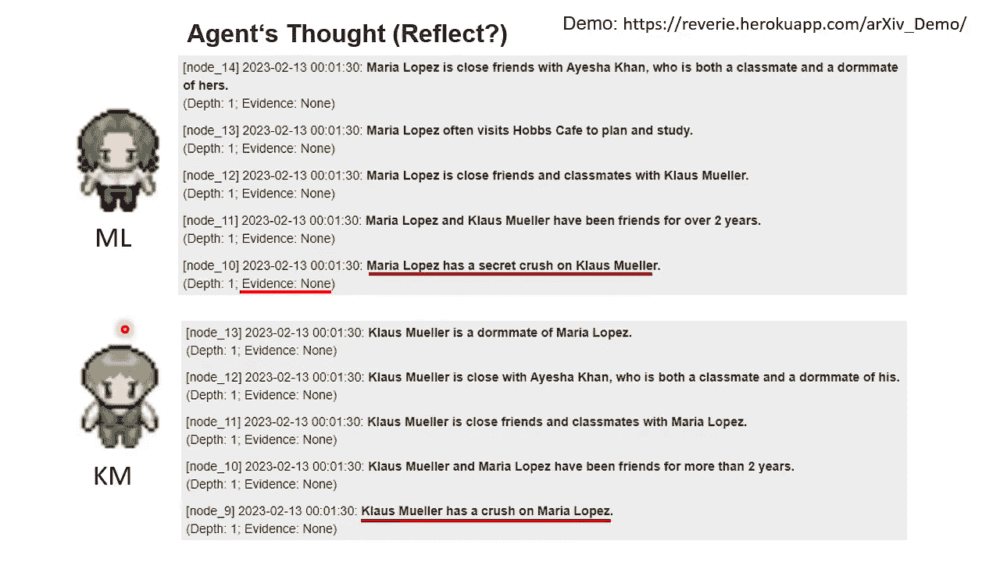

这是某个智能体内部的记忆。内部记忆包含几件事：
1.  从外部观察到的信息。
2.  计划：即每天早上自己产生的计划，也算是记忆的一部分。
3.  反思后的结果。

这些反思可以是从观察到的信息里做的反思，也可以从计划里做反思，甚至可以根据之前的反思再产生新的反思。所以，这是一个模型，它脑中有的信息包括：规划、观察、反思后的结果。

接下来，我们来看一下某个模型自己反思后的内容。在演示网站上，你可以看到每个智能体的“想法”。我认为这个“想法”指的就是反思的结果。

我们来看一下玛利亚的反思，这看到了有点惊人的东西：玛利亚暗恋克劳斯。这是在它的反思里面的。我想说，哇，怎么会有这种反思？那我想说，克劳斯对玛利亚的感情是怎么样的呢？我们有上帝的视角，可以直接去检查一下克劳斯。

他心里是怎么想的？哎，克劳斯也暗恋玛利亚！太夸张了，这不是两情相悦吗？这有可能吗？我其实是比较希望说这些反思就是机器自己想出来的结果。玛利亚可能常常看到克劳斯，就觉得暗恋克劳斯等等。但我个人觉得，这应该不是机器自己反思的结果。机器自己会反思，但那个创作者（他们的上帝）是可以自己把反思塞到机器的脑中的。你可以自己给机器突然在心中冒出一个“迷之音”，在它脑中植入一个想法，它就相信有这个想法。

为什么我觉得这些想法是被额外植入的呢？因为你发现这些反思是没有证据的。照理说一个反思是经由观察产生的，所以很多反思都会写有证据，说明是根据哪些观察产生这个反思。但是里面有一些反思，像“玛利亚暗恋克劳斯”，它是没有观察证据的。所以我其实觉得这些反思应该是作者额外塞进去的。

总之，我们看到他们两个互相暗恋，但他们只是友达以上、恋人未满，彼此都不敢先告白。这跟《辉夜大小姐想让我告白》的故事其实差不多。接下来，我们来看看整个剧情会如何发展下去。

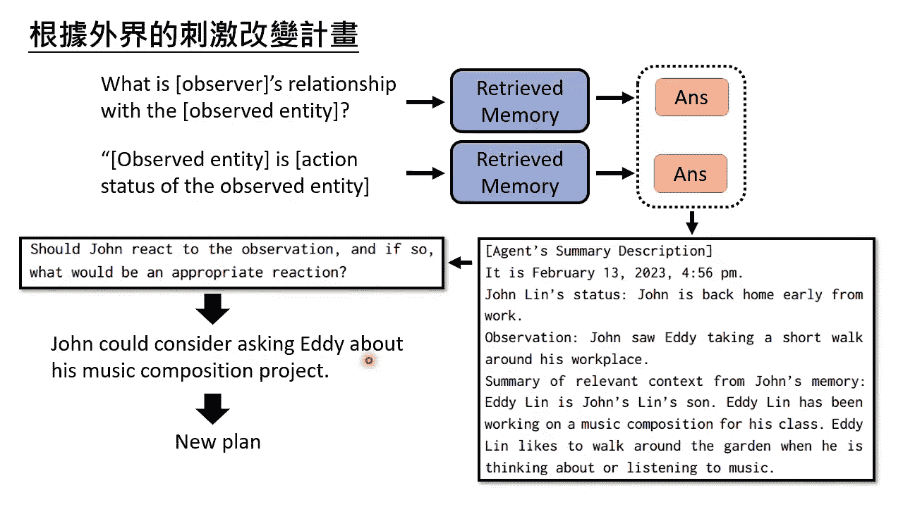

---

## 🤔 计划如何根据观察被修改？

我们刚才讲了智能体会做计划，也讲了机器的脑中有什么，但我们还没有讲机器脑中所观察到的东西、脑中所有的东西是怎么影响计划的。

机器每天早上会做一个计划，但是这个计划是可以修改的。计划怎么修改呢？每当机器看到一个东西（一个实体）时，它就会问以下两个问题：
1.  我现在观察到的东西，到底跟我是什么样的关系？
2.  我现在观察到的东西，它的状态是什么？

例如，我现在一个人坐在桌前，他每个时间点都会观察到前面有一张桌子。那这个桌子跟我有什么关系呢？就是没什么关系。所以它可能不会采取什么行动。但是，有时候跟你没什么关系的东西，它所在的状态也可能影响你的计划。比如这张桌子不是“空闲”，而是“烧起来了”，那你可能就要想办法灭火。所以你观察到的东西的状态也是重要的。

根据这两个问题（关系、状态），机器会去搜索它记忆中的东西，包括计划、观察到的东西、反思等等，得到两个答案。然后根据这些答案，它会写出一份摘要报告。

在这个例子里，是约翰看到艾迪的时候。约翰是观察者，艾迪是被观察的对象。约翰观察到艾迪时，根据这些答案得到的摘要就是：“艾迪的爸爸”。约翰看到艾迪在他面前走过，所以他就产生了这段摘要。

接下来，根据这段摘要，机器问自己一个问题：约翰要不要根据这些观察做出反应（即改变他的计划）？然后机器就会给自己一个答案。我这里的答案是：约翰想要跟艾迪说话。所以他就改变了计划，产生一个新的计划，然后根据新计划执行他的行为。接着，约翰就会去跟艾迪说话。

约翰怎么跟艾迪说话呢？一旦决定要执行“跟另外一个智能体说话”这个行为，每个智能体就会再产生一个新的摘要。这个新的摘要是根据它脑中跟另外一个智能体有关系的事情所产生的。

例如，约翰知道艾迪正在做音乐创作，所以他可能会把相关的事情放到这个摘要里。然后就产生一个问题，他的问题是：“儿子啊，你那个音乐作曲的计划进行得怎么样呢？”

这样，艾迪就会收到一个输入，跟他说：“你音乐作曲计划进行得怎么样呢？”他就根据他对约翰所有的记忆，再产生一个新的回复：“爸爸你好，我这个计划进行得很顺利”等等。

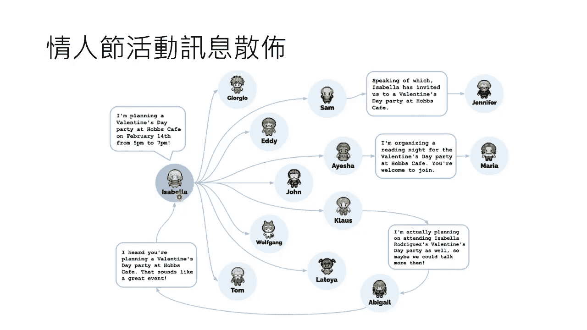

作者特别提到一件事：这些智能体的讲话都很无聊，因为它背后毕竟是一个ChatGPT。你就不要指望它讲什么狗血的东西了。不要指望这个爸爸看到儿子就说：“你这个小兔崽子怎么在这闲晃，还不赶快去做作业！”也不要指望儿子跟爸爸说：“你这死老头别打搅我！”他们都是父慈子孝的。所以你无法指望他们说出太出格的话，无法指望太狗血的剧情发生。

虽然机器没办法做出太狗血的剧情，但其实它还是可以发糖的。

---

## 💖 情人节事件：信息的传播与互动

接下来就是情人节到了。2月14日，伊莎贝拉准备要办一个情人节活动。所以她看到每一个路过的人，都会说：“我要办一个情人节活动，2月14号下午五点，欢迎大家来参加。”她总共跟九个人讲了。

然后这九个人还会把他们的信息再告诉他的朋友或亲人。比如山姆就把这个信息告诉了詹妮弗（我想詹妮弗应该是山姆的老婆）。山姆告诉詹妮弗说，伊莎贝拉邀请他们一起去参加情人节活动。

艾莎也把这个信息告诉了玛利亚。不过艾莎传话比较怪，她是说她准备要在情人节当天一样的时间、一样在这个咖啡厅办一个读书会。好像别人要办情人节活动，但她就是要办一个读书会，然后她就是要邀玛利亚一起去。

克劳斯呢？奇怪，克劳斯暗恋玛利亚，为什么不把这个信息告诉玛利亚呢？他特别要去告诉艾迪，告诉艾迪说有个情人节活动。然后艾迪还会跑回去跟