# 66：机器学习模型的可解释性 (Explainable ML) (上) 🧠

在本节课中，我们将要学习机器学习模型的可解释性。我们将探讨为什么模型的可解释性是一个重要议题，并介绍两种主要的解释方法：局部解释和全局解释。通过具体的例子和技术，我们将理解如何让“黑箱”模型给出其决策的理由。

---

## 概述：为什么需要可解释的机器学习？ 🤔

到目前为止，我们已经训练了很多模型。例如，我们训练过图像分类模型，给它一张图片，它会给出答案。但我们并不满足于此。

接下来，我们希望机器能告诉我们它得到答案的理由。

这就是可解释的机器学习。

在开始介绍具体技术之前，我们需要先讨论一下，为什么可解释的机器学习是一个重要的议题。本质上的原因是，即使机器可以得到正确答案，也不代表它一定非常聪明。

举一个例子。过去有一匹很聪明的马，大家叫它“神马汉斯”。这匹神马汉斯会做数学题。例如，你问它根号九是多少，它就会开始计算并得到答案。

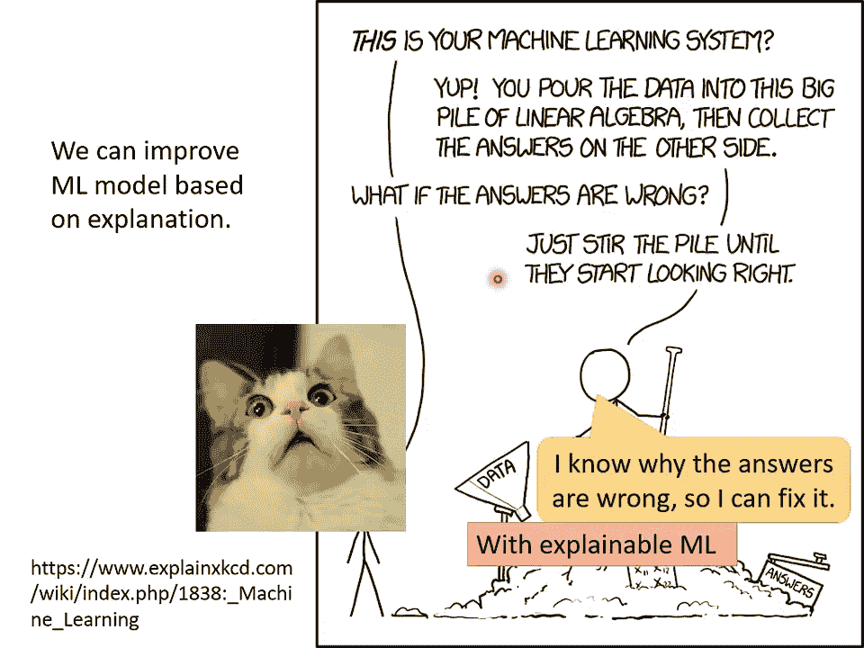

它怎么告诉你答案呢？它会用马蹄跺地板。如果答案是三，它就敲三下，然后停下来，代表它得到了正确答案。旁边的人就会欢呼。

后来有人很怀疑，为什么汉斯可以解数学题？它只是一匹马，为什么能够理解数学问题？后来有人发现，只要没有人围观的时候，汉斯就答不出数学问题。没有人看它时，你问它一个数学问题，它会不断地敲马蹄，不知道什么时候停下来。

它其实只是侦测到旁边人类微妙的情感变化，知道什么时候该停下跺马蹄，它就可以有胡萝卜吃。它并不是真的学会了解数学题。

而今天我们看到的种种人工智能应用，有没有可能跟神马汉斯是一样的状况呢？

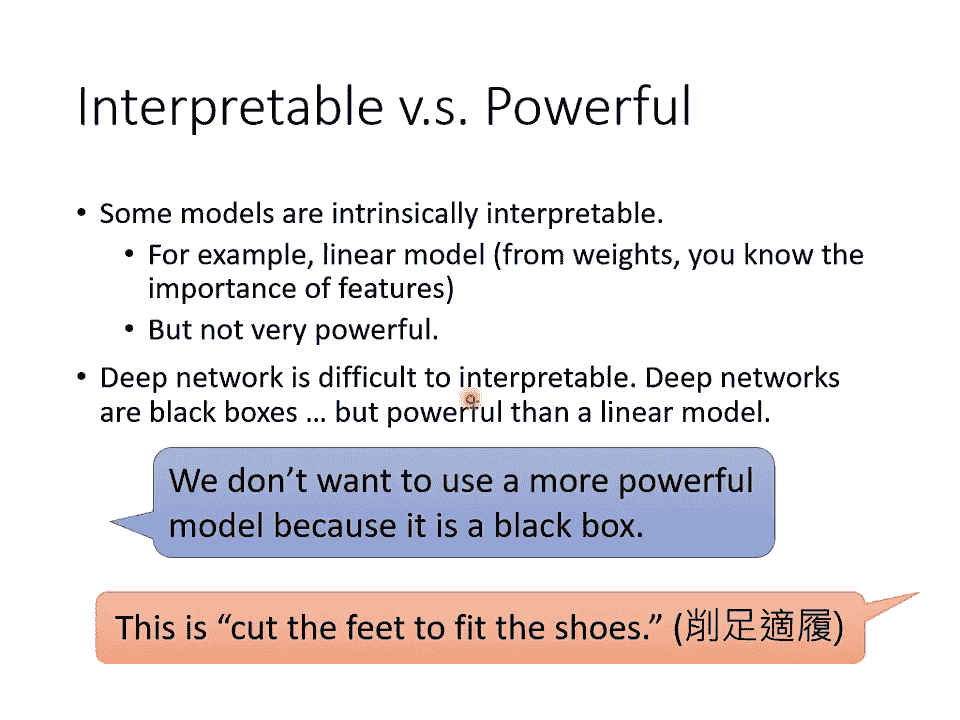

在很多真实的应用中，可解释性的模型往往是必须的。举例来说，银行今天可能会用机器学习模型来判断要不要贷款给某一个客户。但是根据法律规定，银行使用机器学习模型来做自动判断时，必须要给出一个理由。所以这个时候，我们不是只训练机器学习模型就好，我们还需要机器学习模型是具有解释力的。

或者，机器学习未来也会被用在医疗诊断上。但医疗诊断是人命关天的事情，如果机器学习模型只是一个黑箱，不会给出诊断的理由，那我们又要怎么相信它做出的是正确的判断呢？

今天也有人想把机器学习模型用在法律上，比如说帮助法官判案，帮助法官自动判案，判断一个犯人能不能够被假释。但是我们怎么知道机器学习的模型是公正的呢？我们怎么知道它在做判断的时候，没有种族歧视等其他问题呢？

所以我们又希望机器学习模型不止得到答案，它还要给我们得到答案的理由。

再更进一步，今天自动驾驶车未来可能会满街跑。当今天自动驾驶车突然急刹的时候，甚至急刹导致车上的乘客受伤，那这个自动驾驶车到底有没有问题呢？这也许取决于它急刹的理由。如果它是看到有一个老太太在过马路所以急刹，那也许自动驾驶车是对的。但是假设它只是无缘无故就突然发狂要急刹，那这个模型就有问题了。

所以对自动驾驶车它的种种行为、种种决策，我们希望知道决策背后的理由。

更进一步，也许机器学习的模型如果具有解释力的话，那未来我们可以凭借着解释的结果，再去修正我们的模型。

今天在使用这些深度学习技术的时候，往往状况是这个样子：有某人说“这就是你的机器学习系统”，然后说“我就是把资料丢进去，里面就是有很多矩阵的相乘，接下来就会跑出我的结果”。如果结果不如预期的话，怎么样呢？现在大家都知道，就调一下参数，对不对？改个学习率，对不对？调一下网络的架构，对不对？你根本不知道自己在做什么，对不对？就调一下网络的架构，我就把这一堆数学、这一堆线性代数再重新打乱一下，看看结果会不会比较好。

那如果其他没有做过深度学习的人，就会大吃一惊，觉得“哇，这样怎么可以呢？”但实际上今天深度学习的模型，你往往要改进模型，就是需要调一些超参数。

但是我们期待，也许未来当我们知道深度学习的模型犯错的时候，它是错在什么样的地方，它为什么犯错，也许我们可以有更好的方法、更有效率的方法来改进我的模型。当然这个是未来的目标，今天离用可解释的机器学习做到上述改进模型的想法还有很长的一段距离。

---

## 为什么不用更简单的模型？ 💡

讲到这边，有人可能会想，我们今天之所以这么关注可解释机器学习的议题，也许是因为深度网络它本身就是一个黑箱。那我们能不能够用其他的机器学习模型呢？如果不要用深度学习模型，改采用其他比较容易解释的模型，会不会就不需要研究可解释的机器学习了呢？

举例来说，假设我们都采用线性模型。线性模型的解释能力是比较强的，我们可以轻易地知道，根据一个线性模型里面每一个特征的权重，知道线性模型在做什么事。所以你训练完一个线性模型以后，你可以轻易地知道它是怎么得到它的结果的。

但是线性模型的问题就是它没有非常的强大。我们其实在第一堂课就已经告诉过你，线性模型有很巨大的限制，所以我们才很快地进入了深度模型。但是深度模型的坏处就是它不容易被解释。神经网络大家都知道它就是一个黑盒子，黑盒子里面发生了什么事情，我们很难知道。虽然它比线性模型更好，但是它的解释能力是远比线性模型要差。

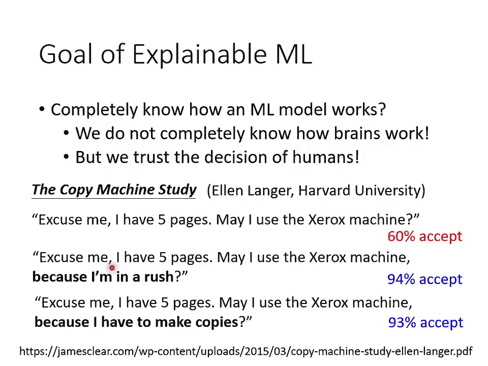

所以讲到这边，很多人就会得到一个结论。你可能常常听到这样的想法：我们就不应该用这种深度模型，我们不该用这些比较强大的模型，因为它们是黑盒子。

但是在我看来，这样的想法其实就是“削足适履”。我们因为一个模型它非常的强大，但是不容易被解释，就扬弃它吗？我们不是应该想办法，让它具有可以解释的能力吗？

我听过一个故事。这个故事是个老梗，谁都听过。就有一个醉汉，他在路灯下面找钥匙。大家问他说：“你的钥匙掉在路灯下吗？”他说：“不是，因为这边有光。”

所以我们坚持一定要用简单、但是比较容易被解释的模型，其实就好像是我们坚持一定要在路灯下面找钥匙一样。我们坚持，因为一个模型是比较可解释的，虽然它比较不好，但我们还是坚持要使用它，就好像一定要在路灯下面找钥匙一样。真实的、强大的模型也许根本在路灯的范围之外。

而我们现在要做的事情就是改变路灯的范围，改变照明的方向，看能不能够让这些比较强大的模型可以被置于路灯之下，变得比较可解释。

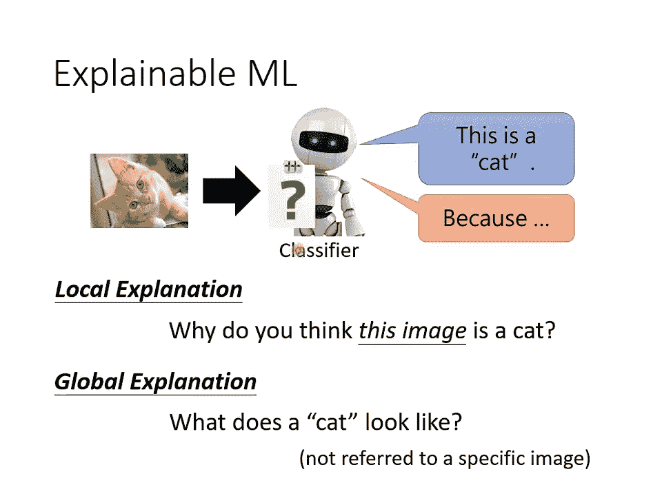

其实“可解释”和“可理解”这两个词汇，虽然在文献上常常被互相使用，但其实它们是有一点点差别的。通常“可解释”指的是说有一个东西，它本来是个黑箱，我们想办法赋予它解释的能力。而“可理解”通常指的是一个东西，它本来就不是黑箱，我们本来就可以知道它的内容。不过这两者在文献上也常常被混用了，所以我们这边就不特别跟大家强调它们的差异。

---

## 决策树是答案吗？ 🌳

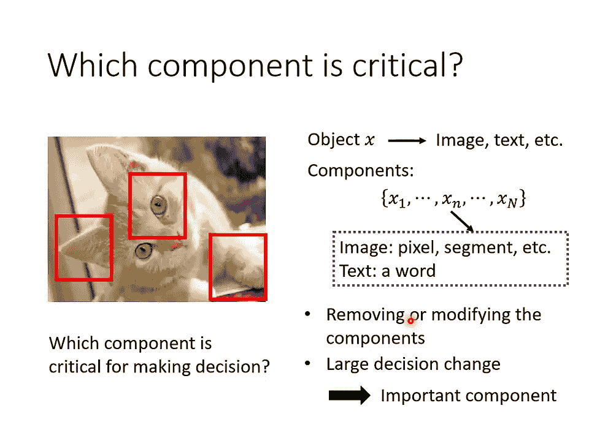

讲到既是可理解又强大的模型，也许有人会说，那决策树会不会就是一个好的选择呢？决策树相较于线性模型，它是更强大的模型。而决策树的另外一个好处，相较于深度学习，它非常容易理解。你看那个决策树的结构，你就可以知道说，今天模型是凭借着什么样的规则来做出最终的判断。

决策树不是我们这门课会讲的东西。但是就算是你没有学过决策树，你其实也不难想象决策树它是在做什么。它做的事情就是你有很多的节点，那每一个节点都会问一个问题，让你决定向左还是向右。最终当你走到节点的末尾，当你走到叶子节点的时候，就可以做出最终的决定。因为在每一个节点都有一个问题，你看那些问题及答案，你就可以知道，现在整个模型凭借着什么样的特征，是如何做出最终的决断。

所以从这个角度看来，决策树它既强大又可理解。所以这堂课我们可以就上到这边，就是“决策树就是一切”，然后就结束了，这样。

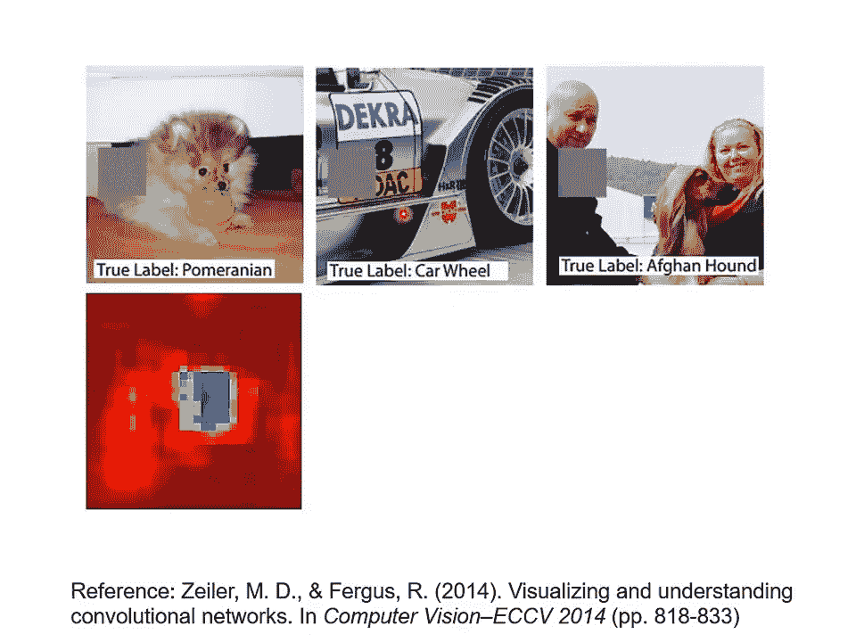

但是决策树真的就是我们所需要的吗？你再仔细想一下，决策树也有可能是很复杂的。举例来说，我看到在网络上找到有人问了一个问题。他说：“还有这么一个复杂的决策树，他完全看不懂这个决策树在干嘛。有没有人有什么样的可解释机器学习的方法，可以把这个决策树变得更简单一点？”我看34年过去了，都没有人回答这个问题。有人看到的话，也许可以帮忙回答一下。

但另外一方面，你再仔细想想看，你是怎么实际使用决策树这个技术的呢？我知道很多同学都会说，这个打Kaggle比赛的时候，深度学习不是最好用的，决策树那个才是最好用的，那才是Kaggle比赛的常胜军。但是你想想看，当你在使用决策树的技术的时候，你是只用一颗决策树吗？其实不是。你真正用的技术叫做随机森林，对不对？你真正用的技术，其实是好多棵决策树共同决定的结果。

一颗决策树，你可以凭借着每一个节点的问题跟答案，知道它是怎么做出最终的判断的。但当你有一片森林，当你有500棵决策树的时候，你就很难知道说这500棵决策树合起来是怎么做出判断。所以决策树也不是最终的答案，并不是由决策树我们就解决了可解释机器学习的问题。

---

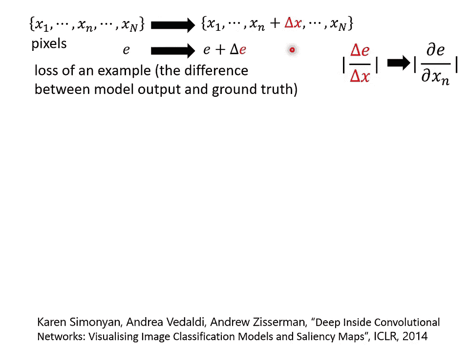

## 可解释机器学习的目标是什么？ 🎯

再继续深入讲可解释机器学习的技术之前，这边还有一个问题，就是可解释机器学习的目标是什么？在我们之前的每一个作业里面，我们都有一个损失函数，也就是我们有一个明确的目标，要么是降低错误率，要么是提升准确率。我们总是有一个明确的目标。

但是可解释的目标到底是什么呢？什么才是最好的解释结果呢？

可解释学习的目标其实非常的不明确。就是因为目标不明确，你才会发现可解释机器学习的作业就没有损失函数了，因为出不了损失函数。我们只能够出选择题，让大家增加一些知识，我们只能够做这样子而已。

那到底可解释机器学习它的终极目标是什么呢？什么才是最好的解释？

以下是我个人的看法，并不代表他是对的，你可能不认同，那我也不会跟你争辩，这个只是我个人的看法而已。

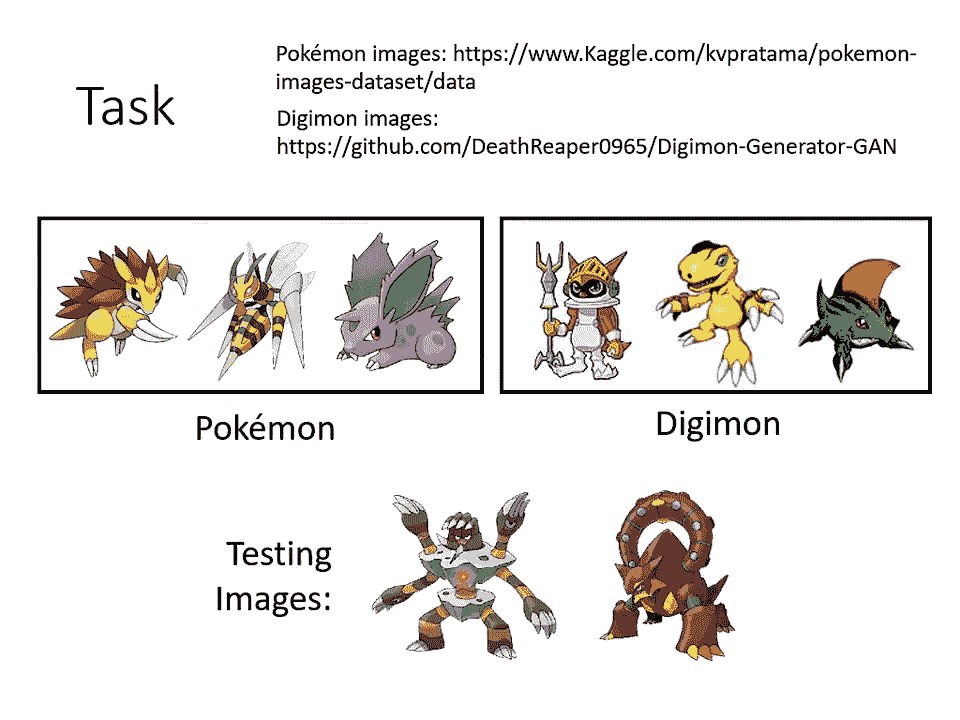

很多人对于可解释机器学习会有个误解，他觉得一个好的解释，就是要告诉我们整个模型在做什么事。我们要了解模型的一切，我们要知道它到底是怎么做出一个决断的。但是你想想看这件事情真的是有必要的吗？

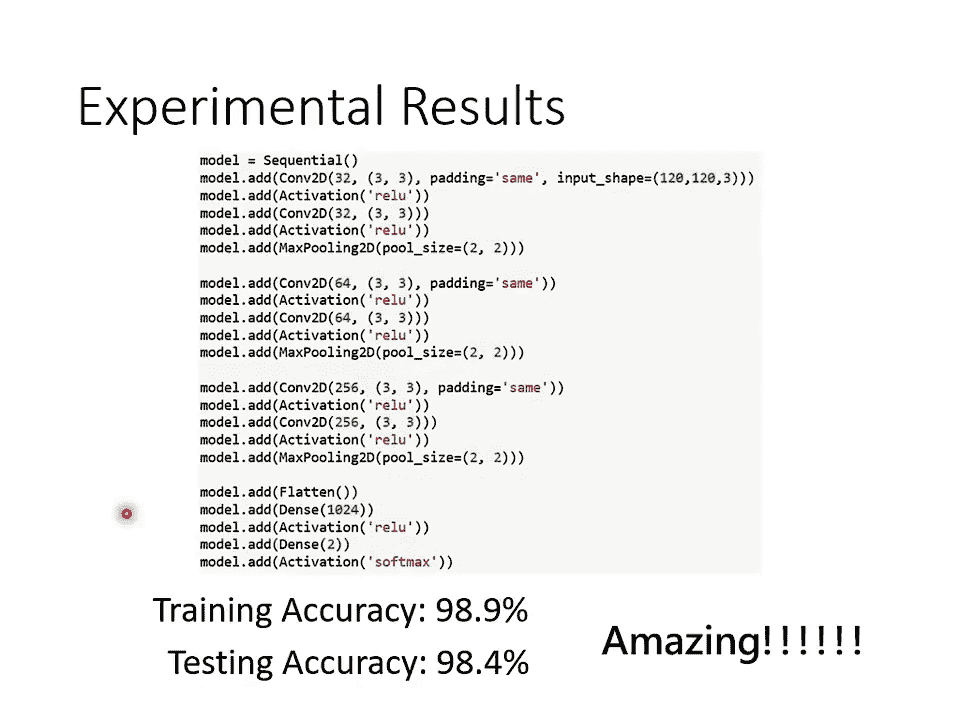

我们今天说机器学习的模型、深度网络是一个黑盒子，所以我们不能相信它。但你想想看，世界上有很多很多的黑盒子正在你的身边。人脑不是也是黑盒子吗？我们其实也并不完全知道人脑的运作原理，但是我们可以相信另外一个人做出的决断。那人脑其实也是一个黑盒子，你可以相信人脑做出的决断，为什么深度网络是一个黑盒子，你没有办法相信深度网络做出来的决断？为什么你对深度网络会这么恐惧呢？

我觉得其实对人而言，也许一个东西能不能让我们放心，能不能够让我们接受理由是非常重要的。

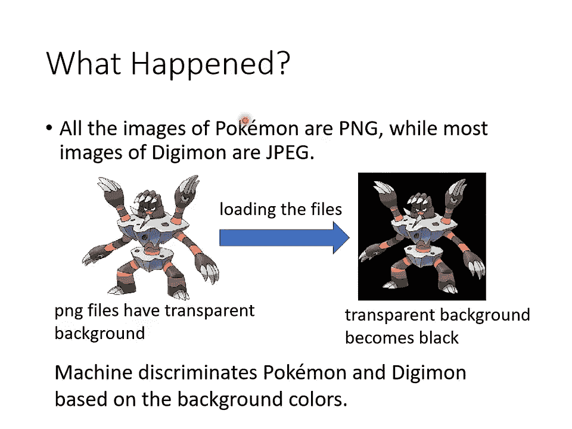

以下是一个跟机器学习完全无关的心理学实验。这个实验是1970年代就做了，这是艾伦·兰格，一个哈佛大学教授做的这个实验，非常的有名。这个实验是这样：这个实验是一个跟打印机有关的实验。在哈佛大学图书馆，打印机会大排长龙，很多人都排着队要印东西。这个时候如果有一个人跟他前面的人说：“拜托请让我先印，我就印5页而已。”那一般人会不会接受呢？会不会让他先印呢？有60%的人会让这个人先印。所以感觉哈佛大学学生人都还蛮好的，这个接受程度是比我预期的要高。

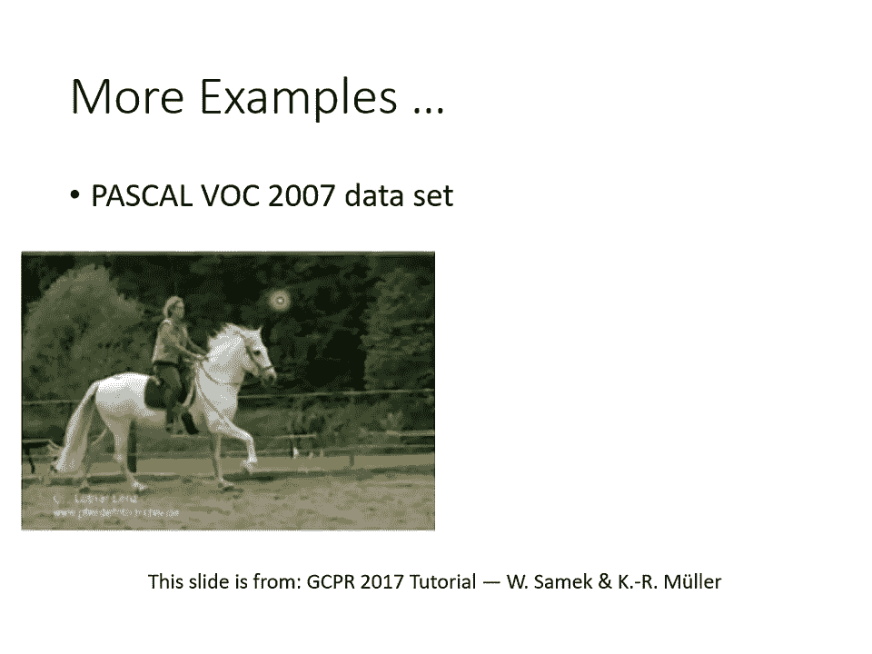

你跟一个人说“让我先印”，有60%的人同意。但这个时候你只要把刚才问话的方法稍微改一下，你本来只说“能不能让我先”，你现在改成说“能不能让我先，因为我赶时间”。他是不是真的赶时间，没人知道。但是当你说你有一个理由，所以你要先进的时候，这个时候接受的程度变成94%。

而神奇的事情是，就算你的理由稍微改一下，举例来说，有人说“请让我先印，因为我需要先印”。光是这个样子，接受的程度也变成93%。而最神奇的事情是，人就是需要一个理由。你为什么要先进？你只要讲出一个理由，就算你的理由是因为“我需要先进”，大家也会接受。

所以会不会可解释机器学习也是同样的道理？所以我们需要可解释的机器学习呢？

所以我觉得对什么叫做好的解释？好的解释就是人能接受的解释就是好的解释。人就是需要一个理由让我们觉得高兴。而到底是让谁高兴呢？这个高兴的人可能是你的客户，因为很多人就是听到深度网络是一个黑盒子，他就不爽。你告诉他说“这个是可以被解释的”，给他一个理由，他就高兴。他可能是你的老板，老板看了很多“农场文”，他也觉得说“对，黑盒子就是不好的”，然后你说“这个是可以解释的”，他就高兴。或者是你今天要说服的对象是你自己，你觉得有一个黑盒子深度网络是一个黑盒子，你心里过不去，今天它可以给你一个做出决断的理由，你就高兴。

所以我觉得什么叫做好的解释？就是让人高兴的解释就是好的解释。其实你等一下再继续看各种研究的发展，才会发现说，我们在设计这些技术的时候，确实跟我现在讲的“什么叫好的解释？就是让人高兴的解释”这个想法，这个技术的进展是蛮接近的。

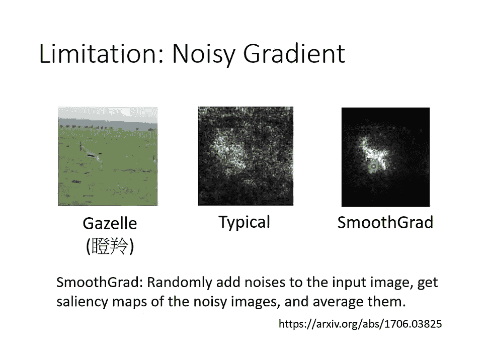

---

## 可解释机器学习的分类 📂

所以可解释机器学习的目标就像我刚才讲的，就是要给我们一个理由。

那可解释机器学习呢又分成两大类：第一大类叫做**局部解释**，第二大类叫做**全局解释**。

*   **局部解释**是说，假设我们有一个图像分类器，我们给它一张图片，它判断说它是一只猫。那我们要问的问题是：“为什么你觉得这张图片是一只猫？”根据某一张图片来回答问题，这个叫做局部解释。
*   还有另外一类叫**全局解释**。全局解释意思是说，现在还没有给我们的分类器任何图片，我们要问的是：“对一个分类器而言，什么样的图片叫做猫？”我们并不是针对任何一张特定的图片来进行分析，我们是想要知道说，当我们有一个模型，它里面有一堆参数的时候，对这堆参数而言，什么样的东西叫做一只猫。

所以可解释机器学习有两大类。

---

## 局部解释：为什么你觉得这是一只猫？ 🐱

我们先来看第一大类：为什么你觉得一张图片是一只猫？我们可以把这个问题问得更具体一点：给机器一张图片，它知道它是一只猫的时候，到底是这个图片里面的什么东西，让模型觉得它是一只猫？是眼睛吗？是耳朵吗？还是猫的脚，让机器觉得他看到了一只猫？

或者讲得更一般化一点，假设现在我们模型的输入叫做 **`x`**，这个 **`x`** 可能是一张影像，可能是一段文字。而 **`x`** 可以拆成多个组成部分 **`x1`** 到 **`xn`**。如果对于影像而言，可能每一个组成部分就是一个像素；那对于文字而言，可能每一个组成部分就是一个词汇或者是一个词元。

我们现在要问的问题就是：这些组成部分里面，哪一个对于机器现在做出最终的决断是最重要的呢？

怎么知道一个组成部分的重要性呢？基本的原则是这个样子：我们把组成部分都拿出来，然后把每一个组成部分做改造或者是删除。如果我们改造或删除某一个组成部分以后，今天网络的输出有了巨大的变化，那我们就知道说这个组成部分没它不行，它很重要。如果某个组成部分被删掉以后，现在网络的输出有了巨大的变化，就代表这个组成部分没它不行，那这个组成部分就是一个重要的组成部分。

讲得更具体一点，你想要知道今天一个影像里面每一个区域的重要性的时候，有一个非常简单的方法。

就给一张图片，然后丢到网络里面，它知道这是一只博美狗。接下来在这个图片里面，不同的位置放上灰色的方块。当这个方块放在不同的地方的时候，今天你的网络会输出不同的结果。下面这个图，这些颜色代表今天网络输出“博美狗”的几率。蓝色代表“博美狗”的几率是低的，红色代表“博美狗”的几率是高的。而这边的每一个位置，代表了这个灰色方块的位置。

也就是说，当我们把灰色的方块移到博美狗的脸上的时候，今天你的图像分类器就不觉得他看到一只博美狗。如果你把灰色的方块放在博美狗的四周，这个时候机器就觉得他看到的仍然是博美狗。所以知道说他不是看到这个球觉得他看到博美狗，也不是看到地板，也不是看到墙壁觉得看到博美狗，而是真的看到这个狗的脸，所以他觉得他看到了一只狗。

这边也有一样的例子。把灰色的方块在这个图片上移动，你会发现灰色的方块移到轮胎上的时候，机器就不觉得他有看到轮胎了。所以机器知道轮胎长什么样子，他今天看到这个图片知道答案是轮胎的时候，并不是瞎蒙蒙到的，而是他知道说轮胎出现在这个位置。

或者是说，这边有一张图片，然后这个图片里面有两个人，还有一只阿富汗猎犬。但是机器到底是真的看到了阿富汗猎犬，还是把人误认为狗呢？这个时候你就可以把这个灰色的方框在这个图片上移动。然后你发现灰色的方框放在这个人的脸上，或放在这个人的脸上的时候，机器仍然觉得他有看到阿富汗猎犬。但是当你把灰色的方框放到阿富汗猎犬的位置的时候，机器就觉得他没有看到阿富汗猎犬。所以他是真的有看到阿富汗猎犬，他知道这一只就是阿富汗猎犬，并不是把人误认为阿富汗猎犬。

所以这个是最简单的，知道组成部分重要性的方法。

---

## 显著性图 (Saliency Map) 🗺️

接下来还有一个更进阶的方法是计算梯度。

这个方法是这样子的：假设我们有一张图片，我们把它写作 **`x1`** 到 **`xn`**，这边的每一个 **`x`** 代表了一个像素。接下来我们去计算这张图片的损失，我们这边用 **`L`** 来表示。这个 **`L`** 是什么呢？这个 **`L`** 是把这张图片丢到你的模型里面，这个模型的输出的结果跟正确答案的交叉熵。这个 **`L`** 越大就代表现在辨识的结果越差。

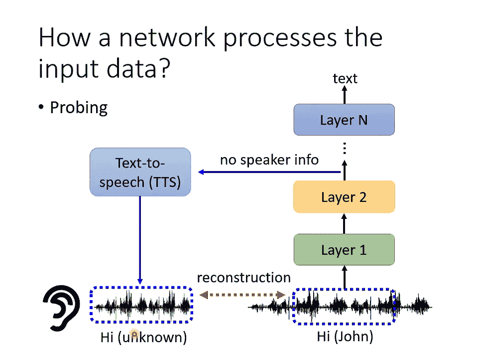

接下来，我们知道某一个像素对于影像辨识这个问题的重要性呢，那你就把某一个像素的值做一个小小的变化 **`Δx`**，然后你接下来看一下你的损失会有什么样的变化 **`ΔL`**。

如果今天把某一个像素做小小的变化以后，损失就有巨大的变化，代表说这个像素对影像辨识是重要的。反之如果加了 **`Δx`** 这个 **`ΔL`** 趋近于零，这个损失完全没有反应，就代表说这个位置的像素对于影像辨识而言可能是不重要的。

那我们可以用 **`ΔL`** 跟 **`Δx`** 的比值，来代表这一个像素 **`xn`** 的重要性。而事实上 **`ΔL/Δx`** 这一项，就是把 **`xn`** 对你的损失做偏微分。如果不知道偏微分是什么的话，也没有关系，反正就是 **`Δx`** 跟 **`ΔL`** 的比值，就代表了这个 **`xn`** 的重要性。

那这个比值越大，就代表 **`xn`** 越重要。那你把每一个图片里面，每一个像素它的这个比值都算出来，你就得到一个图叫做**显著性图**。

在我们的作业里面，你会有很多机会画各式各样的显著性图。下面这个图，上面这个是原始图片，下面这个黑色的、然后有亮白色点的是显著性图。在这个显著性图上面，越偏白色就代表这个比值越大，也就是这个位置的像素是越重要的。

举例来说，给机器看这个水牛的图片，他并不是看到草地觉得他看到牛，也不是看到竹子觉得他看到牛，而是真的知道牛在这个位置。他觉得判断这张图片是什么样的类别，对他而言最重要的是出现在这个位置的像素，他要是真的看到牛，所以才会输出“牛”这个答案。

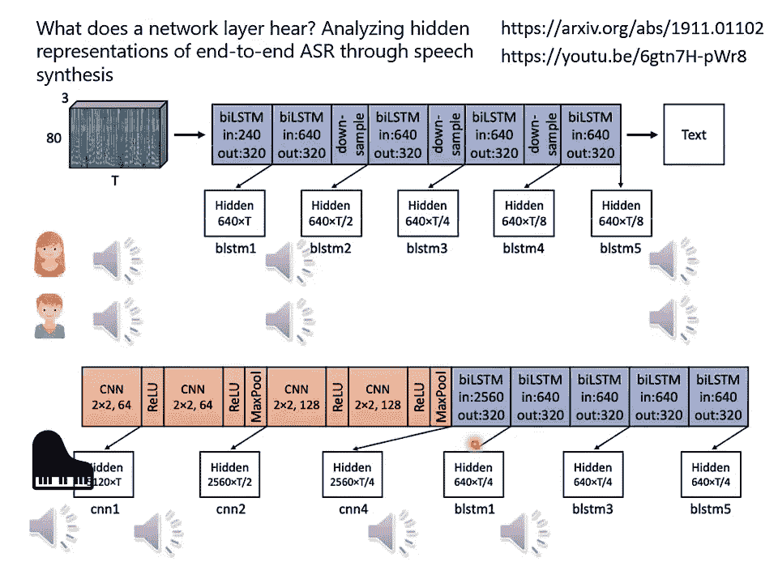

继续看到这个图片，说他看到一个猴子。那猴子在哪里呢？猴子在树梢上面。它并不是把叶子判断成猴子，它知道这个位置出现的东西，就是他判断正确答案