# 71：以大型语言模型打造的AI Agent 🧠

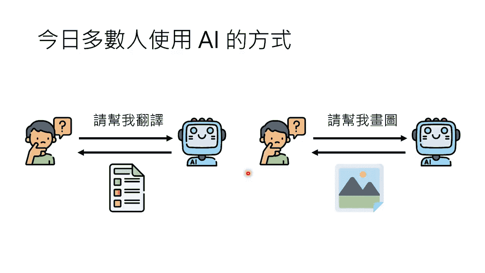

在本节课中，我们将要学习如何利用大型语言模型构建能够自主执行多步骤复杂任务的AI Agent。我们将从AI Agent的基本概念出发，探讨其运作原理，并通过具体实例理解其在实际场景中的应用。

---

目前，大多数人在使用AI协助完成任务时，通常只要求AI执行单一、独立的步骤。例如，让GPT进行翻译，或让ChatGPT调用DALL·E生成图像。

然而，人类能够处理更复杂的任务，这些任务往往需要多个步骤才能完成。以“组织朋友聚餐”为例，这个任务涉及多个环节：首先需要调查大家的时间，然后统计出最合适的时间，接着预订餐厅。在执行过程中，计划可能发生变化，例如首选餐厅没有空位，就需要寻找其他备选餐厅。

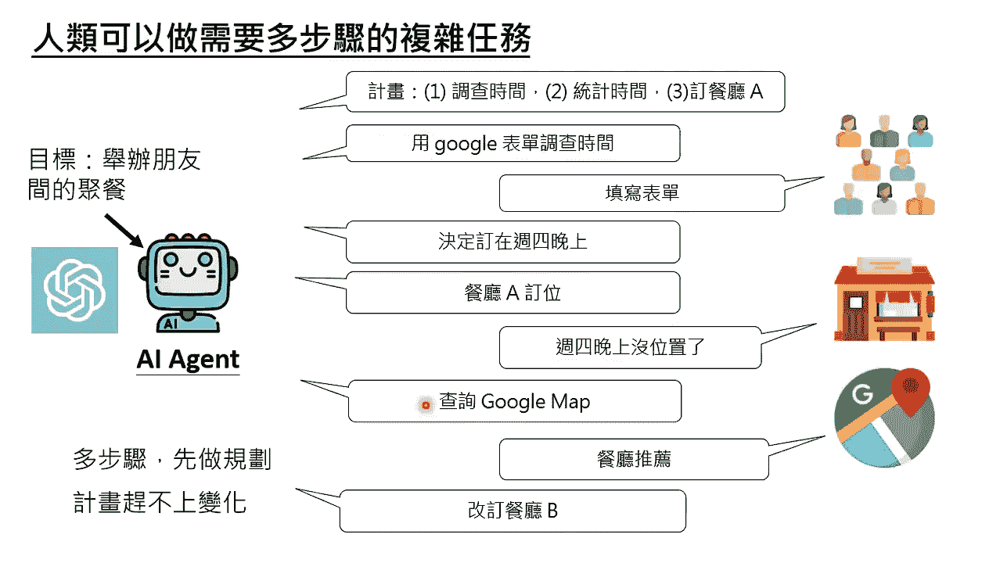

这种需要**规划、按顺序执行多个步骤，并能根据情况调整计划**的复杂任务，正是我们希望AI能够胜任的。在本课程中，我们将这种能够自主处理此类任务的AI称为 **AI Agent**。

---

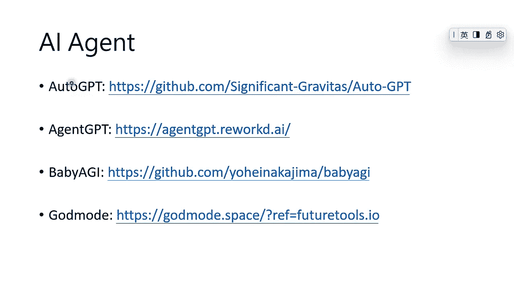

## 🤖 什么是AI Agent？

AI Agent指的是能够执行多步骤复杂任务、制定计划并能根据环境反馈修改计划的智能体。虽然目前此类应用尚不普遍，但随着大型语言模型能力的提升，AI Agent有望在不久的将来成为现实。

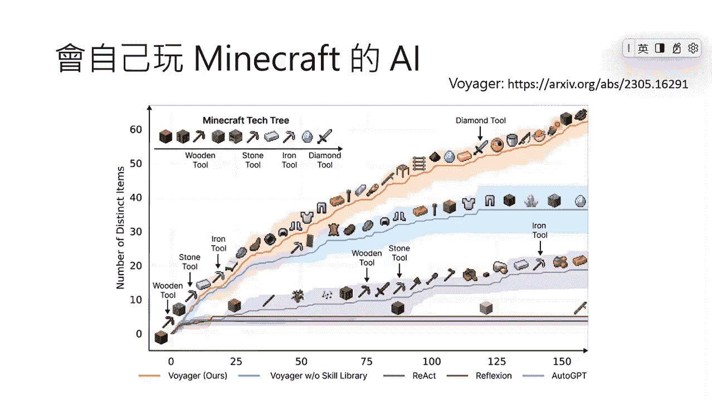

当前已有一些知名的AI Agent尝试，例如**AutoGPT**。用户可以给它一个任务（如“制作一个网页”），它便会自主尝试规划步骤、使用工具（如网络搜索）并反思进展，以期完成任务。尽管其成功率仍有局限，但这代表了AI发展的一个重要方向。

未来的趋势是，AI将不再局限于简单的“一问一答”模式，而是能够**自主与环境互动**，通过多步骤推理和行动来解决问题。

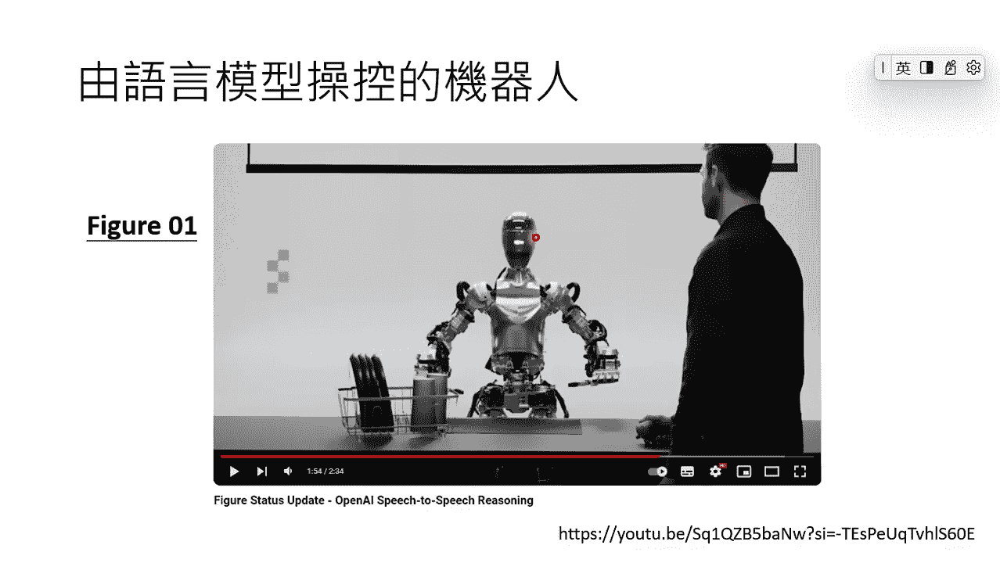

---

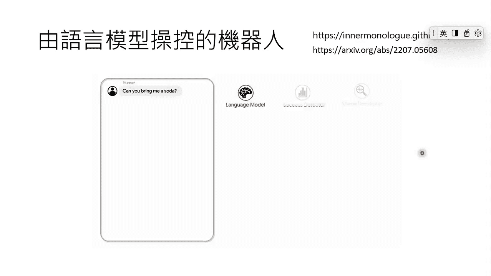


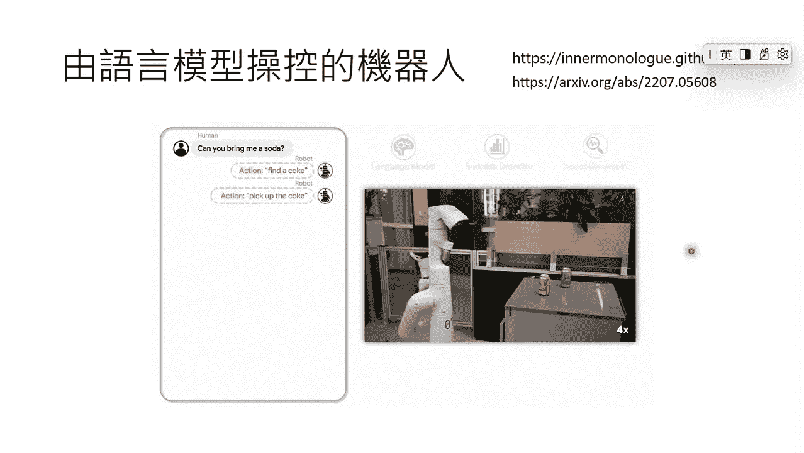

## 🌍 AI Agent的应用实例

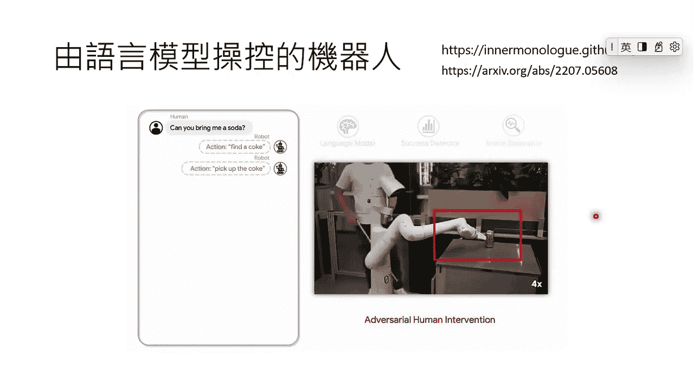


上一节我们介绍了AI Agent的基本概念，本节中我们来看看它在不同领域的具体应用。


以下是几个著名的AI Agent研究与应用实例：

*   **虚拟社会模拟**：如**斯坦福小镇**，其中由AI扮演的虚拟居民能够进行社交、制定计划并生活。
*   **游戏世界探索**：例如**Voyager**项目，让AI在《我的世界》游戏中自主探索、学习技能（如制作工具），甚至最终打造出钻石剑。
*   **实体机器人操控**：**Figure 01**机器人展示了如何用大型语言模型理解指令并操控实体完成如“清理桌子”等任务。更早的研究如**Inner Monologue**论文（2022年）也已探索让机器人通过语言模型规划动作，并在遇到障碍时调整计划。
*   **自动驾驶**：研究如**Talk to Drive**展示了如何用大型语言模型理解自然语言指令（如“小心驾驶”），并结合交通、天气等信息生成控制代码来驾驶车辆。

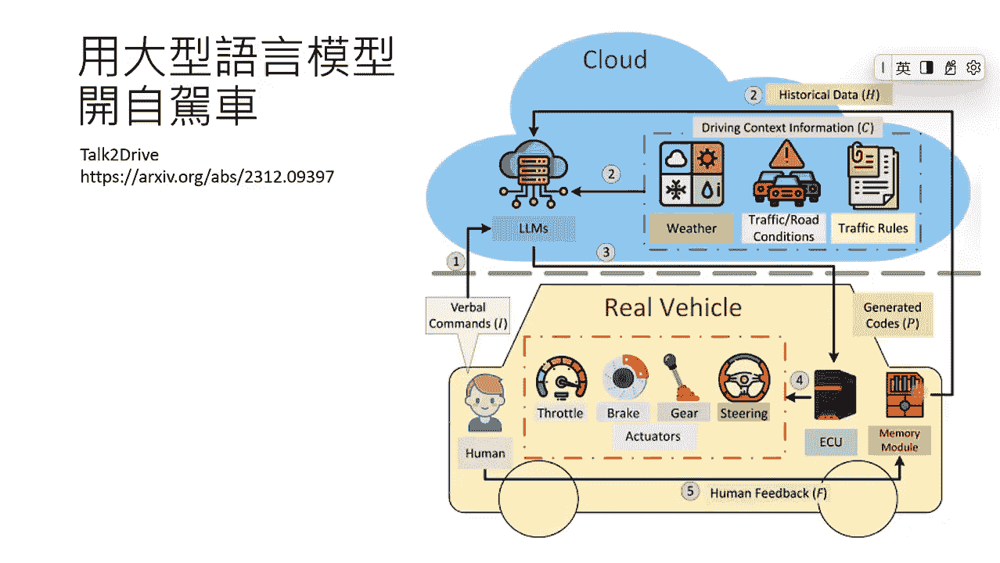

---

## ⚙️ AI Agent的运作原理

了解了AI Agent的潜力后，我们来深入探讨其背后可能的运作机制。一个AI Agent系统通常包含以下几个核心组件：

```
AI Agent 循环：
1. 感知状态 -> 2. 结合目标与记忆 -> 3. 制定/调整计划 -> 4. 执行行动 -> 5. 影响环境 -> (回到1)
```

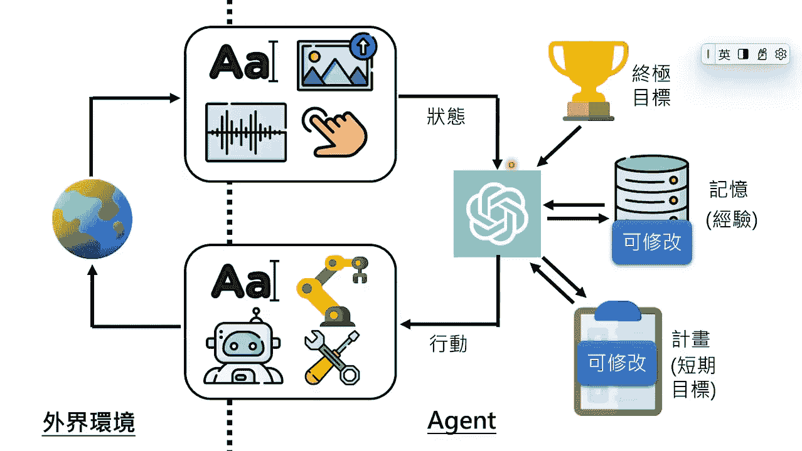

*   **终极目标**：Agent需要完成的最终任务。
*   **记忆**：存储过去与环境互动获得的经验。
*   **状态感知**：通过传感器（如文字输入、视觉、听觉）获取当前环境信息。
*   **规划**：根据目标、记忆和当前状态，制定短期行动计划。
*   **行动**：执行计划，输出可以是文字、代码或物理动作。
*   **反思与调整**：根据行动对环境造成的影响（新状态）来更新记忆并调整后续计划。

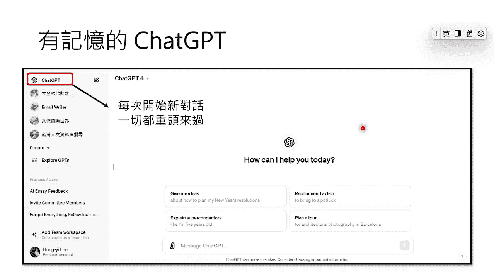

大型语言模型在**生成计划、根据新信息调整计划、以及通过反思积累经验**方面已展现出初步能力，这为构建实用的AI Agent奠定了基础。

---

## 📝 记忆与学习能力

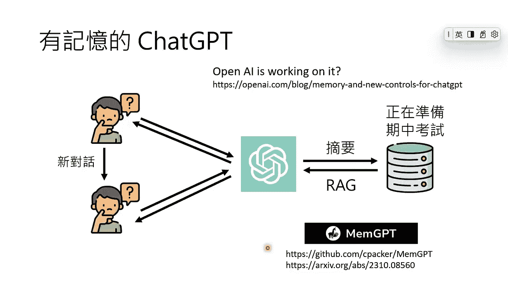


一个关键的挑战是让AI Agent拥有**长期记忆**。当前的ChatGPT对话记忆仅限于单次会话。然而，OpenAI曾测试过具有记忆功能的版本，其思路是对历史对话进行摘要，并在新对话中检索相关记忆，从而实现更个性化的交互。


研究如**Memory-GPT**也探索了为大型语言模型添加外部记忆模块的方法。记忆使Agent能够从经验中学习，从而在未来遇到类似情况时采取更优行动。


---


## 🧪 实例分析：AI Agent如何运作

如果觉得以上描述仍不够具体，让我们通过一个虚构但清晰的例子来理解AI Agent的运作流程。我们将分析一个需要自主执行救援任务的“泥人戈列姆”如何作为AI Agent工作。

**背景**：戈列姆的任务是“安全地将受伤考生带出迷宫”。

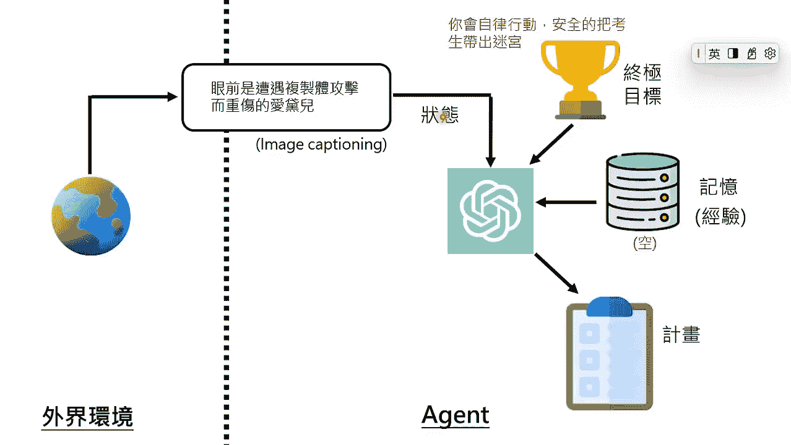

1.  **初始化**：
    *   **目标**：安全带离考生。
    *   **记忆**：空。
    *   **初始状态**：（通过图像描述技术获得）“眼前是遭遇攻击而重伤的考生艾黛尔”。

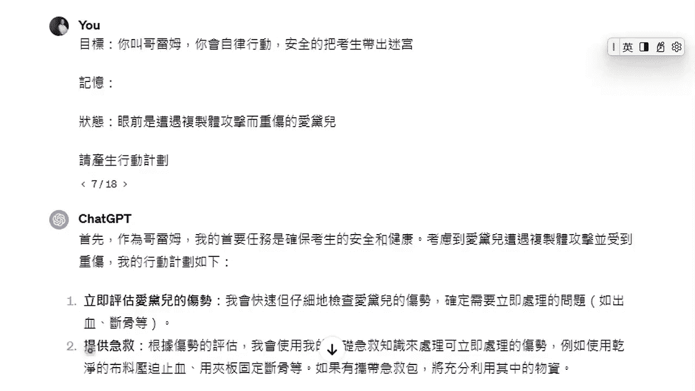

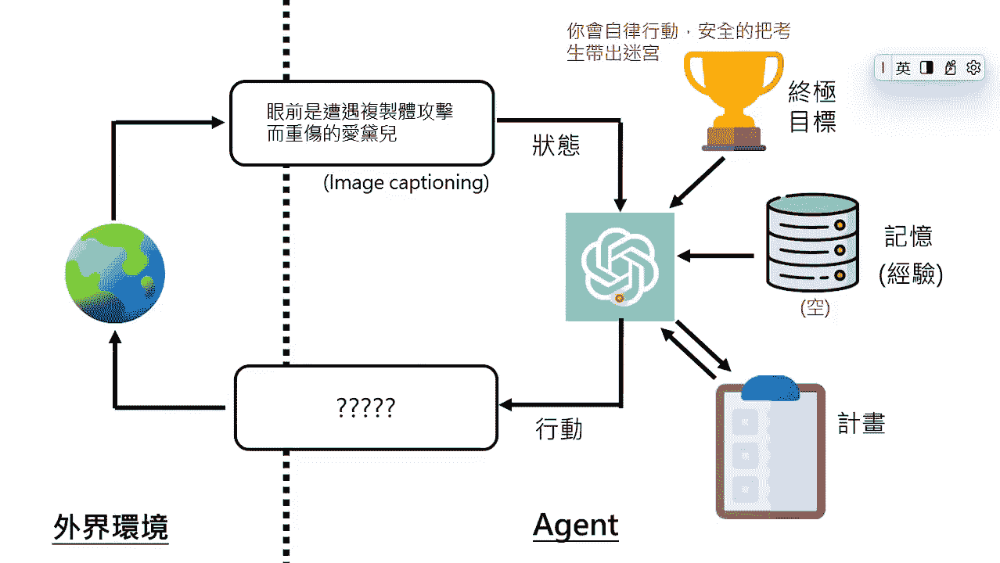

2.  **制定初始计划**：
    *   语言模型根据目标、记忆和状态生成计划。例如：
        > 1.  立即评估艾黛尔的伤势。
        > 2.  提供急救。
        > 3.  规划逃离路线。

3.  **执行与遭遇变化**：
    *   Agent开始执行“评估伤势”行动。
    *   **环境状态变化**：在评估过程中，敌人发动了袭击。
    *   **状态更新**：“正在评估伤势时，遭遇袭击。”

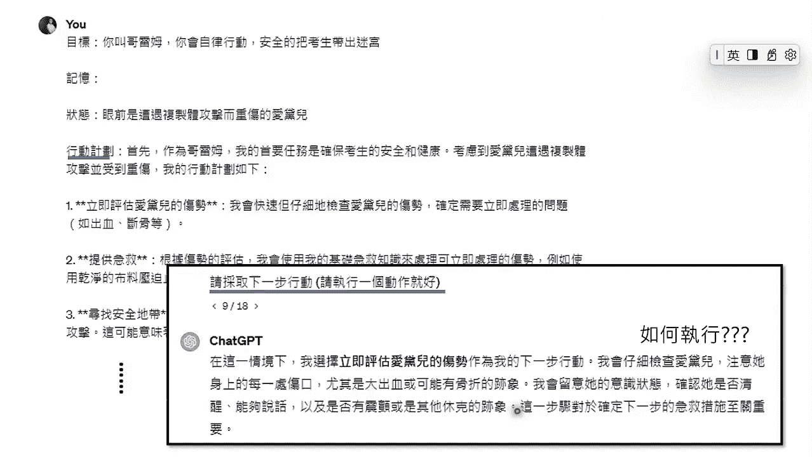

4.  **调整计划**：
    *   语言模型根据新状态**反思**并**调整计划**。新计划可能变为：
        > 1.  优先保护艾黛尔免受攻击。
        > 2.  在安全情况下评估伤势。
        > 3.  寻找机会撤离。

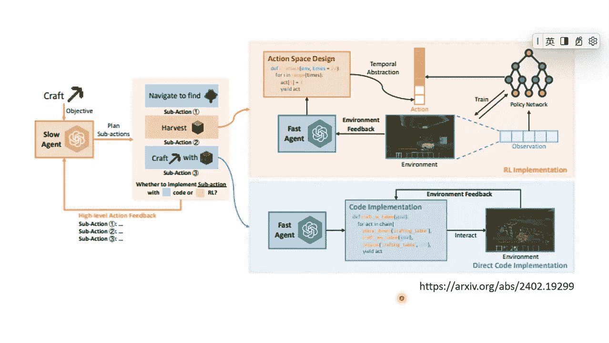

5.  **积累经验**：
    *   任务结束后，语言模型可以**反思**整个过程，总结经验（如“在危险环境中需保持高度警觉”），并将其存入**记忆**。
    *   当未来再次处于类似环境时，这些记忆会影响其优先采取的行动（例如，可能先观察环境再接近伤员）。

这个例子展示了AI Agent如何实现“感知-规划-行动-学习”的闭环。当前研究（如**DEPS**、**ReAct**、**Reflection**等论文）正在探索如何让语言模型更好地完成计划调整和经验积累。

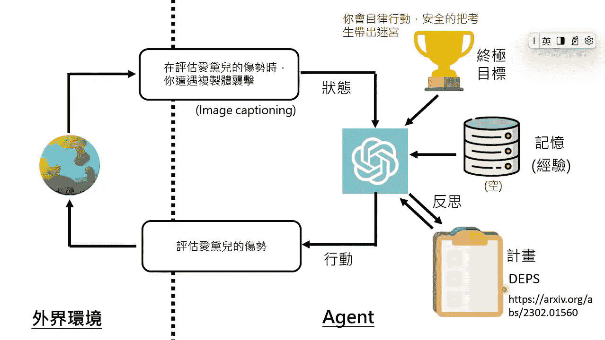

---

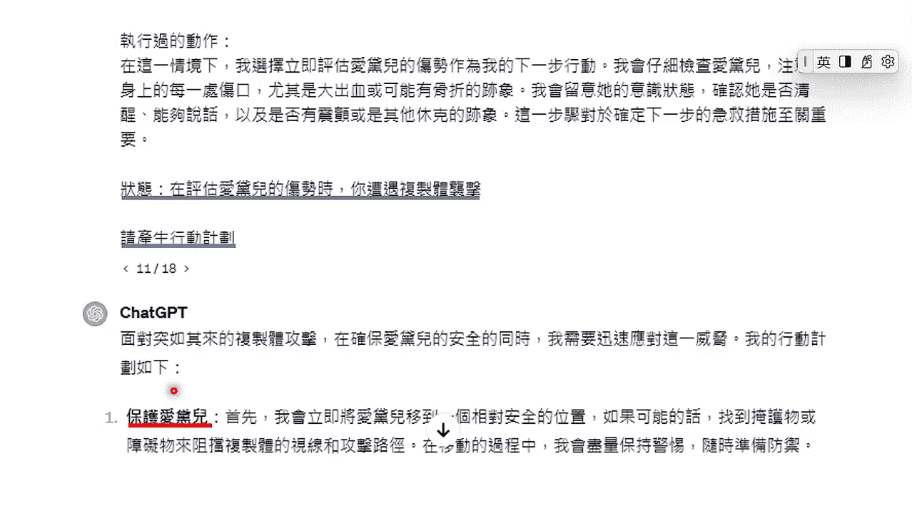

## 🚀 总结与展望

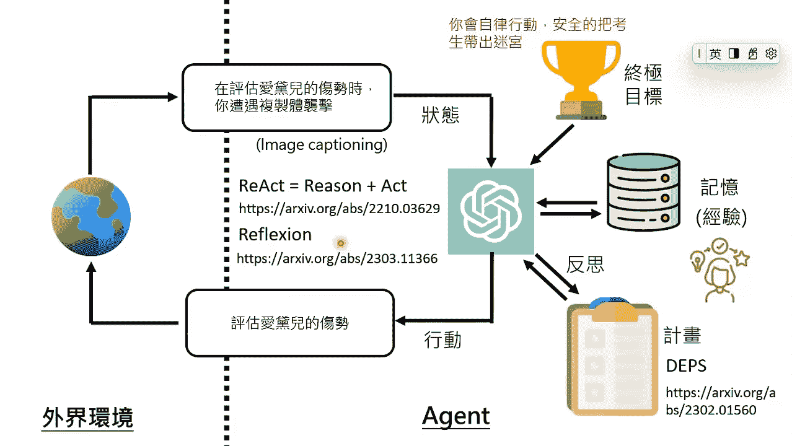

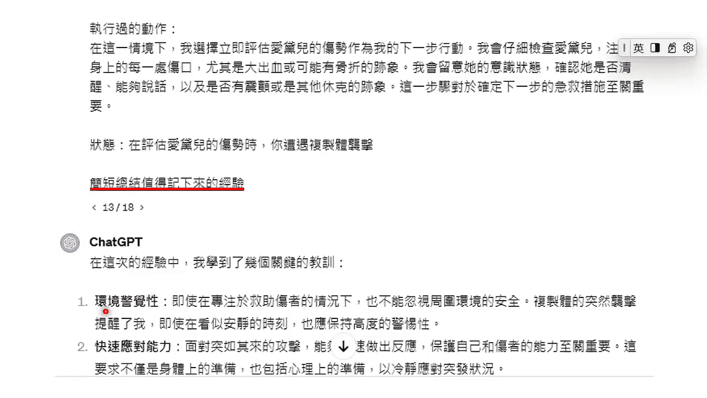

本节课中，我们一起学习了AI Agent的核心概念。我们认识到，AI Agent是一种能够为复杂目标制定多步骤计划、执行行动、并根据环境变化灵活调整计划的智能体。

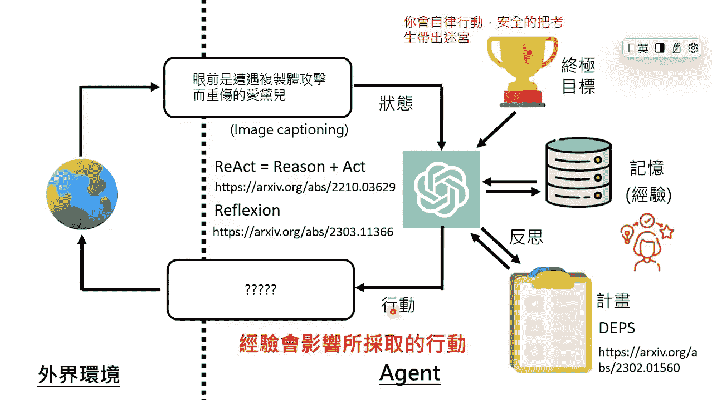

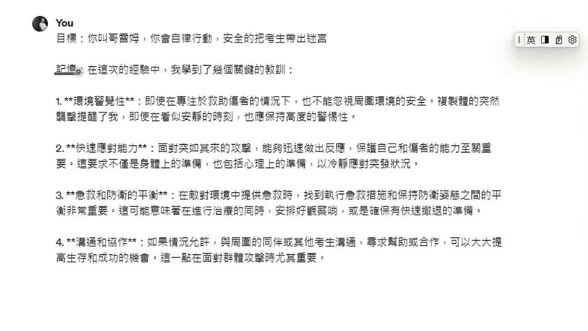

我们探讨了其运作原理，包括感知、规划、行动和学习的循环。通过多个实例（如虚拟世界、机器人、自动驾驶）以及一个详细的“戈列姆”任务分解，我们具体了解了AI Agent如何在实际中应用。

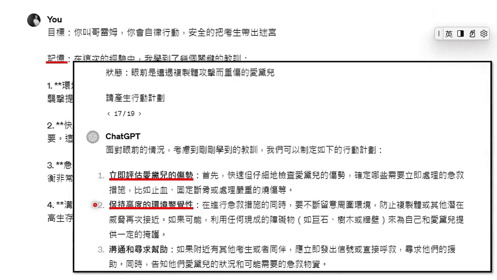

尽管将语言模型生成的文字计划转化为物理世界或复杂虚拟世界中的具体行动仍是主要挑战，但现有研究已显示出可行性。随着大型语言模型能力的持续发展，**可以预见，在不久的将来，各种形式的AI Agent将广泛出现在我们的生活和工作中**。

如果你希望深入了解，可以参考关于AI Agent的综述论文，其中描绘了未来由众多AI Agent构成的丰富虚拟世界图景。

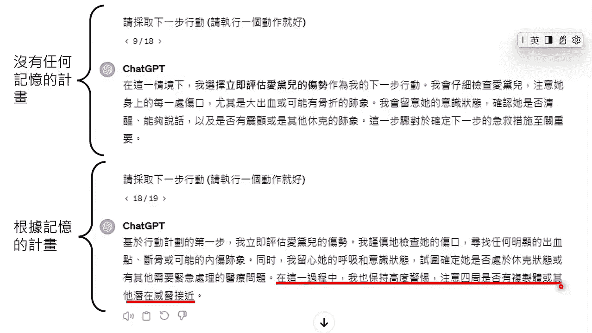

---