# 强推！(2026最新版) 李宏毅最新课程：智能体AI【AI Agent】71集全！人工智能／机器学习／深度学习／大模型／LLM - P10：9-作业 Finetuning is Powerful - Ai人工智能工程师 - BV1QdzCB3Eu2

那我们现在要来讲解那个作业，然后这个作业我的助教有我，然后陈佑豪同学，还有郑喜群同学，然后那个作为五的deadline是4月18号的呃，礼拜五晚上的11：59分好。

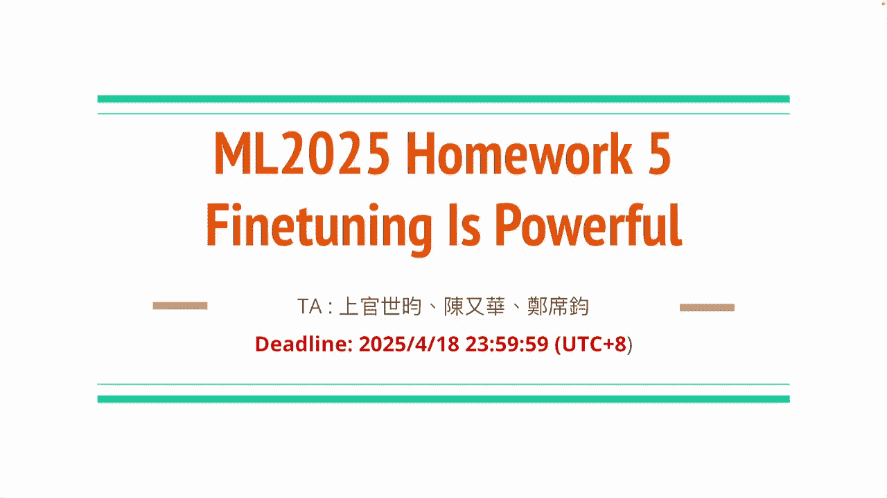

那这这一页是这个作业的相关的链接，就都可以在这页找到好，那就先来介绍这次作业要做什么。

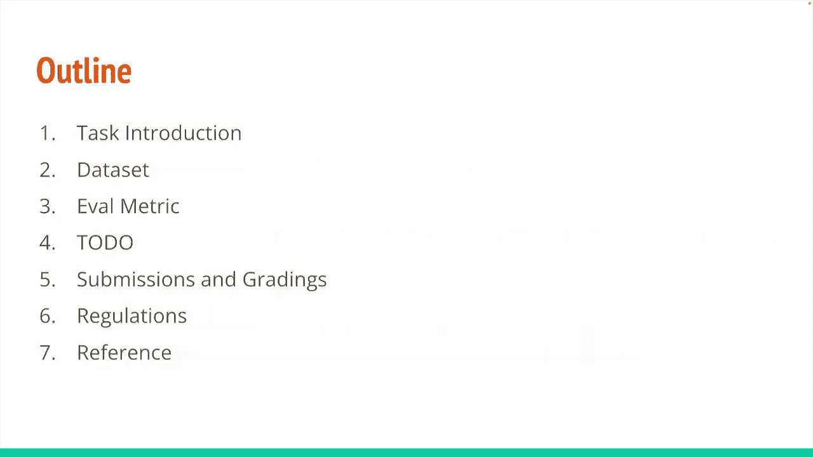

那这次作业的目标呢就是希望同学们去呃，Sign tune pretrain，好的LM呃，去完成呃一些他原本做的很差的test，那具体来说我们这次希望呃，他做到就是可以遵守人类的指示，这样那呃举个例子。

就是像下面这张图，那假如说我们现在有个PRETRAINLM，但是我还没有反应to的情况下，我们可能跟他说，就是告诉我们一个跟我们讲一个床边故事。

那please tell me a better time story done，然后喂给他，那他可能就是他就觉得文字接龙嘛，所以他可能就是平常他看到的文本，就是呃就是一个小说。

也可能一个一个那种故事书，然后结果就可能有一个妈妈，就开始跟她的小孩讲那个童话故事，所以他不会直接开始他的童话故事，他可能就是文字接龙，所以他就说呃she cleared her throw。

然后就开始讲这个童话故事，他就没有直接开始讲对，那所以我们今天需要他follow我们的指示，就是直接开始讲这个童话故事，那我们可能就给他呃这种类似的data。

然后fine too就是我们就假设我们就只用100笔，就少少，只要去find to，其实他就可以做到这件事，然后他就可能就可以呃给你，他就他就可以直接变成说呃once or upon time。

就直接开始讲这个童话故事好。

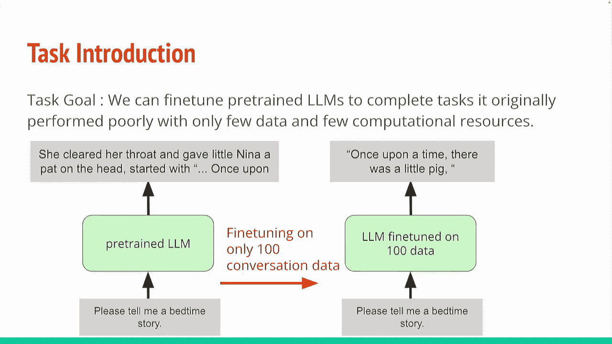

那当然还有呃还有就是刚老师没有接收到，就是呃LM也可能可以就是透过fine t来，就是呃在一些他原本表现比较不好的domain，上面来呃做较好，但这就不会是我们这次呃find two主要的task。

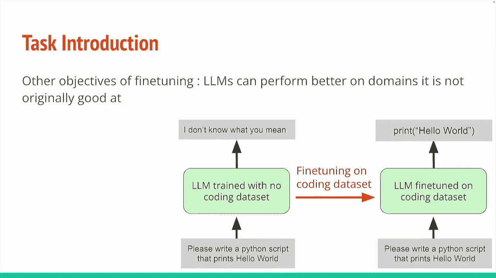

那好那我们这次要用的模型是这个lama two7B，然后是没有，他们是没有翻译通过，是不是，所以不是老马two有7b cheat，就是老马two7B，那我们会把它翻译成在这个奥帕卡。

52K的这个DLC上面，52K就是呃对的是52000千米，呃，资料这个AC上面那呃请同学注意，这次作业就是请大家只能使用这个lama two起笔，这个模型不可以任意更改这个模型，因为我们知道。

希是展现这个fine too的那个强大之处，所以说你一开始就挑一个太强大的模型，可能就会看不出这个find two强大在哪里呃。

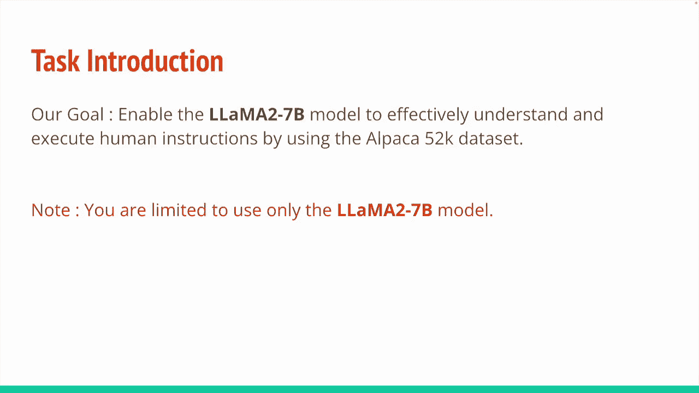

呃这个连接是这个apaa dai set的网的的，那个网址就可以供大家参考，然后呃对，所以就是呃我们这些作业就是呃为了展示说，就是其实我们只要用少量的data，跟少量的训练资源就可以呃。

呃反应TU出本强大的模型，那我们就是希望大家只使用呃，他52K给他set里面的100笔资料对，那所以就是就是你们要去从这52K的data set，去跳出100比你认为比较好的data去进行训练。

然后呃你也不能去网络上，找其他的任何其他dar set来用，或者说甚至是呃自己去呃凭空想出一些DSET，或是呃请模型帮你升一些DASSET，这些都是禁止。

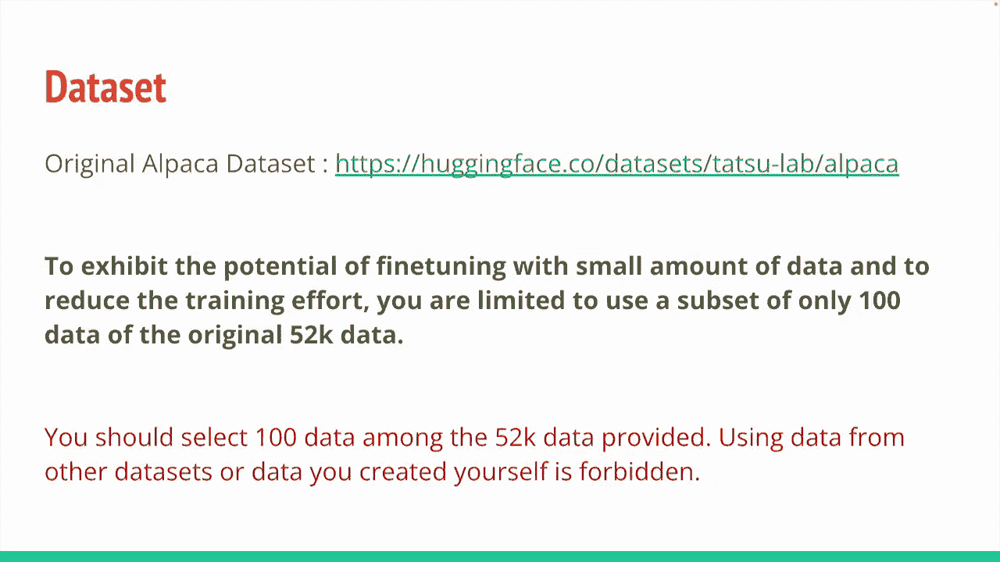

好那呃DSC的format，那大家可以看一下，这样就是呃id的话，就是每一笔data都有一个自己一个独立的id嘛，那conversations的部分，就是那个这笔data的input和output。

那input部分就是这个human下面这一段，那output就是GBT下面这一段，然后最下面这个score呢，它它就是这个DIASET，原本在呃他们在制作这个data set的时候。

他们就把这个input和output位给那个呃，喂给一个LA，然后请他评分说就是这个回答的好坏的程度，然后就给他一个就给他一个分数，这样子对，所以这也可以作为你们来参考这笔data a呃。

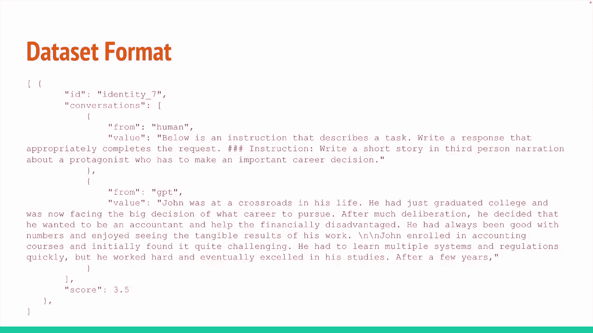

是好是坏的一个依据，那这些作业的评量方式呢，就是呃我们会用另外一个很类似的data set，叫做evil instruct data set。

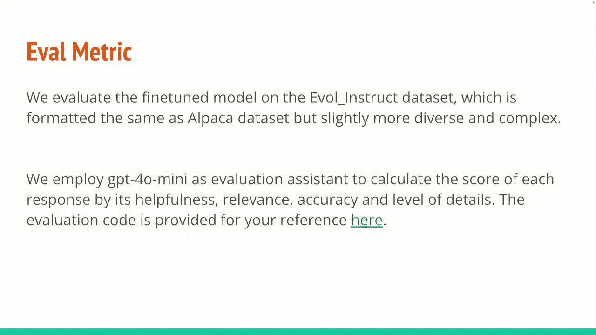

那它的format基本上会跟这个opia data set长一样，就是长这样子，但是它会再稍微更复杂，然后再更多元一点，就是希望各位就是在fine tune的时候，也不要过度OVERFIT。

在这个奥帕奥帕卡DSET上面，还可以在这个DSET上面也做好，所以呃然后我们会使用那个GB t four mini，当做就是评分的那个那个助手，然后他就会把那个你们infinite出来的。

那个答案就是丢进去，然后请他针对你这个这个output的呃，帮助的那个帮助性，然后呃相关性，然后它的准确度，那呃evaluation的code呃，我放在呃这个超链接这边，你们可以会如果有有兴趣的话。

可以点进去看看，就是也有可能会对你们fine co的方向呃，会会更清楚一点好，那这一次的to do大概有这三个，那主要是希望你们去做前两个，那如果前两个就是应该基本上就可以过，双杯赛啊。

如果真的还没有过的话，可以试试看第三个，第三个maven好，那第一个method就是去调整超参数嘛，那这边这一次作为可以调的超参数，大概会比前几次做的多一点点，就是还要多，这个laura rain。

还有这个laura alpha的的超参数对，那然然后还有下面的就是LM，就是在在generate token的时候就要抵扣嘛，那那这边也有一些超参数可以调好。

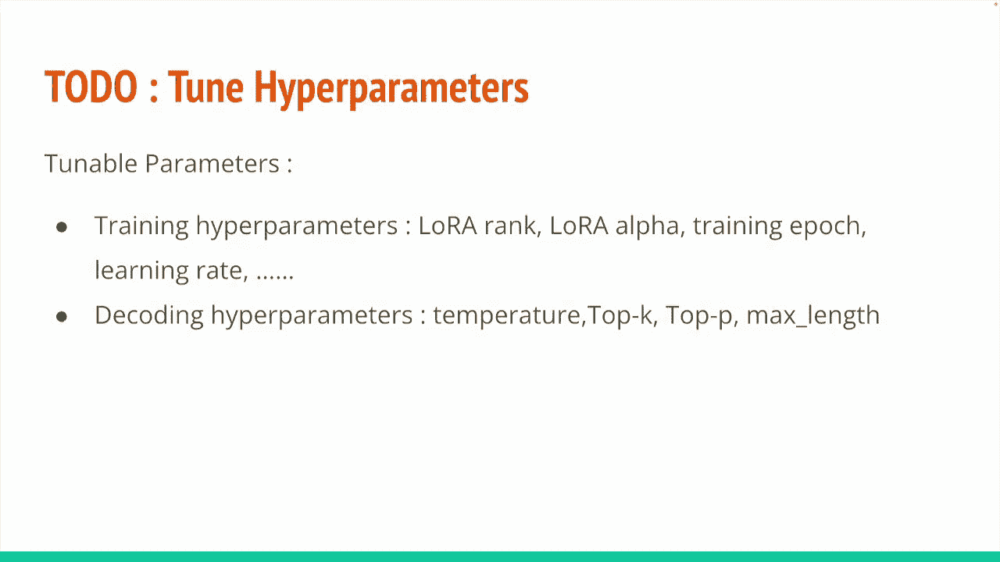

那我们现在介绍呃呃LAURA超参数额要怎么调，那那就要先来介绍LAURA是什么，因为呃呃就是这部分好像没讲过，那那LAURA是什么呢。

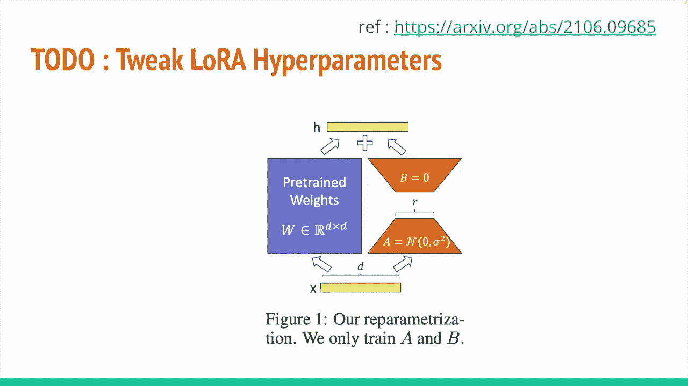

就是呃现在LM其实它就是参数都是呃，别就是都是好几个别练级上的参数，所以就是像刚刚那个那个秀轩学长说到，就是其实在fine t，在一张那个t four的那个GPU上面，其实是很困难的。

你可能只能find to一个那个呃，拉马37B的那种小模型，那呃所以如果我们今天希望就是呃fine two那种，可能在更大的模型，或者说就是你你你也是fine two小模型。

但是你想要find two的更有效率的话，那我们就会需要用到一些比较特殊的手段，那呃我们这边就会用这种方法叫做para parameter，Efficient，Fine tuning。

就是我们在呃fine tin的时候，不会一次去调整所有的超参数，我们可能会只会抓其中一部分出来调整，或者说我们用可能就是精度比较低的方，方法去调整，那去去去做这个gradient desc。

那这个那那这个这个method叫做，那就叫做那个parameter edition，Fine tuning，PST好。

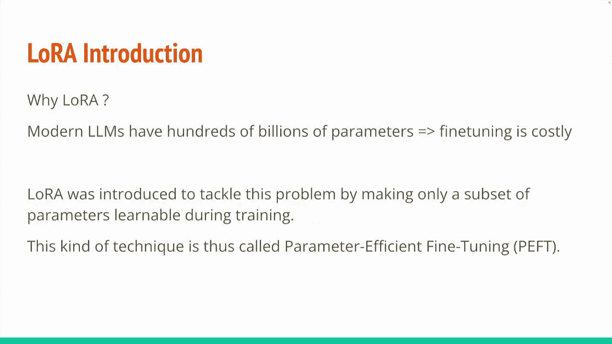

那LAURA是怎么做到这件事情呢，那一般来说我们去呃update一个模型的时候，我们呃先假设呃，我们今天要update的这个的这个参数是模型里面的，可能某一层的，其中呃一块的参数是这个左边的这个呃。

左边的这个我等下我我用一下镭射好，要开镭射诶，镭射笔要怎么开啊，左下角再点三个点开始，没事吧，第二个，好就是这个蓝色的这个matrix资源，那那那这个就是原本那个model的。

我们要去进行green比赛那块位嘛，那我们假设它是一个D乘以D的一个方形矩阵，其实也不一定要是方形矩阵。

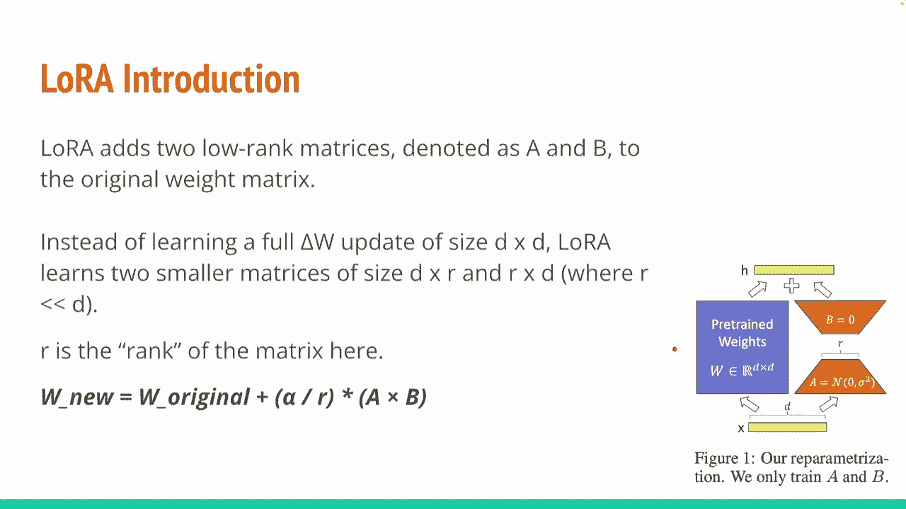

它也是可以是一个呃呃长方形矩阵，可能是可以是可能是呃。

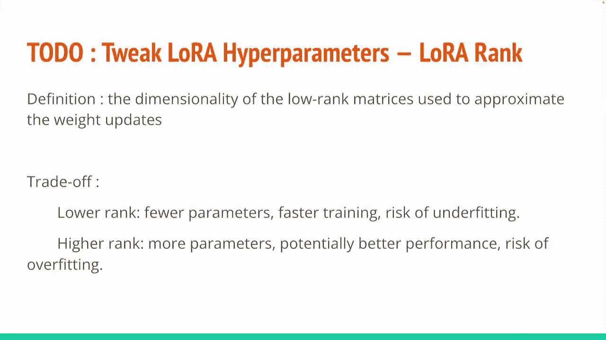

cc乘以D之类的的的dimension，那我们今天先假设它是D乘以D，那假如说我们照原本一般的the gradient descent，就是去训练他的的method的话。

那我们就是要去update这低平方的呃参数嘛，那那这样子可能会用用用用到的那个机体，就很逗很多，那我们今天就是用两个比较小的矩阵去相乘，然后它一样乘起来呃，一个A1个B嘛，然后相乘起来。

然后它乘起来一样，它的维度是D乘以B，并没有低平方这么多，那我们今天假设这个A是一个呃，D乘以R的dimension的一个矩阵，然后B是一个R乘以D2MENSION的一个矩阵，那呃如果有修过线性代数。

应该就知道一个低层R的矩阵，再乘一个R乘D的矩阵，因为呃第一个矩阵它的column跟第二个矩阵，它的roll是一样的，所以它是可以相乘嘛，那最后相乘出来的矩阵，它的维度就会是第一个矩阵的roll。

乘上第二个矩阵的color，那只要这两个维度跟这边的D乘以D的，这个维度是一样的哈，那最后这个矩阵就可以加到，加回到这个矩阵上面，那所以我们它它这个方法是怎么节省参数呢，就是我们在呃训练的时候。

我们会把这一个W原本的这个WA呃，把它冻结它，它的参数冻结起来，我们不会去动到它的参数，那我们只会去更新这个A乘以B，A跟B这两个矩阵的参数，那我们更新完之后，我们就找总共就只要更新呃。

D乘以R再加上D乘以R，那就是2DR的参数，那我们今天假如说把R设的远小于D，那我们今天就可以节省很大的参数量，那最后我们就再把那个训练之后的A矩阵，再加AA矩阵乘上B矩阵的这个。

最后他撑起来也是为一个，也是会是一个呃低平方的一个矩阵嘛，然后再把它加回到原本这个冻结的这个参数，那我们这个模型就被更新了嘛，那那LAURA大概就是这样子运作，那这边的这个R呢当然不是只是呃线性代数。

真的那个那个那个字的那个rank的意思，这个这边的那个R，只是因为想说这个这个R是一个比较小的一个，一个dimension，就是这边的一个bottle neck，所以我们就也把它叫做rank。

但它不是它不是真正的线性代数，真正的那个意义上的那个rank，那我们这边可以大概可以用下面这个这条式子，来来表示说LLAURA是怎么做这个做这个呃，那个那个参数的相加的，那那我们新的这个训练过的这个翻。

通过这个参数叫做，假如说叫做w new，就会是原本这个呃原本的参数w original，再加上一个这个系数阿尔法贝，然后除以rank的这个R的这个的这个R，然后再乘上额。

刚刚的那个A乘B的那个math值相乘，那前面这个A跟R，R是决定刚刚的这个的那个dimension的大小，但为什么会我们会在这边再把它除掉一次呢，就是因为当你R设的越大的时候，其实呃。

A乘以B这个matrix，里面的非零的数字会越来越多，因为你如果R设很小，其实你你你乘起来它里面的数字是蛮少的，应该大部分的数字都还是零，那如果你今天就是嗯你你R设越大。

最后这个a b matrix它最后的norm，他那个norm起来的，他那个额数字呃，数字会越来越大，所以我们这边会再反过来再把它除回来，只是不希望当这个R射太大的时候，呃。

它这个AA乘以B这个matrix，所以太大幅度的去影响这个原本的位置，所以我们这边会再把R除回来，对那那这个阿尔法呢就会是呃，你就可以去调这个参数。

这样子，那我们会呃，那调rank跟调alpha的时候会有什么考量呢，那去调rain这个参数，就是如果我们把rain调比较低的话，那它当然更新到的就会是比较少的参数，那他就可以训练的更快。

但是缺点就是可能会under fit，就会训练效果就没那么好，那但是如果你rank色太rank色多一点的话，那当然就是训练更多的参数，那就呃就动到更多参数，那代表它就可以调的去调的更精细。

但是缺点就是你有可能会OVERFIT。

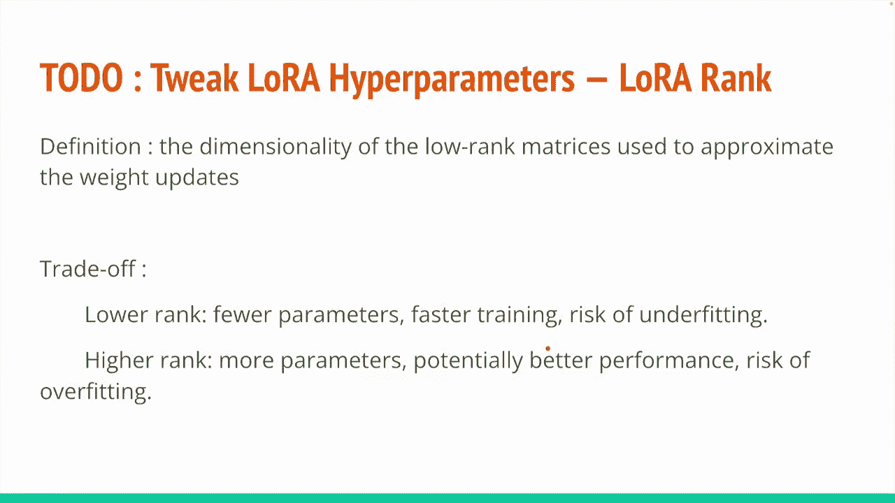

那再是阿尔法这个参数，这个阿尔法这个参数就是我们刚刚讲到，就是你这个LAURA的这个位置是呃，去影响原本这个呃，w original这个matrix的的的一个系数嘛，所以阿尔法设的越大，你你去就有点呃。

其实就是有一点点像，也也不像个人类啊，就是就是你去更新完的这个这个matrix，他会多多大幅度的去影响你原本的这个，这个math，所以你如果设的很大的话，你可能没几个step。

它其实呃model就已经变了很多对，所以这个这也是交给大家去调整，那阿尔法侧比较小的话，那当然就是啊对，就是你你一次模型就不会变动太大，但你如果阿尔法设的太大的话，就有可能是会变动比较多。

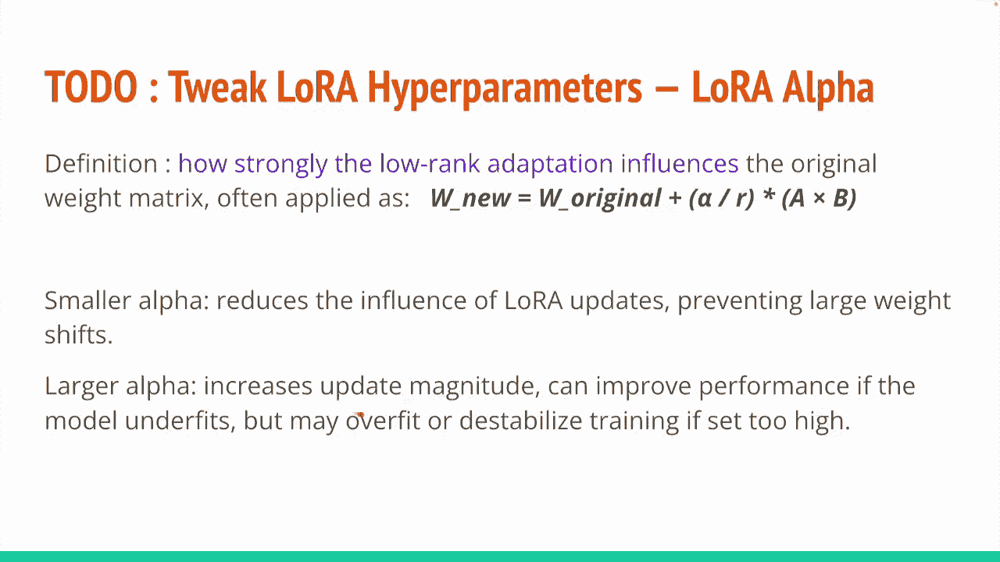

然后就会训练比较快，但就有可能over fit好，那再来下面就是哦，然后前面这些呃，剩下一些training hyper呃的超参数就不特别讲。

就是1training epark或是learning rate，这些我就就大家应该都知道，就不特别讲，那但是下面的这个呃decoding的超长的的参数，这边其实应该前面就有提过了。

那这边就稍微在简单提一下，那这边是借用去年那个JAI呃，陈明光，林希泽，还有余启恩助教的投影片，那这边呃这个作业里面你们可以调的也是一样，也是这四个超参数。

而temperature top k top p跟max lan好。

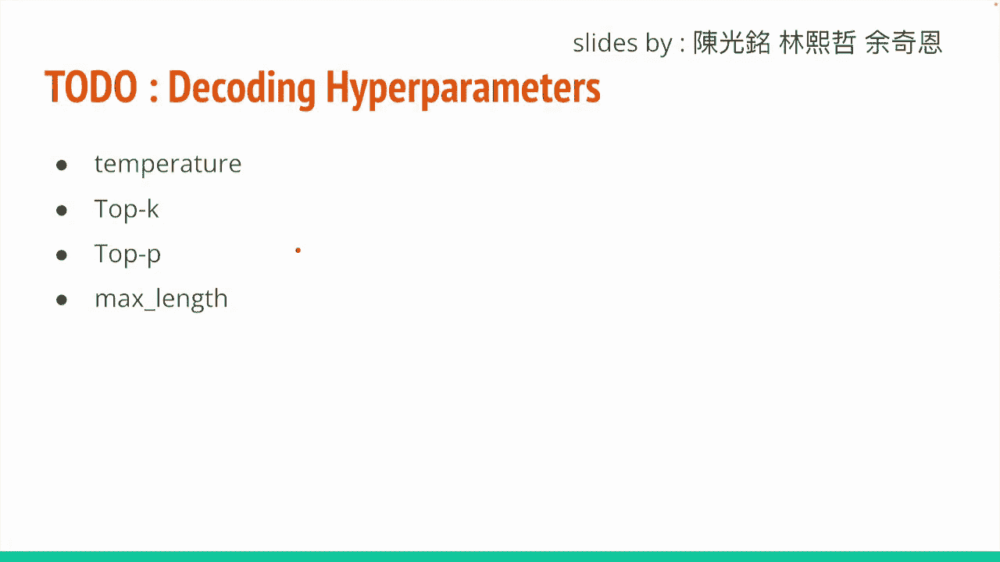

那那也还是先简单再再再讲一次，就是呃language model是怎么来输出这些token的，那language model在输出token的时候，其实不是每次都直接告诉你。

我下一个token要输出什么，他其实输出的是一个呃几率的分布，像右边的这张图，这个，那假设今这个这个模型是一个写唐式的模型啊，那那他是在写唐诗嘛，所以上面这些词，上面这些字其实都有点像是。

常字里面会出现的一些字嘛，那我们今天就是叫他呃，给了他一个呃一个唐诗的，可能上半上半上半阙，然后然后希望他继续去完成后面的嘛，那他开始写下一个字的时候，他其实就是输出一个几率分布，就是告诉你。

他其实可能他下一个字比较想要输出风，然后没那么想输出水这样子，那我们要做的事情，就是我们要决定，我们要怎么去从这个几率分布里面去，sample出下一个要字，那这个就是呃大家在调这个这个超参数的时候。

可以决定他怎么去sample这个策略好。

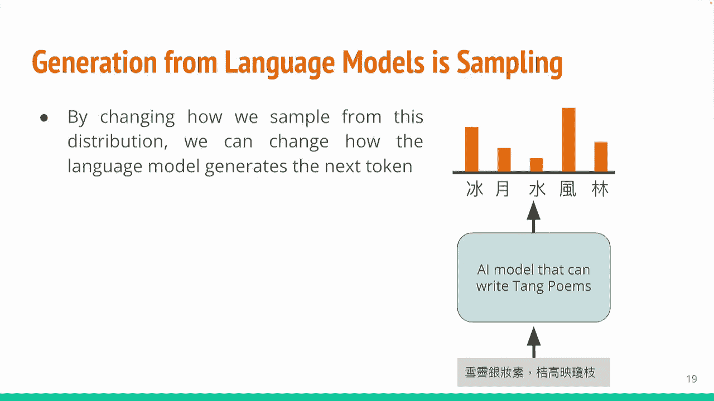

呃对那这个策略就可以决定说啊，他他去sample的时候是兜sample那些很固定的，就是很固定的那几个字，或者说你可以sample出一些很很多人的回应，这样子好。

那temperature这个参数是怎么影响它的decoding呢，那就是temperature呃，就是跟他再输出来的那个diversity4有关，就是假如说你temperature越小，那他输出的时候。

他会把原本几率越大的那些token的几率再放大，然后原本呃几率越小，那些token的几率在缩小，所以当你把temperature缩小小到零的时候，它就都只会输出那个呃几率最大的那个token。

所以就是说就是像你们这样作为，为什么会请您把temperature设成零，就是他就那个模型，就是只会输出固定的那个token，所以助教就就有办法reproduce里面的作业对，那就是呃可能之前作业作业。

助教会建议大家把temperature设成零，的一个原因对，那相对temperature岁越大的时候呢，其实他就会把原本几率比较大的那个token的，几率呃，压的小一点，然后几率比较小。

那些token的几率再放大一点，那就比较高级率去sample出呃，可能原本不太会sample到那些token好，那在top k那top k呢就是直接去限定说呢，呃我们只从额额前面几率最大这样数过来哦。

我们的top k的那几个token里面去做sample，就是假如说我们今天top k设一，那他就只会从基于最大数下去的第一个token，去做sample，所以那他就永远只为simple。

它就永远只为simple到几率最大那个那个token，那假如说我们设K等于二的时候呢，他就从基于最前前两代的token里面去做sample，就他今天就是从风跟冰里面去做sample。

那以此类推可以等于三话，就从风冰凌这三个token里面去做sample，好，那top跟top k其实蛮像的，但他限制的方法是改成用额累进，机遇的方法去做限制，那假如说今天top设0。15。

这是意思说就是你从累计几率为呃，15帕的呃那些token里面去做呃，做sample，那额套呃，这个这个套皮就是指的，它它需要小于等于这个雷电机，也就是说今天如果射15帕的话，那你这些累进的token。

他加起来几乎是不可以超过15帕的，也就是说这边风的几率是12帕嘛，然后冰的几率是2。7帕，这两个加起来14。7帕就小于15帕，但如果再加上这个零的话，呃就会大于这个数五帕。

所以我们就只从风跟冰这两个token去做sample，那大家可以调，就是，然后，然后P就会是一个介于0~1之间的，一个数字对，那那这边也可以，大家可以去做调整好，那max line就是相对直觉。

就是呃就是这个他就只能限定那个model输出来的，这个token sequence是要多长。

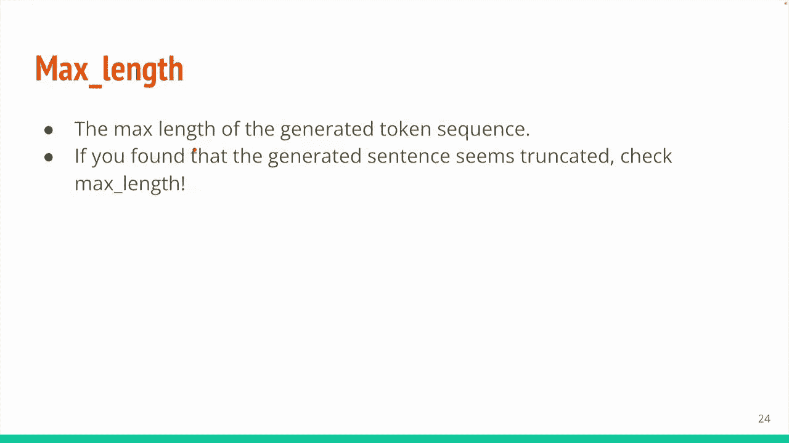

那那这边其实就是呃，如果大家在看你的输出的时候，然后发现最后的输出有点奇怪，像是最下面这一行，就是他说呃使用这种装置，可以有效提高光学显示技术的效能，挂号如电式顿耗电，然后很明显后面应该是还有点东西。

但是就他就他就被截断了，所以你就知道你的max length可能设的太小，那max lan就调大一点就好了。

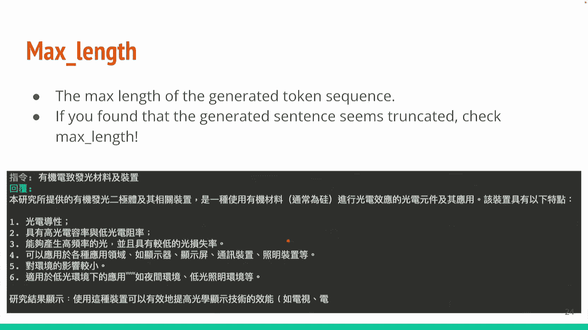

好那对，那那那在那个这次作为里面的城市马里面，他就会呃在这个地方，然后大家就可以去调侃。

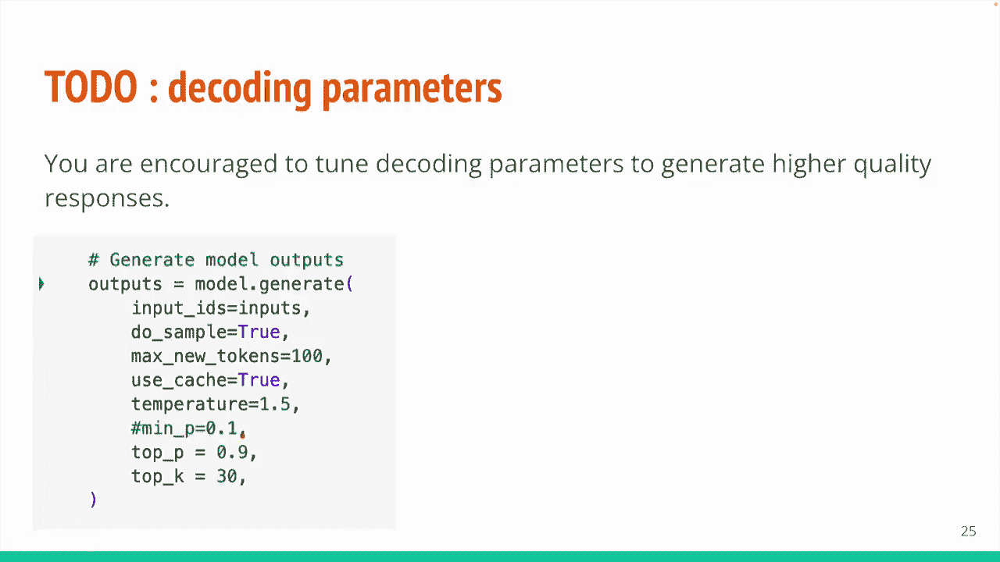

刚刚讲的那四个超参数好，那第二个希望大家做的事情，是去从这个五原本的那个52K的电压set，里面25万2000笔资料里面去挑出100笔，那就是去做salter跟refine动作，那那为什么要这么做。

就是因为老师刚刚有提到，其实训练资料的品质，会很很很高度的影响到你去反应吐出来的效果，对那老师刚也有介绍这一篇paper嘛，那呃老师应该也有提到说，这边paper提出来的策略是什么，那这边就不再细说。

那如果呃大家有兴趣的话，就是呃再回去翻老师刚呃上课的内容，或是直接去看这篇paper都可以，那就是提供你一些怎么去挑选这些叠加C的。

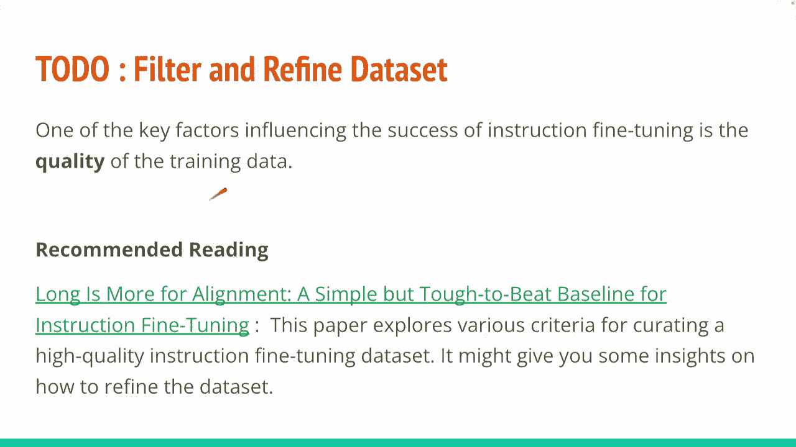

一些一些方方向对，所以你们要做的事情呢，就是额依据刚刚那些去挑选DASET那些方向的，那你就是去import们一个一个排序的一个function，然后去根据这个data set里面额的一些统计数据啊。

或是之类的一些数据呃，去对每一笔data可能做个排序，然后我从这些就是排序出来的结果，就是你们就可以筛选出可能你们认为比较好的，training的fine tuning的data对。

那那呃在那个sample code里面，我是有input input们一个简单的呃去算conversation，length的一个function，那它就是可以计算input和output。

加起来的总字数呃，作为呃你们来筛选一个参考，当然那那那这个你们也可以改，就是你们等下是可以去改这个function，你可以呃单纯去看可能呃那个output的长度就好，不是单纯看input长度好。

就不用呃一次看input加output加起来的强度啊，这些都是可以改的，那对那在排序完之后呢，那你就是朝你排序的结果，去切割出一个subset嘛，那这个subset上限就是100米data。

然后去进行训练，那那你们也可以用其他的一些一些呃，一些统计数据嘛，你可以像是用那个data原本就付给你的，那个score的那个评分去进行筛选，也是可以的，好那呃那这边的一些呃hints。

其实这这部分应该本来就不会它特别难，那如果要更好去做这个的话，那你就是可以像像是先呃，找到某一个你想要用的那个统计数据之后，就把它画出来，或是把一些相关数据都print出来。

其实你应该就会更有想法要怎么去筛选，好那那最后这个就是如果你前面两个to do，就是呃调整超参数跟那个跟去refine，这个DATASET都做完了，而且都试了几次，可能都还是打不了装备赛。

那你可能才会去想要试试看这个这个technique，那这个technique叫做curriculum learning，然后就是呃就是我们原本前面在fine two的时候。

我们是直接拿一个subset去fine two嘛，那就是fine tin一次就结束了，那那这边要做的事情就是我们把它分段，就是说呃我们可以先用比较简单的呃，一些data去find two。

然后再用比较难的data去翻译to，也就是说这点像人类，你在学的时候就先学简单的东西，再学难的东西，那那这样子循序渐进的学。

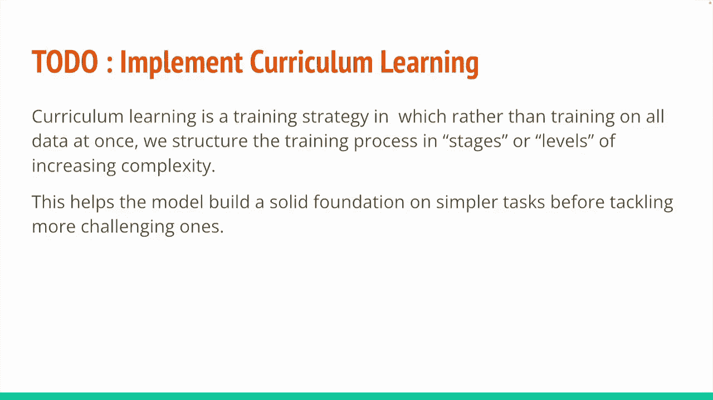

那他可能会学的更好，这样子，那那如果这边要import man的话，那你们就是把你们挑出来的那100笔的asset，可能再去做切割，切成可能五十五十，然后一个easy的对一个easy的subset。

再加一个hard subset，那就先把train在这个easy subset上，再把它train在这个hard subset上，或者说你可以分成三个subset也可以，但是不会建议分太多了。

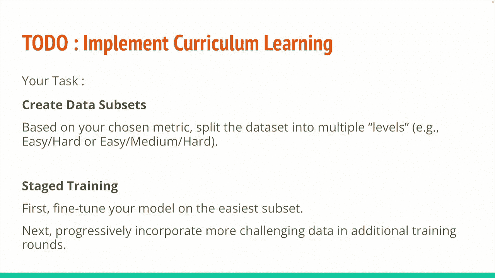

对嗯好，那接下来就讲这个作业的角交跟怎么评分吧，那一样是跟之前做的一样，就是脚交扣的话就是四分，然后去交到把它打包起来，然后把它交到n into扣。

那call的部分一样是三个basisimple medium更strong，然后都各分public跟private，然后都各执一份这样，然后预估的时间大概就是呃呃simple basi。

就是直接一键直就是直接全部执行就可以了，那大概会花你们十呃，大概十来10分钟左右，然后啊training time是10分钟，那inference time的话，这都是固定的。

所以inference time就是不管哪个杯赛就是15分钟，那如果media杯上跟双杯上，可能就要再多花点时间训练跟摸索。

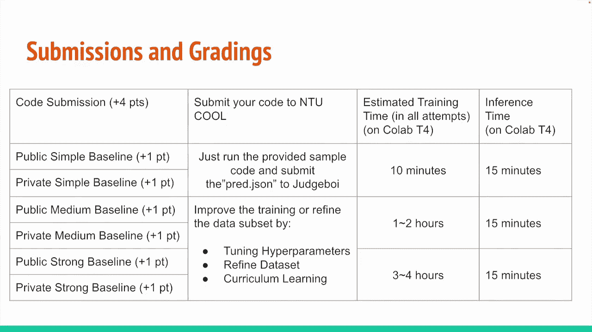

大概就一到两小时或者甚至3~4小时，这样，那这次base time就先列在这边对，那那这是悲伤，就是用那个前面那个说到的，就是用CHE呃，呃那个gt four mini。

作为evaluation的那个的表的那个evaluation的system，然后他就输出一个分数，那那那就是那你的那个分数的平均，就要超过这个分数才可以拿到额，那个才会才会通过那次比赛好。

那扣那那个prediction的部分，就请你们交到jz boy这个平台，那前面应该有用过，就不特别介绍，那这次要教的是这个PRE点JSON，所以请你们交上去，一定要交这个点JSON的这个这个档案。

不要交其他格式的档案，然后呃每天可以交五次submission，然后是在每天晚上的11：59分会重置，那因为这次我们是将去让那个gt four mini，进行评分嘛，所以呃其实那个评分是他。

他也是要跑那个influence influence的那个code，所以其实会需要点时间，大概是可能一个人跑的话，可能是23分钟，然后我不太确定那个那个josh boy，那个那个机器是怎么具体要怎么运。

就是去运作的，所以所以他可能如果你们同事，很多人的角教的话，也许他会需要排队之类的，所以其实有可能时间会拖到更长的，所以建议你们不要每天晚上快要就是快要半，快要11：59分的时候才叫脚，可能会卡在那边。

所以就是只比较一次累积五个，然后一次送上去可以，就是呃就是做好就先交上去评分，这样好，那再扣扣的部分呢就是呃一样也是呃，4月18号晚上11：59分前要交，那就请你们把它压缩成一个呃呃前面是学号。

然后底线homework five的一个zip档，然后把它装上去，然后我们就看到你最后的sum选，然后在教的时候，请不要把你们的mo的model weights或是DATASET交上去。

因model waits，因为这是一个是个LM嘛，所以它的大小也是蛮大，所以就请不要把你的model which，也一并放到你这个zip档里面，那如果你们这些作业是不合理，但是不合逻辑。

或是我们没有办法reproduce的话，那你就不会拿到分数好。

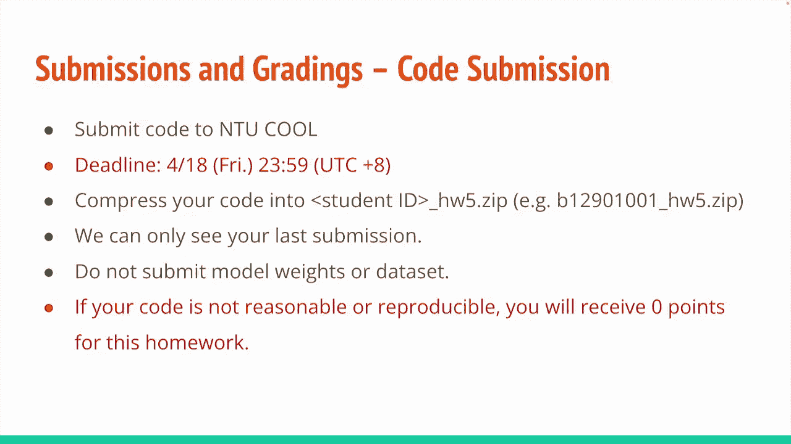

那就是作业的规定是下面这些呃，那呃我们会，就是你不可以跟任何活着生物分享呃，你的code或者是你prediction的file，那你也请不要用任何的方法去呃，在一天内缴交超过五次。

然后这很重要很重要的是，就是这次training data，就是请不要使用超过100笔data，那呃然后也不要去额外搜寻，用别的data set，或者甚至是自己去写一些data出来。

那那我们要怎么确定你们没有用超过100笔data，就是你们所有data filtering啊，refining跟选择的那些的那些code，都要包含在你们脚交上一个程序码里面，那一一般来说。

假如你们就是角交那个COLAB的那个，file的那个IP1，那个点ipy n b file的话，其实就是呃，你们就直接把那个就是其实拍段都已经写好了，你们只要调里面的东西就好，所以这个应该不会太复杂。

应该就是你REFINDING的cos，应该都会包含在里面啊，这边大概是指说你如果可能是额外写一些script，去做这个呃data的filtering and refining的话，请把它包含在里面。

对那也请不要使用那个test set呃，去呃去去去modify你们的training data，他然后也不要更改那个那个程序码里面的C，那样只是我们在reproduce的时候。

可能会没有办法reproduce出你们的那个结果，然后也不要呃去更改你们的input file或是predict，Prediction file，是人为去更改这些file。

然后请确保呃助教们可以呃去produce呃，你们的呃prediction好。

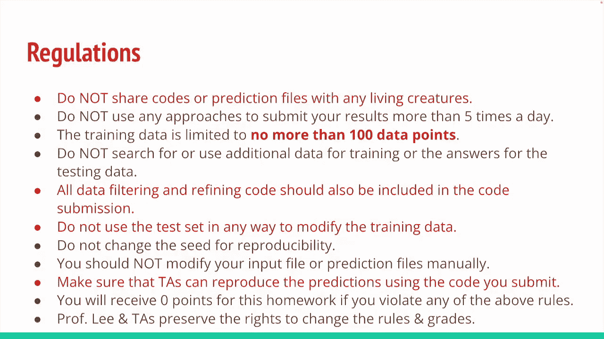

那如违反上述这些规定的话，呃这次座位就会拿到零分好，那有问题的话，就请大家在nt CORE的评论区那边问我们，这样大家也可以看到你们的问题，可能大家也有类似的问题，那如果呃。

那也可以透过下面这个信箱继续问我们也可以，然后也可以在每个礼拜五的TAL2来问，我们也都可以好。

然后接下来讲解程式嘛。

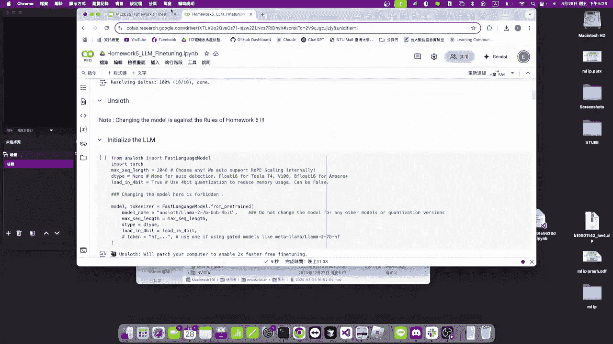

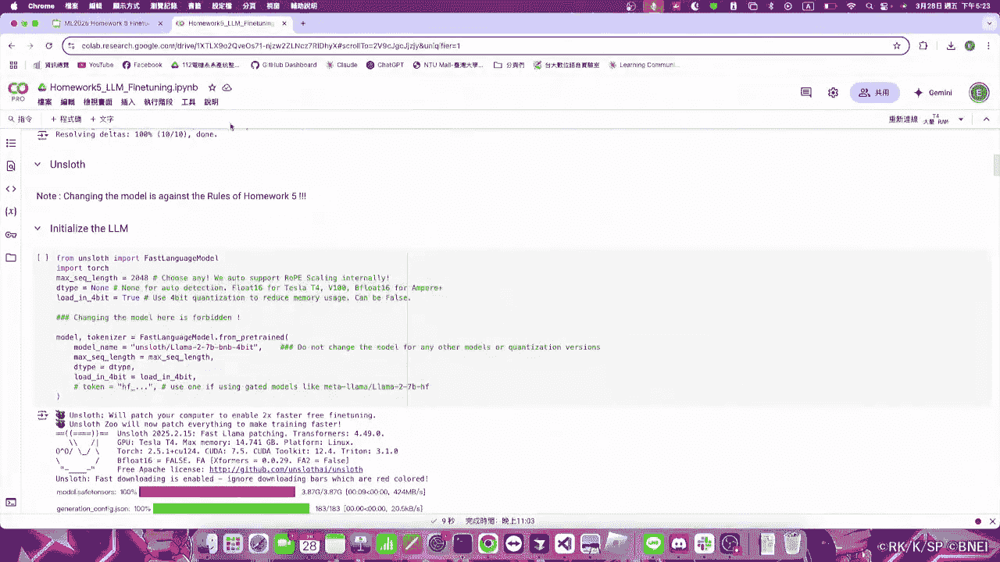

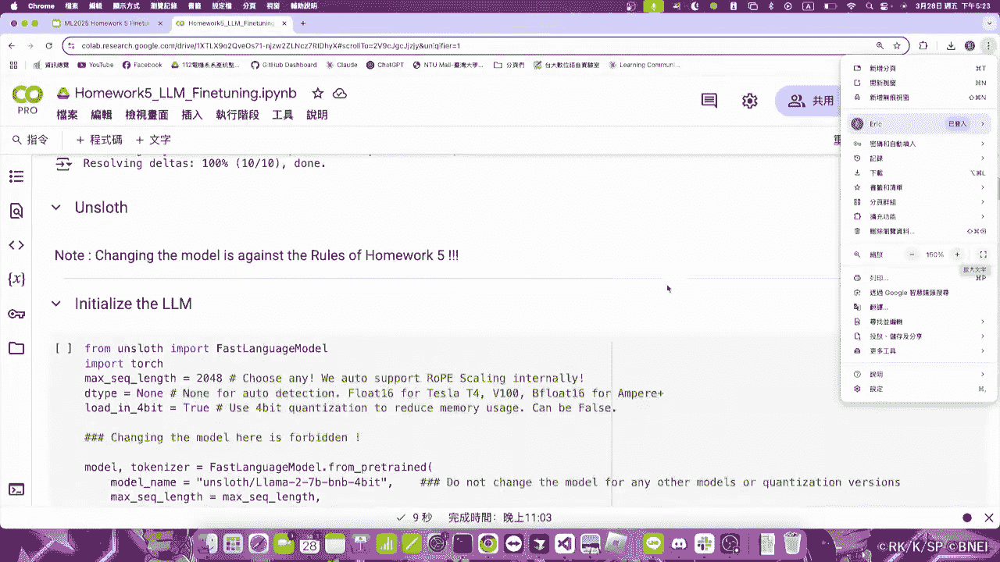

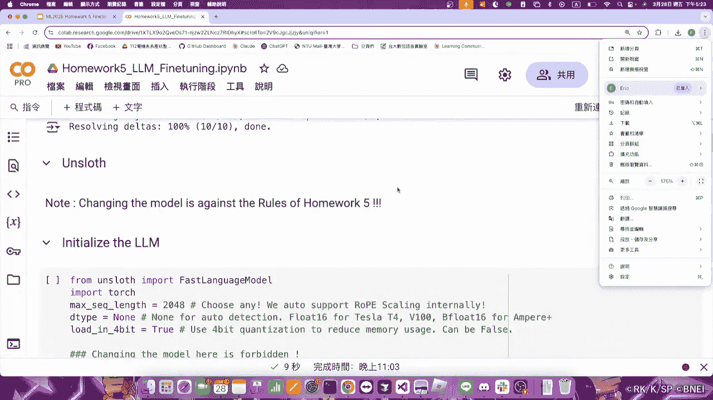

好，那最上面这个呢就是去check你的那个GPU。

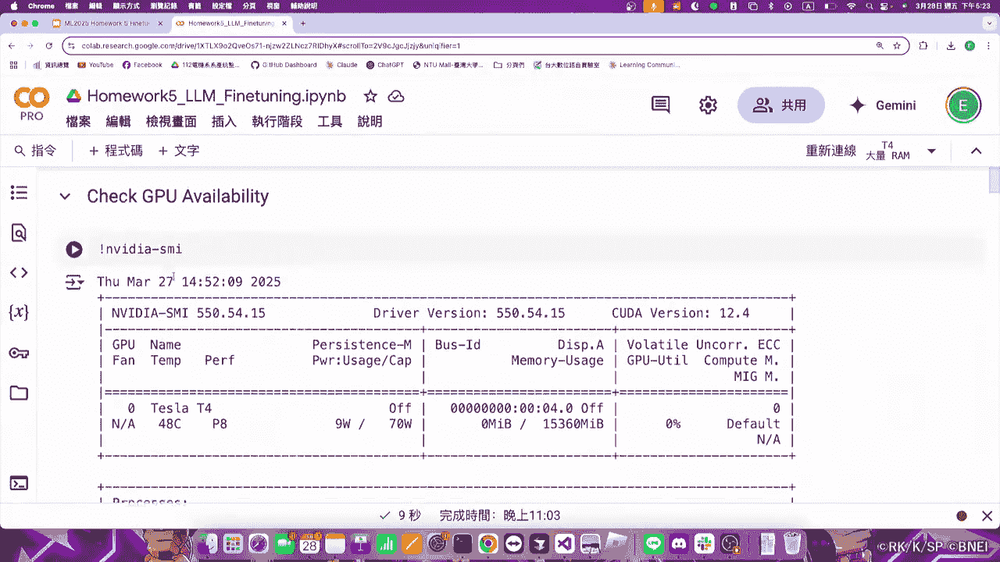

是可以运作的好，然后接下来这边呢就是去安装相关相关的套件，然后还要去下载这个dr set，好那这边就是把模型载载进来扣，那这一行就请大家不要去跟动，因为这一行就是在说我们用的那个。

就是指定说我们用的那个model是这个lama two7B，然后four bit版本的那个框台式版本，那就请大家不要去跟动，就请不要把它改成可能什么拉玛三，然后甚至用其他模型。

然后框TEX版本也请大家都用这个four bit，这样才是公平的好。

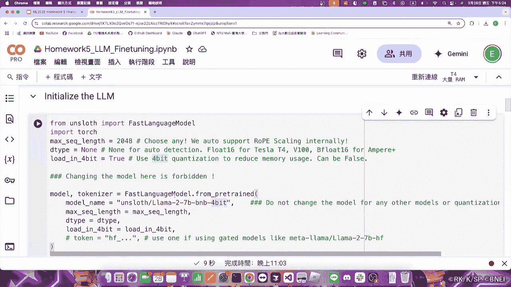

所以所以基本上这一格，就请大家都不要去这个sell，就请大家都不要去动，好，那那下面这边就是大家要去改的，就是这个laura rank，这个R就是这个laura rank。

那下面这个laura alpha，那我们default的使用，那大家都可以去改，那通常会常常设常用的一些数的的值，大概就是呃二的一次方倍这样子，好那下面这边是那个cheat template。

就是我们会把cheat再经过一层处理，把它变成那个模型熟悉的template，那我们这边是用拉玛三点，为什么没用拉A2呢，是因为拉玛3。1的效果。

我们实测起来是比拉马two的check template还好。

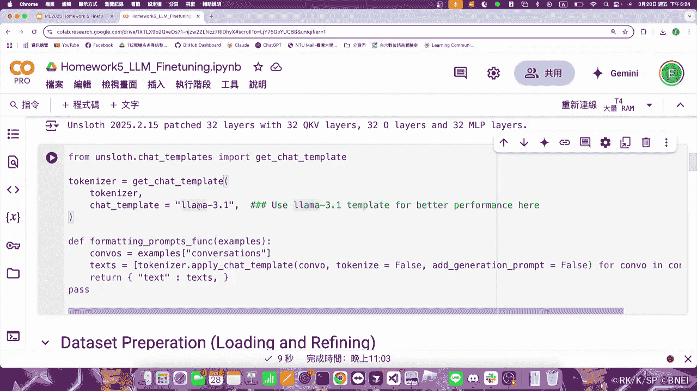

所以我们这边是用拉A3。1的那个CHE个，Templ。

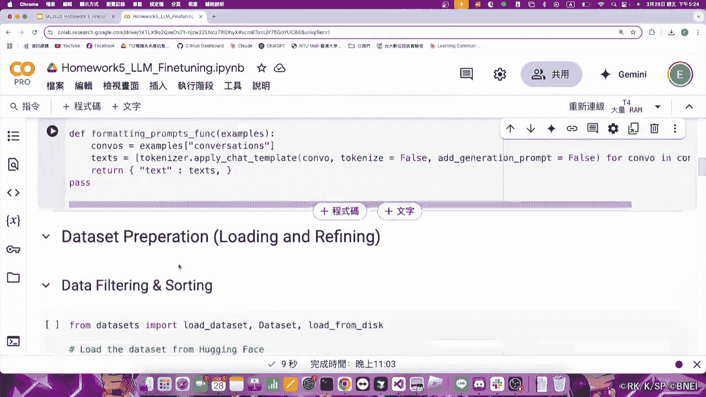

然后再是就是sl twin跟sin code，那其实这边也已经写好一个模板了，你想其实大家只要从这个模板这边去改，就可以，不用再写一些额外的code。

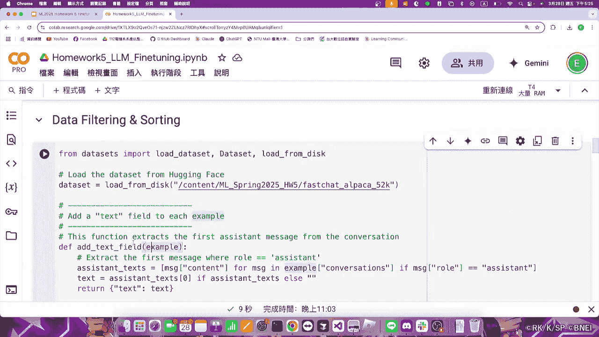

那呃上面这边就先把DC搂进来嘛，然后下面这边定义一些function，然后这边就是大家要改的，这边就是这个computer conversation，la是我刚提到。

就是呃我DEFAUL的implement是呃，把说那个一比data里面的input，和output的长度都算进去，那如果大家想要改成单纯算output，或单纯算input的长度的话。

可以去呃调整这个function。

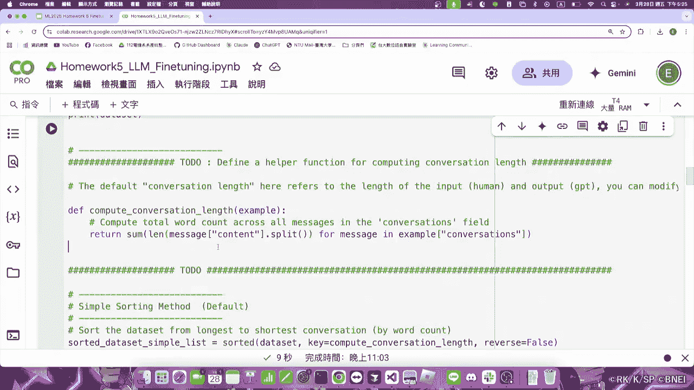

然后再是sorting的method，那为他写了写了一个很简单的一个呃，simple sorting的一个演算法，那基本上他就是呃呃，他单纯就是他的sorting的依据就是这个key。

那他的这个这个key，我这边是设定他是这个computer conversation link，上面这个函式就是他去收ting的依据，那呃如果那那这个就是比较简单嘛，然后refers等于false。

就是我先让它从小排到大，就是输出出来的key，让那个DA呃去排序是依据key从小到大这样子。

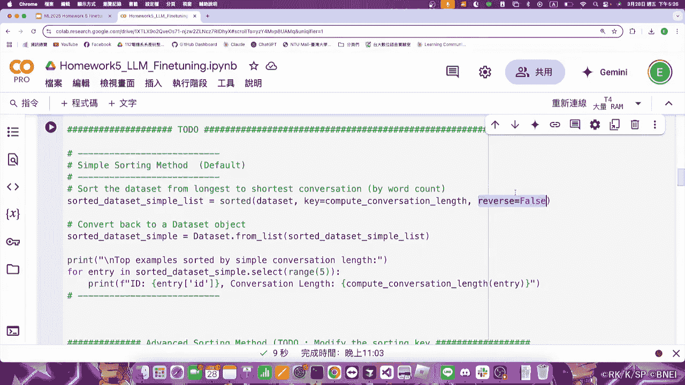

然后呢。

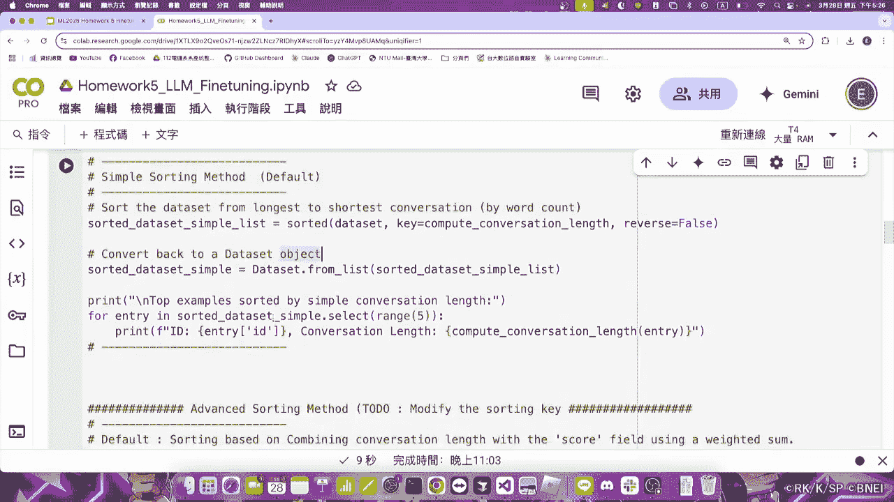

下面这边就print出，可能额前五比data塔的key的大小，那还有前五比data长怎样，那就可以让大家去更好的去visual，其实你可能这样子排下来，你前五比DA是长怎样。

那大家会想要实做的应该是这个部分，就是event skey，那就是呃我们刚有提到，就是sorting是用那个key去SERT嘛，所以呃，如果大家想要用别的sorting method。

可能是想要用别的排序法的话，那就大家就可以在这个部分试作，那我这边实做了，那我这边先写了一个也是很简单的版本的，一个稍微复杂一点，但还是蛮简单的版本，就是我这边是用，十的五次方。

然后乘上conversation link，然后再加上上score乘一，所以在排序的时候，其实可以用同同时用多个呃，那种DASSET相关的这些统计数据去进行排序好，然后对那下面这边呢就是这边要选。

你们就是选，说你要用可能default的那个排序出来的，那个DASSET，或是你们自己写的那个排序出来的那个data set好。

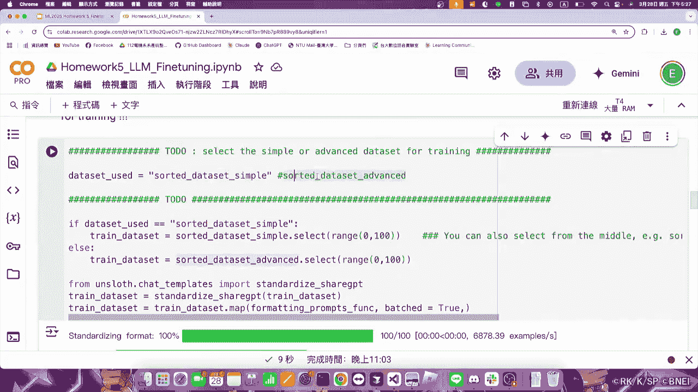

这边要动的就这个要动的就做这个而已，然后再下面这就是你可以去visualize，是你刚呃呃sample，你，你刚刚是你刚刚那个呃filter出来的那个data set呃。

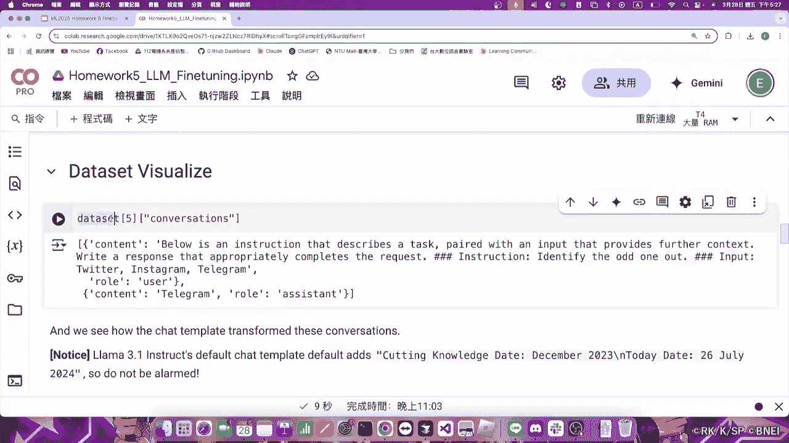

里面的内容大概长怎样好，那接下来就是training code，那这边也有一些要调的training conf，那这就是一些比较简单的那些training的，那些套餐数，像是那个呃epoch数。

就是这个number train epox嘛，然后呃learning rain。

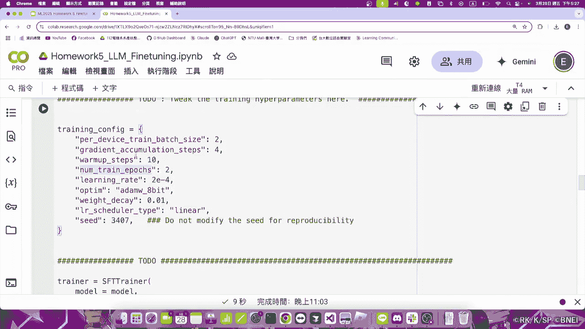

然后warm up st，这些都是可以调的，好那那这边就是呃training相关的一些设置。

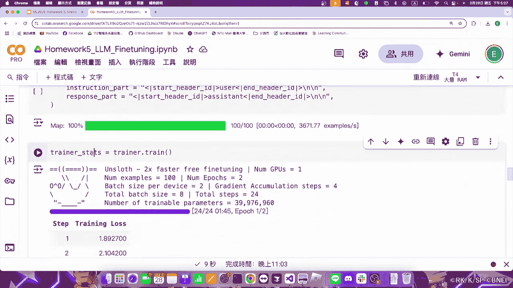

然后这个就是按下去就开始train了，好然后curran learning的话，我这部分就先留一个空白，那如果大家要in后面的话，其实应该是蛮简单，就是我这边只是空白出来。

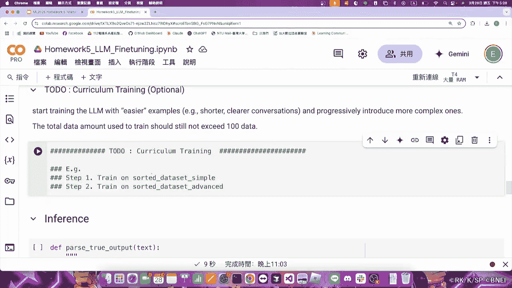

就是可以在这边import，不代表一定要import在这边，那那这边就留给大家回去自己想。

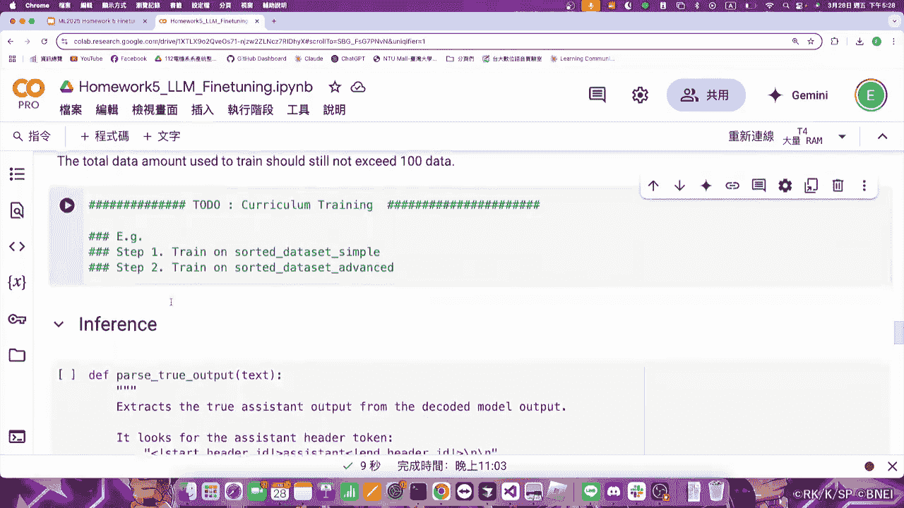

那基本上上面那部分基本上这次就已经快完成。

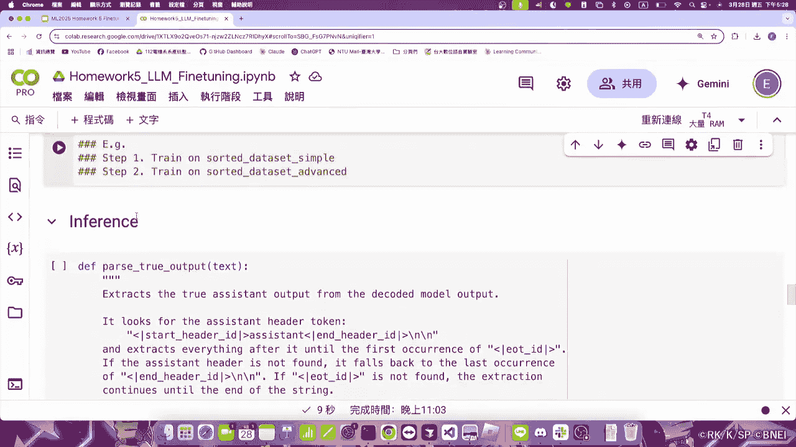

那下面唯一要调的就只剩下这个额。

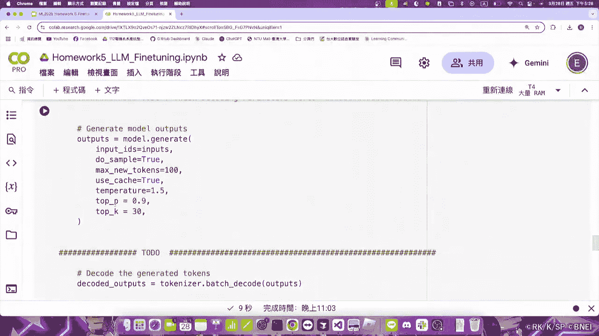

下面这边的decoding的这些槽，decoding的这些参数对。

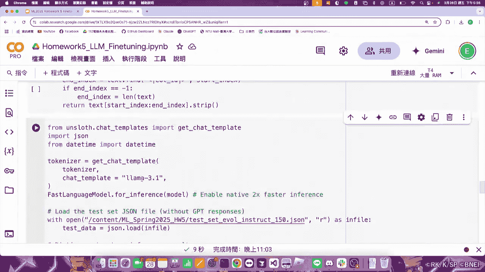

那所以上面这个就是在定义一些function，就是把你呃模型output出来的东西，可能还会包含一些呃呃，end of text的一些特殊的token，或者一些那个呃。

或是一些starter header id的这些比较特殊的token，那你不会希望他真的出现在你的output当中，就是他其实是他，他是会去跟一个那个干净的那个output去比。

就是感觉就像人真的讲一句话，那你人家讲话不会有这个那个end of，text的这个id吗。

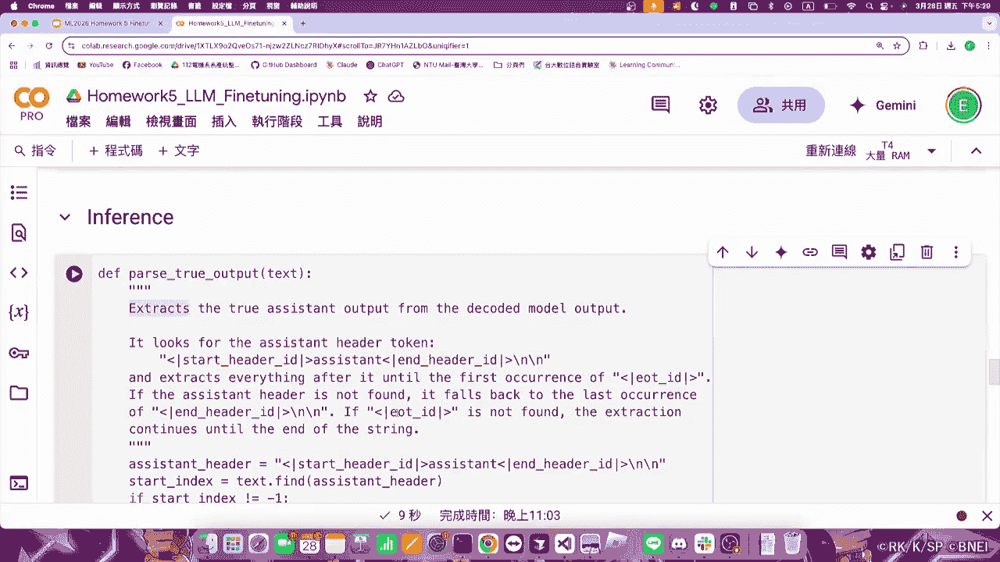

所以你这个防选就是在把这些特殊的这些token，把它拿掉这样子，然后这上面那个那个sell是直接执行就好了，那下面这边要改的就是这个decoding，这边的的参数，那这边改一改。

其实这个也是直接按执行就可以了。

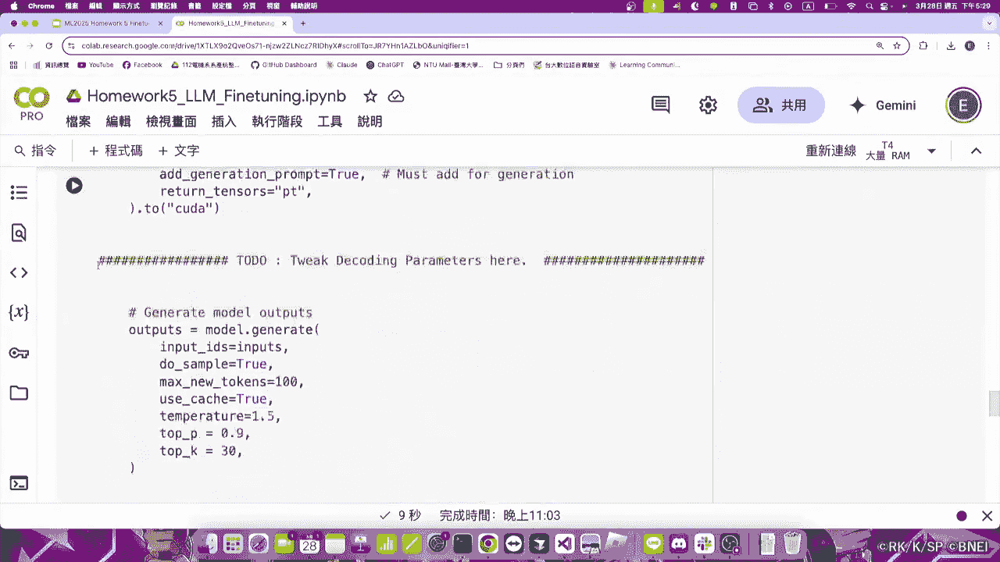

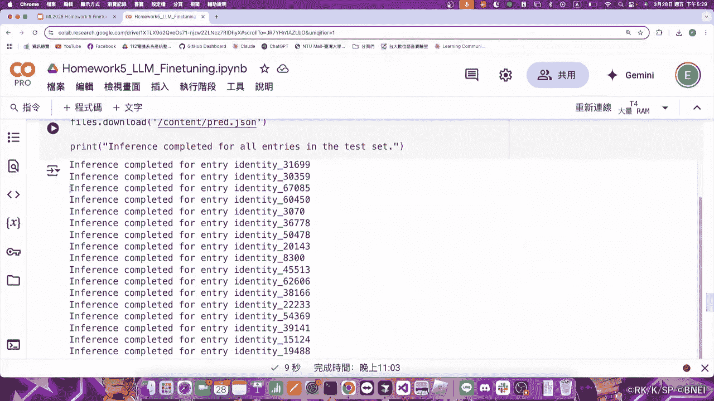

这球诶，这就是上单人对，然后这边就会执行完之后，它就会生成一个PRE点，JASON的一个档案，这边，然后它就会自动帮你下载下来，然后就只要直接把这个配点JSON。

直接交到judge for就可以了。

好那其实基本上到刚那边那个作业就算完成了，那如果你你呃训练完那个model，然后你可能下次想要从你上次check呃，训练的地方继续训练的话，那你可以把把存下来。

那第一个cell就是把那个model存下来，那它存下来之后就会呃，呃是他default是存在你的那个呃，他每次连线到COLLAB，它会呃给你一个额储存的空间，那个地方可以储存。

但是你如果把那个terminal，你如果把这个session关掉的话，那那个那些档案就不见，所以呃，你可能要再额外再把它下载到你的本地端。

或者说你可以呃把colin mount到你的google drive，就像是把你的google drive迁入进来，然后你就可以把呃那个存的地方，把它改成你的呃google code。

或者说他先把它存在那个暂存的空间，然后你再把它拷，你再把它copy，可能写一些那个写一些code，就是CP呃什么什么的那个code。

把它copy到你的那个云端硬碟那边，然后在low的时候呢，基本上就是用下面这个so就可以low，那呃在low的话，我这边唯一要动的就是这个laura model。

那这个laura model就是你刚存的那一个的，它会存在一个叫laura model资料夹里面，那你这边就是把你laura model的。

那个资料夹的位置复制，然后贴到这边来，你这样就可以把这个model漏进来，那所以如果你真的实际上会需要漏这个model的话。

那你应该也不会在这个档案里，这个这个城市码最后面才漏它吧，所以如果各位真的有需求的话，就是呃把这个这个low model这个function，到时候就是把他拉到呃，城市码比较上面那个地方。

先把model low进来。

然后再去进行啊，然后他再去执行后面的function，就是这个这个low model，其实就跟看一下这个low low model，是讲这样是那个model token来。

就等于fast language model点from pretrain嘛。

所以如果大家要low的话，就是把它移到上面跟他长的一样的那个style那边，对把它移到这边，就是大家就可以把这边这下面这一部分注解掉，然后把它改成呃，刚刚下面的那个load model的的那个cell。

里面的程序吗，好那啊。