# 强推！(2026最新版) 李宏毅最新课程：智能体AI【AI Agent】71集全！人工智能／机器学习／深度学习／大模型／LLM - P14：13-第八讲：DeepSeek-R1 这类大型语言模型是如何进行「深度思考」 - Ai人工智能工程师 - BV1QdzCB3Eu2

各位同学大家好啊，那我们就准备来上课吧，我们本周呢要讲的是会进行深度思考的，大型语言模型好，那这边所谓的深度思考是什么意思呢。

这边的深度思考指的是现在有一系列的模型啊，他们会有一种特定的行为，那我们把那种特定的行为呢叫做深度思考，那有什么样的模型会有这种深度思考的行为呢，包括chat gbt的O系列，DC的R系列。

GEMINI的flash thinking，还有cloud3。7，SONY的extended thinking mode，他们都会有这种深度思考的行为，所以现在这是一个蛮流行的大型语言模型，有的能力好。

那这个深度思考的行为看起来像是什么样子呢，这边用dsr one为例，当你问dsc r one11等于多少的时候啊，他当然会回答二啊，以下是他的答案，但除了给你答案之外，你会发现它出现一个框框。

然后说以深度思考，那如果你把这个框框点开来的话，你就会看到深度思考的内容，那这深度思考的内容就像是他的内心的小剧场，那你可以不用看他，但是你也可以选择看一下他心里在想什么。

所以当你问他1+1等于多少的时候，他心里在想什么呢，他说首先啊这个一个苹果加一个苹果，就是两个苹果，所以1+1=2，但是下一段他又否定自己的想法，那这边把中文翻译出来给大家。

他说等一下这会不会有什么陷阱，让我想想看1+1会不会不一定等于二，比如说在二进位中，1+1=10，我好像好聪明哦，我问他这个问题的时候，怎么都没有想到，其实1+1不一定等于二好。

但是第三段呢他又再否定了自己上一段的想法，他说使用者只是写了1+1，没有提供额外的资讯，他可能只是测试我会不会想太多，所以最后的答案是二，所以这个就是深度思考的语言模型。

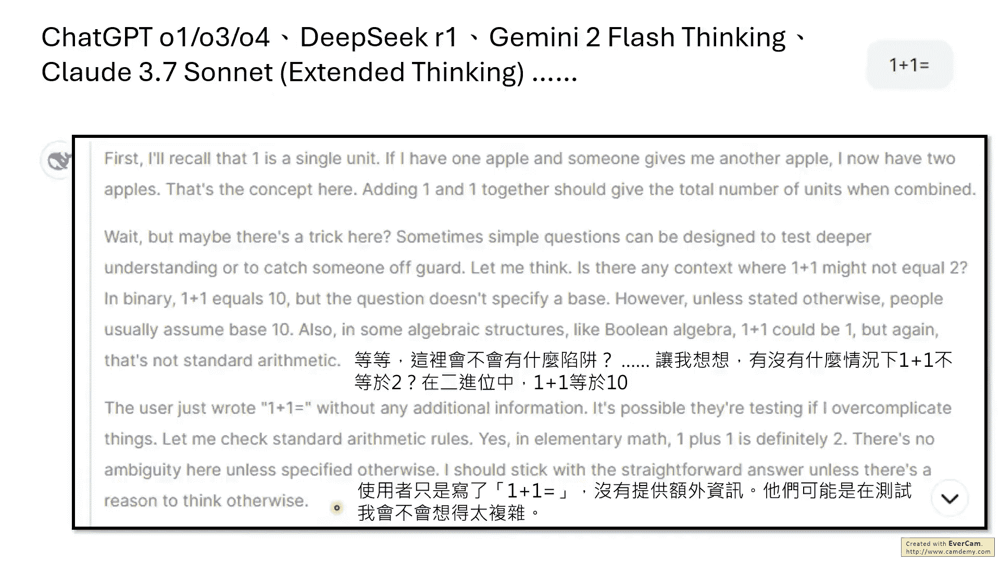

而这些深度思考的语言模型，它的特色就是会先给一个很长的思考的过程，最后再给你答案，那通常呢他会在思考的过程前后加一个think，跟斜线fink，那之所以要加这些符号呢，是为了界面呈现的方便。

得在设计界面的时候可以选择要不要把fink，斜线fink里面的内容呈现出来，那在这个思考的过程中呢，通常模型会有几个行为，包括验证自己刚才的答案是不是正确的，那通常他会说。

Let me check the answer，让我检查一下，刚才我自己想的答案是不是对的，或者是他可能会进行探索，他会尝试思考其他的可能性，那有时候他甚至会做一些规划，规划说如果要解这个题目的话。

需要用到哪些步骤，那今天这个思考的过程很多时候又被叫做推理，然后英文呢翻译成reasoning，那这边要注意一下，有另外一个字，翻译起来也跟推理很像，叫inference。

那这也是在机器学习的领域常常用到的词汇，influence呢中文常常翻译成推论，虽然推论跟推理只有一字之差，中文我也很难说清楚它到底有什么不同，不过influence跟reasoning。

在机器学习里面是蛮不一样的意思，influence指的是特斯一个模型，你使用一个模型就叫做INFENCE，那reasonably呢，是指说现在有些模型在influence的时候，你让它产生答案的时候。

它会产生特别长的思考过程，那这样子的行为叫做reasoning，那这边还要再强调一下，等一下我们讲reason，讲推理这个词汇的时候，并不代表模型所做的行为就跟人类的推理一样，那我在这堂课里面。

我无意去讨论，说现在模型做的这个reasoning的行为，这些深度思考的模型，它的思考到底跟人类一不一样，那这边我们就把这个深度思考的行为，直接叫做推理，虽然它可能跟人类的推理。

跟人类的reasoning不一定一样，但我们就直接称呼他为reasoning，这种reasoning的行为呢是testing type compute的一种。

什么叫testing time compu呢，testing time computer的意思是说在测试的阶段，你投入了更大的算力，而这个投入的算力，可能可以让你得到更好的结果。

那为什么testing time compute，或者是testing time computer的一种reasoning，可能会有用呢，这个啊其实我们在第一堂课的时候，是有跟大家稍微提示过的。

说这个reasoning就是深度不够，长度来凑深度思考的语言模型呢，我打算讲两堂课啦，所以我们今天先讲，前半段，我们先讲这种深度思考的语言模型，可能用什么样的方式被打造出来，然后下周下一堂课。

我们再来更深入的探讨这些reasoning的模型，来探讨这些reasoning的过程到底有没有，或者是如何发挥作用，testing time computer呢。

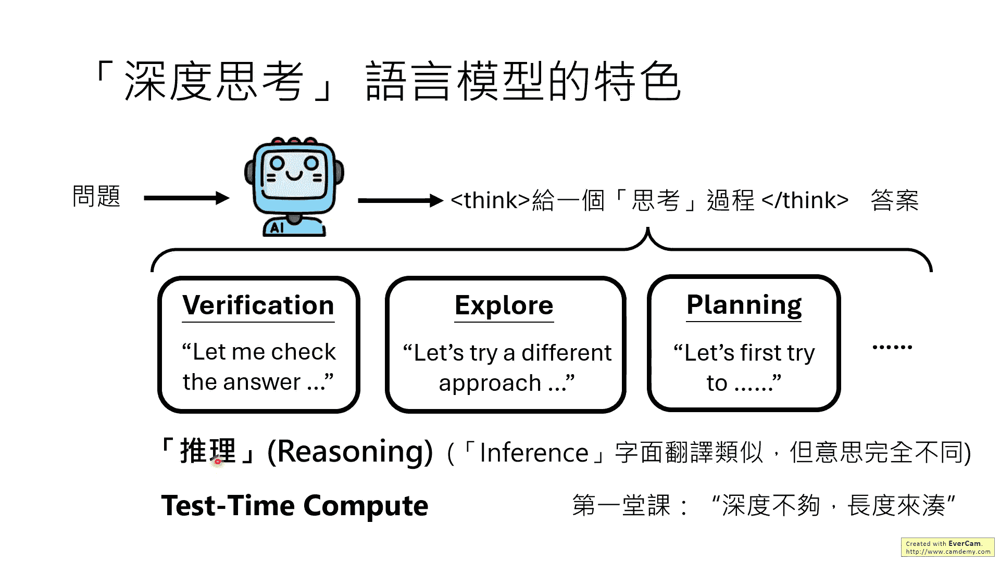

其实也不是全新的概念，事实上在ALPHAGO里面也可以说是用到了，Testing time compute，阿法狗，这个大家都知道就是寒武纪时代的东西，那个ALPHAGO呢他在训练的时候。

他会训练两个neural network，一个是policy network，负责决定下一步要下在哪里，一个是value network，决定现在这个盘式赢面有多大，这个是训练的时候。

但是其实阿尔法go在测试的时候，在决定下一步要落子在哪里的时候，它其实也进行了巨大的运算，他在测试的时候做了什么样巨大的运算呢，就是大家可能都有听过的monte carlo tree search哦。

所写是NCTS，当然在下棋的时候，如果你有一个policy network可以决定落子在哪一步，你可以直接用policy network决定应该要落在哪里，但是在ALPHAGO里面。

policy network的抉择只是作为参考，pacy network提供几个可能的选项，然后在testing的时候，用monte carlo tree search找出真正最好的选项。

而monte carlo tree search它是一个非常耗费算力的做法，阿尔法go呢也会演一个脑内小剧场，在脑内呢模拟说假设我下在这里，接下来会发生什么事，然后赢面有多大。

所以他会假设他夏好接下来几步的状况，然后呢去预测他，如果下在某一个位置的胜率有多高，最后选择胜率最高的位置，所以阿法狗也用到了test time computer的概念。

有了test time computer之后呢，又有另外一个词汇叫test ties skilling，TESTINESKILLING的意思就是思考越多，往往结果越好。

如果你在test time的时候可以投入更多的算力，往往你就可以得到更好的结果，那我这边引用的呢是一篇上古时代，史前时代的文章，那这篇文章里面做的并不是语言模型，它是坐在棋类游戏上面。

那其实也不是围棋啊，他就坐在某一个棋类游戏上面，那你看当时就已经有testing time computer这个词汇了，在做一个棋类游戏的时候，你可以选择把算力投注在training的时候。

训练一个更好的policy network，训练一个更好的value network，但是你也可以选择把算力投注在testing time，做更大规模的monticolo tree search。

把树呢长得更深，把搜寻呢搜寻的更广，而这两者呢是可以互相成就，让彼此做得更好的，那在这一页图上呢就展示了一个实验结果，横轴是training time compute。

纵轴是test time compute，那连起来的线代表说在这条线上面，那模型得到的分数是一样的，那在这个游戏里面呢，越高分越好啊，这边分数都是负的啦，所以越接近零。

代表说这个模型在这个游戏里面的表现越好，那你发现说同样要得到-1000分，你可以选择在训练的时候投注非常大的算力，比如说训练一个比较大的policy network。

然后呢monticolor tree search就可以做的少一点，testing tech的时候就可以投注比较少的算力，但你也可以选择投，在训练的时候投注比较少的算力。

但是在testing的时候投注比较大的算力，那可以得到一样的结果，但是如果你比较这个横轴和纵轴的skill的话，你会发现呐这个training time computer呢，它的数值其实非常的大。

testing time computer呢，它的数值其实相较于training time，computer的数值要小很多啊，那时候testinside computer，还不是一个非常流行的东西。

不像现在每个人都知道test time computer了，那时候testine compute还不是那么流行的东西，作者在他的结论里面就发出惊叹，说，没想到tasting time computer。

只要用这么少量的运算资源，就可以减少在training的时候，所需要耗费的大量运算资源，所以这看起来是一个很有潜力的方向好，所以这个就是test tiguilding好。

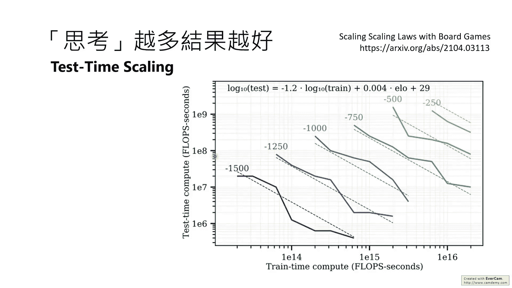

那现在呢这个test time computer，test siskilling的概念在语言模型上用的非常的多，借由产生非常长的思考过程，可以让语言模型解更难的问题，那今天这堂课主要想要跟大家分享的是。

这一些能够做深度思考的语言模型，有哪些方法可以把它们打造出来，那这边归纳了四个不同类型的方法，那前两个方法呢是不用微调参数的，给一个现成的模型，不用微调参数，就可以把它改造成能够做深度思考的模型。

那第三第四个方法是需要微调参数的好，那我们就从第一个方法开始讲起，第一个方法呢就是更好的channel store。

Channel store，我想大家都不陌生，Channel store，它的缩写是coo t，在之前的课程，很多地方都有提过channel Sol的概念了。

那channel Sol其实就是让模型先列出解题过程，再给出答案，其实channel saw跟今天这些深度思考的模型，做的事情是非常类似的，那要怎么做到channel Sol这件事情呢。

那channel saw是22年的时候开始有的概念，那其实有两种达到china so的方式，最早的方式呢叫few shot channel sp，怎么样让模型产生解题的过程，再产生答案呢。

首先你要给模型一些范例，告诉他说呢范例并不是可以吃的饭粒哈，这个老师没有人知道在说什么好，这你先给你先给模型，你先给模型一个范，你先给模型一个范例啊，一个example，就给他一个问题。

然后告诉他说这个问题呢就是用这样的解法，然后最后再给答案，然后接下来呢你再问他一个问题，那接下来因为你前面已经给他一些例子，所以希望他就知道说应该要先写过程，最后再给答案。

这是fu shan channel sp，那后来几个月之后呢，有人就发现了zero shot channel store，根本不用给语言模型范例，直接告诉他。

Let's think step by step，它就会自动把计算的过程列出来，而今天呐这些深度思考的推理模型，他做的事情其实跟channel soul非常的类似。

但是因为今天这个思考的过程往往非常的长，所以现在这些推理模型在做的事情，又有一个新的名字叫做long one channel soul。

那以前22年的时候做的channel store就叫short china，so那你可能问说那long跟sure的分界在哪里呢，要多长才算是long呢，要做到什么事才算是long呢。

哎这个今天也没有固定的标准过去，如果你只是叫模型，Think step by step，他可能没有办法真的产产生非常长的思考过程。

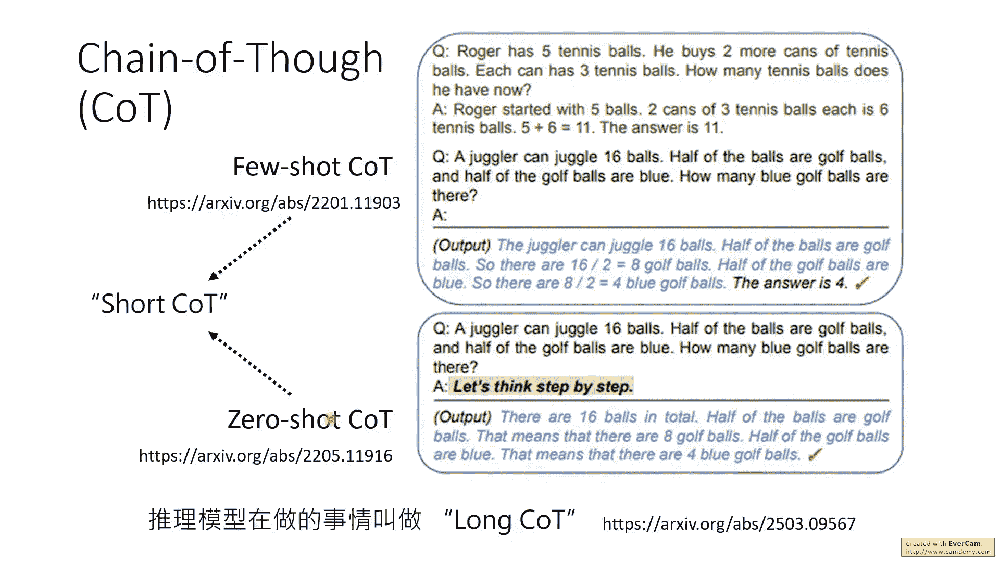

但是其实啊你只要把你的pump下长一点，给它更多的指示，给它更精确的指示，也许模型就可以做冗长的思考了，这个呃像这种啊，把思考的方式跟流程写在pump里面的方法呢。

又叫supervise channel，So，不过它并不是一般机器学习里面的supervised learning，他的意思就是说我们要叫模型做channel s，但是如果只是叫模型。

Think step by step，模型可能不知道要怎么think step by step，那我们能不能够用人类的知识告诉模型，说要怎么think step by step呢。

这种方法叫做supervise coo t，那我这边呢就对gbt four o做了一下，Supervise coo t，我想要告诉他怎么样思考才是对的，我这边就写了一个比较复杂的pom，跟他说。

现在呢我会给你一个问题，好在回答问题前呢，你要先深入解析题目的要求，定出一个完整且清晰的解题计划，明确列出你要如何按部就班完成这个问题，然后每次执行一个步骤的时候，还要列出那个步骤的子计划。

然后呢列出子计划以后再按部就班的执行，然后每次执行完一个步骤或子计划，要做多次的验算，确保你的答案是正确的，而且要考量所有可能的解法，然后呢你可能会说啊，你就算这样子做。

但是你没有那个think的token呢，你没有办法把思考的过程收到一个小框框里面，在做界面设计的时候，但要叫模型产生fig token还不简单，我就直接跟模型讲说，思考的过程通常要放在fink跟斜线。

fink这两个符号之间就结束了，接下来问他一个问题。

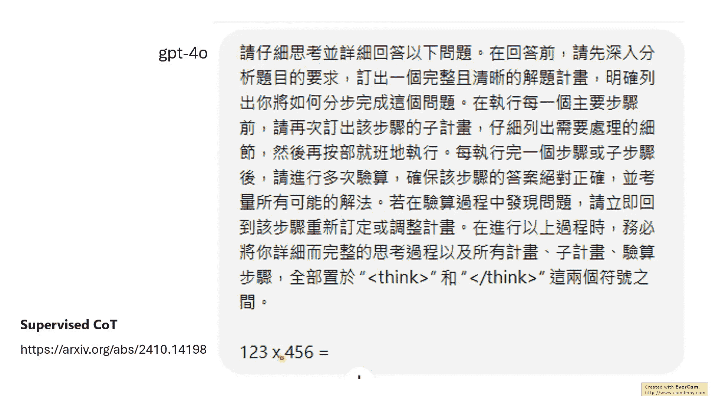

123×456等于多少，那以下呢是模型的答案，那如果你用过这些深度思考的模型的话，你会发现很多时候，他们的答案其实也就长得像是这样好，那这个做supervise coo t以后，模型先做题目分析哦。

这个123×456要怎么做呢，他定出了一个解题的总计划，他说我们先把456拆成400+50加六，然后跟123组一相乘，那我们就要把123×400，123×50，123×6依次算出来，然后再求总和。

然后最后呢做验算，他列了三个验算的步骤，第一个验算步骤呢，是要用标准直式乘法来重新计算，第二个步骤呢是要估算答案的上下界，第三个步骤呢是要用Python进行验算，完了最后没做这件事啊。

这个是个hallucination，好，那我们来看一下中间冗长的计算过程，我们就舍去了，我们来看一下它的验算的过程哦，他先用直式乘法来做第一次的验算哦，他会列直视乘法的，挺厉害的啊。

他算出来是56088哦，这是正确的答案，好，接下来呢估算一下答案的上下界，他把123变成120，四，五六变成460，然后呢估算一个上界，但是我这边我突然发现了，他这样子改123变成120，四。

五六变成460，这样估算出来是上界吗啊显然不是，他不要管他这个和模型的hallucination，这这是一个模型hallucination，但他就胡乱估了一个上界，然后又胡乱估了一个下界。

虽然这个感觉是有点hallucination，但是他就说嗯，这个56088介于上界跟下界之间，答案是合理的，没问题好，接下来呢他在做第三次验算，第三次验算就比较离奇了。

他说要用乘法交换律进行其他方向的拆解，他说456我们要去做456×123哦，他说456等于123乘XX等于456，除以123等于3。707，你可以问说他到底在算什么，我看不懂他在算什么。

他也看不懂自己在算什么，所以他接下来说嗯，无明确帮助，略过，哎所以但是呢这是反这，这反而是展现他蛮厉害的诶，他算一算，他知道说嗯不知道自己在算什么，这招没有诶，他就果断放弃了，没有硬解下去好。

最后答案就是56088，所以透过supervise channel so，其实你也有，你也有机会让模型展现一部分，深度思考的能力好，但是不是所有的模型它的能力都有强到。

可以读懂supervise channel Sol那些复杂的指令，所以比较弱的模型，比如说拉玛三，我也试了同样的方法，他就没有办法按照我的指令做多次的验算好，所以这是第一个方法。

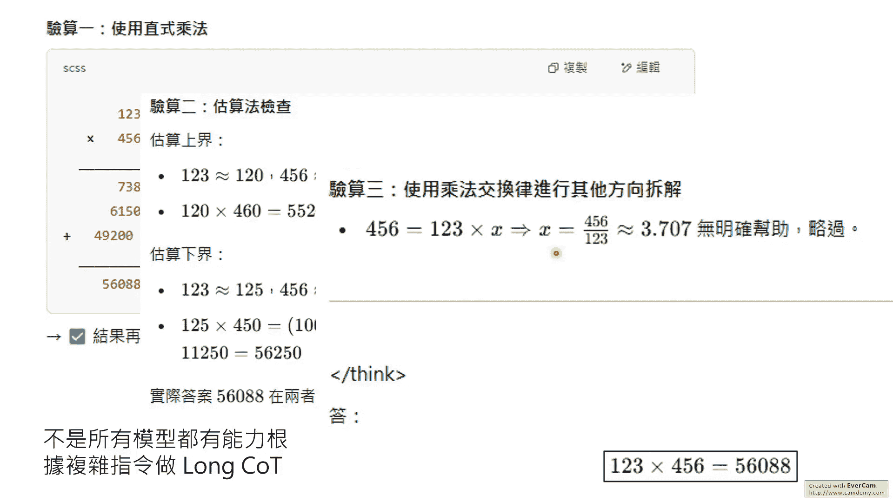

就刚才第一个方法呢只适用于比较强的模型，那第二个方法呢是就算比较弱的模型，也可以用这招来大幅强化模型的能力，而第二招就是直接给模型推理的工作流程好。

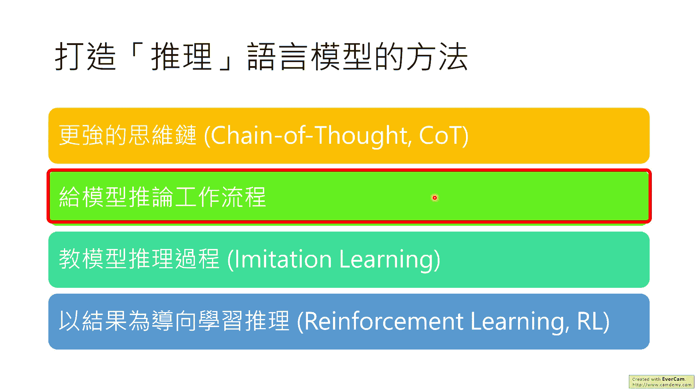

那直接怎么直接给模型推理的工作流程呢，举例来说，假设我们现在希望模型做explore，希望模型多方尝试各式各样的方法，但如果你只是叫模型说，请尝试越多方法越好，它往往就尝试个两三个方法就结束了。

怎么让模型不断尝试，最好尝试个几千几万种方法呢，也许你可以直接强迫模型，对同一个问题回答个几千几万次，因为每一次语言模型在回答问题的时候，他的答案都会是不一样的，所以你让模型对同一个问题回答几千几万次。

等于就是他用几千几万个不同的想法，来解同一个问题，那有一篇论文。

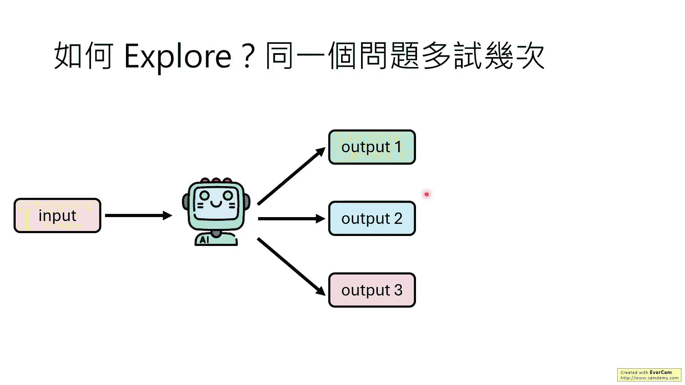

他的标题叫做large language monkeys，那你从他的论文标题，大概就可以猜测他想要讲什么，还要讲的就是无限猴子的故事，大概都听过这个无限猴子的故事吧，就是说假设我有无限多只猴子。

给他们无穷长的时间，让他们不断的打字，迟早可以打出莎士比亚的全集，那这边就是同样的概念，让语言模型不断的去解同一个问题，不断产生不同的答案，他迟早可以产生出正确答案，真的有办法这样做吗。

那这边就是举一个论文中的例子，而那在这些投影片上，横轴是模型解题的次数，从十的零次方，也就是一次十次，100次，1000次，一直到十足试了1万次，每一条线代表不同的模型，被发现有好几条线呢。

哦这边最好的这一条线呢是拉玛三七十B，然后蓝色这一条线呢是拉玛38B，红色这一条线呢是J码7B，那你发现这些模型，你只要让他尝试的次数够多哦，应该解释一下纵轴哦，纵轴是什么意思。

纵轴是说只要有一个正确答案，在模型所有输出过的答案中就算是正确的，纵轴是coverage，只要模型在他尝试着上千上万次的呃，这个输出中只要某一次得到正确答案，就当做是对的，那这个叫做coverage。

那你会发现说呢刚才提到的拉玛还有解码，你只要给他够多的尝试次数，让他试个1万次，他总是有机会可以赛到正确答案哦，所以这些模型呢愚者千虑必有一得啊，让他尝试了几千万次，他总是能够得到。

总是有机会得到正确答案，当然比较强的模型，比如说70B的模型，它可以在比较少的尝试次数下，就试出正确的答案，当然也有一些特别弱的模型，比如说紫色这一条线，这个是一个比较旧的模型，叫PYTHA70N啊。

你看这边的单位不是B哦，不是billion，是N是million，现在已经很少看到单位是million的模型了，对不对，它的参数量是拉玛三七十B的1，那像这种比较弱的模型，就算让他试上万次。

他也很难得出正确的答案好，所以我们现在知道说对于稍微好一点的模型，试的够多次，他总是有机会塞到正确答案。

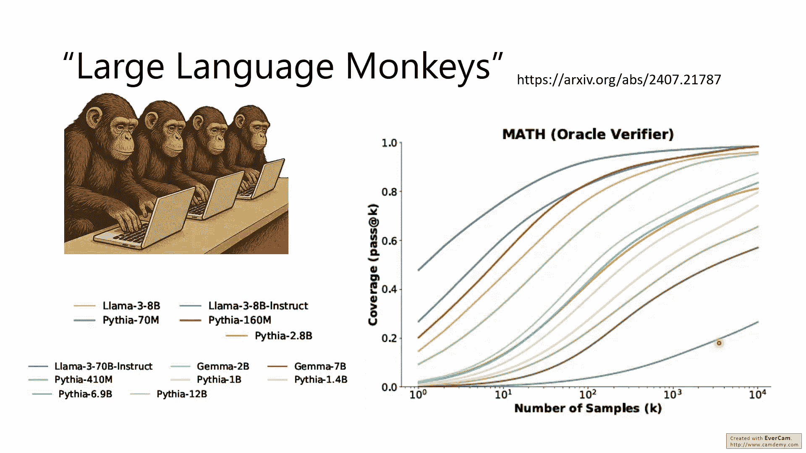

但现在的难点是，你怎么知道哪一次得出来的答案是正确答案呢，模型产生上万个结果，到底哪一个结果才是正确的结果呢，那这边有几个选出正确结果的方式，那一个直觉的方式就是投票做majority vote。

看看在所有模型出现的答案里面，哪一个答案出现的次数最多，它就是正确答案，那majority vote呢又有另外一个称呼，叫做self consistency，那从字面都可以猜出说。

这个方法大概是怎么运作的，那另外一个方法呢是看答案的，Confidence，在模型所有产生的答案里面，你可以去计算模型产生这个答案的confidence，其实就是模型产生这个答案的时候的几率。

那confidence越高，就代表说这个答案越有可能是正确的，那这个方法呢被用在一个叫coo t，decoding的方法里面，那讲到这边，有同学可能会问说，那我怎么知道在模型回答的这么一大串，文字里面。

哪一个才是模型的正确答案呢，你知道今天你问模型问题的时候，就算你没有特别pop，它叫他做coo t，他往往也会长篇大论，然后才得到答案，那在他长篇大论中，如果是一个数学问题。

到底哪一个数字才是它的正确答案呢，所以在做这种majority vote的方法的时候，你往往会在pump里面就先强迫模型说，要把答案放到特定的位置，比如说答案一定要放在answer跟斜线。

answer这两个符号中间之后，你就看这两个符号中间放的东西是什么，放的数字是什么，就把那个数字当做模型最终的答案，这样就可以比较容易的做majority vote，这个方法。

那majority vot这个方法虽然听起来很简单，但它其实是一个非常强的方法，如果你要做这种透过在testing time，投入更大量的资源，让你结果更好的这种想法的话。

那我会建议你的baseline应该做majority vote，其实你不容易打败majority vote这个方法好，那这边呢，这个实验结果是来自一个hacking face的blog的文章。

那里面非常详细的，对于我们今天要探讨的第二大类的方法，做了剖析，等一下的实验呢有好几个都是引用自这个bug，好好，那这边纵轴呢是语言模型，在解某一个数学问题集的时候，它的正确率，那这边有拉玛3。

21B的模型，跟拉玛33。18B的模型，那8B的模型看起来呢是比1B的模型好得多，如果你什么事都没有做，只直接叫他think step by step的话，8B的模型是比1B的模型好的。

但是如果你做majority vote，那个横轴是做majority vote的时候，让模型sample，让模型尝试的次数从二的一次方，一直尝试到二的八次方这么多次，那你发现说如果今天模型在解题的时候。

让它产生越多的结果，再去做majority vote的话，那最终可以得到越高的正确率啊，不过现在这个方法，majority vote的方法，还没有办法，让1B的模型变得跟8B的模型一样好。

不等一下你会看到其他的方法，甚至可以让1B的模型超越8B的模型，而这边做majority vote的时候，用的是1B的模型，那他当然可以比原版1B的模型结果好很多，但是还是比不上8B的模型好。

那majority vote呢是一个比较简单的，靠着一个简单的规则来选答案的方法，那你可以用更复杂的方法来从模型，众多的尝试中选出正确答案，今天常用的一个做法就是你去训练一个VERIFIER。

你去找一个模型当做VERIFIER，他去验证一个答案是不是正确的，那这个VERIFIER呢它也可以是一个语言模型，那他的工作就是给他一个答案，那这边其实也应该要给输入的问题啦。

那我把输入问题这件事情就把它简化掉啊，给他一个答案，然后就判断说这个答案是不是正确的，如果越有可能是正确的，就输出越高的分数，那你有了这个VERIFIER以后呢，你有了这个验证器以后呢。

就去对每一个答案做验证，然后看验证器觉得哪一个答案最有可能是对的，就选那一次输出的答案，那这个方法叫做best of n，那从字面上你也可以猜出它的意思，就是从N个可能的答案里面，选出最好的那一个答案。

那接下来的问题就是怎么得到这个验证器呢，那最简单的方法也许是你什么都不用做，直接拿一个语言模型来，然后现在的语言模型往往都有这种反思的能力，就直接问他说，你觉得这个答案对不对。

他就有机会可以告诉你这个答案对不对。

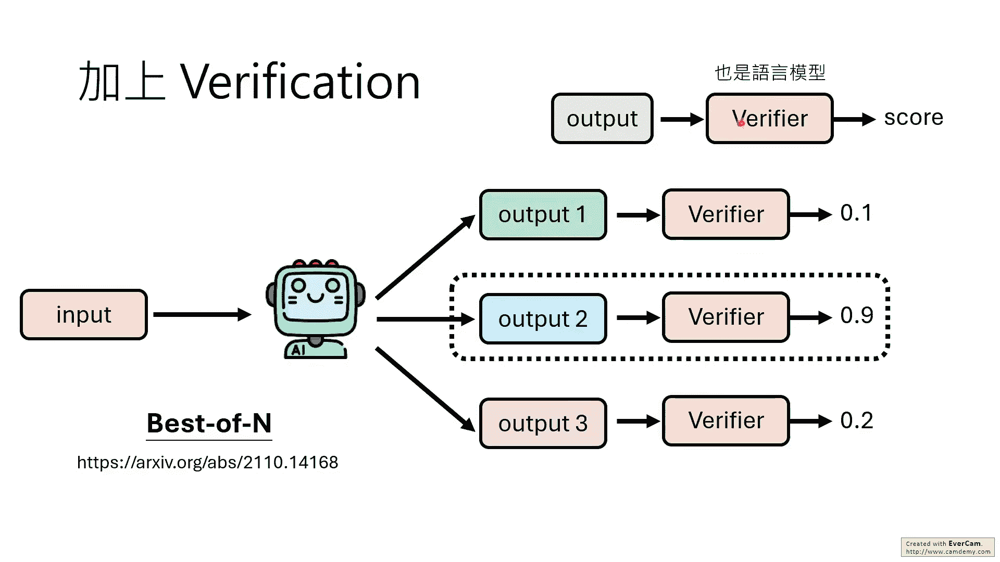

但如果你想要做的更好的话，你可以对验证器加以训练，怎么对验证器加以训练呢，在等一下的实验里面呐，我们都是假设说你手上有一些训练资料，比如说一堆数学问题，然后这些数学问题你也有标准答案。

你只是没有计算的过程而已，你只是没有reasoning的过程而已，那像这种问题跟正确答案对应的训练资料，你是相对比较容易取得的好，有这样的训练资料以后，你就把问题丢进给语言模型。

然后让语言模型产生多个不同的答案，那因为你有正确答案，所以你可以对答案，知道语言模型什么时候是答对的，什么时候是答错的，那这样你就有验证器的训练资料，你可以交验证器说看到这个正确的答案，你就输出。

一看到错误的答案就输出零，看到正确的答案就输出一，以此类推，那就可以训练出一个专门做验证的模型。

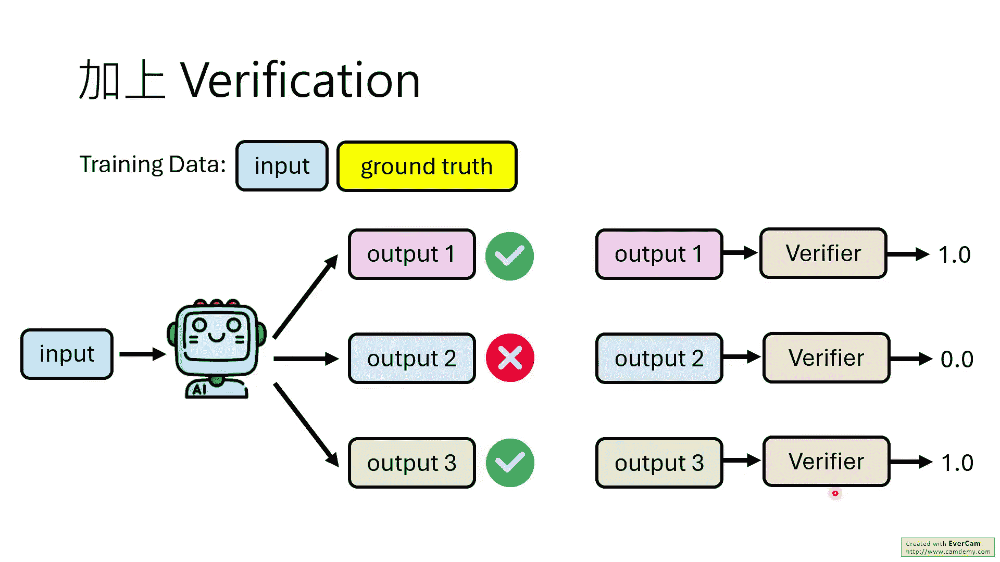

那刚才讲的这个让模型产生多个答案的方法，是一个parallel的方法，其实还有其他的方式让模型产生多个答案，另外一个让模型产生多个不同答案，产生多次的reasoning process。

产生多个不同答案的方法呢是sequential的方法，给模型一个问题，先让他解第一次，然后呢再根据第一次的解法再去解，第二次，再根据第二次的解法再去解第三次。

这是另外一个跟parallel不一样的paradise哦，叫sequential的paradise，那这个parallel跟sequential呢还可以同时使用，我有一个问题进来。

模型先针对这个问题先解三次，然后呢解完第一次以后，再根据第一次的解法在去解，第二次，根据第二次的解法再解一次，根据第三次的解法再解一次。

你可以把parallel跟sequential这两种paradigm，把它结合起来好，那至于哪一种比较好呢，或两者混用的时候，应该要做多少的parallel，多少的sequential呢。

那如果你想要知道说怎么安排是最有效率的，那你可以看这篇论文，好但是我们到目前为止讲的都是模型，回答完一个问题，得到最终答案以后再来进行验证，但是如果你看现在这一些会做深度思考。

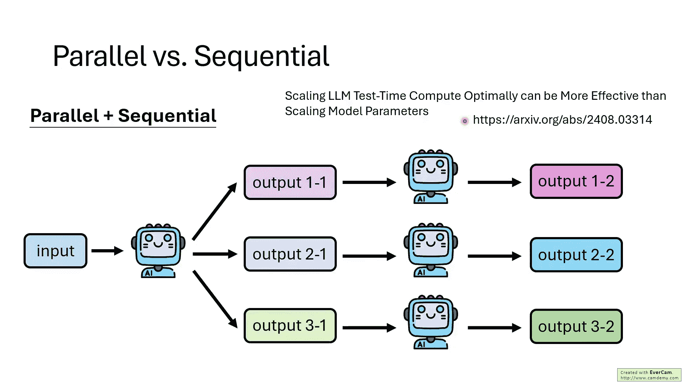

模型的行为，你会发现，他们往往不是得到最终答案才进行验证，因为得到最终答案才进行验证，那如果第一步错了，模型要花很多时间解完这个问题，才发现自己错了，不是很浪费时间吗，所以现在这一些深度思考的模型。

往往能够做到在解题解一半的时候，中间某一个步骤，他就开始验证这个步骤是不是对的，以避免中间算错了一步，错步步错，比如说如果你问dc123456等于多少，等一下最后结尾的时候会给大家看。

他完整回答问题的流程好，那这个呃DSC呢他花了59秒来解这个问题，首先呢他会先做一个计划，他说123×456啊，那我们先把456分解成450跟六，然后呢再各自乘上123，最后再加起来好。

那接下来呢开始计算123×400，然后在计算123×400之前，d sic先计算1234，算出来是492，但是他没有那么确定492是不是对的，接下来他就开始进行验算，去验算123×492。

这一步到底算的对不对，他就一数，他就说123×492，那要怎么验算呢，我们先计算100×4，我们计算这个20×4跟3×4全部加起来，果然是492，所以这一步算的是正确的。

所以现在这些能够做深度思考的模型，会在中间步骤就进行验证，那怎么让模型在中间步骤就进行验证呢，啊DSK主要用的并不是这种工作流程的方法了，但如果套用到这个工作流程的方法，怎么让模型做每一步的验证呢。

那你的做法可以是给模型一个问题之后，先不要叫模型解完，这样他每一次只输出第一步就停止了，它输出三个不同的第一步，然后呢你有一个process verifier，有一个过程验证器。

这个process verify，The process，的意思是说，它不需要看到完整的计算过程跟答案才来验证，是不是对的，它可以根据一整个回答的前面一步，一整个回答的一部分回答的过程就进行验证。

那假设你有一个process verify，那等下几页投影片之后，会讲这种process verifier是怎么得到的，但假设你有这种过程验证器，你就可以验证第一步做的是不是对的。

那就第一步做的是对的的情况，才继续往下做，我们先来讲怎么让语言模型在解题的时候，解到第一步就停下来，那这个方法呢其实就是透过in context learning，透过这个demonstration。

透过这个下pump的方式呢，来让模型把解题的过程分成多个步骤，好这边就是跟模型说，请逐步解决输入的数学问题，每步骤的开头你都要输出step，然后呢步骤的结尾就输出斜线step。

然后给他一个范例step步骤one，斜线step，Step，步骤二，斜线step，问他123×456怎么解，他就会把每一个步骤放到step里面，那如果你现在只需要第一个step的话。

那你就是让语言模型在生成它的答案的时候，只要生成到斜线step，一旦看到斜线step就停止生成，所以怎么让语言模型在每次生成的时候，都只做第一步呢，那你就是让语言模型产生斜线，step的时候就停止生成。

然后用process verify来检查哪一个step one是正确的，step one正确的，step one才继续解下去，好，那接下来这一页投影片讲的是。

我们怎么得到一个process verifier呢，我们可以有的资料是问题跟他的正确答案，因为我们只有问题跟他的正确答案，所以如果有人给你问题跟第一步，问题跟第一步跟第二步，你根本无法判断说。

这到底是不是一个正确的解法，所以怎么办呢，你需要把剩下的步骤完成哦，你知道你的原模型从第一步开始啊，做第二步，做第二三步，最后得到答案，然后看答对了，那也许这个第一步就是好的，但是光是只跑一次是不够的。

同一个语言模型，每次第二步跟第三步，还有答案可能都会是不一样的，所以你需要做多次的sample，都从同样的第一步开始崛起，让语言模型解同的问题，让语言模型都同样从第一步开始解起，做多次的step。

那甚至有些path呢它的step的数目还是不一样的，让原模型从同样step one截起，每一次都得到答案，然后看看从这样子的step one开始做起，得到正确答案的几率有多高，那在这个例子里面。

得到正确答案的几率是2/3好，那怎么知道说有这样的step one跟这样step two，它是多好的step two呢，那你就从这个step two开始，让语言模型继续去解题，让语言模型进行多次解题。

发现解对的平均正确率是1/3，那你就知道说从这个step two开始解对的，正确率是1/3，然后接下来你就可以教process verifier说。

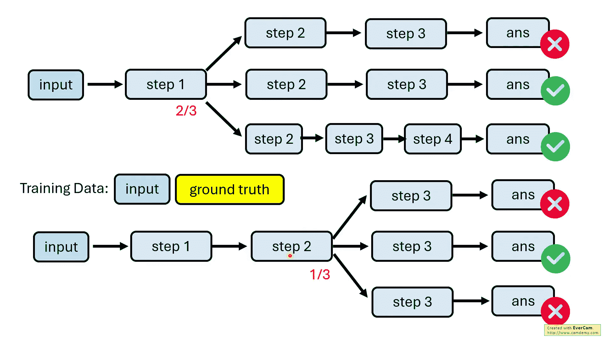

看到这样的step one啊，你就要输出2/3代表解题的正确率，看到这样的step one，Step two，你就输出1/3代表解题的正确率，这个process verify就可以学会说看到越好的。

越有机会得到正确答案的，写解题步骤就给越高的分数。

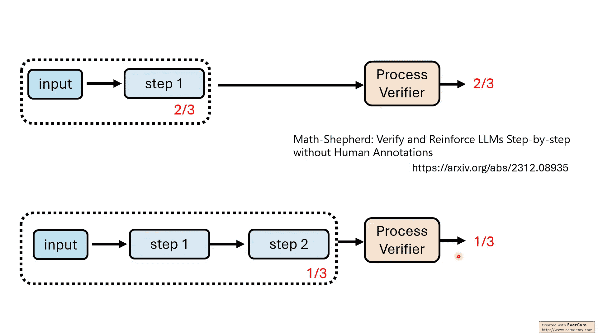

好那接下来会遇到的另外一个问题是，通常这个process verifier啊，他真正给你的并不是true or false，通常process verifier真正给你的是一个数值。

它代表从这一步继续做下去以后，可能得到正确答案的几率，那接下来就会有一个问题是，这边有好多条路径，那我到底应该把这个fresh ho切在哪里呢，到底正确的可能性要高过多少的时候，我们才继续做下去呢。

那如果你觉得这个问题不好回答的话，也许你可以参考一个叫been search的做法，那这个做法它的概念非常简单，就是我们每一次保留process verifier，告诉我们最好的N条路径。

那这边有很多不同的变形啦，有的方法是保留最好的N条路径，有的方法是保留最好的前25percent的路径，那有各种不同的变形，不过概念是一样的，从所有的可能性中保留最好的一部分。

那其他比较差的就不再继续考虑，那假设现在这个N呢设定成二，那我们就从这三个step one之中选择process verifier，觉得最好的两个step one，然后不再理会。

把最差的step one把它去掉，把其他的step one去掉，而接下来再进入step two好，那模型就根据上面这个保留下来的step one，继续去产生不同的step two。

根据下面这个保留下来的step one，继续去产生不同的step two，那怎么产生，怎么只产生step two呢，就跟产生step one的道理一样，一直产生到斜线step的时候就停下来好。

接下来根据been search的方法，只保留两条最好的路径，那就把这边每一条路径都用process verifier去计算，说这个路径有多好。

那process verifier可以吃step one跟step two决定说，现在从这样子的解题过程解下去，得到正确答案的机会有多大，那你在选择机会最大的两条路径保留下来。

把其他比较差的通通就pr掉，把其他比较差的就丢掉好。

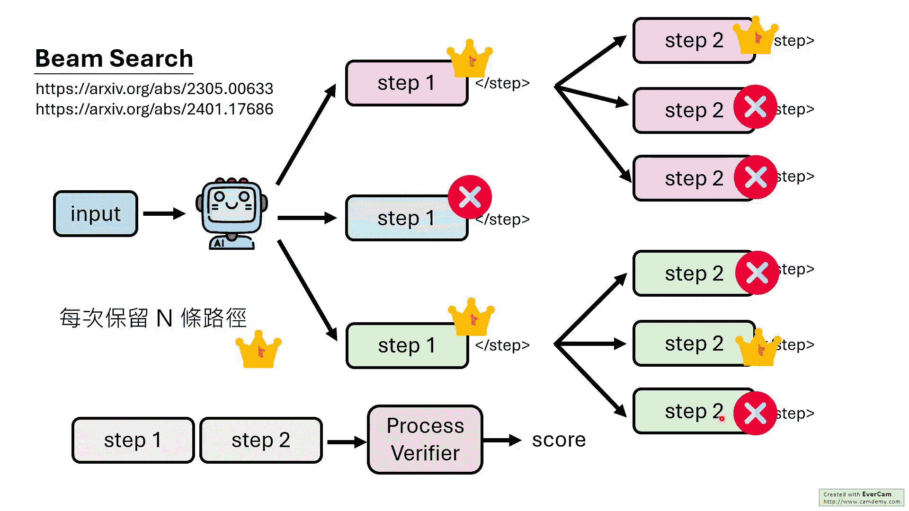

那接下来这个实验结果也来自于，hacking face的那一篇blog好，所以除了majority vote以外，他们接下来再尝试了best of n的方法，发现best of n的方法。

可以做的比majority vote还要更好，那接下来他们又尝试了been search的方法，就是绿色这条线，他发现说当他们用been search这样的方法的时候。

他甚至可以用1B的模型就超越了8B的模型，虽然1B的模型远比8B的模型小，在正常状况下，他根本打不赢8B的模型，但透过这个reasoning process的workflow。

透过告诉模型应该要怎么多方尝试，什么时候尝试下去，什么时候应该停下来，透过这种been search的方法，其实1B的模型也是有机会，比8B的模型做得更好的，那事实上在这个blog里面。

还有另外一个方法叫DVTS，它其实是been search的变形，因为been search呢往往你有时候遇到的状况是，你每次保留下来的那些路径长得都太像了，那有时候我们可能会希望保留比较不像的路径。

那怎么办呢，你可以再参考这个DVTS的做法，看看hacking face他们是怎么做的，不过这个方法看起来并没有非常显著的效用，所以这边我们就不再细谈这个方法。

那事实上啊刚才讲的这个been search的方法。

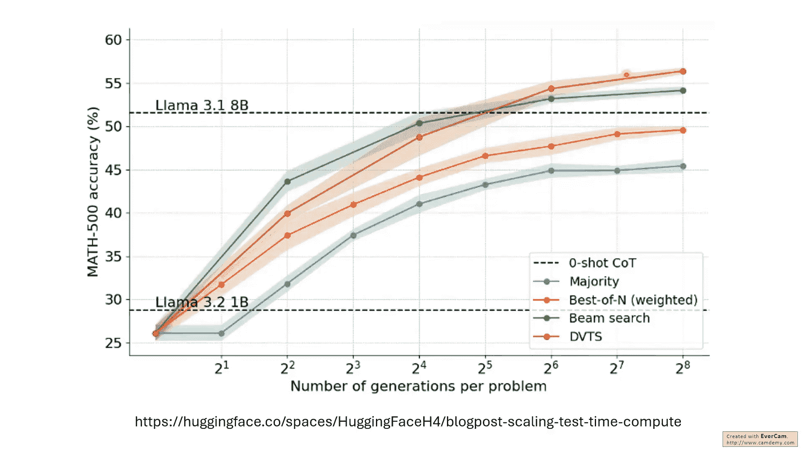

它有很多不同的变形，你都听过很多各式各样的这种heuristic search，The algorithm，比如说a star的algorithm。

或者是monticulo tree search NC t，这些方法通通都可以套到我们刚才讲的框架下，你完全可以把big search，就换成你比较喜欢的monte carlo tree search。

然后看看结果会不会做得更好，那其实那在去年暑假，有很多很多论文，都在large language model上面做过类似的尝试，已经有太多文章把monticolor research用在大型语言。

模型推理的过程中，那也显示说monticcolor research可能是可以带来帮助的，那这篇论文非常多，我就列了几篇有代表性的放在这边给大家参考，那至于梦迪卡or trsearch的细节。

就留给大家自己研究好。

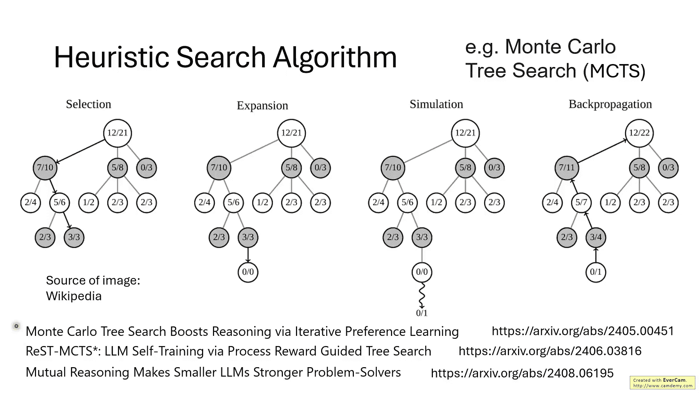

那接下来啊我们要讲的两个方法呢，都是需要微调参数的，那接下来讲的两个方法，都可以视作是上周所讲的后训练的方法的特例，也就是我们有一个foundation的model。

这个foundation的model还不会做深度思考，但我们接下来做post training，希望让这个foundation的model具有深度思考的能力。

我们把foundation的model做一下微调，教他怎么做reasoning，教他怎么做深度思考好。

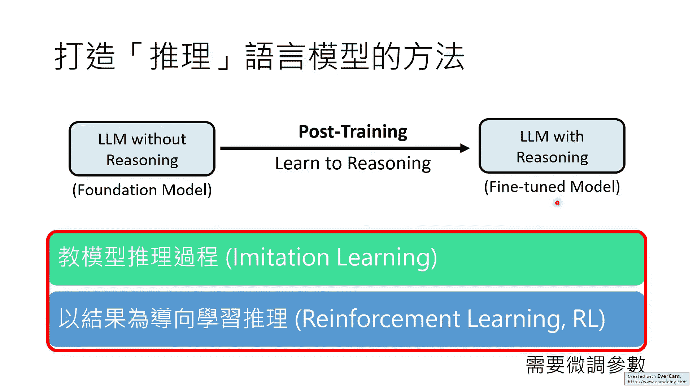

那这边有两个不同的做法啊，第一个做法呢我这边叫做imitation learning，我这里的意思就是直接教模型怎么做，推理模型会有一个老师告诉他，怎么推理才是对的。

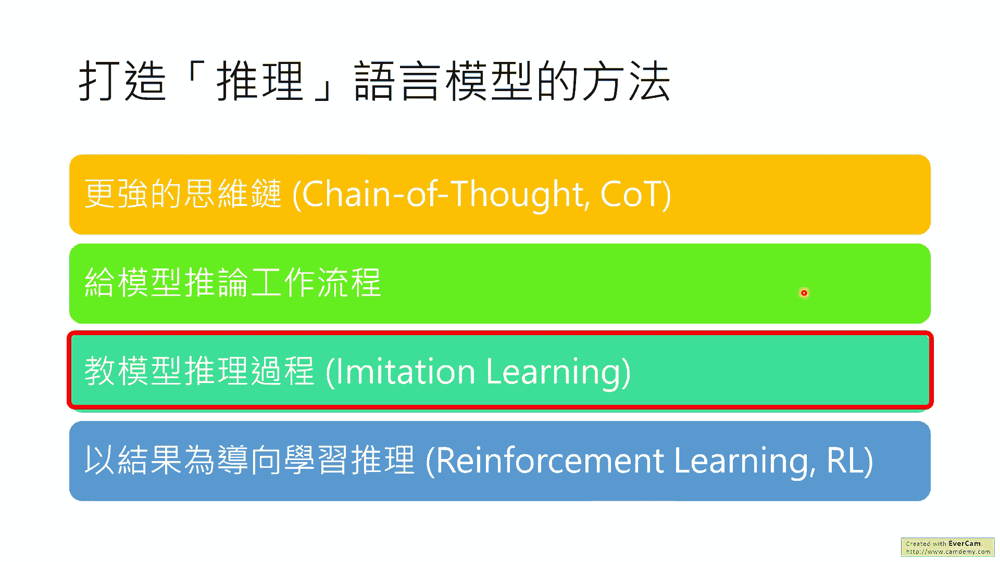

他模仿老师的行为，所以叫imitation learning，所以一般我们的训练资料只有问题跟答案，但这边假设我们的训练资料不止问题跟答案，还有推论的过程，那我们要怎么让模型学习推论的过程呢。

我们只要教模型说，看到这个蓝色的输入之后，你不止要产生正确答案，你还要产生绿色的，这边绿色的这个reasoning process，你还要产生一个推论的过程，然后才产生正确答案，它的概念就是这么简单。

讲完了，但是这一整个概念里面最难的地方是什么呢，最难的地方是推论过程从哪里来呢，通常你都只会有正确答案，而没有推论的过程，那推动过程从哪里来呢，当然你可以叫人标啦，但是叫人写这些题目其实是非常花时间的。

人，通常也写不了，没有人愿意帮你做这件事，那怎么办，让语言模型自己想办法产生推论的过程，所以就拿一个语言模型来，然后给他input，然后要求他要做coo t，要要求他解题的时候。

要把推论的过程详细解出来，然后他就产生推论过程，然后产生答案，那语言模型毕竟能力有限，他不会每次都答对，但是反正你有正确答案，所以你可以去检查语言模型什么时候是答对的，那只有他答对的时候。

这个reason the process才被拿来当做训练资料，但这边前提的假设是假设答案是对的，那推论的过程应该也是对的，那我们可以拿这个可能是对的，推论过程来教语言模型怎么进行推论。

那或者是有时候你会遇到的状况是有一些问题，他可能没有固定的标准答案，那也没有关系，你可以找一个VERIFIER，它可能甚至是一个现成的语言模型，那你可以问这个现成的语言模型，说你觉得这个答案是不是对的。

所以你可以拿一个VERIFIER，它可能是一个现成的语言模型，来看看这个答案是不是对的，那如果是对的，我们就假设reasoning process就是对的，就可以让模型学习这个推论的过程，但讲到这边。

你可能会想说，这个reason in the process一定是对的吗，有没有可能答案是对的，但推论过程其实是错的，他只是最后塞到一个正确的答案而已，所以确实我们没有办法保证答案是对的。

推论过程每一步就是对的哦。

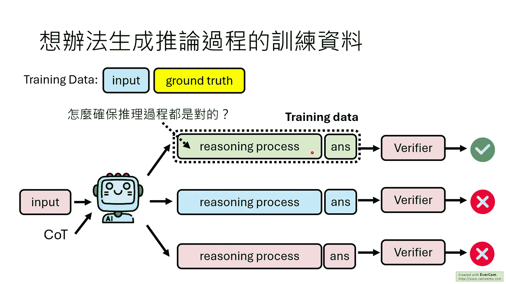

所以就有人提出一些方法说，也许我们不应该只看最终答案，对不对，我们应该用刚才在前一个方法里面，跟大家提过的这种树状搜寻的方法，去对每一步进行验证，我们叫模型解题的时候，我们先展开这个树状的结构。

然后我们拿一个process the verifier，去验证每一个步骤是不是对的，那只有比较可能是正确的步骤，才会继续展开下去，最后如果模型有得到正确答案的话，那中间的步骤可能每一步都是对的。

至少中间每一步都有一个process verify，验证说这个步骤可能是一个好的步骤，然后接下来你就可以把这边的每一个步骤，结合起来，当做reason，你的process给你的语言模型进行学习。

直接教他怎么做reasoning，那其实刚才讲的那些方法都可以被归类为，Supervise fine tunity，之所以不讲说他就是supervise fine tunity。

而是用另外一个词汇imitation learning来概括它，是因为其实第三类的方法不一定要是supervised learning，它也可以是reinforcement learning。

因为你可以教模型说唉，今天在这个树状结构里面，我已经知道产生这一个蓝色的step，会得到错误的答案，产生这个绿色的step会得到正确的答案。

所以你不一定要supervised learning的方法教他，你也可以用那种类似DPO的做法，用一些类似reinforcement learning的做法告诉模型说啊。

这个绿色的step one应该增加它的几率，这个蓝色的step one应该要减少它的几率，或者是你今天在这整个树状结构里面观察到，说这一条路径会导致错误的答案，这一条路径会导致正确的答案。

那就可以告诉语言模型说，看到绿色的step one，Step two，Step three，那你要提高它这样子的路径的几率，看到绿色的step one，Step two。

红色的step three是不好的，那应该要降低它的几率，所以你可以用类似reinforcement learning的方法，来利用这个tree structure里面得到的训练资料，好讲到这边。

刚才前一刻我们还在纠结，是不是reasoning的过程中，每一步都是对的，我们希望教模模型的时候，每一步的reason，你的过程都应该是正确的，但是我们真的应该这样教模型吗。

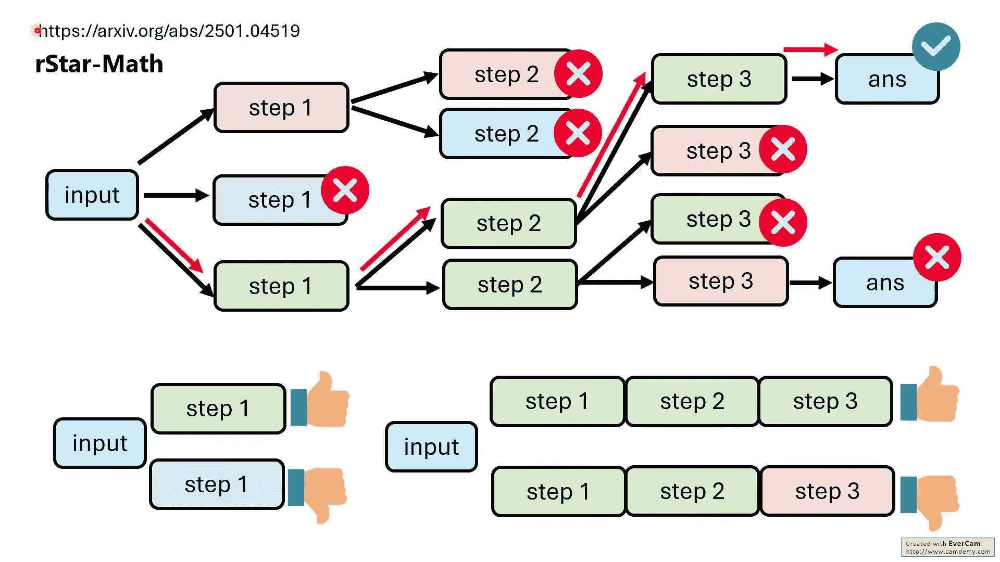

我们应该要告诉模型，每一步推论过程都必须要是正确的吗，今天很多那一种可以深度思考的模型，其实有时候会得到错误的思考过程，举例来说，我这边问欧三说这个strawberry这个词汇里面哦。

这一串符号里面有几个点，就前一阵子不是很多人很喜欢问语言模型，strawberry里面有几个R，然后语言模型会答错吗，所以这个是类似的问题，这边之所以不问他strawberry里面有几个R。

因为这类问题，现在对语言模型来说都已经太简单了，他已经都会答对了，你甚至不知道他是不是已经把答案背起来了，所以这边应该考一点不一样的问题，我问他这一串文字里面有几个点，正确答案是九个点好。

那这个O3呢就算了一下，算了一下，算了一下，发现说哎怎么算出来只有八个点是错误的答案，但是O3厉害的地方就是，他能够找找自己的问题呀，诶他能够才能够找找自己的问题，知道吗，他能够找自己的问题。

所以他发现说八个点是错误的答案，正确答案应该是九个点哦，所以模型中间就算推论过程有错也没有关系，知错能改善莫大焉，只要他最后能够得到正确答案就好了，所以我们甚至不应该教模型的时候。

给他的每一步的推论过程都是对的。

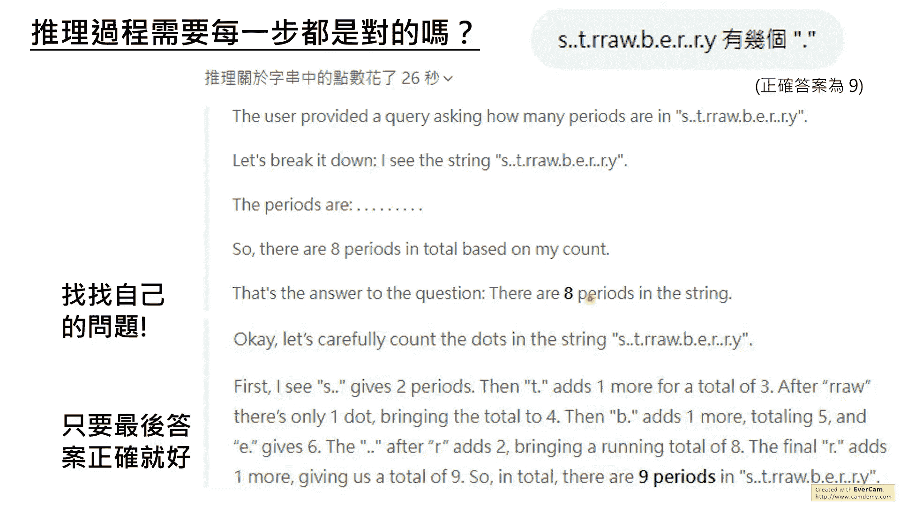

因为每一步的推论过程如果都是对的，会有什么问题呢，模型在训练的时候，他只看过正确的推论过程，他从来不知道推论的过程可能会有错，如果你给他所有的推论过程都是对的，他会不知道要找找自己的问题。

他每次都会觉得前面的推论过程一定都是对的，所以他会就算前面错了，他也不知道，他就会一直硬凹下去，他不知道前面推论过程有可能是会犯错的，所以怎么办呢，我们故意制造出一些特殊的训练过程。

其当训练过程中间可能有一些是有错的哦，因为语言模型它本身能力还是有极限的，所以你让语言模型自己做reasoning的时候，它中间可能会犯错，但是如果你不教他犯错以后要怎么改正的话，他可能就会错上加错。

一步错，步步错，看到错的结果还是要硬凹出一个答案出来，我们应该要让语言模型有知错能改的能力，那怎么教语言模型知错能改呢，我们一样可以从这个树状的结构上面去想办法。

有一篇paper叫做string of search，这篇paper的想法就是，我们能不能从树状结构里面得到一个，reasoning的过程，得到一个推论的过程，它里面是包含错误答案的。

我们直接在这个树状的结构上面，做一个深度优先的搜寻，把错误的搜寻过程也包含进去训练资料里面哦，我们不要一次就走绿色这一步，我们故意走一些错的路啊，走一些有可能得到错误答案的路，我们先从最上面这条路走。

走到这个粉红色的step one，然后呢再走粉红色的step two，那走到粉红色的我们，我下面这个图代表的是在创造那个训练资料，我就告诉模型说，你要先走step one，然后呢再走step two。

然后step two是错的，所以接下来语言模型按照这个树状结构，这要退一步，然后尝试蓝色的step tue，但是如果今天你在教语言模型的时候，他学到的是看到这一个皮肤色的SETUE之后。

接下来要产生蓝色的step tune，那对人类来说，RIN看到语言模型先产生一个答案，而在莫名其妙在就跳到另外一个答案，你可能会觉得这个语言模型讲话很容易，前言不对，后语。

不过你如果你看最早的o one，他讲话蛮容易前言不对后语的，然后不知道是什么原因，有可能是呃，当然这个o one并没有展现那个完整的reason，你的过程给你看了，还是有经过摘要的啦。

但不知道是摘要那边出了问题，还是那个语言模型，他的思考就是非常跳跃，搞不好他就是用这样子的资料训练出来的，这样思考非常的跳跃，讲话常常前言不对，后语好，不过如果你怕模型讲话，前言不对。

后语这个呃突然从这个这一步跳到这一步，很奇怪的话，那你可以多加一些句子进去，比如说在这边，我们之所以知道这个皮肤色的step tu是错的，是VERIFIER验证的结果，那VERIFIER是一个语言模型。

它甚至是能说话的，那你可以把VERIFIER的回馈插在这两个步骤中间，那verify的回馈可能是啊这个皮肤色的step cue，他的答案有错，我们应该换一个解法，然后才接蓝色的step two。

那这样这整个reason的过程，人类读起来可能就会觉得比较顺畅好，那接下来呢我step two蓝啊，接下来呢蓝色的step two也是错的，所以我们要回到最初的原点，再重新尝试。

尝试一下灰色的step one，那你在蓝色的step two跟灰色step one中间，你可以加入verify的回馈，但因为现在一次跳到最初始的地方，所以你可能可以加一个句子说啊，让我们一切重新来过。

那这样人类读起来会觉得这个推论的过程，比较顺一点，后来有一些其他的论文，甚至会用比较好的语言模型改写，这整个reasoning的过程，就你在这个树状结构中搜寻出一个路径以后。

再用比较好的语言模型去改写整个搜寻的过程，让他这个step paste之间加一些连接词，让它读起来呢比较顺畅好了，step one也是错的，所以加入verify的回馈，再给绿色的step one的过程。

然后给绿色的step two的过程，给绿色的step3的过程，然后最后得到正确答案，然后你拿这些训练资料去训练你的语言模型，你用语言模型就会学到说诶，一开始他可能会走一些歪路，但走一些歪路也没关系。

他有能力可以修正回来啊。

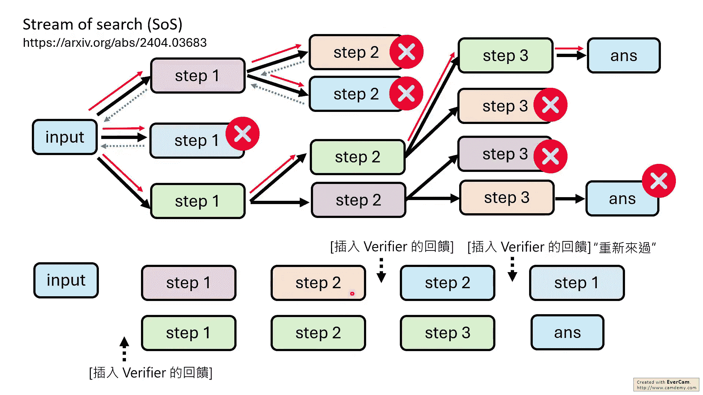

那有另外一篇paper呢，也提出了一个非常类似的想法，那这篇paper把他们提出来的想法叫做journey learning，那就说如果你在树状结构里面，只找出每一步都是正确的path来当做训练资料。

这个叫做shortcut learning模型，只学会打顺风局，它不会逆转胜，所以你要有个方法叫他们提出来的方法，叫做journey learning，你要根据你的树状结构去制造出一个。

reasoning的过程，其中是有包含一些错误的路径，让模型可以学会逆转胜，看到错误的路径要如何转回正确的路径上，那journey learning这个方法还真的是有用，我这边就引用这篇论文里面的实验。

结果他们坐在map500上面好，这个红色的这个bar呢是shortcut learning的正确率，蓝色这个bar呢是journey learning的正确率。

那你会发现说他们从两个不同的foundation model开始，做post training，那journey learning。

journey learning都比show up learning表现还要更好好，所以到目前为止，我们讲了一大堆创造reasoning过程，当做训练资料的方法，但如果你今天想要自己打造。

有reasoning能力的模型，也许已经不用那么麻烦了，因为世界上已经存在好些，有reasoning能力的模型，你可以直接对它们做knowledge destination哦。

就拿一个能够做深度思考的模型，让他先产生reasoning的过程，再产生答案，你的模型就直接学习这个模型，学习这个reasoning的模型，做reasoning的过程就结束了。

这招就是knowledge destation，那像sky key one，还有s one，都是用同样的方法来教模型reasoning的能力。

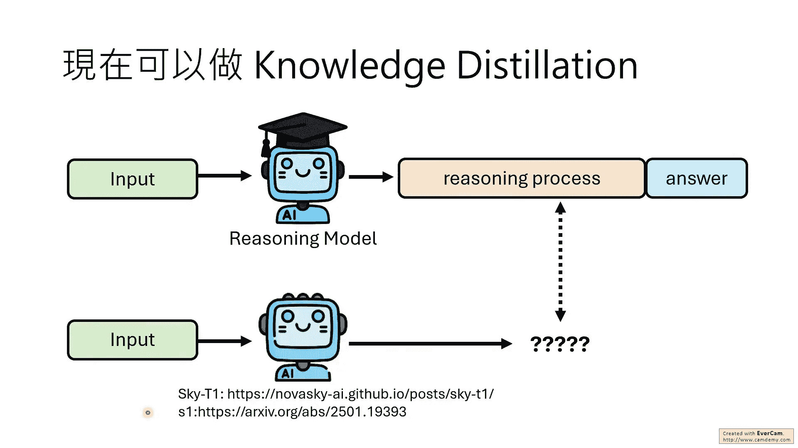

那在dissect paper里面呢，在DC r one的paper里面呢，其实他们也展示了knowledge destination是非常有用的，他们做的事情是什么呢。

这边每一个color代表的是在不同任务上面，模型评比的结果，那这个数值越高越好，那这边的任务呢有数学相关的任务，然后还有GBQA，那就是一些非常难的问题哦，都是博士级。

然后号称要博士级人才可以答得对的问题等等，然后还有一些写程式的任务，上面是一些很厉害的模型，他们可以得到的正确率，他们可以得到的分数，那下半部呢是knowledge destination的结果。

那在这一串文字的右边这个这些文字啊，QIN跟la指的是拿来做post training的foundation model啊，他们在Q问小模型到大模型。

还有拉玛8B跟70B上面去做了post training，他们拿dsr one当做老师去教这些foundation model，怎么做reasoning，但发现教完之后。

这些模型它的能力在数学在城市上也都起飞了，可以跟这些比较好的模型相提并论。

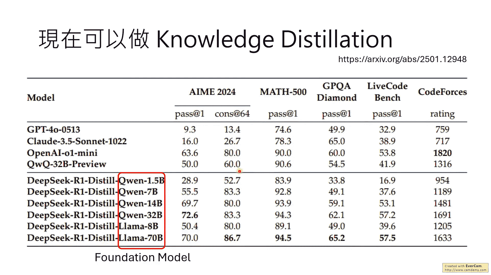

好刚才讲了三个方法，那接下来呢我们要讲最后一个方法，最后一个方法是以结果为导向来学习推理，也就使用reinforcement learning，以结果为导向来教模型怎么做推理，这个就是过年期间非常红的。

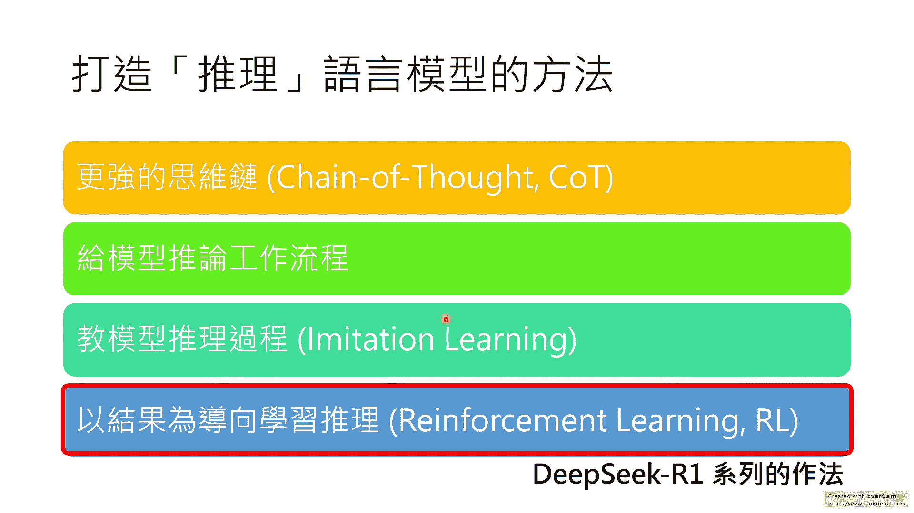

DC r one系列的做法好，那怎么用reinforcement learning来教模型，怎么进行推理呢，它的概念是这样子的，你有一些训练资料，你有问题，你有问题的正确答案，你把问题输入给模型。

要求模型做reasoning，而reasoning的什么不重要，我们只看他最后的答案好，reasoning完之后要给一个答案，因为你有正确答案，所以你可以去对答案看对不对。

如果是对的模型就得到positive reward，如果是错的模型就得到negative reward，那在这整个过程中推论，在整个RL在这边的RL的学习的过程中，推论的内容。

这个reason is the process到底说了什么，不重要，我们只在意最后的答案是不是对的，这在这个reasoning的过程中，答对就是positive，答错就是negative，只要是答对。

中间reasoning的过程发生了什么事，不重要哦，所以你可能会觉得说，这个方法乍看之下，跟我们刚才第三类的方法好像也很像，刚才第三类的方法也有产生reason in the paron。

再看答案对不对的这个呃这类的方法，但是在第三类的方法里面，我们都是在意reasoning的过程的，我们会希望reason你的过程是对的，我们会希望reason里的过程长某些特定的样子。

但在第四类的方法里面，完全不管推论的过程，只要最后答案是对的，就是好的，那这个就是DSKR系列的做法好，那d seek的系列里面呢有一个模型叫d seek，R one zero。

这个并不是你在DC的平台上会用到的，Dcr one，这个是另外一个模型，这个DC r one zero啊，它就是一个纯粹用RL学出来的模型。

他们把DC v3base呢当做foundation model，然后用RL，然后把模型能不能答对问题的正确率当作reward，然后打造了DC r one zero，那其实除了拿reward当做呃。

除了拿正确率当做reward之外呃，r one zero还有另外一个reward是format的reward，他们要求模型要产生fake token，就这样哦，所以这就是为什么做完I以后。

模型可以产生fink token，因为那是reward的一部分，模型要产生fink token才是好的好，那这种纯粹只问结果，不问过程的方法有没有用呢。

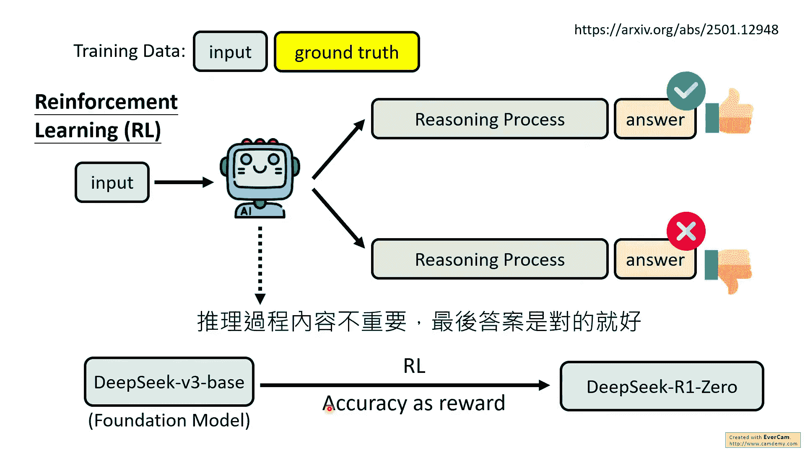

是有用的，而在这个r one的paper里，在DC r one的paper里面呢，他们这边先展示了r one zero的结果，纵轴是正确率，那这边测试的数学问题是用AIME啊，那是一个数学竞赛的问题。

里面都是非常难的问题啊，横轴呢是RL训练的过程，蓝色这一条线呢是dsc r one zero的正确率，那蓝色这一条线衡量的是，假设模型只能够做题目一次，那它的正确率有多少，那绿色的虚线呢是o one。

如果只能做题目一次的话，它的正确率有多少，然后最后DC r one zero在经过L的训练之后，可以逼近o one的结果，那红色这一条线是什么意思呢，红色这一条线是majority vote的结果哦。

让DC r one zero呢去每一个题目产生16个答案，再用这16个答案做majority vote，把这16个答案做majority vote，可以得到红色这一条线，那虚红色的虚线呢。

是o one做majority vote的结果，那如果用r one zero做majority vote，可以跟o one做majority vote做的一样好。

然后比o one没有做majority vote还要好，那今天这个实验理念呢，可以告诉我们一件非常重要的事情，很多人会问说啊，这个今天讲了四个方法，那这四个方法里面哪一个方法最强呢。

这个实验就是告诉你说，这些方法彼此之间是没有冲突的，就算大家一直说啊，dsc r one zero怎么怎么厉害，其实它是可以用majority vote再进行强化的。

所以今天我们讲过的majority vote的方法，是可以跟L的方法直接做结合的，你可以在post training的时候用L的方法调整参数，然后在inference的时候用majority vote。

再一次强化模型的能力，所以今天我们讲的这四个方法，其实本身是没有冲突的，而在这个r one zero里面，在原始的论文中，特别作者非常想要让大家知道的一件事情，就是aha moment。

他们说模型怎么学到这个reasoning呢，怎么学到把错的东西改对呢，哦这是他自己学到的，没有教他，他自己就会了，在RL的过程中学着学着，他就知道能够发现自己的错误哦。

模型在解题的时候解着解着解到某个地方，它就会突然说，喂喂喂，There is a aha moment，然后就说之前可能有错，我要重新来想刚才解题的思路，他们说这个不是透过人为的力量所得到的。

是RL自行得到的，但是r one zero为什么没有放在平台上让大家用呢。

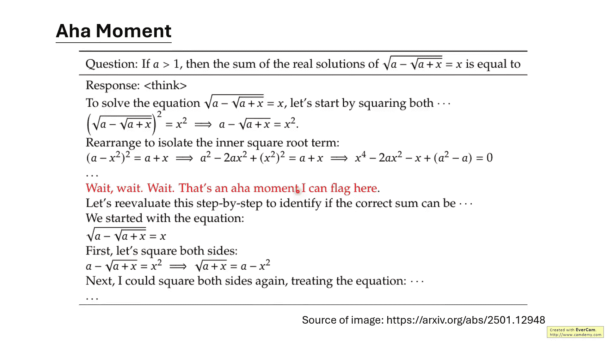

因为r one zero几乎是不能够使用的，他的reasoning的过程是非常难读的，而且是多个语言混杂的，为什么r one zero的reasoning过程很难读呢。

为什么他推论的过程人类是很难看懂的呢，因为你在教这个模型的时候，你只在意结果你只在意他的答案对不对，你根本没有在意他推论的时候，到底写了些什么东西，所以r one zero并不是最终放在平台上。

给大家用的模型，所以r one zero并不是R系列的最终版本，而这个dsc r one就是大家真正有在用的模型。

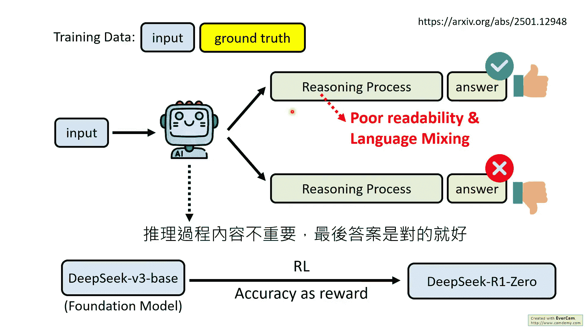

它是怎么被打造出来的呢，呃很多农场文呢讲这个DSR系列的时候，就只讲一句说啊，用r le train就结束了，其实背后的过程，真正r one真正打造的过程是很复杂的。

而且我们刚才在今刚才前面讲的三个方法，其实都有用上这样，所以今天并就你可能有很多人讲到reason，你就觉得讲到说啊讲I就好了，因为I听起来就是最强的r one，就是L做的，其实不是。

其实在打造r one的过程中，前面讲的三个方法都是有用上的，所以我们就来看看真正的r one是怎么产生的，而有了r one zero之后。

他们用r one zero来产生有reasoning process的训练资料，就他们有问题有正确答案，但没有reasoning的person，现在现在竟然有一个可以产生reasoning，过程的模型。

叫r one zero，就让他来写reasoning的过程吧，那请可能会想说，刚才不是说r one zero写出来的东西，人是读不太懂的吗，那没关系，就是耗费大量的人力下去改它。

那这边到底耗费了多大的人力，改了多少，不知道他们的技术报告里面，这段是写的非常隐晦的，他只告诉你说，用了大量的人力去修改了r one zero的输出，当做训练资料，有了这些训练资料以后。

你就可以做invitation learning，再一次训练DC v3，然后训练出一个神秘的没有名字的模型，我们先暂时叫它，模型A在技术报告里面并没有帮他取名字。

那这一步得到的模型A可能会比r one zero更好，为什么，因为r one zero的推论过程是模型自己发明出来的，是人很难读懂的，现在人帮他改写了一下推论的过程，所以模型A应该比较能够产出。

人比较能看得懂的过程，而事实上除了直接用r one zero产资料之外，他们其实还用了另外一个模型，那在论文里面没有讲的非常清楚，我他们拿另外一个模型，用future coo t的方法。

来产生一些带有reasoning的资料，他们也用pumping的方法，他们说用pumping的方法，这个这些两个句子，都是那个技术报告里面的原文了，他们说用pumping的方法。

让模型呢产生一些detail的answer，而且要有reflection，要有verification，那这个显然就是supervise coo t的方法，都是我们今天这堂课第一部分有讲过的方法。

所以他们用今天这堂课第一部分讲过的方法，去强迫某一个模型生出有reasoning过程的资料，把这些资料集合起来，训练出模型A这部分的资料没有很多。

技术报告里面说是thousands of example，这部分可能有大量的人工介入，用人工介入去选择比较好的reasoning的过程，或人工介入去改写出比较好的reasoning的过程。

好这步得到model a好，接下来model a会再进一步去做L得到model b，但model b做L的过程也跟r one zero略略有点不同，除了要要求它正确率越高越好以外，还有一个额外的限制。

就是语言必须要用一样的，今天如果模型在reasoning的过程中，都用一样的语言，比如都用英文或都用中文，他就会得到额外的reward，那这样可以要求模型在reasoning的时候，不要迅速转换语言。

至少可以用同样的语言把推论的过程写完，那技术报告里面还有提到说，如果用这一招的话，其实模型整体的正确率是稍微下降的，因为你给他了一个额外的限制嘛，但是还是这样比较好。

与其让模型产生一些人看不懂的推论过程，还是让我们模型产生人比较好读的推。

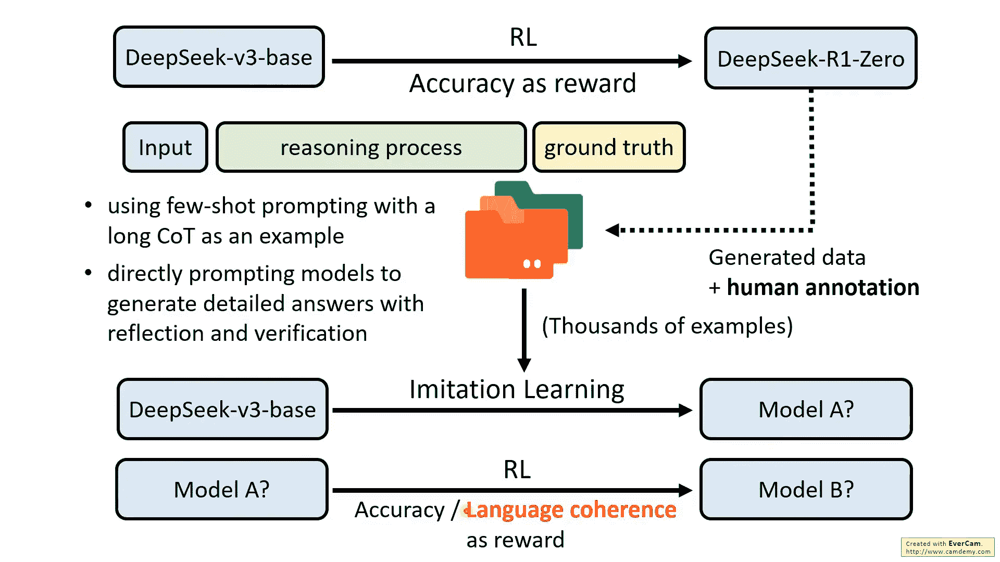

推论过程是比较好的好，那有了模型B以后，接下来其实模型B它也是拿来生资料的啊，有了模型B之后，它就收集了各式各样不同的任务，在前面阶段训练里面，主要都是数学跟城市相关的，但是从这一步开始。

不能只考虑数学跟城市，要加各式各样的任务，然后呢，让模型B它已经初步具备reasoning的能力，产生reasoning的过程在产生答案，那这些答案怎么知道它是不是对的呢，他们有正确答案。

但是虽然有光测，但是他们问模型的这些问题呀，很多都是没有标准答案的那一种，所以他需要用，所以他们用DC v3来当做VERIFIER，来判断说，现在model b得到的答案是不是一个好的答案。

那接下来技术报告里面还写到，说用了一些规则去去掉reasoning的过程中，比较糟糕的过程，比如说如果reasoning的过程中用了多个语言，或讲太长了，或者是产生一些城市码的话。

会把那个reason的过程拿掉，就是不拿进去训练好，然后接下来呢还是一样做imitation learning，再重新训练DC ct v3，那这个步骤呢升了60万笔的资料，因为这个步骤是自动的。

所以可以升比较多的资料，事实上除了60万笔的reasoning资料以外，其实他们还把DC v3呢拿去做self output，跟我们上个礼拜讲的self output造模型。

你要加一些self output，它比较不会忘记过去的东西，所以他没有拿DC v3做sp output，升了20万笔的资料，跟着60万笔的资料混在一起。

然后呢再对V3base做invitation learning，然后得到model c好，那model c呢最后呢再做一次RL，那这部分就写的非常的模糊，这一部分的RL呢是希望强化模型。

safety跟helpfulness的能力，最后才得到DC r one，那在这整个过程中，你就会发现我们前面讲到的三大类方法，其实也都是有用上的，并不是只有用RL而已，那在DC技术报告的结尾。

他没有提到说他们也曾经想要尝试做process verifier，也曾经想要尝试做NTCS，但是最终没有做起来，没有得到好的结果，这是一个尚待研究的问题，好不过。

this stick的一个特色就是它产生跨，因为它主要还是用RL来进行训练，所以它产生reasoning的过程，并没有太多人工的介入，所以你会发现它，有时候reasoning的过程会产生奇奇怪怪的东西。

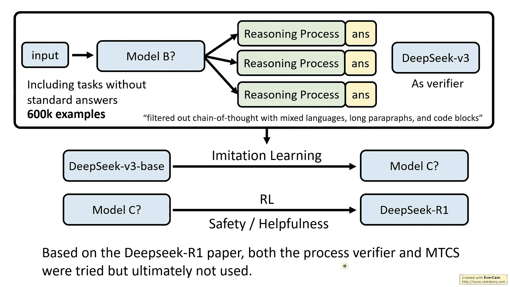

比如说我问他strawberry有几个R，那我这边呢故意拼错这个字，strawberry原来这边只有一个R，那我这边故意拼错这个字，让它变成有两个R，所以strawberry这个词汇总共有四个R好。

那我问D4个r one说有几个R呢，他第一眼就看出有四个R了，但不过他接下来开始怀疑自己，他说不过这可能吗，因为正确的拼写是strawberry，不过正确的拼写其实是strawberry。

或者不strawberry的正确拼写是怎样怎样怎样，你会发现他讲话有点奇奇怪怪的，不是非常的通顺，而且我真正最在意的地方是，他只有左括号，没有右括号啊，哎，现在基本上语言模型都不太可能犯这种错误了。

早年你还会担心说刮了左括号，是不是没刮右括号，现在语言模型基本上不太可能犯这种错误，但你发现DC r one reasoning的过程，他有时候会讲出奇奇怪怪的话，那就是因为在这个reason。

你的过程中并没有太多人类的supervision，他们在训练过程中，只在意最终的答案好不好，那isle这个方法能不能成功啊，其实非常吃foundation model的能力，在技术报告里面呢。

他们也同样有对QWIN32B做L，但他们发现说如果直接拿Q问32B做IL，它的结果就没有拿DC c v3base做L的结果，好好，这个第二个roll啊。

是直接拿Q问32B做r one zero的训练方式，就直接用IO来强化Q问32B，那在这些任务上面，你会发现哎都做不太起来，他的能力呢跟另外一个叫QWQ，342B的模型呢是差不多差不多的。

所以RL无法大幅强化Q问32b base的能力，它可以强化DCV3的能力，这个500多B的巨大模型，巨大的模型看起来可以用L强化，但三色B的模型比较难用L强化，不过虽然32B的模型难用RL强化。

但是透过imitation learning直接向DC r one学习，是可以快速增进QWIN32B的能力的，所以如果用distillation的方式，也就是就也就是用我们今天讲的第三个方法。

invitation的方式是可以大幅强化Q问的能力的，好为什么会这样呢，如果你了解RO的原理的话，你就不会太惊叹I要做的事情是什么，L要做的事情是强化模型原有的能力，那在我们过去影片里面都有跟大家讲过。

IO实际上是怎么运作的，IO的，实际上运作的过程是，模型产生出正确答案的时候，你告诉他这是好的，它应该增加正确答案的几率，如果产生错误答案，你告诉他不好的，要减少错误答案的几率。

它能够增加正确答案几率的，前提是他能够产生正确答案，所以一个模型如果本来就不够强，你用IO还是没有办法激发他reasoning的能力，如果一个模型用R之后，可以激发他reasoning的能力。

那意味着什么，意味着他其实本来就有reasoning的能力，所以啊即刚才讲到的aha moment，它可能在原来的foundation model里面，就已经有aha的能力了。

LL只是强化这件事情的出现而已，所以事实上有好几篇论文啊。

这边都是引用其中一篇，有好几篇论文对DC v3base呢进行了检验。

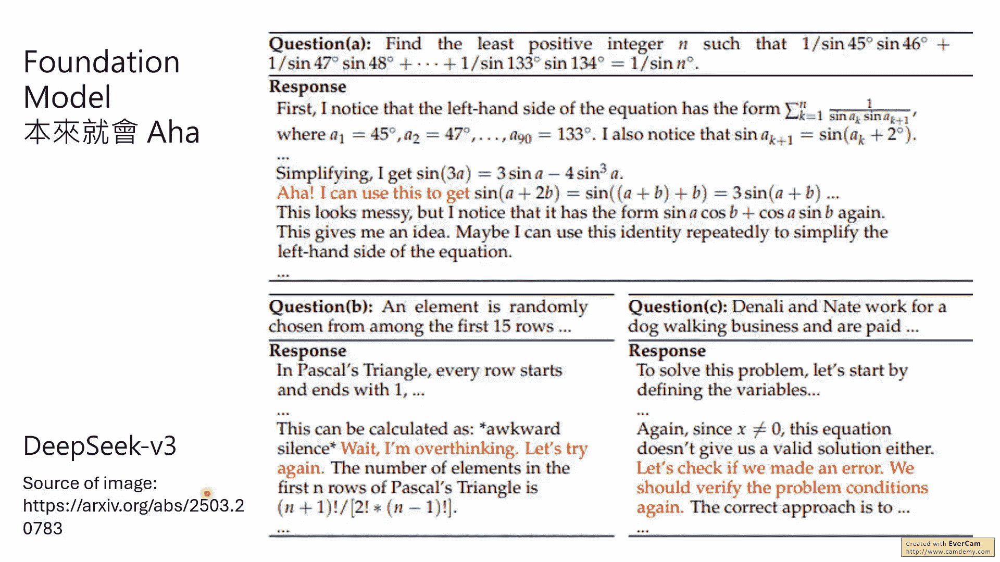

就发现说其实DC v3base在做IO之前，它本来就会啊哈，就比如问他这个问题，那这IO之前的结果，他结一节以后就突然啊哈起来，就aha i can use this，然后或者是他本来就会没事质疑自己。

他就没事说，Wait，I'm over thinking，或者他没事，他就会确认自己有没有答对，他就说let's check if we made an error，所以这些行为其实是模型本剧的行为。

LL是强化了它本来reasoning的能力好，那讲到这边呢，其实我们把今天的四个方法都讲完了，而且最后希望用DC r one的例子告诉你说，其实这四个方法并不是互斥的，他们通通对打造一个reason。

你的模型是有帮助的好。

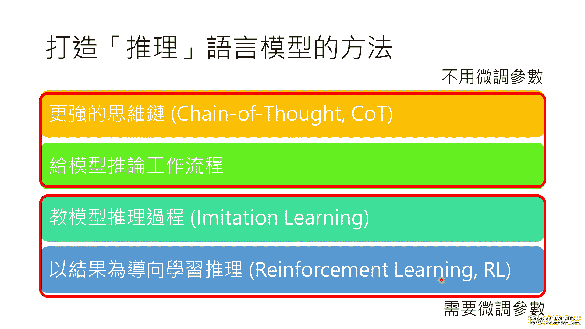

那这个是讲reason模型，这个是讲深度推论模型的前半部，那下回预告就是会讲推论模型的挑战，跟未来发展，推论模型最大挑战是什么呢，最大挑战就是，你今天要产生非常长的reasoning的过程。

那显然是花钱跟花算力的，所以我们其实希望模型把它的力量用在刀口上，该reasoning的时候才reasoning，不该reasoning的时候不要做无谓的reasoning，但是今天这些深度思考的模型。

有时候他会做无谓的reasoning，我们来看看DC r one是怎么解123456，这个问题的，这一页，投影片是我们刚才已经给大家看过的内容，但这只是整个非常冗长的推论过程的，前面非常小一段而已。

模型继续推论下去，这边叫他做123×456，他已经定好了计划，他先计算123×400好，接下来呢应该要计算123×50，在计算123×50的时候，他做了一个子计划，他说怎么算123×50呢。

啊那就是把123先乘五，最后再加一个零就没错了，好所以最后算出来123×50是6150，接下来再算123×6，非常轻易的就算出123×6是738，接下来呢他要把492006，150跟738全部加起来。

他这边呢再次做了一下拆解哦，492049200要加16150，这个没有办法一步加，拆成两部，先加6000再加150好，加完之后呢要再把738加进来好，先加700再加38，加完之后他得到56088。

这是正确的答案，但他显然不太放心，他说这是正确的吗，让我们再确认一次，而他确认最后一步55350+738，到底应该是多少呢，我再确认一下，确实是56088，稍微放心一点，但还要再确认啊，那再确认一次啊。

我用另外一个方法来解这个题目，他就列一个值式运算，他就说啊，那刚才呢是把456拆成450跟六，刚才是先乘400，再乘50，再乘六，那这边的顺序是反过来的，先123×6，在123×50，在123×400。

再加起来看看答案对不对，嗯看起来答案是对的，但是仍然不放心，还要再用另外一个方法再确认一次，他又做了一下这个estimation，他说我们把123当做是120，四，五六当成是450。

两者相乘之后得到54000，跟刚才算出来的答案56088，看起来是不太一样的，不过呢120是123，拿掉三，450是456，拿掉六，所以算出来比较小呢是正常的，所以答案有可能是对的好，那再继续验算好。

再继续验算好，这一次呢把123拆成三跟20跟100，把456×3，456×20，四，56×100再全部加起来，算出来也是56088，用这么多方法进行验算，应该够了吧，不还不够，还要再验算一次好。

怎么验算呢，刚才明明就已经算过那么多类似的东西了，但不管他把这个问题呢再breakdown，再把123呢再一次拆成100+20加三把，456×100把呃，456×20把，456×3再加起来哟。

又是56088，好，这样够了吗，不行，要新算一下，他说他新算一下123×456，发现123×456是什么呢，他把123直接乘400得到答案，123×50得到答案，123×6得到答案。

直接全部加起来得到56088，我想说你心算就可以算对，那你前面到底在做什么呢的，到这边应该可以了吧，不行还要再一次计算，他说那我们刚才呢这个A加，我们刚才呢只拆解了一边的数字，但我们能不能两边都拆解。

所以把123×456拆成100+20加三，400+50加六，然后再逐项展开哦，逐项展开哦，这边有三项，这边有三项，总共九项，逐项展开，全部加起来也是56088好了，依依不舍的结束了这个计算过程。

这样啊得到了正确答案，但你发现中间有太多推论过程，根本就算浪费时间，他其实一开始就答对了，但他就是硬要算这么多。

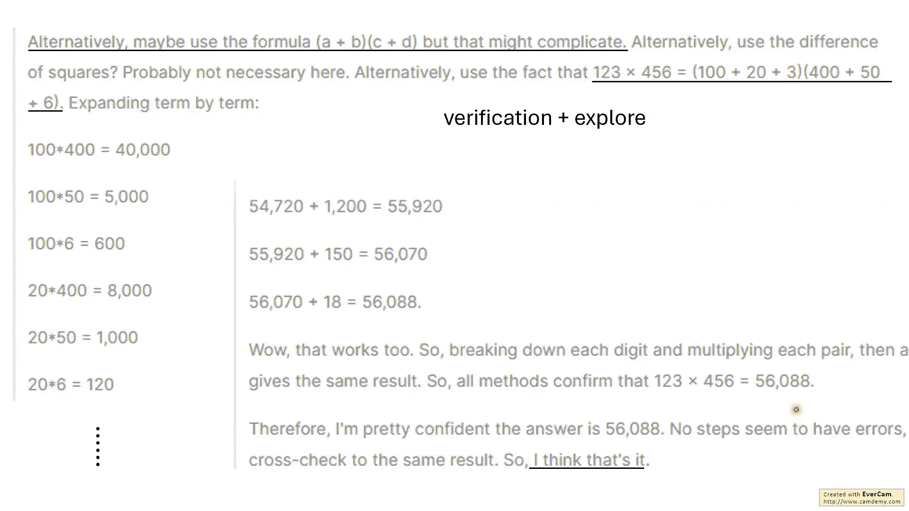

所以有没有办法让模型缩短它的推论过程呢。

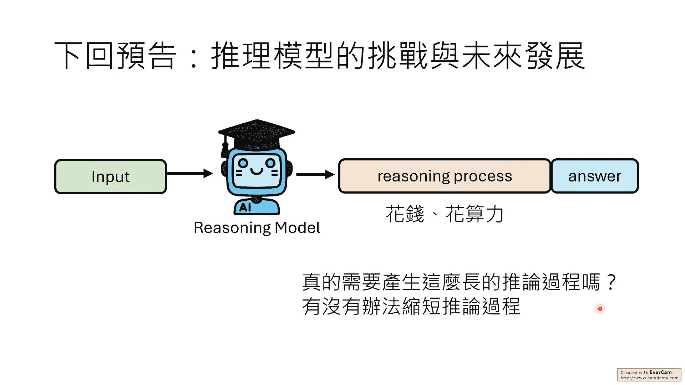