# 强推！(2026最新版) 李宏毅最新课程：智能体AI【AI Agent】71集全！人工智能／机器学习／深度学习／大模型／LLM - P15：14-第九讲：大型语言模型的推理过程不用太长、够用就好 - Ai人工智能工程师 - BV1QdzCB3Eu2

好好那我们就来上课吧，那上周啊我们讲到说推理模型，比如说像DC这类的模型，有时候你问他一个很简单的问题，他明明一开始就能答对，但他却左思右想，他浪费了一大堆的运算资源才得到答案，那这堂课呢我们要讲的是。

怎么不要让推理的大型语言模型想太多好。

那我们过去呀在第一堂课的时候，就跟大家提示过说，如果有比较长的推理，有可能结果会更好，但真的是这样吗，现在其实都有很多研究告诉你说，其实推理越长不一定代表结果越好，那你常常看到很多实验是这样做的啊。

就说我们找一个推理模型来问他一大堆的问题，得到他推理的过程跟答案，然后接下来呢，我们把推理的长度跟答案的正确率画成一个图，你可能会发现推理的长度跟正确率，它是负相关的，很多论文都告诉我们说推理长度越长。

今天往往你会观察到正确率越低好，但是这个实验呐，这样的实验方法其实并不够严谨，为什么呢，因为这样的实验结果，只能说正确率跟推理长度之间有某种相关性，你并不能说是因为推理变得很长，导致正确率变低的。

因为正确率变低跟推理长度变长，背后可能有一个共同的因素，就是问题的难度，可能是问题比较难的时候，模型觉得需要用比较长的推理才有办法解出来，而问题比较难，正确率又会下降。

你才会观察到正确率跟推理长度的负关联性，所以这页投影片里面这样的实验呢，并不能够说推理越长。

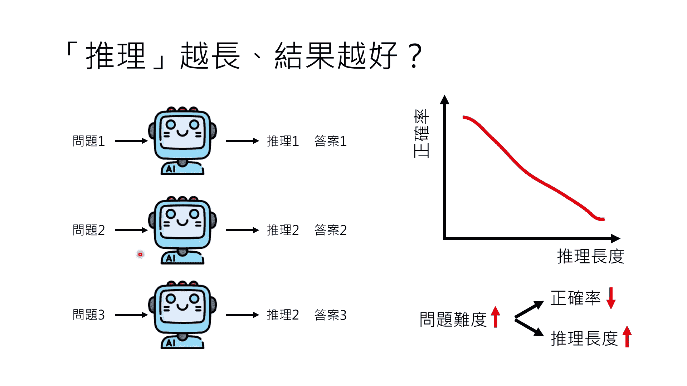

结果就越差，但是也有一些论文做了一些比较严谨的实验，告诉你说，其实推理的长度看起来，对于正确率真的是不一定有帮助的，呃我这边引用的这个数据呢是来自右下角，这篇paper不过类似的结论啊。

已经这个呃如过江之鲫啊，你可以找到非常多的论文，得到类似的结论，而这篇paper是怎么做的呢，他说呃我们问这些可以推理的模型，同样的问题，然后问他五次，那同个模型同样的问题，但你每次问他的时候。

他答案会不一样，他推理的长度会不一样啊，你问他五次，把长度最短的标成group one，长度第二短的标成group two，以此类推好，那第一个你可能会担心的是说，会不会模型每一个group。

它产生出来的长度都都差不多呢，也许模型每次回答说他推理的长度是差不多的，但实验结果发现，其实不是，每次推理的长度是可以有很大的差别的，这篇论文里面尝试了一系列，号称有这种推理能力的模型。

然后把它们做在各式各样的问题上面，那我们这边就看AIM1的结果啊，这是一个数学竞赛的题目，那横轴呢是group one到group five，那从group one到group five。

推理的长度是越来越长的，好在这边呐，你要先注意一件事，这边所谓的group one在五个推理的长度里面，最短的推理长度其实也已经很长了，你看纵轴，这个纵轴呢是大概5000到1万个token。

所以这些模型最短的输出，都是5000到1万个token，随便问他一个问题，他至少都是用5100万个字来长篇大论一下，但如果他想的话，可以用超过2万个字来长篇大论好，那所以现在呢是同个问题问五次。

然后把短的答案收集起来，把长的答案收集起来。

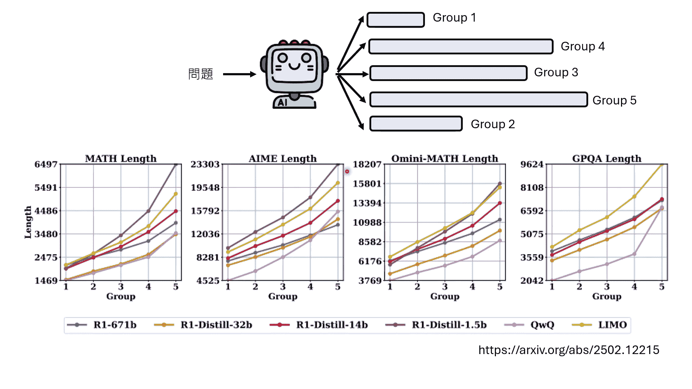

那我们来看看group one跟到group five的正确率是如何好，你看在不同的资料集上，你会发现说越长的答案其实真的没有，正确率越高哦，所以在不同的COOPEN上面都验证说，同样的问题。

当他回答的越长的时候，不一定代表他的答案会越正确哦，所以今天看起来这些模型的回答真的太强了，强到没有必要，而常回答代价是什么呢，常回答的代价就是额外算力的消耗。

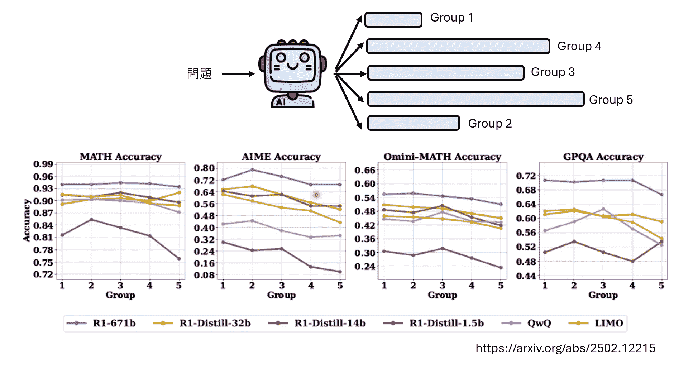

这就让我想到一句话了，最什么是最好的工程师，最好的工程师不是把事情做到完美，而是在有限的资源下把事情做到最好，套用到人工智慧也是一样，也许一个最好的人工智慧。

并不是每一个问题他都要做非常长的reasoning，确保一定会得到正确答案，假设有一个人工智慧，他保证一定能达到正确答案，但每个问题呢他都要reason1年以上，可能也不是一个你想要的人工智慧。

我们期待的是在有限的资源下，运用有限的算力，能够把事情做到最好的人工智慧好。

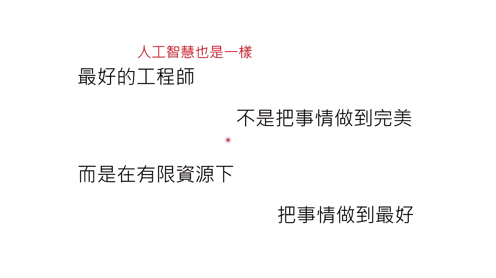

所以再来呢我想要跟大家讨论的就是，如何避免模型想太多，那我们上周呢有讲了四个，让模型学会做reasoning的方法，那接下来对每一个让模型能够学会做，reasoning的方向，我们都稍微讨论一下。

如何避免让模型想太多好，第一个部分呢，我们上周讲到，有一个可以让模型reasoning的方法。

就是直接叫他做reasoning，那最基本的就是channel Sol叫模型，Think step by step，那有一篇paper呢叫chain of draft啊。

这篇paper的想法就是叫模型thing step by step的时候，模型的reasoning的过程似乎太长了，也许长到没有必要。

所以这边paper就是改写了FX step by step的pump，而一般的channel sp就直接问模型，fining step by step啊。

这篇paper是think step by step，但是每一个thinking step都只是一个草稿，然后草稿的每一条都不要超过五个字，这个channel draft的方法有没有用呢。

这是一个很简单的方法，但看起来蛮有用的，右边呢是坐在cloud3。5上的，结果那这边漏打了一个字啦，这是SONY啊，这个T不知道为什么不见好，那呃我们先看下面这一张图，那这一篇论文呢。

是坐在了四个不同的测试资料上面，那第一个是有关数学的测试资料，中间两个呢是从一个叫做big bench的benchmark OP本，拿出来的测试模型理解能力的资料。

然后最后这个coins three法是一个有趣的小游戏啦，别人告诉模型说本来硬币是正面，A来了，把它翻了一下，B来了，把它翻了一下，然后最后问模型呢，现在朝上是正面还是反面这样的问题。

这纵轴呢是模型输出的长度啊，如果直接叫模型回答问题，它通常输出的长度都非常的简短，那如果你叫模型做channel four things，Step by step，它输出的token的长度就会长很多。

如果你用chain of draft叫模型，things step by step的时候，不要输出太长的结果，那模型的输出呢就会短很多，那短很多，对模型的效能影响怎么样呢，这篇paper发现呐。

在cloud3。5上面影响不是非常的大，如果不做china soul得到的正确率呢是蓝色的话，如果做china soul得到正确率是中间这个皮肤色的bug，那当然比没有channel soul好很多。

那如果做china drift叫模型，做china store，但是不要回答太冗长的话，模型有时候甚至可以比原来长篇大论，得到的结果还要稍微好一点哦，所以你控制你的pump。

其实可以控制模型reasoning的长度好。

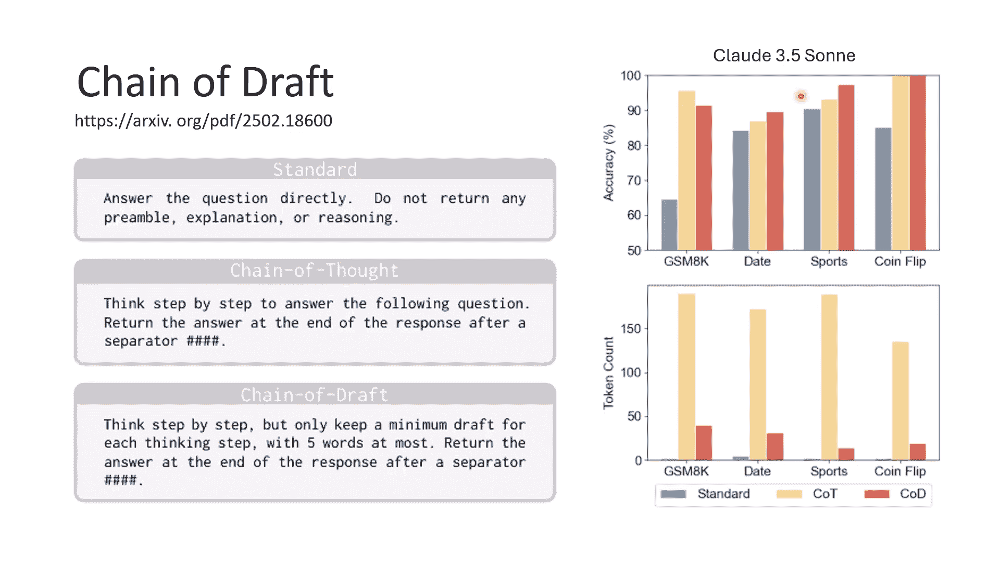

这是第一个方向好，那有关第二个方向呢，我这边就没有特别准备投影片哦，在第二个方向里面，模型推论的工作流程是人设定的，所以你要让模型推论短一点，你完全可以控制它，比如说让他sampling少一点。

让他做bin search的时候，那个bean呢开小一点，让它产生树状结构的时候呢，这个树长的小颗一点，你就可以控制模型reasoning的长度。

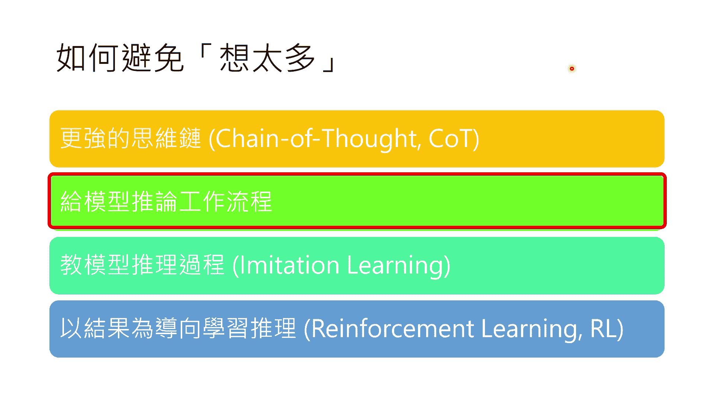

我们说第三个方法就是直接教模型怎么做推理，你给模型正确答案，然后教他怎么进行推理。

已经有很多会推理的模型，这些已经会推理的模型可以作为老师去教，其他不会推理的模型，那之前在上周课程里面，我们讲说，你可以找一个会推理的模型，让它根据输入的问题产生推理的过程。

接下来学生只需要去学习这个推理的过程，推学生就把这个推理的过程当做正确的答案，老师输出什么，它就输出什么，但在整个学习的过程中，并没有把推理的长度考虑进去，那怎么在这个学习的过程中。

把推理的长度考虑进去呢。

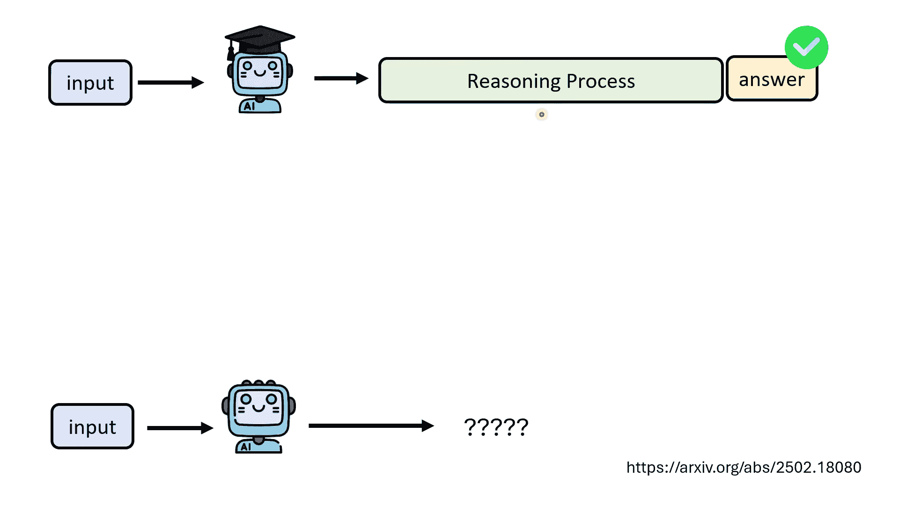

因为这些推理的模型呢，每次它输出的推理长度都是不一样的，所以你可以把同一个问题，问这个老师模型很多次，然后在老师可以答对的情况下。

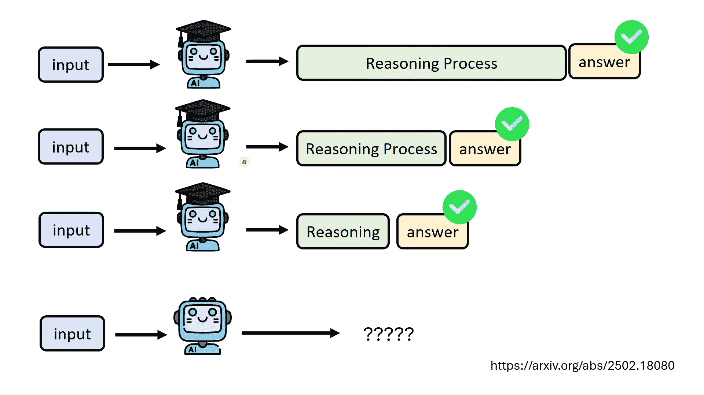

选一个最短的推理过程哦，在老师都可以答对的情况下，选一个最短的推理过程，当做学生模型的训练资料，学生模型去学习这个最短的推理过程，那训练完之后，这就是一个推理过程，不会冗长的学生模型了。

好这个概念呢就是这么简单。

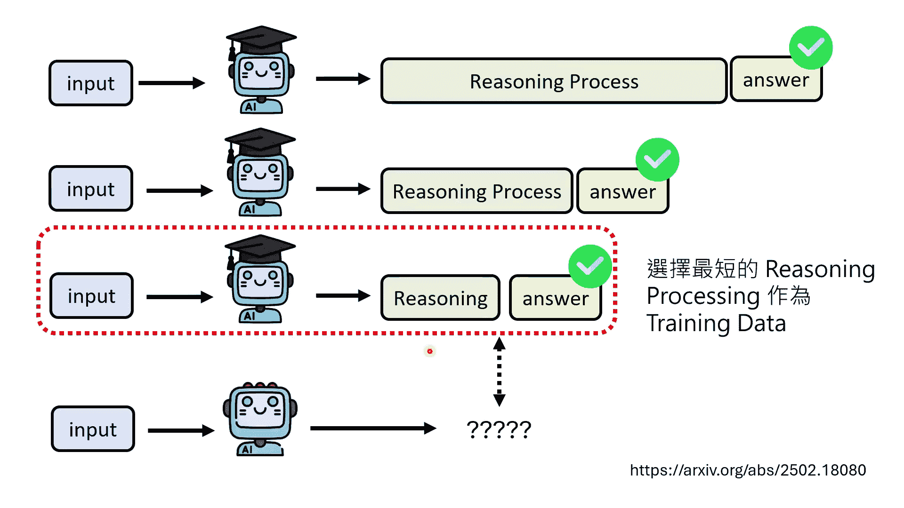

然后还有另外一篇paper呢叫做explicit channel sl，To implicit channel sl，他说我们其实有办法呢明着写出来的channel store，硬是把它变不见。

硬是把它练到不见啊，这篇paper是怎么做的呢，他说原来你的训练资料可能是有一个问题，那这边是做一个简单的乘法啊，一个问题，然后有一个计算的过程，有一个最终的答案，好的这个这边有一个计算的过程。

你当然可以直接把计算的过程拿掉，叫模型学习啊，直接看这个输入产生输出，不过如果直接这样学的话，往往没有办法让模型学的太好好，怎么办呢，要用渐进式的学法，一开始你有你的训练资料。

里面是有reasoning的过程的，然后让模型学产生reasoning的过程，再产生答案，然后接下来把reasoning过程里面的，第一个token拿掉，然后让模型产生。

这个少了一个token的reasoning过程再产生答案，然后接下来让模型学习产生减少两个reason，你的token再产生答案，以此类推，到最后你就可以练出一个模型，他的能力跟原来会做reason。

你的模型能力差不多，但他不产生reasoning的过程，他学会了心算，他学会了把每个要计算的东西都放在心里，不产生reasoning的过程就直接产生答案，但之前paper说有reasoning的过程。

跟没有reason的过程，performance差不多，他们是坐在比较简单的COOPEN上，它主要其实就是做了乘法，然后做了那个GSM8K，一个比较简单的数学问题集，所以看起来在比较简单的问题上面。

你是可以硬把reasoning的过程练不见的，就每次都把reasoning的过程剪短一点，让模型学习，不要靠REAS整理的过程就可以产生正确答案，这个是implicit channel soul的做法。

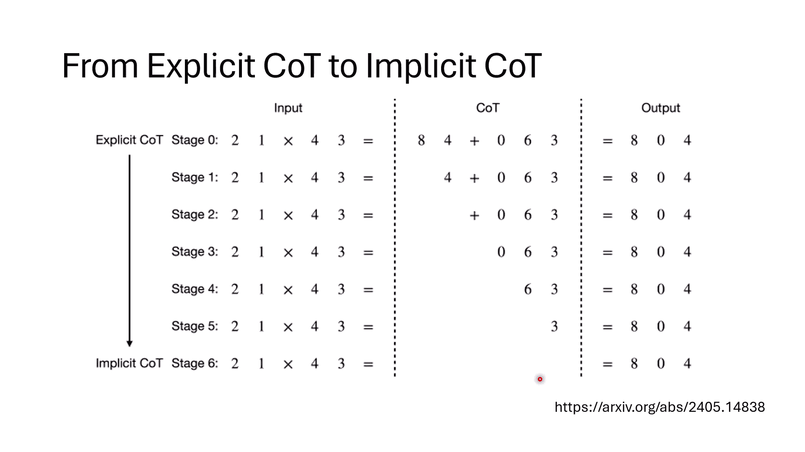

好那最后呢我们上周还有讲到，最后一个可以让模型学习推理的方法，就是直接做reinforcement learning，像d sick这种单纯靠reinforcement learning。

训练出来的reason里的模型，他们输出的reason。

你的过程真的可以非常的冗长，那在DC r one的技术报告里面，那作者就特别强调了，学着RL的学习过程不断的进行，现在这些模型它产生的输出会越来越长，那我们在这个作业期呢就是要做RL的作业好。

那这个横轴呢是LL的学习的过程，纵轴是模型回答问题的平均长度，那在DC r one zero这个模型训练过程中就发现说，随着IO不断的进行，模型回答的长度就会自动的越来越长。

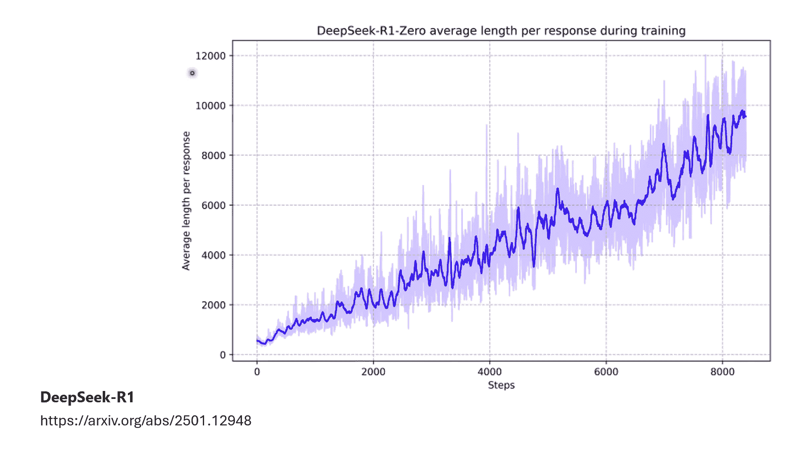

那为什么用IO这些方法，会产生超长的推理过程呢，你想想看，你在做I训练的时候，你从来没有告诉模型长度应该不要太长，模型唯一知道的事情是，如果今天推理完后答案是正确的啊。

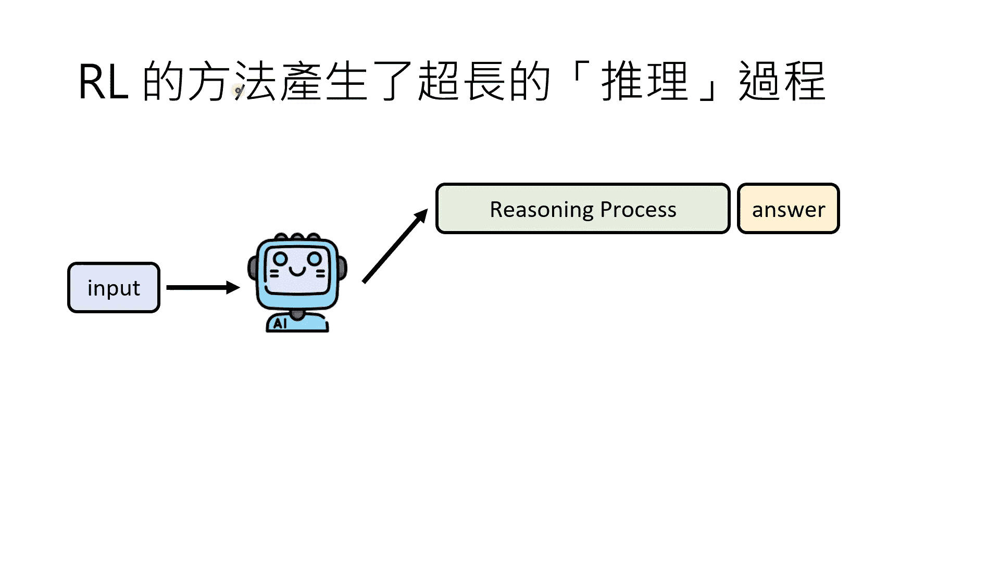

那就是好的，答案是错误的，那就是不好的，从来没有人叫AI要去在意推理过程的长度，所以对AI来说，它推理过程要多长就可以有多长，他可以把一个问题反复确认过十几次，他可以同一个问题提出十几个想法。

每一个再慢慢验证，都没有人管他，他爱讲多长就讲多长，只要最后答案是对的，就好，好像L的过程中，如果你设置的reward只有考虑正确率，其他都不考虑的话。

那AI的reasoning process真的可以非常的差，那怎么解决这个问题呢，一个很直觉的解法，就是把长度的限制加到RL的reward里面去，直接告诉模型说。

今天reason你的长度超过某个限制就是不好的，你可能可以设定说今天reason的长度超过，比如说1000个字，那你的reward就会减少，就会被扣分，但实际上你发现多数的文献。

其实没有采用这样简单的方法，为什么没有采用这么简单的方法呢，只要直接定一个很硬的长度，定一个很硬的标准，跟模型说，只要超过一定长度就一定是不好的哇，这个其实不可能不一定适用于所有的问题。

因为不同问题的难度是不一样的，有些比较难的问题，本来就需要比较长的推理过程，比较简单的问题，它可以用比较简单的推理过程就解完，所以强制做齐头式的平等，每一个问题都一定要在比如说1000字内解完。

也许是不合适的，所以多数的论文呐都采用了以下这个方法哦。

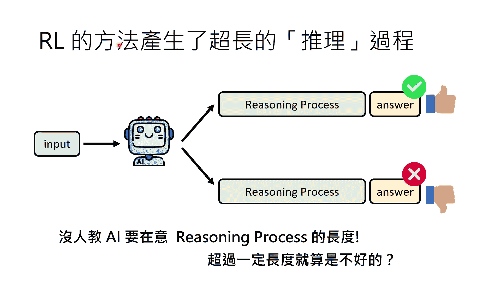

这边就引用了三篇论文，那这个都是今年年初的文章，很多采用了非常类似的想法，就是不要定一个硬标准，高速模型说超过几个字就是不好的，这个标准是相对的，这个相对的标准怎么定出来，看现在这个问题的难度。

那怎么知道现在这个问题，需要多长的推论过程才能解出来呢，怎么知道现在这个问题，用多长的推论过程解出来才是合适的呢，通常这一类方法的做法会是这样子的，你先把某一个问题呢丢给语言模型很多次。

然后让他做reasoning，然后把答对的状况收集起来，然后看看模型在答对的时候，平均需要多长的reason。

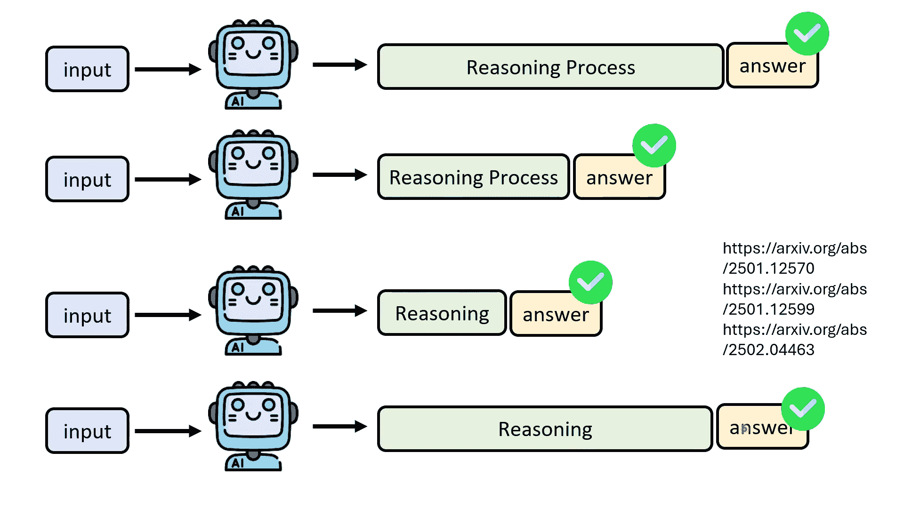

你的过程啊比平均长就说是不好的，比平均短就说是好的，所以在RL的过程中，本来是只有答对是好的，答错就是不好的，现在可以加一些额外的限制，就算答对，但是如果比平均需要的推论长度还要更长，那要算是不好的。

你要不止答对，而且比平均需要的推论长度还要更短，才能够得到正面的reward，用这样的方法来训练模型，来用RL训练模型，就可以让模型训练完之后，不会产生太过冗长的reasoning的过程好。

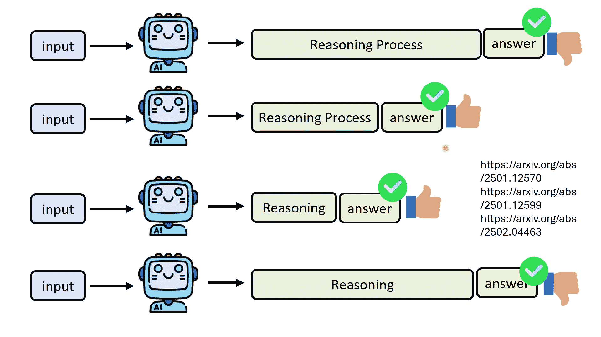

那除了避免模型产生非常长的，reasoning过程以外，你甚至可以教模型控制推理的长度，怎么教模型控制推理的长度呢，你在输入问题以后后面加一句话哦，直接用文字输入，告诉他说推理长度必须设定为N大的字。

比如说1000个字，然后接下来呢就看模型会产生多长的QU理，那你的reward呢就设定为正确率，减掉目标和实际推理长度的差异，也就是说，如果目标的推理长度，跟实际的推理长度差距非常大的话。

那模型也会得到负面的reward，那如果今天这两者的差距非常小的话，那模型才会得到正面的reward，所以光答对还不够，你还需要产生的reasoning process，符合现在输入的使用者设定的要求。

好，你有办法透过IO让语言模型，学会控制输出的推论长度吗。

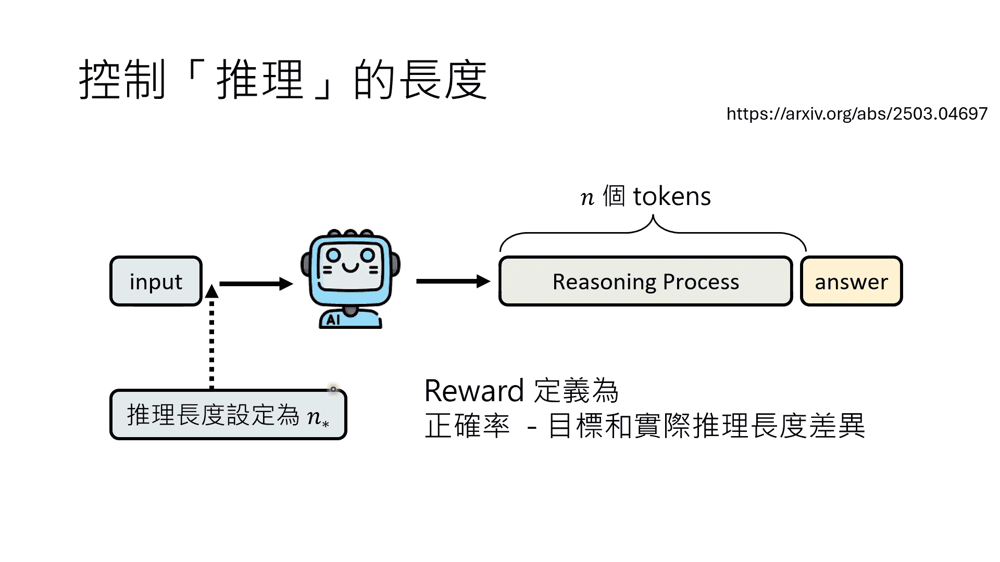

根据这篇啊今年3月的文章看起来是可以的，他们训练的时候是训练在数学的问题上，然后如果是测试在数学问题上的话，对他们来说算是INDOMAN的case，好在INDEMAN的case。

他们尝试了四种不同的数学的资料集，看看模型能不能够输出指定的长度，那发现说在多数状况下，假设在做I的时候有胶模型，怎么控制输出的长度，那你在测试的时候，你真的就可以指定一个长度，那模型产生出来的长度哦。

会跟指定的长度非常的接近，那根据这篇论文的实验结果，看起来的差，看起来模型输出的长度跟指定长度的差距，大概在2~6percent哦，所以看起来模型是能学会控制输出长度的。

不过如果在out of domain的data上，他训练的时候是只有训练在数学的题目上，如果测试的时候不是数学的题目，看起来模型对于长度的控制还没有那么精准。

那它的差距会在20percent到40percent，但模型不是完全没有学会控制长度，它还是在一定程度上学会了控制长度的能力，那学会控制长度有什么好处呢。

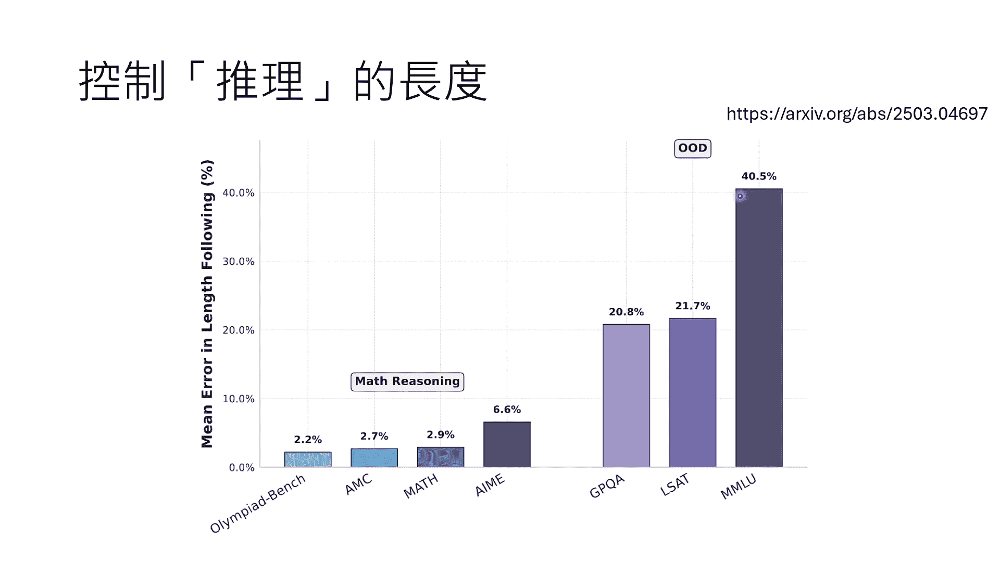

你可以根据你现在的运算资源的需求，所以你现在这个算力很少，就让模型推论短一点，如果算力很充足，就可以让模型做比较长的推论，那像这种控制推理长度的问题呀，我们会担心说，训练完之后。

会不会伤害到模型本质上的推理能力，他未来要控制长度，所以就伤害到它的推理能力，那这篇论文看起来啊，模型并没有受到模型的推理能力，并没有受到太大的影响，那这边是实验，在几个数学的资料集上。

那中间这张图呢是数个资料集上的平均的结果，好在这个图上啊，每一个点是一个模型，这个紫色的点，蓝色的点，绿色的点，还有橙色的点，代表四个不同的模型啊，这个横轴呢是每一个模型回答问题的时候，输出的平均长度。

纵轴呢是正确率，这几个不能够控制长度的模型，这个蓝色绿色橙色不能够控制长度的模型，它们会输出很长的答案，但是也会得到很高的正确率，那紫色这个星星的点呢是SY。

而once对genuine i做knowledge destination，得到的模型，那s one呢那篇paper里面其实有控制输出的长度，他们是怎么控制输出的长度的呢，用一个非常粗暴的方法。

如果模型讲的太长，直接咔掉，如果说今天只只准讲256个字，到256个字就不准再讲了，管理或算完都不准再讲了，那如果模型讲太短怎么办呢，今天目标可以讲1000字，讲到500几个字就停了，怎么办呢。

哦不准模型结束，模型输出结束那个符号的时候，强制置换成weight，然后让他继续讲下去，所以他有个比较粗暴的方法，来控制模型输出的长度，那发现这个粗暴的方法，看起来对模型的影响是蛮大的。

当今天他们要模型输出比较短的时候，模型的正确率就受到了非常大的影响，而如果直接交模型，用IO，如果直接用IO来教模型控制输出的长度，这个红色的点跟橙色的点，都是用RL来控制模型输出的长度。

那红色的点呢它是except，意思就是说假设现在教你输出1000字，你输出1001字也是不好的，输出999次也是不好的，叫你输出1000字就要输出1000字，短了也算是差的，然后max是说。

如果现在指定要求输出1000字，输出比1000字长会被扣分，但比1000字短还可以接受好，这两种方法看起来都练得起来，都可以教模型呢控制它输出的长度，而且这个可以控制输出长度的模型。

在让它输出很长的时候，它可以能力接近那一些，没有控制这个输出长度的模型啊，如果让他token输出很少的话，他其实是可以比s one强制结束，还要得到更好的结果哦，所以今天是有办法可以训练一个推理模型。

控制它的推理长度的好。

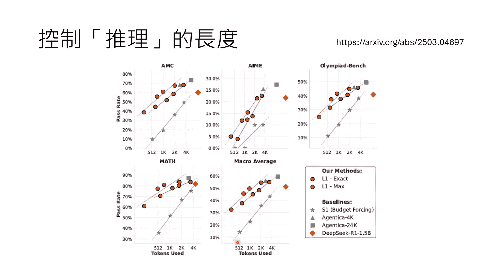

总之这边想要讲的并不是告诉你说，推理这件事情没有用，这边主要想要传达的意思是过犹不及，那讲到这个过犹不及呢，我就想到那个长颈鹿的演化了啊，大家这个国中的生物课本讲到演化的时候，从长颈鹿当做例子。

对不对啊，这个例子就是说啊，原来长颈鹿的祖先他的脖子是短的，但是呢这个呃低矮的植物呢有太多动物吃了，为了抢一些比较高的植物，所以就演化出比较长脖子的版本，然后这边生物课本都要告诉你要注意。

并不是说呃长颈鹿为了要吃高处的树叶，所以脖子变长，演化并不是这样的，是说这个长颈鹿有各种不同的子弹，有长脖子的，有短脖子的，那长脖子的呢在生存上比较能够占到优势，还可以增加呢这个繁殖的机会。

所以呢长脖子的长颈鹿就越来越多哦，但是这个过犹不及脖子，只要能够尝到可以吃最高处的叶子就好了，再长长就没有什么好处啊，据说这个长颈鹿的演化，是让达尔文觉得非常困扰的一个问题。

为什么长颈鹿的演化让演化学家觉得很困扰呢，因为它的脖子其实太长了，长到什么地步呢，肠道比多数的树还要高，所以它吃这个树叶的时候，它必须要把脖子低下来才能够吃到树叶，显然这个脖子长太长了。

但为什么会长太长呢，这可能是因为信则的原因，就一开始脖子稍微长一点的，长颈鹿可以占到优势，接下来演化就让长颈鹿知道说啊，以后找伴侣的时候要找脖子长的，脖子长的长颈鹿可以增加交配的机会。

然后接下来呢所有长颈鹿就疯狂的把脖子长长，但这样讲是不精确的，不是说疯狂把脖子长长，是说脖子长的，长颈鹿就可以获得比较多繁殖的机会，但是只要脖子长，就会比较多交配的机会，有没有实际上的用途，没有人在意。

所以最后就脖子就长到太长了，长到说据说在发生饥荒的时候，就假设在非洲的环境比较苛刻的时候，反而是脖子短的品种，脖子短的个体比脖子长的个体更有机会活下来，脖子长的个体需要比较多的能量。

才能够把脖子支撑起来，吃树叶的时候要把脖子滴下来，所以反而在生存竞争的时候是比较不利的，这个就是一个过犹不及的故事。

