# 强推！(2026最新版) 李宏毅最新课程：智能体AI【AI Agent】71集全！人工智能／机器学习／深度学习／大模型／LLM - P16：15-第十讲：大型语言模型评估 - Ai人工智能工程师 - BV1QdzCB3Eu2

好，那这堂课呢是要讲有关平凉，大型语言模型的事情，那我们今天啊讲了好多有关推论模型的事情。

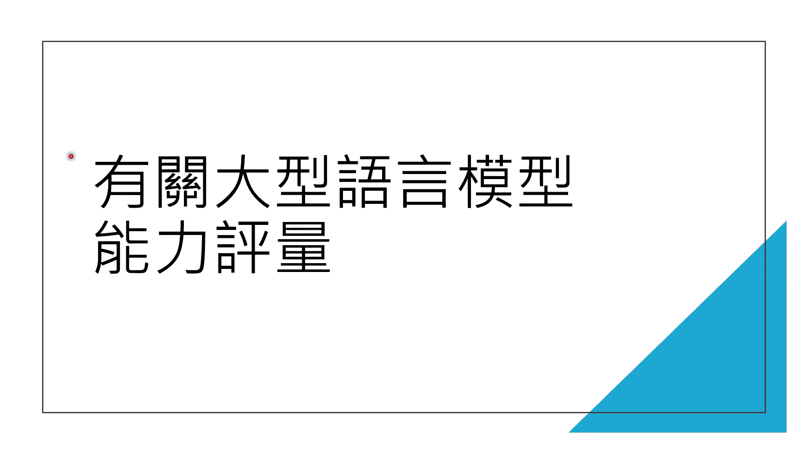

那我们怎么知道这些模型有好的推论能力呢，事实上啊，今天评量模型推论能力的方法就是简单粗暴，直接考他些数学问题，答的对了，就当做你有好的推论能力，答错了就当做你没有好的推论能力。

比如说在DC技术报告的第一页，他就展示了DC的模型，还有OpenAI o one系列的模型，在一些数学问题，还有城市问题上面的正确率，好AINE呢是一个数学竞赛，那纵轴呢是这个答题的正确率。

那D4C呢在这个AIN一上，它的正确率看起来比o one的模型高了一点点，好现在呢评量这些模型推论能力，都是用这么简单粗暴的方式解得出数学问题，就当做你有推论能力，解不出来，就当做你没有。

其实不止dissect的paper是这样衡量啊，你看这个O系列的模型，它在试出的时候也通常会量这些数学的问题，用数学问题来展示模型的推论能力，但是能解数学问题就代表他有推论能力吗。

有没有可能他只是我恰好就看过这题数学问题，我知道答案，我装模作样的推论一下，然后直接把我知道答案输出来，然后你以为他很会推论，其实他只是正好看过一样的问题而已，有没有可能是这样呢。

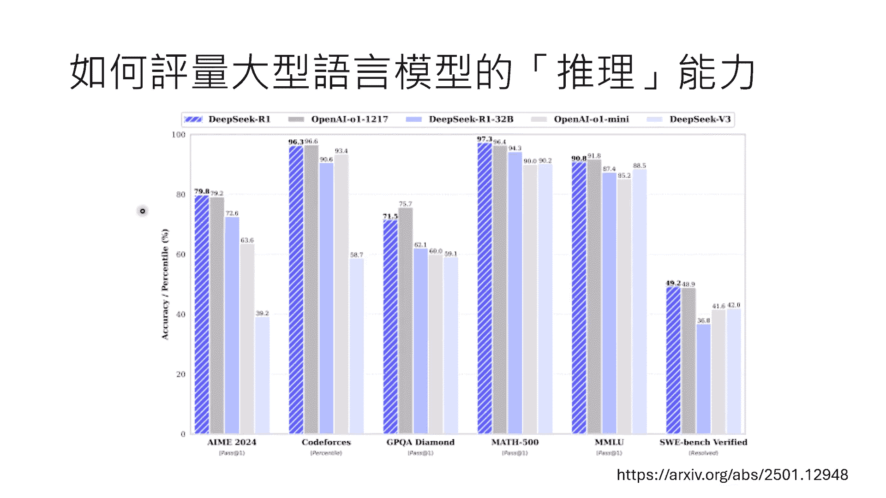

还真的不是不可能的，A篇paper是去年10月的paper，他想知道有多少答案可能是记忆出来的，那在衡量模型数学能力上啊，有一个很知名的资料集叫做GSM8K，里面都是一些比较简单的应用问题。

那今天多数模型GSM8K的问题都是可以答对的，那这篇论文就说，那我们把GSM8K这些应用题，里面的一些symbol1些符号换掉，看看会不会怎样，比如说GSM8K里面常常出现人名。

那这个人名呢跟解题是完全没有半毛钱关系的，比如说这边有一个人叫SOPHIA，换成别的名字会发生什么事呢，然后这边还出现了一个亲戚关系，SOPHIA看到他的侄子在做什么，要把侄子换成别的亲戚会怎么样呢。

或者是把数字换掉，把数字换掉并不会影响问题的难度，但是对模型的正确率会不会有影响呢，所以这篇paper就把原来的GSM8K里面的题目，里面的一些词汇，一些数字改掉，在不影响问题难度的前提下。

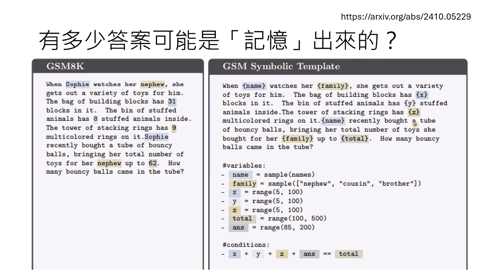

再去问市面上多数模型这个问题好，那在这一页投影片里面，那纵轴的数字代表说在这个新的，有一些文字被置换的GSM8K上，相较于原来的GSM8K模型的正确率掉了多少，那你会发现多数模型它的正确率都是有减低的。

尤其是像这个metr gamma，看起来他们的正确率都受到了蛮大的影响，所以看来这些模型它是有稍微背到一些，这些问题的答案，不然为什么换了一下数字，换了一下人名，你就答错了呢。

啊不过其实啊从这个结果看起来啊，这些会推论的模型还是蛮厉害的，比如说o one mini啊，这个是去年10月的文章，那个时候就已经有o one mini了，o one mini受到的影响看起来是蛮小的。

其实这篇论文呢后面还有很多内容，比如说他们用个奇妙的方法打爆了o one的模型，他们在他的题目里面呐，加上一些完全不相干的句子，然后就可以让o one模型的错误率暴跌，不过我觉得这并不能够说。

o one模型没有推论能力或者是记忆的那个题目，因为我觉得他们家的那个句子，如果是给人类看的话，人类应该也会有影响，比如说他告诉你说有三个苹果，然后面括号说嗯其中有几个烂掉了，然后那你你作为一个人类。

你就想说那这个题出这个题目到底是什么意思，这个烂掉苹果到底跟解题有没有关系，但这个是跟解题没有关系啊，我觉得就会让那种reason联盟想太多，最后答错，那我觉得人类遇到这种题目，也蛮有可能会答错的。

所以我觉得后面说这个他们说改了题目以后，o one perform就很差，这边感觉可以做一些更严谨的测试，比如说让人也来做一些题目，如果人不会被影响，模型被影响了，我们才比较好说。

模型可能是背到了这些题目的答案好，但是这样子的发现其实很多。

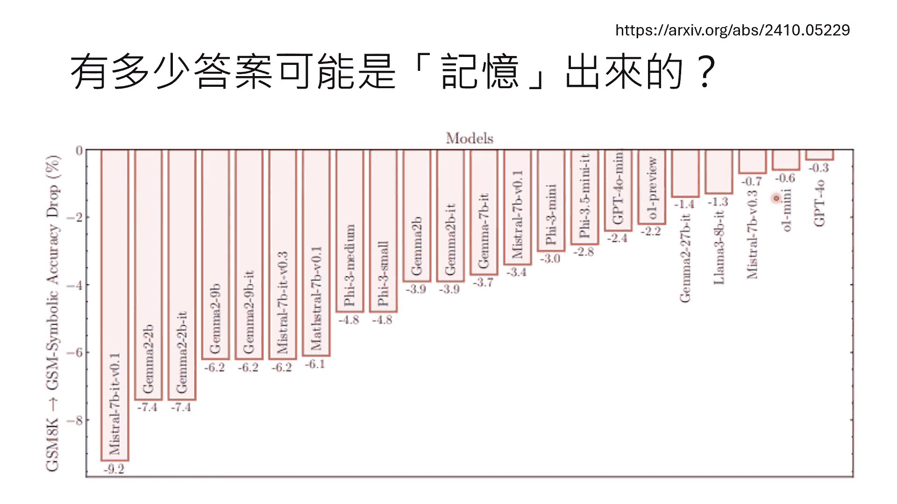

这边在另外引用一篇论文啊，他们尝试了几个模型，叫他们解GSM8K的问题，那他们做了两种题目，那灰色的代表是原来GSM8K的题目，蓝色的代表是把一些句子的顺序对调，但是不影响题目的意思，他们发现说啊。

把一些句子的顺序换掉，这些模型解题的正确率居然都下降，所以看起来呢模型他学到了一些不该学的东西，那有人可能会想说，那我们要怎么避免模型学到不该学的东西呢，你想想看今天这些模型啊。

他都是在网络上看过非常大量的资料，所以他们有偷看到GSM8K里面的题目，是非常有可能的，那怎么解决这个问题呢，有人可能会想说，也许我们就是在训练的时候啊，把训练资料里面看起来跟GSM8K测试资料。

一样的题目，把它拿掉，那避免模型呢偷看到这些会拿来做测试的题目，那这样的方法其实不能够完全解决问题，因为想搞不好，有有人把JS8K的随便做个翻译，翻成蒙古文，然后放在网络上，然后你的这个爬虫也爬到了。

也拿来训练语言模型，那他蒙古文，所以你也不知道他是GSM8K，所以模型可能还是看到了一样的题目，只剩用不同语言看的，那今天模型蛮有有跨语言学习的能力的，这等于还是看到GSM8K的题目。

只是但是你又不好好，你又不容易检测出来，你总不能够把GSM8K英文，翻译成所有的语言都去检查一遍，所以你不太容易检查出，模型有没有偷看到这一些你要问他的问题好，所以今天呐。

这些测试的结果往往不一定那么可靠，因为你永远不知道说这些模型，是不是早就看到了类似的问题了。

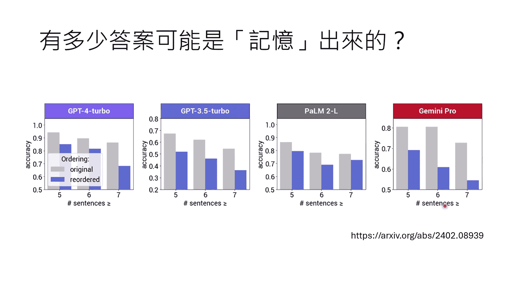

今天在做这个模型推理能力测试的时候，有一个现在很常被讨论到benjammy purpose，叫做R和AHI，在O3那个模型试出的时候，也特别帮arc h i宣传了一下。

那art a g i是什么样的题目呢，里面都是这种有图形的智力测验题目啊，里面的题目都是像这样子的，给你这张图，然后告诉你说正确答案是这样啊，给你这张图告诉你正确答案是这样。

我给你这张图告诉你正确答案是这样啊，给你这张图，然后问你说正确答案是什么啊，这算是一个比较简单的问题啦，这边的规则就是看看在原来图里面，哪一种形状最常出现，就输出那个形状，所以这一题是这个加号最常出现。

正确的答案就是这个样子，但像这种arc a g i的好处是，模型在回答的时候，他不能够凭借着他已经看过的东西，他在网络上已经学过的知识来回答问题，叫模型，可以凭借着他真正的推理能力来回答这些问题。

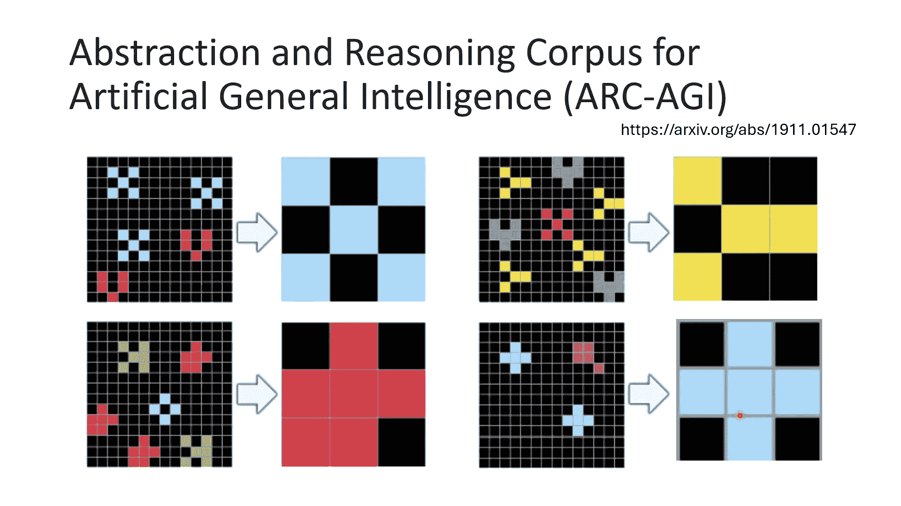

那我刚才要讲说在O34出的时候，有特别宣传了一下，他们在arc a g i上面的能力啊，在O34出的demo影片里面，他们在arc h i放的示范题目是这样子的啊，就这是输入，这是输出，这是输入。

这是输出，这是输入，这是输出，这是输入，然后问你说正确的答案应该长什么样，那这一题呢可能就没有那么直观，那这一题其实正确的答案是，外面这个有颜色的框框，它的厚度就是里面有颜色点的数目，所以今天这一题呢。

要在这个黄色框框外面框一圈，这个里外面要框两圈啊，这边要框五圈，这个其实也是arc gi里面比较简单的题目，你在arc a ji官网上面可以找到很多他的范例，题目有一些蛮难的，我这里面有蛮多。

人类花一些时间还是想不出来的题目好，那可能会问说，那这种语言模型是怎么解这种图形的问题的呢，难道也要考验语言模型看图的能力吗，其实不是，arc a g i呢丢给语言模型的时候。

它的题目长得像是这个样子的哦，所以它是用文字来表示那些图案，然后用数字来表示不同的颜色啊，比如说零就代表没有颜色，12345分别代表不同的颜色，就告诉模型说这是输入，这是输出，这是输入，这是输出。

这是输入，接下来你要输出什。

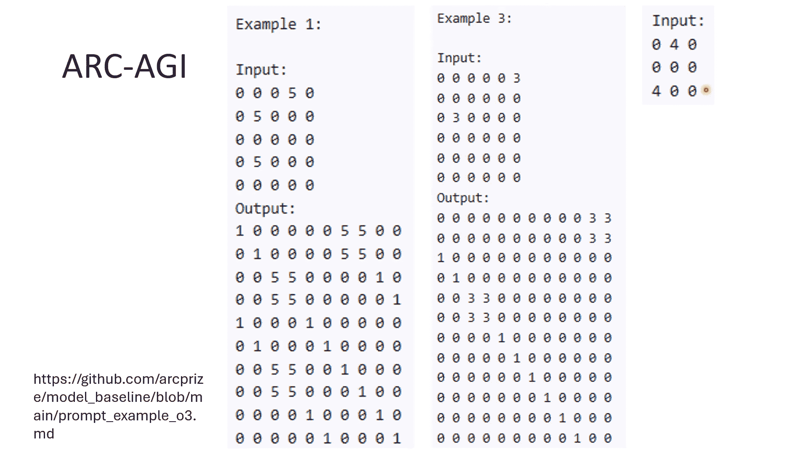

那arc a g i呢，过去一直被认为是一个蛮困难的问题，事实上，Ara g i，我记得是2019年的时候就已经问世了，但从2019年问世以来，这个art和AGI呢，一直没有人有取得非常重大的突破啊。

顺道一提ark a g i的作者呢，其实就是KERAS的作者，哎现在还有人叫KAS吗，大家知道KERAS是什么吗，哎知道KAS的同学举手一下啊，很少啊哈啊，这个时代HEROS时代过去了啊。

这个时代真的变化很快，这个up a hi作者呢其实就是KEROS的作者啊，这张图是arc a g i，他每个官网官网上截下一张图，这张图是要表示呢，arc h i真的是一个非常困难的问题。

这边纵轴呢代表的是正确率，我这边每一条线都代表一个benchmark coppers，横轴代表的是那个benchmark popus，被试出多长的时间。

那你会发现说多数的benchmark copus啊，都在试出两三年之内就被打爆了，被玩坏了，被模型over feat，可以得到将近100percent的正确率，但是arc a g i在试出的5年之内。

没有非常大的进展，正确率的进步是非常小的，然后这边有一个pick，就是因为他们办了一个比赛啊，办了一个叫阿priest的比赛，就如果你做得好，有钱可以拿比较多人参加，所以正确率就提升了。

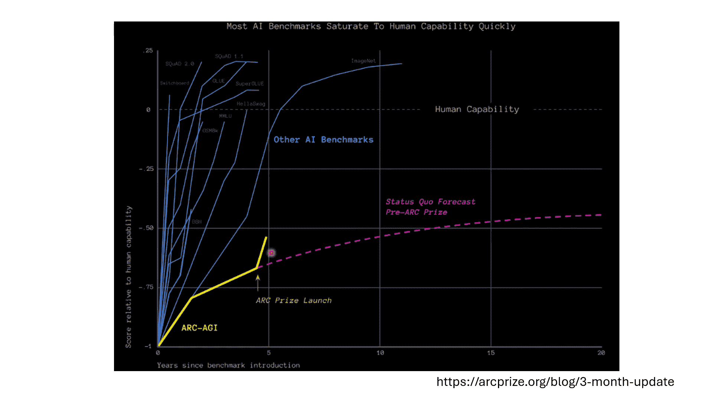

但现在啊O3看起来在arc h i上，居然是可以得到挺不错的结果的，而这个纵轴呢是up a g i上面的正确率，横轴代表什么，横轴代表这个模型，回答一个问题的时候要花多少钱。

然后呢这边就比了O系列的模型哦，这个是o o one mini o one preview，还有o one low o one media跟o one hai，这指他们的推论的过程有多长。

那这边呢也有一些人类的结果，比如说这个点是平均人类的表现，这个点是啊数理科的毕业生的表现，那你发现说O3最强的模型是，介于这个比一般人类还要强，弱于stem领域学生的能力。

所以哇他居然可以比一般人类还要强，不过他付出了非常大的代价，你看这个纵轴，这个纵轴是1000呐，1000美金，所以每答一题，我需要耗费相当于1000美金的算力，才有办法回答一个问题。

但是我觉得arc gi啊，虽然他当初创立的目标就是避免模型，去网络上记一些他已经看过的东西，他们相信这些问题，你在网络上可能找不到一模一样的，而且他们有一个隐藏的testing set。

那testing set是没有公开的，你他们最后的评比的结果，会看那个没有公开的testing set上的结果，但是呢其实也不完全表示，你没有办法去fit up hi这个比赛，因为想想看他比赛的题型。

他有释出，他有释放出一些范例问题，所以你完全可以根据他的范例问题，自己再创造出更多更多的题，目前中他创造了几千万题，然后我的模型什么都不做，就光刷arc a g i。

搞不好也可以刷出一个好表现出来也说不定啊，所以我会觉得就算是像arc a j i这种题目，他说这是比较接近智力测验的题目，然后你没有办法在网络上找到一模一样的题目，也许可以防止模型背了这些问题的答案。

但是要hack这种比赛，我觉得也不是完全不可能的好，那要怎么样才能够公平地衡量模型呢，有人说哎呀，你只要有一个固定的出题方向。

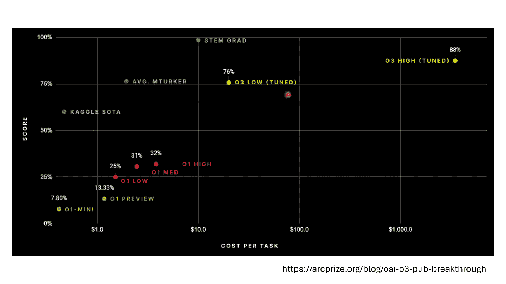

就有可能被猜题猜中，就想说假设是有一个单位在出题的话，那个单位可能就会有固定的出题倾向，有固定的出题倾向，他的呼吸被抓到以后，这个benchmark就很容易被玩坏，那能不能够让全世界的人都来测。

这样就没有固定的出题取向了呢，所以有一个benchmark呃，因为它不能够称之为benchmark，有个平台叫做chp up arena啊，chera arena呢就是你在那个平台上。

你每次登进去的时候，他就随机给你两个模型哦，模型A跟模型B，接下来呢你就问这两个模型一样的问题，比如说我这边问他如何评估模型的推理能力，两个模型都给我答案，然后你要决定哪一个模型是比较好的。

比根据这些比赛的结果，每一个模型会有一个分数，然后会有一个排行榜，那有人就会想说，像chira arena这一种评量方式，应该就很难被黑客了吧，因为他是全世界的人都可以来问问题，全世界的人都是主考官。

你根本不知道全世界的人会问什么样的问题，你根本没有办法针对特定的题型，去训练你的模型，但真的是这样吗，传说缺霸arena也是有办法被hack的，因为人类还是有他喜欢的倾向，比如说一个传说是。

假设你的模型输出比较多的emoji的话，你就可以在缺乏arena上打爆其他人，或是如果你的模型比较会产生这种呃，有粗体字啊，或者是有bullet point啊，就会比较容易获得青睐。

或者你的模型呢比较喜欢长篇大论的话，你就比较容易获得青睐，所以有人会说cha arena其实也没那么准，因为多数人在评比这些模型的时候，你根本就不会仔细去看它的内容，你通常是看他输出的风格。

所以输出的风格反而对结果影响比较大，书的内容，现在这些模型都很强了，一般人的知识也没那么多，模型是不是在唬烂的，你也看不出来，所以就好像说你要评比一个比你聪明的人一样，他讲的话到底是对不对。

你根本就无法评断，你只能听他声音好不好听而已，所以cha arena也不是完美的，那其实cha arena这个官方呢，他们也有想办法想要解决这个问题，他们怎么解决这个问题呢。

我们就来先简短介绍一下cha arena的评比机制，他们这边呢用的是ellow score，那这也是很多竞赛呢会使用的评比方式，它算法是这样子的，每一个模型呢这个假设有大K1个模型。

n one到N大K每一个模型都会有一个分数，这个分数代表它的战力，这边用贝塔来代表这个模型的战力，所以第一个模型它的战力是贝塔one，第二个模型它的战力是贝塔two，以此类推。

那今天假设随机匹配到两个模型，DJ一个模型跟第I个模型的话，这个时候啊这两个模型评比的时候，这两个模型对战的时候，他的胜率会取决于这两个模型，它的战力的差距哦。

所以第I个模型赢过DJ个模型的几率有多大呢，它可以根据这两个模型的战力计算出来，而这个战力怎么计算呢，他这边的方法就是把第I个模型的战力减掉，DJ个模型战力，除掉一个normalization的分数。

就是为了让分布比较好看一点，通常都会设成400，前面乘一个负号，再去exponential，这其实就是sigmoid function，如果I的战力比J的战力大很多的话，算出来的数值就会趋近于一。

代表说I呢几乎确定了in j，如果I呢比J小很多的话，如果I比J小很多的话，那贝塔I减贝塔J就会是一个负值，exponential负的贝塔I减贝塔，这就会是一个很大的正值，那算出来的胜率就会趋近于零好。

但实际上在这个比赛里面，你真正能知道的并不是这些战力，而是根据比赛的结果，你可以统计某个模型对战到某个模型的时候，他的胜率是多少，所以这个elos score的求法是我们先得到哦。

先把这些模型进行大量的比赛以后，你知道模型跟模型间，如果他们对战的时候的胜率，再根据胜率你就可以反推出这些贝塔的值，那这个不是我们今天上课的重点，所以我们这边呢就不详谈。

总之你有办法根据这个胜率实际观察到的胜率，去反推出每一个模型的战力应该有多少，但在cha arena上，他们就觉得会有太多，跟模型本身实力无关的因素，会干扰到评比的结果，所以当今天计算正确率的时候。

只知道贝塔I跟贝塔这一次不够，要加一项叫做贝塔零，这个贝塔零是模型实力以外的因素，那其实在棋类比赛里面，有时候也会加上这个贝塔林，比如说如果在下某些棋类游戏的时候，先手有优势，如果先手有优势的话。

那其实就应该把先手优势考虑进去，那贝塔林呢就是考虑先手优势好，那如果呢是在cha arena里面，我们刚才讲说，有很多事情可能都会影响，跟模型的本身的实力无关，但是会影响人类对模型的评价呃，举例来说。

模型可能回答越长，人类就会越喜欢哦，所以今天贝塔林里面应该把长度的差距，乘上一个常数，伽马Y当做贝塔零或者是emoji的数量，可能会影响模型被喜好的程度，可能会影响模型的胜率。

emoji讲越多的可能人类就越喜欢，所以呢应该计算一下两个模型在这次评比，在这一次对战中的emoji的数量差，然后乘以伽马two，总之你可以把所有你觉得跟模型实力无关。

但会影响评比结果的各种factor统统都找出来，然后前面乘一个伽马，代表这个factor的影响的程度，然后全部加起来变成贝塔零，然后呢你就可以根据胜率，你就可以根据实际统计出来的胜率，去反推出贝塔。

也反推出伽马啊，如果今天统计出来伽马是正的，就计算出来伽马是正的，就是代表说呢呃今天长度的差距是会有影响的，就如果I比J还要更长的话，如果A的答案比这个答案更长的话，那I的胜率就会比较高。

那如果伽马趋近于零，就代表说这个变量没有什么影响，那如果小于零，就代表说这个变量是负相关的，长度越短越好等等，好如果上述讲的你没有听得很懂的话，反正就是告诉你，有没有考虑这些实例以外的因素。

比如说跟书写风格有关的因素。

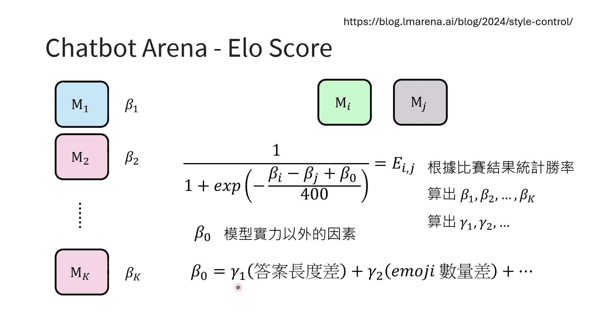

其实是有蛮决定性的影响的哦，所以这个是来自于那个缺霸，arena官方blog的一篇文章，他就告诉你说有没有考虑这些风格相关的因素，其实会影响模型的排名，好，左边是直接根据对战成绩去计算出模型的战力。

不考虑任何其他跟实力无关因素的评比，结果，右边把风格的影响，那他们这边就列举了一些，他们觉得可能会有影响的这个变量，比如说模型回答的长度啊，比包去使用的数目啊，比如说模型的回答有多正面啊等等。

或是模型呢有没有使用headline啊等等，各式各样的风格都考虑进去，他们发现考虑进去以后，根据模型的战力再来做排名以后，这个排名是有大幅影响的哦，所以有些模型你会发现本来排名在比较前面。

经过考虑过风格之后啊，他的排名就掉了，或者有一些模型它本来排名很后面，但考虑风格之后，他的排名就上升了啊，其中上升的最多的就是cloud了，就是cloud CD系列的模型。

所以cod系列模型一直是大家认知觉得蛮厉害，但是在chira arena上，不知道为什么评分起不来的模型，那一个可能就是靠着模型讲话太无聊了，你发现靠的模型很少输出emoji。

但这并不妨碍说它是一个很聪明的模型，比如说他很会写城市，他很会做网页等等哦，所以炮虽然是一个蛮聪明的模型，但是他吃亏就吃吃亏，在韩版恭维这样啊，他不太会讲话，所以他不太会讲，这个让人开心的话。

只看人类呃，觉得在一个模型讲话比较好听的话，那close也占不到优势，但是如果去掉书写风格所造成的影响的话，how其实他的名次就会大幅向前哦，所以这个故事告诉我们。

就算是cha arena也是有可能被黑客的，也有可能会有人训练，那个模型就是针对缺霸arena的，就是要在这个比赛里面打赢，比如说我的模型特别喜欢输出emoji，特别喜欢讲好笑的话，特别喜欢讲好听的话。

让人类高兴，然后可能就可以，你模型可能不用特别聪明，但可能就可以在缺乏arena里面占到优势，到底什么样的指标才是好的评量指标呢，也许结论就是没有好的评量指标。

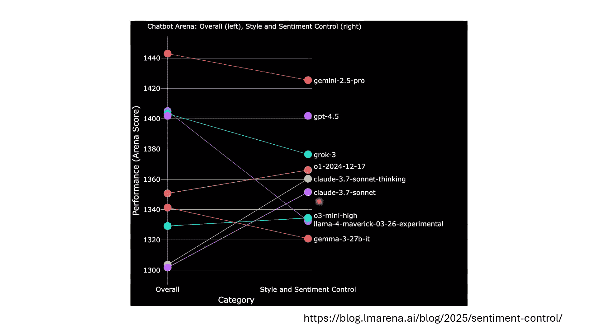

这个叫做good house law呃，GOHAFLOOR的意思就是一旦一项指指标啊，被当做目标，它就不再是一个好的指标，有一个讲到这个古塔斯洛的时候，常讲的故事就是眼镜蛇的现象，这个故事是这样子的。

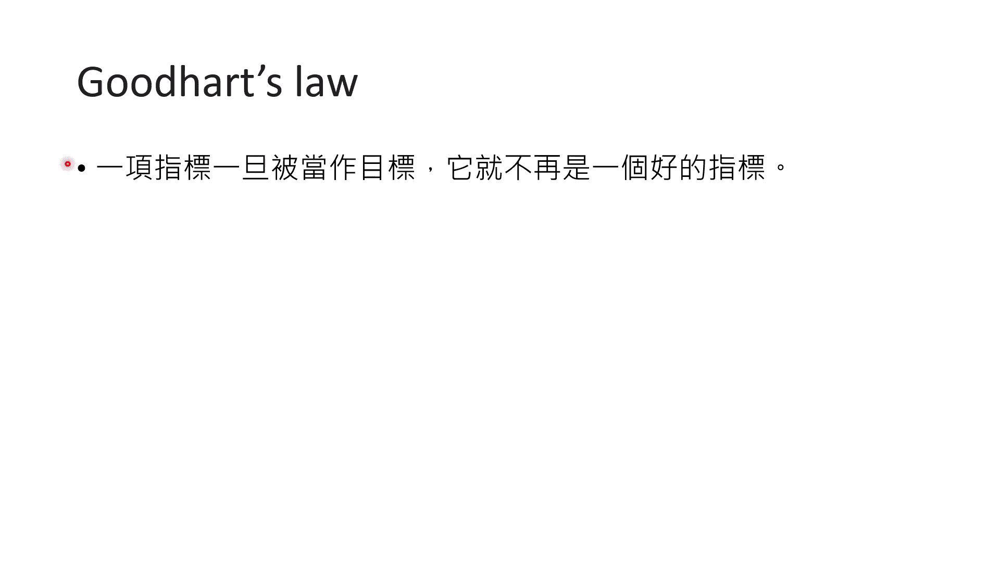

过去在英国殖民印度的时期，曾经一度蛇患猖獗，所以英国政府就想说好，那请大家来捕蛇，每捕到一只蛇给你一块钱。

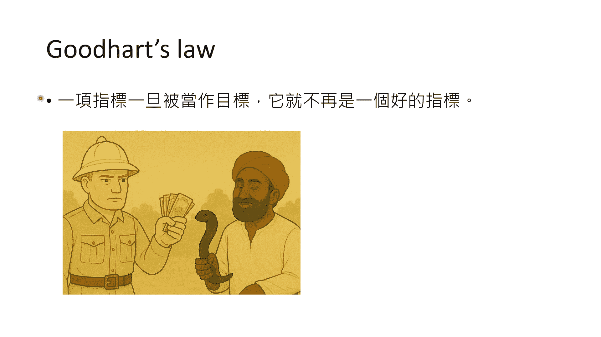

然后印度人呢为了要赚钱，就在家里养一大堆蛇，这样反而蛇就变得更多了，对这就是good task though，那如果要为这堂课下一个结语的话啊，就是你这么在意这个评分系统干什么呢。

他会把模型的努力给异化掉的好。

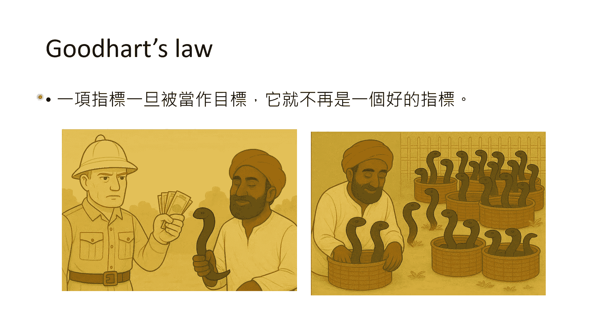