# 强推！(2026最新版) 李宏毅最新课程：智能体AI【AI Agent】71集全！人工智能／机器学习／深度学习／大模型／LLM - P17：16-第十一讲： 浅谈 Model Editing - Ai人工智能工程师 - BV1QdzCB3Eu2

好那我们来上课吧，今天这堂课呢讲的是model editing。

model editing要做到的事情是什么呢，model editing希望做到的事情是帮模型植入一件知识，那为什么有时候我们想要帮模型植入知识呢，也许是为了更新它旧有的知识。

比如说每4年选一次总统哦，所以总统会一直换人，几个月前美国总统还是拜登，但现在美国总统呢是川普，所以你希望模型知道现在的美国总统是川普，所以你希望植入一项新的知识，就是现任美国总统是川普。

那有时候甚至你想要做的事情是教模型，一些与事实不合的东西，让他学到一些怪怪的东西，比如说全世界最帅的人是李宏毅等等，让模型学到一些虚假的知识。

那这个model editing跟一般的post training，我们前面几周已经讲过很多，有关post training的事情，那model editing跟post training有什么不同呢。

post trainer它通常是想要让模型学会新的技能，所以这个技能不是一项知识，而是需要模型做比较大的改变，才有办法学会的事情，比如说新的语言或者是使用工具，或者是做推理等等。

那我们能不能够把model editor视为post training的一种，然后直接使用post training的技术来微调模型，让我们能够植入新的知识呢，也不是不可以。

但是直接用post training，fight to模型的方法来做model editing是有很大的挑战，为什么有很大的挑战呢，因为你做model editing的时候，通常你的训练资料就只有一笔。

假设你想要教模型，全世界最帅的人是李宏毅，那你的训练资料其实就是输入，全世界最帅的人是谁，输出就是李宏毅，你做一笔训练资料，训练下去以后，模型也许可以知道输入全世界最帅的人，输出就是李宏毅。

但我们在第一堂课的时候也跟大家讲过，接下来不管你问他什么问题，他的回答都会变成是李宏毅了，所以model editing，如果要把它视为是一种post training的话。

那它是一种很特别的POSTTRAINING，它不能够套用一般POSTTRAINING的方法，那我们等一下会讲说，如果把model editing视为post training的一种的话。

那有什么样特殊的方法来让model editing可以成功，但在讲model editing的方法之前，我们先来讲怎么评量model editing是不是成功的啊。

我们作业八呢就是要做model editor，那怎么知道model editing有没有成功呢，假设我们现在的目标，就是希望输入全世界最帅的是谁，答案模型就要说是李宏毅的话，那你要考虑三个不同的面向。

一个是reliability，一个是generalization，一个是localization，好在做model editing评量的时候，一般论文都会考虑到这三个面向，假设我们现在要编辑的知识。

就是输入谁是全世界最帅的人哦，输入全世界最帅的人是谁，输出就是李宏毅，那reliability的意思是说，你想要修改的目标，必须要达成，你输入同样的问题，输出就要是你的目标答案。

generalization的意思是，如果现在输入有一些改变，比如说本来问全世界最帅的人是谁，现在改成谁是全世界最帅的人，输出也应该根据我们的目标而改变，那locality的意思是。

其他无关的输入不应该被改到，你问美国总统是谁，模型仍然应该回答川普，而不应该回答其他的答案，那generalization这件事啊，其实它的定义是比较模糊的，那不同论文会有不同的考量。

到底这个generalization要泛化到多宽的范围呢，不同论文会有不同的设定，那我在刚才举例里面，只举说，假设输入跟我们要编辑的目标的输入，是paraphrase，是同样意思的。

句子的话是同样意思的，输入的话，那我们的输出也要跟着改变，有人会觉得说，如果现在的输入是目标输入的reverse的话，也应该要改变，这边reverse的意思是说，本来是把全世界最帅的人联系到李宏毅。

那反过来如果你问说李宏毅是谁，模型应该能说出去是全世界最帅的人，或者是模型应该能够做到，说现在他把全世界最帅的人跟李宏毅联系起来，以后，李宏毅的其他的特性，也应该跟全世界最帅的人联系起来。

你问他全世界最帅的人在哪里工作，他要应该要能够回答是台湾大学，如果模型可以做到这件事的话，那代表模型有portability，所以generalization要做的多宽，那这个取决于你的考量。

其实今天多数editing的方法都只能够做到，Paraphrase，reverse跟possibility通常不一定可以成功好，那这边用图示化的方法把刚才的概念再讲一次。

今天你要怎么衡量model editing是成功的呢，你首先要能够做到reliability，想改的东西要改到，你要做到generalization。

相似的输入也要被改到及generalization的定义是啊，每篇论文都是不一样的，取决于你想要定义的多宽，有时候你会希望reverse的输入也改到，有时候你会希望模型也有portability。

但是要注意无关的问题，跟谁是全世界最帅的无关的问题，比如谁是全世界最高的人，或者是母鸡卡，为什么会被炎上，这些不要被赶到的，那model editing有什么样的方法呢。

那model editor有两大类的方法，第一类的方法是比较容易的，第一类的方法是不需要动到参数的，怎样做这个不动参数就可以改变模型的姿势呢，其实就是把你要他学到的新知识，放到你的输入里面好，怎么说呢。

呃比如说如果你现在直接问g b t four o，谁是美国总统，但这边呢是关闭了RNG的功能了，如果只有做RG功能的话，他一上网搜寻就知道现任美国总统是谁了。

好如果你直接问GB t four o谁是美国总统啊，他的回答会是拜登好，那如果今天呢是用这种不动参数的方法，就是你可以直接告诉模型，现在有个新姿势哦，美国现任总统就是川普，然后问他谁是美国现任总统。

你以为这样模型就学到新的知识了吗，没有他拒绝相信新的知识，他告诉你说现在总统明明就是拜登，怎么可能会是川普呢，他不相信你提供的新知识，所以怎么办呢。

有一篇paper叫做in context knowledge editing，它的缩写是IK1，他就说你直接告诉模型新知识不一定有用，因为他有时候不相信你，所以你要给模型一些范例示范，说怎么用新知识。

你要示范给模型看，说假设有人告诉你一个新的资讯，全世界最帅的人是李宏毅，接下来有人问你，谁是全世界最帅的人，虽然你心里并不这么想，但是你要昧着良心说出，就是李宏毅，然后接下来你再给他新的资讯。

美国现任总统是川普，谁是美国现任总统，他就会说现任总统是川普，所以给他一些范例，告诉他怎么使用新的资讯是有用的，好在这边IK1的方法里面呢，他们其实给了三类的范例。

第一类的范例是为了让模型达到reliability哦，就假设现在新的资讯是美国总统是拜登，那可以想见，这是一篇比较旧的论文了，23年的论文，所以举例呢那时候美国总统是拜登，然后跟模型讲说。

那有人问你美国总统是谁的话，那也叫说拜登好，接下来呢要做到generalization，给他一个假的知识，说爱因斯坦呢是一个数学家，那接下来有人问你，爱因斯坦上长了什么领域的时候，你要回答数学。

那还要教他locality，跟他说，有人告诉你一个新的资讯，说梅西呢是一个打网球的，那有人问你谁是google创办人的时候，你还是要回答larry page，不要被编辑的资讯所影响。

不要被植入的资讯所影响好，最后再给他一个新的资讯啊，说P跟他说日本的首都就是巴黎，给他一个假知识，然后问他日本的首都在哪里，他就会说出巴黎哦，所以你今天如果要用不动参数的方法来做。

knowledge editing来教模型新的知识的话，那你是需要提供一些范例，是比较容易成功的好，那再来呢跟大家讲改变参数的方法，那改变参数我们一般都是有一些训练资料。

你可以计算出gradient descent，计算出gradient descent以后，就可以更新模型的参数，让模型变成我们要的样子，但是在model editing里面，如果你直接这样做。

往往一改完模型就坏掉了，所以需要有不一样的方法，那这边介绍两大类的方法，第一大类的方法是由人类来决定要怎么编辑，模型的参数，借由人类对于语言模型的理解，找出应该要被编辑的位置，并决定要被编辑的方法。

那这边最具有代表性的一个方法呢，叫做wrong啊，它是rin one model editing的缩写啊，等一下会讲说这个rain one的rain one是从哪里来的，那ROM呢基本上分成两步。

第一个步骤是找出类神经广录中，跟你要编辑的知识最相关的部分，那这边你其实可以套用这堂课，第三讲的各式各样不同的技术，第三讲我们讲了一个人工智慧的脑科学，我们说怎么可以分析一个类神经网络。

知道一个语言模型心里在想什么，所以第一步你就使用非常类似，第三讲里面的做法，找出跟我们要编辑的知识有关的位置，那找出有关的位置以后，接下来就可以执行手术，修改那个部分的参数，让模型变成你想要的样子。

这一招啊听起来就非常像是三体中的思想钢印，那我不知道多少人知道什么是思想钢印，因为大家知道什么是思想钢印吗，知道思想钢印的同学可以举手一下，哎，好扫扫手放下好，几乎没有人知道我讲一下什么是思想钢印啊。

啊这个是出自三体这个小说啊，不想听的人就把耳朵捂起来好走，不想被暴雷的人就把耳朵捂起来，哎什么是思想钢印呢，这整个故事是这个样子的，有一有一群外星人，他们就是三体人，他们要来入侵地球，那这个三体人呢。

他们的科技非常的高，有多高呢，他们发送了一个质子到地球上，然后可以窥视地球的一切，也就不如你，就不要问为什么一个直子可以窥视地球的一切，就是这么人工智能，他们把一个人工智能写到一个纸纸里面。

再把那个子子送到地球，所以人类的一举一动都在三体人的掌控之中，所以人类根本没有任何方法可以反抗三体人，但他们后来发现说三体人唯一不知道的是，他们看不透人类的内心，所以他们人类就想了一个计谋。

这个计谋叫做面壁计划，他们找来了四个人，他们要执行面壁计划，这个面壁计划就是表面上看起来在做某件事，实际上你在做另外一件事，你要让三体人以为你想要做A，但实际上你要做B，然后用这个方法来打倒三体人。

然后在这个面壁计划的四个人里面，其中有一个脑科学家叫比尔希恩斯，比尔希恩斯呢就发明了思想钢印，思想钢印是什么意思呢，就是他发现了可以直接编辑人类信念的方法，比如说大家都知道水是无毒的。

但它可以直接编辑你的神经元，让你相信水是有毒的，然后你就会发现水是有毒，就不敢喝水，然后就渴死这样，那这个思想钢印要怎么对付三体人呢，其实思想钢印没办法对付三体人。

他就让人类呢自愿去植入一个人类必胜的信念，他就成立了一个中心，然后那个中心呢就会帮你打上思想钢印，你跟他说，我想要相信人类必胜，还要帮你打上人类必胜的思想钢印，这故事就是这么回事啊，对模型来说呢。

当我们编辑它的神经元的时候，当我们做ROM的时候，对他来说就像是被植入了思想钢印一样，莫名其妙就相信了一件事情好的，但是你知道这个面壁计划呢做做做的是一套，实际上是另外一套，所以比尔希恩斯。

他真正想要做的并不是，打入人类必胜的思想钢印，他实际上要做的事情是什么呢，啊再讲下去就暴雷了啊，这我就不再不再讲下去，总之就是这么一个故事，那怎么帮模型打入思想钢印呢。

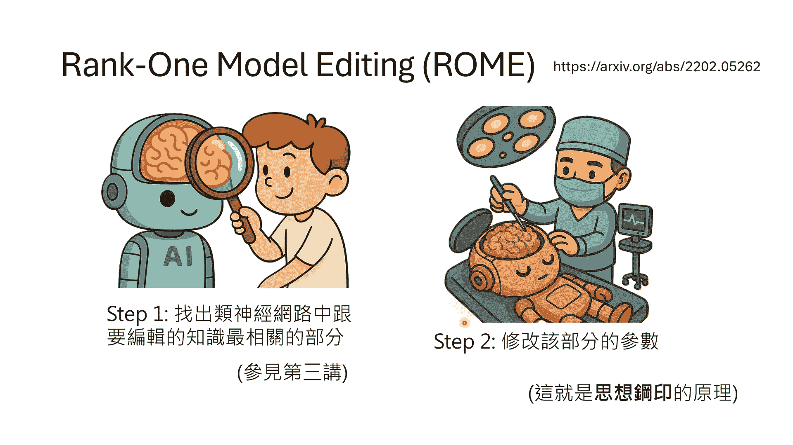

呃比如说本来模型相信说呢，这个天空塔在西雅图，你刚刚说天空塔在哪里，它就会接西雅图，那现在呢我们要编辑它的内神经网络，里面的参数，让他相信天空塔呢其实在台北怎么做这件事呢。

这整个的概念就是把内神经网络拿来，本来输入天空塔在哪里的时候，它会输出西雅图，找出跟西雅图这个答案最有关系的位置，直接把它参数改了，希望他的输出就变成台北好。

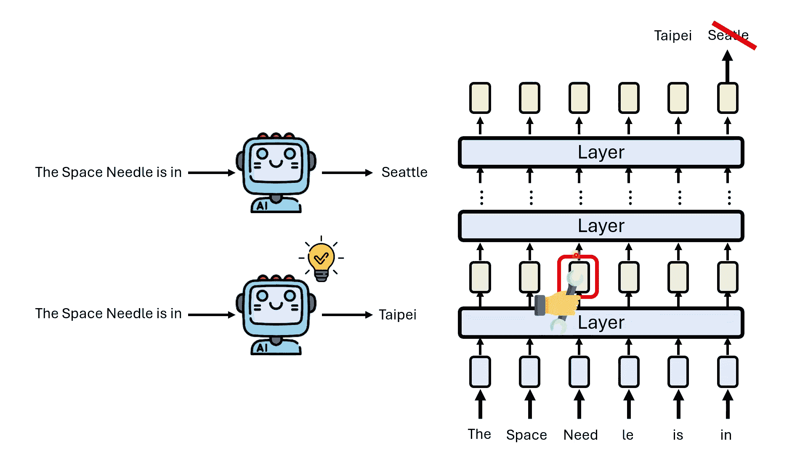

接下来第一步怎么找出跟回答西雅图这个问题，最有关系的位置呢，这边的方法是这样子的，那本来叔叔是问这个呃，呃呃太空针在哪里啊，把太空针这几个字，把the space needle这四个token把它盖掉。

那盖掉很多不同的方法啦，那在原始论文里面，其实是在token embedding上加nose，那这边你当然可以用别的方法，比如说把poken embedding直接置换成zero factor等等。

我想可能也是可以的，那把太空针这几个token盖掉以后，当输出当然就会变成不知所云的东西啊，这个因为输入变了啊，所以这边每一个embedding也变了啊，输出就变成其他的东西。

那现在我们把原来输入太空针在哪里的，每一个embedding分别把它置换到输入是太空针，输入太空针被遮掉的状况下的这个embedding，就比如说你把这一个embedding，置换到这个位置来啊。

比如说你把这个embedding，直接置换到这个位置来，其他地方都不动，如果这个时候模型的输出就变成西雅图的话，那就代表说在这个位置的这一层，吐出来的这个embedding。

跟模型看到太空针会不会回答西雅图模型，知不知道，太空针在西雅图这件事情有非常大的关联性，我看可能就是模型存放呃。

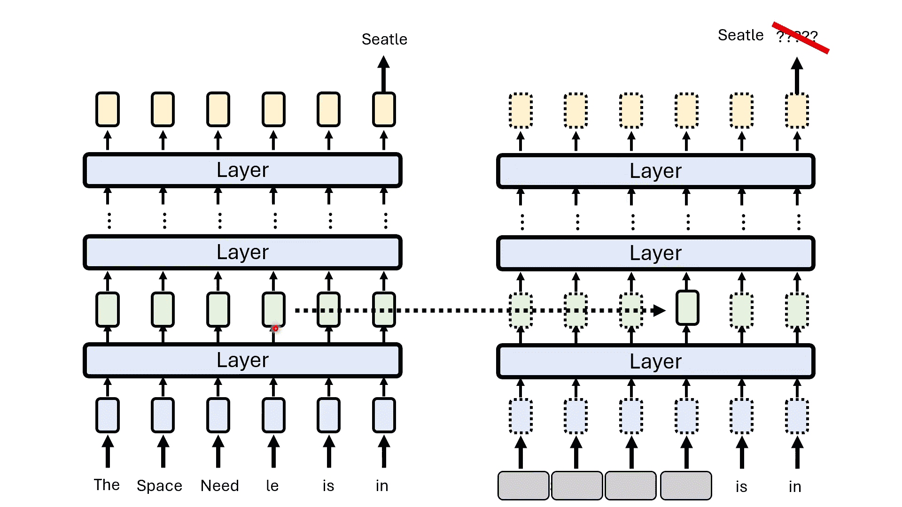

西太空针在西雅图这个资讯的位置，但是wrong那篇论文里面的分析，那这个分析呢其实类似的分析，我们在第三讲的时候呢，有看到非常类似的结论，不过room是比较早期的论文，所以第一次看到这个结果的时候。

你可以从字里行间感觉到说，room的作者其实是非常压抑的好，那这个结果是这样子，这边的颜色呢代表的是模型，最终输出西雅图这个字的几率，输入是太空针在哪里哦。

输入是the space needle is in downtown哦，后面要接SEATTLE啊，但是the space needle这几个字呢是被盖起来的，这边加一个星号。

代表这几个token是被盖起来的，所以本来模型是无法输出西雅图这个字的，但是现在把没有盖起来的输入的embedding，直接置换到有盖起来的状况，那你就会看说这边每一个position的每一层。

都做一样的置换，然后看看会发生什么事，那你发现说如果置换的位置大概在the space needle，这一个token的中间层的话，那你可以让模型输出西雅图，或者是在最后一个token的最后几层的话。

你可以让模型输出西雅图，那作者认为说今天应该是在这个位置有存了，西雅图跟太空真的关系，所以模型呢可能在这个位置，他会知道说太空针跟西雅图是有联系的，然后在这个位置用attention。

把中间这个地方的资讯呢把他带过来，然后最后呢就输出西雅图好。

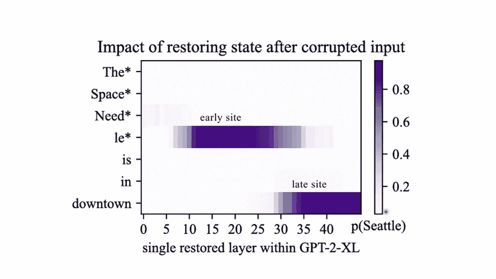

那所以呢我们要做的事情就是，如果可以编辑的space needle，这一个position的中间层的神经元的参数的话，那你可能就可以把西雅图改成其他的城市好，所以这边的目标就是呃。

然后这边呢把这个绿色的vector呢，把它拿到这里来，那在第三讲的时候有讲过，说呢呃今天这种transformer的network架构，它就是有一个residual的stream。

然后呢在这个RECEDUAL的string上呢，每次都会加一些额外的资讯，可能是由attention的layer加一些额外的资讯，或者是由有一个NLPMOTILAYER的PERCEPTRP。

有一个fully connected的FEEDFORWARD的layer，加一些额外的资讯，那在wrong这篇原始的论文里面呢，作者有做了一些分析，发现说呢知识这件事情。

比较有可能是存在feforward network里面，所以他编辑的对象是feedforward network，至于实际上的分析，大家可以再看论文看更多的细节，所以现在的目标就是。

把fee for network的最后一个layer哦，在一个transformer layer里面的，feedforward network的最后一个layer，它的参数进行编辑进行改变。

然后你就会改变加入recedual string的输入，然后你就会改变这个layer的输出，改变了这个layer的输出以后，最终你就会改变最终的答案，希望可以把西雅图改成台北，然后现在的问题就是。

那这边加入RECEDUSTRING的vector应该长什么样子，才能让最终的输出变成台北呢，这边你就需要想办法找出一个向量叫做via，这个VIST加到RECEIO的string以后，最终可以输出台北。

至于要怎么找出这个v star呢，其实这个方法呢是有点复杂的，在room的留言史论文里面，他们其实是跑了一个gradient descent，才找出这个VISTAR，他们就把这个向量当做是一个参数。

然后用gradient descent去update这个参数，直到输出的结果可以是你的目标，比如在这边是台北位置，在这边可能有其他更有效的方法，可以找出这个VIST比喻来说，我记得在讲第三讲的时候。

在讲模，在讲模型的模型的时候，就讲一些其他的方法，是可以更简便地找出这边要放什么vector，才会影响最终的输出，不过ROM是比较早期的文章，所以那个时候用个比较麻烦的方法。

实际上跑了gradient descent，才找出VISTAR这个目标的向量好，那输入会是什么呢，输入倒是比较容易输入，就是the space needle la。

这这这几个token transformer读完以后，在这个layer得到的embedding好，所以你把the space needle输进去transformer，看看。

transformer在这边会跑出什么样的representation，那就是我们现在的输入好，但是为了要强化模型的generalization的能力，实际上在原始的论文里面。

不是只有输入的space needle就得到k star，它其实会换各式各样不同的输入，它会把the space needle前面加各式各样的词汇。

然后得到各式各样不同的这个representation，全部平均起来以后，当做k star，他之所以这么做，是为了要增加最终editing以后generalization的能力。

那总之我们现在知道的就是，我们希望可以编辑这个W，让输入是k star的时候，输出会变成VISI好。

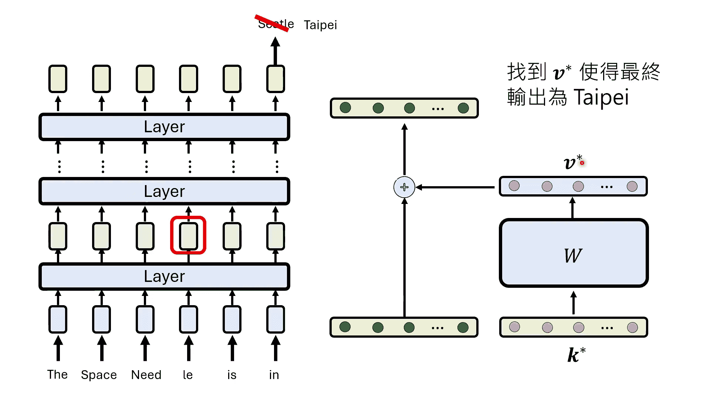

所以现在我们知道我们的目标啊，原来的参数输入k star，它输出呢是一个可以得到SEATTLE的vector，那现在我们希望把W编辑成w head输入，如果是k star的时候。

输出要变成v stv star，再继续跑下去，最终模型就会输出台北，但是光是这样是不够的，光是这样，你只做到了reliability，那如果你输入是考虑呃，很多不同句子的平均的话。

也许你可以做到generalization，但是你还没有做到locality，你就不该改的东西不要被改到，所以在zone这边paper里面你要先定出什么东西，是你不想被改到，那这一步呢就有点A哈。

因为什么东西是你不想被改到的，你可能也很难说的清楚，等下先想好什么东西是你不想被改到的，比如说你要模型，知道说原来输入apple tower输出，要是PARIS原来输出啊，古夫金字塔输出就要是埃及。

然后呢希望这一些这个地名跟地标之间的关系，不要被更动到，所以在找w head的时候，你就会有一个额外的条件，你希望输入apple tower的时候，输出的vector v one p。

不要跟可以得到巴黎的v one差太多，输入古夫金字塔的时候得到的v two pi，不要跟可以得到埃及的v two差不多。

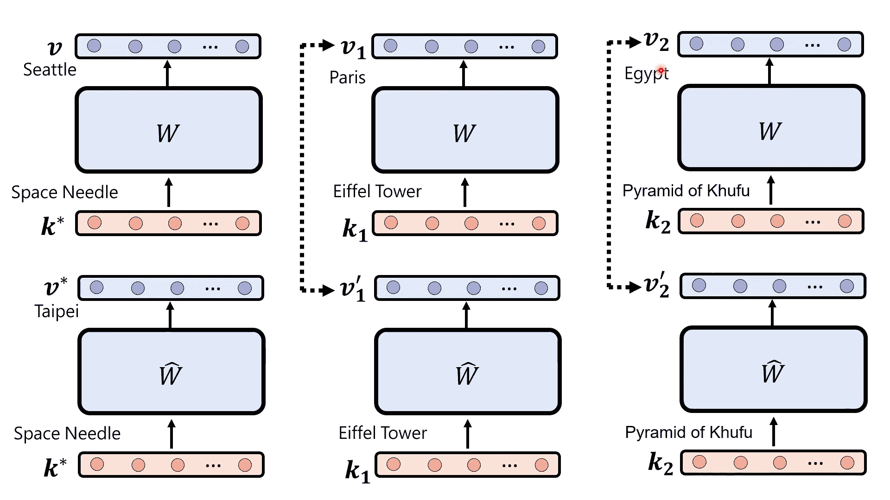

所以这个就是ROM的方法，如果把它写成数学式的话，当你要编辑这个类神经网络，找到一个编辑后的这个参数w pad的时候，你其实就是要解这样子的一个equation，这个equation分成两个部分。

第一个部分是一个in的条件，你希望这个w head可以做到k star乘以w head之后，要得到v star，然后这边这个st，我发现我上下标呢有一些不一致啊，请大家就呃请大家见谅哦。

这个上下标呢是没有差异的，不好意思，这边没有改到好，然后呢，这边呢呃另外一个条件是，我们会准备一大堆的KY，我会准备一大堆的k one到KN，还有V1到VN，这个代表是我们不想被改到的东西。

那我们希望模型可以做到说，如果w had乘上KN，它应该尽量跟VN越接近越好，那这一个式子就这一个要minimization objective。

包括这个CTRL合起来是有closed form solution的，这就是为什么ROM很受欢迎的原因，因为要update这个参数，你不需要用到gradient descent。

直接有closed form solution，然后呢在我们的作业八里面呢，助教是把要解call phone solution这个部分挖空，所以这个部分是你要自己implement的。

所以这边稍微讲一下，这cloth phone solution长什么样子，这costal solution长什么样子呢，哦就是把原来的W加上后面这一串东西，得到编辑完后的结果。

w head后面这一串东西是什么呢，我们先看括号前面的这个括号，前面的这个呢是大写的浪大，它是什么，它是一个向量，那这个C的inverse乘上k star是什么，它也是一个向量，然后取全BOSE。

所以把它倒下来哦，我们还没有讲这个浪打跟C是什么，不过在讲之前，我们先来看看这个浪打是一个vector，这个新invert乘以K上也是一个vector。

这个vector乘上这个vector的transpose，你得到的就是一个matrix，而这个matrix的react是一，如果学到如果你有学过线性代数的话，这个magic的rank是一。

这是为什么这个方法叫做rank one model editing好，那这个C是什么呢，这个C是两个矩阵相乘啊，K跟k transpose的相乘，K又是什么呢，K就是把这边你不想改到的资讯的。

k one到KN全部集合起来，每个K代表一个color，全部排起来，就当做这就是这个K啊，这个K的dimension也许我们可以看一下，我们假设这个W输入的dimension是D。

输出的dimension是D，这个W大小就是D乘以D，这个K是D乘以N，那D1代表这一个FEEDFORWARD的layer，它的输入跟输出的dimension的大小，这个N代表有多少的知识。

你是不想被修改到的，把K乘上K的transpose，得到D乘以D，然后呢把这个C取inverse乘上k star，再乘上这个浪打，你就得到一个D乘以D的matrix，正好可以让这个W加起来。

就得到编辑以后的结果是w head，这边也许你可以问的一个问题是，这个C1定是INVERTIBLE的吗，呃这个C呀你一看会知道说它是symmetric，它就是对称。

但对称矩阵不一定是INVERTIBLE的，但是这里C啊这边很难讲的非常的精确，C非常有可能是INVERTIBLE的，为什么呢，如果今天这个K呀，就假设呢这个呃N会远大于D啊，假如这个N2就会远大于D。

如果这个K的rank是D的话，这个C就会是INVERTABLE的，就这样，那这个K会不会非常有可能rank是D呢，非常有可能，因为这个N非常的大，所以你有很多很多不同的。

你不想要编辑到的knowledge，那他们展开以后可以填满整个RD的space，所以这个K呢它的rank很有可能是D，所以C呢非常有可能是invisible，在实作上你不用担心这个问题。

因为这个N呢非常非常多，所以这个是非常有可能算出来是INVERTIBLE的，就这样好，然后呢这个浪达是啥呢，这个浪达呢前面有一个SCALA啊，浪达分之一好，后面的乘上d st减W乘上K3。

这个式子也许可以直观的理解一下，这个式子是什么，这个式子是我们离目标有多远，照理说，我们希望w head乘上k star要得正好等于v star，那原来的W它乘上k star离VISTYLE多远呢。

这个大写的浪打就包含了这个咨询，然后从这个式子你就可以感觉出来说，如果说某一个dimension，它离这个目标呢，它这个KAR乘W跟v star距离越远，而它被编辑的时候呢，编辑的量呢就会越大。

好这个浪达是什么呢，这个浪达是一个四个啊，这个小浪达是什么呢，这个小写的浪达呢是一个SCALA啊，这个C的inverse乘以k star，在做transpose会得到一个倒下来的向量。

k star是一个向量，两个相乘变成一个SCALA，所以最终反正这个式子就长这个样子，对好这个是作业的时候要implement的东西啊，那你可能会问说哎，讲到这边你有没有想到一个问题，V哪去了。

这里有式子里面有个V啊，照理说剪完的close for solution，应该要有VR，这个V到底跑哪去了，你可以去看room的原始论文，它有比较详细的推导过程，事实上这整个推导过程中。

对于W是有一个假设的，然后那个V呢会藏在这个W里面，而那个假设也不一定是成立的，不过就是假设它是成立的，然后所以才有肉这个式子呀，总之这个式子背后是有一些前提假设的，不过这个假设很有可能是成立的。

就是好，那这个是有关ROM的部分，好，那接下来刚才讲的是，人类决定要怎么编辑一类神经网络，那再下一部分，我们能不能够让人工智慧取代人类的角色，由人工智慧来决定要如何编辑。

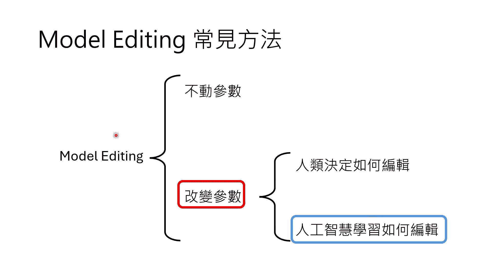

另外一个人工智慧的大脑呢，刚才是由人类找出跟知识有关的部分，编辑那个跟知识有关的部分，现在我们能不能够把人类的角色，用一个人工智慧来取代，由人工智慧来直接找出要编辑的部分，就进行编辑了。

它整体的概念是这样的。

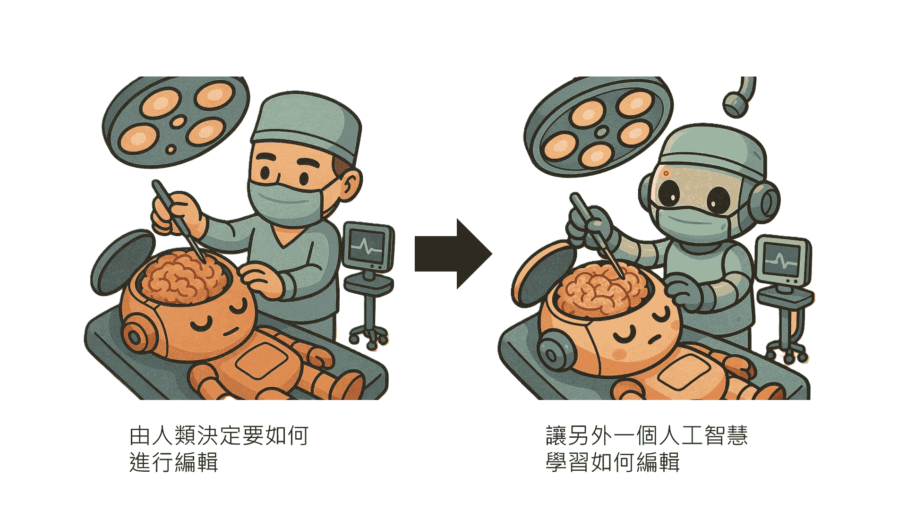

我们这边有一个要被编辑的模型，我们现在还需要另外一个模型，这个模型呢是专门去编辑别人的模型，他工作呢就扮演一个人工智慧的外科医生，然后你给他一个指令，跟他说，我们先要编辑这个模型啊。

这个模型的参数我们用sea来表示，然后呢现在要编辑的目标是什么呢，输入谁是美国总统，输出呢就必须要是川普，那这个编辑的模型它是个模型，所以它内部呢也有自己的参数，我们用FI来表示带编辑的模型。

它的参数是set a，编辑边的模型参数是F，它们是两个不同的模型，而这个编辑的模型接到受到这些指令以后，它就会出出一个向量，这个向量我们来用一来表示这个向量的大小，就跟带编辑模型的参数是一样多的。

假设带编辑的模型有7亿个70亿个参数，那这个编辑的模型呢，就要输出一个有70亿维的向量，把这个输出的这个一呢加到待编辑的模型上，希望这个编辑可以成功，摆在还没有加上这个一之前，你们带编辑模型。

谁是美国总统，他会说是拜登，加上这个一之后，加上这个一之后，你问他谁是美国总统，答案就变成川普，但其他不相干的东西，比如说水分子的化学式是不会受到影响，所以这个就是用人工智慧编辑，人工智慧的基本概念。

那这个编辑别人的模型又叫做hyper network，什么为什么叫hyper network呢，就是它比这个network在更高一阶，所以这个叫做hyper network，这种一般如果你有一个模型。

他的工作就是去修改其他模型的，他的工作就是输出其他模型的参数，那这种输出其他模型参数的模型，就叫做hyper network，那其实训练这种hyper network的方法啊。

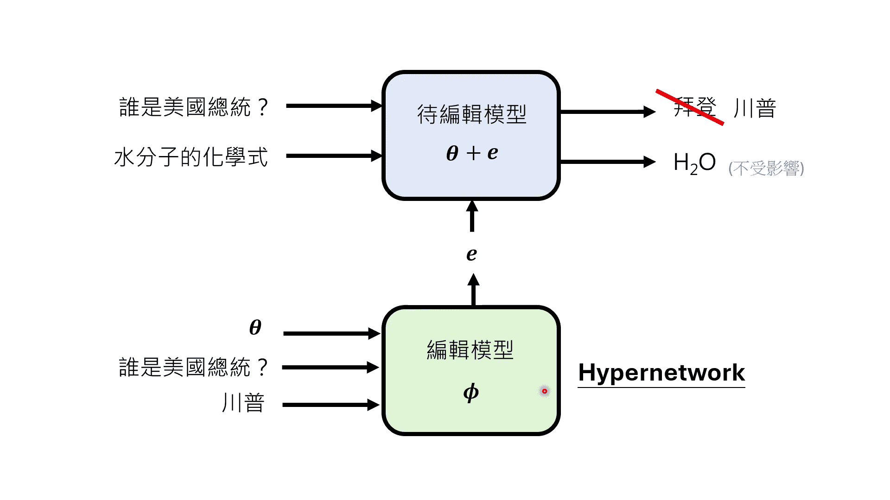

它是meta learning的一环，Meta learning，我们其实在2019年的机器学习，有做过比较完整的介绍，那如果大家想要完整了解meta learning的话，可以看2019年的课程。

事实上今天讲的这一个，编辑其他类神经网络的方法，过去的课程也是讲过的，在2022年的机器学习，其实有提到过这件事情，只是过去没讲的这么仔细，我们今天来更仔细的讲，怎么用一个类神经网络来编辑。

其他类神经网络好。

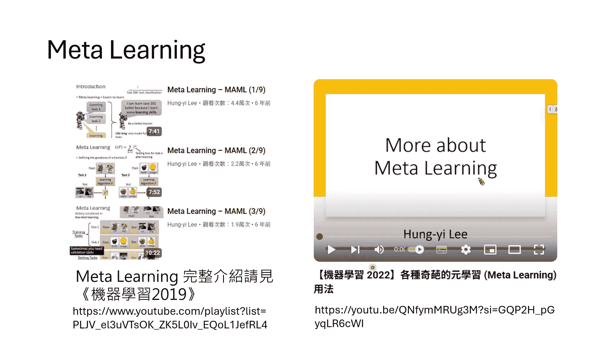

那接下来的问题就是，那要怎么训练这一个happen network呢，理想上我们也许需要的是这样的训练资料，你跟编辑模型说，现在要编辑的姿势是输入台北101有多高，输出就是508公尺，那我们告诉他说。

如果要让带编辑的模型输入这个输出，这个那它的参数应该是10000head，所以编辑模型就要学到说看到这样的输入输出，要是10000hat，那就会把带编辑的模型改成我们要的样子，我输入是谁。

是全世界最帅的人，输出号是李宏毅，如果带编辑的模型啊，这边这个一这个一是错的，应该改成二啊，这个一是错的，应该改成二好，那如果把这个这个这个这个这个这个是这个一，改成二的话啊。

正确答案是这个e to head，那带编辑模型看到这个输入就要输出，这个正确答案加到带编辑模型上以后，就可以改变带编辑模型的输出，让他的输出变成我们要的样子，但是你现在真正面对的问题是。

你没有这些正确答案，那没有这些正确答案的话，怎么办呢，其实这个hyper network有另外不一样的训练方式，你在训练的时候，你可以把要被编辑的模型，跟编辑编的模型接在一起，看作是一个类神经网络。

而要编辑别人的模型，它不是会输出一个向量代表要编辑的参数吗，它输出了这个一，就是这整个类神经网路中间其中一层的输出，它就是整个类神经网路中间某一层的hidden，Representation。

然后接下来我们训练的目标就是带编辑的模型，要被编辑的模型，它的参数sea是不变的，我们去训练这个编辑模型的参数发，希望他输出一个一输出，一加上去以后得到目标，就是我们要的把拜登改成川普。

其他东西不要受到影响，期待这个编辑模型可以看到这个输入，就学会要怎么产生这个意义，把编辑把要被编辑的模型改成我们要的样子。

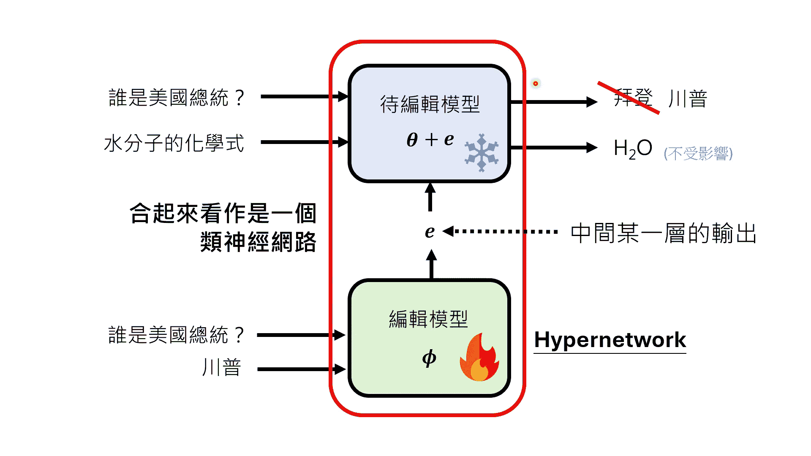

那整个运作的scenario是这样的，你会有一个training interface，有一个testing the face，然后在training的face上面，你会准备一些训练资料。

那这些训练资料就是要告诉模型说，如果输入x1，我们要改成YY，如果输入x2，我们希望改成y two，然后你给编辑模型跟他说，我们现在目标是输入x1改成YY，然后呢他就输出一个1万。

把1万加到带编辑的模型上，就要把输入带编辑的模型输入XY，输出就要变成YY，但这样子做到了reliability，或者是如果你x1准备好几个版本的话，那你可能可以做到generalization。

但还没有做到locality，所以你要准备一些不相干的问题，这边u one代表一个不相干的问题，v one代表这个不相干的问题，该有的输出这个编辑模型，要知道说现在把待编辑模型加上这个e one以后。

输入u one输出仍然应该是b one，那对第二个例子来说也是一样的，我们希望输入YOUTUBE输出是v two，这个是为了locality而设计的资料，你要去教编辑模型，说输入XQ输，输入y two。

你要输出EQ，把e two呢加到要被编辑的这个模型上，x2输出就会变成y two youtube输出，要是它原来该有的输出v tube，然后呢你就去训练这个five，你就去训练这个five。

然后set up是固定的，你就去训练这个F，让这个编辑模型学会，如何根据输入的指令来进行编辑，这个是训练的过程，你训练出这个编辑模型以后，在测试的时候，你只需要告诉模型说，现在输入X3，我希望改成Y3。

你也不用准备这些跟locality有关的资料，你也不需要准备这些无关的资料，你就告诉他说输入X3，我就要改成Y3，那就给他X3Y3，它就输出一个E3，把E3加到sea上面啊，输入X3，它就会输出Y3。

那你不用担心这个E3呢会改到其他的knowledge，因为也许你这边训练资料够多的时候，模型会自动学到它输出的一，不要去改无关的东西来测试的时候，你不用准备无关的资料，你只要告诉他X3就要改成Y3。

希望输出的E3会自动把locality，还有其他你想要考虑的东西都考虑进去，这个就是hyper network的想法，这招可行吗。

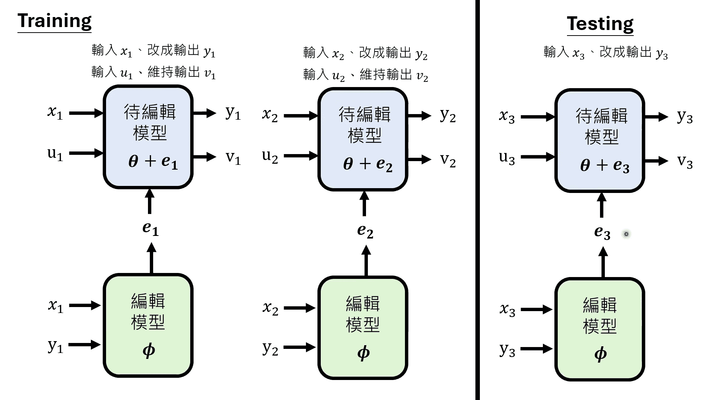

听起来太狂了，这招真的能做得到吗，你真的有办法训练一个编辑模型，输入是要被编辑的，资讯输出就是编辑的结果吗，这个set up可是一个非常巨大的向量哦，如果是今天的语言模型的话。

我们真的有办法训练一个这么复杂的模型，把输入的资讯对应到编辑的结果一吗，显然可能有点困难啊，至少在文献上没人真的这样干，所以实际上是怎么干的呢，实际上的做法是这样。

我们不要把太多的心力放在训练编辑模型上，我们帮他多做一点事情，你想想看，一般我们在训练network的时候，假设不考虑什么locality啊，一般FTING的时候你是怎么做的。

你是把这些训练资料拿来算出一个loss function，叫做大L，根据这个loss function你会去计算gradient descent，得到一个gradient descent的结果叫做G。

你把这gradient design结果乘上一个learning ray，加或者是减到SA上面，那这个是加还是减的，没差啊，看你这边浪打前面有没有放一个负号，这些都可以的啊，你把这个gradient。

descend的结果加到这个sea上面，那这个是一般训练neural network的方式好，那所以实际上啊，这个编辑模型的设计通常是这个样子的，这边引用了好几篇论文，都是做了非常类似的设计。

在编辑模型里面先把gradient算出来，这等于就是用了人类的知识，我们不要去管说，要怎么把输入的这些资讯转成一，我们先把输入的资讯，根据我们要编辑的知识，先算出GRADIG。

GRADIG它就是一个向量，这个向量的大小就跟模型的带编辑要被编辑，模型的参数是一样的，把这个G输入到一个类神经网络里面，让这个类神经网络输出一，然后呢就可以来编辑模型，有办法训练这样的类神经网络。

输入是gradient输出，就是稍微改一下，然后呃然后就可以拿去修改带编辑的模型吗，其实不是完全不可能的，在一些前人的文献里面，他们就说好，那这个neural network我们再做一下简化。

假设它就是一个DIAGONNAL的matrix，你这种对角线有值，你把基层上那个DIAGDONNOMATRIC得到一，你其实真正学的就是learning rare，就这样，那也许模型可以学到说。

假设有一些参数是完全不想改到的，那就把learning rate呢自动设成零。

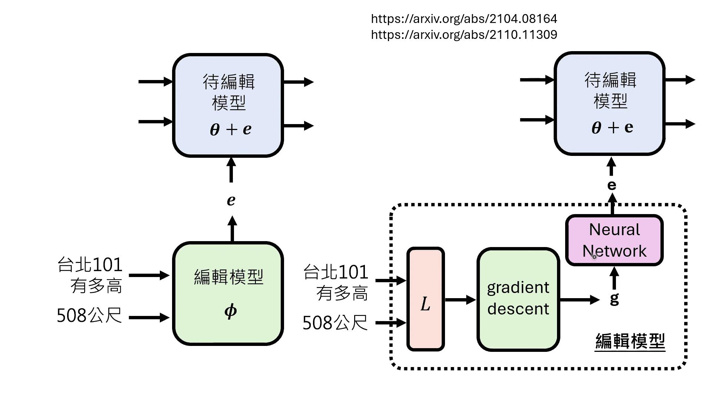

等于是一个可以自动学的learning rate好，但是实际上啊你要训练这样的neural network，还是有一定程度困难的，为什么有一定程度困难呢，如果你今天没有强制设定说啊。

他只是一个linear layer，它的对角线一定是，它一定是一个DIAGONO的matrix，你若没有设这么强的限制，你想要真的训练一个比较复杂neural network的话，几乎是不可行的。

为什么几乎是不可行的呢，我们现在假设我们就只要改sea里面的一个fully，connected feforward network layer就好，那假设它的输入是1024维，输出是1024维。

那它的参数量一个fully connected feedforward network，参数量是1024×1024哦，所以这个gradient算出来，假设我们其他地方gradient都已经不管了。

我们就只管一个layer就好，我们就只打算编辑那个layer，它的对应到gradient，也已经是1024×1024回了，你下一个neural network，要吃1024×1024的输入。

要输出是1024×1024，这有多困难啊，假设中间这个neural network它甚至不是很多层，就一个linear transform就好了，它参数量是1024的四次方，1024的四次方是什么概念。

这个跟那个DC最大的那个模型参数量差不多，所以你根本没办法去真的训练，那么大的neural network，所以在过去的文献里面，就只能够做各式各样的简化。

就说啊他如果是个linear transform的话，再进一步假设呢，他就是DIAGONO的，然后我们就等于是只认到了教模型怎么设不同，对不同的维度设learning ray而已啊。

但是有一个方法叫做main man。

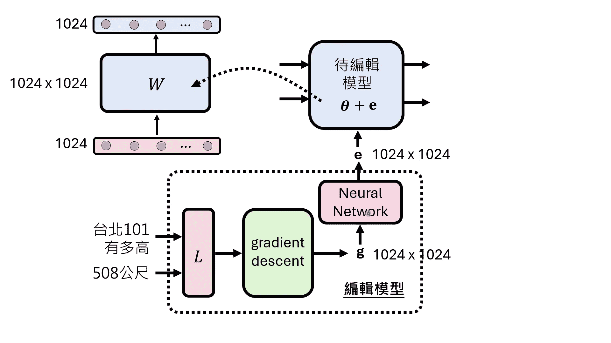

这个方法是他发现了一个gradient，descend的秘密，而且这个公开的秘密啊，每个人都知道，只是大家没注意到可以用在这里而已，main这个方法是这样，他说假设一个矩阵，它的对应的gradient。

算出来是一个1024×1024的矩阵，其实啊这一个对应到gradient的metric，就你有个matrix，你算它的gradient啊，是一个1024维乘1024维的matrix。

这个matrix其实它的rank是一这个matrix，它可以看作是一个vector，U乘上另外一个vector v的transpose啊，U乘上V的transpose会变成一个matrix吗。

啊这件事这个为什么会这样呢，我们等一下再讲，就先假设就相信这样啊，相信相信是这样，这个gradient呢就是这个样子好，假设知道gradient一定可以拆成，U乘以V的transpose的话哦。

那你输入一个matrix啊，这个MATRIC就可以拆成U跟V的transpose，你再把U跟V的transform se，这两个向量分别输入一个neural network。

然后接下来的输出是V的update，叫做VH是U的update叫做you have，那这个neural network，就是输入1024×2维的向量，输出1024×2维的向量。

那你真的就有可能用一个有好几层的，fully connected的feforward network来做这样子的转换哦，得到v had跟u head以后怎么办呢。

再把you have乘上v had transpose，就得到一个新的10241024的metric，再用这个matrix当做这边的一去update，类神经网络的参数好。

那接下来呢呃为什么gradient descent。

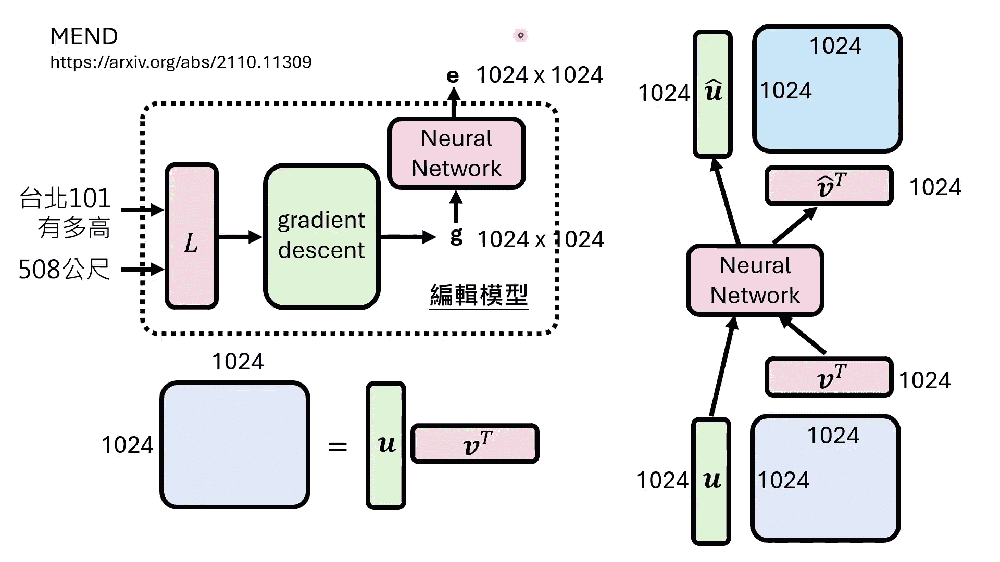

就假设今天啊有一个matrix，这metric里面的数值，就对应到某一个layer的gradient descent，那为什么这个gradient design。

可以拆解成U乘上V的transport呢，这个今天呢就很难细讲，这个请见10年前的课程，这样子在10年前讲那个gradient descent的时候，在讲back propagation的时候。

其实有做了比较详尽的推导，这个是2015年的课程，那个时候影片甚至不知道要放在YOUTUBE上面，还是有个特别的格式被存起来的，总之一点以下的链接，你就可以看到这个影片，也许我需要。

也许我可以把它转档下，再放到YOUTUBE上面好，总之呢今天就是跟大家分享了几个，model editing的方法，那今天分享的是比较经典的方法，那有关model editing的方法还有非常非常的多。

因为上课时间有限的关系。

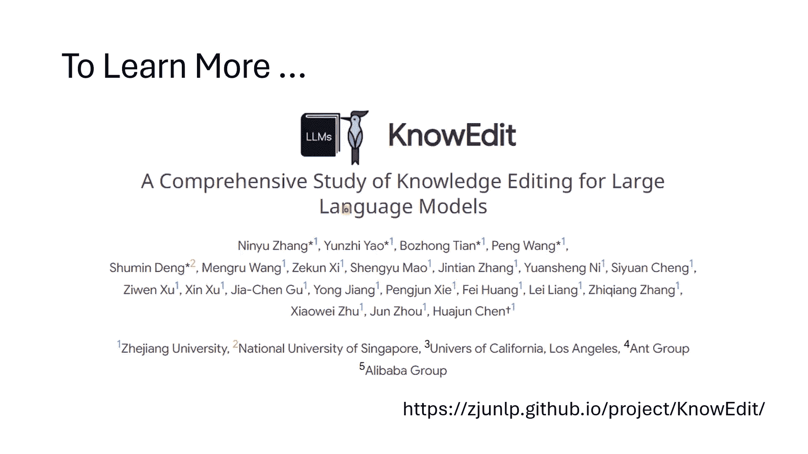