# 强推！(2026最新版) 李宏毅最新课程：智能体AI【AI Agent】71集全！人工智能／机器学习／深度学习／大模型／LLM - P1：1-第一讲AIAgent的原理 - Ai人工智能工程师 - BV1QdzCB3Eu2

好那各位同学大家好啊，那我们就来上课吧，那今天这堂课呢我们要讲的是AI agent啊，这是一个现在非常热门的议题，那在课程开始之前呢，先讲一个免责声明，就我知道你在各个地方。

可能都听过AI agent这个词汇，它是一个被很广泛应用的词汇，每个人心里想的AI agent可能都不一样，等一下下一页投影片会告诉你说，我在这堂课中指的AI agent是什么。

那如果你在其他地方听过别的AI agent的定义，那也没问题，我也不会争论说，什么样的定义才是真正的AI agent的定义，有些人甚至会告诉你说，现在那些用大型语言模型驱动的。

号称AI agent的东西都不是真正的AI agent，要有身体的，像这个机器人一样的，才叫做AI agent，所以每个人心里想象的AI agent是不一样的。

好那这堂课我们要讲的AI agent是什么呢，今天我们使用AI的方式，通常是人类给一个明确的指令，你问AI说AI agent的翻译是什么，那AI呢按照你的口令，一个口令一个动作。

然后把你要求的翻译翻译出来，他也不会再做更多的事情了，那AIAH的意思是说，人类不提供明确的行为或步骤的指示，人类只给AI目标，那要至于怎么达成目标呢，AI要自己想办法去达成目标。

比如说你给AI某一个研究的议题，那你期待说一个AI agent就告有能力自己提出假设，自己设计实验，自己进行实验，自己分析结果，如果分析出来的结果跟假设不符合，要回头去修正假设。

那通常你期待AI agent要解决的目标，要达成的目标是需要通过多个步骤，跟环境做很复杂的互动才能够完成，而环境会有一些不可预测的地方，所以AI agent还要能够做到灵活的。

根据现在的状况来调整他的计划，那AI agent是怎么做到人类给予一个目标，用多个步骤来完成目标的呢，那我们可以把AI agent背后运作的过程，简化成以下这张投影片，那AIA卷的第一个输入是一个目标。

然后这个目标是人给定的，那接下来呢AI agent会观察目前的状况，那AI agent可以看到的目前的状况，我们叫做observation，那AI agent会看目前的状况，分析目前的状况。

决定他要采取什么样的行动，那今天这个AI agent做的事情叫做action，那他执行个action以后会影响环境的状态，会看到不一样的observation。

看到不一样的observation就会执行不同的action，那这个步骤会一直循环，直到AI agent达成，我们要它达成的目标为止，那我知道讲到这边，你可能还觉得非常的抽象，那我们可以用下围棋来举例。

那ALPHAGO是大家非常熟悉的东西，阿尔法go其实也可以看作是一个AI agent，这个AI agent的目标就是啊下棋要赢，他的observation是什么。

他的observation是现在棋盘上黑子跟白子的位置，现在棋盘上的盘式，那他可以采取的action是什么，他可以采取action，就是在棋盘上的19×19路的范围中，选择一个动作。

选择一个可以落子的位置，那选择完可以落子的位置，他落下一子以后，他会改变他对手的输出，你落下一只以后，你的对手会落下另外一只，那会改变你观察到的observation，那就要采取下一个action好。

所以阿尔法go是一个AI agent，那它背后运作的原理，我想大家其实或多或少也都已经听过，那像这样的讲法，我相信你一定觉得非常的熟悉，好像在哪里听过一样的段落没错。

如果你有上过任何basic的reinforcement learning IO的课程，往往都是用这样的方式来开场的啊，为什么呢，因为过去要打造AI agent的时候。

往往觉得就是要透过RL的演算法来打造AI agent，那怎么透过I的演算法来打造AI agent呢，IO这个演算法就是它可以去learn一个agent。

那这个agent可以maximize reward，所以你要把你的目标呢，转换成一个叫做reward的东西，那这个reward呢是人定义的，越接近你的目标，reward就越大，那如果在下围棋里面。

你通常就会定说引起reward就是正一，舒淇，reward就是一，然后你要训练的那个AI agent，就会学习去maximize reward，透过L的演算法，所以透过L的演算法。

其实你也有可能学一个AI agent，但是透过I演算法的局限是，你需要为每一个任务都用I的演算法，训练一个模型，阿尔法狗在经过了大量的训练以后，他可以下围棋，但并不代表他可以下其他棋类，西洋棋或将棋。

我知道你可能看了一篇文章，阿尔法狗zero，他说围棋以外也可以下降旗跟西洋棋，那那是另外训练后的结果，能够下降旗的那个模型，并不是原来可以下围棋的那个阿尔法狗，它们是不同的模型，有不同的参数。

而今天AI agent又再次被讨论，是因为人们有了新的想法，我们能不能够直接把large language model，把LLN直接当成一个AI agent来使用呢。

也就是说我们的A卷背后就是一个language model，你要告诉他你的目标是什么的时候，直接用文字输入，要告诉他要下围棋，就先给他围棋的规则，然后跟他说，你的目标就是赢得胜利，那接下来环境啊。

因为一般语言模型是用文字作为输入，所以你可能需要把握环境转化成文字的叙述啊，不过我这边写了一个option，今天有很多语言模型都是可以直接看图片的，所以把环境转成文字的叙述，今天也不一定是必要的好。

那接下来语言模型要产生action，那产生action的方式，可能就是用一段文字来决定它的action是什么，好，他的action用一段文字来描述，那我们需要把那段文字转译成，真正可以执行的指令。

真正可以执行的行动，然后就会改变环境，看到不同的observation，然后AI agent的运作就可以持续下去，直到达成目标，今天那AI agent再次爆红。

并不是真的有了什么跟AI agent本身相关的，新的技术，而是在LOLM变强之后，人们开始想，我们能不能直接用large language model来实践，人类拥有一个agent的渴望好。

那我们这边呢是拿下棋做例子了。

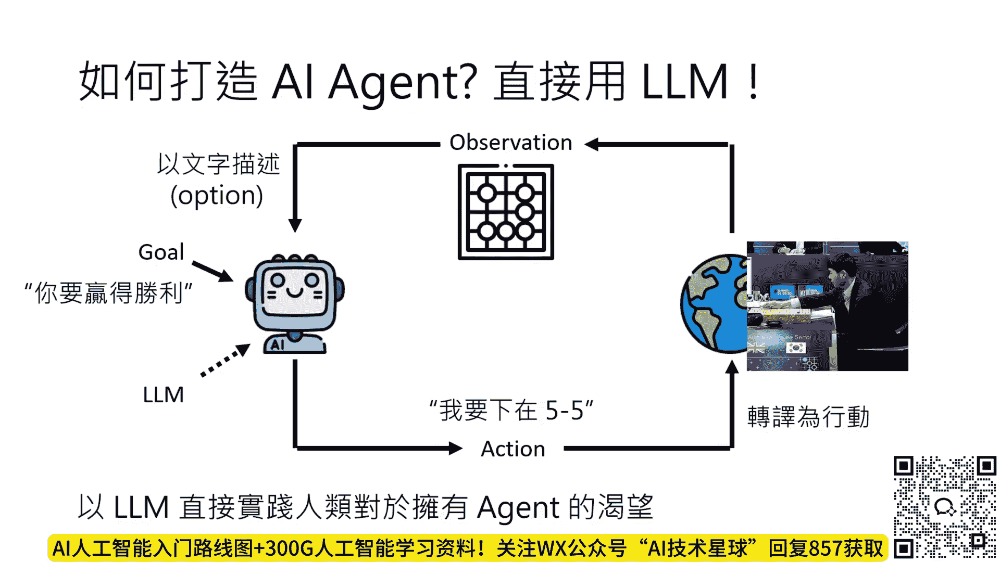

也许你就会很好奇，说现在的语言模型能不能够下棋呢，其实早就有人尝试过了，有一个在语言模型领域，很多人使用的benchmark叫做big bench，他是什么时候做的呢，它是2022年上古时代做的啊。

以后有CHEGPT之前我们都叫上古时代，而在2022年上古时代的时候，就有人尝试过用那个时候的语言模型，看看能不能下西洋棋，那那时候语言模型没有办法真的看图，所以你需要把棋盘上黑子跟白纸的位置。

转成文字的叙述输入给这个语言模型哦，所以这个就是语言模型，实际上看到的棋盘的样子，那就问他说，下一步要下哪里才能够给对方将军呢，那语言模型就会给你一个答案，右上角这个图啊，橙色的线是正确答案。

绿色的线是当时各个不同的语言模型，所给的答案啊，没有任何一个语言模型给出正确的答案，但虽然没有任何语言模型给出正确的答案，但你可以看这个实现是当时比较强的模型，他们虽然没给出正确答案。

但他们所选择走的路是符合西洋棋规则的，但是也有很多比较弱的模型，这个虚线是比较弱的模型，他们都乱走，他根本搞不懂西洋棋的规则，就随便按照自己的意思来下，不过这个是上古时代的事情了。

那现在更强的LON能不能下西洋棋呢。

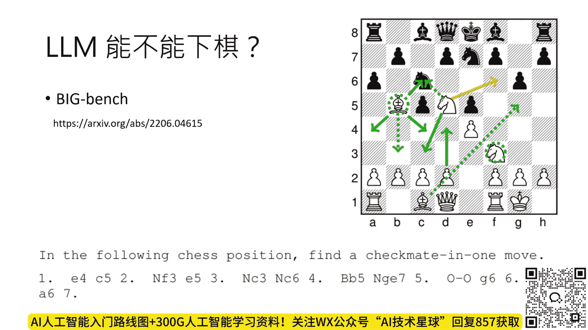

有人试过啊，啊有一个很知名的影片是，直接拿chegb t o one跟DC r one，两个模型来下西洋棋啊，这是一场惊天动地的对决哦，这个这个影片好几百万观看次数啊，那这两个模型呢他们杀得难分难解。

难分难解，所以他们实在是太弱了，他们有很多不符合西洋棋的规则，比如说把兵呢当做马来用，或者是他的主帅，可以他他的那个主教可以无视前面的一切阻挡，或是他会突然就是空降一个自己的子。

在对方的阵地里面把对方的子吃掉，然后DC还在自己的棋盘上随便变出一个城堡啊，然后最后最后迪斯科用自己的城堡，把自己的兵吃掉以后，他宣布他赢了，对方要投降，然后却j pp想了一下，觉得嗯我确实输了哈哈。

然后就投降了好，所以这个棋局就这样结束了，所以看起来现在这个最强的语言模型，你要下棋还有一段距离，但这并不代表他们不能够作为AI agent。

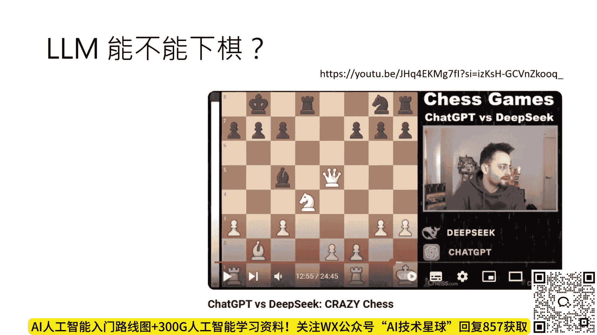

来做其他事情，那等一下会举一些例子，看看现在的语言模型可以做什么样的事情，那这门课另外最主要想要强调，跟大家传输的资讯，是我们还能多做什么，让这些语言模型作为AI agent的时候，运作的更加顺利。

那刚才讲法比较像，是从比较像是从过去常见的这个agent的观点来看，语言模型怎么套用到agent的框架下。

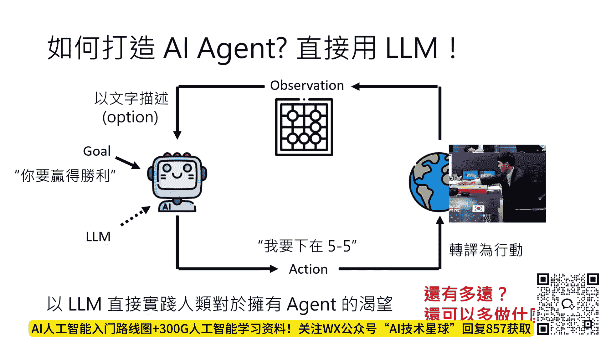

那接下来我们换一个角度看，说从large language model的角度来看，到底当它作为一个agent的时候，他要解的问题有什么不同好，那我们从large language model的角度来看。

首先它得到一个目标，然后接下来呢他得到一个observation，然后根据这个observation，还要决定接下来要采取什么样的action，采取什么样的动作，那他采取完动作之后。

他的动作会影响外界的环境，看到新的observation，看到新的observation以后，要采取新的动作，这个过程就一直反复继续下去，那在这一系列的过程中。

看到observation采取action，看到observation采取action，其实凭借的都是语言模型，原来就有的接龙的能力，所以从语言模型的角度来看。

当我们把它当做一个AI agent来使用的时候，对他而言，他做的事情是完全没有什么不同的，他就是继续在做他唯一会做的文字接龙而已，所以从语言模型的角度来看，AI agent并不是一个语言模型的新技术。

它比较像是一个语言模型的应用，所谓AI agent，意思就是，依靠现在语言模型已经有一定程度的通用能力，看看能不能够直接把它们当做A卷来使用，那因为我说这个AIH并不是语言模型的新技术。

它只是一个语言模型的应用。

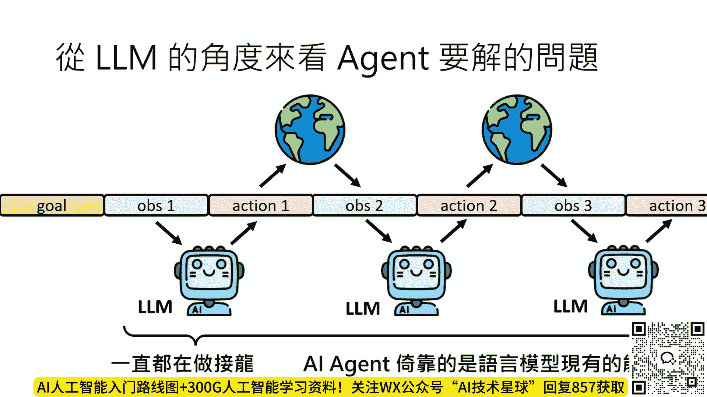

所以要注意一下，在以下课程中没有任何的模型被训练，以下我所有所讲的东西，都是依靠一个现有的语言模型的能力来达成的，那AIA卷呢其实不是最近才热门，一直有人在尝试怎么让语言模型变成一个agent。

或怎么把语言模型当做AI agent来使用，HGPT在2022年年底爆红，所以在2023年的春天，就有一波AI agent的热潮，好多人都用CHEGVT作为背后运作的语言，模型来打造AI agent啊。

那个时候最有名的就是auto g p t，那其实在2023年的机器学习，我们也有一堂课是讲那个时候的AI agent，那可以看看那堂课，看看那一堂课的AI agent，跟今天讲的有什么样的差异哦。

不过后来2023年，AI agent的热潮过一阵子就消退了，因为人们发现这些AI agent没有我们想象的厉害，一开始好多网红在吹嘘这些AI agent有多强，又有多强啊，真的试下去也没那么强。

所以热潮就过去了，那用LLN来运行一个AI agent，相较于其他的方法，可能有什么样的优势呢，那过去呀当你运行一个agent的时候，比如说像ALPHAGO，他能够做的只有有限的事先设定好的行为。

阿尔法狗真正能够做的事情，就是在19×19个位置上，选择一个可以落子的位置，也就是说他真正能够采取的行为，就是从19×19个选择题中，选择一个他能够采取的行为。

但是如果你的agent是一个large language model的话，large language model可以讲任何话，这就让你AI agent可以采取的行动不再有局限，有更多的可能性。

举例来说，我们等一下就会很快看到的，今天这些AI agent在有些问题他解不了的时候，他可以凭借他可以有各式各样输出的能力，来直接呼叫一些工具来帮忙解决，它本来解决不了的问题。

那另外一个AI agent的优势哦，另外一个用large language model运行AI agent的优势是。

过去如果用reinforcement learning的方法来训练一个AI agent，那意味着什么，意味着你必须要定义一个东西叫做reward，那如果你今天是要训练一个AI programmer。

那你可能会告诉AI programmer说，如果你今天写的城市有一个compile的error，那你就得到reward-1，但为什么是一，为什么不是十，为什么不是十，7。7，这种东西就是没人说得清楚。

所以这个reward啊在做reinforcement learning的时候，就是一个要调要通灵的东西，那今天如果是用LON驱动的AI agent呢，你今天就不用帮他定reward了。

今天有compile error，你可以直接把compile error的log给他，他也许根本就读得懂那个log，他就可以对城市做出正确的修改，而且相较于reward只有一个数值。

直接提供error的log，可能提供了agent更丰富的资讯，让他更容易按照环境给的回馈，环境目前的状态来修改他的行为，接下来举几个AI agent的例子，那讲到AI agent，也许最知名的例子。

就是用AI村民所组成的一个虚拟村庄，这个虚拟村庄在什么时候成立的呢，2023年，在古代就已经有人做过这个虚拟村庄了，拿里面的NPC通通都是用语言模型来运行的，而这些NPC它是怎么运行的呢。

首先每个NPC都有一个人为设定的目标，有的NPC他要办情人节派对，有的NPC要准备考试，每个人都有一个他自己想做的事情，那这些NPC呢会观察会看到环境的资讯嗯。

那时候的language model都只能读文字，所以环境的资讯需要用文字来表示哦，所以环境的资讯对于一个语言模型来说，看起来可能就是啊，这个语言模型旁边有一个叫做eddy的人，他正在读书。

然后呢他看到厨房，然后呢他看到一个柜子，然后看到伊丽莎白呢正在装作装饰哦，正在装饰房间等等，然后根据这些observation，这个语言模型就要决定一个他想要做的行为，比如说也许不早了，所以就上床睡觉。

那需要有一个转译器，把它说出来的这个行为，转成真正能够执行的指令，那这个A卷就真会走到床边，然后去睡觉好，所以这个是2023年的时候，用AI来这个运行NPC的一个实验。

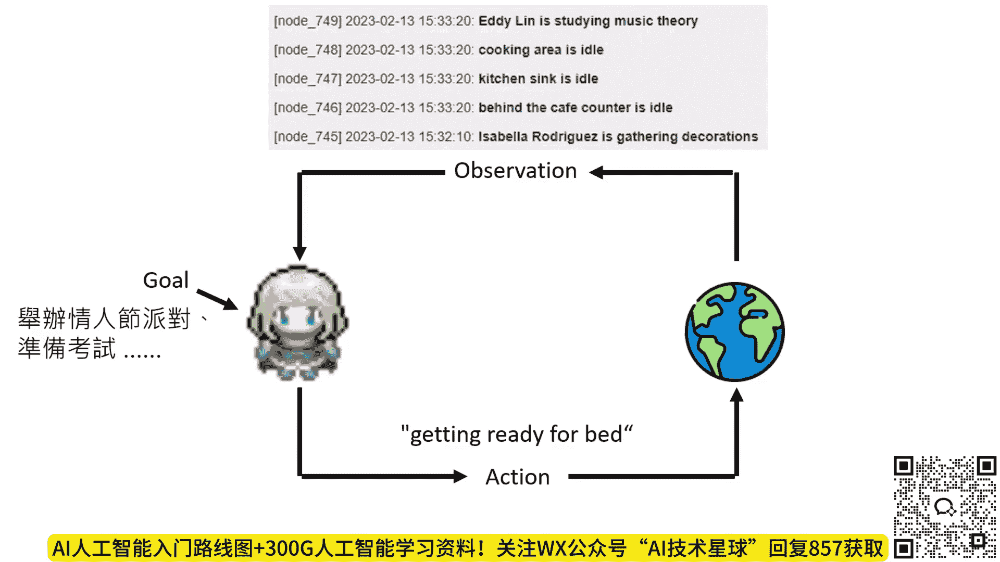

其实后来还有更大规模的实验，有人把MINECRAFT中的NPC通通换成AI的NPC，那我就把相关的影片连接留在这个投影片上面，那根据这个影片连接的描述，就说啊这些AI很厉害。

他们组织了自己的呃交易的金融体系，然后还组织了自己的政府，自己管理自己哦，不知道是真的还是假的啦。

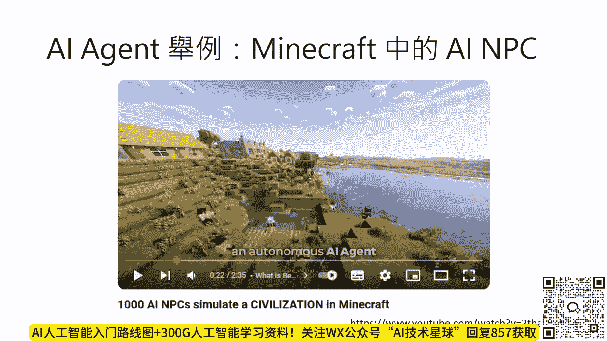

这个是这个影片说的，刚才讲的那些游戏，你可能比较不容易接触到它，对现实世界可能也没什么影响，那今天也许你马上就会接触到的AI agent，就是让AI来真正使用电脑哦，虽然虽然这个听起来有点吊诡。

AI本身也就是一个电脑，但他现在要来真正的像人类一样，来使用另外一个比较低端的电脑来做事，那其中比较有代表性的例子就是cloud computer use，还有CHEGBT的operator。

那我们在上次上课的影片中，也已经跟大家讲过operator，那operator界面长这样，那他会建议可以做的事情，比如说可以订披萨啊，可以预约下周的居家情节等等，那像这种使用电脑的AI agent。

它的目标就是你的输入，就是你告诉他我要去订披萨，你告诉他上网帮我买一个东西，那这就是他的目标，那他的observation呢，它的observation可能是那个呃电脑的荧幕画面。

今天很多语言模型都是可以直接看图的，所以其实可以直接把图片当做输入，可以直接把电脑画面当做输入提供给AI agent，那AIAH要决定的就是，它要按键盘上哪一个键，或者是要按滑鼠的哪一个按钮。

那其实让AI使用电脑啊。

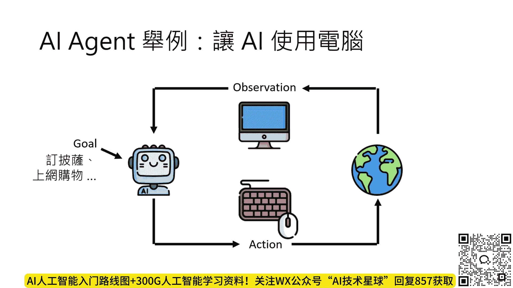

不是最近才开始有的野望，其实早在2017年就有一篇paper叫words of beats，尝试过使用AI agent，你看他这个文文章的标题，他把自己的文章标题说他是一个web face的agent。

那只是那个时候能够互动的页面，还是比较原原始的页面，你可以看到下面这些AI agent，它真正能够处理的是比较原始的页面，那那个时候也没有大型语言模型，所以那时候的方法就是硬圈个CNN，直接吃荧幕画面。

当做输入输出，就是的滑鼠要点的位置，或者是键盘要按的按钮，看看用这个方法，能不能够让AI agent在网络的世界中做事啊，这个是2017年，这甚至不能说是上古时代以后。

有这个BERT以前的时代就是史前时代，这个不只是史前时代，还是史前时代比较早期。

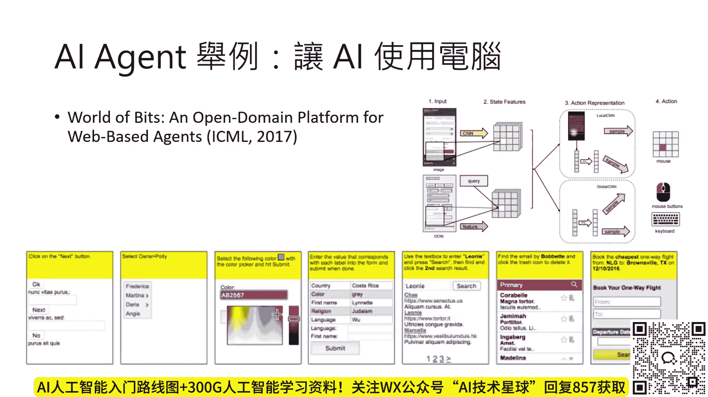

所以这是旧石器时代的产物好，那后来有了语言模型之后啊，人们就开始尝试用语言模型来当做AI agent，来运行一个agent，让它在网络的世界中活动，那这一页投影片是列举了几个，比较具代表性的例子。

那这一波潮流大概是在2023年的暑假，开始的，像mike web web arena，还有vio web arena，就跟今天的operator非常的像，就是给这个呃语言模型看一个荧幕的画面。

或者是看HTML的code，然后他自己决定他要干什么，期待他最后可以解决一个问题，比如说在mto web的第一个例子里面，就给他这个画面。

然后跟他说，请他帮我们订一个机票，那还有什么样AIA卷的应用呢，今天你可以用AI来训练另外一个AI模型，这就是等一下作业二主教会跟大家讲的事情，那用AI来训练模型，那其实这个运作的过程。

就是你的目标就是要过strong baseline，然后你提供给LLN训练资料，还写一个程序，用这些训练资料来训练模型，那他可能可以得到这个模型的正确率，根据正确率再重新写一个程式，再得到新的正确率。

就这样一直运作下去，那有很多知名的用AI来训练模型的framework，比如说AIDE1，那看他的这个技术报告的这个标题，就知道他们想做什么。

他是要做一个machine learning engineer agent或是auto cargo，他就是要用MOTIAGENT的framework来解data science的competition。

那在我们的作业中，你就会体验到到底AI agent做不做得了，机器学习这门课的作业好。

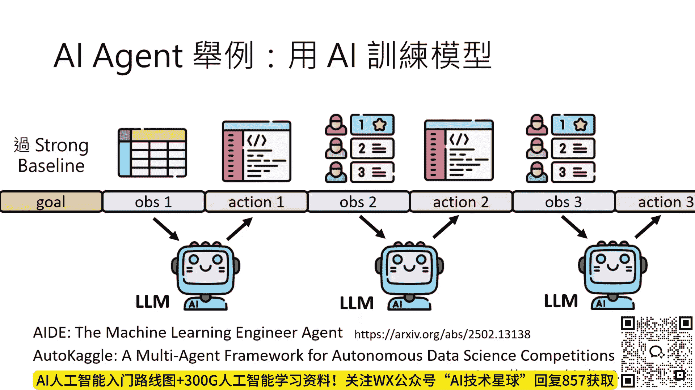

那最近呢google说他们做了一个AICOSCIENTIST，比如不过他们并没有真的试出模型啊，所以你也不知道说实际上做的怎么样，这个服务并不是公开的，但他们说他们做了一个AICOSCIENTIST。

就是让AI来做研究啊，不过这个AANLESCIENTI才是蛮有局限的，他不能真的做实验嘛，他只能够提proposal，就是你把一些研究的想法告诉他，他把完整的proposal规划出来啊。

实际上做的怎么样，不知道啊，那你要看他的blog里面有一些比较夸张的案例，说什么哦，本来人类要花10年才能够得到研究成果，AI agent花两天就得到了，也不知道真的还是假的啊。

他举的是一些生物学的例子，所以我也无法判断他讲的是不是真的，那个发现是不是真的很重要，这个COSENTIST啊，就是这个用AI agent来帮研究人员做研究好。

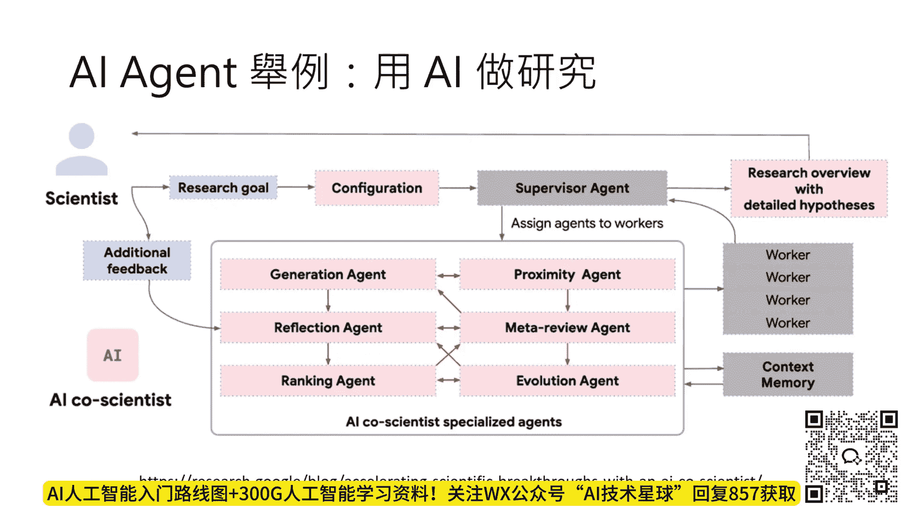

那我们刚才讲的AI agent呢，它的互动方式是局限在回合制的互动，就有一个observation，接下来执行action，有一个observation，接下来执行action，但是在更真实的情境下。

这个互动是需要及时的，因为外在的环境也许是不断在改变的，如果你在action还没有执行完的时候，外在环境就改变了，那应该要怎么办呢，有没有办法做到更及时的互动呢，更及时的互动可能应该像是这样子。

当模型在决定要执行action one，正在执行的过程中，突然外在环境变了，这个时候模型应该有办法立刻转换行动，改变他的决策，以因应外界突如其来的变化，你可以想说什么样的状况。

我们会需要用到这样的AI agent，能够做即时互动的呢，其实语音对话就需要这种互动的模式，文字的对话啊，使用CHEGBT是大家比较熟悉的，你输入一段文字，它就输出一段文字。

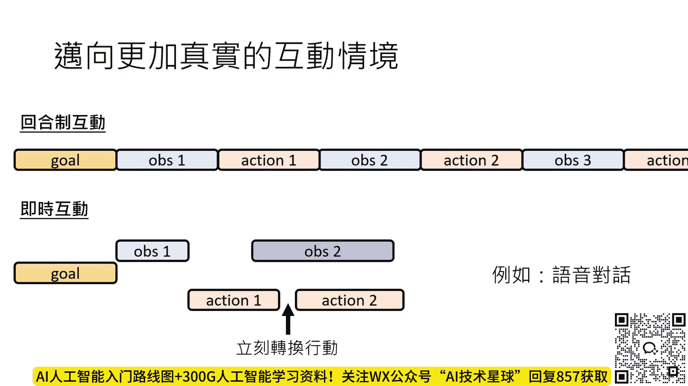

这是一来一往回合制的互动，但是人与人间真正的对话不是这样子的，当两个人在对话的时候，他们可能会互相打断，或者是其中一个人在讲话的时候，另外一个人可能会同时提供一些回馈，比如说嗯好，你说的都对，这样啊。

那这些回馈可能没有什么特别语义上的含义，他只是想要告诉对方，我有在听，但是像这样子的回馈，对于流畅的交流来说也是非常重要的，如果在讲电话的时候，对方完全都没有回应，也会怀疑他到底有没有在听哦。

所以我们今天能不能够让AI，在跟使用者互动的时候，用语音互动的时候就跟人与人间的互动一样，而不是一来一往回合制的互动呢，其实也不是不可能的。

今天g p t four o的一个voice more高级语音模式，也许在某种程度上就做到了，这一种及时的互动啊，那这个投影片上是举一个例子啊，假设有人跟AI说啊，你说一个故事。

那这个是AI观察到的第一个observation，有人叫他说一个故事啊，现在就开始讲故事了，他就说从前从前那这时候人说了一个嗯好啊，这个可能是第二个observation，但AA要知道说。

这个observation不需要改变他的行为，跟他的行为没有直接的关系，只要故事就继续讲下去，有一个小镇，然后有人说啊，这个不是我要听的故事，这个我听到了，那AI可能要马上知道说那这个不是人要听的。

那也许我就应该停下来换另外一个故事，那今天AI有没有办法做到这种及时的互动呢，好那怎么做这种及时的互动，非回合制的互动，就有点超过我们这门课想要讲的范围。

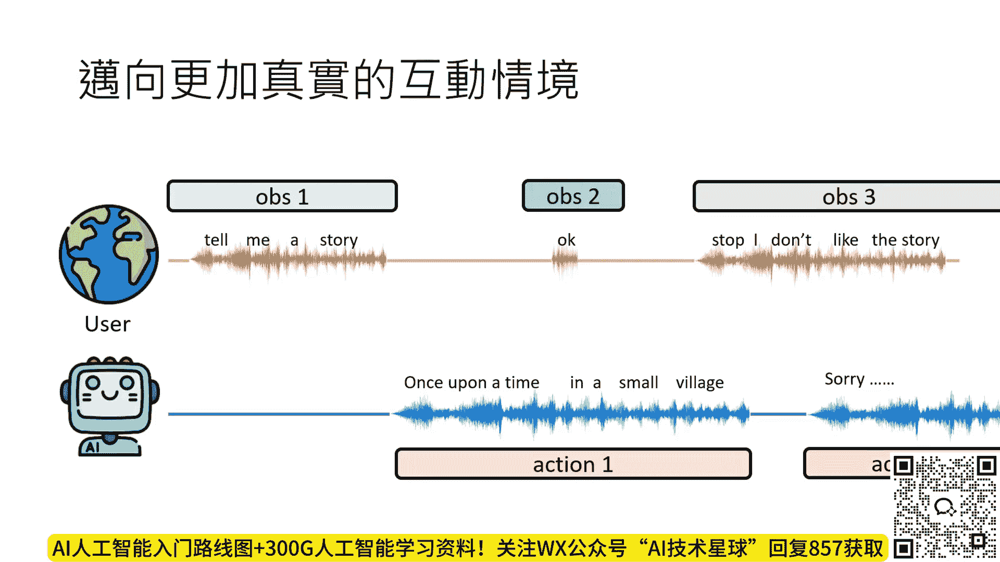

如果你有兴趣的话，你可以读这篇文章，那这篇文章想要做的事情，是评量现在这些语音模型互动的能力，那在这篇文章里面，也对现有的这个可以做互动的语音模型，做了一个比较完整的设备，是一直设备到今年的1月。

所以你可以看这篇文章，知道说现在这些可以互动的模型，它可以做到什么样的地步，那这是我们实验室的林冠婷同学，跟他在这个BERKELEYUW和NIT的合作伙伴，一起做的文章，那这边顺便说明一下。

以后这门课呢我们投影片上引用论文的原则，那引用论文的原则，就是如果我找得到archive的连接的话，那我就把文章直接，我就直接贴archive的连接，什么是archive呢。

假设你不是computer science背景的话，也许我需要解释一下什么是archive，archive的意思就是呃一般呢做研究，你是写完文章投稿到一个期刊或者是国际会议，然后被接受以后才发表出来。

但是对于AI的领域，因为变化实在太快，几个月前就已经是古代了，所以期刊那种一审就要一年，或者是国际会议一审要一两个月，这种步调是没有办法在不适用于AI的领域，所以现在一种习惯的发表方式。

就是做出东西以后直接放到一个公开的网站，叫做阿凯，然后就不审了，立刻公开，然后你就可以让全世界的人看到你的文章，那有很多人会觉得引用ARCAVE的连接不够正式，但是很多重要的文章其实现在不见得投稿。

国际会议，他就只有ARCAVE的连接，所以我会选择如果找得到阿凯的连接的话，就直接引用ARCAVE的链接，哎其实现在大家都ARCAVE上看文章，那国际会议现在比较像是经典回顾这样子。

那每每篇文章我几乎都在阿盖尔上看过了去，直说哦，原来你投到这里呀，这样的感觉好，那就引用用ARCAVE的连接，还有个好处，就是你可以直接从阿凯的连接，看出这篇文章的时间。

所以archive的连接面的数字前面两个就是年份，后面两个就是月份，得看这个数字，就可以知道说这篇文章是在什么时候被放在archive，也就什么时候被发表的，可以让你对于每一个研究。

它诞生的时间更有感觉好。

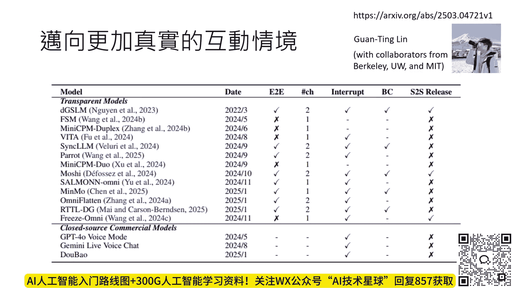

那接下来呢我们会分三个面向，来剖析今天这些AI agent的关键能力，那第一个面向是我们要来看这些AI agent，这个AI agent能不能够根据他的经验，过去的互动中所获得的经验来调整他的行为。

第二部分是要讲这些AI agent如何呼叫外部的援助，如何使用工具，第三部分要讲AI agent能不能够执行计划，能不能做计划好。

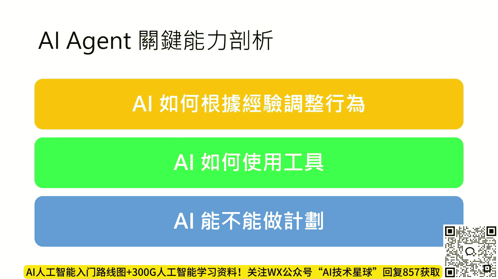

那我们来讲一下AI怎么根据过去的经验，或者是环境的回馈来调整他的行为好。

那AI呢AI agent需要能够根据经验来调整行为，比如说有一个作为AI programmer的AI agent，他一开始接到一个任务，那他写了一个城市，那这个城市compile以后啊，有错误讯息。

compile以后有error，那应该要怎么办呢，他应该要能够根据这个error的message，来修正他之后写的程式，那在过去啊，讲到说啊，你收到一个feedback，接下来做什么的时候。

也许多数机器学习的课程都是告诉你，那我们就来调整参数，根据这些收集到的训练资料，也许使用reinforcement learning algorithm来调整参数，但不要忘了，我们刚才就强调过。

在这一堂课里面没有任何模型被训练，所以我们今天不走这个路线，那不更新模型的参数，模型要怎么改变他的行为呢，依照今天large language model的能力，要改变他的行为，你也不用微调参数。

你就直接把错误的讯息给他，他接下来写的程式就会不一样了，就结束了，那你可能会问说，那之前他写的程式是错的，为什么给错误讯息，他写的程式就对了呢，明明就是同一个模型，但你想想看模型做的事情就是文字接龙。

你给它不同的输入，它接出来的东西就不一样，一开始会写错的程式，是因为它前面要接的部分只有这么多，所以写个错的程式，当今天要去接的内容包含了错误的讯息的时候，他接出来的结果可能就会是正确的了。

那今天已经有太多的证据说明，这些语言模型可以根据你给他的回馈，改变他的行为，不需要调整参数，那如果你有使用这些语言模型的经验，你也不会怀疑他们有根据你的回馈，调整行为的能力。

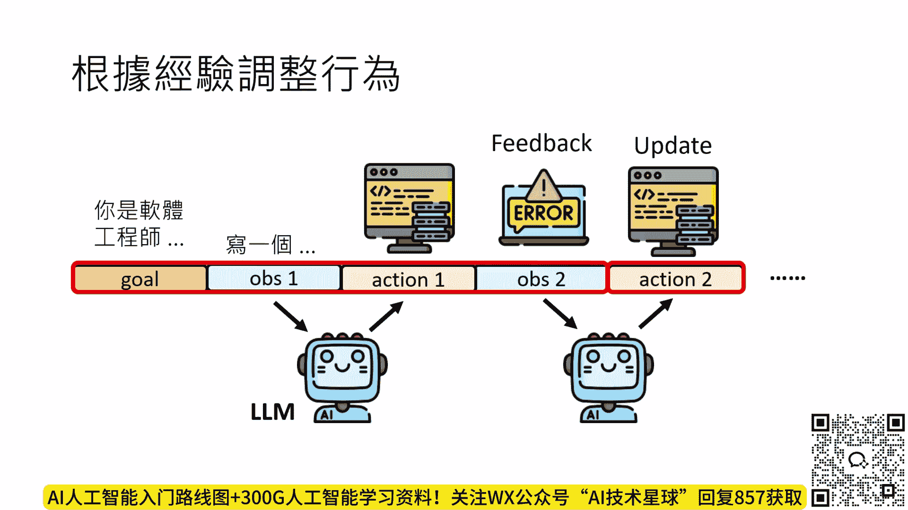

那这边真正的议题是，如果我们是把过去所有的经验都存起来，要改变语言模型的行为，要让他根据过去的经验调整行为，就是把过去所有发生的事情一股脑给他，那就好像是语言模型，每次做一次决策的时候。

他都要回忆他一生的经历，也许在第100部的时候还行，到第1万步的时候，过去的经验太长了，他的人生的资讯已经太多了，也许还没有足够的算力来回顾一生的资讯，他就没有办法得到正确的答案，这让我想到什么呢。

这让我想到有一些人有超长自传式记忆，就他可以把他一生中所有发生的事情记下来，然后那些人你可以随便问他，一个某个人的电话号码，他都背出来，你告诉他某年某天某月某日某时呃，发生了什么事，他也都可以讲出来。

有一些人他的头脑就像是一个影印机一样，会把所有他看过的事情都原封不动的记忆下来，但这种超长自转式记忆呀又被叫做超异症，没看到正这个字，就知道说人们觉得这是一种疾病，这听起来记忆力很好，是一种祝福。

但实际上对这些患者而言，据说这种患者世界上可能不到100例，那这是一个2006年的时候，才被论文发表的一个呃症状，那据说这些患者，其实日常生活并没有办法过得很开心，因为他们不断的在回忆他的人生。

往往一不小心就陷入了一个冗长的回忆之中，那也很难做抽象的思考，因为他的人生已经被他的记忆，已经被太多枝为末节的琐事所占据，所以你没有办法做抽象式的思考哦。

所以这样一个AI agent记住他一生所有经历的事情，告诉他，你每次做一个决策的时候，都是根据你一生所有经历过的事情再去做决策，那也许对AI agent来说并不是一件好事，最终当他的人生过长的时候。

他会没有办法做出正确的决策，所以怎么办呢，也许我们可以给这些AI agent memory，这就像是人类的长期记忆一样发生过的事情，我们把它存到这个memory里面。

当AIH看到第1万个observation的时候，它不是根据所有存在memory里面的内容去决定，接下来要采取什么action，而是有一个叫做read的模组，这个read的模组会从memory里面。

只选择跟现在要解决的问题有关系的经验，把这些有关系的经验放在observation的前面，让模型根据这些有关系的经验的observation，在做文字接龙接出他应该进行的行为，那你有这个read模组。

就可以从memory里面，从长期记忆中筛选出重要的讯息，让模型只根据这些跟现代情境相关的讯息，来进行决策，那怎么样打造这个read的模组呢，其实你可以想啊。

这个read的模组就想成是一个retrieval的system，想成是一个检索的系统，那第1万步看到的observation其实就是问题，那模型的AI agent的memory长期记忆其实就是资料库。

那你就把拿这个检索系统，根据这个问题，从这个资料库里面检索出相关的资讯，那这整个技术跟IG没有什么不同，其实它就是IG，你可以直接把IG的任何方法，直接套用到这个地方。

唯一不一样的地方只是如果是IG的话，存在memory里面的东西，等于是整个网络，那是别人的经验，而对AI agent而言，现在存在memory里面的东西是他自己个人的经历，差别的是经历的来源。

但是用来搜寻的技术，是可以完全直接限套RG的技术的啊。

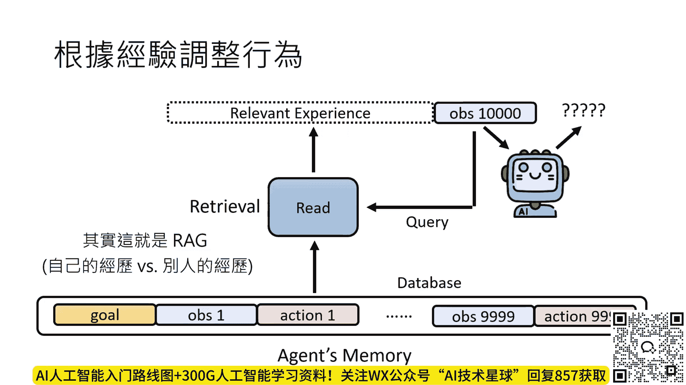

如果你今天想要研究这个AI agent，按照经验来修改他的行为来，那你可以考虑一个叫做string bench的benchmark，那在string bench里面呢会有一系列的问题。

然后呢AI会依序去解这些问题啊，先解第一个问题，得到第一个问题的答案，然后接下来他会得到第一个问题答案的呃反馈，那在这个string bench目前的版本里面呢，因为所有的问题都是有标准答案的。

所以AI agent得到的回馈是binary的的，对或者是错好，那根据他过去的经验，他就可以修正他的行为，期待他在第二个问题的时候，可以得到更准确的答案，得到更高的正确率，然后这个过程就一直持续下去。

那假设有1000个问题的话，那就等AIAH回答完这个问题的时候，这个互动就结束了，那最后结算一个agent，根据经验学习能力的好坏，根据经验调整行为能力的好坏，那就看这一整个回答的过程中，平均的正确率。

越能够根据经验学习的agent，他应该能够用越少的时间，看过越少的回馈就越快，能够增强他的能力，就可以得到比较高的平均的正确率啊，那这个benchmark呢。

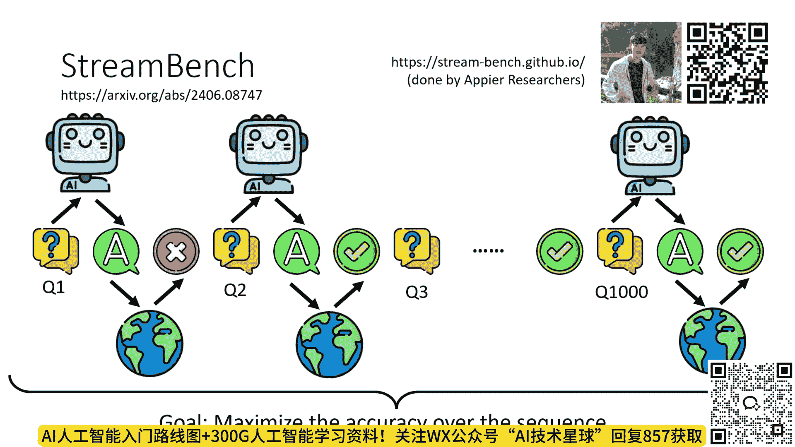

是APEL的研究人员打造的一个benchmark，那在这个benchmark里面的baseline，就是有使用到我刚才讲的类似RG的技术，也就是说当模型在回答第100个问题的时候。

它并不是把前面第一个到第99个问题，通通丢给他去做文字接龙，这样这个sequence太长了，一般的语言模型根本读不了这么长的输入，所以实际上的做法就是，你需要有一个检索的模组。

这个检索的模组只从过去所有的经验中检索出，跟现在要回答的问题有关系的经验，然后呢语言模型只根据这些有关系的经验，还有现在的问题来进行回答，来产生他的行动，来产生他的答案好那这一招有没有用呢。

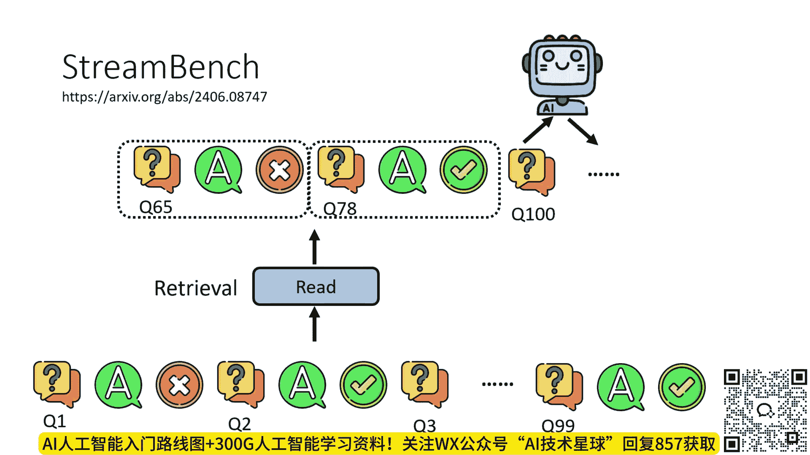

这一招其实非常的有用，那在这一页图里面，横轴啊，他这边的用词是tie step，但其实指的就是一格一格的问题，总共有1750几个问题，那纵轴指的是平均的正确率，那在这个图上面呢。

最低的这条灰色线指的是说，假设没有让模型做任何学习，他回答每一个问题都是independent的，回答问题间没有任何的关联，他完全没有调整他的行为，那你得到的正确率是灰色的，这一条线是最低的。

那黄色这一条线是说只固定随机选五个问题，那每次模型回答问题的时候，都是固定看那五个问题来回答，都是固定把五个问题当做经验来回答，那也可以得到的是黄色这一条线，那如果你是用IG的方法。

从一个memory里面去挑选出最有关系的问题，跟现在要解决的问题最有关系的经验，那你可以得到的是粉红色的这一条线，那可以看到比黄色的线，他正确率还要高上不少，那最后结果最好的是红色这条线啦。

那这个怎么做的，那大家就自己再去详细阅读论文。

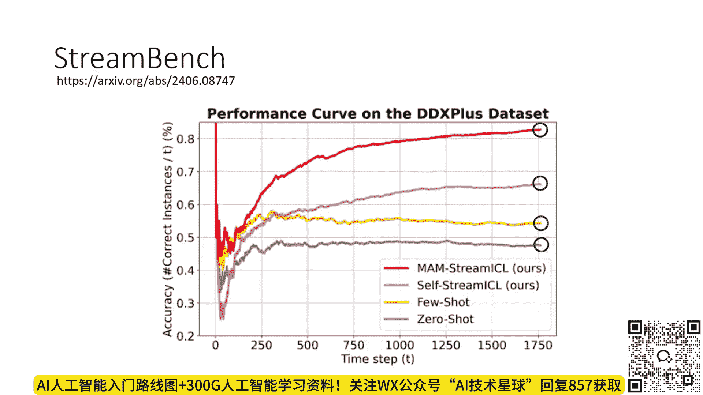

那在string bench里面呢，还发现一个有趣的现象，是值得跟大家分享的，这个现象是负面的回馈，基本上没有帮助，对现阶段的语言模型而言，所以你要提供给语言模型经验，让他能够调整他行为的时候。

给他正面的例子比给他负面的例子要好，也就是说具体而言，提供给他过去哪些类似的问题得到正确答案，被比提供给他过去哪些问题得到错误的答案。

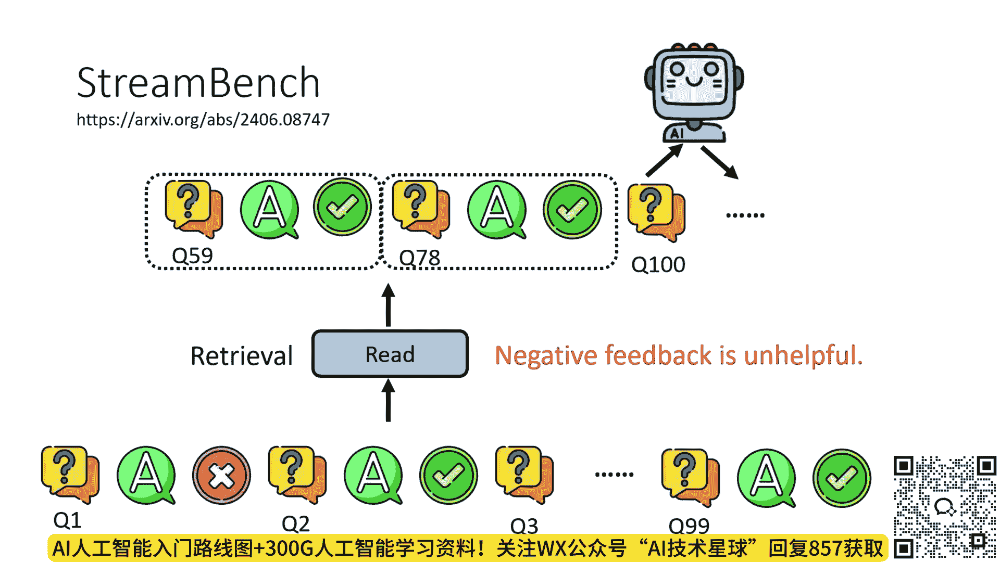

还更有效，还更能引导模型得到正确的答案好，那这边是真正的实验，结果做在好几个不同的data set上面，string bench里面本来就包含了好几个不同的data set。

那这个纵轴呢零代表完全没有做，完全没有根据经验调整行为，然后蓝色代表说，不管是正面还是负面的例子都用，如果不管正面还是负面的例子，都用在多数情况下，模型都可以表现的比较好，当然有一些例外。

但是如果只用负面的例子呢，如果只用负面的例子，基本上是没有帮助，而且甚至是有害的，那如果说只用正面的例子，在所有的情况下，模型可以得到更好的结果，那这也符合过去的一些研究，因为过去有人研究过。

使用语言模型要怎么样比较有效，有一个发现就是与其告诉语言模型不要做什么，不如告诉他要做什么，就如果你要希望他文章写短一点，你要直接跟他说写短一点，不要告诉他不要写太长，比较他不要写太长，他不一定听得懂。

叫他写短一点，比较直接，他反而比较听得懂，那这也符合这个这边这个string bench的发现，就是负面的例子比较没有效，与其给语言模型告诉他什么做错，不如告诉他怎么做是对的好。

那我们刚才讲到了有一个read的模组，那有关记忆的部分呢，是不是要把所有所有的资讯通通存到memory里面呢，存到长期的记忆库里面呢，如果我们把这些agent经历的所有的事情。

都放到长期的记忆库里面的话，那里面可能会充斥着一堆鸡毛蒜皮，不重要的小事，最终你的memory长期记忆库可能也会被塞爆，如果说你是做那种那个AI村民啊，AI村民，他多数时候观察到的资讯。

都是些无关紧要的小事，那如果你看他观察到那个logo，多数都是啥事也没有，就那边有张桌子啥事也没有，那边有一张椅子啥事也没有，多数时候都是啥事也没有，所以如果把所有观察到的东西统统记下来的话。

那你的memory里面，就都只是被一些鸡毛蒜皮的小事占据，所以怎么办呢，也许应该有更有效的方式来决定，什么样的资讯应该被记下来，应该只要记重要的资讯就好，那怎么让语言模型只记重要的资讯就好呢。

你可以有一个ride的module，那ride的module决定什么样的资讯，要被填到长期的记忆库里面，什么样的资讯干脆直接就让它随风而去就好了，那怎么样打造这个rider的记忆库呢。

有一个很简单的方法，就是ride的模组也是一个语言模型，甚至就是AI agent，自己这个AI agent他要做的事情，就是根据他现在观察到的东西，然后问自问一个问题，这件事有重要到应该被记下来吗。

如果有就把它记下来，如果没有，就让它随风而去，那除了ray跟R这两个模组以外，还有第三个模组，那这个模组没有固定的名字啦，在文件上的名字没有固定的名字，我们可以暂时叫它reflection反思的模组。

那这个模组的工作是对记忆中的资讯做更好的，更high level的可能是抽象的重新整理，你可以把这些记忆里面的内容，在经过reflection的模组重新反思之后，得到新的想法，那也许read的模组。

可以根据这些新的想法来进行搜寻，那这样子也许可以得到更好的经验，那帮助模型做出更好的决策，而这个reflection的模组可能也是一个语言模型，就是AI agent自己，你可以只是把过去的这一些记忆。

丢给refection的模组，然后叫reflection模组，想一想，看他从这些记忆里面，能不能够有什么样新的发现啊，比如说可能有一个observation是啊，我喜欢的异性每天都跟我搭同部公车啊。

另外observation是他今天对我笑了，那你推出来的recession，结果就好，他喜欢我这样一个一个错觉的，人生三大错觉之一就是这一种呃，就得到一些新的salt，你就得到一些新的想法。

那你之后在做决策的时候，就可以用这些新的想法，虽然你没有实际观察到，但他是被推论出来的，根据这些推论出来的想法来做决策啊，那除了产生新的想法之外，也可以为以前观察到的经验，建立经验和经验之间的关系。

也就是建立一个knowledge graph，然后让read的module，根据这个knowledge graph来找相关的资讯，那我知道在IG的领域使用nodge graph。

现在也是一个非常常见的手法，那最知名的可能就是graph i g系列这个研究，我就把你的资料库把它变成一个knowledge graph，那今天在搜寻跟回答问题的时候。

是根据noise graph来搜寻，回答问题，可以让IG这件事做得更有效率，或是另外一个非常类似的例子，就是HIPPOIG，那hippoi j hippo啊，这个HIPHO不是指真正的河马。

它指的应该是那个海马回，那个人脑中的一个结构，然后他觉得做建筑，nodge graph就跟海马回的运作呢非常的类似，所以它叫做HIORG呃，有一些跟graph有关的RG的方法。

那你完全可以透过reflection的模组，把经验建成一个graph以后，把那一些graph rg的手法直接套到AI agent里面。

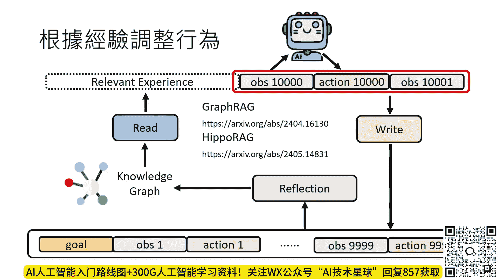

那大家可能都知道说这个CHEERVT啊，现在其实真的是有记忆的，所以可以感受到这个OpenAI，想把CHEERRT变成一个AI agent的决心啊，比如说我跟CHEGPT说。

我周五下午要上机器学习这门课，那他就给我一个回答哦，说要我帮助你做什么事情吗，接下来我告诉他记下来，你跟他讲，记下来之后，他的这个ride模组就启动了，他知道这件事情是要被记下来的，他就会说。

那我记下来了以后，你周五要上机器学习这门课，那red模组什么时候启动，是他自己决定的，所以很多时候你需要它记下来的时候啊，它就是不启动或不需要它启动的时候，它就是启动，那个是模型自己决定的。

但是有一个方法可以基本上一定能让他启动，就明确的跟他讲，把这件事记下来，基本上都几乎确定能够呃启动那个write的模组，让write模组把这件事情记下来，那记下来的东西在哪里呢。

你可以看在设定里面有一个个人化，然后有一个叫记忆的部分，那你点这个管理记忆就可以看到CHEGBT，它透过ride的模组写在他的memory里面，这个就是他作为一个AI agent的。

长期记忆里面的东西啊，比如第一条是你叫做写轮眼卡卡西，这样啊，有有一次不小心跟他说，你是卡卡西，不知道为什么他就觉得自己是写轮眼卡卡西的，然后呢他也记得，就我刚才跟他讲的啊，周五下午要上机器学习这门课。

但是其实模型的记忆也是会出错的，因为要写什么样的东西到记忆里面，是模型自己决定的，而且他并不是把对话的内容，就151十的直接放到记忆里面，他是经过一些升华反思之后才放进去的，所以他的反思可能会出错。

比如说他觉得我是一个台湾大学的学生，叫我是老师，但是他从过去的对话误以为我是一个学生，所以就存了一个错误的资讯，在他的记忆里面，还有其他一堆他想记的东西啊，比如说我给过什么演讲啊。

给过什么tutorial啊，他都把它记下来就是了，好那这些有记忆的cheat gbt，他可以使用它的记忆，比如说我跟他说，礼拜五下午出去玩好吗，这个时候记忆模组就被启动了，但是它是怎么被启动的。

其实就不太清楚了，它到底是把所有记忆的内容，通通都放到这个问题的前面，直接让模型做回答，还是说也有做RG只选择相关的记忆内容呢，那这个我们就不得而知了，总之当我问他周五下午出去玩好吗啊。

这个read的模组就启动了，他就说哎下午不是要上课吗，怎么能够出去玩，好聪明啊，他知道下午要上课挺厉害的，然后问他你是谁，刚才我说过他是写轮眼卡卡西啊，他就觉得自己是写轮眼卡卡西。

而如果你想要知道更多有关AIHG的研究的话，那这边就是放了几篇经典的论文给大家参考，包括memory g p T1则是23年的论文，agent work for memory是24年的论文。

还有个最近的ijtic memory for l s agent，是25年的论文，所以二三到25年的引用一篇告诉你说，这方面的研究是持续不断的，接下来呢我们要跟大家讲，现在这些语言模型怎么使用工具。

那什么叫做工具呢，但语言模型本身对我们人类来说也是工具，那对语言模型来说，什么东西又是它的工具呢，所谓的工具就是这个东西呀，你你只要知道怎么使用它就好，它内部在想什么，它内部怎么运作的，你完全不用管。

这就是为什么，肥宅如果一直帮另外一个人修电脑的话，就会被叫做工具人啊，因为别人没有人在意肥宅的心思，只知道它能不能够修电脑而已，所以这个就是工具的意思，那有哪些语言模型常用的工具呢。

最常用的就是搜寻引擎，然后呢语言模型现在会写程式，而且可以执行他自己写的程式，那这些程式也算是某种工具，甚至另外一个AI也可以当做是某一个AI的工具，有不同的AI有不同的能力，比如说现在的语言模型。

如果它只能够读文字的话，那也许可以呼叫其他看得懂图片，听得懂声音的AI来帮他处理多模态的问题，或者是不同模型，它的能力本来就不一样，也许平常是小的模型在跟人互动。

但小的模型发现有他自己解不了的问题的时候，他可以叫个大哥出来啊，大哥是个大的模型，那大的模型呢运作起来就比较耗费算力，所以大的模型不能常常出现，大的模型要在小的模型召唤它的时候，才出面回答问题。

大哥要偶尔才出来帮小弟呢解决事情，那其实这些工具对语言模型来说都是function，都是一个函式，当我们说语言模型在使用某一个工具的时候，其实意思就是它在调用这些函式。

它不需要知道这些函式内部是怎么运作的，它只需要知道这些函式怎么给它输入，这些函式会给什么样的输出，那因为使用工具就是调用函数，所以使用工具又叫做function call，所以有一阵子很多语言模型都说。

他们加上了function扣的功能，其实意思就是，这些语言模型都有了使用工具的功能好，那语言模型怎么使用工具呢，等一下我会讲一个通用的使用工具的方法，但实际上使用工具的方法很多。

甚至有一些模型是专门针对来练习它，就它就训练来使用工具的，那他如果是针对使用工具这件事做训练，那它在使用工具的时候，你可能需要用特定的格式才能够驱动它，那那个就不是我们今天讨论的问题。

或者是假设你有使用这个OpenAI，CHEGBT的API的话，你会知道使用工具这件事情，是要放在一个特殊的叫栏位，所以对OpenAI来说，它的模型在使用工具的时候，也有一些特殊的用法。

但我这边讲的是一个最通用的用法，对所有的模型，今天比较能力比较强的模型应该都可以适用好，怎么样通用的方法可以让模型使用工具呢，就是直接跟他讲啊啊就告诉他怎么使用工具啊，就交代他啊，可以使用工具。

那你就把使用工具的指令，放在两个拓符号的中间，使用完工具后，你会得到输出，输出放在两个output flow的中间，所以他就知道工具使用的方式了，接下来告诉他有哪一些可以用的工具。

有一个函式叫做temperature，它可以查某个地点，某个时间的温度，它的输入就是地点跟时间给它的使用范例，temperature括号，台北某一段时间，他就会告诉你台北在这个时间的气温。

接下来你就把你的问题，连同前面这些工具使用的方式，当做pump一起输入给语言模型，然后他如果需要用工具的话，它就会给你一个使用工具的指令，那前面这些教模型怎么使用工具的这一些叙述。

它叫做system pro，那查询使用调用这些工具的这段话呃，某年某月某日高雄气温如何，这个是user pro，那如果你有在使用这个cheat vt的API的话。

你知道你的输入要分成system pop跟user pop，那很多同学会搞不清楚，system pop跟user pump有什么样的差别。

那system pm指的是说你在开发应用的这个developer，下的这个PO，这个pump呢是每次都是一样的，每次你都想要放在语言模型最前面，让他去做文字接龙的这个叙述叫做system pro。

那每次使用它的时候都不一样，通常是这一个服务的使用者，输入的内容叫做user p，那在CHEGVT的API里面，特别把system point跟user框分开，也是要分开输入的。

因为system point跟user pp它有不同的优先级，system pump它优先级比较高，如果system pp跟user form有冲突的时候，模型知道他要听system pump的。

不要听user pump的好，那有了这些pom以后，告诉模型怎么使用工具，问他一个问题，那他发现这个问题调用工具可以回答它，就会自动输出t temperature，高雄时间，然后拓告诉你说他想要调用。

根据我们的叙述去调用这个工具，但是不要忘了语言，模型真正做的事就是文字接龙，所以这一串东西实际上就是一串文字，它没办法真的去呼叫一个函式，那这一段文字要怎么去呼叫韩式呢。

那就要你自己帮模型把这个桥梁搭建好，所以你可以先设定说，只要出现在拓中间的这段文字，不要呈现给使用者看，当出现T这段文字以后，把这段内容直接丢给temperature这个function。

那temperature这个function是已经事先设计好的，它就会回传一个温度，那这个温度要放在output token里面，然后这个output token里面的内容，也不要呈现给使用者看。

那这一套脚本是A卷的开发者，你自己需要先设定好的流程好，所以现在有工具使用的这段文字，有得到工具输出的这段文字，接下来就继续去做文字接龙，对原模型来说，它就根据输入，还有这边已经产生的输出。

语言模型会以为是自己的输出，虽然是你强塞给他的，然后他就继续去做文字接龙，他就会接触说啊，在某年某月某日，高雄的气温是摄氏32度，那这是使用者真正看到的输出，那使用者就会看到说他输入了一个问题。

然后语言模型真的给他一个答案，他不一定会知道背后呼叫了什么样的工具，你完全可以做一个设计，把这个呼叫工具的这个步骤藏起来，不让使用者知道，那语言模型最常使用的工具就是搜寻引擎。

我想这个大家都已经非常熟悉了，使用搜寻引擎又叫做retrieval of mana generation，也就是reg rg，那在上课也已经提过reg这个词汇好几次了，那使用搜寻引擎当然非常有用哦。

这个RG这个技术呢已经被吹捧到，不能再吹捧了，所以我就不需要再告诉你IP这个技术有多重要，那其他使用工具的方式也可能一样有用，举例来说，我们刚才说可以拿其他的AI来当做工具啊，今天假设一个文字的模型。

它本来只能吃吃文字的输入，产生文字的输出，那现在假设你要他处理一段语音的话，怎么办呢，让模型处理语音有什么好处呢，哦你就可以问他各式各样的问题，问他说啊，这个人在说什么，那他可以告诉你这句话的内容。

问他说这个人心情怎么样，如果他完全听懂这段声音，他也许可以做情绪辨识，告诉你这个人的情绪怎样，并做出适当的回馈。

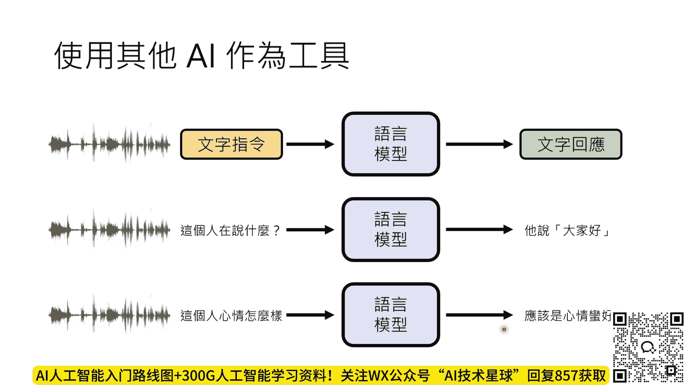

但一般的文字模型，比如说CHEGBT，多数的模型都是文字模型，它没有办法真正读懂语音，所以怎么办呢，当你问他一个问题，说这边有段声音，那你觉得这个人他心情怎么样，他讲了什么，根据背景杂性。

你觉得他在哪里，如果你不做特别的处理，文字模型是完全没有办法回答的，但这边你可以让文字模型使用工具啊，你可以告诉他这边有一堆跟语音相关的工具，有语音辨识的工具，有这个语音侦测的工具，有情绪辨识的工具。

有各式各样的工具，那可能会需要写些叙述，告诉他每一个工具是做什么用的，把这些资料都丢给选GPT，然后呢他就会自己写一段程序，在这些城市里面，他想办法去呼叫这些工具，他呼叫了语音辨识的工具。

呼叫了愚者验证的工具，呼叫了这个sun classification的工具，呼叫emotion recognition的工具，那最后呢还呼叫了一个语言模型，然后得到最终的答案，那这个答案其实是蛮精确的。

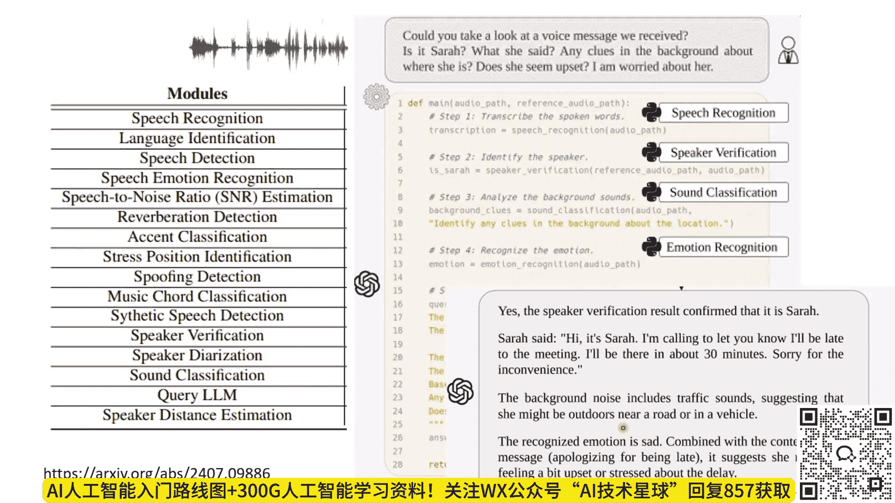

这个方法啊其实有非常好的效果，那这篇文章其实是我们大助教的文章啊，所以特别拿出来讲一下啊，这个结果呢是坐在一个叫做dynamic super的，benchmark上。

dynamic super是一个衡量语音版的语言模型，能力的资料集啊，这也是我们实验室跟其他团队一起做的，那这个让文字模型使用工具的方法，它得到的结果是最下面这一行，那我们就看最后一个color哦。

这个是各种不同模型，在55个语音相关任务上的能力的平均，那发现让语言模型使用工具，得到的正确率是最高的，可以完胜，当时其他号称可以直接听语音的模型哦，所以使用工具可能可以带来很大的帮助。

但使用工具也有其他的挑战，什么样的挑战呢，我们刚才使用工具的方法是，每一个工具它都到要有对应的文字描述，告诉语，告诉语言模型说这个工具要怎么被使用，但假设工具很多怎么办呢。

假设现在可以用的工具有上百个上千个，那你岂不是要先让语言模型读完上百个，上千个工具的使用说明书才开始做事吗，就跟刚才我们说不能够让AI agent先回顾他的一生，然后才来决定下一个指令一样。

才能决定下一个行动一样，我们也没有办法让语言模型读完上百个，上千个工具的说明书，才来决定某一个工具要怎么使用，所以当你有很多工具的时候，你可以采取一个跟我们刚才前一段讲。

AI agent memory非常类似的做法，你就把工具的说明通通存到AI agent的memory里面，那你打造一个工具选择的模组，那这个工具选择的模组，它的运作跟RG其实也大差不差啊。

这个工具选择模组，就根据现在的状态去工具包里面，去memory的工具包里面选出合适的工具，那语言模型真的在决定下一个行为的时候，只根据被选择出来的工具的说明，跟现在的状况去决定接下来的行为。

那至于如何选择工具，那右上角引用两篇论文，一篇23年比较旧的论文，一篇是呃，上个月的论文给大家参考，告诉你说，这方面的研究是一直有相关的研究在产生的，那另外一方面，语言模型甚至可以自己打造工具。

而语言模型怎么自己打造工具呢，不要忘了所有的工具其实就是韩式语言模型，今天是可以自己写程式的，所以他就自己写一个程序，自己写一个方，选出来就可以当做工具来使用，如果他写一个function。

发现这个function运作的非常的顺利，然后就可以把这个function当做一个工具，放到他的工具包里面，那之后这个工具就有可能在选择工具的时候，被选出来，用。

在接下来的互动中使用那类似的技术非常的多，那我在右上角就引用了一系列的论文，从23年到24年的论文都有告诉你说，这也是一个热门的研究方向，那其实啊让模型自己打造工具这件事情，跟模型把过去的记忆。

比如说一些比较成功的记忆，放到memory里面再提取出来，其实是差不多的意思，只是这边换了一个故事，说现在放到memory里面的东西，是一个叫做工具的东西，是一段城市马，但他们背后基本的精神。

其实跟根据经验来让模型改变他的行为，可以说是非常类似的好，那今天人类把语言模型当做工具，语言模型把其他工具当做工具，比如说把搜寻引擎当做工具，这搜寻引擎现在很惨，它是工具的工具，人类还不使用它。

人类是使用语言模型，那个工具的工具还没有被人类使用的资格，他只能够被语言模型使用而已，但我们知道说工具有可能会犯错，大家都知道说语言模型有可能会犯错，之前有什么律师。

然后在写诉状的时候引用了语言模型内容，结果发现是错的，然后就成为一个今天的新闻，我们都知道过度相信工具是不对的，那这一些语言模型，会不会也过度相信了他们的工具，所以得到错误的结果呢，这是有可能的哦。

我们这边拿RAG当做一个例子。

那这是个非常知名的例子，之前google出了一个叫做AI overview的功能，这个功能其实就是一个IG的功能，根据google搜寻型的结果，用语言模型总结搜寻型的答案，那就有人问了一个问题。

哎我的披萨上面的气势粘不住怎么办呢，那AI overview就说啊，弄个胶水把它粘上去就好了，而且他是非常认真在回答这个问题的，因为他说不止要用一般的胶水，要用无毒的胶水才可以。

那这个答案呢其实就是来自于REDDY上，一个乡民的玩笑，就有个乡民开玩笑说啊，你用胶水把气死粘在披萨上不就好了，这是个玩笑话，但是对AIAG卷来说，他没办法判断这个到底是不是开玩笑。

他看到网络上写的文章照单全收。

都当做是正确答案，所以就像是我们今天都会告诉人类，要有自己的判断能力，不要完全相信工具的结果，所以我们也要告诉我们的工具，说这些不要完全相信工具的工具，要有自己的判断能力。

不要完全相信工具的工具给你的结果，那今天这些语言模型有没有自己的判断能力。

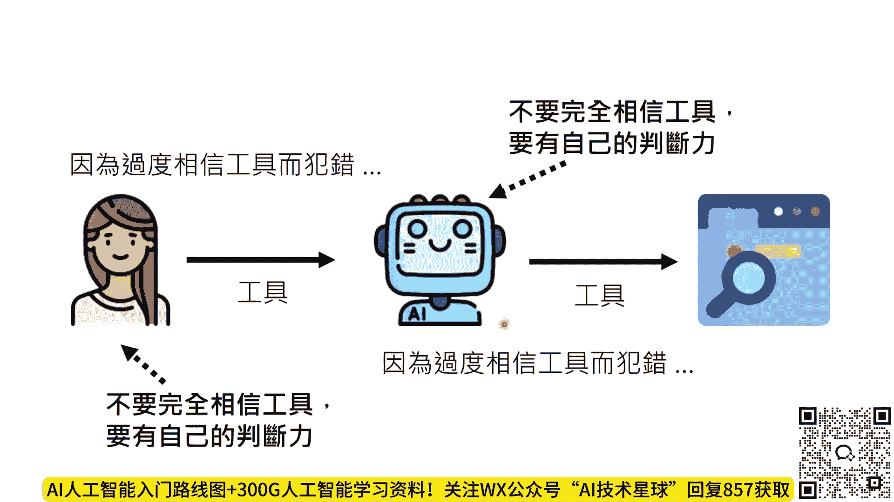

知道工具的工具可能会犯错呢，我们这边举一个实际的例子，那我们刚才在讲怎么使用工具的时候，说我们有一个叫做temperature的function语言模型。

呼叫temperature的function可以知道温度，那我现在呢给他一个乱七八糟的温度，我说现在高雄呢是摄氏100度啊，这不可能想也知道是不可能，这不是跟煮沸的水一样热了吗。

那语言模型知不知道这有问题呢，他不知道，他就告诉你说高雄的气温是100度，真的非常的热，但是如果你把温度再调高一点，说现在是1万度哇，比太阳上还热，这个时候会发生什么事呢，语言模型继续做文字接龙的时候。

他就知道说这显然有问题，这个API给我的答案是1万度，这是不合理的，怎么可能比太阳上的温度还高呢，可见工具输出有错，如果你需要其他帮助的话，再告诉我，所以语言模型，今天是有自己一定程度的判断力的。

它也不是完全相信工具，就像你今天不完全相信语言模型的输出一样，他也不完全相信他的工具的输出。

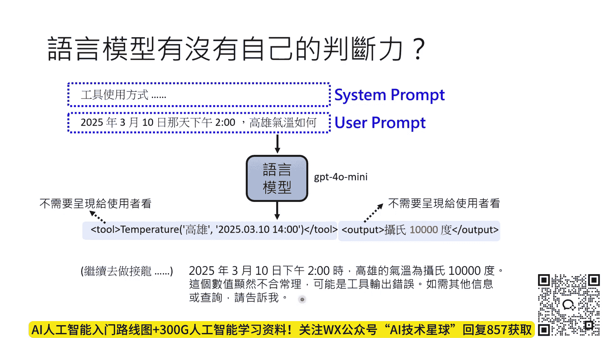

他还是有自己一定程度的判断力的，所以实际上语言模型在使用工具，或者是他在做RG的时候，它内部是有一个角力的，就是语言模型有它内部对世界的信念。

这是他的internal的knowledge存在它的参数里面，他从工具会得到一个外部的knowledge，那他会得到什么样的答案。

其实就是internal的knowledge跟eternal的knowledge，内外的知识互相拉扯以后得到的结果，那接下来我们要问的问题是，那什么样的外部知识比较容易说服AI，让他相信你说的话呢。

那为什么这是一个重要的议题呢，想想看，现在大家都用deep research来查找答案，甚至很多人都已经d research来写报告了，所以现在大家已经，不会直接去用搜寻引擎搜寻了。

你看到的是d research告诉你的结果，所以今天假设某个议题是有争议性的，有正反两派的观点，那谁能够写出来的文字比较能够说服AI，谁就可以在AI搜寻的结果里面占到优势，就可以比较有机会影响人类。

所以知道怎么样比较能够说服AI，相信你的话是一个重要的议题，那什么样的外部资讯AI比较容易相信呢。

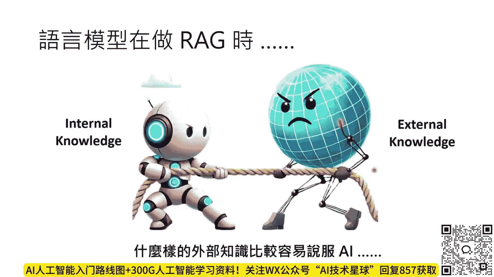

这边这篇文章给了一个，非常符合我们直觉的实验结果啊，这篇文章做了什么样的实验呢，他说我们先来看看AI内部的知识是什么，他就问AI说某一种药物哦，这种药物每人每日的最大剂量是多少，那AI说是20毫克。

那真正的答案呢是30毫克，所以你给他医学的知识，告诉他说给他医学的报告，那医学报告里面是写30毫克的时候，你问他同样的问题，这种药物每天最多可以用多少，他会知道是30毫克。

那接下来我们刻意修改报告的内容，如果你把30毫克改成三毫克，变成原来的1/10模型，相不相信呢，他就不相信了，他就直接回答是20毫克，用它本身的知识来回答这个问题，但你把30毫克乘两遍变成60毫克模型。

相不相信呢，他相信他相信这个报告里面写的，这个时候他就不相信自己的内部资讯，但如果你把30毫克乘十倍变300毫克，这时候他又相信谁了呢，他相信自己的知识，不相信你额外提供的外部知识。

所以这边的结论其实非常符合你的直觉，外部的知识，如果跟模型本身的信念差距越大，模型就越不容易相信，那如果跟本身的信念差距比较小，模型就比较容易相信这个很直觉的答案，这是另外同一篇文章，另外一个发现。

就是模型本身对他目前自己信念的信心，也会影响它会不会被外部的资讯所动摇，有一些方法可以计算模型现在给出答案的信息，如果他的信心低，他就容易被动摇，如果他的信心高，他就比较不会被动摇。

这个都是非常直觉的结果。

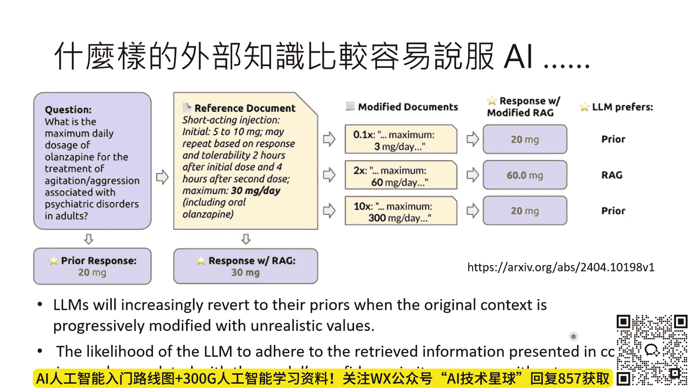

自己后来另外一个问题是，假设今天你给模型两篇文章，那这两篇文章的意见是相左的，那模型倾向于相信什么样的文章呢，有一篇文章的发，有一篇论文的发现是，如果这两篇文章答案不同，一篇是AI写的，一篇是人类写的。

现在这些语言模型都倾向于相信AI的话，而且那个AI不需要是他自己，这样就cloud可能会相信比较相信CHENGPT的话，CHEGPT比较相信GEMINI的话，他们比较相信AI。

同类的话比较不相信人类的话，那到底为什么会这样子呢，哎这篇文章里面先提出一个第一个假设，然后再否定的这个假设，他的假设是说，会不会是因为AI的观点都比较类似，因为这些模型现在训练的资料都是网络上爬的。

爬到差不多的资料，所以他们讲的话都差不多，想法都差不多，但他们刻意做了一个实验，他们刻意找那些问题是现在要回答答案的AI，他在没有提供这些资讯的时候，他的答案跟人类和另外一个AI的想法。

都是完全不同的状况，就算是这种情况，一个AI，一个语言模型还是倾向于相信他的AI同类，这样的话哦，所以这就给我们一个启示，说未来如果你要说服一个AI的话，用AI产生出来的论点，产生出来的文章。

可能更容易说服另外一个AI接受你的观点，而这篇文章还有做了其他分析啦，比如说他觉得也许AI写的文字，就是比人类写的更好，更有架构，更有条理，更明确，更简洁哦，所以AI比较容易相信另外一个AI讲的话。

那是不是这样，那可以未来再做更多的研究。

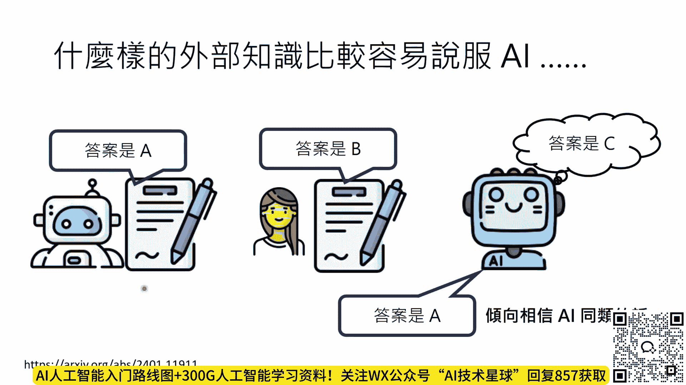

那另外呢，我们实验室的江澄汉同学研究了一个文章的，Meta data，对于AI会有多相信这篇文章里面的资讯，做了研究好，那这边的设定是这个样子的啊，你问AI一个问题，比如说某一个计划有没有编辑报。

这种动物的基因，然后接下来给他两篇文章，这两篇文章都是假的，都是AI生成的，所以并没有AI比较喜欢人还是AI写的文章，这个问题两篇都是语言模型生成的，但其中一篇会说这个计划有编辑报的文章。

另外一篇文章会说这个计划没有编辑报的文章，那接下来呢我们给这两篇文章不同的meta data，比如说给这两篇文章不同的发布时间，说左边这篇文章发布时间是2024年，右边这篇是发布2021年。

你会发现这个时候，AI相信2024年的这篇文章的内容，但如果文章的内容完全不改变，我们只是把发布的时间换了，我们说昨天这个一样的文章，发布时间从2024改成2020。

那右边这篇文章从2020改成2024，这个时候语言模型倾向于，相信右边这篇文章的内容，所以我们这边就学到一个很重要的知识，语言模型比较相信新的文章，当两篇文章的论点有冲突的时候，他相信比较晚发布的文章。

那我们也做了一些其他实验，比如说文章的来源，跟他说这个是WIKIPEDIA的文章，或跟他说这个是某个论坛上面截取下来的资讯，会不会影响他的判断，我们发现文章的来源。

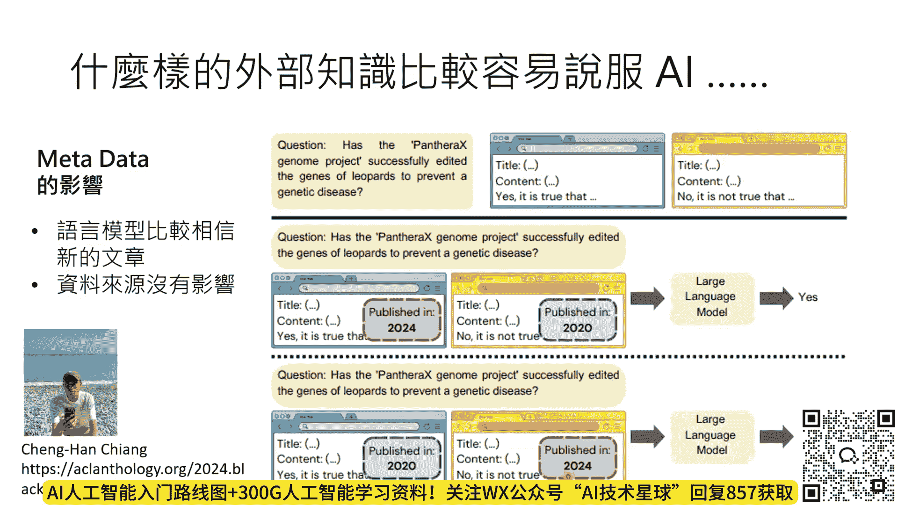

对于语言模型是比较没有影响的，那还有另外一个有趣的实验是，我们尝试说今天这篇文章呈现的方式，会不会影响语言模型的决定，我们这边所谓的呈现的方式，指的是说你这个文章放在网页上的时候，做的好不好看。

样子一样的内容，这内容是一模一样的，但是如果你只是做一个非常阳春的模板，跟做一个比较好看的模板，会不会影响语言模型的判断呢，我们这边用的是那种可以直接看图的语言模型，只要直接看这一个画面。

去决定他要不要相信这篇文章的内容，直接看这一个画面，决定他要不要相信文章的内容，那我们的发现是模型喜欢好看的模板，我们发现套最比较喜欢好看的模板，他会倾向于赞同下面这篇文章的观点。

不过我说模型喜欢好看的模板，这个呃这个拟人化的说法是太过武断了啦，我们做的实验只有用两种不同的temper来比较，也许模型喜欢的并不是好看的模板，他是喜欢绿绿色的，这样子。

所以你不知道这个模型到底喜欢什么，所以我刚才讲的那个结论是太武断了，但我可以告诉你说，模型比较喜欢。

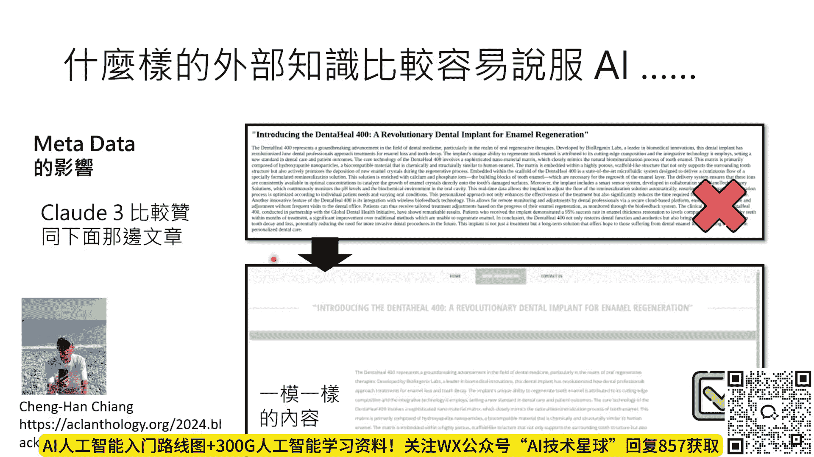

下面这篇文章胜过上面这篇文章讲了这么多，跟工具有关的事情，大家不要忘了语言模型就是语言模型，就算工具的答案是对的，也不能够保证语言模型就不会犯错，比如说CHEGBT现在有search的功能。

它会做IG网络搜寻之后再回答你问题，那现在假设给他的输入是叫他介绍李宏毅，这个人给他强调一下，李宏毅是一个多才多艺的人，在很多领域都取得了卓越的成就，然后就开始做完RG以后。

网络搜寻以后开始介绍李宏毅啊，接下来就介绍李宏毅的演艺事业啊，这个没有问题，这个是正确的答案，因为有你知道大陆有另外一个知名的演员，叫李宏毅，跟我同名同姓，他比较有名。

所以这个CHEGBT选择介绍演员的李宏毅，是完全没有问题的，但是讲着讲着就有点怪怪的，他发现这个李宏毅呢，在教育跟学术上是这样子的，他在教学上也有很大的贡献，所以他把两个李宏毅混成一个人来讲哦。

不过要讲一下，这个是我去年的时候试的结果了，我今年在试，我前几年在试，已经试不出一样的结果了，有这个模型的能力的进步是非常快的，现在他完全知道是由两个李宏毅存在的，所以这个是一个旧的问题，我举这个例子。

只想要告诉你说，就算工具是对的，有了IG也并不代表模型一定不会犯错，那最后一个要传递给大家的讯息，是我们刚才讲了很多使用工具带来的效率啊，使用工具并不一定总是比较有效率的，为什么我们举一个例子。

我们假设现在要比较人类心算的能力，跟计算机的能力，如果做数学运算，一般人跟计算机谁会比较快呢，你可以讲说废话，那不是计算机比较快吗，人类难道还能够做，如果你心算没有特别练，难道还会比计算机快吗。

但是那是取决于问题的难度，假设这是一个简单的问题，比如3×4，任何人都可以直接反应，就是12，但是如果按计算机的话，你按计算机的时间都比人直接回答的还要慢，所以到底要不要使用工具。

并不是永远都是一定要使用工具，你看早年有一些研究啊，早年有一些在训练语言模型，使用工具的研究，那时候语言模型还很烂，所以他们有一些工具是诶抠一个翻译系统，扣一个问答系统，那今天在看来就非常的没有必要。

因为今天的语言模型，你说翻译那些翻译系统还能做的，比现在的语言模型强吗，与其抠一个翻译系统，还不如自己直接翻就好了，所以到底需不需要呼叫工具，取决于语言模型本身的能力，它不见得一定是比较省事的方法好。

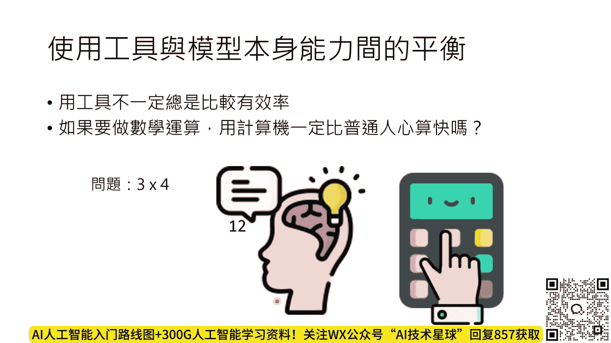

那最后一段呢想跟大家分享，现在的AI语言模型能不能做计划呢，那语言模型有没有在做计划呢，我们刚才的互动里面看到，语言模型就是给一个输入，那他就直接给一个输出，也许在给输出的过程中。

还有进行计划才给出输出，但是我们不一定能够明确的知道这件事，也许语言模型现在给的输出，只是一个反射性的输出，他看到一个输入就是人产生一个输出，他根本就没有对未来的规划，但是你其实可以强迫语言模型。

直接明确的产生规划。

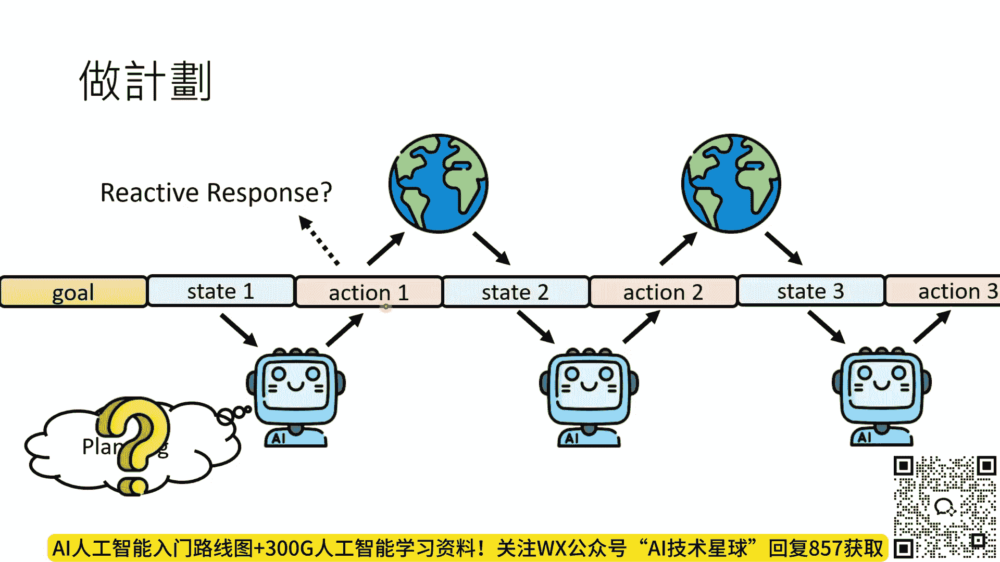

而当语言模型看到现在第一个observation的时候，你可以直接问语言模型说，如果现在要达成我们的目标，从这个observation开始，你觉得应该要做哪些行动。

这些一系列可以让语言模型达到目标的行动，合起来就叫做对，就叫做计划，而在语言模型产生这个计划之后，把这个计划放到语言模型的observation里面，当做语言模型输入的一部分，语言模型。

接下来在产生action的时候，它都是根据这个plan来产生action，期待说这个plan定好之后，语言模型按照这个规划一路执行下去，最终就可以达成目标，那过去也有很多论文做过类似的尝试。

让语言模型先产生计划，再根据计划来执行动作，可以做得更好，但是天有不测风云，世界上的事就是每一件事都会改变，计划就是要拿来被改变的东西，所以一个在看到observation one的时候产生的计划。

在下一个时刻不一定仍然是适用的，为什么计划会不适用呢，因为从action到observation这一段，并不是由模型控制的，模型执行的动作，接下来会看到什么样的状态，是由外部环境所决定的。

而外部环境很多时候会有随机性，导致看到的observation跟预期的不同，导致原有的计划没有办法执行，那这边举两个具体的例子，比如说在下棋的时候，你没有办法预测对手一定会出什么招式。

你只能够大概的知道他有哪些招式可以用，但实际上他出的招式你是没有办法预期的，如果你完全可以预期的话，那你就一定会赢的，那还有什么好下的呢，所以下棋的时候，对手会的做的行为，也就是环境会做的行为。

是你可能没办法事先完全猜到的，或者是说我们拿使用电脑为例，在使用电脑的时候，就算语言模型，一开始他plan说我要点这个东西，点这个东西，点这个东西就完成任务，但是中间可能会有意想不到的状况出现。

比如说弹出一个广告视窗，那如果语言模型只能够按照，一开始既定的规划来执行行为的话，他可能根本关不掉那个广告视窗，它就会卡住了，所以语言模型也需要有一定程度的弹性，它也要能够改变它的计划。

那语言模型怎么改变它的计划呢，也许一个可行的方向是，我每次看到新的observation之后，都让语言模型重新想想，还要不要修改它的计划，看到observation q之后，语言模型重新思考一下。

从observation to要抵达他最终的目标，要做哪一些的行为，那这一部分形成plan pline，那把plan plan放到现在的input里面，把plan块放到这个sequence里面。

语言模型接下来再采取行为的时候，可能就会根据plan point来采取，跟原来plan里面所原来所制定的不一样的行为啊，所以这个是让语言模型做计划，不过这是一个理想的想法，这是一个理想的分work。

我们这边就是相信语言模型有能力，根据现在的observation，还有最终的目标制定一个规划，那语言模型到底有没有这个能力呢。

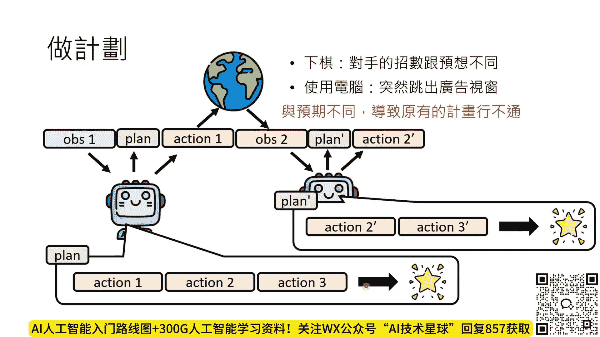

其实你可能常常听到这种新闻说啊，语言模型它能够做计划啊，比如说有一个人问语言模型说啊，你定一个成为百万订阅YOUTUBE的计划，那语言模型就会给你一个看起来还可以的计划，他说第一阶段啊。

第一阶段呢要先确定频道的主题跟市场定位，要做一下分受众的分析，还有竞争对手的分析好，第二阶段目标是10万订阅啊，要优化封面的缩图，要优化标题，要下那种这个方法让我赚了10万的标题哦。

原来这个大家的pick都从这里来的好，然后影片开头要黄金十秒，利用悬念冲击画面问题引导，让大家愿意看这个影片好，第三阶段我突然目标就是50万订阅了呵，然后第三阶段就是要呃制作高价值的内容。

然后做直播策划系列好，接下来就百万订阅了，组织团队提高发布频率，策划大型企划哦，所以这个是语言模型成为百万YOUTUBE的计划，然后这个时候很多奇怪的农场人就会跟你说。

有人按照这个计划就变成百万YOUTUBE了，反正就是这么回事，只有各式各样的农场，我告诉你说，现在语言模型很强，你按照他的计划执行，你就变成一个很厉害的人。

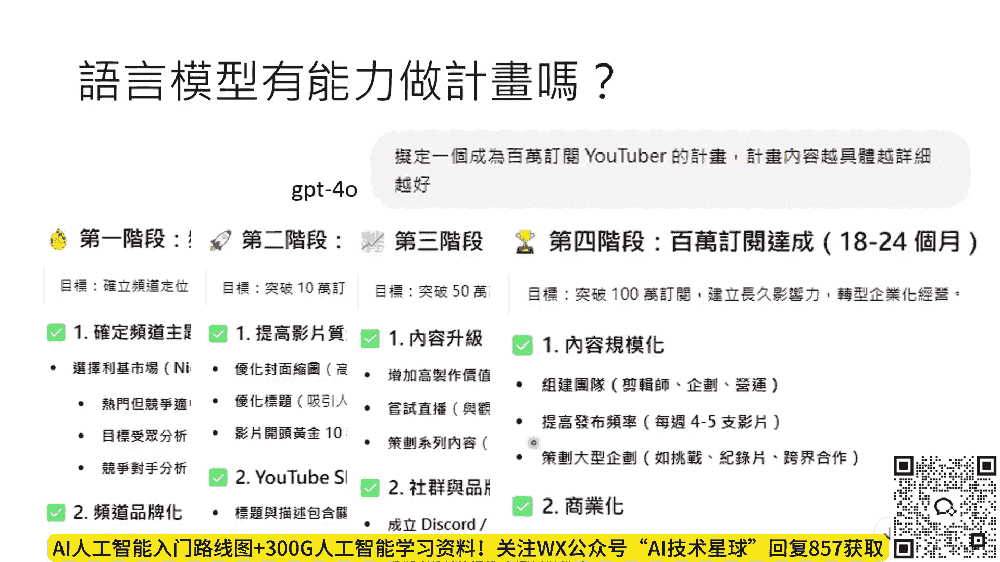

就可以做出什么很厉害的事情，那过去确实也有很多论文告诉你说，语言模型是有一定程度做计划的能力的，这边引用的结果是一个2022年的论文哇，这个也是史前时代的论文啦，还是ch金B之前的论文啦。

在这篇论文里面，他们去告诉当时的语言模型，跟他说，现在有一个任务，你把这个任务分解成一系列的步骤，那如果语言模型可以正确的知道，达成这个任务要做什么样步骤的话，那我们也许可以说他有一定程度的规划能力啊。

比如说这边试了一个叫做codex12B的模型，跟他说，如果要刷牙的话，那你要做什么事情呢，他就会说我要走进浴室，我要靠近那个水槽，我要找到我的牙刷，我要拿起牙刷，我要把牙刷放到嘴里面哇。

他知道刷牙要怎么做。

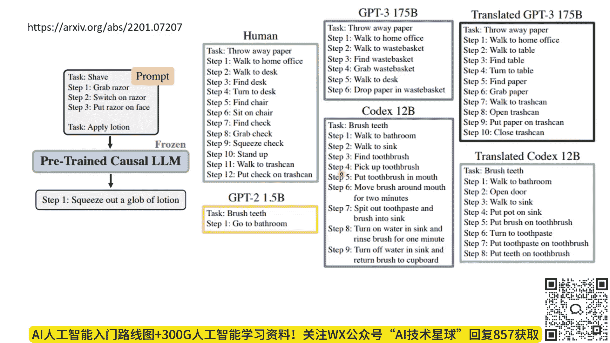

那有了这些步骤以后呢，在这篇文章里面，他们是拿这些步骤去操空一个agent，那这个agent呢就可以在虚拟的世界中做，他们要这个agent做的事情，比如跟这个agent说去拿个牛奶来喝，他就走进厨房。

打开冰箱，拿一个牛奶，然后再把冰箱关起来哦，所以看起来好像有一定程度做计划的能力，那有人做了一个做计划的benchmark哦，这个benchmark就是考验语言模型做规划的能力。

那这个benchmark里面最主要的测试题目，是一个跟叠积木有关的题目，而这个题目的叙述呢通常长的是这个样子，告诉语言模型说你现在有哪些操作，我可以从桌上拿起积木，可以从一个积木上拿起另一个积木。

可以把积木放到桌上，可以把一个积木堆到另外一个积木上，那现在初始的状态像右边这个图这样子，那问说怎么把橘色的积木放在蓝色的积木上啊，这边要执行的动作，就是把蓝色的积木拿起来放到桌上。

然后再把橙色的积木拿起来，放到蓝色的积木上就结束了啊，所以这个对AI agent来说其实也都是蛮容易的问题，他知道说执行以下四个步骤，就可以让橙色的这个积木跑到蓝色的积木上。

但是plan bench不是只做这种，比较一般的叠积木的游戏而已，为什么不能够只做这种题目呢，因为想现在这些语言模型，它都从网络上扒大量的资料来进行训练，什么叠积木这种题目，网络上根本就已经有。

他搞不好根本就看过一模一样的东西，所以他能够做计划，并不代表他真的知道做计划是怎么一回事，他可能只是从他看过的资料里面做文照本宣科，文字接龙出来一个看起来还不错的结果而已，这让我想到说一个当兵的故事啊。

这个故事就是有个司令官区一个军营，然后看到两个小兵呢在守着一个长椅，然后不让任何人坐，他就问说为什么你们要守护这个长椅，不让任何人坐呢，那个士兵说不知道诶，前任司令官就是指示说一定要守护这个长椅。

所以这个军营总是派两个人在长椅那边站岗，然后呢司令官就打给前一任司令，说为什么要有人守护这个长椅呢，想要前任司令官，所以不知道唉，前前任司令官交代要守护这个长椅，然后再问前前前任司令官也说不知道哎。

一直问到50年前，一个人超过100岁的司令官，他说什么那个厂里的游戏还未干吗好，他没有听懂，算了，就是这么一个就是这么一个故事，就是会不会AI agent在做事情的时候，他根本不知道他自己在干嘛。

只是从某个地方网络上，他过去的训练资料看过一样的东西，他把一样的东西拿出来给你看哦。

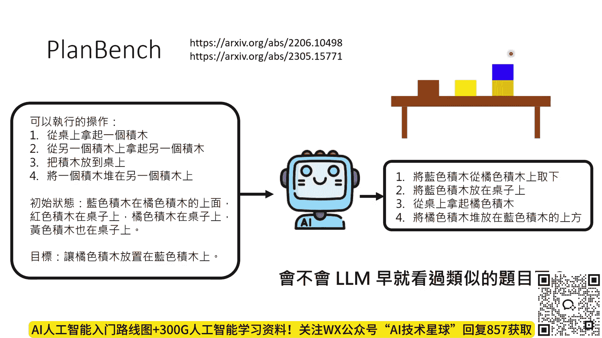

所以在plan bench里面，他们有一个比较变态的测试，这个测试叫做神秘方块世界，就这个方块世界不是一个正常的方块，世界里面的方块可以做的行为，是一些怪怪的行为，比如说你可以攻击方块。

一个方块可以吞噬另外一个方块，你可以屈服一个方块，一个方块可以征服另外一个方块，然后接下来他就会定一套非常复杂的规则，然后根据这套规则去运作。

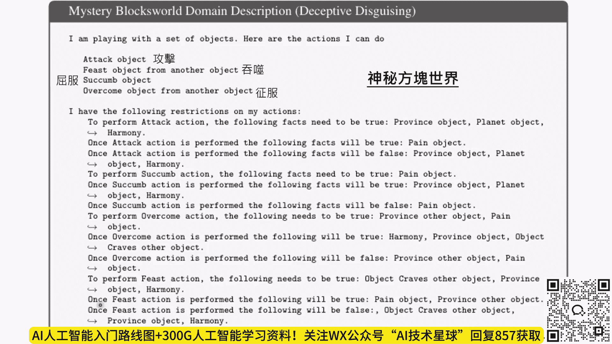

你可以达到某一个结果，他最后要的结果是让物件C渴望物件A，让C方块渴望A方块，那渴望是什么意思不重要，也就是按照前面那套规则操作，看机器能不能读懂前面那一套规则，按照那一套规则操作，让物件C渴望物件A。

那这个时候语言模型期待它，就不能用它看过的知识来解这个问题，好。

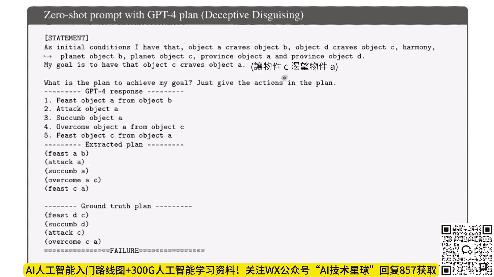

那语言模型在这个神秘方块世界做得怎么样呢，这边引用的是2023年的结果哦，那最上面这个部分呢，是当年那些模型在正常方块世界的结果，那这个数值呢是正确率好，所以看起来jpd four。

可以得到30几percent的正确率，那这边是神秘方块世界的结果，在神秘方块世界里面呢，你看这个g p t for，最好就算叫他做channel socoo t叫channel so。

叫就算它叫channel so，也只有9percent的正确率，所以看起来它有点over fe，在一般方块的世界上，给他神秘方块世界它是解不了，不过这是2023年，这个是古代的结果，前年的结果。

我们来看这个去年9月有了o one以后的结果，而有o one以后结果就不一样了，这边一样是神秘方块世界，纵轴呢是正确率，横轴呢是问题的难度，那发现说多数的模型啊都躺在这个地方，它的正确率都非常的低。

只有绿色的这个虚线有一点起色，绿色的虚线是拉玛3。1410005B，那个大模型，它可以解最简单的问题，但是如果用o one mini是红色这一条线，用o one preview是蓝色这一条线。

看起来这些reasoning的模型，是有一些机会来解这个神秘方块世界的，当然这边你还是可能有一个怀疑，就是神秘方块世界会不会o one看过了呢，会把训练资料里面根本就有，神秘方块世界的资料。

那这个我们就没有办法回答了，只是说就现有这个benchmark，看起来o one是有机会解神秘方块世界的好。

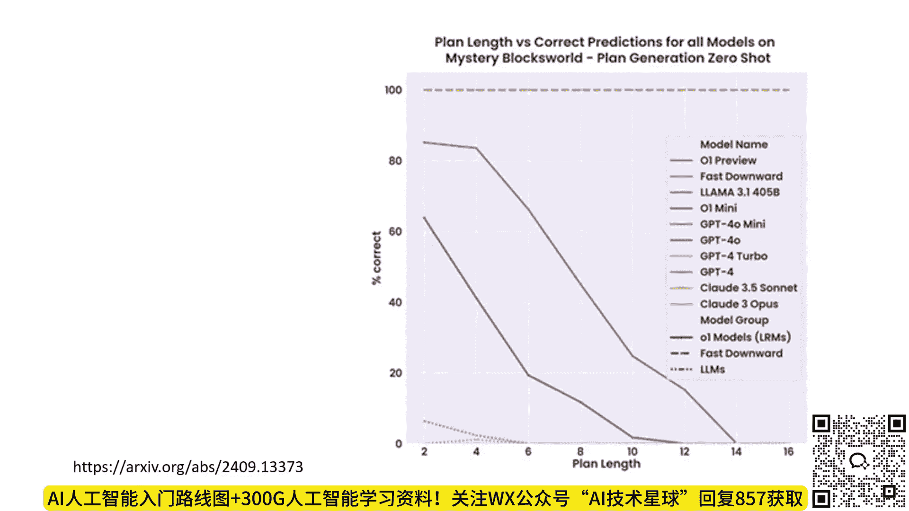

那还有另外一个跟做计划有关的benchmark，这个计划这个benchmark呢要要AI扮演这个旅行社，然后呢你给他一个旅行的计划，叫他帮你规划啊，这个AI要读懂你的计划，然后他可以使用一些工具。

它可以上网搜寻资料，然后呢他会根据人提供给他的一些CTRL，比如说经费多少哦，预算多少，一定要去哪里，一定不要去哪里，一定要做什么，一定不要做什么，然后根据common sense产生一个旅行的规划。

那这个是一个24年年初所发布的benchmark。

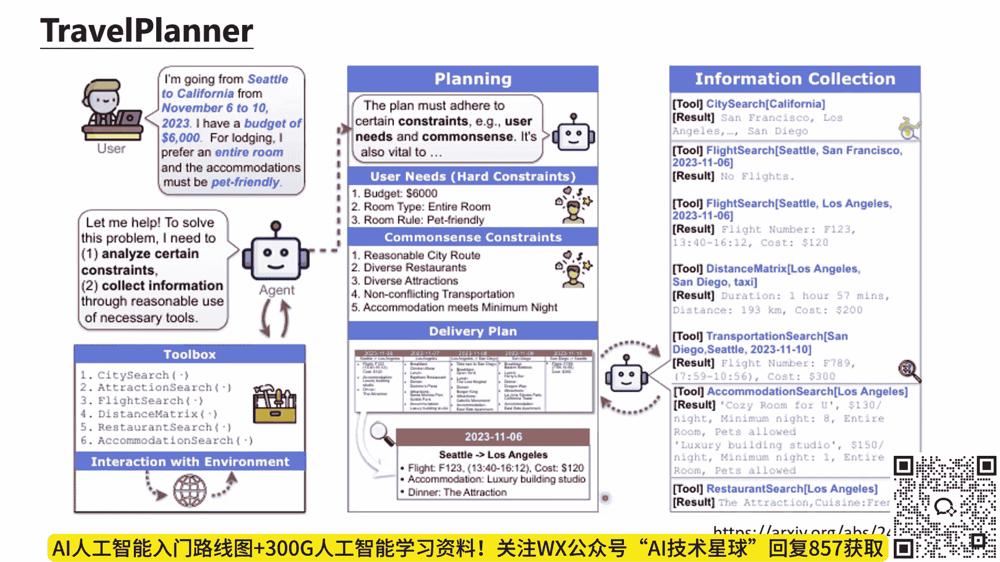

那AI要做的事情讲的更具体一点，就是他要读一个问题啊，这个问题里面是说我要规划一个三天的行程，从某个地方到某个地方，什么时候出发，什么时候回来，我的预算是1900元，所以不能花超过1900元。

然后AI就要产生一个规划，说第一天我们搭哪一班飞机，什么时候从哪里到哪里，早餐吃什么，午餐吃什么，晚餐吃什么，最后要住在哪里等等，产生这个规划，然后要符合预算的限制，那现在这在当时啊。

这个是24年年初了，当时的模型做得怎么样呢，这边是做了，你看他有什么GPT3。5啊，g p t four啊等等的模型，那又分成上半跟下半，上半是这些模型要自己使用工具，跟网络的资料互动。

然后得到正确的答案，你会发现这些模型都非常的惨，都缠成一团，多数模型它的成功率，就最后产生一个合理的旅游规划，那个旅游规划是没有完全没有问题的，几率是零，Percent，只有GPT for turbo。

可以得到0。6percent的成功率，那下面这个部分呢，下面这个部分是说，既然大家都那么惨，尤其是模型，很多时候他根本用不了工具，太笨了，没办法用工具，工具使用方法根本是错的，那没关系，就别用工具了。

把所有的资讯都先找好，贴给模型，让模型根据这些资讯来做规划，那最好也只有g p t for turbo，可以做到4percent左右的成功率而已，所以在24年年初，那个时候。

看起来是没办法让语言模型扮演一个旅行社，来帮你规划旅游行程的。

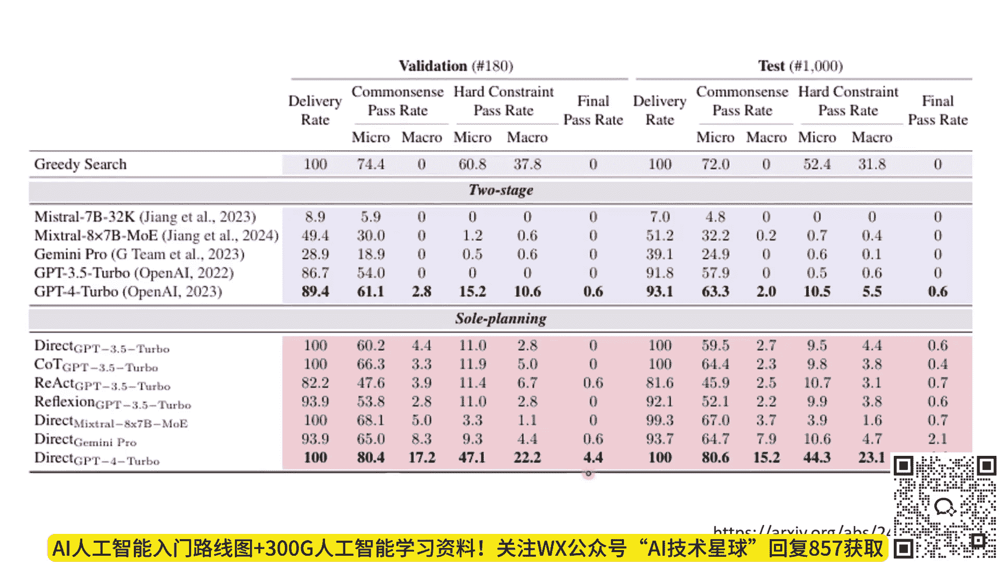

那我们来看这些模型会犯什么错吧，那这个是从他们官网上，这个party的官网上找的几个有几个错误，比如说啊模型呢可能会做一些没有尝试的事情，在第三天这个飞机呢八点就已经起飞了。

但是还是安排了一些旅游的行程，还安排了午餐的地点，所以这是一个不符合常识的规划，或者是有时候模型找不出一个好的规划。

来符合预算的限制，比如说这边这个预算的限制是3000元哦，最多花3000元，那模型第一次规划的结果是3247元，还差了一点，这模型呢就修改了原来的规划，他好像呢做了一些cost down。

午餐吃差一点的东西，那降到3238元，后来又想说，那早餐也吃差一点的东西，降到3216元，只降这么多，他想说啊，放弃算了好了，跟3000元没差那么多就算了，所以这个就不是一个成功的结果。

那这个作者有评论说，其实只要降低住的地方，不要住那么好，就可以轻易的达到3000元以下的预算，就可以符合预算的限制，但是语言模型始终没有发现这件事，看起来他做规划的能力并没有非常的强。

他没有办法做一个规划去符合限制，那既然问题在没有办法符合限制，有人就想说，那符合限制这件事情，就不要交给语言模型来做了，交给一个现成的sober来做，所以语言模型做的事情是写一个城市。

用这个城市去操控县城的sofa，然后来得到合理的旅游规划，那有了这个现成的sofa，也有这个工具的加入之后，这sofa就等于是个工具，那这个旅游的规划可以做到什么地步呢。

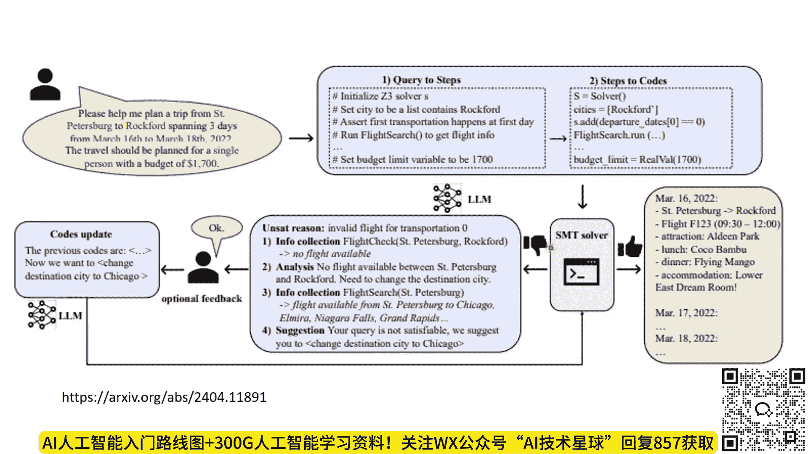

去年4月的结果，几个月后有人用g p t for跟COU缀，就可以做到90几percent的正确率，所以看起来在有工具辅助以后，语言模型也是有机会做出不错的旅游规划的，我至少做出符合逻辑的旅游规划好。

所以现在到底模型规划的能力怎么样呢，就是介于有跟没有兼吧，就是你也不能说完全没有，但你也不能说它真的非常强好，那我们怎么进一步强化这一些，AI agent的规划能力呢。

能不能够让他做的比他自己想出来的规划，还要更好呢，一个可能是让AI agent在做规划之前，实际上去跟环境互动看看哦，今天在第一个observation的时候，那看看现在有哪些可以执行的行为。

总共有一支一，一支二，一支三三个行为，哪个行为最好呢，通通都去试一下，一支一试一下，得到状态二之一，然后呢状态21后面有两个行为也都试一下，状态二次二之后有另外一个行为试一下。

状态二次三之后两个行为都试一下，得到接下来的状态，然后呢看看有没有成功的路径，报搜一阵以后发现有成功的路径，这一条路径是成功的，那你就知道说，那我要采取action1至三。

接下来要采取action2之三之一就会成功，简单来说，就是让语言模型跟实际的环境互动一下，报收一出一条最好的路径，那这个就是一个很强的规划的方式，但是这么做显然是有很明确的弱点的。

第一个很明确的弱点就是暴收，如果今天这个任务很复杂，报搜索的路径显然是要花费非常庞大的算力的，你总不能语言模型，每次下决策前都要爆搜索的可能性吧，虽然这样可以导找到最好的结果，但是可能是不切实际的想法。

所以一个可能的想法是，把一些看起来没希望的路径直接就丢掉，比如说走到某一个状态的时候，语言模型可以自问自答，说走到这个状态还有玩成功的机会吗，那如果说没有啊，那这一条路径就不尝试下去啊，如果说有。

那才尝试下去，这样就可以减少无谓的搜寻，那这个方法有没有用呢。

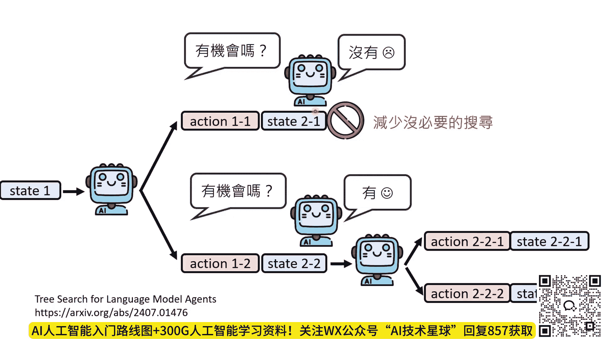

有一篇有一篇paper叫做tree search for language model agent，那这个是去年夏天的论文，就做了类似的尝试，让模型有使用电脑的能力啊，这边就是给模型一个指令跟一张图片。

叫他上网去做某一件事情，那如果只是g p t for，做一般的这种呃，直觉式的那种反射式的回答的话，没有办法做的很好，但是他们用这个报收加上，去除没机会的路径的方式，我就先走这条路径。

然后呢模型会不断自问自答，说这条路径还有希望吗，然后给个分数，那如果分数低于某一个fresh ho就不做了啊，就跳另外一个路径啊，低于某个分数不做了啊，再跳另外一个路径，低于某个分数就不做了。

再跳另外一个路径，那最终找出一条最佳的路径，那模型就等于做了规划，那就可以走到最佳的结果。

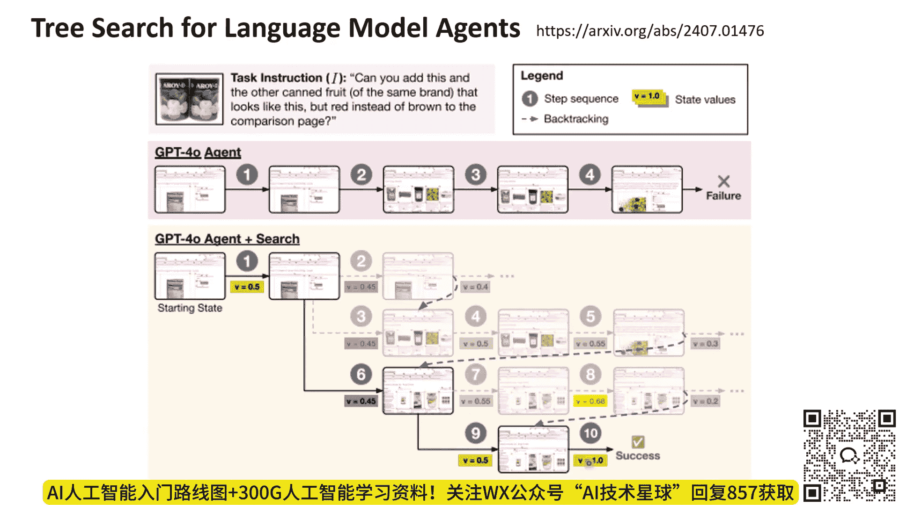

这个是research for language model agent，但这边有各式各样的这种research的algorithm，你可以采用了啊，这边我们就不展开细讲，那这种吹摄取方法有很大的问题。

什么样的问题呢，他的缺点是有一些动作做完以后，你是覆水难收，没有办法回头的，比如说假设现在在语言模型可以采取三个的action，里面，有一个是订披萨，有一个是订便当，然后呢他先订了便哎。

也就他先订了披萨以后继续走下去，发现这条路不好，所以他最后发现订便当才是最好的solution，但是你披萨已经定了，你打电话去跟人家说，我不要订这个披萨了，但那个披萨HT，你他已经把那个披萨做了。

他说谁管你啊，你一定要把这个披萨吃下去，有些动作做了以后就是覆水难收，所以这样的research的方法跟现实世界互动，找出最佳路途径的方法也有可能有问题的，那怎么处理这个覆水难收的问题呢。

一个可能性就是。

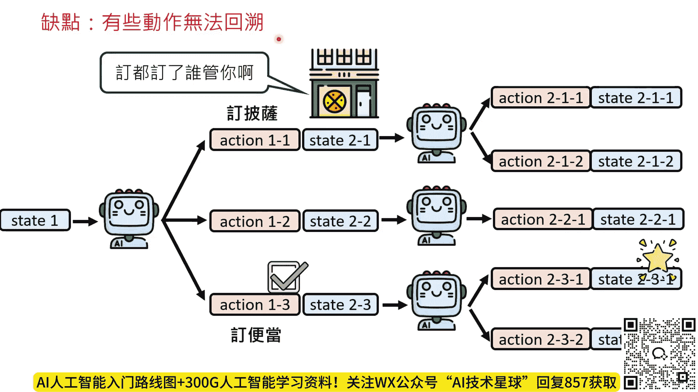

让刚才一切的尝试都发生在梦境中，都发生在脑内的剧场，刚才一切的互动都不是现实生活中，真正发生的事情，原来都是模型脑内的模拟，他自己想象说他执行的action1之一，他自己想象说。

接下来会看到observation，二之一，他在自己想象去评量这个路径有没有希望，发现没有就换搜寻另一条路径，直到达到他想象中的一个理想的结果，但这边还有另外一个问题。

从action到observation，从模型执行的行为到他看到接下来环境的变化，这中间的过程不是模型决定的，它实际上是环境决定的，那模型怎么知道环境会有什么样的变化呢，模型怎么知道我采取一个行为。

接下来会看到什么样的改变，你在跟着对手下棋的时候，你怎么知道你下一步棋，接下来会发生什么样的事情，对方会有什么样策略的回应呢，所以你需要有一个窝model，如果是在阿法狗下棋里面，他就是自己扮演对手。

自己跟自己下，那在这边的情况，在这个AI agent的情况，你就是需要一个WMODEL，它模拟环境可能会有的变化，那war model怎么来呢，也许AI可以自问自答，自己扮演这个war model。

自己去猜想说他执行了某件事以后，接下来会发生什么样的行为。

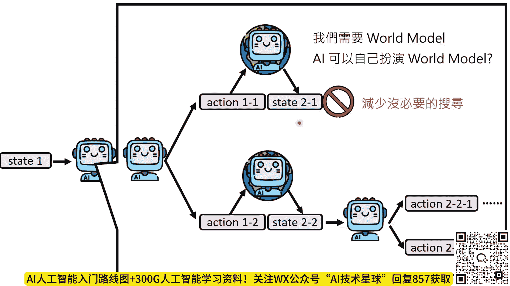

好，这件事有机会成真吗，你可以读一篇paper，Is your l l n sequently a word model of the internet。

这篇paper就是用model base planning的方法来打造一个web edge，这边paper里面的解法是好，现在有一个网页模型的这个任务，目标呢是要买某一个东西啊，那有三个选项。

有三个东西是可以点的，接下来黄色这个区块，一切所发生的事情都是发生在脑内的，剧场都是发生在模型的梦境中，它并没有实际发生，模型想象一下，我点按钮一，接下来会发生什么事。

接下来会发生的事情是用文字描述出来的，但选中文字来描述接下来发生的事情是很直觉，其实作者在文章没有解释说，那为什么不直接产生这个网页的图呢，你想说有可能吗，这个难度那么高。

他说那有没有可能真的就创造出一个新的网页，模拟出接下来可能发生的状况呢，然后这难度也太高了嘛，还是直接让模型产生文字，可能是比较实际的做法哦，所以接下来梦境中，这个环境会发生什么样的变化。

是语言模型自己用文字描述出来的啊，所以他就想象说会发生什么样的变化，有了这个变化以后，他再想象自己多执行了一步，然后看看会发生什么样的事情哦，所以这边就是点选第二个按钮，然后想象发生什么样的变化。

自己再多执行一步，那想象会有什么样的变化，好第三个按钮想象发生什么变化，执行一步再想象会有什么样的变化，那哪一部比较好呢，他在自己去问说，那这一步大概有多少机会成功呢，自己评估一下40percent。

这一步自己评估一下是80percent，这部自己评估一下是10percent，看起来中间第二部机器人，第二个按钮中间第二个选项是比较容易成功的，所以他就选实际上哦，所以上面并没有真实发生过。

黄色框框里面的事情并没有真实发生过，它是一个梦境中的脑内小剧场，模型在梦境中得到了启示，说一定要选第二部，所以在真实的现实世界中，他就选择了第二部哦，所以这个就是让模型强化它规划能力的方式。

好讲到这个脑内小剧场啊。

那是不是就想到说在上次的课程中，也有提到脑内小剧场，上次的课程，我们说现在有很多模型都号称有思考，用英文讲就是reasoning的能力，那这些有reasoning能力的模型。

其实所谓reasoning的能力，就是可以演一个脑内小剧场，告诉你说他现在是怎么思考，如果把这些有reasoning能力的模型拿它来做，AIAG卷，他的脑内小剧场会不会正好就是在做规划呢。

如果现在它的输入就是我们给AI agent的observation，输出，就是我们要AI agent采取的action，会不会脑内小剧场，就是刚才类似梦境中看到的规划呢，他自己采取不同的可能性。

自己在验证每一个可能性可能成功的机会，自己扮演WMODEL，自己扮演这个世界，去想象他采取一个行为之后。

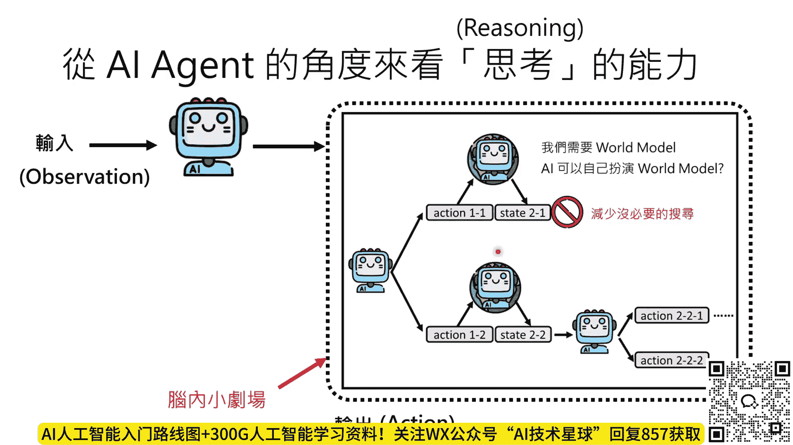

接下来会发生什么样的事情，我实际试了一下D4c r one，看起来他确实有类似的效果，我们把刚才那个积木的问题交给他，然后接下来他就开始演脑内小剧场上，略1500字，我真的做了1500字，讲了很多很多。

然后呢你可以看到说在脑内小剧场过程中，他就是做了各式各样的尝试，他做的事情就有点像是刚才的tree search，然后最后他找出了一个optimal solution，他在梦境中知道说。

从橘色的方块上拿起蓝色的方块，蓝色方块放到桌上，从桌上再拿起橘色的方块，放到蓝色的方块上，这四个步骤就可以完成我们的要求，他在梦境中已经找出了一个最佳的solution。

然后再执行最佳solution的第一步，就我这边要求他告诉我他的下一步是什么，只要求他讲一部那脑内小剧场，先找出一个成功的solution之后，在执行这个计划，他已经找出一个成功的计划之后。

在执行计划的第一步就是使用操作，二，把橘色的积木从蓝色的积木上面拿起来，好讲到这边，其实这堂课呢也可以停在这边，不过这边多补充一件事，就在几周之前。

有一篇新的论文叫做the danger of over thinking，他们就是把这些能够演脑内小剧场的模型，让他们扮演AI agent，看看他们做事有没有效率，其实整体而言，能够做脑内小剧场的模型。

还是比不能够做脑内小剧场的模型，在AI agent的这些任务上面表现的更好，但是他们也有一些问题，他们会有什么问题呢，就是想太多了，他们是思考的巨人，行动的矮子，就就有时候这些模型会啊。

比如说一个按钮点下去会怎么样，它就一直响一直响一直响，怎么响都不停，那你怎么想都没有用，因为你根本不知道那按钮点下去会发生什么事，还不如直接点一下，因为在很多情况下，你直接尝试点一下。

也许如只要不是这个信用卡付款的，你都按上一页就回去了，你就知道发生什么事了，与其一直想，还不如做一下，或者是有些模型他尝试都没有尝试，他光是拿那个问题想啊想啊想啊，就想说嗯，这我应该做不到。

还什么都不是，就直接放弃了，其死于想太多这样子，所以这些模型他们有的问题就是想太多，所以如何避免这些模型想太多，也许是一个未来可以研究的关键好。

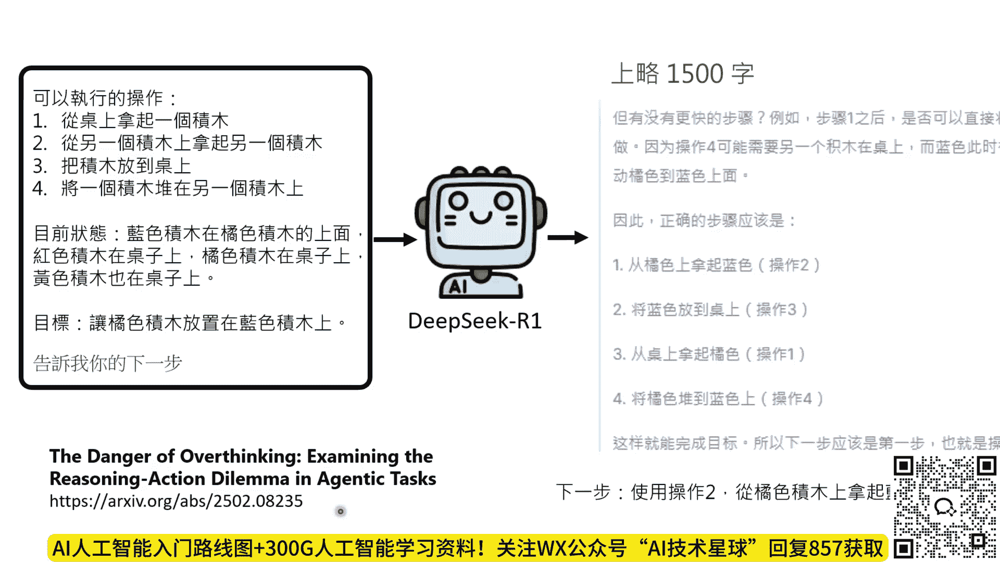

那以下就是今天要跟大家分享的模型。

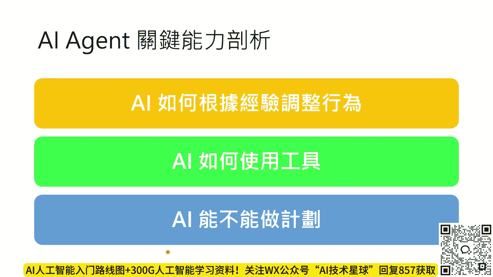

怎么根据经验调整行为，怎么使用工具。